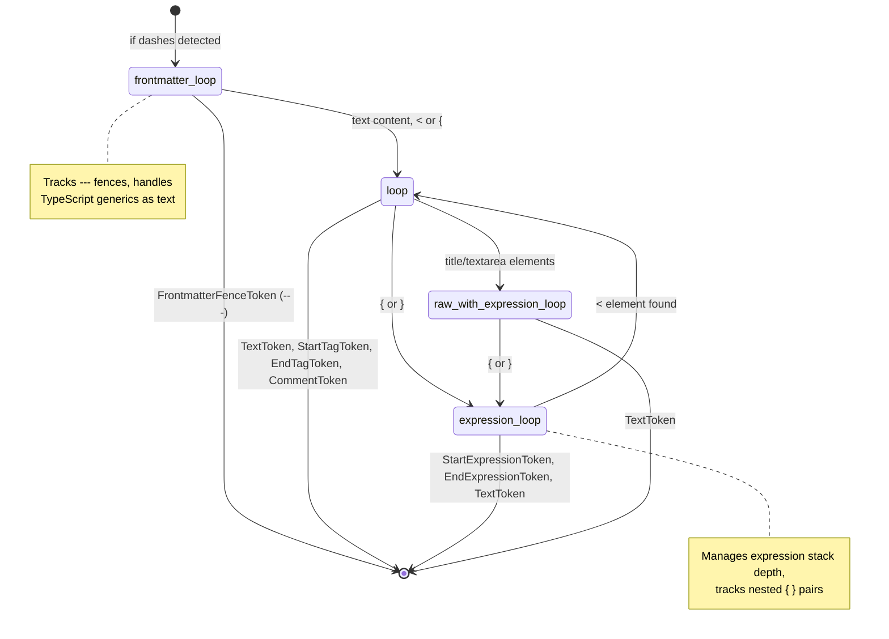
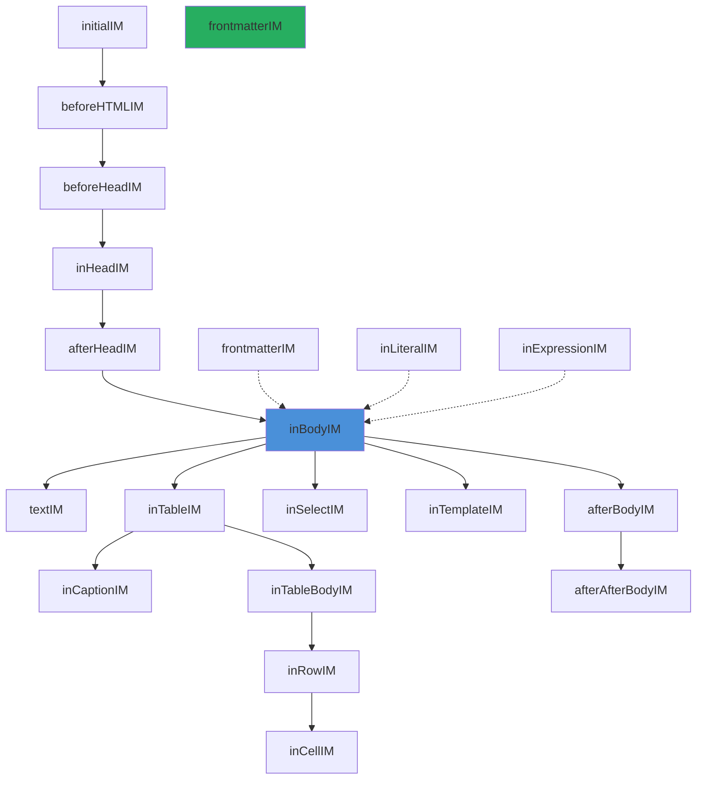

# Go Parser: Tokenization and Parsing

The Go compiler parses .astro files using a custom tokenizer that extends Go's `golang.org/x/net/html` package with Astro-specific token types (frontmatter fences, expression delimiters), feeding into an HTML5-compliant parser augmented with 12 Astro-aware insertion modes. The tokenizer runs in multiple states (frontmatter loop, expression loop, raw text loop) via goto-based state machine transitions.

## Token Types and Attribute Types

The tokenizer (`internal/token.go:24-48`) defines 10 token types:

```go
// internal/token.go:24-48
const (
    ErrorToken TokenType = iota       // Parsing error or EOF
    TextToken                         // Plain text content
    StartTagToken                     // <div>, <Component>
    EndTagToken                       // </div>
    SelfClosingTagToken               // <br/>, <input/>
    CommentToken                      // <!-- ... -->
    DoctypeToken                      // <!DOCTYPE html>
    FrontmatterFenceToken             // --- (opening or closing)
    StartExpressionToken              // { (beginning of expression)
    EndExpressionToken                // } (end of expression)
)
```

Attribute types (`internal/token.go:80-87`) cover six variations:

```go
// internal/token.go:80-87
const (
    QuotedAttribute        // class="my-class"
    EmptyAttribute         // disabled
    ExpressionAttribute    // onClick={() => {}}
    SpreadAttribute        // {...props}
    ShorthandAttribute     // {className}
    TemplateLiteralAttribute // title=`Hello ${name}`
)
```

Frontmatter state tracking (`internal/token.go:53-57`) uses three states:

```go
// internal/token.go:53-57
const (
    FrontmatterInitial FrontmatterState = iota  // Not yet seen ---
    FrontmatterOpen                               // Between opening and closing ---
    FrontmatterClosed                             // After closing ---
)
```

## Tokenizer State Machine

The tokenizer is a goto-based state machine (`internal/token.go:1676-2098`). The `Next()` method can transition between four labeled states:



The tokenizer tracks state in `Tokenizer` struct (`internal/token.go:239-300`):

| Field | Purpose |
|-------|---------|
| `fm FrontmatterState` | Current frontmatter parsing state |
| `rawTag string` | "script", "style", etc. — next token is raw text |
| `noExpressionTag string` | "math", "iframe", etc. — `{` is literal text |
| `expressionStack []int` | Nested expression depth counter |
| `expressionElementStack [][]string` | Elements open within each expression |
| `openBraceIsExpressionStart bool` | Whether `{` starts a new expression |
| `attrExpressionStack int` | Attribute expression nesting depth |
| `attrTemplateLiteralStack []int` | Template literal nesting in attrs |

Source: `internal/token.go:239-300`

## The Next() Method

The main `Next()` method (`internal/token.go:1676-2098`) is the heart of the tokenizer. It dispatches based on current state:

```go
// internal/token.go:1676-1710 (simplified dispatch)
func (z *Tokenizer) Next() TokenType {
    z.prevToken = z.Token()
    z.raw.Start = z.raw.End
    z.data.Start = z.raw.End
    
    // If in raw text mode (script, style, etc.)
    if z.rawTag != "" {
        if z.rawTag == "plaintext" { /* read to EOF */ }
        if z.rawTag == "title" || z.rawTag == "textarea" {
            goto raw_with_expression_loop  // Still parse expressions
        } else {
            z.readRawOrRCDATA()  // Read until </tag>
        }
    }
    
    // Frontmatter not yet closed?
    if z.fm != FrontmatterClosed {
        goto frontmatter_loop
    }
    // At expression boundary?
    if z.isAtExpressionBoundary() {
        goto expression_loop
    }
    
    // Normal HTML/JSX parsing loop
loop:
    for {
        c := z.readByte()
        if c == '{' || c == '}' { goto expression_loop }
        if c == '<' { /* check for tag */ }
        // ... emit TextToken or tag token
    }
}
```

## Expression Handling

Expression tracking is the most complex part of the tokenizer. The `expressionStack` and `expressionElementStack` work together:

```go
// internal/token.go:1643-1673 (trackExpressionElementStack)
func (z *Tokenizer) trackExpressionElementStack() {
    if len(z.expressionStack) == 0 { return }
    i := len(z.expressionElementStack) - 1
    if z.tt == StartTagToken {
        // Push element onto expression's element stack
        z.expressionElementStack[i] = append(z.expressionElementStack[i], tagName)
    } else if z.tt == EndTagToken {
        // Pop matching element
        for j := len(stack)-1; j >= 0; j-- {
            if stack[j] == tagName {
                if len(stack) == 1 {
                    // Stack emptied — reset expression mode
                    z.expressionElementStack[i] = nil
                    z.openBraceIsExpressionStart = false
                } else {
                    z.expressionElementStack[i] = stack[:len(stack)-1]
                }
            }
        }
    }
}
```

The key insight: when inside an expression `{...}`, the tokenizer tracks which HTML elements are open. A `{` only starts a **new** expression when the element stack is empty (no unclosed elements). This distinguishes JSX element `{` from object literal `{`.

## Parser: HTML5 Insertion Modes

The parser (`internal/parser.go`) implements the HTML5 tree construction algorithm with Astro extensions. It uses insertion modes — functions that decide what to do with each token:

```go
// internal/parser.go:538
type insertionMode func(*parser) bool
```

Available insertion modes:

| Mode | Source Line | Purpose |
|------|------------|---------|
| `initialIM` | 625 | Handle doctype, frontmatter fence |
| `beforeHTMLIM` | 660 | Handle `<html>`, early components |
| `beforeHeadIM` | 729 | Handle `<head>`, expressions |
| `inHeadIM` | 784 | Handle head elements, components |
| `inHeadNoscriptIM` | 971 | Handle `<noscript>` context |
| `afterHeadIM` | 1020 | Handle `<body>`, `<frameset>` |
| `inBodyIM` | 1120 | Main content handling (largest) |
| `textIM` | 1797 | Raw text element content |
| `inTableIM` | 1837 | Table context |
| `inCaptionIM` | 1972 | Table caption context |
| `inColumnGroupIM` | 2032 | `<colgroup>` context |
| `inTableBodyIM` | 2108 | `<tbody>`, `<thead>`, `<tfoot>` |
| `inRowIM` | 2177 | `<tr>` context |
| `inCellIM` | 2243 | `<td>`, `<th>` context |
| `inSelectIM` | 2309 | `<select>` context |
| `inSelectInTableIM` | 2420 | `<select>` in table |
| `inTemplateIM` | 2447 | `<template>` context |
| `afterBodyIM` | 2520 | After `</body>` |
| `inFramesetIM` | 2564 | `<frameset>` context |
| `afterFramesetIM` | 2615 | After `</frameset>` |
| `afterAfterBodyIM` | 2655 | After `</html>` |
| `afterAfterFramesetIM` | 2685 | Final state |
| `frontmatterIM` | 2722 | **Astro extension**: frontmatter content |
| `inLiteralIM` | 2775 | **Astro extension**: literal component content |
| `inExpressionIM` | 2816 | **Astro extension**: expression content |



## Frontmatter Parsing

The `frontmatterIM` insertion mode (`internal/parser.go:2722-2772`) handles content between `---` fences:

```go
// internal/parser.go:2722-2772
func frontmatterIM(p *parser) bool {
    switch p.tok.Type {
    case FrontmatterFenceToken:
        if p.frontmatterState == FrontmatterInitial {
            p.addFrontmatter(false)  // Opening fence
        } else {
            p.frontmatterState = FrontmatterClosed
            p.fm.Loc = append(p.fm.Loc, p.tok.Loc)
            for range p.oe {
                if p.oe.top().DataAtom != a.Html {
                    p.oe.pop()
                }
            }
            p.im = p.originalIM  // Return to previous mode
            p.originalIM = nil
        }
    case TextToken:
        p.addText(p.tok.Data)  // TypeScript code as text
    case StartTagToken:
        // TypeScript generics: <T> without space before tag
        if p.top().Type == FrontmatterNode && p.ltok.Data[len(p.ltok.Data)-1:] != " " {
            p.addText("<")
            p.addText(p.tok.Data)
            p.addText(">")
            return true
        }
        p.addElement()  // JSX elements in frontmatter
    }
}
```

**Aha:** TypeScript generics are distinguished from HTML tags by checking whether there's a space before the `<`. `function foo<T>()` has no space before `<T>`, so it's treated as text, not a tag. `function foo() <Component />` has a space, so `<Component>` is a tag.

## The AST Node Structure

The AST node (`internal/node.go:82-113`) carries extensive metadata:

```go
// internal/node.go:82-113
type Node struct {
    Fragment        bool        // Is a Fragment <>...</>
    CustomElement   bool        // Contains '-' (web component)
    Component       bool        // Starts with uppercase or has '.'
    Expression      bool        // Is an expression node
    Transition      bool        // Uses transition directives
    TransitionScope string      // Hash for transition scoping
    HandledScript   bool        // Script handled by compiler
    
    // Tree structure (doubly-linked with parent)
    Parent, FirstChild, LastChild, PrevSibling, NextSibling *Node
    
    // Document-level collections (only on root node)
    Styles, Scripts          []*Node
    HydratedComponentNodes   []*Node
    HydratedComponents       []*HydratedComponentMetadata
    ClientOnlyComponentNodes []*Node
    ClientOnlyComponents     []*HydratedComponentMetadata
    HydrationDirectives      map[string]bool
    ServerComponents         []*HydratedComponentMetadata
    ContainsHead             bool
    ContainsTemplateElement  bool
    HeadPropagation          bool
    
    Type      NodeType
    DataAtom  atom.Atom
    Data      string
    Namespace string
    Attr      []Attribute
    Loc       []loc.Loc
}
```

Node types (`internal/node.go:15-32`):

```go
// internal/node.go:15-32
const (
    ErrorNode NodeType = iota
    TextNode
    DocumentNode
    ElementNode
    CommentNode
    DoctypeNode
    RawNode              // Raw HTML injection
    scopeMarkerNode      // HTML5 scope marker
    FrontmatterNode      // Astro extension
    ExpressionNode       // Astro extension
    RenderHeadNode       // Astro extension
)
```

## Parser State: Stack of Open Elements

The parser maintains an element stack (`oe`) and active formatting elements (`afe`), per the HTML5 spec:

```go
// internal/parser.go:20-64 (partial)
type parser struct {
    tokenizer *Tokenizer
    doc  *Node       // Document root
    fm   *Node       // Frontmatter node
    oe   nodeStack   // Stack of open elements
    afe  nodeStack   // Active formatting elements
    head, form *Node // Element pointers
    scripting, framesetOK bool
    templateStack insertionModeStack
    im          insertionMode        // Current insertion mode
    originalIM  insertionMode        // Mode to return to
    fosterParenting bool             // Table foster parenting
    quirks      bool                 // Quirks mode
    literal     bool                 // Literal mode flag
    handler     *handler.Handler     // Error/warning handler
}
```

Source: `internal/parser.go:20-64`

## Expression Insertion Mode

The `inExpressionIM` (`internal/parser.go:2816-2876`) handles content inside `{...}` expressions:

```go
// internal/parser.go:2816-2876
func inExpressionIM(p *parser) bool {
    switch p.tok.Type {
    case StartTagToken:
        if p.isInsideHead() {
            // Components in head expressions go to literal mode
            if isComponent(p.tok.Data) || isFragment(p.tok.Data) {
                ret := inLiteralIM(p)
                p.im = inExpressionIM
                return ret
            }
            // Head elements dispatched to inHeadIM
            switch p.tok.DataAtom {
            case a.Noframes, a.Style, a.Script, a.Title, a.Noscript, a.Base, a.Basefont, a.Bgsound, a.Link, a.Meta, a.Slot:
                ret := inHeadIM(p)
                p.im = inExpressionIM
                return ret
            }
        }
        return inBodyIM(p)  // Default: treat as body content
    case EndExpressionToken:
        p.addLoc()
        p.oe.pop()
        p.resetInsertionMode()
        return true
    }
}
```

## Implicit Node Handling

When a document starts without `<html>`, the parser creates implicit nodes. The `ImplicitNodeMarker` (`internal/node.go:58`) is a zero-byte attribute used to mark these:

```go
// internal/node.go:58
const ImplicitNodeMarker = "\x00implicit"
```

This allows the printer to know whether `<html>`, `<head>`, and `<body>` were user-authored or compiler-inserted.

## Public API

```go
// internal/parser.go:3095-3147
func Parse(r io.Reader) (*Node, error) {
    return ParseWithOptions(r)
}

func ParseWithOptions(r io.Reader, opts ...ParseOption) (*Node, error) {
    p := &parser{
        tokenizer: NewTokenizer(r),
        doc: &Node{
            Type:                DocumentNode,
            HydrationDirectives: make(map[string]bool),
        },
        frontmatterState: FrontmatterInitial,
        im:               initialIM,
    }
    for _, f := range opts { f(p) }
    if err := p.parse(); err != nil { return nil, err }
    return p.doc, nil
}

func ParseFragmentWithOptions(r io.Reader, context *Node, opts ...ParseOption) ([]*Node, error) {
    // Similar, but parses within a context element
}
```

Source: `internal/parser.go:3095-3147`, `internal/parser.go:3149-3233`

## Next Steps

Continue to the Go printer: [Go Printer](./02-go-printer.md)

Related documents:
- [Rust Parser](./03-rust-parser.md) — oxc-based alternative implementation
- [AST Transforms](./05-ast-transforms.md) — What happens after parsing
- [Syntax Spec](./08-syntax-spec.md) — Full .astro syntax reference
