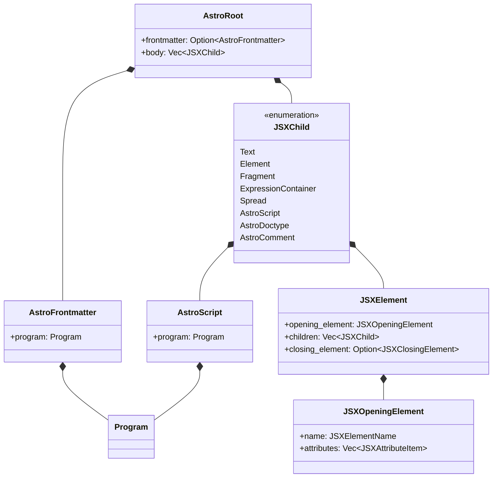
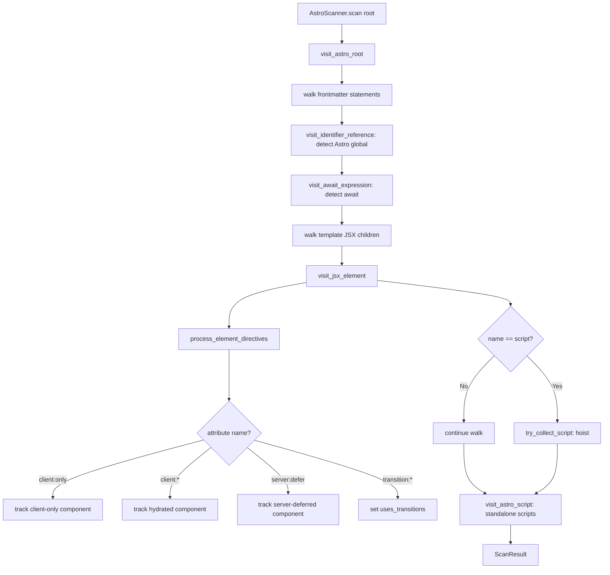

# Rust Parser: oxc Integration and AST Scanning

The Rust compiler delegates parsing to a forked oxc parser (`github.com/withastro/oxc`) that returns an `AstroRoot` AST — a JSX-based tree with Astro-specific node types for frontmatter and script elements. Analysis (metadata collection) runs as a separate single-pass visitor (`AstroScanner`) using oxc's `Visit` trait, cleanly separating parsing from analysis.

## oxc Parser Integration

The Rust compiler uses a custom oxc fork with Astro-specific changes:

```toml
# Cargo.toml:16-34 — oxc dependencies from withastro/oxc fork
oxc_allocator = { git = "https://github.com/withastro/oxc", rev = "c429ef28..." }
oxc_ast = { git = "https://github.com/withastro/oxc", rev = "c429ef28..." }
oxc_parser = { git = "https://github.com/withastro/oxc", rev = "c429ef28...", features = ["regular_expression"] }
oxc_ast_visit = { git = "https://github.com/withastro/oxc", rev = "c429ef28..." }
oxc_codegen = { git = "https://github.com/withastro/oxc", rev = "c429ef28..." }
```

The fork adds `SourceType::astro()` and `Parser::parse_astro()` which return `AstroRoot` instead of the standard `Program`. This gives the compiler a JSX-native AST with Astro extensions.

Source: `compiler-rs/Cargo.toml:16-34`

## AstroRoot AST Structure

The `AstroRoot` node (from the oxc fork) is the document root. It contains:

```
AstroRoot
├── frontmatter: Option<AstroFrontmatter>   ← TypeScript between --- fences
│   └── program: Program                     ← oxc Program (JS/TS statements)
├── body: Vec<JSXChild<'a>>                 ← Template content
└── (inherited from JSX)

AstroFrontmatter
└── program: Program<'a>                    ← Parsed TypeScript AST

AstroScript                                 ← Standalone <script> nodes
└── program: Program<'a>                    ← Parsed script content

JSXChild                                  ← Template children
├── Text(JSXText)
├── Element(JSXElement)
├── Fragment(JSXFragment)
├── ExpressionContainer(JSXExpressionContainer)
├── Spread(JSXSpreadChild)
├── AstroScript(AstroScript)               ← Parsed script (not raw text)
├── AstroDoctype(JSXDoctype)
└── AstroComment(JSXComment)
```



## The Transform Entry Point

The `transform` function (`crates/astro_codegen/src/printer/mod.rs:176-185`) is the primary entry point:

```rust
// crates/astro_codegen/src/printer/mod.rs:176-185
pub fn transform<'a>(
    allocator: &'a Allocator,
    source_text: &'a str,
    options: TransformOptions,
    root: &'a AstroRoot<'a>,
) -> TransformResult {
    // Pass 1: Analysis
    let scan_result = AstroScanner::new(allocator).scan(root);
    // Pass 2: Code generation
    let codegen = AstroCodegen::new(allocator, source_text, options, scan_result);
    codegen.build(root)
}
```

Source: `crates/astro_codegen/src/printer/mod.rs:176-185`

## AstroScanner: Single-Pass Metadata Collection

The `AstroScanner` (`crates/astro_codegen/src/scanner.rs:61-103`) walks the AST once using oxc's `Visit` trait, collecting metadata that the printer needs:

```rust
// crates/astro_codegen/src/scanner.rs:29-52
pub struct ScanResult {
    pub uses_astro_global: bool,                  // Astro.xxx in frontmatter
    pub uses_transitions: bool,                   // transition:* directives
    pub has_await: bool,                          // await expressions (needs async)
    pub client_only_component_names: FxHashSet<String>, // client:only names
    pub hydrated_components: Vec<HydratedComponent>,    // client:* components
    pub client_only_components: Vec<HydratedComponent>, // client:only components
    pub server_deferred_components: Vec<HydratedComponent>, // server:defer
    pub hydration_directives: Vec<String>,        // "load", "visible", "only"
    pub hoisted_scripts: Vec<TransformResultHoistedScript>,
    pub has_template_element: bool,               // <template> exists
}
```

Source: `crates/astro_codegen/src/scanner.rs:29-52`

## Scanner Implementation

The scanner implements `Visit<'a>` (`crates/astro_codegen/src/scanner.rs:308-377`):



The key visitor methods:

```rust
// crates/astro_codegen/src/scanner.rs:308-377
impl<'a> Visit<'a> for AstroScanner<'a> {
    fn visit_identifier_reference(&mut self, ident: &IdentifierReference<'a>) {
        if ident.name == "Astro" {
            self.uses_astro_global = true;
        }
    }
    
    fn visit_jsx_element(&mut self, el: &JSXElement<'a>) {
        self.process_element_directives(&el.opening_element);
        let name = get_jsx_element_name(&el.opening_element.name);
        
        if name == "template" {
            self.has_template_element = true;
        }
        
        if name == "script" {
            if !self.in_non_hoistable && should_hoist_script(&el.opening_element.attributes) {
                self.try_collect_script(el);
            }
            return; // Don't walk script children
        }
        
        // Track non-hoistable context (svg, noscript, template)
        let is_non_hoistable = matches!(name.as_str(), "svg" | "noscript" | "template");
        let was = self.in_non_hoistable;
        if is_non_hoistable { self.in_non_hoistable = true; }
        walk::walk_jsx_element(self, el);
        self.in_non_hoistable = was;
    }
    
    fn visit_await_expression(&mut self, _it: &AwaitExpression<'a>) {
        self.has_await = true;
    }
    
    fn visit_astro_script(&mut self, script: &AstroScript<'a>) {
        self.collect_script_from_program(&script.program, &[]);
    }
}
```

Source: `crates/astro_codegen/src/scanner.rs:308-377`

## Directive Detection

The `process_element_directives` method (`crates/astro_codegen/src/scanner.rs:123-195`) scans attributes for directives:

```rust
// crates/astro_codegen/src/scanner.rs:123-195
fn process_element_directives(&mut self, el: &JSXOpeningElement<'a>) {
    for attr in &el.attributes {
        let attr_name = get_jsx_attribute_name(&attr.name);
        
        // transition:* detection
        if attr_name.starts_with("transition:") {
            self.uses_transitions = true;
        }
        
        // server:defer detection
        if attr_name == "server:defer" && is_component {
            self.server_deferred_components.push(HydratedComponent { ... });
        }
        
        // client:* detection
        if let Some(directive) = attr_name.strip_prefix("client:") {
            if directive == "only" {
                self.client_only_component_names.insert(name.clone());
                self.client_only_components.push(HydratedComponent { ... });
                self.hydration_directives.push("only".to_string());
            } else {
                self.hydration_directives.push(directive.to_string());
                self.hydrated_components.push(HydratedComponent { ... });
            }
            break; // Only first client:* directive
        }
    }
}
```

Source: `crates/astro_codegen/src/scanner.rs:123-195`

Aha: The scanner only tracks metadata — it never modifies the AST. This is a clean separation: the scanner asks "what's in this file?" and the printer asks "how do I emit it?" The Go compiler mixes both concerns (transform modifies the AST in place). The Rust approach means the scanner could run in parallel with other analysis passes without race conditions.

## Script Hoisting Logic

The `should_hoist_script` function (`crates/astro_codegen/src/scanner.rs:421-463`) determines which `<script>` elements get bundled:

```rust
// crates/astro_codegen/src/scanner.rs:421-463
pub fn should_hoist_script(attrs: &Vec<JSXAttributeItem>) -> bool {
    let mut has_type_module = false;
    let mut has_src = false;
    let mut has_other = false;
    let mut is_inline = false;
    let mut has_define_vars = false;
    
    for attr in attrs {
        match attr_name.as_str() {
            "is:inline" => is_inline = true,
            "define:vars" => has_define_vars = true,
            "src" => has_src = true,
            "type" => { if value == "module" { has_type_module = true } else { has_other = true } }
            _ => has_other = true,
        }
    }
    
    // is:inline or define:vars: never hoist
    if is_inline || has_define_vars { return false; }
    
    // src attribute: only hoistable if it's the sole attribute
    if has_src { return !has_type_module && !has_other; }
    
    // No attributes or just type="module": hoistable
    attrs.is_empty() || (has_type_module && !has_other)
}
```

Source: `crates/astro_codegen/src/scanner.rs:421-463`

## Helper Functions

Shared helpers (`crates/astro_codegen/src/scanner.rs:381-417`):

```rust
// crates/astro_codegen/src/scanner.rs:411-417
pub fn is_component_name(name: &str) -> bool {
    name.starts_with(|c: char| c.is_ascii_uppercase()) 
        || name.contains('.') 
        || name.contains(':')
}

pub fn is_custom_element(name: &str) -> bool {
    name.contains('-')
}
```

These match the Go compiler's `isComponent` and `isCustomElement` functions exactly.

Source: `compiler/internal/parser.go:407-416` (Go equivalent).

## Await Detection

The scanner detects three forms of async usage (`crates/astro_codegen/src/scanner.rs:354-369`):

```rust
// await expression: await fetch(...)
fn visit_await_expression(&mut self, ...) { self.has_await = true; }

// for await (... of ...): needs async but is NOT an AwaitExpression
fn visit_for_of_statement(&mut self, it: &ForOfStatement) {
    self.has_await |= it.r#await;
    walk::walk_for_of_statement(self, it);
}

// await using x = ...: needs async but is NOT an AwaitExpression  
fn visit_variable_declaration(&mut self, it: &VariableDeclaration) {
    self.has_await |= it.kind == VariableDeclarationKind::AwaitUsing;
    walk::walk_variable_declaration(self, it);
}
```

Source: `crates/astro_codegen/src/scanner.rs:354-369`

Aha: The `for await...of` and `await using` constructs are NOT `AwaitExpression` nodes in the AST — they're separate statement/declaration types with an `await` flag. The scanner must check these explicitly, or the printer would emit non-async wrappers around `await`-containing code, producing invalid JavaScript.

## Next Steps

Continue to N-API bindings: [N-API Bindings](./04-napi-bindings.md)

Related documents:
- [Go Parser](./01-go-parser.md) — Hand-written parser the Rust version replaces
- [Code Generation](./06-code-generation.md) — How the scanner's results feed into codegen
- [AST Transforms](./05-ast-transforms.md) — Go equivalent transform pass
