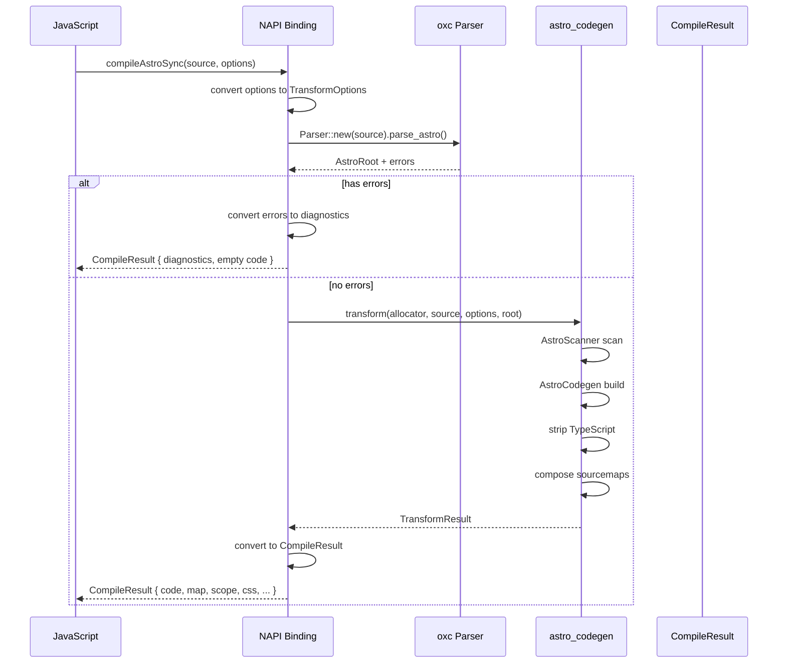
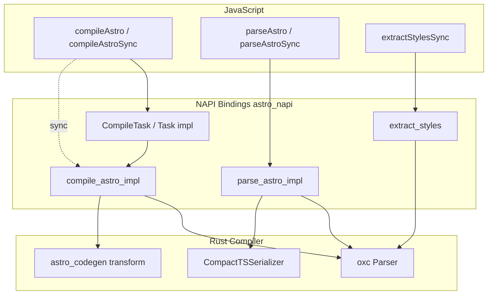

# N-API Bindings: Native Node.js Interface for Rust Compiler

The `astro_napi` crate exposes the Rust compiler to JavaScript through N-API (Node-API), providing synchronous and asynchronous compilation functions, AST parsing, and style extraction. The bindings use napi-rs v3 with `tokio_rt` for async task execution, and optionally mimalloc for memory allocation.

## Crate Structure

```
crates/astro_napi/
├── Cargo.toml              ← Dependencies: napi, napi-derive, mimalloc-safe
├── src/
│   ├── lib.rs              ← All NAPI-exposed functions and types
│   └── error.rs            ← Diagnostic conversion from oxc errors
└── build.rs                ← napi-build setup
```

Source: `compiler-rs/crates/astro_napi/src/lib.rs`

## Global Allocator

```rust
// crates/astro_napi/src/lib.rs:5-15
#[global_allocator]
#[cfg(all(
    feature = "allocator",
    not(any(target_arch = "arm", target_os = "freebsd", target_os = "windows", target_family = "wasm"))
))]
static ALLOC: mimalloc_safe::MiMalloc = mimalloc_safe::MiMalloc;
```

Source: `compiler-rs/crates/astro_napi/src/lib.rs:5-15`

The allocator is only enabled on x86_64 Linux (not ARM, FreeBSD, Windows, or WASM). mimalloc provides faster allocation/deallocation than the system allocator, which matters for compilation workloads that create many small allocations.

## NAPI String Enums

The bindings expose three string enums for JavaScript:

```rust
// crates/astro_napi/src/lib.rs:33-74
#[napi(string_enum)]
pub enum SourcemapOption {
    #[napi(value = "external")] External,
    #[napi(value = "inline")] Inline,
    #[napi(value = "both")] Both,
}

#[napi(string_enum)]
pub enum CompactOptions {
    #[napi(value = "none")] None,
    #[napi(value = "html")] Html,
    #[napi(value = "jsx")] Jsx,
}

#[napi(string_enum)]
pub enum ScopedStyleStrategy {
    #[napi(value = "where")] Where,      // :where(.astro-XXXX)
    #[napi(value = "class")] Class,       // .astro-XXXX
    #[napi(value = "attribute")] Attribute, // [data-astro-cid-XXXX]
}
```

Source: `compiler-rs/crates/astro_napi/src/lib.rs:33-74`

## CompileOptions

The options struct maps JavaScript object properties to Rust config:

```rust
// crates/astro_napi/src/lib.rs:77-171
#[napi(object)]
#[derive(Default)]
pub struct CompileOptions {
    pub filename: Option<String>,
    pub normalized_filename: Option<String>,
    #[napi(js_name = "internalURL")]
    pub internal_url: Option<String>,
    #[napi(ts_type = "'external' | 'inline' | 'both'")]
    pub sourcemap: Option<SourcemapOption>,
    pub astro_global_args: Option<String>,
    #[napi(ts_type = "'none' | 'html' | 'jsx'")]
    pub compact: Option<CompactOptions>,
    pub result_scoped_slot: Option<bool>,
    #[napi(ts_type = "'where' | 'class' | 'attribute'")]
    pub scoped_style_strategy: Option<ScopedStyleStrategy>,
    #[napi(js_name = "transitionsAnimationURL")]
    pub transitions_animation_url: Option<String>,
    pub annotate_source_file: Option<bool>,
    pub strip_slot_comments: Option<bool>,
    pub resolve_path_provided: Option<bool>,
    pub preprocessed_styles: Option<Vec<Option<String>>>,
}
```

Source: `compiler-rs/crates/astro_napi/src/lib.rs:77-171`

## CompileResult

```rust
// crates/astro_napi/src/lib.rs:201-228
#[napi(object)]
pub struct CompileResult {
    pub code: String,                         // Generated JavaScript
    pub map: String,                          // Source map JSON (or empty)
    pub scope: String,                        // CSS scope hash
    pub css: Vec<String>,                     // Extracted CSS per style tag
    pub scripts: Vec<HoistedScript>,          // Hoisted scripts
    pub hydrated_components: Vec<Component>,  // client:* components
    pub client_only_components: Vec<Component>, // client:only components
    pub server_components: Vec<Component>,    // server:defer components
    pub contains_head: bool,
    pub propagation: bool,
    pub style_error: Vec<String>,
    pub diagnostics: Vec<DiagnosticMessage>,
}
```

Source: `compiler-rs/crates/astro_napi/src/lib.rs:201-228`

## Compilation Implementation

The `compile_astro_impl` function (`crates/astro_napi/src/lib.rs:304-411`) orchestrates compilation:



```rust
// crates/astro_napi/src/lib.rs:304-411 (simplified)
fn compile_astro_impl(source_text: &str, options: &CompileOptions) -> CompileResult {
    let allocator = Allocator::default();
    let source_type = SourceType::astro();
    
    // Parse the Astro file
    let ret = Parser::new(&allocator, source_text, source_type)
        .with_options(ParseOptions::default())
        .parse_astro();
    
    // If parse errors, return diagnostics
    if !ret.errors.is_empty() {
        let diagnostics = Diagnostic::from_oxc_list(source_text, &ret.errors);
        return CompileResult { code: String::new(), diagnostics, ... };
    }
    
    // Convert NAPI options to codegen options
    let codegen_options = TransformOptions {
        sourcemap: napi_to_codegen_sourcemap(&options.sourcemap),
        compact: napi_to_codegen_compact(&options.compact),
        // ... more field mappings
    };
    
    // Generate JavaScript
    let result = transform(&allocator, source_text, codegen_options, &ret.root);
    
    // Convert internal types to NAPI types
    CompileResult {
        code: result.code,
        map: result.map,
        scope: result.scope,
        css: result.css,
        scripts: result.scripts.into_iter().map(...).collect(),
        // ...
    }
}
```

Source: `compiler-rs/crates/astro_napi/src/lib.rs:304-411`

## Synchronous API

```rust
// crates/astro_napi/src/lib.rs:429-432
#[napi]
pub fn compile_astro_sync(
    source_text: String,
    options: Option<CompileOptions>
) -> CompileResult {
    let options = options.unwrap_or_default();
    compile_astro_impl(&source_text, &options)
}
```

Source: `compiler-rs/crates/astro_napi/src/lib.rs:429-432`

## Asynchronous API

The async version uses NAPI's `Task` trait for thread-pool execution:

```rust
// crates/astro_napi/src/lib.rs:434-483
pub struct CompileTask {
    source_text: String,
    options: CompileOptions,
}

#[napi]
impl Task for CompileTask {
    type JsValue = CompileResult;
    type Output = CompileResult;
    
    fn compute(&mut self) -> napi::Result<Self::Output> {
        let source_text = mem::take(&mut self.source_text);
        Ok(compile_astro_impl(&source_text, &self.options))
    }
    
    fn resolve(&mut self, _: napi::Env, result: Self::Output) -> napi::Result<Self::JsValue> {
        Ok(result)
    }
}

#[napi]
pub fn compile_astro(
    source_text: String, 
    options: Option<CompileOptions>
) -> AsyncTask<CompileTask> {
    AsyncTask::new(CompileTask { source_text, options })
}
```

Source: `compiler-rs/crates/astro_napi/src/lib.rs:434-483`

**Aha:** The async API doesn't use Tokio or async/await internally -- it runs the sync compilation on NAPI's thread pool via the `Task` trait. `compute()` runs on a background thread; `resolve()` runs on the main JS thread. This means async compilation blocks a thread pool slot, not the event loop. The docs explicitly recommend worker threads for parallelization instead of this async API.

## Parse API

The parse functions return the AST as JSON:

```rust
// crates/astro_napi/src/lib.rs:486-564
#[napi(object)]
pub struct ParseResult {
    pub ast: String,          // ESTree JSON
    pub diagnostics: Vec<DiagnosticMessage>,
}

fn parse_astro_impl(source_text: &str) -> ParseResult {
    let allocator = Allocator::default();
    let ret = Parser::new(&allocator, source_text, SourceType::astro())
        .parse_astro();
    
    // Serialize AST to ESTree JSON
    let mut serializer = CompactTSSerializer::new(false);
    ret.root.serialize(&mut serializer);
    let ast = serializer.into_string();
    
    ParseResult { ast, diagnostics }
}
```

Source: `compiler-rs/crates/astro_napi/src/lib.rs:486-564`

## Style Extraction

`extractStylesSync` lets callers preprocess CSS before compilation:

```rust
// crates/astro_napi/src/lib.rs:234-276
#[napi(object)]
pub struct StyleBlock {
    pub index: u32,
    pub content: String,
    pub attrs: HashMap<String, String>,
}

#[napi]
pub fn extract_styles_sync(source_text: String) -> Vec<StyleBlock> {
    let allocator = Allocator::default();
    let ret = Parser::new(&allocator, &source_text, SourceType::astro())
        .parse_astro();
    
    if !ret.errors.is_empty() { return Vec::new(); }
    
    let blocks = extract_styles(&ret.root);
    blocks.into_iter().map(|b| StyleBlock {
        index: b.index as u32,
        content: b.content,
        attrs: b.attrs.into_iter().collect(),
    }).collect()
}
```

Source: `compiler-rs/crates/astro_napi/src/lib.rs:234-276`

This enables the "Rust extract -> TypeScript preprocess -> Rust compile" pipeline for Sass/PostCSS support.

## Architecture Overview



## Error Handling

Diagnostics are converted from oxc errors:

```rust
// crates/astro_napi/src/error.rs
// Diagnostic::from_oxc_list converts oxc diagnostics
// DiagnosticMessage::from_codegen_list formats for JavaScript
```

Source: `compiler-rs/crates/astro_napi/src/error.rs`

## Next Steps

Continue to AST transforms: [AST Transforms](./05-ast-transforms.md)

Related documents:
- [Rust Parser](./03-rust-parser.md) -- The core parser this binds to
- [Code Generation](./06-code-generation.md) -- What compileAstro produces
- [Compiler API](./07-compiler-api.md) -- JavaScript usage of these bindings
