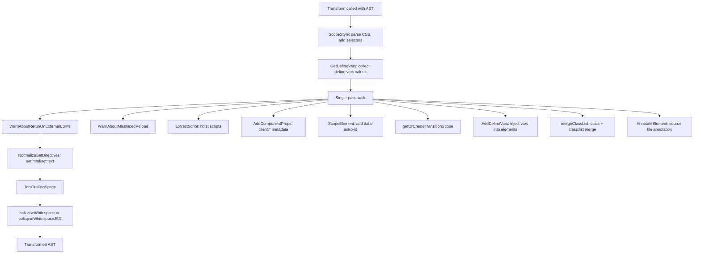
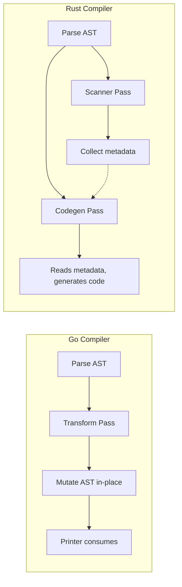

# AST Transforms: CSS Scoping, Directives, and Metadata

The transform pass mutates the parsed AST before printing: it scopes CSS selectors to component hashes, converts directives like `set:html` and `define:vars` into runtime function calls, extracts component metadata for hydration, and collapses whitespace. The Go compiler modifies the AST in-place; the Rust compiler separates analysis (scanner) from mutation-free code generation.

## Go Transform Entry Point

The `Transform` function (`internal/transform/transform.go:49-128`) walks the AST once and applies all transformations:

```go
// internal/transform/transform.go:49-128
func Transform(doc *astro.Node, opts TransformOptions, h *handler.Handler) *astro.Node {
    shouldScope := len(doc.Styles) > 0 && ScopeStyle(doc.Styles, opts)
    definedVars := GetDefineVars(doc.Styles)

    walk(doc, func(n *astro.Node) {
        WarnAboutRerunOnExternalESMs(n, h)
        WarnAboutMisplacedReload(n, h)
        HintAboutImplicitInlineDirective(n, h)
        ExtractScript(doc, n, &opts, h)
        AddComponentProps(doc, n, &opts)
        if shouldScope { ScopeElement(n, opts) }
        if HasAttr(n, "transition:animate") || ... {
            doc.Transition = true
            doc.HeadPropagation = true
            getOrCreateTransitionScope(n, &opts, i)
        }
        if HasAttr(n, "server:defer") {
            doc.HeadPropagation = true
        }
        if len(definedVars) > 0 {
            didAdd := AddDefineVars(n, definedVars)
        }
        mergeClassList(doc, n, &opts)
        if n.DataAtom == a.Head { doc.ContainsHead = true }
        if opts.AnnotateSourceFile { AnnotateElement(n, opts) }
    })

    NormalizeSetDirectives(doc, h)
    TrimTrailingSpace(doc)

    // Whitespace collapse
    switch opts.Compact {
    case CompactJSX: collapseWhitespaceJSX(doc)
    case CompactNone: /* no-op */
    }

    return doc
}
```

Source: `internal/transform/transform.go:49-128`



## TransformOptions

```go
// internal/transform/transform.go:33-47
type TransformOptions struct {
    Scope                   string                  // CSS scope hash
    Filename                string                  // Source file path
    NormalizedFilename      string                  // Normalized for hash
    InternalURL             string                  // Runtime import specifier
    SourceMap               string                  // Sourcemap mode
    AstroGlobalArgs         string                  // $$createAstro arguments
    ScopedStyleStrategy     string                  // where/class/attribute
    Compact                 CompactMode             // none/default/jsx
    ResultScopedSlot        bool                    // Scoped slot result
    TransitionsAnimationURL string                  // View transitions CSS URL
    ResolvePath             func(string) string     // Custom path resolver
    PreprocessStyle         interface{}             // Style preprocessing callback
    AnnotateSourceFile      bool                    // Source file annotation
}
```

Source: `internal/transform/transform.go:33-47`

## CSS Scoping

The `ScopeStyle` function (`internal/transform/scope-css.go:18-59`) transforms CSS selectors to be component-scoped:

```go
// internal/transform/scope-css.go:18-59
func ScopeStyle(styles []*astro.Node, opts TransformOptions) bool {
    for _, n := range styles {
        if n.DataAtom != a.Style { continue }
        if hasTruthyAttr(n, "global") { continue }      // Deprecated
        if hasTruthyAttr(n, "is:global") { continue }    // Global styles
        if n.FirstChild == nil || strings.TrimSpace(n.FirstChild.Data) == "" {
            if !HasAttr(n, "define:vars") { continue }
        }

        didScope = true
        // Add data-astro-id attribute to style element
        n.Attr = append(n.Attr, astro.Attribute{
            Key: "data-astro-id", Val: opts.Scope,
        })

        // Parse CSS with esbuild's CSS parser
        tree := css_parser.Parse(..., n.FirstChild.Data, ...)

        // Print with scoping strategy
        result := css_printer.Print(tree, css_printer.Options{
            Scope: opts.Scope,
            ScopeStrategy: scopeStrategy,
        })
        n.FirstChild.Data = string(result.CSS)
    }
    return didScope
}
```

Source: `internal/transform/scope-css.go:18-59`

The scope strategy options (`css_printer.Options`):

| Strategy | CSS Output | Selector Size |
|----------|-----------|---------------|
| `where` (default) | `:where(.astro-XXXX) h1` | 17 chars hash |
| `class` | `.astro-XXXX h1` | 17 chars hash |
| `attribute` | `[data-astro-cid-XXXX] h1` | 27 chars hash |

Source: `internal/transform/scope-css.go:44-49`

## Rust CSS Scoping

The Rust compiler's `css_scoping.rs` implements equivalent logic using `lightningcss`:

```rust
// crates/astro_codegen/src/css_scoping.rs
// Uses lightningcss for CSS parsing and selector transformation
// ScopeStrategy enum mirrors Go: Where, Class, Attribute
```

Source: `compiler-rs/crates/astro_codegen/src/css_scoping.rs`

## Directive Normalization

### set:html and set:text

The `NormalizeSetDirectives` function (`internal/transform/transform.go:179-279`) converts `set:html` and `set:text` attributes into expression children:

```go
// internal/transform/transform.go:179-279
func NormalizeSetDirectives(doc *astro.Node, h *handler.Handler) {
    walk(doc, func(n *astro.Node) {
        if n.Type == astro.ElementNode && HasSetDirective(n) {
            for _, attr := range n.Attr {
                if attr.Key == "set:html" || attr.Key == "set:text" {
                    n.RemoveAttribute(attr.Key)

                    var nodeToAppend *astro.Node
                    var shouldAddExpression bool

                    switch attr.Type {
                    case astro.QuotedAttribute:
                        // set:html="raw <b>html</b>" -> $$unescapeHTML("raw <b>html</b>")
                        data = fmt.Sprintf("\"%s\"", attr.Val)
                        shouldAddExpression = attr.Key == "set:html"
                    case astro.ExpressionAttribute:
                        // set:html={htmlString} -> $$unescapeHTML(htmlString)
                        if attr.Key == "set:html" {
                            data = fmt.Sprintf("$$unescapeHTML(%s)", attr.Val)
                        }
                        shouldAddExpression = true
                    }

                    if shouldAddExpression {
                        nodeToAppend = &astro.Node{
                            Type: astro.ElementNode,
                            Data: "astro:expression",
                            Expression: true,
                        }
                        nodeToAppend.AppendChild(&astro.Node{
                            Type: astro.TextNode, Data: data,
                        })
                    }

                    // Warn if existing children will be overwritten
                    for c := n.FirstChild; c != nil; c = c.NextSibling {
                        if c.Type == astro.CommentNode || ... {
                            h.AppendWarning(&loc.ErrorWithRange{
                                Code: loc.WARNING_SET_WITH_CHILDREN,
                                Text: fmt.Sprintf("%s directive will overwrite child nodes.", attr.Key),
                                Hint: "Remove the child nodes to suppress this warning.",
                            })
                        }
                    }
                    n.AppendChild(nodeToAppend)
                }
            }
        }
    })
}
```

Source: `internal/transform/transform.go:179-279`

Aha: The `set:html` directive wraps the value in `$$unescapeHTML()` to allow raw HTML injection. `set:text` does NOT -- it just renders as a text node. This distinction prevents XSS from `set:text` (which always escapes) while allowing intentional HTML injection via `set:html`. The transform converts a simple attribute into an expression child node, letting the printer handle it uniformly.

## Script Extraction

The `ExtractScript` function (`internal/transform/transform.go:535-589`) collects hoistable scripts:

```go
// internal/transform/transform.go:535-589
func ExtractScript(doc *astro.Node, n *astro.Node, opts *TransformOptions, h *handler.Handler) {
    if n.Type == astro.ElementNode && n.DataAtom == a.Script {
        if HasSetDirective(n) || HasInlineDirective(n) { return }
        if !IsHoistable(n, true) { return }

        // Hoist scripts that have: no attributes, only src, or hoist attribute
        if len(n.Attr) == 0 || (len(n.Attr) == 1 && n.Attr[0].Key == "src") {
            doc.Scripts = append(doc.Scripts, n)
            n.HandledScript = true
        }
    }
}
```

Source: `internal/transform/transform.go:535-589`

## Component Props and Hydration Metadata

`AddComponentProps` (`internal/transform/transform.go:604-697`) resolves client:*/server:* directives:

```go
// internal/transform/transform.go:604-697
func AddComponentProps(doc *astro.Node, n *astro.Node, opts *TransformOptions) {
    if n.Type == astro.ElementNode && (n.Component || n.CustomElement) {
        for _, attr := range n.Attr {
            if strings.HasPrefix(attr.Key, "client:") {
                directive := parts[1]
                doc.HydrationDirectives[directive] = true

                if attr.Key == "client:only" {
                    doc.ClientOnlyComponentNodes = append(doc.ClientOnlyComponentNodes, n)
                    // Match to import statement
                    match := matchNodeToImportStatement(doc, n)
                    if match != nil {
                        doc.ClientOnlyComponents = append(doc.ClientOnlyComponents, &HydratedComponentMetadata{
                            ExportName: match.ExportName,
                            Specifier: match.Specifier,
                            ResolvedPath: ResolveIdForMatch(match.Specifier, opts),
                        })
                    }
                    // Add client:component-path and client:component-export attrs
                    break
                }

                // For regular client:* directives
                doc.HydratedComponentNodes = append(doc.HydratedComponentNodes, n)
                // ... similar import matching
            }

            // server:* handling (similar pattern)
            if strings.HasPrefix(attr.Key, "server:") {
                // server:defer, etc.
            }
        }
    }
}
```

Source: `internal/transform/transform.go:604-697`

## Import Matching

`matchNodeToImportStatement` (`internal/transform/transform.go:704-722`) scans frontmatter imports to find the matching module for a component name:

```go
// internal/transform/transform.go:704-722
func matchNodeToImportStatement(doc *astro.Node, n *astro.Node) *ImportMatch {
    eachImportStatement(doc, func(stmt js_scanner.ImportStatement) bool {
        for _, imported := range stmt.Imports {
            exportName, isUsed := js_scanner.ExtractComponentExportName(n.Data, imported)
            if isUsed {
                match = &ImportMatch{
                    ExportName: exportName,
                    Specifier: stmt.Specifier,
                }
                return false // Stop iterating
            }
        }
        return true
    })
    return match
}
```

Source: `internal/transform/transform.go:704-722`

## Whitespace Collapsing

The Go compiler implements two whitespace strategies (`internal/transform/transform.go:327-493`):

### collapseWhitespace (HTML-aware)

```go
// internal/transform/transform.go:327-394
func collapseWhitespace(doc *astro.Node) {
    walk(doc, func(n *astro.Node) {
        if n.Type == astro.TextNode {
            if n.Closest(isRawElement) != nil { return }  // Don't touch raw

            if n.Parent != nil && n.Parent.Expression {
                // Inside expressions: trim first/last child
                if n.PrevSibling == nil { n.Data = strings.TrimLeftFunc(...) }
                if n.NextSibling == nil { n.Data = strings.TrimRightFunc(...) }
                return
            }

            // Lone whitespace-only text node
            if len(strings.TrimFunc(n.Data, unicode.IsSpace)) == 0 {
                if n.PrevSibling == nil && n.NextSibling == nil {
                    n.Data = ""  // Clear
                } else {
                    n.Data = " " // Collapse to single space
                }
                return
            }

            // Collapse leading/trailing whitespace
            // Newlines preserved as \n, spaces as single space
        }
    })
}
```

Source: `internal/transform/transform.go:327-394`

### collapseWhitespaceJSX (JSX-style)

The JSX version (`internal/transform/transform.go:409-493`) implements the same algorithm as esbuild/Babel:

```go
// internal/transform/transform.go:409-464
func cleanJSXTextWhitespace(text string) string {
    // First line: preserve leading, trim trailing
    // Middle lines: trim both, join with single space
    // Last line: preserve trailing, trim leading
    // Empty lines: contribute nothing
}
```

This matches esbuild's `fixWhitespaceAndDecodeJSXEntities` exactly.

Source: `internal/transform/transform.go:409-464`

## Rust Scanner Equivalence

The Rust compiler achieves the same results through the scanner pass:

| Go Transform | Rust Scanner |
|-------------|-------------|
| `ScopeStyle` | `css_scoping.rs` (called during codegen) |
| `NormalizeSetDirectives` | Handled directly in printer |
| `ExtractScript` | `AstroScanner::try_collect_script` |
| `AddComponentProps` | `AstroScanner::process_element_directives` |
| `GetDefineVars` | `define_vars_values` in codegen |
| `collapseWhitespace` | `collapse_html` / `collapse_jsx` in whitespace.rs |
| `walk` function | `oxc_ast_visit::Visit` trait |



## The Walk Function

```go
// internal/transform/transform.go:748-757
func walk(doc *astro.Node, cb func(*astro.Node)) {
    var f func(*astro.Node)
    f = func(n *astro.Node) {
        cb(n)
        for c := n.FirstChild; c != nil; c = c.NextSibling {
            f(c)
        }
    }
    f(doc)
}
```

Source: `internal/transform/transform.go:748-757`

Simple pre-order depth-first traversal. The callback can mutate nodes, collect data, or trigger warnings.

## class:list Merging

`mergeClassList` (`internal/transform/transform.go:760-800`) combines `class` and `class:list` attributes:

```go
// internal/transform/transform.go:760-800
func mergeClassList(doc *astro.Node, n *astro.Node, opts *TransformOptions) {
    if classListAttrIndex >= 0 && classAttrIndex >= 0 {
        if classAttrType == astro.ExpressionAttribute {
            n.Attr[classListAttrIndex].Val = fmt.Sprintf("[%s, %s]", classAttrValue, classListAttrValue)
        } else {
            n.Attr[classListAttrIndex].Val = fmt.Sprintf("['%s', %s]", classAttrValue, classListAttrValue)
        }
        n.Attr = remove(n.Attr, classAttrIndex)  // Remove the class attribute
    }
}
```

Source: `internal/transform/transform.go:760-800`

## Next Steps

Continue to code generation: [Code Generation](./06-code-generation.md)

Related documents:
- [Go Printer](./02-go-printer.md) -- Consumes the transformed AST
- [Rust Parser](./03-rust-parser.md) -- Scanner replaces transform in Rust
- [Cross-Cutting](./09-cross-cutting.md) -- Whitespace strategies compared
