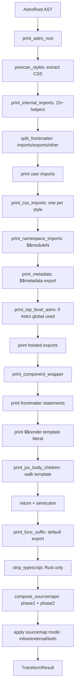
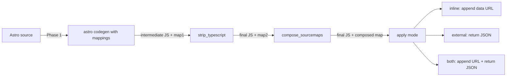

# Code Generation: Building the JavaScript Output

The code generation phase walks the transformed AST and emits JavaScript that imports runtime helpers, preserves frontmatter code, and renders template content as a `$$render`-tagged template literal. The Rust compiler adds a second phase — TypeScript stripping via oxc's codegen — that the Go compiler avoids because the tokenizer already treats frontmatter as text.

## The Generated Output

A compiled `.astro` file produces JavaScript with this structure:

```
┌─────────────────────────────────────────────────┐
│ 1. Internal imports (runtime helpers)            │
│ 2. User imports (from frontmatter)               │
│ 3. CSS imports (?astro&type=style)              │
│ 4. Module re-imports (* as $$moduleN)           │
│ 5. Metadata export ($$metadata)                  │
│ 6. Top-level Astro global ($$Astro)              │
│ 7. User exports (named/default)                  │
│ 8. Component wrapper ($$createComponent)         │
│    a. Async prefix if await found               │
│    b. Astro = $$result.createAstro(...)         │
│    c. Non-import frontmatter statements          │
│    d. return $$render`...template...`           │
│ 9. Default export                                │
└─────────────────────────────────────────────────┘
```



Source: `compiler-rs/crates/astro_codegen/src/printer/mod.rs:580-634` — `print_astro_root`.

## Component Wrapper

The component wrapper (`compiler-rs/crates/astro_codegen/src/printer/mod.rs:1066-1141`) creates the render function:

```rust
// crates/astro_codegen/src/printer/mod.rs:1066-1079
fn print_component_wrapper(&mut self, statements, body, component_name) {
    let async_prefix = self.get_async_prefix();  // "async " or ""
    self.println(&format!(
        "const {} = {}({}({}, $$props, $$slots) => {{",
        component_name,
        runtime::CREATE_COMPONENT,
        async_prefix,
        runtime::RESULT
    ));
    
    if self.scan_result.uses_astro_global {
        self.println(&format!(
            "const Astro = {}.createAstro($$props, $$slots);",
            runtime::RESULT
        ));
        self.println(&format!("Astro.self = {component_name};"));
    }
    
    // Print frontmatter statements
    for stmt in statements {
        self.print_statement(stmt);
    }
    
    // Emit $$definedVars if needed
    if !self.define_vars_values.is_empty() {
        self.println(&format!(
            "const $$definedVars = {}([{}]);",
            runtime::DEFINE_STYLE_VARS,
            self.define_vars_values.join(",")
        ));
    }
    
    // Return with template literal
    self.print("return ");
    self.print(runtime::RENDER);
    self.print("`");
    
    // Maybe insert $$maybeRenderHead
    if self.needs_maybe_render_head_at_start(body) {
        self.print("${$$maybeRenderHead($$result)}");
    }
    
    self.print_jsx_body_children(body);
    self.println("`;");
    
    // Close component
    let propagation = if self.scan_result.uses_transitions || 
                       !self.scan_result.server_deferred_components.is_empty() {
        "\"self\""
    } else {
        "undefined"
    };
    self.println(&format!("}}, {filename_part}, {propagation});"));
}
```

Source: `compiler-rs/crates/astro_codegen/src/printer/mod.rs:1066-1141`

## Template Literal Emission

The template is emitted inside a `$$render` template literal. Each JSX child dispatches to the appropriate print method:

```rust
// crates/astro_codegen/src/printer/mod.rs:1266-1298
fn print_jsx_child(&mut self, child: &JSXChild<'a>) {
    match child {
        JSXChild::Text(text) => {
            self.add_source_mapping_for_span(text.span);
            self.print(&escape_template_literal(text.value.as_str()));
        }
        JSXChild::Element(el) => { self.print_jsx_element(el); }
        JSXChild::Fragment(frag) => { self.print_jsx_fragment(frag); }
        JSXChild::ExpressionContainer(expr) => { self.print_jsx_expression_container(expr); }
        JSXChild::Spread(spread) => { self.print_jsx_spread_child(spread); }
        JSXChild::AstroScript(_) => { /* handled at element level */ }
        JSXChild::AstroDoctype(_) => { /* stripped */ }
        JSXChild::AstroComment(comment) => {
            self.print("<!--");
            self.print(&escape_template_literal(comment.value.as_str()));
            self.print("-->");
        }
    }
}
```

Source: `compiler-rs/crates/astro_codegen/src/printer/mod.rs:1266-1298`

## TypeScript Stripping (Rust Only)

The Go compiler doesn't need TypeScript stripping because it treats frontmatter as raw text and preserves it verbatim. The Rust compiler uses oxc to parse frontmatter as TypeScript AST, then must strip type annotations before emitting:

```rust
// crates/astro_codegen/src/printer/typescript.rs
pub fn strip_typescript(
    allocator: &Allocator,
    code: &str,
    generate_sourcemap: bool,
) -> (String, Option<oxc_sourcemap::Sourcemap>) {
    // 1. Parse the intermediate JS as a Program
    let ret = Parser::new(allocator, code, SourceType::tsx()).parse();
    
    // 2. Use oxc's Codegen to emit without TypeScript
    let codegen = Codegen::new().with_options(CodegenOptions {
        remove_types: true,
        ts_annotation: false,
    });
    let result = codegen.build(&ret.program);
    
    // 3. If sourcemap requested, get the map
    let map = if generate_sourcemap {
        Some(result.map)
    } else {
        None
    };
    
    (result.code, map)
}
```

Aha: This is a fundamental architectural difference between the two compilers. The Go compiler is "dumber" — it treats frontmatter as text, so no type stripping is needed. The Rust compiler is "smarter" — it parses frontmatter as a proper TS AST, which enables more features (like detecting `await` in for-of statements) but requires a second compilation pass. The two-phase approach (astro codegen → TS stripping) is why the Rust compiler composes two sourcemaps.

## Two-Phase Sourcemap Composition

The Rust compiler generates sourcemaps in two phases:



Source: `compiler-rs/crates/astro_codegen/src/printer/mod.rs:527-560`

The composition function (`compiler-rs/crates/astro_codegen/src/printer/sourcemap_builder.rs`):

```rust
// crates/astro_codegen/src/printer/sourcemap_builder.rs
pub fn compose_sourcemaps(
    intermediate_code: &str,
    final_code: &str,
    phase2_map: Option<Sourcemap>,  // intermediate → final
    phase1_builder: Option<AstroSourcemapBuilder>, // source → intermediate
    source_path: &str,
    source_text: &str,
) -> Option<Sourcemap> {
    match (phase1_builder, phase2_map) {
        (Some(p1), Some(p2)) => {
            // Phase 1: source → intermediate
            let map1 = p1.build(source_path, source_text);
            // Compose: source → intermediate → final
            Some(map1.compose(&p2))
        }
        (Some(p1), None) => {
            // Only Phase 1 (no TS stripping needed)
            Some(p1.build(source_path, source_text))
        }
        (None, _) => None,  // No sourcemap requested
    }
}
```

Source: `compiler-rs/crates/astro_codegen/src/printer/sourcemap_builder.rs`

## $$maybeRenderHead Logic

The `needs_maybe_render_head_at_start` method (`compiler-rs/crates/astro_codegen/src/printer/mod.rs:1191-1231`) determines whether to insert `$$maybeRenderHead` at the template start. This is needed when the document has an implicit `<head>` — the runtime needs to know where to inject head content:

```rust
// crates/astro_codegen/src/printer/mod.rs:1191-1231
fn needs_maybe_render_head_at_start(&self, body: &[JSXChild]) -> bool {
    if self.render_head_inserted || self.has_explicit_head {
        return false;  // Already handled or user has explicit head
    }
    for child in body {
        match child {
            JSXChild::Text(t) => {
                if t.value.trim().is_empty() { continue; }  // Whitespace OK
                return false;  // Non-whitespace text before implicit head
            }
            JSXChild::Element(el) => {
                let name = get_jsx_element_name(&el.opening_element.name);
                if name == "html" { return false; }
                if name == "slot" { return false; }
                if name == "script" { continue; }  // Scripts OK
                // First non-head, non-component, non-custom element
                return !is_component_name(&name) 
                    && !is_custom_element(&name)
                    && !is_head_element(&name);
            }
            JSXChild::Fragment(_) | JSXChild::ExpressionContainer(_) => {
                return false;  // Fragment/expression before implicit head
            }
            _ => {}
        }
    }
    false
}
```

Source: `compiler-rs/crates/astro_codegen/src/printer/mod.rs:1191-1231`

## Whitespace During Printing

The Rust printer handles whitespace collapsing at print time (unlike Go which does it during transform):

```rust
// crates/astro_codegen/src/printer/mod.rs:1300-1321
fn print_jsx_text_with_pos(&mut self, text: &JSXText, pos: TextPosition) {
    let value = text.value.as_str();
    match self.options.compact {
        CompactMode::Disabled => {
            self.print(&escape_template_literal(value));
        }
        CompactMode::Html => {
            let in_raw = self.raw_element_depth > 0;
            let in_insensitive = self.in_head;
            if let Some(collapsed) = collapse_html(value, in_raw, in_insensitive, pos) {
                self.print(&escape_template_literal(&collapsed));
            }
        }
        CompactMode::Jsx => {
            let in_raw = self.raw_element_depth > 0;
            if let Some(collapsed) = collapse_jsx(value, in_raw) {
                self.print(&escape_template_literal(&collapsed));
            }
        }
    }
}
```

Source: `compiler-rs/crates/astro_codegen/src/printer/mod.rs:1300-1321`

The `collapse_html` and `collapse_jsx` functions are in `whitespace.rs`. The `raw_element_depth` tracks whether we're inside raw elements (`<pre>`, `<textarea>`, etc.) where whitespace must be preserved.

## Component Element Printing

Components (uppercase or dotted names) emit `$$renderComponent` calls:

```rust
// crates/astro_codegen/src/printer/components.rs
// print_component_element generates:
// ${$$renderComponent($$result,"ComponentName",Component,{...props},$$slots)}

// Props are built as JS object from attributes:
// { "class": "my-class", "onClick": (() => handler), ...props }

// Slots are generated as arrow functions:
// { "default": () => $$render`slot content` }
```

Source: `compiler-rs/crates/astro_codegen/src/printer/components.rs`

## HTML Element Printing

HTML elements emit directly into the template literal:

```rust
// crates/astro_codegen/src/printer/elements.rs
// print_html_element generates:
// <div class="my-class">${$$addAttribute(expr, "id")}</div>

// Attributes:
// - Quoted: class="value" (direct)
// - Empty: disabled (direct)
// - Expression: ${$$addAttribute(expr, "name")}
// - Spread: ${$$spreadAttributes(obj)}
// - Shorthand: ${$$addAttribute(name, "name")}
// - Template literal: ${$$addAttribute(`tmpl`, "name")}
```

Source: `compiler-rs/crates/astro_codegen/src/printer/elements.rs`

## TransformResult

The final output structure:

```rust
// crates/astro_codegen/src/printer/result.rs
pub struct TransformResult {
    pub code: String,
    pub map: String,  // JSON or empty
    pub scope: String,  // CSS scope hash (base32-like)
    pub style_error: Vec<String>,
    pub diagnostics: Vec<Diagnostic>,
    pub css: Vec<String>,  // One per <style> tag
    pub scripts: Vec<TransformResultHoistedScript>,
    pub hydrated_components: Vec<TransformResultHydratedComponent>,
    pub client_only_components: Vec<TransformResultHydratedComponent>,
    pub server_components: Vec<TransformResultHydratedComponent>,
    pub contains_head: bool,
    pub propagation: bool,
}
```

Source: `compiler-rs/crates/astro_codegen/src/printer/result.rs`

## Hash Generation

The scope hash is computed from the filename (not content):

```rust
// crates/astro_codegen/src/printer/mod.rs:280-340
let hash_input = options.normalized_filename
    .as_deref()
    .or(options.filename.as_deref())
    .filter(|s| *s != "<stdin>")
    .unwrap_or(source_text);

let source_hash = {
    let mut hasher = DefaultHasher::new();
    hash_input.hash(&mut hasher);
    Self::to_base32_like(hasher.finish())
};

// to_base32_like: converts u64 to 8-char lowercase alphanumeric
const ALPHABET: &[u8] = b"abcdefghijklmnopqrstuvwxyz234567";
// 32 chars: a-z (26) + 2-7 (6) = 32
```

Source: `compiler-rs/crates/astro_codegen/src/printer/mod.rs:280-340`

Aha: Using the filename (not content) for the hash means that two different files with identical content get different scope hashes. This prevents CSS collisions when two components happen to have the same styles — they still get different `.astro-XXXX` classes because their filenames differ.

## Next Steps

Continue to compiler API: [Compiler API](./07-compiler-api.md)

Related documents:
- [Go Printer](./02-go-printer.md) — Go equivalent code generation
- [N-API Bindings](./04-napi-bindings.md) — How this is exposed to JavaScript
- [Cross-Cutting](./09-cross-cutting.md) — Sourcemap details, performance
