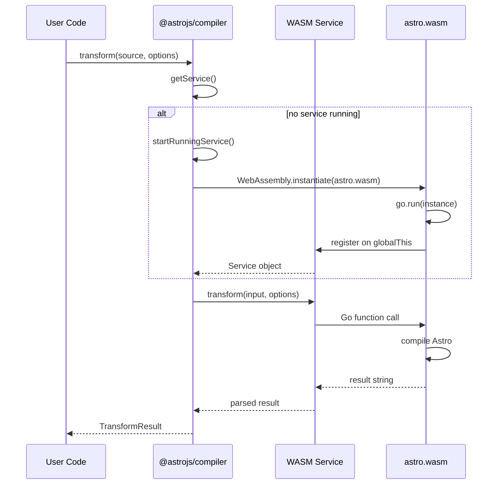
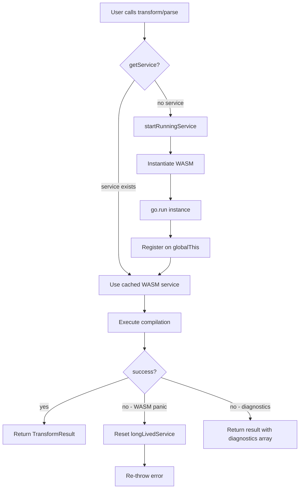

# Compiler API: Programmatic TypeScript Interface

The Astro compiler exposes a TypeScript API for programmatic compilation, parsing, and TSX conversion. Two implementations exist: the WASM-based API (from the Go compiler, used via `@astrojs/compiler` npm package) and the N-API-based API (from the Rust compiler, used via `@astrojs/compiler-binding`). Both share the same type definitions but differ in deployment and performance characteristics.

## npm Package Structure

```
packages/compiler/
├── package.json              ← @astrojs/compiler
├── src/
│   ├── node/
│   │   ├── index.ts          ← Node.js entry (WASM loading)
│   │   ├── sync.ts           ← Synchronous API
│   │   ├── wasm_exec.ts      ← Go WASM runtime wrapper
│   │   └── utils.ts          ← Shared utilities
│   ├── browser/
│   │   ├── index.ts          ← Browser entry (WASM loading)
│   │   ├── wasm_exec.ts      ← Browser WASM runtime
│   │   └── utils.ts
│   └── shared/
│       ├── types.ts          ← TransformOptions, TransformResult, etc.
│       ├── ast.ts            ← AST node types
│       └── diagnostics.ts    ← Error types
├── types.d.ts                ← Public type definitions
├── sync.d.ts                 ← Sync API types
├── utils.d.ts                ← Utility types
└── tsup.config.ts            ← Build configuration
```

Source: `compiler/packages/compiler/` directory structure.

## Shared Type Definitions

```typescript
// packages/compiler/src/shared/types.ts:42-62
export interface TransformOptions {
  internalURL?: string;
  filename?: string;
  normalizedFilename?: string;
  sourcemap?: boolean | 'inline' | 'external' | 'both';
  astroGlobalArgs?: string;
  compact?: boolean | 'jsx';
  resultScopedSlot?: boolean;
  scopedStyleStrategy?: 'where' | 'class' | 'attribute';
  transitionsAnimationURL?: string;
  resolvePath?: (specifier: string) => Promise<string> | string;
  preprocessStyle?: (content: string, attrs: Record<string, string>) => null | Promise<PreprocessorResult | PreprocessorError>;
  annotateSourceFile?: boolean;
  // Deprecated: as?: 'document' | 'fragment';
}

export interface TransformResult {
  code: string;
  map: string;
  scope: string;
  styleError: string[];
  diagnostics: DiagnosticMessage[];
  css: string[];
  scripts: HoistedScript[];
  hydratedComponents: HydratedComponent[];
  clientOnlyComponents: HydratedComponent[];
  serverComponents: HydratedComponent[];
  containsHead: boolean;
  propagation: boolean;
}

export interface HoistedScript {
  type: string;
} & (
  | { type: 'external'; src: string; }
  | { type: 'inline'; code: string; map: string; }
);

export interface HydratedComponent {
  exportName: string;
  localName: string;
  specifier: string;
  resolvedPath: string;
}
```

Source: `compiler/packages/compiler/src/shared/types.ts:42-110`

## WASM-Based API (Go Compiler)

The Node.js API (`packages/compiler/src/node/index.ts`) manages a long-lived WASM service:

```typescript
// packages/compiler/src/node/index.ts:14-110
export const transform: typeof types.transform = async (input, options) => {
  return getService().then((service) => service.transform(input, options));
};

export const parse: typeof types.parse = async (input, options) => {
  return getService().then((service) => service.parse(input, options));
};

export const convertToTSX: typeof types.convertToTSX = async (input, options) => {
  return getService().then((service) => service.convertToTSX(input, options));
};

const getService = (): Promise<Service> => {
  if (!longLivedService) {
    longLivedService = startRunningService().catch((err) => {
      longLivedService = void 0;  // Reset on failure
      throw err;
    });
  }
  return longLivedService;
};

const startRunningService = async (): Promise<Service> => {
  const go = new Go();
  const wasm = await instantiateWASM(
    fileURLToPath(new URL('../astro.wasm', import.meta.url)),
    go.importObject
  );
  go.run(wasm.instance);
  const _service = (globalThis as any)['@astrojs/compiler'];
  
  return {
    transform: (input, options) =>
      new Promise((resolve) => {
        try {
          resolve(_service.transform(input, options || {}));
        } catch (err) {
          longLivedService = void 0;  // Reset on panic
          throw err;
        }
      }),
    parse: (input, options) =>
      new Promise((resolve) => resolve(_service.parse(input, options || {})))
        .then((result: any) => ({ ...result, ast: JSON.parse(result.ast) })),
    convertToTSX: (input, options) => {
      return new Promise((resolve) => resolve(_service.convertToTSX(input, options || {})))
        .then((result: any) => ({ ...result, map: JSON.parse(result.map) }));
    },
  };
};
```

Source: `compiler/packages/compiler/src/node/index.ts:14-110`



Source: `compiler/packages/compiler/src/node/index.ts:46-110`

## Synchronous API

The sync version (`packages/compiler/src/node/sync.ts`) loads WASM synchronously:

```typescript
// packages/compiler/src/node/sync.ts
export function transformSync(input: string, options?: TransformOptions): TransformResult {
  const service = getSyncService();
  return service.transform(input, options || {});
}

export function parseSync(input: string, options?: ParseOptions): ParseResult {
  const service = getSyncService();
  const result = service.parse(input, options || {});
  return { ...result, ast: JSON.parse(result.ast) };
}
```

Source: `compiler/packages/compiler/src/node/sync.ts`

## The compile() Convenience Function

A utility for rendering Astro templates at runtime:

```typescript
// packages/compiler/src/node/index.ts:26-31
export const compile = async (template: string): Promise<string> => {
  const { default: mod } = await import(
    `data:text/javascript;charset=utf-8;base64,${Buffer.from(template).toString('base64')}`
  );
  return mod;
};
```

Source: `compiler/packages/compiler/src/node/index.ts:26-31`

This creates a data URL from the compiled JS and imports it as an ES module. Useful for server-side rendering of Astro components.

## Service Lifecycle

The WASM service is managed as a singleton:

```typescript
// packages/compiler/src/node/index.ts:41-44
export const teardown: typeof types.teardown = () => {
  longLivedService = undefined;
  (globalThis as any)['@astrojs/compiler'] = undefined;
};
```

Source: `compiler/packages/compiler/src/node/index.ts:41-44`

Called during shutdown to release WASM memory. Important for long-running servers.

## Browser WASM API

The browser version (`packages/compiler/src/browser/index.ts`) differs in WASM loading:

```typescript
// packages/compiler/src/browser/index.ts
const startRunningService = async (): Promise<Service> => {
  const go = new Go();
  const wasm = await WebAssembly.instantiateStreaming(
    fetch(wasmURL),  // Uses streaming fetch instead of fs.readFile
    go.importObject
  );
  go.run(wasm.instance);
  // ... same service registration
};
```

Source: `compiler/packages/compiler/src/browser/index.ts`

Browser uses `WebAssembly.instantiateStreaming` for faster loading (fetches and compiles in parallel).

## N-API API (Rust Compiler)

The Rust compiler exposes equivalent functions via N-API:

```javascript
// Usage with @astrojs/compiler-binding
import { compileAstroSync, compileAstro, parseAstroSync } from '@astrojs/compiler-binding';

const result = compileAstroSync(`---
const name = "World";
---
<h1>Hello {name}!</h1>`, {
  filename: 'Component.astro',
  sourcemap: 'external',
});

console.log(result.code);
console.log(result.scope);
console.log(result.css);
```

Source: `compiler-rs/crates/astro_napi/src/lib.rs:413-432`

## API Comparison

| Feature | WASM API | N-API API |
|---------|----------|-----------|
| Package | `@astrojs/compiler` | `@astrojs/compiler-binding` |
| Runtime | Node.js + browser | Node.js only |
| Loading | Async WASM instantiate | Native addon (require) |
| Compilation | Go code in WASM | Rust native code |
| Sync support | Yes (sync.ts) | Yes (compileAstroSync) |
| Async support | Yes (Promise-based) | Yes (AsyncTask thread pool) |
| Parse API | Yes (parse, parseSync) | Yes (parseAstro, parseAstroSync) |
| TSX conversion | Yes (convertToTSX) | No (not exposed via N-API) |
| Style extraction | No | Yes (extractStylesSync) |
| Preprocessed styles | Yes | Yes (preprocessedStyles) |
| Memory management | teardown() required | GC handles native handles |

**Aha:** The WASM API wraps Go's synchronous compilation in Promises, but the Go code itself runs synchronously inside WASM. The N-API async API uses actual thread pool execution (`AsyncTask`). For most use cases, the sync API is preferable -- async only matters when parallelizing many compilations, and even then, worker threads are recommended over the async API.

## TransformOptions Deep Dive

Key options and their effects (from the TypeScript API):

| Option | Effect | Default |
|--------|--------|---------|
| `filename` | Component name derivation, sourcemap source | `"<stdin>"` |
| `normalizedFilename` | Hash computation (different files = different hashes) | filename |
| `sourcemap` | Source map output mode (`boolean` or `'inline'`/`'external'`/`'both'`) | `false` (no map) |
| `compact` | Whitespace collapsing (`boolean` or `'jsx'`) | `false` |
| `internalURL` | Runtime import path | `"astro/runtime/server/index.js"` |
| `scopedStyleStrategy` | CSS scoping selector style | `"where"` |
| `resolvePath` | Custom path resolver (returns `Promise<string>` or `string`) | none |
| `preprocessStyle` | Style preprocessing callback | none |

Note: `stripSlotComments`, `resolvePathProvided`, and `preprocessedStyles` are Rust compiler internals not exposed in the TypeScript API. The Rust `CompactOptions` enum (`'none'`/`'html'`/`'jsx'`) is broader than the TypeScript `compact` type (`boolean | 'jsx'`).

## Error Handling

Both APIs return diagnostics in the result:

```typescript
// packages/compiler/src/shared/types.ts:18-40
export enum DiagnosticSeverity {
  Error = 1,
  Warning = 2,
  Information = 3,
  Hint = 4,
}

export interface DiagnosticMessage {
  severity: DiagnosticSeverity;
  code: DiagnosticCode;
  location: DiagnosticLocation;
  hint?: string;
  text: string;
}

export interface DiagnosticLocation {
  file: string;
  line: number;    // 1-based
  column: number;  // 1-based
  length: number;
}
```

The WASM API throws on panics (Go runtime errors); the N-API returns diagnostics for parse errors but still throws on compilation panics.



Source: Service lifecycle flow derived from `compiler/packages/compiler/src/node/index.ts`

## Next Steps

Continue to syntax spec: [Syntax Spec](./08-syntax-spec.md)

Related documents:
- [N-API Bindings](./04-napi-bindings.md) -- Rust implementation of this API
- [Overview](./00-overview.md) -- High-level architecture
- [Code Generation](./06-code-generation.md) -- What transform() produces
