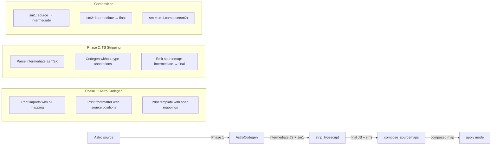
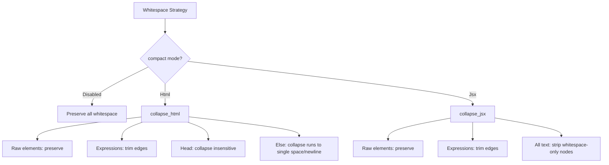

# Cross-Cutting Concerns: Sourcemaps, Whitespace, Performance, Errors

Cross-cutting concerns span the entire compiler pipeline: sourcemaps track locations through parse-transform-print phases, whitespace strategies affect output correctness, error handling catches invalid input, and performance determines whether the compiler can run on every file save. Understanding these concerns is essential for debugging compilation issues and extending the compiler.

## Sourcemap Generation

### Go Compiler Sourcemaps

The Go compiler builds sourcemaps during printing using a chunk builder:

```go
// internal/printer/printer.go:547-558
func (p *printer) addSourceMapping(location loc.Loc) {
    if location.Start < 0 {
        p.builder.AddSourceMapping(loc.Loc{Start: 0}, p.output)
    } else {
        p.builder.AddSourceMapping(location, p.output)
    }
}

func (p *printer) addNilSourceMapping() {
    p.builder.AddSourceMapping(loc.Loc{Start: -1}, p.output)
}
```

Source: `internal/printer/printer.go:547-558`

The `sourcemap.ChunkBuilder` (`internal/sourcemap/sourcemap.go`) maps source positions to output positions incrementally as the printer emits bytes.

```go
// internal/sourcemap/sourcemap.go:575-595
type ChunkBuilder struct {
    inputSourceMap      *SourceMap
    sourceMap           []byte
    prevLoc             loc.Loc
    // ... more fields
}
// Methods: AddSourceMapping, GenerateChunk, GetLineAndColumnForLocation, etc.
```

Source: `internal/sourcemap/sourcemap.go`

The final result includes a `SourceMapChunk`:

```go
// internal/printer/printer.go:19-24
type PrintResult struct {
    Output         []byte
    SourceMapChunk sourcemap.Chunk  // Final sourcemap data
    TSXRanges      TSXRanges
}
```

Source: `internal/printer/printer.go:19-24`

### Rust Compiler Sourcemaps

The Rust compiler has a two-phase approach:



Source: `compiler-rs/crates/astro_codegen/src/printer/sourcemap_builder.rs`

The sourcemap builder tracks both source → intermediate and intermediate → final mappings:

```rust
// crates/astro_codegen/src/printer/sourcemap_builder.rs
pub struct AstroSourcemapBuilder<'a> {
    source: &'a SourceFile,
    mappings_builder: MappingBuilder,
}

impl<'a> AstroSourcemapBuilder<'a> {
    pub fn add_source_mapping(&mut self, output: &[u8], source_pos: u32) {
        self.mappings_builder.add_mapping(
            output_line(output),
            output_col(output),
            source_pos,
        );
    }
    
    pub fn add_source_mapping_force(&mut self, output: &[u8], source_pos: u32) {
        // Bypasses dedup for multi-line expansions
        self.mappings_builder.add_mapping_force(...);
    }
}
```

Source: `compiler-rs/crates/astro_codegen/src/printer/sourcemap_builder.rs`

The `add_source_mapping_force` bypasses the consecutive-position dedup, which is needed when a single source position maps to multiple output lines (e.g., expression expansion).

### Sourcemap Modes

Both compilers support three output modes:

| Mode | `code` field | `map` field |
|------|-------------|-------------|
| `external` (default) | Just JS | JSON sourcemap |
| `inline` | JS + `//# sourceMappingURL=data:...` | Empty |
| `both` | JS + `//# sourceMappingURL=data:...` | JSON sourcemap |

Source: `compiler-rs/crates/astro_codegen/src/options.rs:7-26`

## Whitespace Strategies

Three strategies are available:



### HTML Whitespace Collapsing

```rust
// crates/astro_codegen/src/printer/whitespace.rs
pub fn collapse_html(
    text: &str,
    in_raw: bool,
    in_insensitive: bool,
    pos: TextPosition,
) -> Option<String> {
    if in_raw { return Some(text.to_string()); }
    if in_insensitive { /* head: more aggressive */ }
    
    // If lone child and only whitespace: preserve
    if pos.is_lone_child && text.chars().all(|c| c.is_ascii_whitespace()) {
        return Some(text.to_string());
    }
    
    // Collapse runs of whitespace to single space
    // Preserve newlines as newlines
    // Trim leading/trailing appropriately
}
```

Source: `compiler-rs/crates/astro_codegen/src/printer/whitespace.rs`

### JSX Whitespace Collapsing

```rust
// crates/astro_codegen/src/printer/whitespace.rs
pub fn collapse_jsx(text: &str, in_raw: bool) -> Option<String> {
    if in_raw { return Some(text.to_string()); }
    
    // Strip all whitespace-only text nodes
    // Strip leading/trailing whitespace
    // Similar to Babel/SWC/esbuild JSX transformers
}
```

Source: `compiler-rs/crates/astro_codegen/src/printer/whitespace.rs`

Aha: The Go compiler does whitespace collapsing in the transform pass (modifying AST text nodes before printing), while the Rust compiler does it during printing (in `print_jsx_text_with_pos`). Both produce the same output but at different pipeline stages. The Go approach means the printer never sees whitespace decisions; the Rust approach means the AST is immutable after parsing, which is cleaner for tooling that reads the AST.

### Raw Element Tracking

The Rust compiler tracks raw element depth:

```rust
// crates/astro_codegen/src/printer/mod.rs
raw_element_depth: usize,  // > 0 means inside raw element
```

Incremented when entering `<pre>`, `<textarea>`, `<script>`, `<style>`, or `is:raw` elements. Decrementing on exit ensures nested raw elements are handled correctly.

## Error Handling and Diagnostics

### Go Compiler

The Go compiler uses a `handler.Handler` (`internal/handler/handler.go`) that collects errors, warnings, and hints:

```go
// internal/handler/handler.go
type Handler struct {
    diagnostics []Diagnostic
}

func (h *Handler) AppendError(err *loc.ErrorWithRange) {
    h.diagnostics = append(h.diagnostics, Diagnostic{
        Severity: Error,
        Code:     err.Code,
        Text:     err.Text,
        Range:    err.Range,
        Hint:     err.Hint,
    })
}

func (h *Handler) AppendWarning(warn *loc.ErrorWithRange) { ... }
func (h *Handler) AppendHint(hint *loc.ErrorWithRange) { ... }
```

Source: `internal/handler/handler.go`

Error codes are defined in `internal/loc/diagnostics.go`:

| Code | Severity | Condition |
|------|----------|-----------|
| `ERROR_MISSING_FRONTMATTER_FENCE` | Error | Closing `---` without opening |
| `ERROR_FRAGMENT_SHORTHAND_ATTRS` | Error | Attributes on `<>` fragment |
| `ERROR_UNTERMINATED_STRING` | Error | Unterminated quoted attribute |
| `ERROR_UNTERMINATED_JS_COMMENT` | Error | `//` at end of frontmatter |
| `WARNING_SET_WITH_CHILDREN` | Warning | `set:html` with child nodes |
| `WARNING_CANNOT_DEFINE_VARS` | Warning | Cannot inject define:vars |
| `WARNING_DEPRECATED_DIRECTIVE` | Warning | `<script hoist>` deprecated |
| `WARNING_INVALID_SPREAD` | Warning | `...spread` without braces |
| `WARNING_UNTERMINATED_HTML_COMMENT` | Warning | `<!--` without `-->` |
| `HINT` | Hint | Script may need `is:inline` |

Source: `internal/loc/diagnostics.go`

### Rust Compiler

The Rust compiler uses oxc's diagnostic system:

```rust
// crates/astro_codegen/src/diagnostic.rs
pub struct Diagnostic {
    pub severity: DiagnosticSeverity,
    pub message: String,
    pub labels: Vec<DiagnosticLabel>,
}

impl Diagnostic {
    pub fn from_oxc_list(
        source_text: &str,
        errors: &[oxc_diagnostics::OxcDiagnostic],
    ) -> Vec<Self> { ... }
}
```

Source: `compiler-rs/crates/astro_codegen/src/diagnostic.rs`

### N-API Error Conversion

```rust
// crates/astro_napi/src/error.rs
pub struct DiagnosticMessage {
    pub severity: String,  // "error", "warning", "info", "hint"
    pub location: Option<DiagnosticLocation>,
    pub message: String,
    pub hint: Option<String>,
}

impl DiagnosticMessage {
    pub fn from_codegen_list(diagnostics: Vec<Diagnostic>) -> Vec<Self> { ... }
}
```

Source: `compiler-rs/crates/astro_napi/src/error.rs`

## Performance Characteristics

### Go/WASM Performance

| Metric | Value |
|--------|-------|
| WASM binary size | ~1-2 MB compressed |
| Startup cost | WASM instantiate + compile (~10-50ms) |
| Per-compilation | ~1-10ms for typical files |
| Memory | WASM heap (managed by Go GC) |
| Parallelism | Single WASM instance (singleton pattern) |

The WASM service is singleton (`longLivedService`) because WASM instantiation is expensive. All calls share the same instance.

Source: `compiler/packages/compiler/src/node/index.ts:39-56`

### Rust/N-API Performance

| Metric | Value |
|--------|-------|
| Binary size | Native addon (~2-5 MB) |
| Startup cost | require() (near-zero) |
| Per-compilation | ~0.5-5ms for typical files |
| Memory | Native heap (mimalloc allocator) |
| Parallelism | Thread pool (async) or sync |

The Rust compiler uses `mimalloc` as the global allocator (on supported platforms) for faster allocation patterns.

Source: `compiler-rs/crates/astro_napi/src/lib.rs:5-15`

### Benchmark Suite

The Rust compiler includes divan benchmarks:

```rust
// crates/astro_codegen/benches/codegen.rs
#[divan::bench]
fn basic_component(bencher: divan::Bencher) {
    bencher.bench(|| compile_astro_with_options(BASIC_COMPONENT, options.clone()));
}
```

Source: `compiler-rs/crates/astro_codegen/benches/codegen.rs`

## Testing Strategies

### Go Compiler Tests

Go tests use the standard `testing` package with snapshot testing:

```go
// internal/parser_test.go
func TestParser(t *testing.T) {
    // Table-driven tests for parsing scenarios
}

// internal/token_test.go
func TestTokenizer(t *testing.T) {
    // Table-driven tests for tokenization
}
```

Source: `internal/parser_test.go`, `internal/token_test.go`

TypeScript tests use `uvu`:

```typescript
// packages/compiler/test/basic/expressions.ts
import { transform } from '@astrojs/compiler';
import { test } from 'uvu';

test('expressions in attributes', async () => {
  const result = await transform(`<div class={cls} />`);
  assert.equal(result.code.includes('$$addAttribute'), true);
});
```

Source: `compiler/packages/compiler/test/` directory (50+ test files).

### Rust Compiler Tests

The Rust compiler uses `insta` for snapshot testing:

```rust
// crates/astro_codegen/src/printer/printer_tests.rs
#[test]
fn basic_component() {
    let result = compile_astro_with_options(BASIC_COMPONENT, TransformOptions::new());
    insta::assert_snapshot!(result.code);
}
```

Source: `compiler-rs/crates/astro_codegen/src/printer/printer_tests.rs`

Integration tests run as snapshot files:

```rust
// crates/astro_codegen/tests/snapshots.rs
#[test]
fn snapshots() {
    let paths = glob("tests/snapshots/**/*.astro").unwrap();
    for path in paths {
        // Compile and compare snapshot
    }
}
```

Source: `compiler-rs/crates/astro_codegen/tests/snapshots.rs`

## Memory Management

### Go WASM

```typescript
// packages/compiler/src/node/index.ts:41-44
export const teardown = () => {
  longLivedService = undefined;
  (globalThis as any)['@astrojs/compiler'] = undefined;
};
```

Required for long-running servers to release WASM memory. Without teardown, the WASM instance stays pinned in memory.

### Rust N-API

Native handles are managed by Node's garbage collector. The mimalloc allocator is optional:

```rust
#[cfg(all(
    feature = "allocator",
    not(any(target_arch = "arm", target_os = "freebsd", target_os = "windows", target_family = "wasm"))
))]
#[global_allocator]
static ALLOC: mimalloc_safe::MiMalloc = mimalloc_safe::MiMalloc;
```

Source: `compiler-rs/crates/astro_napi/src/lib.rs:5-15`

### Rust Release Profile

```toml
# Cargo.toml:52-59
[profile.release]
opt-level = 3
lto = "fat"
codegen-units = 1
strip = "symbols"
debug = false
panic = "abort"
```

Source: `compiler-rs/Cargo.toml:52-59`

These settings optimize for production: full LTO for best performance, symbol stripping for smaller binary, abort on panic (no unwinding needed in a compiler).

Aha: The Rust release profile uses `panic = "abort"` which means any panic crashes the process rather than unwinding. This is acceptable for a compiler (panics are bugs, not expected errors) and reduces binary size by eliminating unwind tables. The Go/WASM version can't do this — Go requires panic recovery for the WASM service to stay alive.

## Cross-Compiler Consistency

Both compilers must produce identical output. The test strategy verifies this:

1. Compile the same `.astro` source with both compilers
2. Compare the generated `code` field
3. Compare `scope` hash
4. Compare `css` array
5. Compare `hydratedComponents`, `clientOnlyComponents`, `serverComponents`

Minor differences (whitespace in generated JS, import ordering) are acceptable as long as the runtime behavior is identical.

## Next Steps

This concludes the documentation. Review the index: [README](./README.md)

Related documents:
- [Overview](./00-overview.md) — Architecture summary
- [Go Parser](./01-go-parser.md) — Parse phase
- [Code Generation](./06-code-generation.md) — Print phase
- [Compiler API](./07-compiler-api.md) — How to use the compiler
