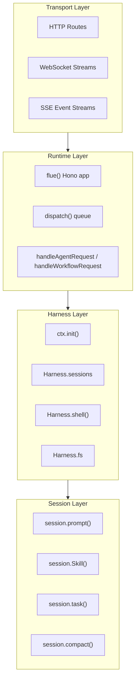
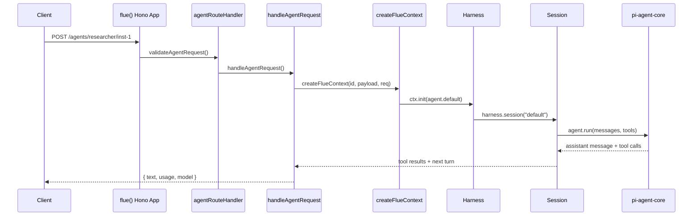

# Flue Overview: The Agent Harness Framework

Flue is a TypeScript framework that runs AI agents headlessly. It wraps `pi-agent-core` into a full runtime with HTTP/WebSocket APIs, sandbox isolation, session persistence, structured results, workflow orchestration, and multi-target deployment to Node.js or Cloudflare Workers. Flue is **not** an AI SDK. It is a runtime framework like Astro or Next.js, but for agents. You define agents in TypeScript, Flue serves them over HTTP, manages their conversation state, and orchestrates their tool use. The same codebase deploys to Node.js (with a local sandbox) or Cloudflare Workers (with Durable Objects for persistence) without code changes.

**Related**: [Architecture deep dive](./01-architecture.md) -- [Agent system](./02-agent-system.md) -- [Harness and sessions](./03-harness-sessions.md)

**Source**: [flue/packages/runtime/](https://github.com/formulus-ai/flue/tree/main/packages/runtime)

---

## Philosophy: Agents as Serverless Functions

Flue treats agents the same way web frameworks treat HTTP handlers. An agent is a function that receives a context, initializes a harness, and runs a session. The framework handles everything else: routing, persistence, tool execution, compaction, and observability.

```typescript
// src/agents/researcher.ts
import { createAgent } from "@flue/runtime";

export default createAgent(() => ({
  model: "anthropic/claude-sonnet-4-20250514",
  cwd: "/home/user/project",
}));
```

Source: `packages/runtime/src/agent-definition.ts` -- `createAgent()` returns a frozen object with `__flueCreatedAgent: true` and an `initialize` function that the runtime calls on each request.

The agent definition is **not** a singleton. It runs fresh on every invocation. The runtime calls `initialize(context)` to get an `AgentRuntimeConfig`, then constructs a `Harness` with a `SessionEnv`, `SessionStore`, and tool factory. This means every request gets a clean harness but shares persistent session state through the store.

### Aha: Flue Agents Are Claude Code Without the TUI

This is the core insight. Flue agents use the **same tools** as Claude Code -- `read`, `write`, `edit`, `bash`, `grep`, `glob`, `task` -- with the **same AGENTS.md discovery** and the **same skills system** from `.agents/skills/`. The only difference is the interface: Claude Code talks to a human through a terminal UI; Flue agents talk to HTTP requests and workflows through a headless runtime.

When you write `createAgent(() => ({ model: "anthropic/...", cwd: "/project" }))`, the runtime:

1. Reads `AGENTS.md` and `CLAUDE.md` from the session's `cwd`
2. Discovers skills from `.agents/skills/<name>/SKILL.md`
3. Composes a system prompt with a headless preamble: "You are running in headless mode with no human operator. Work autonomously -- never ask questions, never wait for user input."
4. Builds the same tool list Claude Code uses
5. Routes LLM calls through `pi-agent-core`

The agent is Claude Code's engine, served over HTTP.

Source: `packages/runtime/src/context.ts:104-105` -- `HEADLESS_PREAMBLE` constant injected into every system prompt.

---

## Mental Model: The Four-Layer Stack

Flue has four conceptual layers. Each layer builds on the one below it:



Each layer maps to a distinct API surface:

| Layer | Entry Point | What It Manages |
|-------|-------------|-----------------|
| Transport | `flue()` Hono sub-app | HTTP routes, WebSocket upgrades, SSE streams |
| Runtime | `handleAgentRequest`, `handleWorkflowRequest` | Request parsing, context creation, dispatch admission |
| Harness | `ctx.init()` returns `FlueHarness` | Session lifecycle, sandbox environment, out-of-band shell/fs |
| Session | `harness.session()` returns `FlueSession` | LLM turns, tool execution, compaction, structured results |

The transport layer is a Hono sub-app mounted at any path. The runtime layer handles routing logic and error envelopes. The harness layer manages session creation and sandbox access. The session layer drives LLM turns and tool calls. Each layer is testable in isolation.

---

## Quickstart: Three Agents in Five Minutes

### Step 1: Define an Agent

Create a file at `src/agents/greeter.ts`:

```typescript
// src/agents/greeter.ts
// Source: projects use the createAgent pattern from packages/runtime/src/agent-definition.ts
import { createAgent } from "@flue/runtime";

export default createAgent(() => ({
  model: "anthropic/claude-sonnet-4-20250514",
  cwd: "/tmp/greeter-workspace",
}));
```

The `createAgent()` function validates that you passed an initializer function, then returns a frozen object:

```typescript
// packages/runtime/src/agent-definition.ts:77-86
export function createAgent<TPayload, TEnv>(
  initialize: (context: AgentCreateContext<TPayload, TEnv>) => AgentRuntimeConfig | Promise<AgentRuntimeConfig>,
): CreatedAgent<TPayload, TEnv> {
  if (typeof initialize !== "function") {
    throw new Error("[flue] createAgent() requires an initializer function.");
  }
  return Object.freeze({ __flueCreatedAgent: true as const, initialize });
}
```

The initializer receives an `AgentCreateContext` with three fields: `id` (the instance or run ID), `env` (platform environment bindings), and `payload` (workflow payload, undefined for direct agent calls). It returns an `AgentRuntimeConfig` with `model`, `cwd`, `sandbox`, `persist`, `instructions`, `skills`, `tools`, `subagents`, `thinkingLevel`, and `compaction`.

### Step 2: Define a Workflow

Create a file at `.flue/workflows/greet.ts`:

```typescript
// .flue/workflows/greet.ts
// Source: workflow handler pattern from packages/runtime/src/runtime/handle-agent.ts
import type { FlueContext } from "@flue/runtime";

export async function handle(ctx: FlueContext) {
  const agent = await import("../agents/greeter");
  const harness = await ctx.init(agent.default);
  const session = await harness.session("default");
  const result = await session.prompt("Say hello to the world");
  return { greeting: result.text };
}
```

Workflows are async functions that receive a `FlueContext`. The context provides `id` (the run ID), `payload` (the invocation payload), `env` (platform bindings), `req` (the incoming `Request`), `log` (a `FlueLogger`), and `init()` to create a harness.

### Step 3: Deploy and Invoke

Build with `flue build --target node` or `flue build --target cloudflare`. The CLI generates a server entry point that imports your agents and workflows, configures the runtime, and mounts `flue()` on a Hono app.

Invoke the agent:

```bash
curl -X POST http://localhost:8787/agents/greeter/instance-1 \
  -H "Content-Type: application/json" \
  -d '{"message": "Say hello"}'
```

Or invoke the workflow:

```bash
curl -X POST http://localhost:8787/workflows/greet \
  -H "Content-Type: application/json"
```

Source: `packages/runtime/src/runtime/flue-app.ts:270-318` -- `flue()` creates a Hono app with routes at `/agents/:name/:id`, `/workflows/:name`, and `/runs/:runId`.

---

## Core Concepts at a Glance

### Agents

Agents are defined in `agents/<name>.ts` via `createAgent()`. They are addressable at `/agents/:name/:id`. Each agent gets its own harness, sessions, and sandbox. The agent initializer runs on every request -- there is no persistent agent instance in memory.

Source: `packages/runtime/src/agent-definition.ts` -- `createAgent()` function.

### Harnesses

A harness is a configured environment returned by `ctx.init()`. It holds the model, sandbox, tools, skills, and session store. A harness can have multiple named sessions. The harness name defaults to `'default'` and is set via `AgentHarnessOptions.name`.

Source: `packages/runtime/src/harness.ts` -- `Harness` class implementing `FlueHarness`.

### Sessions

Sessions are conversation-state containers within a harness. They manage message history, compaction, and persistence. The `FlueSession` interface exposes `prompt()`, `skill()`, `task()`, `shell()`, `compact()`, `delete()`, and `fs`. Sessions are named -- the default session is called `'default'`.

Source: `packages/runtime/src/session.ts` -- `Session` class (internal) wrapped by `FlueSession` in `harness.ts`.

### Sandboxes

Sandboxes are isolated execution environments. The virtual sandbox (just-bash) runs commands in-process without a container. The local sandbox (Node only) runs commands on the host. Remote sandboxes connect to providers like E2B, Daytona, or Modal via duck-typed `SandboxApi` connectors.

Source: `packages/runtime/src/sandbox.ts` -- `createSandboxSessionEnv()`, `bashFactoryToSessionEnv()`.

### Tools

Tools are LLM-callable functions. Flue ships with seven built-in tools: `read`, `write`, `edit`, `bash`, `grep`, `glob`, and `task`. Custom tools are defined with `defineTool()` and passed to `createAgent()`, `init()`, `prompt()`, `skill()`, or `task()`. MCP servers can be connected via `connectMcpServer()`.

Source: `packages/runtime/src/agent.ts` -- `createTools()` builds the built-in tool list. `packages/runtime/src/tool.ts` -- `defineTool()` validates custom tools.

### Skills

Skills are markdown-defined agent capabilities discovered from `.agents/skills/<name>/SKILL.md` at runtime, or statically imported as packaged skills. A skill has a name, description, and optional resource files. The model reads the skill file from disk when activated.

Source: `packages/runtime/src/context.ts:40-73` -- `discoverLocalSkills()` reads `SKILL.md` frontmatter.

### Workflows

Workflows are orchestration handlers exported from `.flue/workflows/`. They are invoked via HTTP at `/workflows/:name`. A workflow receives a `FlueContext`, initializes agents, manages sessions, and returns a result. Workflows support three invocation modes: accepted (returns a run ID), wait-result (blocks until completion), and stream (SSE event stream).

Source: `packages/runtime/src/runtime/flue-app.ts:579-634` -- `workflowRouteHandler` dispatches to Node or Cloudflare.

### Dispatch

`dispatch()` delivers input asynchronously to an agent session. It does not wait for the model to process or respond. The returned `DispatchReceipt` contains a `dispatchId` that identifies delivery. Cloudflare dispatch is at-least-once; Node uses a process-lifetime in-memory queue by default.

Source: `packages/runtime/src/runtime/flue-app.ts:180-205` -- `dispatch()` function.

### Compaction

Compaction manages context windows automatically. When used tokens exceed `contextWindow - reserveTokens`, older messages are summarized by an LLM and replaced with a structured summary. Defaults: `reserveTokens` capped at 20000 (model-aware), `keepRecentTokens` at 8000. Compaction can be disabled with `compaction: false` or tuned per-agent.

Source: `packages/runtime/src/compaction.ts` -- `deriveCompactionDefaults()`, `compact()`.

### Multi-Target

The same Flue code deploys to Node.js or Cloudflare Workers. On Node, sessions use `InMemorySessionStore` by default. On Cloudflare, sessions live in Durable Objects with automatic persistence. The CLI generates different entry points for each target.

Source: `packages/runtime/src/node/` (5 files) and `packages/runtime/src/cloudflare/` (14 files).

---

## Key Design Decisions

### Duck-Typed Sandbox API

The `SandboxApi` interface is a structural contract. Any provider -- E2B, Daytona, Modal, Boxd, Mirage -- implements the same eight methods: `readFile`, `readFileBuffer`, `writeFile`, `stat`, `readdir`, `exists`, `mkdir`, `rm`, plus `exec`. There is zero provider branching in the core code. The session engine works with any `SessionEnv` regardless of how it was constructed.

Source: `packages/runtime/src/sandbox.ts:160-178` -- `SandboxApi` interface. `packages/runtime/src/sandbox.ts:181-254` -- `createSandboxSessionEnv()` wraps any `SandboxApi` into a `SessionEnv`.

### Session History Is a Tree, Not a List

`SessionHistory` stores entries with `parentId` links and a `leafId` pointer. This enables task sessions to persist as parent-owned subtrees. When a `session.task()` creates a child session, its entries branch off the parent's history tree. The parent's `getActivePath()` walks from `leafId` back through `parentId` to reconstruct the active conversation path.

Source: `packages/runtime/src/session.ts:262-448` -- `SessionHistory` class with `getActivePath()`, `appendMessage()`, `appendCompaction()`.

### Headless Mode Preamble Is Included Once

The headless preamble ("You are running in headless mode with no human operator") is injected into the system prompt during context discovery, not into every `prompt()` call. This means the model receives the instruction exactly once, when the session initializes. Previously it was inlined into every per-call user message, which was redundant noise.

Source: `packages/runtime/src/context.ts:104-147` -- `HEADLESS_PREAMBLE` constant and `composeSystemPrompt()`.

### Aha: The Virtual Sandbox Means No Container Needed

The just-bash virtual sandbox runs commands in-process on the host. For many agent tasks -- reading files, running scripts, installing packages -- a container is unnecessary. The agent gets its own isolated process environment with `exec`, file I/O, and path resolution. This dramatically reduces startup time (no container pull) and cost (no remote sandbox provider billing).

On Cloudflare, the virtual sandbox uses `VirtualSandbox` with in-process execution. On Node, the `local()` sandbox factory binds directly to the host filesystem and `child_process.exec`. Both implement the same `SessionEnv` interface.

Source: `packages/runtime/src/cloudflare/virtual-sandbox.ts` -- `getVirtualSandbox()` returns a `BashLike` instance. `packages/runtime/src/node/local.ts` -- `local()` returns a `SandboxFactory`.

---

## Package Structure

Flue is a monorepo with four packages:

| Package | Purpose | Key Exports |
|---------|---------|-------------|
| `@flue/runtime` | Agent runtime | `createAgent`, `defineAgentProfile`, `defineTool`, `dispatch`, `observe`, `connectMcpServer`, `Type`, `ResultUnavailableError` |
| `@flue/sdk` | Client library | `FlueClient` with `agents.invoke()`, `workflows.connect()`, `runs.get()`, `runs.events()`, `runs.stream()` |
| `@flue/cli` | Build tooling | `flue build`, `flue dev`, `flue add` |
| `@flue/opentelemetry` | Observability | OpenTelemetry integration |

The runtime barrel export at `packages/runtime/src/index.ts` re-exports the public API. Internal helpers (`createFlueContext`, `InMemorySessionStore`, `bashFactoryToSessionEnv`) are intentionally NOT re-exported -- they live in `@flue/runtime/internal` and are consumed only by the generated server entry point.

Source: `packages/runtime/src/index.ts:1-107`.

---

## The Request Flow: From HTTP to LLM

When a request arrives at `POST /agents/:name/:id`:



1. `flue()` receives the request at the `/agents/:name/:id` route (source: `packages/runtime/src/runtime/flue-app.ts:285-294`)
2. `validateAgentRequest()` checks that the agent name exists in the manifest and the HTTP transport is enabled (source: `packages/runtime/src/errors.ts`)
3. `handleAgentRequest()` dispatches to the target-specific handler (Node: `handleAgentRequest` with handlers map; Cloudflare: `routeAgentRequest` forwarding to Durable Object) (source: `packages/runtime/src/runtime/flue-app.ts:636-687`)
4. `createFlueContext()` builds the context with the instance ID, payload, request, logger, and `init()` method
5. `ctx.init()` calls the agent's `initialize()` function, discovers context from `cwd`, builds the tool factory, and returns a `Harness`
6. `harness.session("default")` creates or loads a session from the store
7. The agent's exported function calls `session.prompt()`, `session.skill()`, or `session.task()` to drive LLM turns
8. The result is returned to the HTTP client as a JSON response or SSE stream

---

## Thinking Levels

The `ThinkingLevel` type controls reasoning effort for models that support it (like Claude's extended thinking). Valid values: `off`, `minimal`, `low`, `medium`, `high`, `xhigh`. The harness defaults to `"medium"` when unset.

Source: `packages/runtime/src/agent-definition.ts:32-39` -- `VALID_THINKING_LEVELS` constant.

```typescript
// packages/runtime/src/agent-definition.ts:32-39
const VALID_THINKING_LEVELS = {
  off: true,
  minimal: true,
  low: true,
  medium: true,
  high: true,
  xhigh: true,
} as const satisfies Record<ThinkingLevel, true>;
```

Thinking level is set at three levels of precedence: per-call override > agent default > profile default. Setting it on `createAgent(() => ({ thinkingLevel: "high" }))` applies to all session operations unless a specific `prompt()`, `skill()`, or `task()` call overrides it.

---

## Built-In Tool Limits

The seven built-in tools have hard limits to prevent context window exhaustion:

| Tool | Limit | Constant |
|------|-------|----------|
| `read` (text) | 2000 lines or 50KB | `MAX_READ_LINES = 2000`, `MAX_READ_BYTES = 50 * 1024` |
| `read` (directory) | Unlimited entries | Lists directory contents as newline-separated names |
| `grep` | 100 matches, 500 chars/line | `MAX_GREP_MATCHES = 100`, `MAX_GREP_LINE_LENGTH = 500` |
| `glob` | 1000 results | `MAX_GLOB_RESULTS = 1000` |
| `bash` | 2000 lines or 50KB output | Uses `truncateTail()` from `formatBashResult()` |
| `write` | Unlimited | Creates parent directories automatically |
| `edit` | Unlimited file size | Requires unique `oldText` match |

Source: `packages/runtime/src/agent.ts:5-9` -- constant definitions at file top.

---

## Session Persistence Model

Sessions persist through a `SessionStore` interface with three methods: `save(id, data)`, `load(id)`, `delete(id)`. The `SessionData` shape is versioned (currently version 5) with these fields:

| Field | Type | Purpose |
|-------|------|---------|
| `version` | `5` | Schema version; mismatch throws an error |
| `affinityKey` | `string` | Opaque stable identity for prompt caching and routing |
| `entries` | `SessionEntry[]` | Tree-structured history with parent links |
| `leafId` | `string \| null` | Pointer to the active leaf entry |
| `metadata` | `Record<string, any>` | Arbitrary key-value data (parent session, task ID, cwd, depth) |
| `createdAt` | `string` | ISO timestamp |
| `updatedAt` | `string` | ISO timestamp |

Source: `packages/runtime/src/types.ts:773-782` -- `SessionData` interface.

On Node, `InMemorySessionStore` is the default. On Cloudflare, the `store` object from `packages/runtime/src/cloudflare/session-store.ts` uses Durable Object storage.

---

## Error Envelopes

All Flue errors return a consistent `FluePublicError` shape:

```typescript
// packages/runtime/src/types.ts:50-61
interface FluePublicError {
  type: string;      // Stable machine-readable error category
  message: string;   // Short caller-facing summary
  details: string;   // Caller-facing explanation
  dev?: string;      // Additional local-development guidance
  meta?: Record<string, unknown>; // Structured error-specific metadata
}
```

HTTP routes return error envelopes with appropriate status codes: 400 for validation errors, 404 for not found, 405 for method not allowed, 415 for invalid content type, 500 for internal errors, 501 for unconfigured runtime features.

Source: `packages/runtime/src/runtime/flue-app.ts:382-391` -- `errorResponses()` function.

---

## Next Steps

- [Architecture](./01-architecture.md) -- Full dependency graph, layer diagrams, package structure, and multi-target deployment details
- [Agent System](./02-agent-system.md) -- `createAgent`, profiles, subagents, and skills in depth
- [Harness and Sessions](./03-harness-sessions.md) -- `init()`, harness lifecycle, session operations, and the tree-based history model
