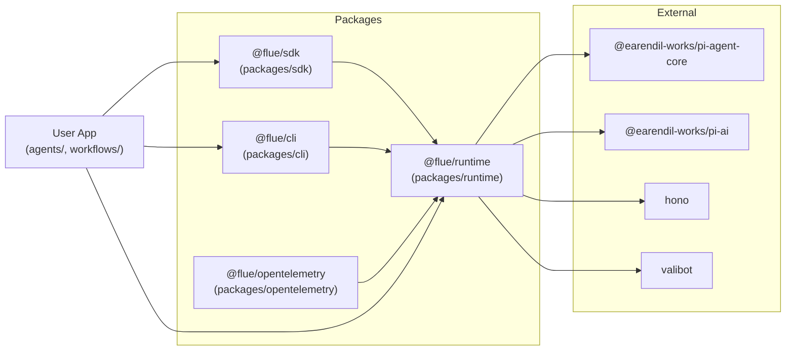
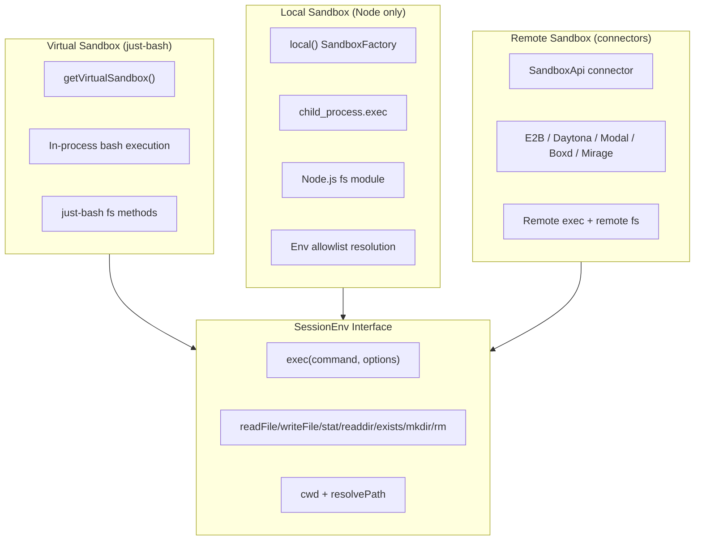
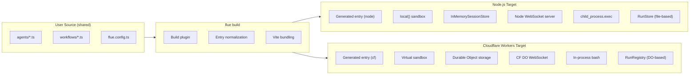
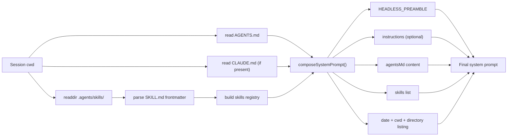
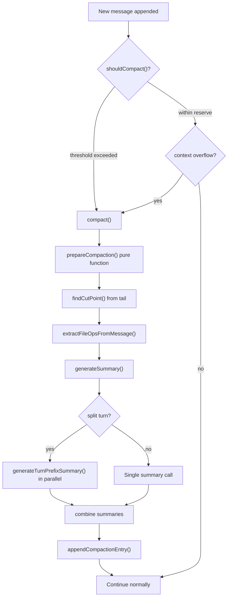

# Flue Architecture: Full Dependency Graph, Layers, and Multi-Target Deployment

Flue's architecture separates concerns into four layers: transport (HTTP/WebSocket/SSE), runtime (request routing and dispatch), harness (session management and sandbox), and session (LLM turns and tool execution). The same source code compiles to two different targets -- Node.js and Cloudflare Workers -- with target-specific adapters for sandboxing, persistence, and WebSocket handling. This document maps every package, every layer, and every cross-target difference.

**Related**: [Overview](./00-overview.md) -- [Agent System](./02-agent-system.md) -- [Harness and Sessions](./03-harness-sessions.md) -- [Sandbox and Tools](./04-sandbox-tools.md)

**Source**: [flue/packages/runtime/](https://github.com/formulus-ai/flue/tree/main/packages/runtime)

---

## Complete Package Dependency Graph

Flue is a monorepo managed by pnpm workspaces. Four packages form the core:



The dependency direction is intentional: `@flue/runtime` depends only on the pi libraries and Hono. The SDK, CLI, and OpenTelemetry packages depend on the runtime. User applications depend on the runtime and optionally on the SDK and CLI.

### Package Details

| Package | Directory | Files | Key Files |
|---------|-----------|-------|-----------|
| `@flue/runtime` | `packages/runtime/` | Runtime core | `src/runtime/flue-app.ts`, `src/session.ts` (2271 lines), `src/agent.ts`, `src/types.ts`, `src/compaction.ts` |
| `@flue/sdk` | `packages/sdk/` | Client library | `src/client.ts`, `src/http.ts`, `src/public/invoke.ts`, `src/public/websocket.ts`, `src/public/stream.ts` |
| `@flue/cli` | `packages/cli/` | Build tooling | `src/lib/build.ts`, `src/lib/dev.ts`, `src/lib/config.ts`, `bin/flue.ts` |
| `@flue/opentelemetry` | `packages/opentelemetry/` | Observability | `src/index.ts` |

Source: `packages/runtime/src/index.ts` (107 lines), `packages/sdk/src/client.ts`, `packages/cli/src/lib/build.ts`.

---

## Layer Architecture

The four layers form a strict dependency hierarchy. Each layer calls downward and never upward.

```mermaid
flowchart TD
    subgraph Transport["Transport Layer (HTTP/WebSocket/SSE)"]
        T1["flue() Hono sub-app"]
        T2["GET /openapi.json"]
        T3["POST /agents/:name/:id"]
        T4["GET /agents/:name/:id (WS)"]
        T5["POST /workflows/:name"]
        T6["GET /workflows/:name (WS)"]
        T7["GET /runs/:runId"]
        T8["GET /runs/:runId/events"]
        T9["GET /runs/:runId/stream (SSE)"]
    end

    subgraph RuntimeLayer["Runtime Layer (Request Handling)"]
        R1["agentRouteHandler"]
        R2["workflowRouteHandler"]
        R3["handleAgentRequest (node)"]
        R4["handleWorkflowRequest (node)"]
        R5["routeAgentRequest (cf)"]
        R6["routeWorkflowRequest (cf)"]
        R7["dispatch() admission queue"]
        R8["createFlueContext"]
    end

    subgraph HarnessLayer["Harness Layer (Session Management)"]
        H1["Harness class"]
        H2["Harness.session()"]
        H3["Harness.sessions.get/create/delete"]
        H4["Harness.shell()"]
        H5["Harness.fs (out-of-band)"]
        H6["SessionEnv (sandbox adapter)"]
        H7["SessionStore (persistence)"]
    end

    subgraph SessionLayer["Session Layer (LLM + Tools)"]
        S1["Session class (internal)"]
        S2["FlueSession (public wrapper)"]
        S3["SessionHistory (tree)"]
        S4["session.prompt()"]
        S5["session.Skill()"]
        S6["session.Task()"]
        S7["session.Shell()"]
        S8["session.Compact()"]
        S9["Built-in tools: read/write/edit/bash/grep/glob/task"]
        S10["Compaction engine"]
    end

    Transport --> RuntimeLayer
    RuntimeLayer --> HarnessLayer
    HarnessLayer --> SessionLayer
```



The key invariant: **no layer imports a higher layer**. Transport imports runtime types but never harness types. Runtime imports harness types but never session types. Harness imports session types. Session imports nothing above it.

---

## Runtime Layer Deep Dive: `flue-app.ts`

The `flue()` function creates a Hono sub-app with all public routes. This is the single entry point for both Node and Cloudflare targets.

Source: `packages/runtime/src/runtime/flue-app.ts:270-318`.

```typescript
// packages/runtime/src/runtime/flue-app.ts:270-318
export function flue(): Hono {
  const app = new Hono();

  app.get("/openapi.json", lazyOpenApiRouteHandler(app, publicOpenApiOptions));

  app.post(
    "/workflows/:name",
    describeRoute(workflowRouteSpec()),
    validated("param", WorkflowRouteParamSchema),
    validated("query", WorkflowInvocationQuerySchema),
    workflowRouteHandler,
  );
  app.get("/workflows/:name", workflowSocketRouteHandler);
  app.all("/workflows/:name", workflowRouteHandler);

  app.post(
    "/agents/:name/:id",
    describeRoute(agentRouteSpec()),
    validated("param", AgentRouteParamSchema),
    agentRouteHandler,
  );
  app.get("/agents/:name/:id", agentSocketRouteHandler);
  app.all("/agents/:name/:id", agentRouteHandler);

  for (const [routePath, action] of RUN_ROUTES_BY_ID) {
    // /runs/:runId, /runs/:runId/events, /runs/:runId/stream
    ...
  }

  app.onError((err) => toHttpResponse(err));
  return app;
}
```

The routes are:

| Route | Method | Handler | Purpose |
|-------|--------|---------|---------|
| `/openapi.json` | GET | `lazyOpenApiRouteHandler` | OpenAPI specification |
| `/workflows/:name` | POST | `workflowRouteHandler` | Invoke workflow (accepted/wait-result/stream) |
| `/workflows/:name` | GET (WS) | `workflowSocketRouteHandler` | WebSocket workflow invocation |
| `/agents/:name/:id` | POST | `agentRouteHandler` | Prompt agent (sync/stream) |
| `/agents/:name/:id` | GET (WS) | `agentSocketRouteHandler` | WebSocket agent attachment |
| `/runs/:runId` | GET | `handleRunById('get')` | Get workflow run record |
| `/runs/:runId/events` | GET | `handleRunById('events')` | List persisted run events |
| `/runs/:runId/stream` | GET (SSE) | `handleRunById('stream')` | Stream live run events |

Source: `packages/runtime/src/runtime/flue-app.ts:156-160` -- `RUN_ROUTES_BY_ID` constant array.

### Dispatch Admission

The `dispatch()` function queues input for asynchronous delivery. It has two overloads: one accepting a `CreatedAgent` value directly, and one accepting a named agent string. Both return a `DispatchReceipt` with `dispatchId` and `acceptedAt`.

```typescript
// packages/runtime/src/runtime/flue-app.ts:180-205
export function dispatch(agent: CreatedAgent, request: AgentDispatchRequest): Promise<DispatchReceipt>;
export function dispatch(request: NamedAgentDispatchRequest): Promise<DispatchReceipt>;
export async function dispatch(
  agentOrRequest: CreatedAgent | NamedAgentDispatchRequest,
  maybeRequest?: AgentDispatchRequest,
): Promise<DispatchReceipt> {
  const rt = runtimeConfig;
  if (!rt) throw new Error("[flue] dispatch() called before runtime was configured.");
  if (!rt.dispatchQueue) throw new Error("[flue] dispatch() cannot be accepted because no dispatch queue is configured.");
  const request = isCreatedAgentValue(agentOrRequest)
    ? resolveCreatedAgentDispatchRequest(agentOrRequest, maybeRequest, rt)
    : agentOrRequest;
  return enqueueDispatch({ request, dispatchQueue: rt.dispatchQueue, rt });
}
```

Source: `packages/runtime/src/runtime/flue-app.ts:180-205`.

---

## Harness Layer: The `Harness` Class

The `Harness` class implements `FlueHarness` and manages sessions, shell execution, and file I/O. It is constructed by `createFlueContext` inside `ctx.init()`.

Source: `packages/runtime/src/harness.ts:36-274`.

```typescript
// packages/runtime/src/harness.ts:36-59
export class Harness implements FlueHarness {
  readonly sessions: FlueSessions = {
    get: (name?: string) => this.openSession(name, "get"),
    create: (name?: string) => this.openSession(name, "create"),
    delete: (name?: string) => this.deleteSession(name),
  };

  readonly fs: FlueFs;

  private openSessions = new Map<string, Session>();
  private pendingSessionOperations = new Map<string, Promise<void>>();

  constructor(
    private instanceId: string,
    readonly name: string,
    private config: AgentConfig,
    private env: SessionEnv,
    private store: SessionStore,
    private eventCallback?: FlueEventCallback,
    private agentTools: ToolDefinition[] = [],
    private toolFactory?: SessionToolFactory,
  ) {
    this.fs = createFlueFs(env);
  }
  ...
}
```

The harness manages session lifecycle through `openSession()` with three modes: `'get-or-create'` (default for `session()`), `'get'` (throws if not found), and `'create'` (throws if already exists). Session operations for the same name are serialized through `pendingSessionOperations` to prevent race conditions.

Source: `packages/runtime/src/harness.ts:111-176` -- `openSession()`, `loadSession()`, `runSessionOperation()`.

### Session Serialization

The `runSessionOperation()` method serializes operations per session name. It chains promises so that two concurrent `session.prompt()` calls on the same session name execute sequentially:

```typescript
// packages/runtime/src/harness.ts:117-131
private runSessionOperation<T>(sessionName: string, operation: () => Promise<T>): Promise<T> {
  const previous = this.pendingSessionOperations.get(sessionName) ?? Promise.resolve();
  const result = previous.then(operation);
  const tail = result.then(() => {}, () => {});
  this.pendingSessionOperations.set(sessionName, tail);
  void tail.then(() => {
    if (this.pendingSessionOperations.get(sessionName) === tail) {
      this.pendingSessionOperations.delete(sessionName);
    }
  });
  return result;
}
```

This prevents concurrent modifications to the same session's conversation tree. Task sessions (named `task:<parent>:<taskId>`) are separate entries and can run in parallel with their parent.

---

## Session Layer: The `Session` Class

The internal `Session` class (2271 lines) is the heart of Flue. It wraps the public `FlueSession` interface and manages LLM turns, tool execution, compaction, and structured results.

Source: `packages/runtime/src/session.ts` (2271 lines).

### SessionHistory: Tree-Based Conversation State

`SessionHistory` stores conversation entries as a tree with parent links, not a linear list:

```typescript
// packages/runtime/src/session.ts:262-307
export class SessionHistory {
  private entries: SessionEntry[];
  private byId: Map<string, SessionEntry>;
  private leafId: string | null;

  getActivePath(): SessionEntry[] {
    const path: SessionEntry[] = [];
    let current = this.leafId ? this.byId.get(this.leafId) : undefined;
    while (current) {
      path.push(current);
      current = current.parentId ? this.byId.get(current.parentId) : undefined;
    }
    return path.reverse();
  }
  ...
}
```

The tree structure enables several important behaviors:

1. **Task sessions persist as parent-owned subtrees**. When `session.task()` creates a child session, its entries branch off the parent via `parentId`. The child's history is never merged into the parent; instead, a `BranchSummaryEntry` summarizes the child's result and links back via `fromId`.
2. **Compaction works on the active path only**. `buildContextEntries()` walks from `leafId` back through parent links, inserting the latest `CompactionEntry` summary at the appropriate position.
3. **Branch switching is safe**. If a mid-window branch switch happened, `getActivePathSince()` returns an empty array rather than silently including unrelated history.

Source: `packages/runtime/src/session.ts:262-448`.

### Session Entry Types

Three entry types form the session history:

| Entry Type | Fields | Purpose |
|------------|--------|---------|
| `MessageEntry` | `type: 'message'`, `message: AgentMessage`, `source?`, `dispatch?` | A single message in the conversation (user, assistant, toolResult) |
| `CompactionEntry` | `type: 'compaction'`, `summary`, `firstKeptEntryId`, `tokensBefore`, `usage?` | A compaction summary replacing older messages |
| `BranchSummaryEntry` | `type: 'branch_summary'`, `fromId`, `summary` | A summary of a completed task session |

Source: `packages/runtime/src/types.ts:784-829`.

### The Turn Loop

Each `prompt()`, `skill()`, or `task()` call enters a turn loop:

1. Build the LLM context from `SessionHistory.buildContext()` (active path with compaction summaries)
2. Assemble the tool list: built-in tools + custom tools + extra tools + packaged skill read tool
3. Call `pi-agent-core`'s `Agent.run()` with the context and tools
4. Process tool results and continue until the model stops calling tools
5. If `result:` schema is provided, inject `finish` and `give_up` tools and loop until one is called
6. Check for context overflow -- if exceeded, run compaction and retry the turn
7. Return the result to the caller

Source: `packages/runtime/src/session.ts` -- the main turn loop is in the `runAgentCall()` private method.

---

## Sandbox Architecture: Three Modes

Flue supports three sandbox modes, all implementing the `SessionEnv` interface:



### Virtual Sandbox

The virtual sandbox uses just-bash for in-process command execution. No container is needed. On Cloudflare, this is the default -- `getVirtualSandbox()` from `packages/runtime/src/cloudflare/virtual-sandbox.ts` returns a `BashLike` instance.

### Local Sandbox

The local sandbox runs on Node.js with `child_process.exec` and the Node.js `fs` module. The `local()` function from `packages/runtime/src/node/local.ts` returns a `SandboxFactory`:

```typescript
// packages/runtime/src/node/local.ts:18-22
export function local(options: LocalSandboxOptions = {}): SandboxFactory {
  return {
    createSessionEnv: async () => createLocalSessionEnv(options),
  };
}
```

Environment variables are filtered through an allowlist (`DEFAULT_LOCAL_ENV_ALLOWLIST` in `packages/runtime/src/node/local-env.ts`) to prevent leaking secrets into the sandbox.

### Remote Sandbox

Remote sandboxes implement the `SandboxApi` interface. The `createSandboxSessionEnv()` function wraps any `SandboxApi` into a `SessionEnv`:

```typescript
// packages/runtime/src/sandbox.ts:181-254
export function createSandboxSessionEnv(api: SandboxApi, cwd: string): SessionEnv {
  const resolvePath = (p: string): string => { ... };
  return {
    async exec(command, options) {
      const signal = options?.signal;
      if (signal?.aborted) throw abortErrorFor(signal);
      const result = await api.exec(command, {
        cwd: options?.cwd ?? cwd,
        env: options?.env,
        timeout: options?.timeout,
        signal,
      });
      if (signal?.aborted) throw abortErrorFor(signal);
      return result;
    },
    readFile: (path) => api.readFile(resolvePath(path)),
    // ... writeFile, stat, readdir, exists, mkdir, rm
  };
}
```

The abort checks (pre-call and post-call) are centralized here so connectors that don't support `AbortSignal` still get correct abort semantics.

Source: `packages/runtime/src/sandbox.ts:181-254`.

### Aha: Duck-Typed Sandbox Means Zero Provider Branching

The `SandboxApi` interface is a structural contract. Any provider implements the same eight methods. The session engine works with any `SessionEnv` regardless of construction method. There is no `if (provider === 'e2b')` branching in the core code. Connectors are pluggable -- the `connectors/` directory at the repo root contains spec files that define the interface each connector must satisfy.

Source: `packages/runtime/src/sandbox.ts:160-178` -- `SandboxApi` interface definition.

---

## Multi-Target Deployment: Node vs Cloudflare

The same Flue code deploys to two targets. The CLI generates different entry points for each.



### Target Comparison

| Aspect | Node.js | Cloudflare Workers |
|--------|---------|-------------------|
| Entry point | `node/index.ts` generated | `cloudflare/index.ts` generated |
| Sandbox | `local()` -- host fs + `child_process.exec` | `getVirtualSandbox()` -- in-process just-bash |
| Session store | `InMemorySessionStore` (default) | Durable Object `store` (automatic) |
| Run store | File-based `RunStore` | DO-based persistence |
| Run registry | In-process `RunRegistry` | Cross-deployment DO-based `RunRegistry` |
| WebSocket | Node `ws` library | Cloudflare WebSocket attachment API |
| Dispatch queue | Process-lifetime in-memory | Durable Object admission (at-least-once) |
| Context creation | `createFlueContext()` with `process.env` | `getCloudflareContext()` with Worker env |
| Agent routing | Direct handler map (`rt.handlers`) | Durable Object forwarding (`routeAgentRequest`) |
| Persistence opt-in | Supply a `SessionStore` to `createAgent()` | Automatic via Durable Objects |

Source: `packages/runtime/src/node/local.ts`, `packages/runtime/src/cloudflare/virtual-sandbox.ts`, `packages/runtime/src/cloudflare/session-store.ts`, `packages/runtime/src/cloudflare/durable-object.ts`.

### Cloudflare Durable Object Architecture

On Cloudflare, each agent gets a Durable Object instance identified by `{agentName}/{instanceId}`. The DO handles all requests for that agent instance. Session state lives in DO storage -- no database configuration needed.

```typescript
// packages/runtime/src/cloudflare/durable-object.ts:6-24
export async function fetchCloudflareDurableObject(
  namespace: DurableObjectNamespace,
  name: string,
  request: Request,
  options: { retry?: boolean } = {},
): Promise<Response> {
  let attempt = 0;
  while (true) {
    try {
      return await namespace.get(namespace.idFromName(name)).fetch(request.clone());
    } catch (error) {
      attempt++;
      if (!options.retry || attempt >= 3 || !isRetryableDurableObjectError(error)) throw error;
      await new Promise((resolve) =>
        setTimeout(resolve, Math.floor(Math.random() * 100 * 2 ** (attempt - 1))),
      );
    }
  }
}
```

The retry logic handles `overloaded` and `retryable` errors from the DO runtime. Jittered exponential backoff prevents thundering herds.

Source: `packages/runtime/src/cloudflare/durable-object.ts:6-30`.

### Aha: Cloudflare Persistence Is Automatic

On Cloudflare, session data lives in Durable Objects. There is no database configuration, no connection pool, no migration script. The `store` object from `packages/runtime/src/cloudflare/session-store.ts` uses the DO's `storage` API directly. Every `save()` and `load()` call goes to durable storage automatically. On Node, you must supply a `SessionStore` if you want persistence beyond the process lifetime.

---

## Built-In Tools Architecture

The seven built-in tools are created by `createTools()` in `packages/runtime/src/agent.ts`:

```typescript
// packages/runtime/src/agent.ts:37-48
export function createTools(env: SessionEnv, options?: CreateToolsOptions): AgentTool<any>[] {
  const tools: AgentTool<any>[] = [
    createReadTool(env, options?.packagedSkills ?? {}),
    createWriteTool(env),
    createEditTool(env),
    createBashTool(env),
    createGrepTool(env),
    createGlobTool(env),
  ];
  if (options?.task) tools.push(createTaskTool(options.task, options.subagents ?? {}));
  return tools;
}
```

### Tool Limits Table

| Tool | Parameters | Output Limit | Source Location |
|------|-----------|-------------|-----------------|
| `read` | `path`, `offset?`, `limit?` | 2000 lines, 50KB | `agent.ts:74-113` |
| `write` | `path`, `content` | Unlimited (creates parent dirs) | `agent.ts:120-146` |
| `edit` | `path`, `oldText`, `newText`, `replaceAll?` | Unlimited (requires unique match) | `agent.ts:155-198` |
| `bash` | `command`, `timeout?` | 2000 lines, 50KB output | `agent.ts:206-272` |
| `grep` | `pattern`, `path?`, `include?` | 100 matches, 500 chars/line | `agent.ts:348-394` |
| `glob` | `pattern`, `path?` | 1000 results | `agent.ts:397+` |
| `task` | `prompt`, `description?`, `agent?`, `cwd?` | Returns final text answer | `agent.ts:291-318` |

### Aha: The Bash Tool Has Dual Timeout Enforcement

The `bash` tool enforces timeouts at two levels:

1. **LLM-visible timeout**: `params.timeout` (in seconds) is passed to `env.exec()` as a hint. Sandbox connectors forward it to their provider's native timeout option. On timeout, the tool returns a recoverable exit code 124 so the model can retry or adapt.
2. **Local backstop**: `AbortSignal.timeout(params.timeout * 1000)` is composed into the exec signal. Connectors that ignore both fields will at least see the merged signal aborted on the way out.

```typescript
// packages/runtime/src/agent.ts:235-268
const timeoutSignal = typeof params.timeout === "number"
  ? AbortSignal.timeout(params.timeout * 1000) : undefined;
const execSignal = signal && timeoutSignal
  ? AbortSignal.any([signal, timeoutSignal]) : (signal ?? timeoutSignal);

const timedOut = () => formatBashResult({
  stdout: "",
  stderr: `[flue] Command timed out after ${params.timeout} seconds.`,
  exitCode: 124,
}, params.command);

try {
  const result = await env.exec(params.command, { timeout: params.timeout, signal: execSignal });
  if (timeoutSignal?.aborted && !signal?.aborted) return timedOut();
  return formatBashResult(result, params.command);
} catch (err) {
  if (timeoutSignal?.aborted && !signal?.aborted) return timedOut();
  throw err;
}
```

The timeout-as-recoverable-result behavior lives in the LLM-facing tool, not in `SessionEnv` or `SandboxApi`. Programmatic callers use `AbortSignal.timeout()` and accept abort semantics; the model can only emit JSON, so it needs `params.timeout` and a recoverable 124-shaped exit code.

---

## Context Discovery Pipeline

When a session initializes, it discovers context from the sandbox filesystem:



Source: `packages/runtime/src/context.ts:151-179` -- `discoverSessionContext()`.

The system prompt composition order is:

1. `HEADLESS_PREAMBLE` -- always first
2. Custom `instructions` from agent config
3. `AGENTS.md` content
4. `CLAUDE.md` content (concatenated with AGENTS.md)
5. Available skills list with descriptions
6. Date, working directory, and directory listing

Skills are discovered from `.agents/skills/<name>/SKILL.md`. The frontmatter (name + description) is parsed at initialization time. The skill body is **not** loaded into context -- the model reads the file from disk itself when activating the skill. This keeps relative references inside skills resolvable from their actual location and lets users edit skill files mid-session without re-initializing.

Source: `packages/runtime/src/context.ts:40-73` -- `discoverLocalSkills()`.

---

## Compaction Engine Architecture

The compaction system has two trigger modes and a pure-function preparation step:



### Compaction Defaults

Source: `packages/runtime/src/compaction.ts:37-72`.

```typescript
// packages/runtime/src/compaction.ts:37-41
export const DEFAULT_COMPACTION_SETTINGS: CompactionSettings = {
  enabled: true,
  reserveTokens: 20000,
  keepRecentTokens: 8000,
};
```

The `deriveCompactionDefaults()` function adjusts these based on the active model:

```typescript
// packages/runtime/src/compaction.ts:51-72
export function deriveCompactionDefaults(input: {
  contextWindow: number;
  maxTokens: number;
}): CompactionSettings {
  const reserveCap = input.maxTokens > 0 ? input.maxTokens : DEFAULT_COMPACTION_SETTINGS.reserveTokens;
  let reserveTokens = Math.min(DEFAULT_COMPACTION_SETTINGS.reserveTokens, reserveCap);
  if (input.contextWindow > 0 && reserveTokens * 2 >= input.contextWindow) {
    reserveTokens = Math.max(1024, Math.floor(input.contextWindow / 3));
  }
  return { enabled: true, reserveTokens, keepRecentTokens: DEFAULT_COMPACTION_SETTINGS.keepRecentTokens };
}
```

Key insight: reserve is capped at the model's `maxTokens` because reserving more than the model can emit in one turn wastes context. For tiny-window models, reserve is clamped to a third of the window so threshold compaction can actually fire.

### Aha: Compaction Is LLM Summarization, Not Truncation

Compaction uses the same agent harness to summarize old messages. The summarization model produces a structured markdown summary with sections: Goal, Constraints & Preferences, Progress (Done/In Progress/Blocked), Key Decisions, Next Steps, and Critical Context. The cost is persisted on `CompactionEntry.usage` and folded into the triggering call's total usage.

Source: `packages/runtime/src/compaction.ts:612-647` -- `generateSummary()` and `generateTurnPrefixSummary()`.

---

## Structured Results: The `finish`/`give_up` Injection Loop

When a caller passes `options.result` with a Valibot schema, Flue injects two hidden tools into the harness:

```typescript
// packages/runtime/src/result.ts:12-13
const FINISH_TOOL_NAME = "finish";
const GIVE_UP_TOOL_NAME = "give_up";
```

The framework loops until one of these tools is called, with a 32-attempt defense-in-depth ceiling. The `finish` tool validates the model's output against the schema; if validation fails, the model receives an error and can retry. The `give_up` tool returns a `reason` string when the model cannot produce a conforming result.

The prompt footer instructs the model:

```
When the task is complete, call the `finish` tool with your final answer as its arguments.
The arguments are validated against the required schema; if validation fails you will
receive an error and may try again.
If you determine that you cannot complete the task or cannot produce a result that
conforms to the required schema, call the `give_up` tool with a clear `reason`.
Do not respond with the answer in plain text — only a successful `finish` (or `give_up`)
call counts.
```

Source: `packages/runtime/src/result.ts:16-23` -- `buildResultFooter()`.

---

## Event System: `FlueEvent` Union

The `FlueEvent` type is a discriminated union with 25+ variants covering every runtime activity:

| Event Type | When It Fires |
|------------|---------------|
| `run_start` | Workflow run begins |
| `run_resume` | Workflow run resumes after interruption |
| `agent_start` | Agent processing begins |
| `agent_end` | Agent processing ends |
| `turn_start` | LLM turn begins |
| `turn_request` | LLM request details (model, provider, messages, tools) |
| `turn_end` | LLM turn completes |
| `message_start` | Model message begins (streaming) |
| `message_update` | Model message chunk |
| `message_end` | Model message completes |
| `tool_execution_start` | Tool call begins |
| `tool_execution_update` | Partial tool result |
| `tool_execution_end` | Tool call completes |
| `text_delta` | Text streaming chunk |
| `thinking_start` | Extended thinking begins |
| `thinking_delta` | Thinking chunk |
| `thinking_end` | Thinking completes |
| `tool_start` | Simplified tool call start |
| `tool_call` | Simplified tool call result |
| `turn` | Aggregated turn result |
| `task_start` | Delegated task begins |
| `task` | Delegated task completes |
| `compaction_start` | Compaction begins (reason: threshold/overflow/manual) |
| `compaction` | Compaction completes |
| `operation_start` | Session operation begins (prompt/skill/task/shell/compact) |
| `operation` | Session operation completes |
| `log` | Structured log event |
| `idle` | Agent is idle (no work) |
| `run_end` | Workflow run ends |

All events carry optional correlation fields: `runId`, `instanceId`, `dispatchId`, `eventIndex`, `timestamp`, `session`, `parentSession`, `taskId`, `harness`, `operationId`, `turnId`.

Source: `packages/runtime/src/types.ts:1026-1176` -- `FlueEvent` union type.

---

## SDK Client Architecture

The `FlueClient` provides HTTP and WebSocket access to deployed agents and workflows:

```typescript
// packages/sdk/src/client.ts:63-99 (abbreviated)
export interface FlueClient {
  runs: {
    get(runId: string): Promise<RunRecord>;
    events(runId: string, options?: RunEventsOptions): Promise<{ events: FlueEvent[] }>;
    stream(runId: string, options?: RunStreamOptions): AsyncIterable<FlueEvent>;
  };
  agents: {
    invoke(name, id, options): Promise<SyncInvokeResult> | AsyncIterable<AttachedAgentEvent>;
    connect(name, id): AgentSocket;
  };
  workflows: {
    connect(name: string): WorkflowSocket;
  };
  admin: {
    listRuns(options?: ListRunsOptions): Promise<ListResponse<RunRecord>>;
    listAgents(): Promise<ListResponse<AgentManifestEntry>>;
    listWorkflows(): Promise<ListResponse<AgentManifestEntry>>;
    getRunPointer(runId: string): Promise<RunPointer>;
  };
}
```

The SDK has three invocation modes for agents:

1. **Sync**: `invoke(name, id, { message: "..." })` -- blocks until the agent responds
2. **Stream**: `invoke(name, id, { message: "...", stream: true })` -- async iterable of `AttachedAgentEvent`
3. **WebSocket**: `connect(name, id)` -- persistent connection with `prompt()` and `on(event)` methods

Source: `packages/sdk/src/client.ts:63-99`.

---

## Next Steps

- [Agent System](./02-agent-system.md) -- `createAgent`, profiles, subagents, skills, and `defineAgentProfile` validation
- [Harness and Sessions](./03-harness-sessions.md) -- `init()`, harness lifecycle, session operations, tree-based history, and `CallHandle`
- [Sandbox and Tools](./04-sandbox-tools.md) -- Sandboxes, built-in tools, custom tools, MCP integration
- [Compaction](./05-compaction.md) -- Context management, summarization prompts, overflow recovery
