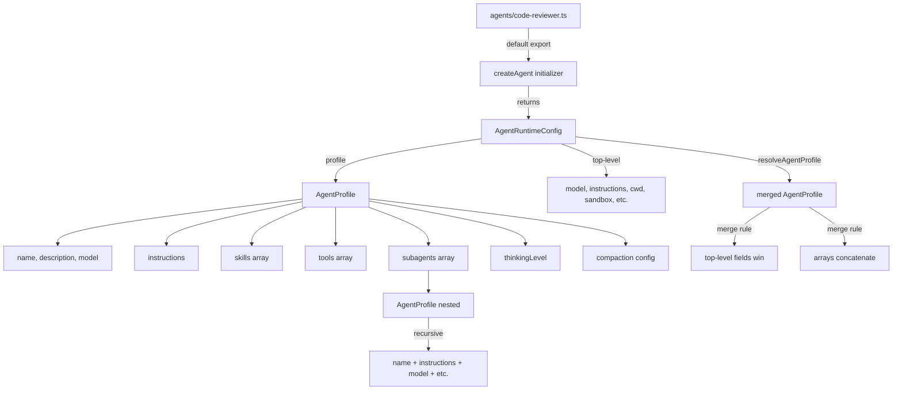
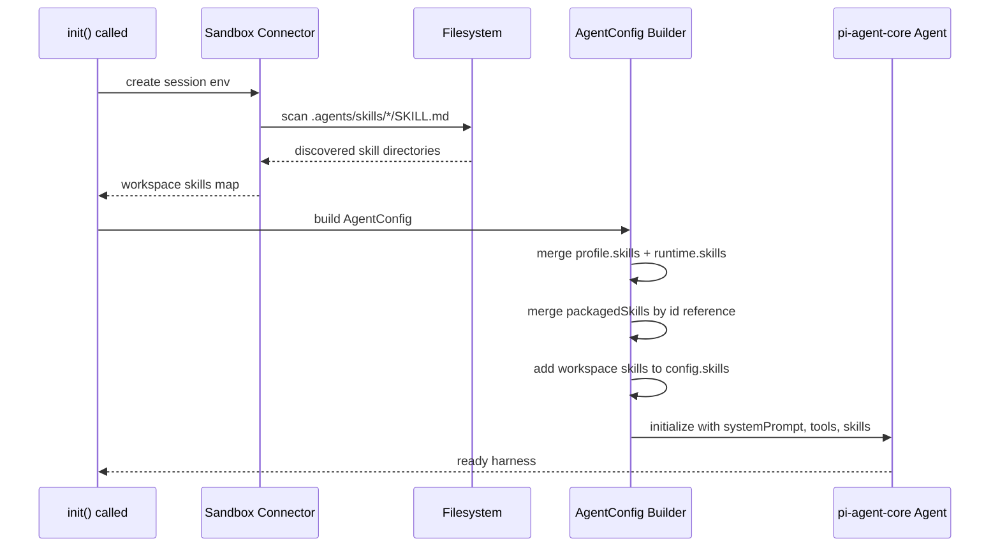

# Agent System — createAgent, profiles, subagents, skills

Flue agents are defined declaratively through `createAgent()` and `defineAgentProfile()`, not instantiated as objects. An agent is a frozen initializer function that returns an `AgentRuntimeConfig` when the runtime calls it. This means agents are stateless blueprints — the runtime constructs a fresh harness and session each time an agent is activated.

**Source:** `packages/runtime/src/agent-definition.ts` — `createAgent()`, `defineAgentProfile()`, `resolveAgentProfile()`
**Related:** [Harness & Sessions](03-harness-sessions.html) | [Sandbox & Tools](04-sandbox-tools.html) | [Compaction](05-compaction.html)

## createAgent() — The Stateless Initializer

`createAgent()` takes a single initializer function and returns a frozen `CreatedAgent` marker object. The initializer runs each time the runtime needs to spin up a harness for this agent — when a workflow calls `ctx.init()`, or when the runtime prepares an addressable agent interaction at `/agents/:name/:id`.

```typescript
// packages/runtime/src/agent-definition.ts:77-86
export function createAgent<TPayload = unknown, TEnv = Record<string, any>>(
	initialize: (
		context: AgentCreateContext<TPayload, TEnv>,
	) => AgentRuntimeConfig | Promise<AgentRuntimeConfig>,
): CreatedAgent<TPayload, TEnv> {
	if (typeof initialize !== 'function') {
		throw new Error('[flue] createAgent() requires an initializer function.');
	}
	return Object.freeze({ __flueCreatedAgent: true as const, initialize });
}
```

The initializer receives an `AgentCreateContext` with three fields:

| Field | Type | Meaning |
|-------|------|---------|
| `id` | `string` | Agent instance id, or workflow run id when initialized via `ctx.init()` |
| `env` | `TEnv` | Platform environment bindings (process.env on Node, Worker env on Cloudflare) |
| `payload` | `TPayload \| undefined` | Workflow payload when initialized via `ctx.init()`; `undefined` otherwise |

The initializer must return an `AgentRuntimeConfig` object. Unknown fields in the returned object throw an error. The accepted fields are: `profile`, `name`, `description`, `model`, `instructions`, `skills`, `tools`, `subagents`, `thinkingLevel`, `compaction`, `cwd`, `sandbox`, `persist`.

```typescript
// packages/runtime/src/types.ts:479-508
export interface AgentRuntimeConfig {
	profile?: AgentProfile;
	name?: string;
	description?: string;
	model?: ModelConfig;              // string or false
	instructions?: string;
	skills?: Skill[];
	tools?: ToolDefinition[];
	subagents?: AgentProfile[];
	thinkingLevel?: ThinkingLevel;
	compaction?: false | CompactionConfig;
	cwd?: string;
	sandbox?: false | SandboxFactory | BashFactory;
	persist?: SessionStore;
}
```

A typical agent definition file lives in `agents/<name>.ts` and default-exports the result of `createAgent()`:

```typescript
// agents/code-reviewer.ts
import { createAgent } from '@flue/runtime';

export default createAgent(async ({ id, env, payload }) => {
	return {
		model: 'anthropic/claude-sonnet-4-20250514',
		instructions: 'You are a code reviewer. Focus on correctness, security, and clarity.',
		cwd: '/workspace',
		sandbox: { /* sandbox factory */ },
		compaction: { reserveTokens: 15000, keepRecentTokens: 6000 },
		subagents: [
			{ name: 'lint', instructions: 'Run linters and report violations.' },
			{ name: 'test', instructions: 'Write and run tests for the given code.' },
		],
	};
});
```

The runtime discovers these modules automatically from the `agents/` directory. Each agent becomes addressable at `/agents/<name>/<instanceId>`.

## defineAgentProfile() — Reusable Behavior Blueprints

`defineAgentProfile()` validates and returns a reusable `AgentProfile`. Profiles define a coherent set of capabilities — model, instructions, skills, tools, subagents, thinking level, compaction — that can be used as the baseline for a created agent, or as named subagents available to `session.task()`.

```typescript
// packages/runtime/src/agent-definition.ts:60-63
export function defineAgentProfile(profile: AgentProfile): AgentProfile {
	assertAgentProfile(profile, 'defineAgentProfile()', new WeakSet());
	return profile;
}
```

The validation is thorough. `assertAgentProfile()` (lines 151-184) checks:

1. **Valibot schema parse** — the profile must match `AgentProfileSchema` (loose object with optional fields: `name`, `description`, `model`, `instructions`, `skills`, `tools`, `subagents`, `thinkingLevel`, `compaction`)
2. **Circular subagent detection** — a `WeakSet` tracks visited profile objects; if the same object reference appears twice in the subagent tree, an error is thrown
3. **Known fields only** — unknown profile fields throw: `[flue] <label> received unknown agent profile field "<key>".`
4. **Name format** — agent names must match `/^[A-Za-z][A-Za-z0-9_-]*$/` (start with letter, contain only letters, numbers, underscores, or hyphens)
5. **Thinking level** — must be one of: `off`, `minimal`, `low`, `medium`, `high`, `xhigh`
6. **Compaction fields** — only `reserveTokens`, `keepRecentTokens`, and `model` are accepted; token counts must be non-negative integers
7. **Tools validation** — each tool must have `name` (non-empty string), `description` (non-empty string), `parameters` (object), and `execute` (function)
8. **Skills validation** — each skill must have `name` and `description` (both non-empty strings)
9. **Subagent recursion** — each subagent is recursively validated with the same `assertAgentProfile()`, sharing the circular-reference tracking set
10. **Unique names** — tools, skills, and subagents must not contain duplicate names within their category

```typescript
// packages/runtime/src/types.ts:454-476
export interface AgentProfile {
	name?: string;
	description?: string;
	model?: ModelConfig;             // string or false
	instructions?: string;
	skills?: Skill[];
	tools?: ToolDefinition[];
	subagents?: AgentProfile[];
	thinkingLevel?: ThinkingLevel;
	compaction?: false | CompactionConfig;
}
```

Profiles are most valuable when you want to define specialized roles that can be delegated to via `session.task()`. Define them once at the agent level, reference them by name at task time.

## Profile Resolution — Runtime Field Merging

When a runtime config contains both top-level fields and a `profile` object, `resolveAgentProfile()` merges them with a clear precedence: top-level fields win when explicitly present; profile fields serve as the baseline. Arrays (`skills`, `tools`, `subagents`) are merged — both base and additions are included.

```typescript
// packages/runtime/src/agent-definition.ts:93-109
export function resolveAgentProfile(options: AgentRuntimeConfig | undefined): AgentProfile {
	assertAgentRuntimeConfig(options);
	const profile = options?.profile;
	return {
		name: hasOwn(options, 'name') ? options?.name : profile?.name,
		description: hasOwn(options, 'description') ? options?.description : profile?.description,
		model: hasOwn(options, 'model') ? options?.model : profile?.model,
		instructions: hasOwn(options, 'instructions') ? options?.instructions : profile?.instructions,
		skills: mergeArrays(profile?.skills, options?.skills),
		tools: mergeArrays(profile?.tools, options?.tools),
		subagents: mergeArrays(profile?.subagents, options?.subagents),
		thinkingLevel: hasOwn(options, 'thinkingLevel')
			? options?.thinkingLevel
			: profile?.thinkingLevel,
		compaction: hasOwn(options, 'compaction') ? options?.compaction : profile?.compaction,
	};
}
```

This matters in practice: a `createAgent()` initializer can return a reusable `profile` object and then overlay runtime-specific additions (extra tools, different cwd) without mutating the original. The `mergeArrays` helper concatenates — profile tools come first, runtime tools appended.

```typescript
// packages/runtime/src/agent-definition.ts:130-133
function mergeArrays<T>(base: T[] | undefined, additions: T[] | undefined): T[] | undefined {
	if (base === undefined && additions === undefined) return undefined;
	return [...(base ?? []), ...(additions ?? [])];
}
```

The `extendAgentProfile()` utility provides a focused way to add only capabilities (skills, tools, subagents) to an existing profile:

```typescript
// packages/runtime/src/agent-definition.ts:111-121
export function extendAgentProfile(
	profile: AgentProfile,
	extensions: Pick<AgentProfile, 'skills' | 'tools' | 'subagents'>,
): AgentProfile {
	return {
		...profile,
		skills: mergeArrays(profile.skills, extensions.skills),
		tools: mergeArrays(profile.tools, extensions.tools),
		subagents: mergeArrays(profile.subagents, extensions.subagents),
	};
}
```

## Subagents — Named Profiles for Task Delegation

Subagents are `AgentProfile` objects nested within an agent definition. They become available to `session.task()` via the `options.agent` parameter. When a task specifies `agent: 'lint'`, the runtime resolves the `lint` profile from `config.subagents` and creates a child session with that profile's instructions, model, skills, tools, and thinking level.

```typescript
// packages/runtime/src/session.ts:1294-1300
private resolveDeclaredSubagent(name: string): AgentProfile {
	const subagents = this.config.subagents ?? {};
	const subagent = subagents[name];
	if (subagent) return subagent;
	const available = Object.keys(subagents).join(', ') || '(none)';
	throw new Error(`[flue] Subagent "${name}" is not declared. Available: ${available}.`);
}
```

Subagents inherit the parent session's environment unless overridden. The task's `cwd` defaults to the parent session's cwd. The model and thinking level follow this precedence for tasks: call-level option > subagent profile value > inherited parent value.

```typescript
// packages/runtime/src/session.ts:1432-1441 (executeTask child options)
const childOptions: PromptOptions<v.GenericSchema | undefined> = {
	model:
		options?.model ?? (taskAgent?.model !== undefined ? undefined : options?.inheritedModel),
	thinkingLevel:
		options?.thinkingLevel ??
		(taskAgent?.thinkingLevel !== undefined ? undefined : options?.inheritedThinkingLevel),
	tools: options?.tools,
	images: options?.images,
	signal,
};
```

When the subagent has its own `model` set, the inheritance chain stops there — the subagent's model is used. When the subagent's `model` is `undefined`, the parent's model flows down. When the subagent's `model` is explicitly `false`, the call must provide a model or it throws.

**Task depth is limited to 4.** The constant `MAX_TASK_DEPTH = 4` at `session.ts:88` prevents infinite delegation chains. When `taskDepth >= 4`, the call throws: `[flue] Maximum task depth (4) exceeded.`

## Skills — Workspace and Packaged

Flue supports two skill systems that operate together: workspace skills discovered from the filesystem, and packaged skills embedded in the build.

### Workspace Skills

Discovered at `init()` time from `.agents/skills/<name>/SKILL.md` inside the session's sandbox. Each directory under `.agents/skills/` containing a `SKILL.md` file becomes a registered skill. The skill name is the directory name.

```
.agents/skills/
├── code-review/
│   └── SKILL.md          ← skill name: "code-review"
├── deploy-guide/
│   └── SKILL.md          ← skill name: "deploy-guide"
└── testing-patterns/
    └── SKILL.md          ← skill name: "testing-patterns"
```

Workspace skills are discovered by `skillsDirIn(cwd)` from `context.ts` during harness initialization. The default empty sandbox starts with no files, so it has no skills unless you populate them. This is a common source of confusion — skills must exist in the sandbox before `init()` runs.

### Packaged Skills

Packaged skills are pre-built skill directories included in the application build. They are defined as `PackagedSkillDirectory` objects:

```typescript
// packages/runtime/src/types.ts:209-214
export interface PackagedSkillDirectory {
	readonly id: string;
	readonly name: string;
	readonly description: string;
	readonly files: Record<string, PackagedSkillFile>;
}
```

Each file in a packaged skill is a `PackagedSkillFile` with base64 encoding:

```typescript
// packages/runtime/src/types.ts:203-207
export interface PackagedSkillFile {
	readonly encoding: 'base64';
	readonly kind: 'text' | 'binary';
	readonly content: string;
}
```

Packaged skills are referenced via `SkillReference` objects, which carry a `__flueSkillReference` marker:

```typescript
// packages/runtime/src/types.ts:196-201
export interface SkillReference {
	readonly __flueSkillReference: true;
	readonly id: string;
	readonly name: string;
	readonly description: string;
}
```

When `session.skill(skillReference)` is called with a `SkillReference`, the runtime resolves the packaged directory from `config.packagedSkills` and builds the skill prompt via `buildPackagedSkillPrompt()`. Packaged skills live at `/.flue/packaged-skills/` in the sandbox, and the `read` tool is intercepted to serve them from the packaged store when the path matches that prefix.

```typescript
// packages/runtime/src/session.ts:1198-1224
if (Object.keys(packagedSkills).length > 0) {
	const packagedRead = createPackagedSkillReadTool(packagedSkills);
	const connectorRead = connectorTools.find((tool) => tool.name === 'read');
	if (connectorRead) {
		connectorTools = connectorTools.map((tool) =>
			tool !== connectorRead
				? tool
				: {
						...tool,
						execute: (id, params, signal) => {
							const resourcePath = /* ... */;
							return typeof resourcePath === 'string' &&
								resourcePath.startsWith('/.flue/packaged-skills/')
								? packagedRead.execute(id, params, signal)
								: connectorRead.execute(id, params, signal);
						},
					},
		);
	}
}
```

The `Skill` union type accepts both forms:

```typescript
// packages/runtime/src/types.ts:217-222
export type Skill =
	| SkillReference
	| {
			name: string;
			description: string;
	  };
```

### Skill Merging Across Layers

Skills accumulate from three sources, merged in order:

1. **Profile skills** — from `AgentProfile.skills`
2. **Runtime skills** — from `AgentRuntimeConfig.skills` (appended to profile)
3. **Workspace skills** — discovered from `.agents/skills/` in the sandbox

Profile skills are merged into each discovered skill catalog during `AgentConfig` construction. This means workspace and packaged skills coexist — the same skill name from both sources resolves to the workspace version first (it's discovered at init time).

## Tool Registration — Custom and Built-in

Custom tools are `ToolDefinition` objects passed at various scopes. The registration flow validates, deduplicates, and converts them to `AgentTool` format for the underlying pi-agent-core engine.

```typescript
// packages/runtime/src/types.ts:235-244
export interface ToolDefinition<TParams extends ToolParameters = ToolParameters> {
	name: string;
	description: string;
	parameters: TParams;
	execute: (args: Record<string, any>, signal?: AbortSignal) => Promise<string>;
}
```

Custom tools can be registered at multiple scopes:

| Scope | Passed via | Availability |
|-------|-----------|-------------|
| Agent | `AgentRuntimeConfig.tools` | Every session initialized from this agent |
| Harness | `AgentHarnessOptions.tools` | Every session in this harness |
| Prompt | `PromptOptions.tools` | Only this `prompt()` call |
| Skill | `SkillOptions.tools` | Only this `skill()` call |
| Task | `TaskOptions.tools` | Only this `task()` call |

Tool names are validated against built-in tool names. The reserved set includes all built-in tools plus `task` (which is framework-reserved):

```typescript
// packages/runtime/src/session.ts:1161-1178
private validateCustomToolNames(tools: ToolDefinition[], builtinTools: AgentTool<any>[]): void {
	const reserved = new Set<string>(builtinTools.map((t) => t.name));
	reserved.add('task');
	const names = new Set<string>();
	for (const toolDef of tools) {
		if (reserved.has(toolDef.name)) {
			throw new Error(
				`[flue] Custom tool "${toolDef.name}" conflicts with a built-in tool. ` +
					`Built-in tools: ${[...reserved].join(', ')}`,
			);
		}
		if (names.has(toolDef.name)) {
			throw new Error(
				`[flue] Duplicate custom tool name "${toolDef.name}". Tool names must be unique.`,
			);
		}
		names.add(toolDef.name);
	}
}
```

Custom tools are converted to `AgentTool` format at runtime:

```typescript
// packages/runtime/src/session.ts:1142-1157
return tools.map(
	(toolDef): AgentTool<any> => ({
		name: toolDef.name,
		label: toolDef.name,
		description: toolDef.description,
		parameters: toolDef.parameters as any,
		async execute(_toolCallId: string, params: unknown, signal?: AbortSignal) {
			if (signal?.aborted) throw new Error('Operation aborted');
			const resultText = await toolDef.execute(params as Record<string, any>, signal);
			return {
				content: [{ type: 'text' as const, text: resultText }],
				details: { customTool: toolDef.name },
			};
		},
	}),
);
```

The `execute` function returns a string result that is sent back to the LLM as tool output. Thrown errors become tool errors visible to the model. The `signal` parameter allows the tool to observe call cancellation.

### Call Override Scope — Per-Call Tool Injection

When `prompt()`, `skill()`, or `task()` receives `options.tools`, the session temporarily swaps its tool set for the duration of that call via `withCallOverrides()`. The original tools are restored in the `finally` block:

```typescript
// packages/runtime/src/session.ts:1258-1290
private async withCallOverrides<T>(
	options: CallOverrides,
	fn: (ctx: { resolvedModel: Model<any> }) => Promise<T>,
): Promise<T> {
	const previousTools = this.harness.state.tools;
	// ... swap tools and model ...
	this.harness.state.tools = [...builtinTools, ...customTools, ...(options.extraTools ?? [])];
	try {
		return await fn({ resolvedModel });
	} finally {
		this.harness.state.tools = previousTools;
		// ... restore model and thinkingLevel ...
	}
}
```

This means per-call tools do not pollute the session's baseline tool set. The next `prompt()` without `options.tools` sees the original tools.

## Aha: Agents Are Stateless Blueprints, Not Persistent Objects

The most non-obvious design decision in Flue's agent system is that `createAgent()` returns a frozen marker object, not a constructed instance. The initializer function runs **each time** the runtime needs a harness for this agent. This means:

- Agents do not carry state between invocations. Each activation gets a fresh harness, fresh session, fresh sandbox.
- The initializer receives `id` (instance id or workflow run id), `env` (platform bindings), and `payload` (workflow data) — enough to make contextual decisions without persistence.
- The `__flueCreatedAgent: true` marker is used for duck-type detection in the runtime. No class hierarchy, no instanceof checks — just structural typing.

This design enables Flue's multi-target deployment. The same agent definition works on Node.js (where processes start and stop) and Cloudflare Workers (where Durable Objects persist but workers are stateless). The initializer pattern means the agent's configuration is computed fresh each time, from whatever environment it runs in.

**Key insight:** `defineAgentProfile()` validates deeply (circular detection, recursive subagent validation, unique names) but `createAgent()` only checks that the initializer is a function. The heavy validation happens when the runtime calls `resolveAgentProfile()` and `assertResolvedAgentProfile()` during harness initialization, not at `createAgent()` time. This defers expensive validation to when it's actually needed.

## Aha: The `task` Tool Is Available to the LLM Itself

The `task` tool is appended to the tool set automatically by `createBuiltinTools()`:

```typescript
// packages/runtime/src/session.ts:1228-1235
return [...connectorTools, createTaskTool(runTask, this.config.subagents ?? {})];
// or:
return createTools(env, {
	subagents: this.config.subagents ?? {},
	packagedSkills,
	task: runTask,
});
```

This means the LLM can delegate work to subagents during its own reasoning process — it does not need the caller to orchestrate parallel tasks. The model sees `task` as a tool with parameters for `prompt` (text instruction), `agent` (optional subagent name), and `cwd` (optional working directory). It can call `task` multiple times in a single turn, creating parallel child sessions that run concurrently.

This is the foundation of Flue's agent orchestration: the caller delegates to an agent, and that agent can in turn delegate to subagents, which can delegate further, up to the depth limit of 4. The caller only sees the final aggregated result; the intermediate task tree is recorded in the parent session's message history.

## Agent Definition Architecture



## Skill Discovery and Registration Flow



## Thinking Level Configuration

The `thinkingLevel` field controls the model's reasoning effort. Valid values are defined in `VALID_THINKING_LEVELS`:

```typescript
// packages/runtime/src/agent-definition.ts:32-39
const VALID_THINKING_LEVELS = {
	off: true,
	minimal: true,
	low: true,
	medium: true,
	high: true,
	xhigh: true,
} as const satisfies Record<ThinkingLevel, true>;
```

Thinking level follows a three-level precedence: call-level option > agent-level config > `'medium'` default. The harness substitutes `"medium"` when no thinking level is set anywhere:

```typescript
// packages/runtime/src/session.ts:1072-1074
private resolveThinkingLevelForCall(callValue: ThinkingLevel | undefined): ThinkingLevel {
	return callValue ?? this.config.thinkingLevel ?? 'medium';
}
```

The same pattern applies in the Agent constructor at initialization: `thinkingLevel: this.config.thinkingLevel ?? 'medium'` (session.ts:685).

## Compaction Per-Agent Configuration

Each agent can opt out of compaction with `compaction: false`, or tune it with a `CompactionConfig` object:

```typescript
// packages/runtime/src/types.ts:367-394
export interface CompactionConfig {
	reserveTokens?: number;      // headroom before compaction triggers
	keepRecentTokens?: number;   // recent tokens to preserve unsummarized
	model?: string;              // override model for summarization
}
```

The defaults are model-aware, capped at 20000 tokens for `reserveTokens`, and 8000 for `keepRecentTokens`. Override values at the agent level replace these defaults field-by-field. Setting `compaction: false` disables threshold compaction but does not disable overflow recovery or manual `session.compact()`.

## Related Documents

- [Harness & Sessions](03-harness-sessions.html) — How `init()` creates a harness from an agent, session lifecycle
- [Sandbox & Tools](04-sandbox-tools.html) — Sandbox connectors, built-in tools, custom tools, MCP servers
- [Compaction](05-compaction.html) — Context window management, summarization, overflow recovery
- [Workflows](06-workflows.html) — Workflow handlers that call `ctx.init()` to initialize agents
- [Session Persistence](13-session-persistence.html) — SessionData v5, storage, tree deletion semantics

---

[← Architecture](01-architecture.html) | [Index](README.html) | [Harness & Sessions →](03-harness-sessions.html)
