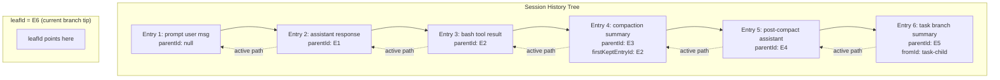
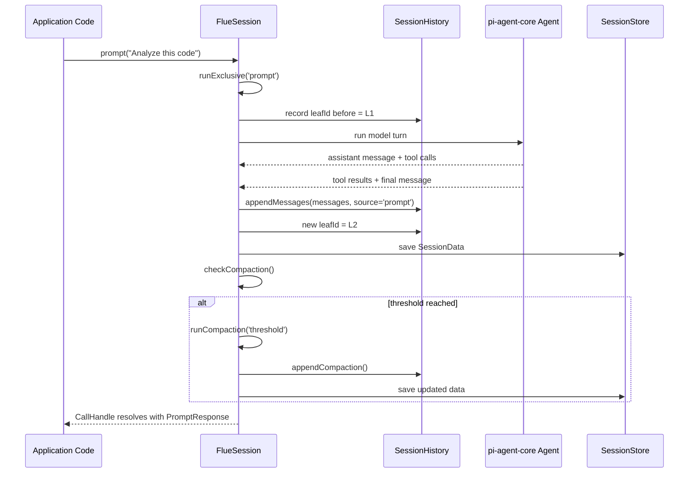
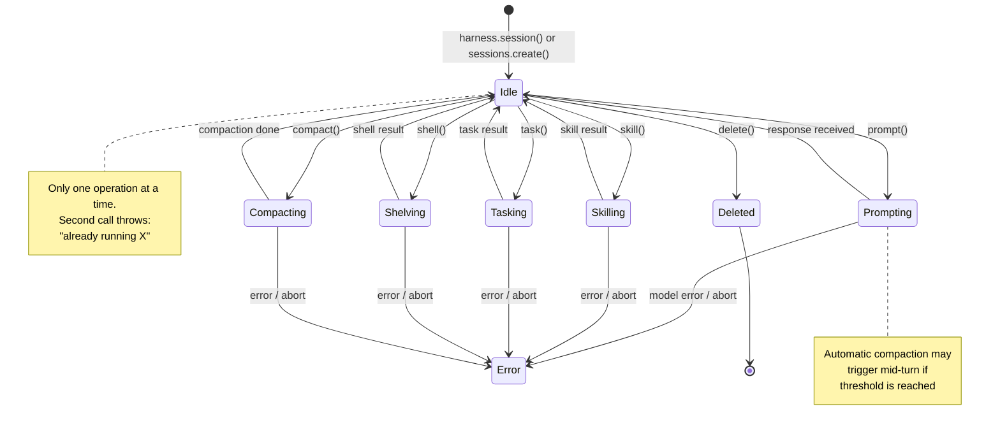

# Harness & Sessions — init(), session lifecycle, message history tree

Flue's harness is a configured environment returned by `ctx.init()` that holds a model, sandbox, tools, skills, and session manager. A harness manages multiple named sessions — each session is an independent conversation with its own message history, compaction state, and persistence. Sessions support six operations: `prompt()`, `skill()`, `task()`, `shell()`, `compact()`, and `delete()`.

**Source:** `packages/runtime/src/session.ts` (2271 lines) — `Session` class, `SessionHistory`, `InMemorySessionStore`
**Source:** `packages/runtime/src/types.ts` — `FlueHarness`, `FlueSessions`, `FlueSession`, `SessionData`, `SessionEntry`
**Related:** [Agent System](02-agent-system.html) | [Sandbox & Tools](04-sandbox-tools.html) | [Compaction](05-compaction.html) | [Session Persistence](13-session-persistence.html)

## init() — Creating the Harness

`init()` is a method on `FlueContext` available inside workflow handlers. It takes a `CreatedAgent` (from `createAgent()`) and optional `AgentHarnessOptions`, and returns a `Promise<FlueHarness>`.

```typescript
// packages/runtime/src/types.ts:572
init(agent: CreatedAgent<TPayload, TEnv>, options?: AgentHarnessOptions): Promise<FlueHarness>;
```

The harness options allow per-invocation overrides:

```typescript
// packages/runtime/src/types.ts:511-520
export interface AgentHarnessOptions {
	name?: string;       // harness name, defaults to 'default'
	tools?: ToolDefinition[];    // additional tools for all sessions
	skills?: Skill[];            // additional skills for all sessions
	subagents?: AgentProfile[];  // additional subagent profiles
}
```

Each harness name may be initialized **once per context**. Calling `init()` twice with the same name throws. The harness name defaults to `'default'`.

The returned `FlueHarness` provides four surfaces:

```typescript
// packages/runtime/src/types.ts:584-605
export interface FlueHarness {
	readonly name: string;
	session(name?: string): Promise<FlueSession>;   // get or create session
	readonly sessions: FlueSessions;                 // explicit management
	shell(command: string, options?: ShellOptions): CallHandle<ShellResult>;
	readonly fs: FlueFs;
}
```

The harness-level `shell()` and `fs` operate on the sandbox **without recording anything in a conversation transcript**. They are out-of-band plumbing — useful for staging files, capturing artifacts, or running setup commands before any model interaction.

## FlueSessions — Explicit Session Management

The harness exposes `sessions` for explicit create/get/delete operations:

```typescript
// packages/runtime/src/types.ts:611-622
export interface FlueSessions {
	get(name?: string): Promise<FlueSession>;    // load existing, throw if missing
	create(name?: string): Promise<FlueSession>; // create new, throw if exists
	delete(name?: string): Promise<void>;        // delete stored state, no-op if missing
}
```

Both `get()` and `create()` default to the `'default'` session name. Names beginning with `'task:'` are **reserved for delegated tasks** — the framework prefixes child task sessions with `task:` to prevent namespace collisions with user-created sessions.

Key behaviors:

- `get()` throws if the session does not exist in the store
- `create()` throws if the session already exists
- `delete()` is idempotent (no-op when missing) but **rejects if the open session has an active operation**
- Session-management requests for one name are applied in request order

`harness.session(name)` is a convenience that calls `get()` first, then `create()` if the session does not exist. It is the recommended way to access sessions when you do not care whether it is new or resumed.

## Session Operations — The Six Methods

`FlueSession` exposes six operations, each with specific semantics:

### prompt() — Model Instruction

Runs a model operation with a text instruction. Returns a `CallHandle` that resolves when the model completes its response.

```typescript
// packages/runtime/src/types.ts:648-652
prompt<S extends v.GenericSchema>(
	text: string,
	options: PromptOptions<S> & { result: S },
): CallHandle<PromptResultResponse<v.InferOutput<S>>>;
prompt(text: string, options?: PromptOptions): CallHandle<PromptResponse>;
```

The overloaded signature supports both freeform text responses (`PromptResponse` with `.text`) and structured data (`PromptResultResponse<T>` with `.data` validated against the valibot schema).

Options scope to the call duration only:

| Option | Type | Effect |
|--------|------|--------|
| `result` | Valibot schema | Require validated structured output |
| `tools` | `ToolDefinition[]` | Additional tools for this call only |
| `model` | `string` | Override model specifier |
| `thinkingLevel` | `ThinkingLevel` | Override reasoning effort |
| `signal` | `AbortSignal` | Cancel the call |
| `images` | `PromptImage[]` | Attach images to the user message |

The prompt text is built via `buildPromptText()` from `result.ts`. When a result schema is present, the prompt text includes schema instructions so the model knows what structure to produce.

### skill() — Registered Skill Execution

Runs a registered skill by name or `SkillReference`. The skill's `SKILL.md` content is injected into the prompt, and the model executes with the skill's instructions active.

```typescript
// packages/runtime/src/types.ts:668-672
skill<S extends v.GenericSchema>(
	skill: SkillReference | string,
	options: SkillOptions<S> & { result: S },
): CallHandle<PromptResultResponse<v.InferOutput<S>>>;
skill(skill: SkillReference | string, options?: SkillOptions): CallHandle<PromptResponse>;
```

The skill resolution flow (session.ts:891-935):

1. If the argument is a string, look up `config.skills[skill]`
2. If the found skill is a `SkillReference` (`__flueSkillReference`), resolve the packaged directory from `config.packagedSkills`
3. If the found skill is a plain skill object, build the prompt via `buildSkillByPathlessNamePrompt()`
4. If not found, throw with the available skills list and discovery guidance
5. If the argument is a `SkillReference` directly, resolve the packaged directory and build via `buildPackagedSkillPrompt()`

Skill options add `args` for passing arguments to the skill instruction:

```typescript
// packages/runtime/src/types.ts:856-871
export interface SkillOptions<S extends v.GenericSchema | undefined = undefined> {
	args?: Record<string, unknown>;   // arguments for the skill instruction
	result?: S;
	tools?: ToolDefinition[];
	model?: string;
	thinkingLevel?: ThinkingLevel;
	signal?: AbortSignal;
	images?: PromptImage[];
}
```

### task() — Delegated Child Session

Delegates work to a detached child session. The child runs in its own session with its own message history, model, and sandbox. The child's history persists as a **parent-owned subtree** until the parent is deleted.

```typescript
// packages/runtime/src/types.ts:679-683
task<S extends v.GenericSchema>(
	text: string,
	options: TaskOptions<S> & { result: S },
): CallHandle<PromptResultResponse<v.InferOutput<S>>>;
task(text: string, options?: TaskOptions): CallHandle<PromptResponse>;
```

Task options:

```typescript
// packages/runtime/src/types.ts:874-891
export interface TaskOptions<S extends v.GenericSchema | undefined = undefined> {
	result?: S;
	agent?: string;           // named subagent profile
	tools?: ToolDefinition[];
	model?: string;
	thinkingLevel?: ThinkingLevel;
	cwd?: string;             // working directory, defaults to parent session cwd
	signal?: AbortSignal;
	images?: PromptImage[];
}
```

The task execution flow (session.ts:1378-1482):

1. Generate a `taskId` via `crypto.randomUUID()`
2. Resolve the subagent profile if `options.agent` is specified
3. Assert `taskDepth < MAX_TASK_DEPTH` (4) or throw
4. Create a child session via `createTaskSession()` with `depth: this.taskDepth + 1`
5. Record the task session in `metadata.taskSessions` and save
6. Add child to `activeTasks` set
7. Call `child.prompt(text, childOptions)` — the child runs independently
8. Collect the result, emit `task` event, remove child from `activeTasks`, close child

The child session name is auto-generated with a `task:` prefix. The parent tracks child sessions in `metadata.taskSessions` as an array of `{ session, taskId }` objects.

### shell() — Out-of-Band Shell Command

Runs a shell command in the session's sandbox and records it in the conversation as if the model had called the `bash` tool. This keeps the transcript readable and lets compaction handle the exchange the same way as real tool calls.

```typescript
// packages/runtime/src/types.ts:655
shell(command: string, options?: ShellOptions): CallHandle<ShellResult>;
```

```typescript
// packages/runtime/src/types.ts:894-901
export interface ShellOptions {
	env?: Record<string, string>;
	cwd?: string;
	signal?: AbortSignal;
}
```

The shell exchange is recorded as a three-message triple (session.ts:1576-1630):

1. **User message**: `"Run this shell command:\n\n\`\`\`bash\n<command>\n\`\`\`"`
2. **Assistant message**: synthetic tool call with `toolCallId`, `name: 'bash'`, and arguments
3. **Tool result message**: formatted bash result with stdout, stderr, exitCode

The synthetic assistant message uses sentinel provider fields (`api: 'flue-shell'`, `provider: 'flue'`, `model: ''`, zero tokens) so no real provider is implied.

Environment values in the transcript only record **keys**, not values, since env values often contain credentials. The actual values are passed to `env.exec()`:

```typescript
// packages/runtime/src/session.ts:972-974
const args: Record<string, unknown> = { command };
if (options?.cwd !== undefined) args.cwd = options.cwd;
if (options?.env !== undefined) args.env = redactEnvValues(options.env);
```

### compact() — Manual Compaction

Triggers compaction immediately. Equivalent to what automatic compaction runs when crossing the configured threshold, but on-demand.

```typescript
// packages/runtime/src/types.ts:700
compact(): Promise<void>;
```

Key behaviors:

- Resolves successfully (no-op) when there is nothing to compact
- Throws if another operation (`prompt` / `skill` / `task` / `shell`) is in flight
- Emits `compaction_start` with `reason: "manual"` followed by `compaction`
- The summarization LLM cost is recorded on `CompactionEntry.usage`, same as automatic compaction

### delete() — Session Deletion

Deletes the session's stored conversation state. Rejects while an operation is active. Once deletion starts, the session is unusable and concurrent calls share the same deletion work.

```typescript
// packages/runtime/src/types.ts:707
delete(): Promise<void>;
```

The deletion implementation (session.ts:1045-1063):

1. If `deletionPromise` exists, return it (concurrent callers share the same work)
2. If already `deleted`, resolve immediately
3. If `activeOperation` is running, reject with an error message
4. Set `deleted = true`
5. Call `deleteSessionTree(this.store, this.storageKey)` — this deletes the session and all its child task sessions
6. Call `onDelete()` callback

## CallHandle — Awaitable Operations with Abort

Every operation method returns a `CallHandle<T>`:

```typescript
// packages/runtime/src/types.ts:632-637
export interface CallHandle<T> extends PromiseLike<T> {
	readonly signal: AbortSignal;
	abort(reason?: unknown): void;
}
```

A `CallHandle` is a `PromiseLike` — you can `await` it. It also exposes a `signal` that fires when the call is aborted, and an `abort()` method for cancellation. Pass `options.signal` to merge an external `AbortSignal` (e.g., `AbortSignal.timeout(ms)`) with the handle's internal signal.

## Session History — Tree Structure, Not a List

This is the core data structure that powers Flue's session system. `SessionHistory` is not a flat message list — it is a **parent-linked tree** that tracks conversation branches.

```typescript
// packages/runtime/src/session.ts:262-271
export class SessionHistory {
	private entries: SessionEntry[];
	private byId: Map<string, SessionEntry>;
	private leafId: string | null;

	private constructor(entries: SessionEntry[], leafId: string | null) {
		this.entries = [...entries];
		this.leafId = leafId;
		this.byId = new Map(this.entries.map((entry) => [entry.id, entry]));
	}
}
```

Every entry has a `parentId` linking it to the previous entry:

```typescript
// packages/runtime/src/types.ts:786-791
interface SessionEntryBase {
	type: string;
	id: string;
	parentId: string | null;
	timestamp: string;
}
```

The `leafId` pointer tracks the **current branch tip**. When a new entry is appended, its `parentId` is set to the current `leafId`, and `leafId` advances to the new entry's id:

```typescript
// packages/runtime/src/session.ts:443-447
private appendEntry(entry: SessionEntry): void {
	this.entries.push(entry);
	this.byId.set(entry.id, entry);
	this.leafId = entry.id;
}
```

### The Active Path

`getActivePath()` walks backwards from `leafId` through `parentId` links, collecting the linear conversation branch, then reverses it to chronological order:

```typescript
// packages/runtime/src/session.ts:299-307
getActivePath(): SessionEntry[] {
	const path: SessionEntry[] = [];
	let current = this.leafId ? this.byId.get(this.leafId) : undefined;
	while (current) {
		path.push(current);
		current = current.parentId ? this.byId.get(current.parentId) : undefined;
	}
	return path.reverse();
}
```

`getActivePathSince(afterLeafId)` returns entries appended after a specific point on the active path. This is critical for usage aggregation — it walks only the entries the call appended, not the entire history:

```typescript
// packages/runtime/src/session.ts:322-328
getActivePathSince(afterLeafId: string | null): SessionEntry[] {
	const path = this.getActivePath();
	if (afterLeafId === null) return path;
	const startIndex = path.findIndex((entry) => entry.id === afterLeafId);
	if (startIndex === -1) return [];  // branch switch happened mid-window
	return path.slice(startIndex + 1);
}
```

When the `afterLeafId` is not found on the current active path (e.g., a branch switch happened mid-window), it returns an empty array. This is intentional: an empty result is safer for usage aggregation than silently including unrelated history from a different branch.

### Entry Types

Three entry types form the session history:

```typescript
// packages/runtime/src/types.ts:784
export type SessionEntry = MessageEntry | CompactionEntry | BranchSummaryEntry;
```

**MessageEntry** — a conversation message with source tracking:

```typescript
// packages/runtime/src/types.ts:793-798
export interface MessageEntry extends SessionEntryBase {
	type: 'message';
	message: AgentMessage;
	source?: 'prompt' | 'skill' | 'shell' | 'task' | 'retry' | 'dispatch';
	dispatch?: DispatchMessageMetadata;
}
```

**CompactionEntry** — a summarization checkpoint with file details and usage:

```typescript
// packages/runtime/src/types.ts:809-822
export interface CompactionEntry extends SessionEntryBase {
	type: 'compaction';
	summary: string;
	firstKeptEntryId: string;
	tokensBefore: number;
	details?: { readFiles: string[]; modifiedFiles: string[] };
	usage?: PromptUsage;
}
```

**BranchSummaryEntry** — records when a task branch completed and returned to the parent:

```typescript
// packages/runtime/src/types.ts:824-829
export interface BranchSummaryEntry extends SessionEntryBase {
	type: 'branch_summary';
	fromId: string;
	summary: string;
	details?: unknown;
}
```

### Context Building with Compaction

`buildContextEntries()` constructs the message list sent to the LLM for the next turn. It locates the latest compaction entry on the active path and includes only entries after `firstKeptEntryId`, plus a synthetic summary message at the front:

```typescript
// packages/runtime/src/session.ts:330-349
buildContextEntries(): ContextEntry[] {
	const path = this.getActivePath();
	const latestCompactionIndex = findLatestCompactionIndex(path);
	if (latestCompactionIndex === -1) {
		return pathToContextEntries(path);
	}
	const compaction = path[latestCompactionIndex] as CompactionEntry;
	const firstKeptIndex = path.findIndex((entry) => entry.id === compaction.firstKeptEntryId);
	const keptStart = firstKeptIndex >= 0 ? firstKeptIndex : latestCompactionIndex + 1;
	const context: ContextEntry[] = [
		{ message: createContextSummaryMessage(compaction.summary, compaction.timestamp), entry: compaction },
	];
	context.push(...pathToContextEntries(path.slice(keptStart, latestCompactionIndex)));
	context.push(...pathToContextEntries(path.slice(latestCompactionIndex + 1)));
	return context;
}
```

This means after compaction, the LLM sees: `[Context Summary]` → entries between the compaction's first-kept entry and the compaction itself → entries after the compaction. The summary replaces the compacted history.

## SessionData — Persisted Format

`SessionData` is the persisted snapshot of a session's state. It is versioned (currently v5) and stored via a `SessionStore`:

```typescript
// packages/runtime/src/types.ts:773-782
export interface SessionData {
	version: 5;
	affinityKey: string;          // provider-facing stable identity for prompt caching
	entries: SessionEntry[];
	leafId: string | null;
	metadata: Record<string, any>;
	createdAt: string;
	updatedAt: string;
}
```

The `affinityKey` is an opaque stable identity used for prompt caching and routing affinity. It follows the pattern `/^aff_[0-7][0-9A-HJKMNP-TV-Z]{25}$/` — a Crockford-base32 encoded identifier. `SessionHistory.fromData()` validates this format and throws if it is malformed.

Version mismatches throw a clear error directing users to clear persisted state:

```typescript
// packages/runtime/src/session.ts:279-283
if (data.version !== 5) {
	throw new Error(
		`[flue] Session data version ${String(data.version)} is unsupported. ` +
		'Clear persisted session state created by an earlier Flue beta.',
	);
}
```

## Session Lifecycle — Exclusive Operations

The `Session` class enforces **single-operation exclusivity** via `activeOperation`. Only one of `prompt`, `skill`, `task`, `shell`, or `compact` can run at a time. Attempting a second operation while one is active throws:

```typescript
// packages/runtime/src/session.ts:1541-1555
private async runExclusive<T>(operation: OperationKind, fn: () => Promise<T>): Promise<T> {
	this.assertActive();
	if (this.activeOperation) {
		throw new Error(
			`[flue] Session "${this.name}" is already running ${this.activeOperation}. ` +
				'Start another session for parallel conversation branches.',
		);
	}
	this.activeOperation = operation;
	try {
		return await fn();
	} finally {
		this.activeOperation = undefined;
	}
}
```

This design decision forces users to create separate sessions for parallel work — which aligns with Flue's mental model of sessions as independent conversation branches. The error message is actionable: "Start another session for parallel conversation branches."

## Model Turn Recovery — Resilience Built In

Every model turn goes through `runModelTurnWithRecovery()` (session.ts:1666-1719), which handles three failure modes:

1. **Context overflow** — when the assistant's output exceeds the model's context window, the session compact()s and retries with `overflowRecoveryAttempted` guard (one retry only)
2. **Transient model errors** — rate limits, 5xx errors, timeouts trigger exponential-backoff retries up to `MAX_TRANSIENT_MODEL_RETRIES = 3` with jittered delays starting at 2000ms
3. **Permanent errors** — the harness state is restored from `history.buildContext()` and the error is surfaced to the caller

```typescript
// packages/runtime/src/session.ts:542-547
function isRetryableModelError(message: AssistantMessage): boolean {
	if (message.stopReason !== 'error' || !message.errorMessage) return false;
	return /overloaded|rate.?limit|too many requests|429|500|502|503|504|service.?unavailable|server.?error|network.?error|connection.?(?:reset|refused|lost)|socket hang up|fetch failed|timed? out|timeout|terminated/i.test(
		message.errorMessage,
	);
}
```

The retry delay uses exponential backoff with jitter:

```typescript
// packages/runtime/src/session.ts:549-552
function modelRetryDelayMs(attempt: number): number {
	const baseDelay = TRANSIENT_MODEL_RETRY_BASE_DELAY_MS * 2 ** (attempt - 1);
	return Math.round(baseDelay * (0.75 + Math.random() * 0.25));
}
```

## Aha: Session History Is a Tree, Not a List — leafId Enables Branch Tracking

Most conversation systems store messages as a flat array. Flue stores them as a parent-linked tree with a `leafId` pointer. Every entry's `parentId` links to the previous entry, and `leafId` tracks the current branch tip.

Why does this matter? Because **tasks create child sessions that persist as parent-owned subtrees**. When a task completes, the parent session records a `BranchSummaryEntry` that links the child branch back to the parent's active path. The child session's full message history is preserved independently, but it is owned by the parent — deleting the parent deletes the entire tree.

The `getActivePathSince()` method is the clever part: it walks only the entries appended since a specific `leafId` on the active path. This enables precise usage aggregation — the `aggregateUsageSince()` method (session.ts:1935-1946) walks only the entries the call appended, summing assistant message usage and compaction costs. If a branch switch happened mid-call (rare but possible with overflow recovery), it returns an empty array rather than silently including unrelated history. Zero is loud (sums won't match expectations); full-history inclusion would be silent overcounting.

**Key insight:** The tree structure is persisted as-is in `SessionData.entries`. The `entries` array is flat (all entries in insertion order), but the `parentId` links encode the tree topology. `leafId` is the single pointer that makes the entire tree navigable. Without `leafId`, you would need to scan all entries to find root entries and rebuild the tree — with `leafId`, a single backward walk gives you the active conversation branch.

## Aha: shell() Records as LLM-Shaped Tool Exchanges

`session.shell()` runs a command directly (not through the model), but records the exchange **as if the model called the bash tool**. This is clever: it means compaction handles shell results the same way as real tool calls, the transcript stays readable for later turns, and no synthetic-user-message shape is needed.

The three-message triple (user request, assistant tool call, tool result) is appended to history with `source: 'shell'`. The synthetic assistant message uses sentinel values (`api: 'flue-shell'`, `provider: 'flue'`, zero tokens) so no real provider cost is attributed to it.

## Message History Tree Visualization



## Session Lifecycle — Operation Flow



## Task Session Tree — Parent-Child Relationships

```mermaid
flowchart TD
    P["Parent Session (default)\nleafId → latest entry"]
    P -->|task() call| T1["task:abc123 (child 1)\nagent: 'lint'\ndepth: 1"]
    P -->|task() call| T2["task:def456 (child 2)\nagent: 'test'\ndepth: 1"]
    T1 -->|nested task()| T1a["task:ghi789 (grandchild)\ndepth: 2"]

    P -. metadata.taskSessions .-> T1
    P -. metadata.taskSessions .-> T2
    T1 -. metadata.taskSessions .-> T1a

    style P fill:#d4edda
    style T1 fill:#cce5ff
    style T2 fill:#cce5ff
    style T1a fill:#cce5ff
```

When the parent session is deleted, `deleteSessionTree()` traverses `metadata.taskSessions` and deletes all child sessions recursively. Child sessions are **not** independently deletable through the parent — they are owned by the parent's lifetime.

## Usage Aggregation — Per-Call Cost Tracking

Every operation returns `PromptUsage` with aggregated token and cost data. The usage includes:

- Every assistant turn produced by the call
- Any result-extraction retry triggered by `result:` callers
- Any compaction summarization (1-2 internal LLM calls) triggered during the call
- The post-compaction retry assistant turn for overflow recovery

```typescript
// packages/runtime/src/types.ts:727-740
export interface PromptUsage {
	input: number;
	output: number;
	cacheRead: number;
	cacheWrite: number;
	totalTokens: number;
	cost: {
		input: number;
		output: number;
		cacheRead: number;
		cacheWrite: number;
		total: number;
	};
}
```

The `aggregateUsageSince()` method (session.ts:1935-1946) walks the active path from a recorded `beforeLeafId`, summing:

- Assistant message `usage` from provider-reported token counts
- Compaction entry `usage` from summarization LLM calls

This means the caller sees the **true total cost** of the operation, including any internal compaction that happened during the call. The compaction cost is folded into the triggering call's usage, not reported separately.

## Abort Propagation — Session-Level Cancellation

`Session.abort()` cascades cancellation to all active subsystems:

```typescript
// packages/runtime/src/session.ts:1031-1036
abort(): void {
	this.harness.abort();
	this.compactionAbortController?.abort();
	this.modelRetryAbortController?.abort();
	for (const task of this.activeTasks) task.abort();
}
```

When a call receives an `AbortSignal` via `options.signal`, the signal is merged with the handle's internal signal. On abort:

- The harness's in-flight LLM call is cancelled
- Any running compaction is aborted
- Any model retry sleep is interrupted
- All active child tasks are aborted

The operation then rejects with an `AbortError` (a `DOMException`), and the `finally` block normalizes post-abort fallout.

## Session State Machine



## InMemorySessionStore — Default Persistence

Flue ships with an in-memory session store as the default:

```typescript
// packages/runtime/src/session.ts:231-245
export class InMemorySessionStore implements SessionStore {
	private store = new Map<string, SessionData>();

	async save(id: string, data: SessionData): Promise<void> {
		this.store.set(id, data);
	}

	async load(id: string): Promise<SessionData | null> {
		return this.store.get(id) ?? null;
	}

	async delete(id: string): Promise<void> {
		this.store.delete(id);
	}
}
```

Sessions persist for the lifetime of the process. On Cloudflare, Durable Objects provide automatic persistence. On Node, you supply a custom `SessionStore` via `persist` in `AgentRuntimeConfig` for durability across restarts.

## Save Coalescing — Preventing Write Storms

The session's `save()` method coalesces concurrent writes to prevent write storms:

```typescript
// packages/runtime/src/session.ts:1639-1651
private async save(): Promise<void> {
	const result = this.pendingSave.then(async () => {
		const now = new Date().toISOString();
		const data = this.history.toData(this.affinityKey, this.metadata, this.createdAt ?? now, now);
		if (!this.createdAt) this.createdAt = now;
		await this.store.save(this.storageKey, data);
	});
	this.pendingSave = result.then(() => {}, () => {});  // swallow rejections
	await result;
}
```

Every save chains after `pendingSave`, so concurrent saves execute sequentially. Rejection swallowing on `pendingSave` prevents unhandled rejection warnings. The `createdAt` timestamp is set on first save and never updated.

## Related Documents

- [Agent System](02-agent-system.html) — `createAgent()`, profiles, subagents, skills
- [Sandbox & Tools](04-sandbox-tools.html) — Sandboxes, built-in tools, custom tools, MCP
- [Compaction](05-compaction.html) — Context window management, summarization details
- [Workflows](06-workflows.html) — Workflow handlers that call `ctx.init()`
- [Session Persistence](13-session-persistence.html) — SessionData v5, storage backends, tree deletion

---

[← Agent System](02-agent-system.html) | [Index](README.html) | [Sandbox & Tools →](04-sandbox-tools.html)
