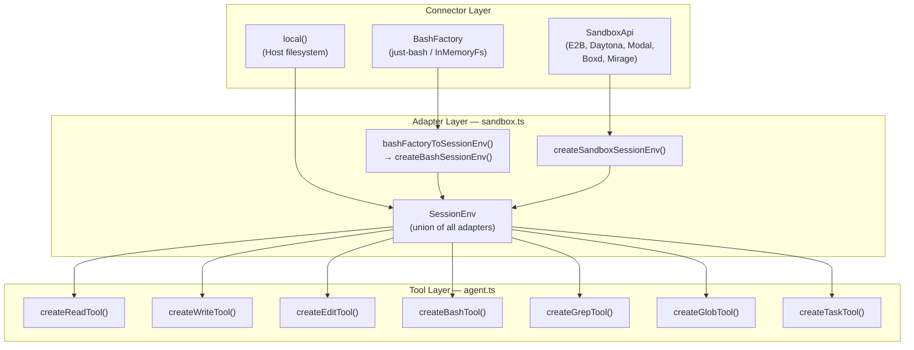
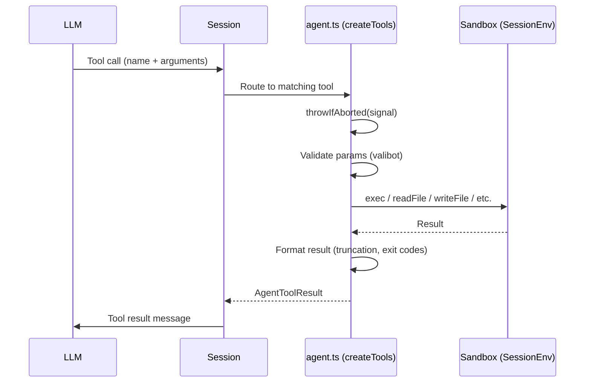

# Sandbox & Tools: Isolated Execution and LLM-Callable Functions

Sandbox systems provide isolated execution environments for agent operations, while tools are the LLM-callable functions that let agents interact with those environments. Flue's sandbox layer is connector-agnostic — any provider that implements the 8-method `SandboxApi` interface works without branching in the core runtime. The built-in tools (read, write, edit, bash, grep, glob, task) give agents the same capabilities as Claude Code's TUI tools, but entirely headless and programmable.

**Source:** `packages/runtime/src/sandbox.ts`, `packages/runtime/src/agent.ts`

## Sandbox Architecture

Flue supports three sandbox categories: **virtual** (just-bash with `InMemoryFs`), **local** (the host filesystem via `local()`), and **remote** (any connector implementing `SandboxApi` like E2B, Daytona, Modal, Boxd, or Mirage). All three converge on a single `SessionEnv` interface through adapter functions.



Every sandbox adapter produces a `SessionEnv` — an object with `exec`, `readFile`, `readFileBuffer`, `writeFile`, `stat`, `readdir`, `exists`, `mkdir`, `rm`, `cwd`, and `resolvePath`. The tools never know which backend they are talking to.

Source: `packages/runtime/src/sandbox.ts` — `SessionEnv` interface (imported from `types.ts`), adapter functions

## Virtual Sandbox: just-bash with InMemoryFs

The virtual sandbox uses just-bash's `BashLike` interface — an in-memory filesystem (`InMemoryFs`) paired with a bash interpreter. This is the default for Cloudflare Workers and local development where no persistent state is needed.

The adapter chain is:

1. **`bashFactoryToSessionEnv(factory)`** — calls `factory()` to get a `BashLike` instance, validates it via `assertBashLike()`, then delegates to `createBashSessionEnv(bash)`.
2. **`createBashSessionEnv(bash)`** — wraps the bash instance into a `SessionEnv`. The `exec` method handles timeout-to-signal translation since just-bash has no native timeout option.

```typescript
// sandbox.ts:54-58
export async function bashFactoryToSessionEnv(factory: BashFactory): Promise<SessionEnv> {
    const bash = await factory();
    assertBashLike(bash);
    return createBashSessionEnv(bash);
}
```

The `createBashSessionEnv` function performs a critical translation: just-bash has no native `timeout` option on `exec`, so the adapter converts `opts.timeout` (seconds) into an `AbortSignal.timeout(opts.timeout * 1000)` and merges it with any caller-provided signal using `AbortSignal.any()`:

```typescript
// sandbox.ts:77-88
const timeoutSignal =
    typeof opts?.timeout === 'number' ? AbortSignal.timeout(opts.timeout * 1000) : undefined;
const mergedSignal =
    opts?.signal && timeoutSignal
        ? AbortSignal.any([opts.signal, timeoutSignal])
        : (opts?.signal ?? timeoutSignal);

const result = await exec.call(
    bash,
    cmd,
    opts ? { cwd: opts.cwd, env: opts.env, signal: mergedSignal } : undefined,
);
```

The `writeFile` method in the just-bash adapter also auto-creates parent directories:

```typescript
// sandbox.ts:94-105
writeFile: async (p, content) => {
    const resolved = resolve(p);
    const dir = resolved.replace(/\/[^/]*$/, '');
    if (dir && dir !== resolved) {
        try {
            await fs.mkdir(dir, { recursive: true });
        } catch {
            /* parent already exists */
        }
    }
    await fs.writeFile(resolved, content);
},
```

### Duck-Typed Detection: `isBashLike()`

Flue uses duck-typed detection to validate just-bash instances rather than requiring instanceof checks. The `isBashLike()` predicate checks for the presence of `exec`, `getCwd`, and `fs` properties:

```typescript
// sandbox.ts:120-133
export function isBashLike(value: unknown): value is BashLike {
    return (
        typeof value === 'object' &&
        value !== null &&
        'exec' in value &&
        'getCwd' in value &&
        'fs' in value &&
        typeof (value as any).exec === 'function' &&
        typeof (value as any).getCwd === 'function' &&
        typeof (value as any).fs === 'object' &&
        (value as any).fs !== null
    );
}
```

Source: `packages/runtime/src/sandbox.ts:120` — `isBashLike()` function

## Remote Sandbox: SandboxApi Interface

Remote sandbox providers (E2B, Daytona, Modal, Boxd, Mirage) implement the `SandboxApi` interface — a duck-typed contract with 8 methods. The core runtime never branches on provider type. Any SDK that implements these 8 methods is a valid connector.

```typescript
// sandbox.ts:160-178
export interface SandboxApi {
    readFile(path: string): Promise<string>;
    readFileBuffer(path: string): Promise<Uint8Array>;
    writeFile(path: string, content: string | Uint8Array): Promise<void>;
    stat(path: string): Promise<FileStat>;
    readdir(path: string): Promise<string[]>;
    exists(path: string): Promise<boolean>;
    mkdir(path: string, options?: { recursive?: boolean }): Promise<void>;
    rm(path: string, options?: { recursive?: boolean; force?: boolean }): Promise<void>;
    exec(
        command: string,
        options?: {
            cwd?: string;
            env?: Record<string, string>;
            timeout?: number;
            signal?: AbortSignal;
        },
    ): Promise<ShellResult>;
}
```

The `exec()` method has a dual cancellation contract:

- **`timeout?: number`** (seconds) — the **primary** cancellation contract. Forward to the provider's native timeout option (E2B `timeoutMs`, Daytona `timeout`, Modal `timeout`, etc.). Required for parity with the LLM bash tool, which always passes a `timeout` hint when the model requests one.
- **`signal?: AbortSignal`** (optional) — for connectors whose SDK supports mid-flight cancellation (Mirage's executor, in-process bash). Lets Programmatic callers do ad-hoc `abort()`. Connectors that cannot honor it should ignore it; the deadline is still enforced via `timeout`.

The `createSandboxSessionEnv()` adapter wraps any `SandboxApi` into a `SessionEnv`, performing pre- and post-execution abort checks so connectors that do not support `AbortSignal` still get correct abort semantics:

```typescript
// sandbox.ts:189-216
async exec(command: string, options?: {...}): Promise<ShellResult> {
    const signal = options?.signal;
    if (signal?.aborted) throw abortErrorFor(signal);  // Pre-check
    const result = await api.exec(command, {
        cwd: options?.cwd ?? cwd,
        env: options?.env,
        timeout: options?.timeout,
        signal,
    });
    if (signal?.aborted) throw abortErrorFor(signal);  // Post-check
    return result;
}
```

Source: `packages/runtime/src/sandbox.ts:160` — `SandboxApi` interface, `createSandboxSessionEnv()` at line 181

## Local Sandbox

The local sandbox (`local()`) uses the host's actual filesystem and shell. In the Node.js deployment target, this is the default — processes have direct access to the real filesystem through a `SessionEnv` that wraps Node's `fs` module. No adapter translation is needed because Node natively supports all operations.

The local sandbox is configured via `packages/runtime/src/node/` which sets up process lifetime, WebSocket connections, and a local just-bash instance when a virtual sandbox is preferred on Node.

## CWD-Scoped Environments: `createCwdSessionEnv()`

For task delegation and subagent isolation, Flue creates child sessions with a different working directory. `createCwdSessionEnv(parentEnv, cwd)` wraps a parent `SessionEnv` so that all paths are resolved relative to the child's `cwd`:

```typescript
// sandbox.ts:25-52
export function createCwdSessionEnv(parentEnv: SessionEnv, cwd: string): SessionEnv {
    const scopedCwd = normalizePath(cwd);
    const resolvePath = (p: string): string => {
        if (p.startsWith('/')) return normalizePath(p);
        if (scopedCwd === '/') return normalizePath(`/${p}`);
        return normalizePath(`${scopedCwd}/${p}`);
    };

    return {
        exec: (cmd, opts) =>
            parentEnv.exec(cmd, {
                cwd: opts?.cwd ?? scopedCwd,
                env: opts?.env,
                timeout: opts?.timeout,
                signal: opts?.signal,
            }),
        readFile: (p) => parentEnv.readFile(resolvePath(p)),
        // ... all other fs methods use resolvePath
        cwd: scopedCwd,
        resolvePath,
    };
}
```

This ensures task sessions cannot escape their designated working directory while sharing the same underlying sandbox.

Source: `packages/runtime/src/sandbox.ts:25` — `createCwdSessionEnv()`

## Public Filesystem Surface: `createFlueFs()`

Flue also exposes a public `FlueFs` surface that adapts `SessionEnv` to a simpler 7-method interface (no `exec`, no `cwd`/`resolvePath`):

```typescript
// sandbox.ts:12-23
export function createFlueFs(env: SessionEnv): FlueFs {
    return {
        readFile: (path) => env.readFile(path),
        readFileBuffer: (path) => env.readFileBuffer(path),
        writeFile: (path, content) => env.writeFile(path, content),
        stat: (path) => env.stat(path),
        readdir: (path) => env.readdir(path),
        exists: (path) => env.exists(path),
        mkdir: (path, options) => env.mkdir(path, options),
        rm: (path, options) => env.rm(path, options),
    };
}
```

Source: `packages/runtime/src/sandbox.ts:12` — `createFlueFs()`

## Built-In Tools

Flue provides seven built-in tools, all created by `createTools(env, options)` in `packages/runtime/src/agent.ts`. Each tool is an `AgentTool<any>` with a name, label, description, valibot parameter schema, and an `execute` function.

```typescript
// agent.ts:37-48
export function createTools(env: SessionEnv, options?: CreateToolsOptions): AgentTool<any>[] {
    const tools: AgentTool<any>[] = [
        createReadTool(env, options?.packagedSkills ?? {}),
        createWriteTool(env),
        createEditTool(env),
        createBashTool(env),
        createGrepTool(env),
        createGlobTool(env),
    ];
    if (options?.task) tools.push(createTaskTool(options.task, options?.subagents ?? {}));
    return tools;
}
```

All tools enforce `throwIfAborted(signal)` at the start of execution to support mid-call cancellation.

Source: `packages/runtime/src/agent.ts:37` — `createTools()`

### Constants and Limits

The following constants govern tool behavior and are defined at the top of `agent.ts`:

| Constant | Value | Used By |
|----------|-------|---------|
| `MAX_READ_LINES` | 2000 | read tool |
| `MAX_READ_BYTES` | 50 * 1024 (51200) | read tool |
| `MAX_GREP_MATCHES` | 100 | grep tool |
| `MAX_GREP_LINE_LENGTH` | 500 | grep tool |
| `MAX_GLOB_RESULTS` | 1000 | glob tool |
| `BASE64_READ_LINE_LENGTH` | 76 | packaged skill read |
| `TOOL_RESULT_MAX_CHARS` | 2000 | compaction summarization (in compaction.ts) |

Source: `packages/runtime/src/agent.ts:5-10` — constant definitions

### Read Tool

The read tool reads files or lists directories. Parameters: `path` (required), `offset` (optional, 1-indexed line number), `limit` (optional, max lines).

```typescript
// agent.ts:74-113
function createReadTool(
    env: SessionEnv,
    packagedSkills: Record<string, PackagedSkillDirectory>,
): AgentTool<typeof ReadParams> {
    return {
        name: 'read',
        label: 'Read File',
        description:
            'Read a file or list a directory. For files, output is truncated to 2000 lines or 50KB — use offset/limit for large files. For directories, returns the list of entries.',
        parameters: ReadParams,
        async execute(_toolCallId: string, params: Static<typeof ReadParams>, signal?: AbortSignal) {
            // ... packaged skill file check first
            // ... stat to detect directories
            // ... readFile + formatReadContent
        },
    };
}
```

The read tool first checks packaged skill files (at `/.flue/packaged-skills/`), then uses `env.stat()` to detect directories. For directories, it returns a newline-separated listing via `env.readdir()`. For files, it calls `env.readFile()` and passes the result through `formatReadContent()`.

The `formatReadContent()` function applies both limits:

```typescript
// agent.ts:471-492
function formatReadContent(path: string, content: string, offset?: number, limit?: number) {
    const allLines = content.split('\n');
    const startLine = offset ? Math.max(0, offset - 1) : 0;
    if (startLine >= allLines.length) {
        throw new Error(`Offset ${offset} is beyond end of file (${allLines.length} lines total)`);
    }

    const endLine = limit ? startLine + limit : allLines.length;
    const lines = allLines.slice(startLine, endLine);
    const { text: truncatedText, wasTruncated } = truncateHead(lines, MAX_READ_LINES, MAX_READ_BYTES);

    let output = truncatedText;
    if (wasTruncated) {
        const shownEnd = startLine + truncatedText.split('\n').length;
        output += `\n\n[Showing lines ${startLine + 1}-${shownEnd} of ${allLines.length}. Use offset=${shownEnd + 1} to continue.]`;
    }

    return {
        content: [{ type: 'text' as const, text: output }],
        details: { path, lines: allLines.length },
    };
}
```

The `truncateHead()` function enforces both `MAX_READ_LINES` (2000) and `MAX_READ_BYTES` (50KB) simultaneously — it stops at whichever limit is hit first:

```typescript
// agent.ts:516-540
function truncateHead(
    lines: string[],
    maxLines: number,
    maxBytes: number,
): { text: string; wasTruncated: boolean } {
    let result = '';
    let lineCount = 0;
    let wasTruncated = false;

    for (const line of lines) {
        if (lineCount >= maxLines) {
            wasTruncated = true;
            break;
        }
        const next = lineCount === 0 ? line : `\n${line}`;
        if (result.length + next.length > maxBytes) {
            wasTruncated = true;
            break;
        }
        result += next;
        lineCount++;
    }

    return { text: result, wasTruncated };
}
```

When truncated, the output includes a continuation hint telling the agent exactly what `offset` value to use for the next read.

Source: `packages/runtime/src/agent.ts:74` — `createReadTool()`, line 471 — `formatReadContent()`, line 516 — `truncateHead()`

### Write Tool

The write tool creates files and auto-creates parent directories. Parameters: `path` (required), `content` (required).

```typescript
// agent.ts:120-146
function createWriteTool(env: SessionEnv): AgentTool<typeof WriteParams> {
    return {
        name: 'write',
        label: 'Write File',
        description:
            'Write content to a file. Creates the file and parent directories if they do not exist.',
        parameters: WriteParams,
        async execute(_toolCallId: string, params: Static<typeof WriteParams>, signal?: AbortSignal) {
            throwIfAborted(signal);
            const resolved = env.resolvePath(params.path);
            const dir = resolved.replace(/\/[^/]*$/, '');
            if (dir && dir !== resolved) {
                await env.mkdir(dir, { recursive: true });
            }
            await env.writeFile(resolved, params.content);
            return {
                content: [
                    {
                        type: 'text',
                        text: `Successfully wrote ${params.content.length} bytes to ${params.path}`,
                    },
                ],
                details: { path: params.path, size: params.content.length },
            };
        },
    };
}
```

The write tool extracts the parent directory from the resolved path using a regex (`/\/[^/]*$/`), creates it recursively if needed, then writes the file. The result reports the byte count.

Source: `packages/runtime/src/agent.ts:120` — `createWriteTool()`

### Edit Tool

The edit tool performs exact text replacement. Parameters: `path` (required), `oldText` (required, must match a unique region), `newText` (required), `replaceAll` (optional).

```typescript
// agent.ts:155-199
function createEditTool(env: SessionEnv): AgentTool<typeof EditParams> {
    return {
        name: 'edit',
        label: 'Edit File',
        description:
            'Edit a file using exact text replacement. The oldText must match a unique region of the file. Use replaceAll to replace all occurrences.',
        parameters: EditParams,
        async execute(_toolCallId: string, params: Static<typeof EditParams>, signal?: AbortSignal) {
            // ...
            if (params.replaceAll) {
                const newContent = content.replaceAll(params.oldText, params.newText);
                if (newContent === content) {
                    throw new Error(`Could not find the text in ${params.path}. No changes made.`);
                }
                await env.writeFile(params.path, newContent);
                const count = content.split(params.oldText).length - 1;
                return {
                    content: [{ type: 'text', text: `Replaced ${count} occurrences in ${params.path}` }],
                    details: { path: params.path, replacements: count },
                };
            }

            const occurrences = countOccurrences(content, params.oldText);
            if (occurrences === 0) {
                throw new Error(`Could not find the exact text in ${params.path}...`);
            }
            if (occurrences > 1) {
                throw new Error(`Found ${occurrences} occurrences of the text in ${params.path}...`);
            }

            const newContent = content.replace(params.oldText, params.newText);
            await env.writeFile(params.path, newContent);
            return { content: [{ type: 'text', text: `Successfully edited ${params.path}` }], ... };
        },
    };
}
```

Without `replaceAll`, the edit tool requires `oldText` to match exactly once. It uses `countOccurrences()` to verify uniqueness before replacing. If the text matches zero times, it throws an error. If it matches more than once, it tells the agent to provide more surrounding context or use `replaceAll`.

Source: `packages/runtime/src/agent.ts:155` — `createEditTool()`, line 502 — `countOccurrences()`

### Bash Tool

The bash tool executes shell commands. Parameters: `command` (required), `timeout` (optional, in seconds).

The bash tool implements **dual timeout enforcement** — a clever two-layer approach that handles both LLM-visible and local cancellation:

```typescript
// agent.ts:206-272
function createBashTool(env: SessionEnv): AgentTool<typeof BashParams> {
    return {
        name: 'bash',
        label: 'Run Command',
        description:
            'Execute a bash command. Returns stdout and stderr. Output is truncated to the last 2000 lines or 50KB.',
        parameters: BashParams,
        async execute(_toolCallId: string, params: Static<typeof BashParams>, signal?: AbortSignal) {
            throwIfAborted(signal);

            // Two layers cooperate to enforce `params.timeout`:
            //   1. Pass `timeout` to env.exec as a hint for provider SDKs
            //   2. Compose AbortSignal.timeout as local backstop
            const timeoutSignal =
                typeof params.timeout === 'number' ? AbortSignal.timeout(params.timeout * 1000) : undefined;
            const execSignal =
                signal && timeoutSignal
                    ? AbortSignal.any([signal, timeoutSignal])
                    : (signal ?? timeoutSignal);

            const timedOut = () =>
                formatBashResult(
                    { stdout: '', stderr: `[flue] Command timed out after ${params.timeout} seconds.`, exitCode: 124 },
                    params.command,
                );

            try {
                const result = await env.exec(params.command, {
                    timeout: params.timeout,
                    signal: execSignal,
                });
                if (timeoutSignal?.aborted && !signal?.aborted) return timedOut();
                return formatBashResult(result, params.command);
            } catch (err) {
                if (timeoutSignal?.aborted && !signal?.aborted) return timedOut();
                throw err;
            }
        },
    };
}
```

**Aha:** The bash tool has dual timeout enforcement. Layer 1 passes `params.timeout` to `env.exec()` so sandbox connectors can forward it to their provider's native timeout (E2B `timeoutMs`, Daytona `timeout`, etc.). Layer 2 creates an `AbortSignal.timeout(params.timeout * 1000)` and merges it into the signal via `AbortSignal.any()`. This backstop catches connectors that ignore both the timeout hint and the signal. On timeout, the tool returns a recoverable result with exit code 124 (the standard Unix timeout code) so the model can detect and handle it gracefully. If the host `signal` (from the caller, not the LLM) is also aborted, the error is rethrown instead — programmatic callers get proper cancellation, while the LLM sees a recoverable error.

The output is truncated using `truncateTail()` which keeps the **last** `MAX_READ_LINES` (2000) or `MAX_READ_BYTES` (50KB) — unlike the read tool which uses `truncateHead()` to keep the first portion, bash uses `truncateTail` to keep the most recent output:

```typescript
// agent.ts:542-557
function truncateTail(
    text: string,
    maxLines: number,
    maxBytes: number,
): { text: string; wasTruncated: boolean } {
    const lines = text.split('\n');
    if (lines.length <= maxLines && text.length <= maxBytes) {
        return { text, wasTruncated: false };
    }

    let result = lines.slice(-maxLines).join('\n');
    if (result.length > maxBytes) {
        result = result.slice(-maxBytes);
    }
    return { text: result, wasTruncated: true };
}
```

The exit code is always reported in the output. Exit code 124 specifically indicates timeout, which the model can use to decide whether to retry with a longer timeout or narrow the command.

Source: `packages/runtime/src/agent.ts:206` — `createBashTool()`, line 320 — `formatBashResult()`, line 542 — `truncateTail()`

### Grep Tool

The grep tool searches file contents via regex. Parameters: `pattern` (required, regex string), `path` (optional, directory or file, default `.`), `include` (optional, glob filter like `*.ts`).

```typescript
// agent.ts:348-395
function createGrepTool(env: SessionEnv): AgentTool<typeof GrepParams> {
    return {
        name: 'grep',
        label: 'Search Files',
        description:
            'Search file contents for a regex pattern. Returns matching lines with file paths and line numbers.',
        parameters: GrepParams,
        async execute(_toolCallId: string, params: Static<typeof GrepParams>, signal?: AbortSignal) {
            const searchPath = params.path || '.';
            let cmd = `grep -rn ${shellQuote(params.pattern)} ${shellQuote(searchPath)}`;
            if (params.include) {
                cmd = `grep -rn --include=${shellQuote(params.include)} ${shellQuote(params.pattern)} ${shellQuote(searchPath)}`;
            }

            const result = await env.exec(cmd);

            // exitCode 1 = no matches (not an error), >1 = actual error
            if (result.exitCode === 1 && !result.stdout.trim()) {
                return { content: [{ type: 'text', text: 'No matches found.' }], details: { matchCount: 0 } };
            }
            if (result.exitCode > 1) {
                throw new Error(`grep failed: ${result.stderr}`);
            }

            const lines = result.stdout.trim().split('\n');
            const truncatedLines = lines.slice(0, MAX_GREP_MATCHES);
            const output = truncatedLines
                .map((line) =>
                    line.length > MAX_GREP_LINE_LENGTH ? `${line.slice(0, MAX_GREP_LINE_LENGTH)}...` : line,
                )
                .join('\n');

            let finalOutput = output;
            if (lines.length > MAX_GREP_MATCHES) {
                finalOutput += `\n\n[Showing ${MAX_GREP_MATCHES} of ${lines.length} matches. Narrow your search.]`;
            }

            return { content: [{ type: 'text', text: finalOutput }], details: { matchCount: Math.min(lines.length, MAX_GREP_MATCHES) } };
        },
    };
}
```

The grep tool uses `grep -rn` with shell-quoted arguments. Exit code 1 means no matches (normal), exit codes greater than 1 throw an error. Results are limited to `MAX_GREP_MATCHES` (100) and each line is truncated to `MAX_GREP_LINE_LENGTH` (500 characters) to prevent massive lines from consuming context window.

Source: `packages/runtime/src/agent.ts:348` — `createGrepTool()`

### Glob Tool

The glob tool finds files by name pattern. Parameters: `pattern` (required), `path` (optional, directory, default `.`).

```typescript
// agent.ts:402-438
function createGlobTool(env: SessionEnv): AgentTool<typeof GlobParams> {
    return {
        name: 'glob',
        label: 'Find Files',
        description:
            'Find files by filename pattern using shell find -name semantics. Returns matching file paths.',
        parameters: GlobParams,
        async execute(_toolCallId: string, params: Static<typeof GlobParams>, signal?: AbortSignal) {
            const searchPath = params.path || '.';
            const cmd = `find ${shellQuote(searchPath)} -type f -name ${shellQuote(params.pattern)} 2>/dev/null | head -${MAX_GLOB_RESULTS}`;
            const result = await env.exec(cmd);
            // ...
        },
    };
}
```

The glob tool uses `find -name` piped to `head -1000` (MAX_GLOB_RESULTS) to limit results at the shell level rather than post-processing.

Source: `packages/runtime/src/agent.ts:402` — `createGlobTool()`

### Task Tool

The task tool delegates work to a detached child agent. Parameters: `prompt` (required, instructions), `description` (optional, human-readable label), `agent` (optional, subagent name), `cwd` (optional, working directory for child agent).

```typescript
// agent.ts:291-318
export function createTaskTool(
    runTask: (params: TaskToolParams, signal?: AbortSignal) => Promise<AgentToolResult<TaskToolResultDetails>>,
    subagents: Record<string, AgentProfile>,
): AgentTool<typeof TaskParams> {
    const agentNames = Object.keys(subagents);
    const agentDescription =
        agentNames.length > 0
            ? ` Available agents: ${agentNames.join(', ')}.`
            : ' No subagents are currently defined.';

    return {
        name: 'task',
        label: 'Run Task',
        description:
            'Delegation a focused task to a detached child agent with its own context. ' +
            'Use this for independent research, file exploration, or parallel work. ' +
            'The task returns only its final answer to this conversation.' +
            agentDescription,
        parameters: TaskParams,
        async execute(_toolCallId: string, params: Static<typeof TaskParams>, signal?: AbortSignal) {
            throwIfAborted(signal);
            return runTask(params, signal);
        },
    };
}
```

The task tool dynamically includes available subagent names in its description, discovered from the `subagents` record passed to `createTaskTool()`. The actual delegation is handled by `runTask`, which creates a child session via `createCwdSessionEnv()` and runs an independent agent loop.

Source: `packages/runtime/src/agent.ts:291` — `createTaskTool()`

## Tool Execution Flow

The complete tool execution lifecycle flows from the LLM's tool call through the session's tool executor:



## Custom Tools

Custom tools are added via the `toolFactory` option during session initialization. The `SessionToolFactory` interface lets you inject additional `AgentTool<any>` instances alongside the built-in tools. These are spliced into the tool list before each LLM call via the `CallOverrides.extraTools` mechanism.

Custom tools have full access to the `SessionEnv` and can implement arbitrary operations — file transformations, external API calls, database queries, anything. They follow the same `AgentTool<any>` shape: name, label, description, valibot parameters, and an execute function that receives `(toolCallId, params, signal)`.

## MCP (Model Context Protocol) Tools

MCP tools are external tools exposed via the Model Context Protocol. Flue can connect to MCP servers and expose their tools as `AgentTool<any>` instances. These are registered alongside built-in and custom tools during harness initialization.

MCP tools follow the same execution model: the LLM emits a tool call, Flue routes it to the matching tool (by name), the tool executes (potentially making an MCP JSON-RPC call to an external server), and the result is returned as a tool result message. The abstraction is identical to built-in tools — the LLM does not know whether a tool is local, custom, or MCP.

## Packaged Skill Read Tool

Flue provides a secondary `read` tool for accessing packaged skill files at `/.flue/packaged-skills/`. `createPackagedSkillReadTool()` returns a tool named `read` with label "Read Packaged Skill File" that searches the `packagedSkills` record for the requested path. Binary files are wrapped as base64 with `BASE64_READ_LINE_LENGTH` (76) characters per line.

```typescript
// agent.ts:56-72
export function createPackagedSkillReadTool(
    packagedSkills: Record<string, PackagedSkillDirectory>,
): AgentTool<typeof ReadParams> {
    return {
        name: 'read',
        label: 'Read Packaged Skill File',
        description: 'Read a packaged skill supporting file by its advertised path.',
        parameters: ReadParams,
        async execute(_toolCallId: string, params: Static<typeof ReadParams>, signal?: AbortSignal) {
            throwIfAborted(signal);
            const content = readPackagedSkillFile(packagedSkills, params.path);
            if (content === undefined)
                throw new Error(`[flue] Packaged skill file not found: ${params.path}`);
            return formatReadContent(params.path, content, params.offset, params.limit);
        },
    };
}
```

Source: `packages/runtime/src/agent.ts:56` — `createPackagedSkillReadTool()`

## Key Design Decisions

### Shell Argument Quoting

The grep and glob tools use `shellQuote()` to safely embed user-provided patterns in shell commands:

```typescript
// agent.ts:512-514
function shellQuote(arg: string): string {
    return `'${arg.replace(/'/g, `'\\''`)}'`;
}
```

This wraps arguments in single quotes and escapes embedded single quotes using the standard `'\''` sequence. This prevents command injection through tool parameters.

### Output Truncation Strategy

The read tool uses `truncateHead()` (keeps the first 2000 lines / 50KB) because when reading a file, the beginning is usually the most important — imports, type definitions, configuration. The bash tool uses `truncateTail()` (keeps the last 2000 lines / 50KB) because command output typically has the most relevant information at the end — error messages, final results, stack traces. This dual strategy gives the LLM the most useful slice of data in each context.

### Exit Code 124 as Recoverable Timeout

Exit code 124 is the standard GNU `timeout` command's exit code. By returning this specific code, Flue makes timeout detection trivial for the LLM — it can check `exitCode === 124` in bash output and decide to retry with a longer timeout, narrow the command, or move on. This is much better than throwing an exception that would abort the entire turn.

## Aha Moments

**Aha: Sandbox connectors are duck-typed via `SandboxApi`.** Any provider (E2B, Daytona, Modal, Boxd, Mirage) implements the same 8 methods. Zero provider branching exists in the core runtime. The `createSandboxSessionEnv()` adapter wraps any `SandboxApi` into `SessionEnv`, and `createBashSessionEnv()` wraps any just-bash instance the same way. Tools never know which backend they are talking to. This means adding a new sandbox provider requires zero changes to tool code — just implement the 8-method interface.

**Aha: Dual timeout enforcement on the bash tool.** The LLM-visible `params.timeout` passes through to sandbox connectors so they can use their provider's native timeout. Meanwhile, an `AbortSignal.timeout()` backstop catches connectors that ignore both. On timeout, a recoverable exit code 124 is returned — the model sees this as a normal tool result it can reason about. But if the host `signal` (from programmatic callers) is also involved, the error rethrows for proper cancellation. Programmatic and LLM callers get the semantics each one needs from the same code path.

**Aha: The write tool auto-creates parent directories.** Rather than requiring the agent to explicitly `mkdir -p` before writing, the write tool extracts the parent directory via regex (`resolved.replace(/\/[^/]*$/, '')`) and creates it recursively. This mirrors the behavior of `bash -c 'echo content > /a/b/c/file.txt'` which also needs `mkdir -p /a/b/c` first, but handles it transparently.

## Related Documents

- [Harness & Sessions](03-harness-sessions.html) — Session initialization, harness lifecycle, how tools are wired
- [Compaction](05-compaction.html) — Context-window management, how tool results contribute to token usage
- [Agent System](02-agent-system.html) — Agent definitions, subagents, skill discovery
- [Architecture](01-architecture.html) — Full dependency graph, multi-target deployment

**Code directory:** `packages/runtime/src/agent.ts`, `packages/runtime/src/sandbox.ts`
