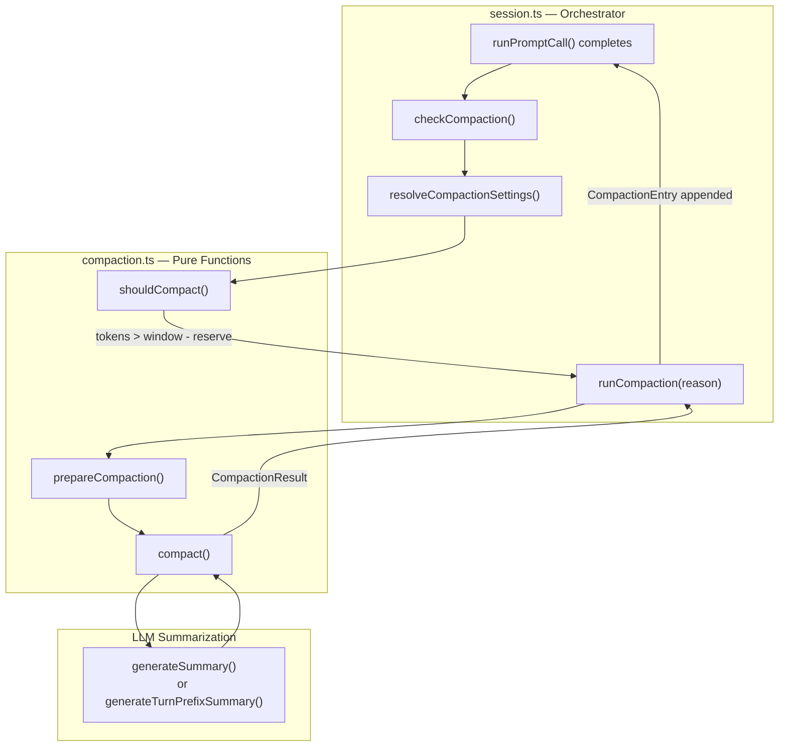
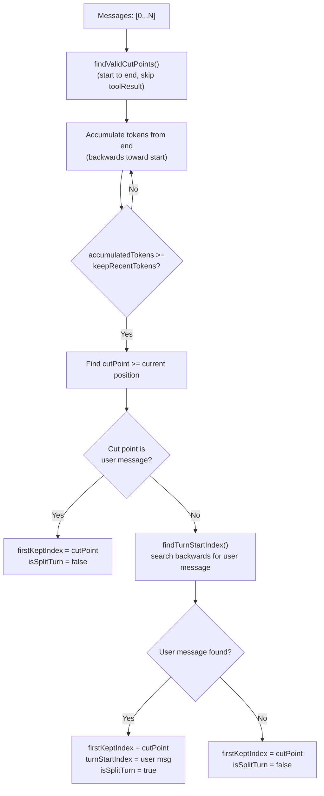
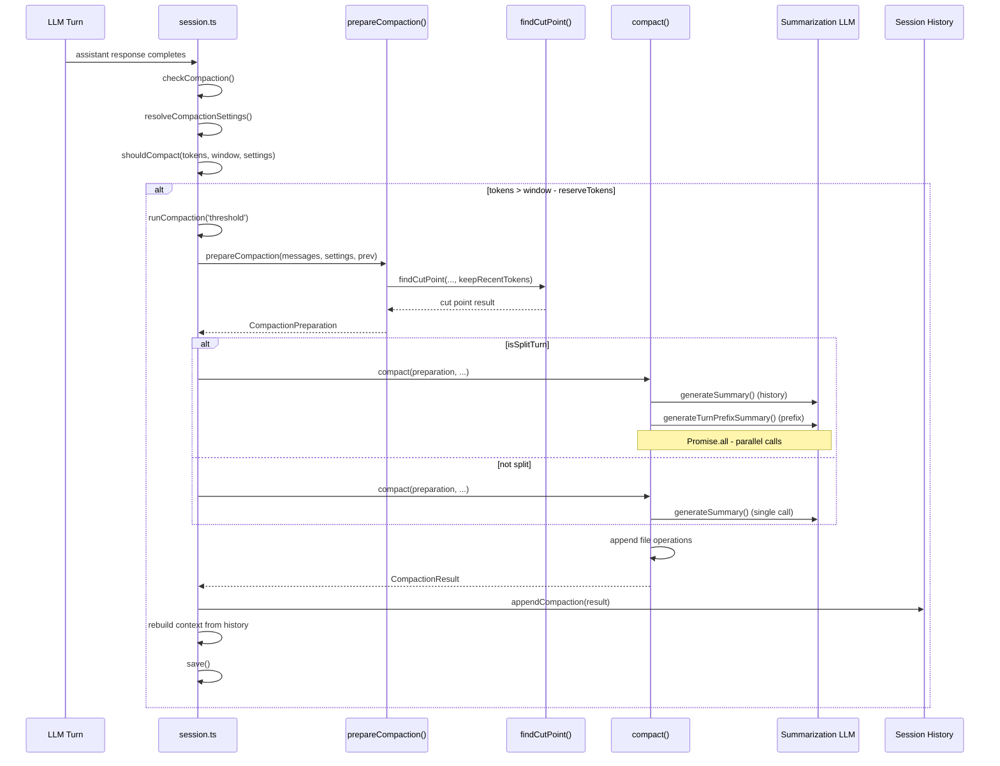

# Compaction: Context-Window Management via LLM Summarization

Compaction is Flue's automatic context-window management system. When a session's conversation history approaches the model's token limit, Flue runs an LLM summarization pass — not a truncation — to compress older messages into a structured checkpoint that preserves goals, decisions, file operations, and next steps. The same agent harness that runs the main conversation is reused to summarize old messages, and the cost is tracked on the `CompactionEntry` so users see the true cost of the triggering call.

**Source:** `packages/runtime/src/compaction.ts`, `packages/runtime/src/session.ts`

## Core Architecture

Compaction operates through two pure functions (`prepareCompaction()`, `shouldCompact()`) and one async function (`compact()`). The session layer orchestrates these via `checkCompaction()`, `runCompaction()`, and `resolveCompactionSettings()`.



There are three trigger modes:

1. **Threshold compaction** — total tokens exceed `(contextWindow - reserveTokens)`. Runs automatically after each assistant response. No auto-retry.
2. **Overflow compaction** — the LLM returns a context overflow error. Compaction runs immediately, then the call is retried with the compacted context.
3. **Manual compaction** — triggered programmatically via `session.compact()`.

Source: `packages/runtime/src/session.ts:1751` — `checkCompaction()`, line 1779 — `runCompaction()`, line 1025 — `compact()` public method

## Compaction Settings

Settings control when and how compaction fires. The `CompactionSettings` interface has three fields:

```typescript
// compaction.ts:26-30
export interface CompactionSettings {
    enabled: boolean;
    reserveTokens: number;
    keepRecentTokens: number;
}
```

### Default Settings

`DEFAULT_COMPACTION_SETTINGS` provides fallback values when no user config and no model metadata are available:

```typescript
// compaction.ts:37-41
export const DEFAULT_COMPACTION_SETTINGS: CompactionSettings = {
    enabled: true,
    reserveTokens: 20000,
    keepRecentTokens: 8000,
};
```

- **`reserveTokens: 20000`** — always keep 20,000 tokens of headroom for the model's next response. The threshold fires when `contextTokens > contextWindow - 20000`.
- **`keepRecentTokens: 8000`** — always preserve the most recent 8,000 tokens of conversation. The cut point is calculated to keep this tail intact.

### Model-Aware Defaults: `deriveCompactionDefaults()`

Real sessions call `deriveCompactionDefaults()` instead of using the static fallback. This function adjusts `reserveTokens` based on the active model's `contextWindow` and `maxTokens`:

```typescript
// compaction.ts:51-72
export function deriveCompactionDefaults(input: {
    contextWindow: number;
    maxTokens: number;
}): CompactionSettings {
    const reserveCap =
        input.maxTokens > 0 ? input.maxTokens : DEFAULT_COMPACTION_SETTINGS.reserveTokens;
    let reserveTokens = Math.min(DEFAULT_COMPACTION_SETTINGS.reserveTokens, reserveCap);
    if (input.contextWindow > 0 && reserveTokens * 2 >= input.contextWindow) {
        reserveTokens = Math.max(1024, Math.floor(input.contextWindow / 3));
    }
    return {
        enabled: true,
        reserveTokens,
        keepRecentTokens: DEFAULT_COMPACTION_SETTINGS.keepRecentTokens,
    };
}
```

The logic has two important behaviors:

1. **Reserve is capped at `maxTokens`** — reserving more than the model can emit in one turn wastes context. If the model's `maxTokens` is 16000, `reserveTokens` becomes 16000, not 20000.
2. **Safety floor for tiny-window models** — if `reserveTokens` would consume half or more of the context window, it is clamped to a third of the window (minimum 1024). This prevents threshold compaction from firing on every turn for small-window models.

When `maxTokens` is unknown (e.g., HTTP providers without declared metadata), it falls back to `DEFAULT_COMPACTION_SETTINGS.reserveTokens` (20000).

### Settings Resolution in the Session

The session resolves settings through `resolveCompactionSettings()`, which merges model-aware defaults with user configuration:

```typescript
// session.ts:812-831
private resolveCompactionSettings(model: Model<any> | undefined): CompactionSettings {
    const cc = this.config.compaction;
    const defaults = model
        ? deriveCompactionDefaults({
            contextWindow: model.contextWindow ?? 0,
            maxTokens: model.maxTokens ?? 0,
        })
        : DEFAULT_COMPACTION_SETTINGS;
    if (cc === false) {
        return { ...defaults, enabled: false };
    }
    if (!cc) {
        return defaults;
    }
    return {
        enabled: true,
        reserveTokens: cc.reserveTokens ?? defaults.reserveTokens,
        keepRecentTokens: cc.keepRecentTokens ?? defaults.keepRecentTokens,
    };
}
```

User config (`this.config.compaction`) can:
- Be `false` — disables compaction entirely
- Be `undefined` — uses model-aware defaults
- Be an object with `reserveTokens` and `keepRecentTokens` — overrides individual fields while keeping `enabled: true`
- Include a `model` field — uses a different model for summarization

Source: `packages/runtime/src/compaction.ts:37` — `DEFAULT_COMPACTION_SETTINGS`, line 51 — `deriveCompactionDefaults()`, `packages/runtime/src/session.ts:812` — `resolveCompactionSettings()`

## Token Estimation

Flue uses a **chars/4 heuristic** to estimate token counts for context management. This is conservative — it overestimates rather than underestimates, which means compaction fires slightly earlier than strictly necessary, a safe default.

```typescript
// compaction.ts:107-150
function estimateTokens(message: AgentMessage): number {
    let chars = 0;
    switch (message.role) {
        case 'user': {
            const { content } = message as UserMessage;
            if (typeof content === 'string') {
                chars = content.length;
            } else if (Array.isArray(content)) {
                for (const block of content) {
                    if (block.type === 'text') {
                        chars += block.text.length;
                    }
                }
            }
            return Math.ceil(chars / 4);
        }
        case 'assistant': {
            const { content } = message as AssistantMessage;
            for (const block of content) {
                if (block.type === 'text') {
                    chars += block.text.length;
                } else if (block.type === 'thinking') {
                    chars += block.thinking.length;
                } else if (block.type === 'toolCall') {
                    chars += block.name.length + JSON.stringify(block.arguments).length;
                }
            }
            return Math.ceil(chars / 4);
        }
        case 'toolResult': {
            const { content } = message as ToolResultMessage;
            for (const block of content) {
                if (block.type === 'text') {
                    chars += block.text.length;
                } else if (block.type === 'image') {
                    chars += 4800;  // Approximate token cost for an image block
                }
            }
            return Math.ceil(chars / 4);
        }
    }
    return 0;
}
```

Per-role counting:
- **User messages** — plain text content length, or concatenated text block lengths for multi-part content
- **Assistant messages** — text blocks + thinking blocks + tool call names and JSON-serialized arguments
- **Tool results** — text block lengths, with image blocks counted as a flat 4800 characters each (approximately 1200 tokens at chars/4)

### Context Token Calculation

The full context token count combines the last assistant response's provider-reported usage with character-estimated trailing tokens:

```typescript
// compaction.ts:152-178
function estimateContextTokens(messages: AgentMessage[]): {...} {
    const usageInfo = getLastAssistantUsageInfo(messages);
    if (!usageInfo) {
        // No assistant usage available — estimate everything from chars
        let estimated = 0;
        for (const message of messages) {
            estimated += estimateTokens(message);
        }
        return { tokens: estimated, usageTokens: 0, trailingTokens: estimated, lastUsageIndex: null };
    }
    const usageTokens = calculateContextTokens(usageInfo.usage);
    let trailingTokens = 0;
    for (let i = usageInfo.index + 1; i < messages.length; i++) {
        const message = messages[i];
        if (message) trailingTokens += estimateTokens(message);
    }
    return {
        tokens: usageTokens + trailingTokens,
        usageTokens,
        trailingTokens,
        lastUsageIndex: usageInfo.index,
    };
}
```

This hybrid approach is efficient: it uses the provider's accurate token count for the last assistant response and only estimates the trailing messages (tool results after the last assistant message).

```typescript
// compaction.ts:76-78
export function calculateContextTokens(usage: Usage): number {
    return usage.totalTokens || usage.input + usage.output + usage.cacheRead + usage.cacheWrite;
}
```

### Threshold Check: `shouldCompact()`

```typescript
// compaction.ts:180-189
export function shouldCompact(
    contextTokens: number,
    contextWindow: number,
    settings: CompactionSettings,
): boolean {
    if (!settings.enabled) return false;
    if (contextWindow <= 0) return false;  // Unknown window — skip threshold
    return contextTokens > contextWindow - settings.reserveTokens;
}
```

Compaction fires when `contextTokens > contextWindow - reserveTokens`. With `reserveTokens = 20000` on a 200K model, threshold compaction triggers at approximately 180K tokens.

Source: `packages/runtime/src/compaction.ts:107` — `estimateTokens()`, line 152 — `estimateContextTokens()`, line 180 — `shouldCompact()`

## Cut Point Detection

Flue never cuts in the middle of a conversation turn. The cut point detection finds valid boundaries and respects turn structure.



```typescript
// compaction.ts:429-467
function findCutPoint(
    messages: AgentMessage[],
    start: number,
    end: number,
    keepRecentTokens: number,
): CutPointResult {
    const cutPoints = findValidCutPoints(messages, start, end);
    if (cutPoints.length === 0) {
        return { firstKeptIndex: start, turnStartIndex: -1, isSplitTurn: false };
    }

    let accumulatedTokens = 0;
    let cutIndex = cutPoints[0] ?? start;

    for (let i = end - 1; i >= start; i--) {
        const message = messages[i];
        if (!message) continue;
        const messageTokens = estimateTokens(message);
        accumulatedTokens += messageTokens;
        if (accumulatedTokens >= keepRecentTokens) {
            for (const cutPoint of cutPoints) {
                if (cutPoint >= i) {
                    cutIndex = cutPoint;
                    break;
                }
            }
            break;
        }
    }

    const isUserMessage = messages[cutIndex]?.role === 'user';
    const turnStartIndex = isUserMessage ? -1 : findTurnStartIndex(messages, cutIndex, start);

    return {
        firstKeptIndex: cutIndex,
        turnStartIndex,
        isSplitTurn: !isUserMessage && turnStartIndex !== -1,
    };
}
```

Key behaviors:
- **Valid cut points** are only `user` or `assistant` messages — `toolResult` messages are never cut points because they are meaningless without their preceding tool call
- **Backward accumulation** starts from the end and counts tokens until `keepRecentTokens` is reached, then finds the nearest valid cut point at or before that position
- **Split turn detection** — when the cut point falls on an assistant message, `findTurnStartIndex()` searches backwards for the user message that started the turn. If found, `isSplitTurn = true` and the prefix of the turn (from user message to cut point) is extracted separately

Source: `packages/runtime/src/compaction.ts:405` — `findValidCutPoints()`, line 416 — `findTurnStartIndex()`, line 429 — `findCutPoint()`

## Compaction Preparation: `prepareCompaction()`

`prepareCompaction()` is a pure function (no I/O) that finds the cut point, extracts messages to summarize, and tracks file operations:

```typescript
// compaction.ts:519-567
export function prepareCompaction(
    messages: AgentMessage[],
    settings: CompactionSettings,
    previousCompaction?: {
        summary: string;
        firstKeptIndex: number;
        details?: { readFiles: string[]; modifiedFiles: string[] };
    },
): CompactionPreparation | undefined {
    if (messages.length === 0) return undefined;

    const boundaryStart = previousCompaction ? previousCompaction.firstKeptIndex : 0;
    const boundaryEnd = messages.length;
    const tokensBefore = estimateContextTokens(messages).tokens;

    const cutPoint = findCutPoint(messages, boundaryStart, boundaryEnd, settings.keepRecentTokens);
    if (cutPoint.firstKeptIndex <= boundaryStart) return undefined;  // Nothing new to compact

    const historyEnd = cutPoint.isSplitTurn ? cutPoint.turnStartIndex : cutPoint.firstKeptIndex;
    const messagesToSummarize = messages.slice(boundaryStart, historyEnd);
    const turnPrefixMessages = cutPoint.isSplitTurn
        ? messages.slice(cutPoint.turnStartIndex, cutPoint.firstKeptIndex)
        : [];

    // File operation tracking (continues from previous compaction)
    const fileOps = createFileOps();
    if (previousCompaction?.details) {
        for (const f of previousCompaction.details.readFiles ?? []) fileOps.read.add(f);
        for (const f of previousCompaction.details.modifiedFiles ?? []) fileOps.edited.add(f);
    }
    for (const msg of messagesToSummarize) extractFileOpsFromMessage(msg, fileOps);
    for (const msg of turnPrefixMessages) extractFileOpsFromMessage(msg, fileOps);

    return { firstKeptIndex: cutPoint.firstKeptIndex, messagesToSummarize, turnPrefixMessages,
             isSplitTurn: cutPoint.isSplitTurn, tokensBefore, previousSummary: previousCompaction?.summary,
             fileOps, settings };
}
```

The `boundaryStart` skips over messages that were already compacted in a previous pass — only messages since the last compaction's `firstKeptIndex` are eligible for summarization. This prevents re-summarizing already-summarized content.

Source: `packages/runtime/src/compaction.ts:519` — `prepareCompaction()`

## File Operation Tracking

Compaction tracks which files were read and modified across the summarized history. This information is appended to the summary so the LLM knows which files it has already interacted with.

```typescript
// compaction.ts:193-232
interface FileOps {
    read: Set<string>;
    written: Set<string>;
    edited: Set<string>;
}

function extractFileOpsFromMessage(message: AgentMessage, fileOps: FileOps): void {
    if (message.role !== 'assistant') return;
    const assistant = message as AssistantMessage;
    if (!Array.isArray(assistant.content)) return;
    for (const block of assistant.content) {
        if (block.type !== 'toolCall') continue;
        const args = block.arguments;
        if (!args) continue;
        const path = typeof args.path === 'string' ? args.path : undefined;
        if (!path) continue;
        switch (block.name) {
            case 'read':    fileOps.read.add(path); break;
            case 'write':   fileOps.written.add(path); break;
            case 'edit':    fileOps.edited.add(path); break;
        }
    }
}

function computeFileLists(fileOps: FileOps): { readFiles: string[]; modifiedFiles: string[] } {
    const modified = new Set([...fileOps.edited, ...fileOps.written]);
    const readOnly = [...fileOps.read].filter((f) => !modified.has(f)).sort();
    const modifiedFiles = [...modified].sort();
    return { readFiles: readOnly, modifiedFiles };
}

function formatFileOperations(readFiles: string[], modifiedFiles: string[]): string {
    const sections: string[] = [];
    if (readFiles.length > 0) {
        sections.push(`<read-files>\n${readFiles.join('\n')}\n</read-files>`);
    }
    if (modifiedFiles.length > 0) {
        sections.push(`<modified-files>\n${modifiedFiles.join('\n')}\n</modified-files>`);
    }
    if (sections.length === 0) return '';
    return `\n\n${sections.join('\n\n')}`;
}
```

The tracking scans `toolCall` blocks in assistant messages for `read`, `write`, and `edit` tool calls, extracting the `path` argument. Files that were both read and modified are classified as "modified" only — the `filter` removes read-only files that appear in the modified set. The formatted output uses XML-style tags (`<read-files>`, `<modified-files>`) for clear structure in the summary.

Source: `packages/runtime/src/compaction.ts:193` — `FileOps` interface, line 203 — `extractFileOpsFromMessage()`

## Summarization: LLM Summarization, Not Truncation

**This is the key insight: compaction is an LLM summarization pass, not a truncation.** Flue uses the same agent harness (or a configured alternative model) to read the old messages and produce a structured markdown summary. The cost of this summarization call is tracked on the `CompactionEntry.usage` and folded into the triggering call's total usage.

### Conversation Serialization

Messages are serialized to plain text so the summarization model does not treat the conversation as something to continue:

```typescript
// compaction.ts:257-308
function serializeConversation(messages: AgentMessage[]): string {
    const parts: string[] = [];
    for (const msg of messages) {
        if (msg.role === 'user') {
            const { content } = msg as UserMessage;
            const text = typeof content === 'string'
                ? content
                : content.filter((c): c is TextContent => c.type === 'text').map((c) => c.text).join('');
            if (text) parts.push(`[User]: ${text}`);
        } else if (msg.role === 'assistant') {
            const { content } = message as AssistantMessage;
            const textParts: string[] = [];
            const thinkingParts: string[] = [];
            const toolCalls: string[] = [];
            for (const block of content) {
                if (block.type === 'text') textParts.push(block.text);
                else if (block.type === 'thinking') thinkingParts.push(block.thinking);
                else if (block.type === 'toolCall') {
                    const argsStr = Object.entries(block.arguments)
                        .map(([k, v]) => `${k}=${JSON.stringify(v)}`).join(', ');
                    toolCalls.push(`${block.name}(${argsStr})`);
                }
            }
            if (thinkingParts.length > 0) parts.push(`[Assistant thinking]: ${thinkingParts.join('\n')}`);
            if (textParts.length > 0) parts.push(`[Assistant]: ${textParts.join('\n')}`);
            if (toolCalls.length > 0) parts.push(`[Assistant tool calls]: ${toolCalls.join('; ')}`);
        } else if (msg.role === 'toolResult') {
            const text = content.filter((c): c is TextContent => c.type === 'text').map((c) => c.text).join('');
            if (text) parts.push(`[Tool result]: ${truncateForSummary(text, TOOL_RESULT_MAX_CHARS)}`);
        }
    }
    return parts.join('\n\n');
}
```

Tool results are truncated to `TOOL_RESULT_MAX_CHARS` (2000) to prevent massive outputs from bloating the summarization prompt. The `truncateForSummary` function adds a truncation note:

```typescript
// compaction.ts:248-254
const TOOL_RESULT_MAX_CHARS = 2000;

function truncateForSummary(text: string, maxChars: number): string {
    if (text.length <= maxChars) return text;
    const truncatedChars = text.length - maxChars;
    return `${text.slice(0, maxChars)}\n\n[... ${truncatedChars} more characters truncated]`;
}
```

### Summarization Prompts

Three distinct prompts handle different summarization scenarios:

**1. Initial summarization** (`SUMMARIZATION_PROMPT`) — for the first compaction pass with no previous summary. Produces a structured markdown summary with Goal, Constraints & Preferences, Progress (Done/In Progress/Blocked), Key Decisions, Next Steps, and Critical Context sections.

**2. Update summarization** (`UPDATE_SUMMARIZATION_PROMPT`) — when a previous summary exists. The prompt instructs the model to preserve existing information while incorporating new messages, moving items from "In Progress" to "Done", and updating Next Steps.

**3. Turn prefix summarization** (`TURN_PREFIX_SUMMARIZATION_PROMPT`) — for split-turn compaction. Summarizes only the prefix of a turn that was cut, providing context for the retained suffix.

```typescript
// compaction.ts:312-346
const SUMMARIZATION_SYSTEM_PROMPT =
    'You are a context summarization assistant. Your task is to read a conversation between a user and an AI coding assistant, then produce a structured summary following the exact format specified.\n\nDo NOT continue the conversation. Do NOT respond to any questions in the conversation. ONLY output the structured summary.';

const SUMMARIZATION_PROMPT = `The messages above are a conversation to summarize. Create a structured context checkpoint summary that another LLM will use to continue the work.
...
## Goal
[What is the user trying to accomplish?]
## Constraints & Preferences
## Progress: Done / In Progress / Blocked
## Key Decisions
## Next Steps
## Critical Context
...`;
```

The system prompt explicitly forbids the model from continuing the conversation — it must only output the structured summary.

Source: `packages/runtime/src/compaction.ts:312` — `SUMMARIZATION_SYSTEM_PROMPT`, line 315 — `SUMMARIZATION_PROMPT`, line 348 — `UPDATE_SUMMARIZATION_PROMPT`, line 387 — `TURN_PREFIX_SUMMARIZATION_PROMPT`

### Summary Generation

```typescript
// compaction.ts:571-618
async function generateSummary(
    currentMessages: AgentMessage[],
    model: Model<any>,
    reserveTokens: number,
    apiKey: string | undefined,
    signal: AbortSignal | undefined,
    previousSummary: string | undefined,
    observer: CompactionTurnObserver | undefined,
): Promise<{ text: string; usage: Usage | undefined }> {
    const maxTokens = Math.min(Math.floor(0.8 * reserveTokens), 16000);
    const basePrompt = previousSummary ? UPDATE_SUMMARIZATION_PROMPT : SUMMARIZATION_PROMPT;
    const conversationText = serializeConversation(currentMessages);
    let promptText = `<conversation>\n${conversationText}\n</conversation>\n\n`;
    if (previousSummary) {
        promptText += `<previous-summary>\n${previousSummary}\n</previous-summary>\n\n`;
    }
    promptText += basePrompt;

    const summarizationMessages: UserMessage[] = [
        { role: 'user', content: [{ type: 'text', text: promptText }], timestamp: Date.now() },
    ];

    const completionOptions: SimpleStreamOptions = { maxTokens, signal };
    if (apiKey) completionOptions.apiKey = apiKey;
    if (model.reasoning) completionOptions.reasoning = 'high';

    const context = { systemPrompt: SUMMARIZATION_SYSTEM_PROMPT, messages: summarizationMessages };
    // ... completeSimple() call with error handling and observer tracking
}
```

Key details:
- **`maxTokens`** is capped at `min(floor(0.8 * reserveTokens), 16000)` — 80% of reserve tokens, with an absolute ceiling of 16000
- **Reasoning models** get `reasoning: 'high'` for better summarization quality
- **The observer** tracks the summarization call as a `compaction` turn for event emission

For turn prefix summarization, `generateTurnPrefixSummary()` uses `min(floor(0.5 * reserveTokens), 16000)` — half the reserve instead of 80%, since the prefix is typically shorter and simpler:

```typescript
// compaction.ts:628
const maxTokens = Math.min(Math.floor(0.5 * reserveTokens), 16000);
```

Source: `packages/runtime/src/compaction.ts:571` — `generateSummary()`, line 620 — `generateTurnPrefixSummary()`

## Main Compaction: `compact()`

The `compact()` function orchestrates the full compaction pass:

```typescript
// compaction.ts:666-747
export async function compact(
    preparation: CompactionPreparation,
    model: Model<any>,
    apiKey: string | undefined,
    signal?: AbortSignal,
    observer?: CompactionTurnObserver,
): Promise<CompactionResult> {
    const { firstKeptIndex, messagesToSummarize, turnPrefixMessages, isSplitTurn,
            tokensBefore, previousSummary, fileOps, settings } = preparation;

    let summary: string;
    let aggregateUsage: PromptUsage | undefined;
    const addCallUsage = (usage: Usage | undefined): void => {
        const normalized = fromProviderUsage(usage);
        if (!normalized) return;
        aggregateUsage = aggregateUsage ? addUsage(aggregateUsage, normalized) : normalized;
    };

    if (isSplitTurn && turnPrefixMessages.length > 0) {
        // Split turn: two parallel summarization calls
        const [historyResult, turnPrefixResult] = await Promise.all([
            messagesToSummarize.length > 0
                ? generateSummary(messagesToSummarize, model, settings.reserveTokens, apiKey, signal, previousSummary, observer)
                : Promise.resolve({ text: 'No prior history.', usage: undefined }),
            generateTurnPrefixSummary(turnPrefixMessages, model, settings.reserveTokens, apiKey, signal, observer),
        ]);
        addCallUsage(historyResult.usage);
        addCallUsage(turnPrefixResult.usage);
        summary = `${historyResult.text}\n\n---\n\n**Turn Context (split turn):**\n\n${turnPrefixResult.text}`;
    } else {
        // Normal compaction: single summarization call
        const historyResult = await generateSummary(messagesToSummarize, model, settings.reserveTokens, apiKey, signal, previousSummary, observer);
        addCallUsage(historyResult.usage);
        summary = historyResult.text;
    }

    const { readFiles, modifiedFiles } = computeFileLists(fileOps);
    summary += formatFileOperations(readFiles, modifiedFiles);

    return { summary, firstKeptIndex, tokensBefore, details: { readFiles, modifiedFiles }, usage: aggregateUsage };
}
```

Source: `packages/runtime/src/compaction.ts:666` — `compact()`

## Session Orchestration

### Threshold Check: `checkCompaction()`

After every assistant response completes, the session checks whether compaction is needed:

```typescript
// session.ts:1751-1770
private async checkCompaction(assistantMessage: AssistantMessage): Promise<void> {
    if (assistantMessage.stopReason === 'aborted' || assistantMessage.stopReason === 'error') return;

    const model = this.harness.state.model;
    const settings = this.resolveCompactionSettings(model);
    if (!settings.enabled) return;
    const contextWindow = model.contextWindow ?? 0;
    const contextTokens = calculateContextTokens(assistantMessage.usage);

    if (shouldCompact(contextTokens, contextWindow, settings)) {
        this.internalLog('info',
            `[flue:compaction] Threshold reached — ${contextTokens} tokens used, ` +
            `window ${contextWindow}, reserve ${settings.reserveTokens}, ` +
            'triggering compaction');
        await this.runCompaction('threshold');
    }
}
```

Threshold compaction does not retry — it compacts and lets the next turn proceed normally.

### Overflow Recovery

When the LLM returns a context overflow error, the session compacts and retries:

```typescript
// session.ts:1691-1703 (inside runPromptCall loop)
if (isContextOverflow(assistant, model.contextWindow ?? 0)) {
    if (overflowRecoveryAttempted) {
        this.harness.state.messages = this.history.buildContext();
        return;  // Already tried recovery once — give up
    }
    overflowRecoveryAttempted = true;
    this.internalLog('info', '[flue:compaction] Overflow detected, compacting and retrying...');
    this.harness.state.messages = this.history.buildContext();
    if (!(await this.runCompaction('overflow'))) return;
    this.internalLog('info', '[flue:compaction] Retrying after overflow recovery...');
    start = () => this.harness.continue();
    source = 'retry';
    continue;  // Retry the LLM call with compacted context
}
```

Overflow recovery is attempted only once. If the LLM still overflows after compaction, the call fails. The session rebuilds context from the history tree before running compaction (to ensure it has the latest persisted state).

### Manual Compaction

Programmatic callers can trigger compaction directly:

```typescript
// session.ts:1025-1029
async compact(): Promise<void> {
    await this.runOperation('compact', undefined, async () => {
        await this.runCompaction('manual');
    });
}
```

### Full Run Compaction: `runCompaction()`

```typescript
// session.ts:1779-1904
private async runCompaction(reason: 'threshold' | 'overflow' | 'manual'): Promise<boolean> {
    this.compactionAbortController = new AbortController();
    const messagesBefore = this.harness.state.messages.length;
    const compactionStartMs = Date.now();

    try {
        const sessionModel = this.harness.state.model;
        const settings = this.resolveCompactionSettings(sessionModel);

        // Summarization may use a different model
        const compactionConfig = this.config.compaction === false ? undefined : this.config.compaction;
        const summarizationModel = compactionConfig?.model
            ? (this.config.resolveModel(compactionConfig.model) ?? sessionModel)
            : sessionModel;

        const contextEntries = this.history.buildContextEntries();
        const messages = contextEntries.map((entry) => entry.message);
        const latestCompaction = this.history.getLatestCompaction();

        const preparation = prepareCompaction(messages, settings, latestCompaction
            ? { summary: latestCompaction.summary, firstKeptIndex: 1, details: latestCompaction.details }
            : undefined);
        if (!preparation) { ... return false; }  // Nothing to compact

        // Emit compaction_start event
        this.emit({ type: 'compaction_start', reason, estimatedTokens: preparation.tokensBefore });

        // Run compact() with observer for event tracking
        const result = await compact(preparation, summarizationModel,
            this.getProviderApiKey(summarizationModel.provider),
            this.compactionAbortController.signal,
            { /* observer: start/end emit turn events */ });

        if (this.compactionAbortController.signal.aborted) return false;

        // Append compaction entry to history
        this.history.appendCompaction({
            summary: result.summary,
            firstKeptEntryId: firstKeptEntry.id,
            tokensBefore: result.tokensBefore,
            details: result.details,
            usage: result.usage,
        });
        this.harness.state.messages = this.history.buildContext();

        const messagesAfter = this.harness.state.messages.length;
        this.internalLog('info',
            `[flue:compaction] Complete — messages: ${messagesBefore} → ${messagesAfter}, ` +
            `tokens before: ${result.tokensBefore}`);

        this.emit({ type: 'compaction', messagesBefore, messagesAfter,
            durationMs: durationSince(compactionStartMs), usage: result.usage });

        await this.save();
        return true;
    } catch (error) { ... return false; }
    finally { this.compactionAbortController = undefined; }
}
```

Key behaviors:
- **Summarization model** can differ from the session model via `config.compaction.model` — you might use a cheaper model for summarization or a stronger one for better quality
- **CompactionEntry** is appended to the session history with the summary, `firstKeptEntryId`, `tokensBefore`, file operation details, and aggregated usage
- **Events** are emitted: `compaction_start` before summarization, `compaction` after completion, plus `turn` events for each summarization LLM call
- **Abort controller** allows programmatic cancellation via `session.abort()`
- **Save** persists the compacted state

### Usage Aggregation: `aggregateUsageSince()`

The summarization cost is folded into the triggering call's usage via `aggregateUsageSince()`:

```typescript
// session.ts:1935-1946
private aggregateUsageSince(beforeLeafId: string | null): PromptUsage {
    let totals = emptyUsage();
    for (const entry of this.history.getActivePathSince(beforeLeafId)) {
        if (entry.type === 'message' && entry.message.role === 'assistant') {
            const usage = fromProviderUsage((entry.message as AssistantMessage).usage);
            if (usage) totals = addUsage(totals, usage);
        } else if (entry.type === 'compaction' && entry.usage) {
            totals = addUsage(totals, entry.usage);
        }
    }
    return totals;
}
```

Both assistant messages and compaction entries contribute to the total usage. This ensures the user sees the true cost of the call that triggered compaction, including the 1-2 summarization LLM calls.

Source: `packages/runtime/src/session.ts:1751` — `checkCompaction()`, line 1779 — `runCompaction()`, line 1935 — `aggregateUsageSince()`

## Complete Compaction Flow



## Aha Moments

**Aha: Compaction is an LLM summarization pass, not a truncation.** Flue does not blindly drop old messages from the context. Instead, it fires an LLM call (using the same agent harness or a configured alternative model) to read the old conversation and produce a structured markdown summary. The summary preserves goals, constraints, decisions, progress, and next steps. The cost of this summarization call is tracked on `CompactionEntry.usage` and folded into the triggering call's usage — so the user sees the true total cost.

**Aha: Split-turn compaction fires two parallel summarization calls.** When the cut point falls in the middle of a conversation turn (between the user message and the assistant response), `compact()` fires `Promise.all([generateSummary(...), generateTurnPrefixSummary(...)])` — two parallel LLM calls. The first summarizes the history before the current turn. The second summarizes just the prefix of the split turn (the user's request and early assistant work). These are combined with a separator into the final summary. This ensures no context is lost at the turn boundary while still keeping the recent suffix (the in-progress assistant response) in the active context.

**Aha: File operation tracking persists across compactions.** The `FileOps` sets carry forward from one compaction to the next via `previousCompaction.details`. Files read in a previously compacted section are preserved in the `read` set, and modified files are preserved in the `edited` set. New tool calls in the current batch are merged. When the summary is finalized, `computeFileLists()` subtracts modified files from the read set — a file that was both read and edited only appears as "modified." The formatted output uses XML-style tags (`<read-files>`, `<modified-files>`) appended to the summary, giving the LLM a persistent record of which files it has interacted with even after the raw tool results are gone.

**Aha: Overflow recovery is single-attempt with automatic retry.** When the LLM returns a context overflow error, Flue compacts and immediately retries the call via `harness.continue()`. The `overflowRecoveryAttempted` flag prevents infinite loops — if the LLM still overflows after one compaction, the call fails rather than compacting again and retrying indefinitely.

## Related Documents

- [Sandbox & Tools](04-sandbox-tools.html) — Sandbox isolation, built-in tools, custom tools, MCP
- [Harness & Sessions](03-harness-sessions.html) — Session initialization, harness lifecycle, history tree
- [Session Persistence](13-session-persistence.html) — SessionData versioning, CompactionEntry persistence, storage
- [Observability](12-observability.html) — compaction_start and compaction events, turn event tracking

**Code directory:** `packages/runtime/src/compaction.ts`, `packages/runtime/src/session.ts`
