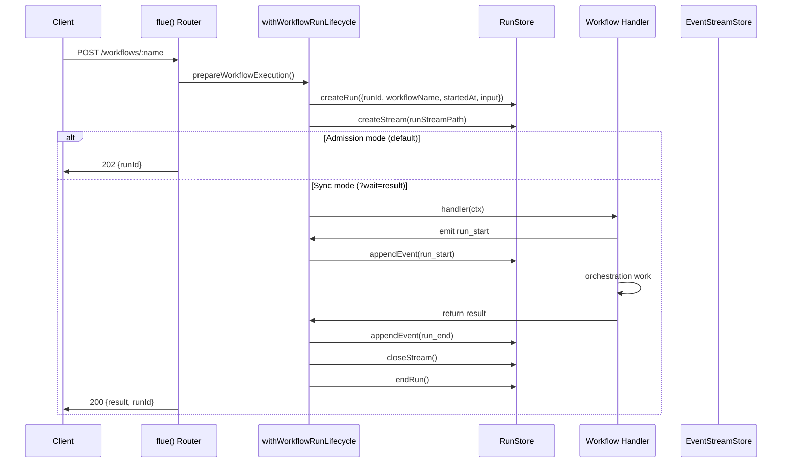
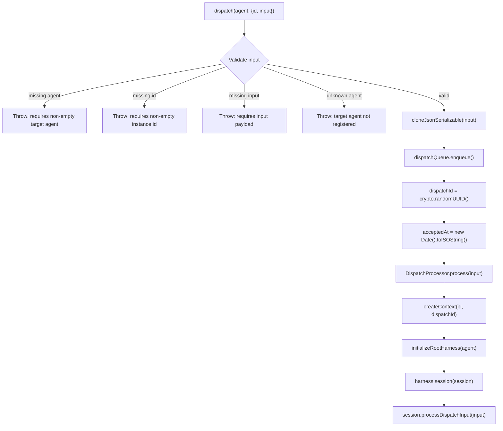
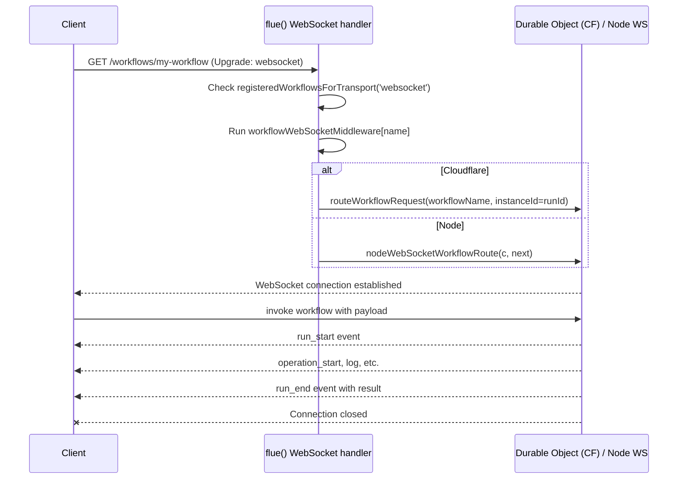

# Workflows: Handlers, Lifecycle, and Dispatch

Flue workflows are orchestration handlers exported from `.flue/workflows/` that run in a `FlueContextInternal` with HTTP-accessible endpoints, persistent event history, and support for both admission (fire-and-forget) and synchronous (`?wait=result`) invocation modes. They are the framework's mechanism for coordinating multi-step, multi-agent, or long-running operations where the caller needs to track progress, retrieve results, or stream events in real time.

This document covers workflow handler definitions, the `FlueContextInternal` interface workflows receive, the run lifecycle (`run_start` through `turns` through `run_end`), `dispatch()` for asynchronous input delivery, the distinction between `dispatchId` and `runId`, and workflow WebSocket semantics (one invocation per connection).

For the HTTP/WebSocket routing layer that exposes workflows, see [07-routing-http-websocket](07-routing-http-websocket.html). For the observability system workflows emit into, see [12-observability](12-observability.html).

---

## Workflow Handler Definition

A workflow handler is a function that receives a `FlueContextInternal` and performs orchestration work. It is defined by exporting a function from a module discovered in the `.flue/workflows/` directory at build time. The handler is invoked via `executeWorkflowDefinition()` in `handle-agent.ts`, which parses the input, initializes the root harness, runs the workflow action, and closes the harness:

```ts
// Source: packages/runtime/src/runtime/handle-agent.ts (executeWorkflowDefinition)
async function executeWorkflowDefinition(
  workflow: WorkflowDefinition,
  ctx: FlueContextInternal,
  input: unknown,
): Promise<unknown> {
  const parsedInput = parseActionInput(workflow.action, input);
  const harness = await ctx.initializeRootHarness(workflow.agent);
  try {
    return await runActionWithParsedInput(workflow.action, { harness, log: ctx.log }, parsedInput);
  } finally {
    await harness.close();
  }
}
```

The handler receives a `FlueContextInternal` object that extends `FlueEventContext` with server-only methods. `FlueEventContext` provides the invocation identity, environment, request, and logger; `FlueContextInternal` adds `initializeRootHarness()`, event emission, and subscription methods.

Source: [`packages/runtime/src/types.ts`](https://github.com/earendil-works/flue/blob/main/packages/runtime/src/types.ts) (`FlueEventContext`) and [`packages/runtime/src/client.ts`](https://github.com/earendil-works/flue/blob/main/packages/runtime/src/client.ts) (`FlueContextInternal`)

```ts
export interface FlueEventContext<TEnv = Record<string, any>> {
  readonly id: string;              // Workflow run ID or agent instance ID
  readonly agentName: string | undefined;
  readonly env: TEnv;               // Platform bindings (process.env or CF Worker env)
  readonly req: Request | undefined; // The incoming HTTP Request
  readonly log: FlueLogger;         // Structured logger: info/warn/error
}

export interface FlueContextInternal extends FlueEventContext {
  readonly runId: string | undefined;
  initializeRootHarness(agent: AgentDefinition): Promise<Harness>;
  createEvent(event: FlueEventInput): FlueEvent;
  publishEvent(event: FlueEvent): void;
  emitEvent(event: FlueEventInput, observation?: FlueObservationDetail): FlueEvent;
  subscribeEvent(callback: FlueEventCallback): () => void;
  flushEventCallbacks(): Promise<void>;
  setEventCallback(callback: FlueEventCallback | undefined): void;
  setSubmissionId(submissionId: string | undefined): void;
}
```

Each field serves a specific role:

- **`id`** — The workflow run ID (from `FlueEventContext`). Generated at admission time as `run_<ulid>` by `generateWorkflowRunId()` in `ids.ts`. On Cloudflare, this doubles as the Durable Object instance ID.
- **`agentName`** — Undefined for workflow contexts (populated for agent contexts).
- **`env`** — Platform-specific environment bindings. On Node this is `process.env`; on Cloudflare this is the Worker environment containing Durable Object bindings, secrets, etc.
- **`req`** — The standard `fetch` `Request` object. Useful for reading headers (e.g., `req.headers.get('authorization')`), the URL, or cloning the body for HMAC verification. Body access is single-use per the standard `Request` contract.
- **`log`** — A `FlueLogger` with `info(message, attributes?)`, `warn(message, attributes?)`, and `error(message, attributes?)` methods. During workflow runs, log events are emitted as `FlueEvent` entries with `type: 'log'` and persisted in the run event stream.
- **`initializeRootHarness()`** — Initializes the root agent harness for this workflow invocation, using the workflow's configured `agent` definition. Returns a `Harness` with `session()` access.

---

## Run Lifecycle

Every workflow execution follows the same lifecycle, regardless of invocation mode (admission or synchronous). The lifecycle is managed by `withWorkflowRunLifecycle()` in `handle-agent.ts`:

```ts
// Source: packages/runtime/src/runtime/handle-agent.ts (withWorkflowRunLifecycle, ~lines 557-586)
async function withWorkflowRunLifecycle<T>(
  lifecycle: WorkflowRunLifecycle,
  body: () => T | Promise<T>,
): Promise<T> {
  const flushFanout = subscribeRunFanout(lifecycle);
  emitRunStart(lifecycle);
  let didFlushFanout = false;
  let result: T;
  try {
    result = await body();
    await flushFanout();
    didFlushFanout = true;
  } catch (error) {
    if (!didFlushFanout) {
      try { await flushFanout(); } catch {}
    }
    await emitRunEnd(lifecycle, { isError: true, error });
    throw error;
  }
  await emitRunEnd(lifecycle, { result, isError: false });
  return result;
}
```

The lifecycle consists of three phases:

### Phase 1: `run_start`

Emitted immediately when the workflow begins execution. The event carries the full invocation metadata:

```ts
// Source: packages/runtime/src/types.ts — FlueEventVariant run_start
{ type: 'run_start'; runId: string; workflowName: string; startedAt: string; input: unknown; }
```

The `emitRunStart()` function emits this event with `runId`, `workflowName`, `startedAt`, and `input`. The event is persisted to the `EventStreamStore` before any handler code runs.

### Phase 2: Turns (handler execution)

Between `run_start` and `run_end`, the workflow handler executes. This typically involves:

1. Calling `ctx.initializeRootHarness(workflow.agent)` to create the root harness
2. Getting a session via `harness.session(name)`
3. Running `session.prompt()`, `session.skill()`, `session.task()`, or `session.shell()` operations
4. Each operation emits its own `FlueEvent` entries (`operation_start`, `operation`, `turn_start`, `turn`, `tool_call`, etc.)

Events emitted during this phase are fanned out through `subscribeRunFanout()` (handle-agent.ts ~lines 653-709), which subscribes to the context's event channel and persists each non-terminal event to the `EventStreamStore` before publishing to live subscribers.

### Phase 3: `run_end`

Emitted when the handler completes or throws. The `emitRunEnd()` function (~lines 606-651 in handle-agent.ts) computes `durationMs` from `startedAtMs`, serializes any error, appends the event to the `EventStreamStore`, closes the stream, then persists the terminal record to the `RunStore`:

```ts
// Emitted fields from emitRunEnd():
{ type: 'run_end'; runId: string; result: unknown | null; isError: boolean;
  error?: unknown; durationMs: number; }
```

The terminal ordering is deliberate: `run_end` is appended to the event stream store and the stream is closed *before* persisting the terminal record to the `RunStore`. This ensures `/runs/:runId/stream` consumers always see `run_end` as the final event.



The lifecycle also supports `run_resume` for recovered runs — when a previously active workflow is restarted after a crash or interruption, `emitRunResume()` emits a `run_resume` event instead of `run_start`, carrying the same identity fields but signaling that this is a continuation, not a fresh start.

---

## Workflow Invocation Modes

Workflows can be invoked through two modes, determined by the `?wait=result` query parameter. The mode selection happens in `handleWorkflowRequest()` at lines 306-324 of `handle-agent.ts`:

```ts
// Source: packages/runtime/src/runtime/handle-agent.ts:315-317
if (wait === 'result') return await runSyncMode(execution);
return await runWorkflowAdmissionMode(execution);
```

| Mode | Trigger | Response | Use Case |
|------|---------|----------|----------|
| **Admission** (default) | `POST /workflows/:name` with no special headers | `202 {runId}` | Fire-and-forget; poll `/runs/:runId` for result |
| **Synchronous** | `?wait=result` query parameter | `200 {result, runId}` | Wait for completion in same request |

The admission mode is the default because workflows are designed for asynchronous operations. The handler is started via `startWorkflowAdmission()`, which on Node executes inline and on Cloudflare wraps in a `runFiber` for crash-recoverable execution across Durable Object hibernation.

---

## Dispatch: Asynchronous Input Delivery

The `dispatch()` function delivers input asynchronously to a continuing agent session. It is the mechanism for sending new messages to an agent that is already running, without creating a new workflow run or blocking the caller.

Source: [`packages/runtime/src/runtime/flue-app.ts`](https://github.com/earendil-works/flue/blob/main/packages/runtime/src/runtime/flue-app.ts)

```ts
// Two overloads: agent-definition and named-agent
export function dispatch(
  agent: AgentDefinition,
  request: AgentDispatchRequest,
): Promise<DispatchReceipt>;
export function dispatch(request: NamedAgentDispatchRequest): Promise<DispatchReceipt>;
```

`dispatch()` has two calling patterns:

**Pattern 1: Agent definition** — Pass an `AgentDefinition` value (the default export from an `agents/<name>.ts` module) plus a dispatch request:

```ts
import { dispatch } from '@flue/runtime';
import { myAgent } from './agents/my-agent.ts';

const receipt = await dispatch(myAgent, {
  id: 'instance-42',
  input: { action: 'check_status' },
});
console.log(receipt.dispatchId); // delivery identifier
```

**Pattern 2: Named agent** — Pass a `NamedAgentDispatchRequest` with the agent name:

```ts
import { dispatch } from '@flue/runtime';

const receipt = await dispatch({
  agent: 'my-agent',
  id: 'instance-42',
  input: { action: 'check_status' },
});
```

### Dispatch Admission Flow

The dispatch flow goes through `enqueueDispatch()` in `dispatch.ts`:

```ts
// Source: packages/runtime/src/runtime/dispatch.ts:13-29
export async function enqueueDispatch(options: {
  request: NamedAgentDispatchRequest;
  dispatchQueue: DispatchQueue;
  rt: DispatchRuntime;
}): Promise<DispatchReceipt> {
  const agent = options.request.agent;
  const input = validateAndCloneDispatchRequest(options.request, agent, options.rt);
  return options.dispatchQueue.enqueue({
    dispatchId: crypto.randomUUID(),
    agent,
    id: options.request.id,
    input,
    acceptedAt: new Date().toISOString(),
  });
}
```

The dispatch process:

1. **Validates** the target agent name is a non-empty string
2. **Validates** the `id` (instance ID) is a non-empty string
3. **Validates** the `input` is not `undefined` (use `null` for an intentional empty payload)
4. **Validates** the agent exists in the runtime manifest
5. **Clones** the input through JSON serialization/deserialization to snapshot it at admission time and detect non-serializable values
6. **Enqueues** the dispatch with a `crypto.randomUUID()`-generated `dispatchId`

Note: dispatch requests do **not** include a `session` field. The session is determined by the dispatch processor on the receiving side. The `NamedAgentDispatchRequest` interface has three fields: `agent`, `id`, and `input` (extending `AgentDispatchRequest` which has `id` and `input`).

The dispatched input is then processed by the agent submission admission in `handle-agent.ts`, which:

1. **Validates** the dispatch input via `assertAgentDispatchAdmissionInput()` (checks all required fields are present and non-empty)
2. **Creates** a `FlueContextInternal` with the `dispatchId`
3. **Initializes** the root harness via `initializeRootHarness(agent)`
4. **Gets** the target session via `harness.session(session)`
5. **Calls** `session.processDispatchInput(input)`



---

## `dispatchId` vs `runId`

This is a critical distinction that shapes how you track activity in Flue.

| Field | What it identifies | Scope | Persisted in run history? |
|-------|-------------------|-------|--------------------------|
| **`runId`** | A workflow run execution | Workflow-scoped | Yes — full event history |
| **`dispatchId`** | A single delivery to an agent session | Session-scoped | No — appears in session messages only |

A `dispatchId` is generated by `crypto.randomUUID()` at dispatch admission time. It identifies the *delivery* of input to an agent session. It is **not** a workflow `runId`, and dispatched inputs do **not** create workflow-run history.

When a dispatched input is processed, the resulting messages in the session carry dispatch-related metadata. The `DispatchReceipt` returned by `dispatch()` contains:

```ts
// Source: packages/runtime/src/types.ts
export interface DispatchReceipt {
  dispatchId: string;    // Generated delivery identifier. Not a workflow runId.
  acceptedAt: string;    // ISO timestamp when dispatch admission begins.
}
```

The `DispatchInput` internal interface (dispatch-queue.ts) carries the dispatch data through the queue:

```ts
// Source: packages/runtime/src/runtime/dispatch-queue.ts
export interface DispatchInput {
  dispatchId: string;
  agent: string;
  id: string;
  input: unknown;
  acceptedAt: string;
}
```

The `FlueEvent` type also carries optional `dispatchId` on its base fields, allowing observability tools to correlate dispatched activity:

```ts
// Source: packages/runtime/src/types.ts — FlueEventInput (correlation fields)
export type FlueEventInput = FlueEventVariant & {
  runId?: string;
  instanceId?: string;
  dispatchId?: string;
  submissionId?: string;
  agentName?: string;
  conversationId?: string;
  session?: string;
  parentSession?: string;
  taskId?: string;
  harness?: string;
  operationId?: string;
  turnId?: string;
};

// Delivered FlueEvent adds durable decoration:
export type FlueEvent = FlueEventInput & {
  v: 3;             // Durable event-format version
  eventIndex: number;
  timestamp: string;
};
```

The event format version is `FLUE_EVENT_SCHEMA_REVISION = 3`.

---

## Workflow WebSocket

Workflow WebSocket connections accept **exactly one invocation** and close after completion or failure. This is fundamentally different from agent WebSockets, which can process sequential prompts over the same connection.

The WebSocket route handler in `flue-app.ts` (lines 370-402) handles `GET /workflows/:name` with `Upgrade: websocket` header. It validates the workflow is registered for WebSocket transport, runs per-workflow middleware if configured, then routes to the Node WebSocket handler or Cloudflare Durable Object. On Cloudflare, the run ID is generated as `generateWorkflowRunId()` and used as the Durable Object instance ID — one workflow run equals one DO instance.



---

## Workflow Run ID Generation

Workflow run IDs are generated by `generateWorkflowRunId()` in `ids.ts` using the pattern `run_<ulid>`:

```ts
// Source: packages/runtime/src/runtime/ids.ts
export function generateWorkflowRunId(): string {
  return `run_${ulid()}`;
}
```

The function takes **no parameters**. The ID is a ULID (Universally Unique Lexicographically Sortable Identifier) from the `ulidx` library prefixed with `run_`. The function includes a JSDoc comment stating: "Workflow run ids are opaque: nothing may parse structure out of them. The owning workflow is resolved through the run registry (`runId` → `workflowName`)."

There is no `parseWorkflowRunId()` function — run IDs are explicitly designed to be opaque. The owning workflow is resolved through the `RunStore.lookupRun()` method which maps run IDs to their workflow name.

On Cloudflare, the run ID doubles as the Durable Object instance ID. The comment at lines 376-379 of `flue-app.ts` explains: "One workflow run = one workflow DO instance. The instanceId IS the runId; the DO it lands on then re-uses that value to seed its run record via handleWorkflowRequest({ runId: instanceId, ... })."

---

## Run Store and Registry

Workflow runs are persisted through two systems:

### RunStore

The `RunStore` interface stores individual run records and event sequences:

```ts
// Source: packages/runtime/src/runtime/run-store.ts
interface RunStore {
  createRun(input: CreateRunInput): Promise<void>;   // { runId, workflowName, startedAt, input, traceCarrier? }
  endRun(input: EndRunInput): Promise<void>;          // { runId, endedAt, isError, durationMs, result?, error? }
  getRun(runId: string): Promise<RunRecord | null>;
  lookupRun(runId: string): Promise<WorkflowRunPointer | null>;  // { runId, workflowName }
  listRuns(opts?: ListRunsOpts): Promise<ListRunsResponse>;      // cursor-paginated listing
}
```

On Node, the run store uses `fjall` (an LSM-tree database) for persistence. On Cloudflare, it uses the Durable Object's embedded SQLite.

The `createRun` operation is idempotent (first-writer-wins): when a record with the same `runId` already exists, the call is a no-op and the existing record is preserved. SQL backends implement this with `INSERT OR IGNORE` / `ON CONFLICT DO NOTHING`.

### Run Lookup

Run lookup for bare `/runs/:runId` URLs is handled through `RunStore.lookupRun()`, which returns a `WorkflowRunPointer` (`{ runId, workflowName }`). This enables the runtime to route inspection requests to the correct handler regardless of where the run was created. There is no separate `RunRegistry` interface — lookup is a method on `RunStore`.

---

## Aha Moments

**Aha: `dispatchId` identifies delivery, not a run.** The `dispatch()` function returns a `DispatchReceipt` with a `dispatchId` that looks like a run ID but isn't. Dispatched inputs go directly to an agent session for processing — they don't create workflow-run history, don't appear in the run store, and don't trigger `run_start`/`run_end` events. The `dispatchId` is purely for correlating which session activity came from which delivery. This means you can send inputs to a long-lived agent session without accumulating workflow runs for each input.

**Aha: Workflow admission is durably committed before the handler runs.** The `createRun()` call in `createWorkflowRunLifecycle()` happens *before* the handler function is invoked. If the handler crashes immediately, the run record still exists with `status: 'active'` and a `run_start` event in the event stream. The `failRecoveredRun()` function can resume from this state, emitting `run_resume` instead of `run_start` and continuing from the last persisted event index. This is what makes Cloudflare's `runFiber` hibernation-recovery model work — the run is already in the database when the DO goes to sleep.

**Aha: Empty POST bodies are legal and treated as `undefined`.** The `parseJsonBody()` function in `errors.ts` returns `undefined` for genuinely empty bodies (no `Content-Length` and no `Content-Type` header, or `Content-Length: 0`). This means `curl -X POST http://localhost:3000/workflows/my-workflow` works without `-d '{}'` for workflows that don't require input. The workflow's `action` input parsing then receives `undefined` and applies the action's default input schema. The trade-off is documented in the code: if a client sends a body but no `Content-Length` and no `Content-Type`, the body is silently ignored. This preserves the `curl -X POST` UX for no-payload invocations.

---

## Related Documents

- [07-routing-http-websocket](07-routing-http-websocket.html) — HTTP/WebSocket routing, route table, protocols, error envelopes
- [12-observability](12-observability.html) — The `FlueEvent` system (v3), `observe()`, and OpenTelemetry integration
- [03-harness-sessions](03-harness-sessions.html) — `initializeRootHarness()`, harness and session lifecycle
- [13-session-persistence](13-session-persistence.html) — SessionData versioning, storage, tree deletion

[Table of Contents](README.html)
