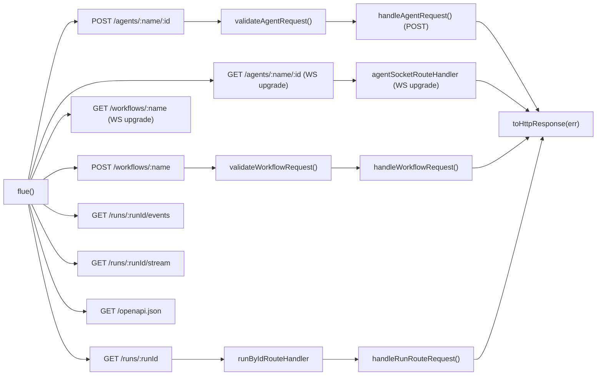

# HTTP Routing: The `flue()` Sub-App

Flue's HTTP API is exposed through a mountable Hono sub-app created by the `flue()` function. The sub-app registers routes for agent invocation (`/agents/:name/:id`), workflow invocation (`/workflows/:name`), and run inspection (`/runs/:runId`, `/runs/:runId/events`, `/runs/:runId/stream`). An OpenAPI document is served at `/openapi.json`. Agent and workflow routes also accept WebSocket upgrades for persistent streaming connections. The routing layer distinguishes between regular HTTP requests and WebSocket upgrades using the `upgrade: websocket` header, forwarding to per-target Node handlers or Cloudflare Durable Objects.

This document covers the `flue()` sub-app architecture, the complete route table with HTTP/WebSocket method semantics, Durable Streams event format, WebSocket protocol v1 message types, error envelope format, and request validation.

For workflow handler semantics and the run lifecycle, see [06-workflows](06-workflows.html). For the SDK client that calls these routes, see [10-sdk-client](10-sdk-client.html). For the error framework implementation, see [15-cross-cutting](15-cross-cutting.html).

---

## The `flue()` Sub-App

The `flue()` function creates and configures a Hono application with all public routes. It is designed to be mounted at any path prefix by the host application:

```ts
// Source: packages/runtime/src/runtime/flue-app.ts:270-318
export function flue(): Hono {
  const app = new Hono();

  app.get('/openapi.json', lazyOpenApiRouteHandler(app, publicOpenApiOptions()));

  app.post(
    '/workflows/:name',
    describeRoute(workflowRouteSpec() as DescribeRouteOptions),
    validated('param', WorkflowRouteParamSchema),
    validated('query', WorkflowInvocationQuerySchema),
    workflowRouteHandler,
  );
  app.get('/workflows/:name', workflowSocketRouteHandler);
  app.all('/workflows/:name', workflowRouteHandler);

  app.post(
    '/agents/:name/:id',
    describeRoute(agentRouteSpec() as DescribeRouteOptions),
    validated('param', AgentRouteParamSchema),
    agentRouteHandler,
  );
  app.get('/agents/:name/:id', agentSocketRouteHandler);
  // Non-POSTs still reach the canonical Flue 405 envelope instead of
  // Hono's default 404 for unmatched methods.
  app.all('/agents/:name/:id', agentRouteHandler);
  for (const [routePath, action] of RUN_ROUTES_BY_ID) {
    if (action === 'events') {
      app.get(
        routePath,
        describeRoute(runRouteSpec(action) as DescribeRouteOptions),
        validated('param', RunIdParamSchema),
        validated('query', RunEventsQuerySchema),
        runByIdRouteHandler(action),
      );
    } else {
      app.get(
        routePath,
        describeRoute(runRouteSpec(action) as DescribeRouteOptions),
        validated('param', RunIdParamSchema),
        runByIdRouteHandler(action),
      );
    }
    app.all(routePath, runByIdRouteHandler(action));
  }

  app.onError((err) => toHttpResponse(err));

  return app;
}
```

The `RUN_ROUTES_BY_ID` constant defines the three run routes:

```ts
// Source: packages/runtime/src/runtime/flue-app.ts:156-160
const RUN_ROUTES_BY_ID: ReadonlyArray<readonly [string, HandleRunRouteOptions['action']]> = [
  ['/runs/:runId', 'get'],
  ['/runs/:runId/events', 'events'],
  ['/runs/:runId/stream', 'stream'],
];
```

When no user-authored `app.ts` exists, `createDefaultFlueApp()` mounts `flue()` at `/` and adds a `notFound` handler that throws `RouteNotFoundError` with the request method and path:

```ts
// Source: packages/runtime/src/runtime/flue-app.ts:332-343
export function createDefaultFlueApp(): Hono {
  const app = new Hono();
  app.route('/', flue());
  app.notFound((c) => {
    throw new RouteNotFoundError({
      method: c.req.method,
      path: new URL(c.req.url).pathname,
    });
  });
  app.onError((err) => toHttpResponse(err));
  return app;
}
```

When a user writes an `app.ts`, they own the composition and must mount `flue()` explicitly. The `Fetchable` interface in `routing.ts` defines the structural contract:

```ts
// Source: packages/runtime/src/routing.ts (re-export from flue-app.ts)
export { flue } from './runtime/flue-app.ts';

export interface Fetchable {
  fetch(request: Request, env?: unknown, ctx?: unknown): Response | Promise<Response>;
}
```

Source: [`packages/runtime/src/runtime/flue-app.ts:270-318`](https://github.com/earendil-works/flue/blob/main/packages/runtime/src/runtime/flue-app.ts#L270-L318)

---

## Route Table

The complete route table with HTTP methods, handlers, and response shapes:

| Route | Methods | Handler | Response |
|-------|---------|---------|----------|
| `POST /agents/:name/:id` | POST | `agentRouteHandler` | `{ result }` JSON or DS stream (Accept: text/event-stream) |
| `GET /agents/:name/:id` | GET | `agentSocketRouteHandler` | WebSocket upgrade (if `upgrade: websocket`) or falls through |
| `ALL /agents/:name/:id` | ALL (catch-all) | `agentRouteHandler` | 405 for non-POST, 404 for unmatched |
| `POST /workflows/:name` | POST | `workflowRouteHandler` | `202 {status, runId}` or `200 {result}` or DS stream |
| `GET /workflows/:name` | GET | `workflowSocketRouteHandler` | WebSocket upgrade (if `upgrade: websocket`) or falls through |
| `ALL /workflows/:name` | ALL (catch-all) | `workflowRouteHandler` | 405 for non-POST, 404 for unmatched |
| `GET /runs/:runId` | GET | `runByIdRouteHandler('get')` | `RunRecord` JSON |
| `GET /runs/:runId/events` | GET | `runByIdRouteHandler('events')` | Paginated event list JSON |
| `GET /runs/:runId/stream` | GET | `runByIdRouteHandler('stream')` | DS stream (SSE) |
| `ALL /runs/:runId` | ALL | `runByIdRouteHandler('get')` | 405 for non-GET |
| `ALL /runs/:runId/events` | ALL | `runByIdRouteHandler('events')` | 405 for non-GET |
| `ALL /runs/:runId/stream` | ALL | `runByIdRouteHandler('stream')` | 405 for non-GET |
| `GET /openapi.json` | GET | `lazyOpenApiRouteHandler` | OpenAPI 3.1 document |



### Agent Routes: `/agents/:name/:id`

Agent routes require both a `name` (the discovered agent module name) and an `id` (an arbitrary instance identifier chosen by the caller). The `validateAgentRequest()` function in `errors.ts` enforces:

- Method must be `POST`
- `name` must be non-empty and not whitespace-only
- `id` must be non-empty and not whitespace-only
- `name` must be registered in the manifest

```ts
// Source: packages/runtime/src/errors.ts:671-683 (validateAgentRequest)
export function validateAgentRequest(opts: ValidateAgentRequestOptions): void {
  if (opts.method !== 'POST') {
    throw new MethodNotAllowedError({ method: opts.method, allowed: ['POST'] });
  }
  if (opts.name.trim() === '' || opts.id.trim() === '') {
    throw new InvalidRequestError({
      reason: 'Agent URLs must have the shape /agents/<name>/<id> with non-empty segments.',
    });
  }
  if (!opts.registeredAgents.includes(opts.name)) {
    throw new AgentNotFoundError({ name: opts.name, available: opts.registeredAgents });
  }
}
```

The `agentRouteHandler` in `flue-app.ts` handles POST requests. Non-POST methods fall through to the `app.all` catch-all which returns a 405 envelope via `agentRouteHandler`. WebSocket upgrades are handled separately by `agentSocketRouteHandler` registered on `app.get('/agents/:name/:id')`.

The POST handler (`handleAgentRequest` in `handle-agent.ts`) parses the JSON body, rejects `X-Webhook: true` requests, and serves the request. The request can be served in two modes:

- **Synchronous** (default): Returns `{ result }` JSON after the model operation completes
- **DS Stream** (`Accept: text/event-stream` header): Returns SSE-framed attached agent events

The agent request body format is:

```json
{
  "message": "string (required)",
  "session": "string (optional, defaults to 'default')"
}
```

The `DirectAgentPayload` type and `parseDirectAgentPayload()` function in `handle-agent.ts` enforce this shape:

```ts
// Source: packages/runtime/src/types.ts:40-43
export interface DirectAgentPayload {
  message: string;
  session?: string;
}

// Source: packages/runtime/src/runtime/handle-agent.ts:178-203
function parseDirectAgentPayload(payload: unknown): DirectAgentPayload {
  const expected =
    'Direct agent requests must use JSON object body { "message": string, "session"?: string }.';
  if (!payload || typeof payload !== 'object' || Array.isArray(payload)) {
    throw new InvalidRequestError({ reason: expected });
  }
  // ... validates message is string, session is non-empty string when provided
  // ... rejects session names beginning with "task:"
  return { message: value.message, session: value.session };
}
```

Agent requests with `X-Webhook: true` are rejected -- asynchronous delivery uses `dispatch()` instead.

### Workflow Routes: `/workflows/:name`

Workflow routes require only a `name`. The `validateWorkflowRequest()` function enforces:

- Method must be `POST`
- `name` must be non-empty
- `name` must be registered in the manifest
- `name` must be explicitly exposed for HTTP transport (workflows can opt out of HTTP exposure)

```ts
// Source: packages/runtime/src/errors.ts:654-669 (validateWorkflowRequest)
export function validateWorkflowRequest(opts: ValidateWorkflowRequestOptions): void {
  if (opts.method !== 'POST') {
    throw new MethodNotAllowedError({ method: opts.method, allowed: ['POST'] });
  }
  if (opts.name.trim() === '') {
    throw new InvalidRequestError({
      reason: 'Workflow URLs must have the shape /workflows/<name> with a non-empty segment.',
    });
  }
  if (!opts.registeredWorkflows.includes(opts.name)) {
    throw new WorkflowNotFoundError({ name: opts.name, available: opts.registeredWorkflows });
  }
  if (!opts.httpWorkflows.includes(opts.name)) {
    throw new WorkflowNotHttpError({ name: opts.name });
  }
}
```

**Note:** `WorkflowNotHttpError` is a separate error class from `WorkflowNotFoundError`. When a workflow is registered but not exposed over HTTP, `validateWorkflowRequest` throws `WorkflowNotHttpError` with `type: "workflow_not_http"` and a distinct `dev` message explaining how to expose the workflow via route middleware. The public `message`/`details` remain identical to prevent callers from enumerating internal-only workflow names.

The workflow request body is free-form JSON -- the shape is defined by the workflow handler. Empty bodies are treated as `{}` by `parseJsonBody()`.

Three invocation modes are selected by request headers/parameters:

| Mode | How to trigger | Response |
|------|---------------|----------|
| **Accepted** | Plain `POST` | `202 {status: "accepted", runId}` |
| **Synchronous** | `?wait=result` query param | `200 {result, _meta: {runId}}` |
| **DS Stream** | `Accept: text/event-stream` header | SSE stream with `run_start`, events, `run_end` |

All three modes set the `X-Flue-Run-Id` response header, even on error responses.

### Run Routes: `/runs/:runId`, `/runs/:runId/events`, `/runs/:runId/stream`

Three run routes are defined by `RUN_ROUTES_BY_ID`, each served by `runByIdRouteHandler` with a different `action`:

| Route | Action | Response |
|-------|--------|----------|
| `GET /runs/:runId` | `'get'` | `RunRecord` JSON |
| `GET /runs/:runId/events` | `'events'` | `{ events: [...] }` paginated event list (query params: `after`, `types`, `limit`) |
| `GET /runs/:runId/stream` | `'stream'` | SSE stream of live + historical events |

The `runByIdRouteHandler` factory validates that the method is `GET` (throws `MethodNotAllowedError` otherwise), resolves the run ID, and dispatches to either the Node handler (`handleRunRouteRequest`) or Cloudflare DO forwarding (`routeRunRequest`).

```ts
// Source: packages/runtime/src/runtime/flue-app.ts:689-719
function runByIdRouteHandler(action: HandleRunRouteOptions['action']): MiddlewareHandler {
  return async (c) => {
    // ... runtime check ...
    if (c.req.method !== 'GET') {
      throw new MethodNotAllowedError({ method: c.req.method, allowed: ['GET'] });
    }
    const runId = c.req.param('runId') || undefined;
    // ... dispatches to handleRunById() ...
  };
}
```

**`GET /runs/:runId`** -- Returns a `RunRecord` JSON object:

```json
{
  "runId": "workflow:my-workflow:01JXYZ...",
  "owner": { "kind": "workflow", "workflowName": "my-workflow", "instanceId": "..." },
  "status": "active" | "completed" | "errored",
  "startedAt": "2025-01-15T10:30:00.000Z",
  "payload": { ... },
  "endedAt": "...",
  "isError": false,
  "durationMs": 5230,
  "result": { ... },
  "error": { ... }
}
```

**`GET /runs/:runId/events`** -- Returns paginated event list with query params `after` (event index cursor), `types` (comma-separated event type filter), and `limit` (1-1000, default 100):

```json
{
  "events": [
    { "type": "run_start", "runId": "...", "eventIndex": 0, ... },
    { "type": "log", "runId": "...", "eventIndex": 1, ... }
  ]
}
```

**`GET /runs/:runId/stream`** -- Returns a Durable Streams event read (catch-up + live tail). Uses `Last-Event-ID` for resume. Emits SSE frames.

---

## WebSocket Protocol v1

Flue supports WebSocket connections for both agents and workflows. WebSocket upgrades are detected by checking for `GET` method + `upgrade: websocket` header. Separate route handlers (`agentSocketRouteHandler`, `workflowSocketRouteHandler`) are registered on `app.get` for each target.

### Protocol Message Types

The types are exported from `types.ts`:

**Agent WebSocket Client Messages** -- `AgentWebSocketClientMessage`:

```ts
// Source: packages/runtime/src/types.ts:68-80
export type AgentWebSocketClientMessage =
  | { version: 1; type: 'prompt'; requestId: string; message: string; session?: string }
  | { version: 1; type: 'ping'; requestId?: string };
```

**Agent WebSocket Server Messages** -- `AgentWebSocketServerMessage`:

```ts
// Source: packages/runtime/src/types.ts:107-137
export type AgentWebSocketServerMessage =
  | { version: 1; type: 'ready'; target: 'agent'; name: string; instanceId: string }
  | { version: 1; type: 'started'; requestId: string }
  | { version: 1; type: 'event'; requestId: string; event: AttachedAgentEvent }
  | { version: 1; type: 'result'; requestId: string; result: unknown }
  | WebSocketErrorMessage
  | { version: 1; type: 'pong'; requestId?: string };
```

**Workflow WebSocket Client Messages** -- `WorkflowWebSocketClientMessage`:

```ts
// Source: packages/runtime/src/types.ts:86-91
export interface WorkflowWebSocketClientMessage {
  version: 1;
  type: 'invoke';
  requestId: string;
  payload?: unknown;
}
```

**Workflow WebSocket Server Messages** -- `WorkflowWebSocketServerMessage`:

```ts
// Source: packages/runtime/src/types.ts:143-171
export type WorkflowWebSocketServerMessage =
  | { version: 1; type: 'ready'; target: 'workflow'; name: string }
  | { version: 1; type: 'started'; requestId: string; runId: string }
  | { version: 1; type: 'event'; requestId: string; runId: string; event: FlueEvent }
  | { version: 1; type: 'result'; requestId: string; runId: string; result: unknown }
  | WebSocketErrorMessage
  | WorkflowRunWebSocketErrorMessage;
```

**Error Messages** -- `WebSocketErrorMessage`:

```ts
// Source: packages/runtime/src/types.ts:94-99
export type WebSocketErrorMessage = {
  version: 1;
  type: 'error';
  requestId?: string;
  error: FluePublicError;
};
```

### WebSocket Route Handlers

The `agentSocketRouteHandler` in `flue-app.ts` (lines 550-577) handles agent WebSocket upgrades:

```ts
const agentSocketRouteHandler: MiddlewareHandler = async (c, next) => {
  if (!isWebSocketUpgrade(c.req.raw)) return next();
  const rt = requiredRuntime();
  const name = c.req.param('name') ?? '';
  const id = c.req.param('id') ?? '';
  if (!registeredAgentsForTransport(rt, 'websocket').includes(name) || id.trim() === '') {
    throw new RouteNotFoundError({ method: c.req.method, path: new URL(c.req.url).pathname });
  }
  return runAttachedMiddleware(c, rt.agentWebSocketMiddleware?.[name], async () => {
    if (rt.target === 'node') {
      if (!rt.nodeWebSocketAgentRoute)
        throw new Error('[flue] Node runtime is missing WebSocket agent routing.');
      return (await rt.nodeWebSocketAgentRoute(c, next)) ?? undefined;
    }
    // Cloudflare: forward to agent Durable Object
    const response = await rt.routeAgentRequest(
      normalizeAttachedRequest(c.req.raw, `/agents/${encodeURIComponent(name)}/${encodeURIComponent(id)}`),
      c.env,
      { agentName: name, instanceId: id },
    );
    if (response) return response;
    throw new RouteNotFoundError({ method: c.req.method, path: new URL(c.req.url).pathname });
  });
};
```

The `workflowSocketRouteHandler` (lines 522-548) follows the same pattern for workflows, checking `registeredWorkflowsForTransport(rt, 'websocket')` and using `workflowWebSocketMiddleware` / `nodeWebSocketWorkflowRoute` / `routeWorkflowRequest`.

Transport opt-in for WebSocket is determined by the `FlueManifest` -- agents and workflows must have `transports: { websocket?: true }` in their manifest entry to accept WebSocket connections.

---

## Durable Streams (DS) Protocol

Flue uses the **Durable Streams (DS) protocol** for HTTP event reads. Both agent and workflow stream reads use the same DS protocol (catch-up, long-poll, SSE). The protocol is implemented in `event-stream-store.ts` and `handle-stream-routes.ts`.

### Stream Read Flow

1. **Catch-up**: Historical events are replayed from the run store starting at `fromIndex` (derived from `Last-Event-ID` header or `?after=` query param).
2. **Long-poll**: If the run is still active, the handler subscribes to new events and waits.
3. **SSE**: Events are emitted as Server-Sent Events with `event: <type>` and `id: <eventIndex>`.
4. **Terminal**: When `run_end` (or equivalent terminal event) is emitted, the stream completes.

### Agent Stream Paths

Agent streams are delivered via the attached agent SSE mode (`Accept: text/event-stream`) on `POST /agents/:name/:id`, or via WebSocket upgrade on `GET /agents/:name/:id`. The Node target uses `handleAgentConversationRead` / `handleAgentConversationHead` for conversation route reads.

### Workflow Run Streams

Workflow run streams use `GET /runs/:runId/stream`. The handler routes to:

- **Node**: `handleRunRouteRequest` with `action: 'stream'`, which calls `streamRunEvents` from `handle-run-routes.ts`
- **Cloudflare**: `routeRunRequest` forwarding to the registry Durable Object

### SSE Frame Format

DS streams emit Server-Sent Events:

```
event: run_start
id: 0
data: {"type":"run_start","runId":"workflow:my-wf:...","eventIndex":0,"timestamp":"...","payload":{}}

event: log
id: 1
data: {"type":"log","level":"info","message":"Processing...","eventIndex":1,"timestamp":"..."}

event: run_end
id: 2
data: {"type":"run_end","runId":"workflow:my-wf:...","result":null,"isError":false,"durationMs":1234,"eventIndex":2,"timestamp":"..."}
```

The `id` field is the `eventIndex` for SSE resume via `Last-Event-ID` header.

Terminal errors in the stream infrastructure use:

```
event: error
id: 2
data: {"error":{"type":"validation_failed","message":"...","details":"..."}}
```

---

## Error Envelopes

Flue's error framework has two audiences and produces a canonical wire envelope. The framework is defined in `errors.ts`:

```
// Wire envelope (HTTP body + SSE data: payload for error events):
{
  "error": {
    "type":    "...",    // Stable machine-readable identifier (snake_case)
    "message": "...",    // One-sentence caller-safe summary
    "details": "...",    // Caller-safe longer explanation
    "dev":     "...",    // Present ONLY in local/dev mode AND when non-empty
    "meta":    {...}     // Structured error-specific metadata (rare)
  }
}
```

### Two-Audience Design

The error framework separates information by audience:

| Field | Who sees it | When | Content rules |
|-------|------------|------|---------------|
| `type` | Always | Always | Machine-readable snake_case identifier |
| `message` | Always | Always | One-sentence caller-safe summary |
| `details` | Always | Always | Caller-safe explanation. NEVER includes: sibling enumeration, filesystem paths, framework internals, source-code fix instructions |
| `dev` | Developer only | Only in `flue dev` / `flue run` mode AND when non-empty | Everything else: available alternatives, filesystem layout, framework guidance, source-code fix instructions |
| `meta` | Always | When set by subclass | Structured error-specific metadata (rare) |

This separation allows `dev` to be richly helpful without leaking namespace state to public callers. When in doubt, information goes in `dev`.

### Error Classes

The framework defines these concrete error classes (all in `errors.ts`):

| Class | HTTP Status | `type` | When thrown |
|-------|------------|--------|-------------|
| `MethodNotAllowedError` | 405 | `method_not_allowed` | Wrong HTTP method on endpoint. Sets `Allow` header. |
| `UnsupportedMediaTypeError` | 415 | `unsupported_media_type` | Body present without `application/json` Content-Type |
| `InvalidJsonError` | 400 | `invalid_json` | Body is present but not valid JSON |
| `AgentNotFoundError` | 404 | `agent_not_found` | Agent name not in registered agents |
| `WorkflowNotFoundError` | 404 | `workflow_not_found` | Workflow name not in registered workflows |
| `WorkflowNotHttpError` | 404 | `workflow_not_http` | Workflow is registered but not exposed over HTTP |
| `RouteNotFoundError` | 404 | `route_not_found` | No route matches the request |
| `RunNotFoundError` | 404 | `run_not_found` | Run ID not found |
| `RunStoreUnavailableError` | 501 | `run_store_unavailable` | Run history endpoint without configured run store |
| `RunRegistryUnavailableError` | 501 | `run_registry_unavailable` | Run lookup endpoint without configured run registry |
| `RunEventTooLargeError` | N/A (internal) | N/A | Event payload exceeds 1 MB persistence limit (extends `Error`, not `FlueHttpError`) |
| `InvalidRequestError` | 400 | `invalid_request` | Malformed request (URL shape, segment validation, payload validation) |
| `ValidationError` | 400 | `validation_failed` | Schema validation failure (used by `validated()` helper) |

**Note:** `WorkflowNotHttpError` is a separate class from `WorkflowNotFoundError`. The `RunRegistryUnavailableError` class exists (not `RuntimeUnavailableError`). `RunEventTooLargeError` exists in the source (extends plain `Error`, not `FlueHttpError`). `ValidationError` exists as a concrete class used by the `validated()` middleware helper.

### The `toHttpResponse()` Function

All thrown errors are caught by `app.onError((err) => toHttpResponse(err))`. The function renders any thrown value into the canonical Flue error envelope:

```ts
// Source: packages/runtime/src/errors.ts:535-559
export function toHttpResponse(err: unknown): Response {
  if (isFlueError(err)) {
    const isHttp = err instanceof FlueHttpError;
    const status = isHttp ? err.status : 500;
    const headers: Record<string, string> = {
      'content-type': 'application/json',
    };
    if (isHttp && err.headers) {
      Object.assign(headers, err.headers);
    }
    // Log non-HTTP FlueErrors that bubbled up to the HTTP layer
    if (!isHttp) {
      flueLog.error(err);
    }
    return new Response(JSON.stringify(envelope(err)), { status, headers });
  }
  // Non-FlueError: log everything, leak nothing.
  flueLog.error(err);
  return new Response(JSON.stringify(GENERIC_INTERNAL), {
    status: 500,
    headers: { 'content-type': 'application/json' },
  });
}
```

**Note:** The actual source does NOT set browser security headers (`x-content-type-options`, `cross-origin-resource-policy`) on error responses. Only `content-type: application/json` is set. Non-HTTP FlueErrors (like internal errors extending `Error` rather than `FlueHttpError`) are logged via `flueLog.error()` even though their message is rendered on the wire.

Non-Flue errors are logged in full and rendered as a generic 500 with no message leaked -- `GENERIC_INTERNAL` is `{error: {type: "internal_error", message: "An internal error occurred.", details: "The server encountered an unexpected error..."}}`.

### Example Error Responses

**404 -- Agent not found (production):**

```json
{
  "error": {
    "type": "agent_not_found",
    "message": "Agent \"unknown\" is not registered.",
    "details": "Verify the agent name is correct."
  }
}
```

**404 -- Agent not found (dev mode):**

```json
{
  "error": {
    "type": "agent_not_found",
    "message": "Agent \"unknown\" is not registered.",
    "details": "Verify the agent name is correct.",
    "dev": "Available agents: \"echo\", \"researcher\".\nAgents are loaded from the project root's \"agents/\" directory at build time. Verify the agent file is present in the project root being served."
  }
}
```

**404 -- Workflow not HTTP:**

```json
{
  "error": {
    "type": "workflow_not_http",
    "message": "Workflow \"internal-task\" is not web-accessible.",
    "details": "This endpoint is not exposed over HTTP.",
    "dev": "To expose it, export route middleware and call await next() to enter the workflow handler."
  }
}
```

**415 -- Unsupported media type:**

```json
{
  "error": {
    "type": "unsupported_media_type",
    "message": "Request body must be sent as application/json.",
    "details": "Received Content-Type: \"text/plain\".\nSend the request body as JSON with the header \"Content-Type: application/json\", or omit the body entirely (and the Content-Type header) if the request doesn't have a payload."
  }
}
```

---

## Request Validation

Route validation uses the `validated()` helper from `flue-app.ts`, which wraps `hono-openapi`'s `validator`:

```ts
function validated(
  target: 'param' | 'query',
  schema: Parameters<typeof validator>[1],
): MiddlewareHandler {
  return validator(target, schema, (result) => {
    if (result.success) return;
    throw new ValidationError({
      details: `Invalid ${target} parameters.`,
      issues: result.error,
    });
  }) as MiddlewareHandler;
}
```

The schemas (from `schemas.ts`):

```ts
// packages/runtime/src/runtime/schemas.ts
export const WorkflowRouteParamSchema = v.object({ name: v.string() });

export const WorkflowInvocationQuerySchema = v.object({
  wait: v.optional(v.literal('result')),
});

export const AgentRouteParamSchema = v.object({ name: v.string(), id: v.string() });

export const RunIdParamSchema = v.object({ runId: v.string() });

export const RunEventsQuerySchema = v.object({
  after: v.optional(integerString('after must be a non-negative integer.')),
  types: v.optional(
    v.pipe(
      v.string(),
      v.regex(eventTypesPattern, 'types must be a comma-separated list of known event type names.'),
    ),
  ),
  limit: v.optional(
    v.pipe(
      integerString('limit must be an integer between 1 and 1000.'),
      v.transform(Number),
      v.minValue(1, 'limit must be at least 1.'),
      v.maxValue(1000, 'limit must be at most 1000.'),
    ),
  ),
});
```

**Note:** There is no `InvocationQuerySchema` -- the query schema is `WorkflowInvocationQuerySchema` used on the workflow POST route. Agent routes do not validate a query schema. There is no `DirectAgentPayloadSchema` in `schemas.ts` -- agent payload validation is done at runtime by `parseDirectAgentPayload()` in `handle-agent.ts`.

---

## Routing Architecture: How Agents and Workflows Share the Middleware Chain

The `flue-app.ts` routes both agents and workflows through similar structural patterns:

```ts
// Agent route (simplified)
app.post('/agents/:name/:id',
  validated('param', AgentRouteParamSchema),
  agentRouteHandler,  // validates -> runAttachedMiddleware -> dispatches
);

// Workflow route (simplified)
app.post('/workflows/:name',
  validated('param', WorkflowRouteParamSchema),
  validated('query', WorkflowInvocationQuerySchema),
  workflowRouteHandler,  // validates -> runAttachedMiddleware -> dispatches
);
```

Both handlers follow the same three-phase pattern:

1. **Validate** the request (method, name/id, registration, transport opt-in)
2. **Run attached middleware** (`runAttachedMiddleware(c, middleware, ...)`)
3. **Route to target** -- Node handler function or Cloudflare Durable Object forwarding

The `runAttachedMiddleware()` function wraps per-agent or per-workflow middleware:

```ts
// Source: packages/runtime/src/runtime/flue-app.ts:796-816
async function runAttachedMiddleware(
  c: Parameters<MiddlewareHandler>[0],
  middleware: MiddlewareHandler | undefined,
  handle: () => Promise<Response | undefined>,
): Promise<Response | undefined> {
  if (!middleware) return handle();
  const finalizedBefore = c.finalized;
  const responseBefore = finalizedBefore ? c.res : undefined;
  let continued = false;
  const response = await middleware(c, async () => {
    if (continued) throw new Error('next() called multiple times');
    continued = true;
    const handled = await handle();
    if (handled) c.res = handled;
  });
  if (response) return response;
  if (continued || (c.finalized && (!finalizedBefore || c.res !== responseBefore))) return c.res;
  throw new Error(
    'Context is not finalized. Did you forget to return a Response object or await next()?',
  );
}
```

This allows users to attach custom middleware (e.g., authentication, rate limiting, logging) to specific agents or workflows via the `FlueRuntime` middleware maps (`agentRouteMiddleware`, `workflowRouteMiddleware`, `agentWebSocketMiddleware`, `workflowWebSocketMiddleware`).

---

## Transport Registration via FlueManifest

Agents and workflows opt into HTTP and WebSocket transport at build time through the `FlueManifest`. The manifest entries define a `transports` object:

```ts
// Source: packages/runtime/src/runtime/flue-app.ts:142-152
export interface FlueManifest {
  agents: Array<{
    name: string;
    transports: { http?: true; websocket?: true };
    created: boolean;
  }>;
  workflows?: Array<{
    name: string;
    transports: { http?: boolean; websocket?: boolean };
  }>;
}
```

The `registeredAgentsForTransport()` and `registeredWorkflowsForTransport()` functions filter by the `transports` object:

```ts
// Source: packages/runtime/src/runtime/flue-app.ts:828-844
export function registeredAgentsForTransport(
  rt: FlueRuntime,
  transport: ExposedTransport,
): readonly string[] {
  return (rt.manifest?.agents ?? [])
    .filter((agent) => agent.transports[transport] === true)
    .map((agent) => agent.name);
}

export function registeredWorkflowsForTransport(
  rt: FlueRuntime,
  transport: ExposedTransport,
): readonly string[] {
  return (rt.manifest?.workflows ?? [])
    .filter((workflow) => workflow.transports[transport] === true)
    .map((workflow) => workflow.name);
}
```

**Note:** The transport opt-in mechanism uses the `FlueManifest` with a `transports: { http?: true; websocket?: true }` shape -- NOT a `route !== undefined` check on records. An agent or workflow that doesn't set `transports.http = true` returns a `WorkflowNotFoundError` / `AgentNotFoundError` even though the entity exists.

The `AgentManifestEntrySchema` in `schemas.ts` reflects this:

```ts
const AgentManifestEntrySchema = v.object({
  name: v.string(),
  transports: v.object({
    http: v.optional(v.literal(true)),
    websocket: v.optional(v.literal(true)),
  }),
  created: v.boolean(),
});
```

---

## OpenAPI Document

The `flue()` sub-app exposes an OpenAPI 3.1 document at `GET /openapi.json`. The handler is lazily initialized via `lazyOpenApiRouteHandler`:

```ts
// Source: packages/runtime/src/runtime/flue-app.ts:764-769
function lazyOpenApiRouteHandler(
  app: Hono,
  getOptions: () => ReturnType<typeof publicOpenApiOptions>,
): MiddlewareHandler {
  return (c, next) => openAPIRouteHandler(app, getOptions())(c, next);
}
```

The OpenAPI document includes:
- `info.title: "Flue Public API"`
- Auto-discovered routes with `describeRoute()` metadata
- Workflow invocation spec (`invokeWorkflow`) with `x-flue-invocation-modes: ['accepted', 'wait-result', 'stream']`
- Agent invocation spec (`invokeAgent`) with `x-flue-invocation-modes: ['sync', 'stream']`
- Run route specs (`getRun`, `listRunEvents`, `streamRunEvents`) with `x-flue-streaming: true` on streaming endpoints
- Standard error responses (400, 404, 405, 415, 500, 501) on all endpoints

---

## `parseJsonBody()` Behavior

The `parseJsonBody()` function in `errors.ts` (lines 574-629) parses request bodies:

- Returns `{}` for genuinely empty bodies (`Content-Length: 0` or no Content-Length AND no Content-Type)
- Throws `UnsupportedMediaTypeError` if a body is present without `application/json` Content-Type
- Throws `InvalidJsonError` if the body is present but unparseable

**Note:** Empty bodies return `{}`, NOT `undefined`. The code documents the trade-off explicitly: if a client sends a body but no Content-Length and no Content-Type, the body is silently ignored. This preserves the no-payload UX for invocations that don't require input.

---

## Aha Moments

**Aha: WebSocket and HTTP share the same validation but diverge on transport.** The `flue()` function registers both POST routes for HTTP requests and GET routes for WebSocket upgrades. Agent and workflow WebSocket handlers (`agentSocketRouteHandler`, `workflowSocketRouteHandler`) check `isWebSocketUpgrade()` and fall through to `next()` if not a WS upgrade. Transport opt-in is checked against the manifest's `transports.websocket` field. The same `runAttachedMiddleware` pattern wraps both HTTP and WebSocket middleware.

**Aha: The error framework has two audiences, enforced by required fields.** Every `FlueHttpError` constructor takes both `details` (caller-safe) and `dev` (developer-only) as required strings. This means it's impossible to accidentally put internal guidance in `details` -- the TypeScript compiler forces you to think about both audiences. The `dev` field is only rendered when `configureErrorRendering({ devMode: true })` is called, which the generated entry does for `flue dev` and `flue run` but not for production deployments.

**Aha: Empty POST bodies are legal and treated as `{}`.** The `parseJsonBody()` function returns `{}` when the request has `Content-Length: 0` or when there's no `Content-Length` AND no `Content-Type` header. This means `curl -X POST http://localhost:3000/workflows/my-workflow` works without `-d '{}'`. The code documents the trade-off explicitly: if a client sends a body but no Content-Length and no Content-Type, the body is silently ignored.

**Aha: Three run routes, not one.** The `RUN_ROUTES_BY_ID` constant defines `/runs/:runId`, `/runs/:runId/events`, and `/runs/:runId/stream` -- each with a different `action` ('get', 'events', 'stream'). The `'events'` action adds `RunEventsQuerySchema` validation for pagination query params. All three are GET-only with ALL catch-alls for 405.

**Aha: WorkflowNotHttpError is a separate class.** When a workflow is registered but not exposed over HTTP, a distinct `WorkflowNotHttpError` is thrown (not `WorkflowNotFoundError` with a flag). The `type` wire value is `"workflow_not_http"` -- different from `"workflow_not_found"`. The public `message`/`details` stay parallel to prevent enumeration.

---

## Related Documents

- [06-workflows](06-workflows.html) -- Workflow handlers, run lifecycle, `dispatch()`, `dispatchId` vs `runId`
- [15-cross-cutting](15-cross-cutting.html) -- Error handling deep dive, provider config, usage tracking
- [10-sdk-client](10-sdk-client.html) -- `FlueClient` HTTP and Durable Streams usage, admin routes
- [08-cloudflare-target](08-cloudflare-target.html) -- Durable Objects, registry, cross-deployment routing
- [09-node-target](09-node-target.html) -- Local sandbox, process lifetime, Durable Streams

[Table of Contents](README.html)
