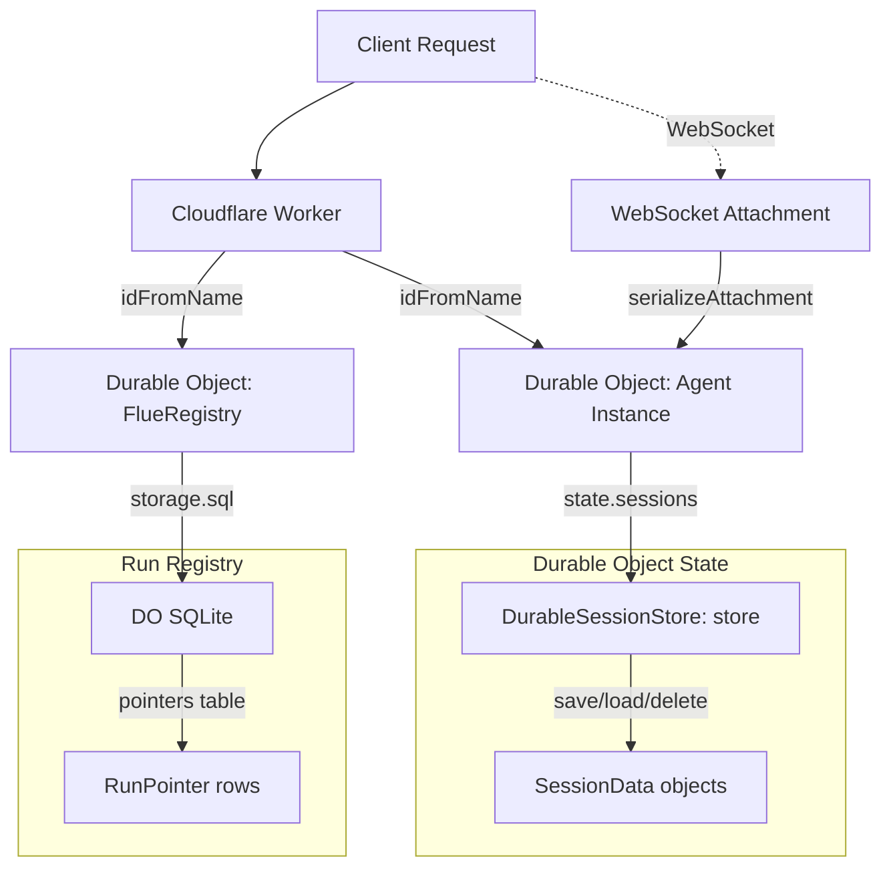
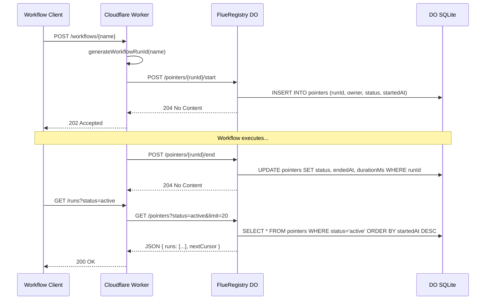
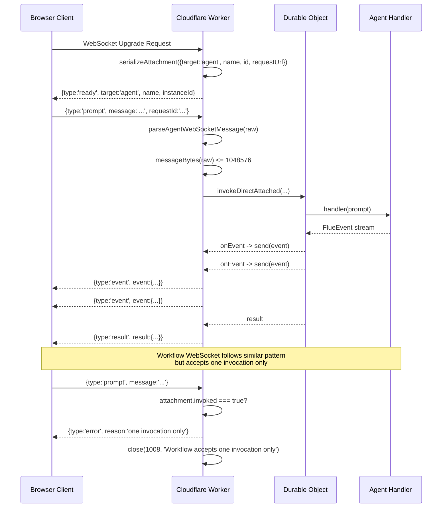
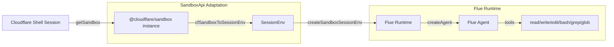
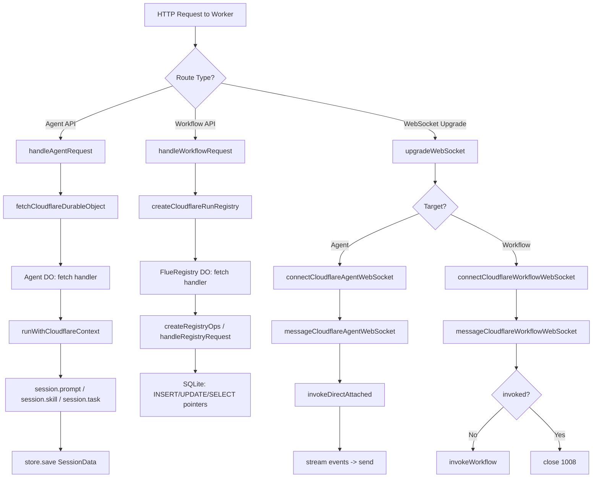

# Cloudflare Workers Deployment

Flue deploys agents to Cloudflare Workers using Durable Objects as the persistence and execution backbone. Every agent instance, every workflow run, and every session is backed by a Durable Object that automatically persists state, handles requests via its `fetch` handler, and survives server restarts without any database configuration.

## Durable Object Architecture

Cloudflare Workers are stateless by default. Flue makes them stateful by using Durable Objects (DOs) as the unit of persistence. A Durable Object is a single-threaded, strongly consistent isolate with built-in storage (SQLite) that stays alive as long as requests reference it. Flue creates three kinds of Durable Objects:

| DO Type | Class/Function | Purpose | Lifetime |
|---------|-------|---------|----------|
| Agent Instance | `FlueDraftWorkflow` (and per-agent classes) | Holds agent sessions, executes prompts | Per agent instance (named by `id`) |
| Session Store | `store()` via `getCloudflareContext()` | Reads/writes `SessionData` from DO state | Tied to agent instance |
| Run Registry | `FlueRegistry` | Tracks workflow run pointers with SQLite | Singleton (`FLUE_REGISTRY_INSTANCE_NAME`) |



**Source:** `packages/runtime/src/cloudflare/durable-object.ts`, `packages/runtime/src/cloudflare/registry-do.ts`, `packages/runtime/src/cloudflare/session-store.ts`

### How Durable Object Routing Works

Every agent instance is identified by a name string (typically the agent's `id` from the URL). The `fetchCloudflareDurableObject` function resolves this name to a DO instance:

```typescript
// packages/runtime/src/cloudflare/durable-object.ts:6-24
export async function fetchCloudflareDurableObject(
    namespace: DurableObjectNamespace,
    name: string,
    request: Request,
    options: { retry?: boolean } = {},
): Promise<Response> {
    let attempt = 0;
    while (true) {
        try {
            return await namespace.get(namespace.idFromName(name)).fetch(request.clone());
        } catch (error) {
            attempt++;
            if (!options.retry || attempt >= 3 || !isRetryableDurableObjectError(error)) throw error;
            await new Promise((resolve) =>
                setTimeout(resolve, Math.floor(Math.random() * 100 * 2 ** (attempt - 1))),
            );
        }
    }
}
```

The flow is:

1. `namespace.idFromName(name)` deterministically converts a string name into a DO ID. The same name always produces the same ID, so the same agent instance always maps to the same DO.
2. `namespace.get(id)` returns a handle to that DO instance.
3. `.fetch(request.clone())` forwards the HTTP request to the DO's `fetch` method.
4. On failure, the retry loop attempts up to 3 times with exponential backoff.

**Aha:** Durable Object errors carry two flags: `retryable` and `overloaded`. The `isRetryableDurableObjectError` function retries only when `retryable === true && overloaded !== true`. This distinction matters: an overloaded DO is under too much pressure and retrying would make things worse, while a retryable error (like a transient cold-start failure) is worth reattempting. The backoff is jittered: `Math.random() * 100 * 2 ** (attempt - 1)` gives 0-100ms on attempt 1, 0-200ms on attempt 2, preventing thundering herd when multiple requests fail simultaneously.

```typescript
// packages/runtime/src/cloudflare/durable-object.ts:26-30
function isRetryableDurableObjectError(error: unknown): boolean {
    if (typeof error !== 'object' || error === null) return false;
    const typed = error as { overloaded?: unknown; retryable?: unknown };
    return typed.retryable === true && typed.overloaded !== true;
}
```

## Cloudflare Context and AsyncLocalStorage

Durable Objects are single-threaded, but async executions interleave at `await` points. A module-level global would be shared across all concurrent requests, creating race conditions. Flue solves this with `AsyncLocalStorage` from `node:async_hooks`, which scopes context to the current async fiber.

```typescript
// packages/runtime/src/cloudflare/context.ts:33-48
const contextStorage = new AsyncLocalStorage<CloudflareContext>();

export function runWithCloudflareContext<T>(ctx: CloudflareContext, fn: () => T): T {
    return contextStorage.run(ctx, fn);
}

export function getCloudflareContext(): CloudflareContext {
    const ctx = contextStorage.getStore();
    if (!ctx) {
        throw new Error(
            '[flue:cloudflare] Not running in a Cloudflare context. ' +
                'This function can only be called inside a Cloudflare Worker or Durable Object.',
        );
    }
    return ctx;
}
```

The `CloudflareContext` interface bundles everything the agent runtime needs:

```typescript
// packages/runtime/src/cloudflare/context.ts:10-20
export interface CloudflareContext {
    env: Record<string, any>;
    agentInstance: {
        state: any;
        setState(state: any): void;
    };
    storage: {
        sql: any;
    };
    durableObjectIdentity?: FlueDurableObjectIdentity;
}
```

| Field | Purpose |
|-------|---------|
| `env` | Cloudflare Worker environment bindings (AI models, KV, R2, etc.) |
| `agentInstance` | The DO instance reference with `state`/`setState` for persistence |
| `storage` | DO SQLite storage handle for structured data |
| `durableObjectIdentity` | Metadata: `bindingName`, `className`, `name`, `id` |

The `FlueDurableObjectIdentity` type carries four identifiers:

```typescript
// packages/runtime/src/cloudflare/context.ts:22-31
export interface FlueDurableObjectIdentity {
    bindingName: string;   // Wrangler binding name, e.g. "FLUE_DRAFT_WORKFLOW"
    className: string;     // DO class name, e.g. "FlueDraftWorkflow"
    name: string;          // Instance name passed to idFromName
    id: string;            // DO id from DurableObjectState.id.toString()
}
```

The helper `getDurableObjectIdentity()` extracts this from the current context:

```typescript
// packages/runtime/src/cloudflare/context.ts:50-58
export function getDurableObjectIdentity(): FlueDurableObjectIdentity {
    const ctx = getCloudflareContext();
    if (!ctx.durableObjectIdentity) {
        throw new Error(
            '[flue:cloudflare] Durable Object identity is not available in this Cloudflare context.',
        );
    }
    return ctx.durableObjectIdentity;
}
```

## DurableSessionStore: Session Persistence via DO State

The `store()` function returns a `SessionStore` implementation that reads and writes `SessionData` objects directly through the Durable Object's `state`/`setState` API. This provides an alternative to DO SQLite-backed storage. As the source comment notes, "usually not needed -- the generated entry point uses DO SQLite by default," meaning the SQLite path is the primary mechanism, and `store()` is available as a simpler alternative for cases where structured SQL queries are not needed.

```typescript
// packages/runtime/src/cloudflare/session-store.ts:14-36
export function store(): SessionStore {
    return {
        async save(id: string, data: SessionData): Promise<void> {
            const { agentInstance } = getCloudflareContext();
            const sessions = copySessions(agentInstance.state?.sessions);
            sessions[id] = data;
            agentInstance.setState({ ...agentInstance.state, sessions });
        },

        async load(id: string): Promise<SessionData | null> {
            const { agentInstance } = getCloudflareContext();
            const sessions = agentInstance.state?.sessions;
            return sessions && Object.hasOwn(sessions, id) ? (sessions[id] ?? null) : null;
        },

        async delete(id: string): Promise<void> {
            const { agentInstance } = getCloudflareContext();
            const sessions = copySessions(agentInstance.state?.sessions);
            delete sessions[id];
            agentInstance.setState({ ...agentInstance.state, sessions });
        },
    };
}
```

The `copySessions` helper creates a clean object (no prototype pollution):

```typescript
// packages/runtime/src/cloudflare/session-store.ts:8-12
function copySessions(
    sessions: Record<string, SessionData> | undefined,
): Record<string, SessionData> {
    return Object.assign(Object.create(null), sessions);
}
```

The three operations work as follows:

1. **`save(id, data)`**: Reads the current `agentInstance.state.sessions`, copies it to a new object, sets `sessions[id] = data`, then calls `setState` to persist the entire new state object.
2. **`load(id)`**: Reads `agentInstance.state.sessions` and returns the entry for `id` if it exists, using `Object.hasOwn` for a safe prototype-free lookup.
3. **`delete(id)`**: Copies the sessions object, deletes the key, then calls `setState`.

**Key detail:** The store does NOT use `storage.sql`. It uses DO `state`/`setState` directly, which is a simpler key-value persistence layer that Cloudflare manages automatically. The comment in the source says "usually not needed -- the generated entry point uses DO SQLite by default," meaning the SQLite path is the primary mechanism, and `store()` is a fallback or alternative for simpler use cases.

**Aha:** Cloudflare persistence is automatic -- no database configuration is needed. The Durable Object persists its `state` across invocations, sleeps, and server restarts. When you call `agentInstance.setState(...)`, Cloudflare serializes and stores the state. When the DO wakes up for the next request, `agentInstance.state` is already populated. There is no connection pool, no migration, no schema definition. The `SessionData` objects live in memory and survive automatically.

## FlueRegistry: Run Pointer Tracking

The `FlueRegistry` is a singleton Durable Object that tracks workflow run pointers using DO SQLite. Unlike the `store()` function which uses DO `state`, the registry uses proper SQL for structured queries and pagination.

```typescript
// packages/runtime/src/cloudflare/registry-do.ts:10-21
export class FlueRegistry extends DurableObject {
    private ops: RegistryOps;

    constructor(state: DurableObjectStateLike, env: unknown) {
        super(state as unknown as DurableObjectState, env as never);
        this.ops = createRegistryOps(state.storage.sql);
    }

    async fetch(request: Request): Promise<Response> {
        return handleRegistryRequest(this.ops, request);
    }
}
```

The registry receives a `DurableObjectStateLike` in its constructor, extracts `state.storage.sql` (the SQLite handle), and passes it to `createRegistryOps` which builds CRUD operations for run pointers. All HTTP requests to the DO are routed through `handleRegistryRequest`, which parses the URL and dispatches to the appropriate operation.

The client side is `CloudflareRunRegistry`, which implements the `RunRegistry` interface:

```typescript
// packages/runtime/src/cloudflare/run-registry.ts:17-22
export function createCloudflareRunRegistry(
    namespace: FlueRegistryNamespace | undefined,
): RunRegistry | undefined {
    if (!namespace) return undefined;
    return new CloudflareRunRegistry(namespace);
}
```

The four `RunRegistry` methods make HTTP calls to the singleton DO:

| Method | HTTP | Path | Purpose |
|--------|------|------|---------|
| `recordRunStart` | POST | `/pointers/{runId}/start` | Create run pointer with `active` status |
| `recordRunEnd` | POST | `/pointers/{runId}/end` | Update pointer to `completed` or `errored` |
| `lookupRun` | GET | `/pointers/{runId}` | Fetch a single run pointer |
| `listRuns` | GET | `/pointers?status=&workflow=&limit=&cursor=` | Paginated list with filters |

All calls go through `fetchCloudflareDurableObject` with `{ retry: true }`:

```typescript
// packages/runtime/src/cloudflare/run-registry.ts:71-75
private fetch(request: Request): Promise<Response> {
    return fetchCloudflareDurableObject(this.namespace, FLUE_REGISTRY_INSTANCE_NAME, request, {
        retry: true,
    });
}
```

The `FLUE_REGISTRY_INSTANCE_NAME` is hardcoded as `'default'`, making the registry a true singleton. The `SYNTHETIC_BASE` is `'https://flue-registry.local'` -- a fake URL that never actually resolves over the network; requests are routed internally to the DO via `fetchCloudflareDurableObject`.

### Run Registry Data Flow



**Source:** `packages/runtime/src/cloudflare/run-registry.ts:30-95`

## Cloudflare Sandbox: cfSandboxToSessionEnv

The `cfSandboxToSessionEnv` function wraps a `@cloudflare/sandbox` instance into Flue's `SessionEnv` interface. This adapter allows remote sandbox providers to plug into the Flue runtime without changing any core logic.

```typescript
// packages/runtime/src/cloudflare/cf-sandbox.ts:7-125
export async function cfSandboxToSessionEnv(
    sandbox: any,
    cwd: string = '/workspace',
): Promise<SessionEnv> {
    const api: SandboxApi = {
        async readFile(path: string): Promise<string> {
            const file = await sandbox.readFile(path);
            return file.content;
        },
        // ... 7 more methods implementing SandboxApi
    };
    return createSandboxSessionEnv(api, cwd);
}
```

The adapter implements all 8 methods of the `SandboxApi` interface:

| Method | Implementation Strategy |
|--------|------------------------|
| `readFile(path)` | `sandbox.readFile(path)` -> returns `file.content` |
| `readFileBuffer(path)` | `sandbox.readFile(path, { encoding: 'base64' })` -> `atob` -> `Uint8Array` |
| `writeFile(path, content)` | String: direct. `Uint8Array`: `btoa` -> `sandbox.writeFile(path, b64, { encoding: 'base64' })` |
| `stat(path)` | `sandbox.exec("stat -c '{...}' path")` -> parse JSON output |
| `readdir(path)` | `sandbox.exec("ls -1 path")` -> split by newline |
| `exists(path)` | `sandbox.exists(path)` -> `result.exists` |
| `mkdir(path, opts)` | `sandbox.mkdir(path, opts)` |
| `rm(path, opts)` | `opts.recursive/force` -> `sandbox.exec("rm -rf path")`, else `sandbox.deleteFile(path)` |
| `exec(command, execOpts)` | `sandbox.exec(command, { cwd, env, timeout })` |

The `exec` method has important signal handling semantics:

```typescript
// packages/runtime/src/cloudflare/cf-sandbox.ts:92-121
async exec(
    command: string,
    execOpts?: { cwd?: string; env?: Record<string, string>; timeout?: number; signal?: AbortSignal },
): Promise<{ stdout: string; stderr: string; exitCode: number }> {
    // The Cloudflare sandbox API has no signal param, so we rely on
    // `timeout` for deadline enforcement and only observe `signal`
    // before and after the remote call.
    const externalSignal = execOpts?.signal;
    if (externalSignal?.aborted) throw abortErrorFor(externalSignal);

    const timeoutMs = typeof execOpts?.timeout === 'number' ? execOpts.timeout * 1000 : undefined;
    const result = await sandbox.exec(command, {
        cwd: execOpts?.cwd,
        env: execOpts?.env,
        timeout: timeoutMs,
    });

    if (externalSignal?.aborted) throw abortErrorFor(externalSignal);

    return {
        stdout: result.stdout ?? '',
        stderr: result.stderr ?? '',
        exitCode: result.exitCode ?? (result.success ? 0 : 1),
    };
}
```

**Key insight:** The Cloudflare sandbox API does not support `AbortSignal` on `exec()`. Flue works around this by checking the signal before the call (fast-fail if already aborted) and after the call (detect if aborted mid-flight), while relying on `timeout` for deadline enforcement during the call itself. This is a deliberate trade-off: the timeout is enforced remotely by the sandbox, but the signal is only observed at the boundaries.

The `stat` method uses a creative approach -- it shells out to `stat -c` and parses the JSON output:

```typescript
// packages/runtime/src/cloudflare/cf-sandbox.ts:40-61
async stat(path: string) {
    const result = await sandbox.exec(
        `stat -c '{"size":%s,"isDir":%F}' '${path.replace(/'/g, "'\\''")}'`,
    );
    if (!result.success) {
        throw new Error(`stat failed for ${path}: ${result.stderr}`);
    }
    try {
        const raw = result.stdout.trim();
        const sizeMatch = raw.match(/"size":(\d+)/);
        const isDir = raw.includes('directory');
        return {
            isFile: !isDir,
            isDirectory: isDir,
            isSymbolicLink: false,
            size: parseInt(sizeMatch?.[1] ?? '0', 10),
            mtime: new Date(),
        };
    } catch {
        throw new Error(`Failed to parse stat output for ${path}: ${result.stdout}`);
    }
}
```

The single-quote escaping (`path.replace(/'/g, "'\\''")`) prevents shell injection in the stat command.

## WebSocket Attachment and Messaging

Cloudflare Workers handle WebSockets differently than Node.js. Instead of a WebSocket server listening on a port, Cloudflare uses WebSocket attachments -- a pattern where the WebSocket metadata is serialized into the connection's attachment and the worker's `fetch` handler upgrades the connection.

### Attachment Schema

```typescript
// packages/runtime/src/cloudflare/websocket.ts:24-33
export type CloudflareWebSocketAttachment =
    | { version: 1; target: 'agent'; name: string; id: string; requestUrl: string }
    | {
          version: 1;
          target: 'workflow';
          name: string;
          runId: string;
          requestUrl: string;
          invoked: boolean;
      };
```

The attachment carries all routing information needed to dispatch messages:

| Field | Agent | Workflow |
|-------|-------|----------|
| `version` | `1` | `1` |
| `target` | `'agent'` | `'workflow'` |
| `name` | Agent name | Workflow name |
| `id` / `runId` | Agent instance ID | Workflow run ID |
| `requestUrl` | Stripped URL (no query/hash) | Stripped URL |
| `invoked` | N/A | Tracks one-shot invocation |

### WebSocket Connection Interface

The `CloudflareWebSocketConnection` interface defines the contract that the WebSocket handler uses to interact with the underlying connection:

```typescript
// packages/runtime/src/cloudflare/websocket.ts:35-40
export interface CloudflareWebSocketConnection {
    serializeAttachment(value: CloudflareWebSocketAttachment): void;
    deserializeAttachment(): CloudflareWebSocketAttachment | null;
    send(message: string): void;
    close(code?: number, reason?: string): void;
}
```

The four methods map directly to Cloudflare's WebSocket API:

| Method | Purpose |
|--------|---------|
| `serializeAttachment(value)` | Writes metadata into the connection; survives reconnections |
| `deserializeAttachment()` | Reads previously serialized metadata back |
| `send(message)` | Sends a text frame to the client |
| `close(code, reason)` | Terminates the connection with a standard WebSocket close code |

### Agent WebSocket Options

The `CloudflareAgentWebSocketOptions` interface extends `CloudflareAttachedOptions` with a `beforePrompt` hook:

```typescript
// packages/runtime/src/cloudflare/websocket.ts:50-56
export interface CloudflareAgentWebSocketOptions extends CloudflareAttachedOptions {
    name: string;
    id: string;
    handler: AgentHandler;
    beforePrompt?: (session: string) => void | Promise<void>;
    runHandler?: RunHandlerFn;
}
```

The `beforePrompt` callback runs before every agent prompt, receiving the session name. It is called in `messageCloudflareAgentWebSocket` before `invokeAgentPrompt`:

```typescript
// packages/runtime/src/cloudflare/websocket.ts:189
await options.beforePrompt?.(message.session ?? 'default');
```

This hook enables middleware-like behavior: session preparation, rate limiting, authentication checks, or metric recording before the agent processes the prompt.

### Connection Lifecycle



**Source:** `packages/runtime/src/cloudflare/websocket.ts`

### Message Processing

Agent WebSocket messages go through `messageCloudflareAgentWebSocket`:

```typescript
// packages/runtime/src/cloudflare/websocket.ts:103-136
export async function messageCloudflareAgentWebSocket(
    connection: CloudflareWebSocketConnection,
    raw: SocketMessage,
    options: CloudflareAgentWebSocketOptions,
): Promise<void> {
    if (typeof raw !== 'string') {
        sendError(connection, new InvalidRequestError({ reason: 'Binary WebSocket messages are not supported.' }));
        close(connection, 1003, 'Binary messages are not supported');
        return;
    }
    if (messageBytes(raw) > MAX_MESSAGE_BYTES) {
        sendError(connection, new InvalidRequestError({ reason: 'WebSocket messages must not exceed 1048576 bytes.' }));
        close(connection, 1008, 'Message too large');
        return;
    }
    let message: AgentWebSocketClientMessage;
    try {
        message = parseAgentWebSocketMessage(raw);
    } catch (error) {
        sendError(connection, error);
        return;
    }
    if (message.type === 'ping') {
        send(connection, { version: 1, type: 'pong', requestId: message.requestId });
        return;
    }
    await invokeAgentPrompt(connection, message, options);
}
```

The validation chain:

1. **Type check**: Rejects binary messages (`ArrayBuffer`/`ArrayBufferView`), closes with code `1003`.
2. **Size check**: `MAX_MESSAGE_BYTES = 1024 * 1024` (1 MiB). Uses `TextEncoder().encode(message).byteLength` for accurate UTF-8 byte counting. Exceeding this closes with code `1008`.
3. **Parse**: `parseAgentWebSocketMessage(raw)` validates the JSON structure.
4. **Ping/Pong**: Special-cased -- responds immediately without invoking the agent.
5. **Invoke**: `invokeAgentPrompt` calls `invokeDirectAttached` with the agent handler.

Workflow WebSocket messages go through `messageCloudflareWorkflowWebSocket`, which adds an invocation guard:

```typescript
// packages/runtime/src/cloudflare/websocket.ts:166-177
const attachment = connection.deserializeAttachment();
if (!attachment || attachment.target !== 'workflow' || attachment.invoked) {
    sendError(
        connection,
        new InvalidRequestError({
            reason: 'Workflow WebSocket connections accept one invocation only.',
        }),
        message.requestId,
    );
    close(connection, 1008, 'Workflow accepts one invocation only');
    return;
}
connection.serializeAttachment({ ...attachment, invoked: true });
await invokeWorkflow(connection, message, options);
```

The `invoked` flag is read from the attachment, checked, then set to `true` atomically via `serializeAttachment`. This ensures each workflow WebSocket accepts exactly one prompt.

### Event Buffering for Workflows

Workflow invocations buffer events until the `onAdmitted` callback fires:

```typescript
// packages/runtime/src/cloudflare/websocket.ts:224-267
const bufferedEvents: Array<...> = [];
// ...
onAdmitted: () => {
    didStart = true;
    send(connection, { version: 1, type: 'started', requestId: message.requestId, runId });
    for (const event of bufferedEvents)
        send(connection, { version: 1, type: 'event', requestId: message.requestId, runId, event });
},
onEvent: (event) => {
    if (!didStart) {
        bufferedEvents.push(event);
        return;
    }
    send(connection, { version: 1, type: 'event', requestId: message.requestId, runId, event });
},
```

Events that arrive before `onAdmitted` are collected in `bufferedEvents`. Once admitted, the buffer is flushed and subsequent events go directly to the client. This prevents clients from receiving events before the `started` message.

## Cloudflare Shell Connector Migration

Flue supports migrating existing Cloudflare Shell sessions into Flue agent sessions. The `cfSandboxToSessionEnv` function is the bridge: given a `@cloudflare/sandbox` instance (from `getSandbox()`), it wraps the sandbox into a `SessionEnv` that Flue's runtime understands.

The migration flow:



The key insight is that `cfSandboxToSessionEnv` creates a `SandboxApi` object that translates between the Cloudflare sandbox API and Flue's internal interface. The sandbox uses `exec()` for operations like `stat` and `readdir` (because the sandbox has no native filesystem API for these), while using native methods like `readFile`, `writeFile`, `mkdir`, `exists` where available.

### Workers AI Binding Provider

The Cloudflare `env` object carries Workers AI bindings (and any other configured bindings). These are accessible through `getCloudflareContext().env`. The model provider abstraction in `pi-ai` can be configured to use Workers AI by passing the appropriate binding from the `env` object. This means agents can run entirely on Cloudflare's infrastructure without external API calls.

## Complete Request Flow



## Summary Table: Cloudflare-Specific APIs

| API | File | Purpose |
|-----|------|---------|
| `fetchCloudflareDurableObject(ns, name, req, opts)` | `durable-object.ts` | Route request to named DO with retry |
| `isRetryableDurableObjectError(error)` | `durable-object.ts` | Check `retryable && !overloaded` |
| `store()` | `session-store.ts` | `SessionStore` backed by DO state |
| `createCloudflareRunRegistry(ns)` | `run-registry.ts` | `RunRegistry` client for FlueRegistry DO |
| `FlueRegistry` | `registry-do.ts` | Singleton DO class for run pointers |
| `cfSandboxToSessionEnv(sandbox, cwd)` | `cf-sandbox.ts` | Wrap `@cloudflare/sandbox` into `SessionEnv` |
| `getCloudflareContext()` | `context.ts` | Get current fiber-scoped Cloudflare context |
| `runWithCloudflareContext(ctx, fn)` | `context.ts` | Execute function within Cloudflare context |
| `getDurableObjectIdentity()` | `context.ts` | Get DO identity (binding, class, name, id) |
| `connectCloudflareAgentWebSocket(conn, opts)` | `websocket.ts` | Serialize agent WebSocket attachment |
| `connectCloudflareWorkflowWebSocket(conn, opts)` | `websocket.ts` | Serialize workflow WebSocket attachment |
| `messageCloudflareAgentWebSocket(conn, raw, opts)` | `websocket.ts` | Process agent WebSocket message |
| `messageCloudflareWorkflowWebSocket(conn, raw, opts)` | `websocket.ts` | Process workflow WebSocket message |
| `CloudflareWebSocketAttachment` | `websocket.ts` | Union type for WebSocket metadata |
| `CloudflareWebSocketConnection` | `websocket.ts` | Interface for WebSocket connection operations |
| `CloudflareAgentWebSocketOptions` | `websocket.ts` | Agent WS options with `beforePrompt` hook |
| `CloudflareWorkflowWebSocketOptions` | `websocket.ts` | Workflow WS options with `startWorkflowAdmission` |
| `operationRequestUrl(requestUrl)` | `websocket.ts` | Strip query/hash from URL for attachment |

**Source directory:** `packages/runtime/src/cloudflare/` (14 files in the Cloudflare target directory)

## Related Documents

- [Node Target](09-node-target.html) -- Node.js deployment, `local()` sandbox, process-lifetime execution
- [HTTP & WebSocket Routing](07-routing-http-websocket.html) -- `flue()` routing, protocols, error envelopes
- [Session Persistence](13-session-persistence.html) -- `SessionData` v5, storage backends, tree deletion
- [Architecture](01-architecture.html) -- Full dependency graph, multi-target deployment overview
