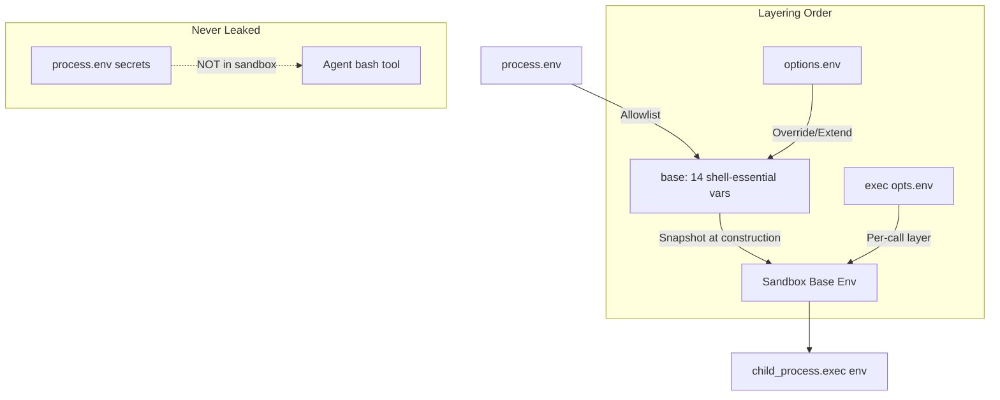
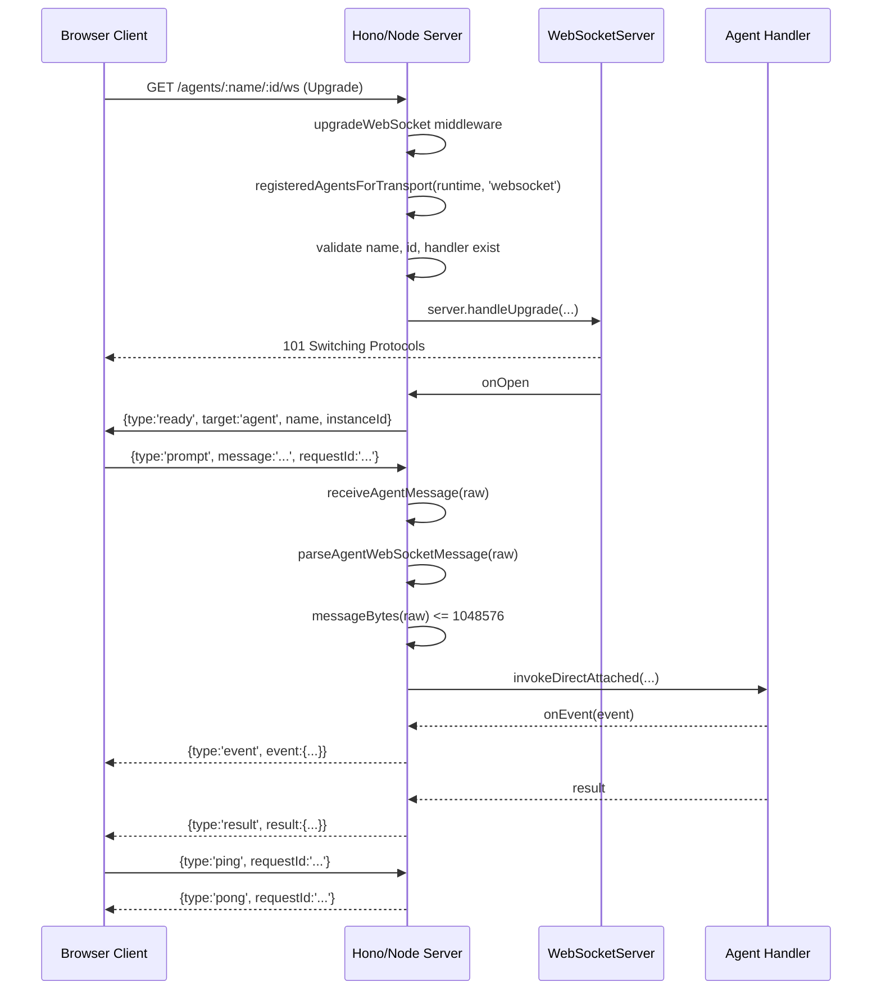

# Node.js Deployment

Flue deploys agents to Node.js with direct host access through the `local()` sandbox, a process-lifetime dispatch queue, and a WebSocket server powered by Hono's `upgradeWebSocket` middleware. Unlike Cloudflare Workers which persist state in Durable Objects, the Node target runs for the lifetime of the Node process and defaults to in-memory session storage.

## The local() Sandbox: Just-Bash on the Host

The `local()` function is the primary sandbox factory for Node.js deployment. It creates a `SandboxFactory` that binds directly to the host filesystem and spawns commands via `child_process.exec`. This gives agents full access to the host machine's tools, libraries, and filesystem -- making the Node target ideal for development, local testing, and production deployments where the host is a trusted environment.

```typescript
// packages/runtime/src/node/local.ts:18-22
export function local(options: LocalSandboxOptions = {}): SandboxFactory {
    return {
        createSessionEnv: async () => createLocalSessionEnv(options),
    };
}
```

This thin wrapper adapts `createLocalSessionEnv` from `./local-env.ts` to the `SandboxFactory` interface that `createAgent()` expects. The actual implementation lives entirely in `local-env.ts`.

**Source:** `packages/runtime/src/node/local.ts`

### LocalSessionEnv: Host Filesystem and Process Execution

The `createLocalSessionEnv` function implements the full `SessionEnv` interface using Node.js built-in modules:

```typescript
// packages/runtime/src/node/local-env.ts:102-213
export function createLocalSessionEnv(options: LocalSessionEnvOptions = {}): SessionEnv {
    const cwd = path.resolve(options.cwd ?? process.cwd());
    const baseEnv = resolveBaseEnv(options.env);

    const resolvePath = (p: string): string => (path.isAbsolute(p) ? p : path.resolve(cwd, p));

    return {
        async exec(command, opts): Promise<ShellResult> { ... },
        async readFile(p) { return fs.readFile(resolvePath(p), 'utf8'); },
        async readFileBuffer(p) { ... },
        async writeFile(p, content) { ... },
        async stat(p): Promise<FileStat> { ... },
        async readdir(p) { return fs.readdir(resolvePath(p)); },
        async exists(p) { ... },
        async mkdir(p, opts) { ... },
        async rm(p, opts) { ... },
        cwd,
        resolvePath,
    };
}
```

The 8 filesystem/exec methods plus 2 path utilities give the agent runtime everything it needs to operate:

| Method | Node.js Module | Notes |
|--------|---------------|-------|
| `exec(command, opts)` | `child_process.exec` | Via `promisify(execCb)`, 64 MiB buffer |
| `readFile(path)` | `fs/promises.readFile` | UTF-8 text |
| `readFileBuffer(path)` | `fs/promises.readFile` | Returns `Uint8Array`, not `Buffer` |
| `writeFile(path, content)` | `fs/promises.writeFile` | Auto-creates parent dirs |
| `stat(path)` | `fs/promises.stat` | Returns `FileStat` with `isFile`, `isDirectory`, `isSymbolicLink`, `size`, `mtime` |
| `readdir(path)` | `fs/promises.readdir` | Returns `string[]` of names |
| `exists(path)` | `fs/promises.access` | Try/catch pattern |
| `mkdir(path, opts)` | `fs/promises.mkdir` | Respects `recursive` option |
| `rm(path, opts)` | `fs/promises.rm` | Respects `recursive` and `force` options |

The `exec` method is the most complex, handling signal merging and error normalization:

```typescript
// packages/runtime/src/node/local-env.ts:109-151
async exec(command, opts): Promise<ShellResult> {
    const signal = opts?.signal;
    if (signal?.aborted) throw abortErrorFor(signal);

    // Compose timeout (seconds) with the caller's signal so signal-blind
    // callers still observe deadlines and signal-aware ones can abort
    // mid-flight. Mirrors the bashFactory adapter's behavior.
    const timeoutSignal =
        typeof opts?.timeout === 'number' ? AbortSignal.timeout(opts.timeout * 1000) : undefined;
    const mergedSignal =
        signal && timeoutSignal
            ? AbortSignal.any([signal, timeoutSignal])
            : (signal ?? timeoutSignal);

    try {
        const { stdout, stderr } = await execAsync(command, {
            cwd: opts?.cwd ? resolvePath(opts.cwd) : cwd,
            // Per-call env layers on top of baseEnv (allowlist +
            // sandbox env option). process.env is intentionally
            // never read here.
            env: opts?.env ? { ...baseEnv, ...opts.env } : baseEnv,
            signal: mergedSignal,
            // Return strings (not Buffers) and lift the default 1MB cap.
            encoding: 'utf8',
            maxBuffer: 64 * 1024 * 1024,
        });
        if (signal?.aborted) throw abortErrorFor(signal);
        return { stdout, stderr, exitCode: 0 };
    } catch (err: any) {
        if (signal?.aborted) throw abortErrorFor(signal);
        // child_process.exec rejects on non-zero exit. Surface stdout/stderr
        // and the exit code through the standard ShellResult shape rather than
        // as an exception — matches just-bash and remote sandbox connectors.
        if (err && typeof err === 'object' && 'code' in err) {
            return {
                stdout: typeof err.stdout === 'string' ? err.stdout : '',
                stderr: typeof err.stderr === 'string' ? err.stderr : String(err.message ?? ''),
                exitCode: typeof err.code === 'number' ? err.code : 1,
            };
        }
        throw err;
    }
}
```

The exec flow has three phases:

1. **Pre-call check**: If `signal` is already aborted, throw immediately via `abortErrorFor`.
2. **Signal merging**: Combines the caller's `AbortSignal` with a `timeout`-derived `AbortSignal` using `AbortSignal.any()`. This ensures both deadline enforcement (for signal-blind callers) and abort capability (for signal-aware callers) work simultaneously.
3. **Error normalization**: `child_process.exec` rejects the promise on non-zero exit codes. The catch block converts this rejection into a `ShellResult` with the exit code, stdout, and stderr -- matching the semantics of `just-bash` and remote sandbox connectors so the rest of the runtime doesn't need to know which sandbox type is active.

The `maxBuffer` is set to `64 * 1024 * 1024` (64 MiB), far above Node's default of 1 MiB. This prevents `stdout` truncation for commands that produce large output (e.g., `cat` on a large file, `find` with many results).

**Aha:** The `local()` sandbox only inherits a small allowlist of shell-essential environment variables by default -- not the full `process.env`. The `DEFAULT_LOCAL_ENV_ALLOWLIST` contains exactly 14 variables that are necessary for shell operations but not sensitive. To expose additional variables like `GH_TOKEN` or `AWS_SECRET_KEY`, you must explicitly pass them via the `env` option. This is a security-by-default design: the model's bash tool cannot accidentally access host secrets unless the developer consciously opts in.

```typescript
// packages/runtime/src/node/local-env.ts:28-43
const DEFAULT_LOCAL_ENV_ALLOWLIST = [
    'PATH',
    'HOME',
    'USER',
    'LOGNAME',
    'HOSTNAME',
    'SHELL',
    'LANG',
    'LC_ALL',
    'LC_CTYPE',
    'TZ',
    'TERM',
    'TMPDIR',
    'TMP',
    'TEMP',
] as const;
```

Each variable serves a clear purpose:

| Variable | Purpose |
|----------|---------|
| `PATH` | Locates executables for command resolution |
| `HOME`, `USER`, `LOGNAME` | User identity and home directory |
| `HOSTNAME` | Machine hostname (needed by many CLI tools) |
| `SHELL` | Default shell for subprocesses |
| `LANG`, `LC_ALL`, `LC_CTYPE` | Locale for text encoding and sorting |
| `TZ` | Timezone for date operations |
| `TERM` | Terminal type for ncurses-based tools |
| `TMPDIR`, `TMP`, `TEMP` | Temporary directory paths |

The allowlist is intentionally minimal. Adding entries is a security-relevant decision. The invariant stated in the source comment is: "nothing on this list should be sensitive on a typical host."

### Environment Resolution and Layering

The `resolveBaseEnv` function builds the sandbox's base environment:

```typescript
// packages/runtime/src/node/local-env.ts:73-100
function resolveBaseEnv(userEnv: LocalSessionEnvOptions['env']): NodeJS.ProcessEnv {
    // Reject non-record shapes (notably true and arrays) at runtime
    if (userEnv !== undefined && (typeof userEnv !== 'object' || Array.isArray(userEnv))) {
        throw new TypeError(
            '[flue] local() env must be a Record<string, string | undefined>. ' +
                'To inherit the full host env, pass env: { ...process.env }.',
        );
    }

    const base: NodeJS.ProcessEnv = {};
    for (const key of DEFAULT_LOCAL_ENV_ALLOWLIST) {
        const value = process.env[key];
        if (value !== undefined) base[key] = value;
    }
    if (!userEnv) return base;
    for (const [key, value] of Object.entries(userEnv)) {
        if (value === undefined) {
            delete base[key];
        } else {
            base[key] = value;
        }
    }
    return base;
}
```

The resolution has three layers:

1. **Allowlist layer**: Copies only `DEFAULT_LOCAL_ENV_ALLOWLIST` entries from `process.env` into `base`.
2. **User layer**: Applies `options.env` on top. Setting a key to `undefined` removes it from the base. Setting it to a string overrides the allowlist value.
3. **Per-call layer**: Each `exec()` call can pass its own `opts.env` which layers on top of the sandbox's base environment.



**Key detail:** The base environment is resolved once at sandbox construction and captured in a closure. Subsequent mutations to `process.env` by the host process are NOT reflected in the sandbox's base environment. This provides environment stability across the sandbox's lifetime.

## InMemoryRunRegistry: Process-Lifetime Run Tracking

On the Node target, workflow run tracking is handled by `InMemoryRunRegistry`, which stores run pointers in a JavaScript `Map`. Unlike the Cloudflare `FlueRegistry` which uses DO SQLite and persists across restarts, the in-memory registry lives only for the lifetime of the Node process.

```typescript
// packages/runtime/src/node/run-registry.ts:16-63
export class InMemoryRunRegistry implements RunRegistry {
    private pointers = new Map<string, RunPointer>();

    async recordRunStart(input: RecordRunStartInput): Promise<void> {
        if (this.pointers.has(input.runId)) return;
        if (input.owner.instanceId !== input.runId) {
            throw new Error(
                '[flue] Workflow run owners must use the same instanceId as the pointer runId.',
            );
        }
        this.pointers.set(input.runId, {
            runId: input.runId,
            owner: input.owner,
            status: 'active',
            startedAt: input.startedAt,
        });
    }

    async recordRunEnd(input: RecordRunEndInput): Promise<void> {
        const pointer = this.pointers.get(input.runId);
        if (!pointer) return;
        this.pointers.set(input.runId, {
            ...pointer,
            status: input.isError ? 'errored' : 'completed',
            endedAt: input.endedAt,
            durationMs: input.durationMs,
            isError: input.isError,
        });
    }

    async lookupRun(runId: string): Promise<RunPointer | null> {
        return this.pointers.get(runId) ?? null;
    }

    async listRuns(opts: ListRunsOpts = {}): Promise<ListRunsResponse> {
        const limit = clampLimit(opts.limit);
        const cursor = decodeRunCursor(opts.cursor);
        const all = [...this.pointers.values()]
            .filter((pointer) => matchesListFilter(pointer, opts))
            .sort(comparePointersDesc);
        const startIndex = cursor ? all.findIndex((pointer) => isAfterCursor(pointer, cursor)) : 0;
        if (startIndex === -1) return { runs: [] };
        const page = all.slice(startIndex, startIndex + limit);
        const last = page.at(-1);
        const nextCursor = startIndex + limit < all.length && last ? encodeRunCursor(last) : undefined;
        return { runs: page, nextCursor };
    }
}
```

### Run Pointer Invariants

The `recordRunStart` method enforces two invariants:

1. **Idempotency**: `if (this.pointers.has(input.runId)) return;` -- calling `recordRunStart` twice with the same `runId` is a no-op. This prevents duplicate pointers if the admission flow retries.
2. **ID consistency**: `if (input.owner.instanceId !== input.runId) throw new Error(...)` -- the workflow's instance ID must match the pointer's run ID. This ensures a 1:1 mapping between workflow executions and run pointers.

### List Runs with Pagination and Filtering

The `listRuns` method implements full pagination with cursor-based navigation:

```mermaid
flowchart TD
    A[listRuns opts] --> B[clampLimit opts.limit]
    B --> C[decodeRunCursor opts.cursor]
    C --> D[Filter: matchesListFilter]
    D --> E[Sort: comparePointersDesc]
    E --> F{cursor provided?}
    F -->|Yes| G[findIndex: isAfterCursor]
    F -->|No| H[startIndex = 0]
    G --> I{found?}
    I -->|No| J[return runs: []]
    I -->|Yes| K[slice startIndex to startIndex + limit]
    H --> K
    K --> L{more pages?}
    L -->|Yes| M[encodeRunCursor last entry]
    L -->|No| N[nextCursor = undefined]
    M --> O[return runs + nextCursor]
    N --> O
```

The supporting functions:

```typescript
// packages/runtime/src/node/run-registry.ts:65-86
function matchesListFilter(pointer: RunPointer, opts: ListRunsOpts): boolean {
    if (opts.status && pointer.status !== opts.status) return false;
    if (opts.workflowName && pointer.owner.workflowName !== opts.workflowName) return false;
    return true;
}

function comparePointersDesc(a: RunPointer, b: RunPointer): number {
    const byStarted = b.startedAt.localeCompare(a.startedAt);
    if (byStarted !== 0) return byStarted;
    return b.runId.localeCompare(a.runId);
}

function isAfterCursor(pointer: RunPointer, cursor: CursorTuple): boolean {
    if (pointer.startedAt < cursor.startedAt) return true;
    if (pointer.startedAt > cursor.startedAt) return false;
    return pointer.runId < cursor.runId;
}

function clampLimit(limit: number | undefined): number {
    if (!limit || !Number.isFinite(limit) || limit <= 0) return DEFAULT_LIST_LIMIT;
    return Math.min(limit, MAX_LIST_LIMIT);
}
```

Sorting is by `startedAt` descending (newest first), with `runId` as a tiebreaker. The cursor comparison uses lexicographic ordering on `(startedAt, runId)` tuples. The `clampLimit` function clamps the limit between `DEFAULT_LIST_LIMIT` and `MAX_LIST_LIMIT` (values imported from `../runtime/run-registry.ts`).

## Node WebSocket Server

The Node target uses Hono's `upgradeWebSocket` middleware with the `ws` package to handle WebSocket connections. The `createNodeWebSocketTransport` function builds the server, routes, and connection handlers.

```typescript
// packages/runtime/src/node/websocket.ts:61-139
export function createNodeWebSocketTransport(
    options: NodeWebSocketTransportOptions,
): NodeWebSocketTransport {
    installErrorEvent();
    const server = new WebSocketServer({
        noServer: true,
        maxPayload: options.maxPayload ?? 1024 * 1024,
    });
    const runtime: FlueRuntime = { target: 'node', manifest: options.manifest };
    const agents = new Set(registeredAgentsForTransport(runtime, 'websocket'));
    const workflows = new Set(registeredWorkflowsForTransport(runtime, 'websocket'));
    const agentRoute = upgradeWebSocket((c) => {
        const name = c.req.param('name') ?? '';
        const id = c.req.param('id') ?? '';
        const handler = options.agentHandlers[name];
        if (!agents.has(name) || !id || !handler)
            throw new Error('[flue] Node runtime is missing WebSocket agent handler configuration.');
        const target: Extract<SocketTarget, { kind: 'agent' }> = { kind: 'agent', name, id, handler };
        const request = c.req.raw;
        return {
            onOpen: (_event, socket) => openAgentSocket(socket, target),
            onMessage: (event, socket) =>
                receiveAgentMessage(socket, request, target, event.data, options),
            onError: (_event, socket) => terminateSocket(socket),
        };
    });
    const workflowRoute = upgradeWebSocket((c) => {
        // ... similar pattern for workflows
    });
    return {
        server,
        agentRoute,
        workflowRoute,
        async close() {
            for (const socket of server.clients) socket.terminate();
            await new Promise<void>((resolve) => server.close(() => resolve()));
        },
    };
}
```

The `close()` method performs a clean shutdown: it iterates over all connected client sockets, calling `socket.terminate()` on each to forcefully close the connection, then waits for `server.close()` to complete. This ensures no dangling connections when the Node process exits. The `terminate()` call sends a TCP RST rather than a graceful WebSocket close, which is appropriate for shutdown since clients will detect the disconnection and handle it at the application level.

### Configuration Options

```typescript
// packages/runtime/src/node/websocket.ts:35-46
export interface NodeWebSocketTransportOptions {
    manifest: FlueManifest;
    agentHandlers: Record<string, AgentHandler>;
    workflowHandlers: Record<string, WorkflowHandler>;
    maxPayload?: number;
    createContext: CreateContextFn;
    startWorkflowAdmission?: StartWorkflowAdmissionFn;
    runHandler?: RunHandlerFn;
    runStore?: RunStore;
    runSubscribers?: RunSubscriberRegistry;
    runRegistry?: RunRegistry;
}
```

The transport returns a `NodeWebSocketTransport` object:

```typescript
// packages/runtime/src/node/websocket.ts:48-53
export interface NodeWebSocketTransport {
    server: WebSocketServer;
    agentRoute: MiddlewareHandler;
    workflowRoute: MiddlewareHandler;
    close(): Promise<void>;
}
```

### WebSocket Lifecycle



### Key Differences from Cloudflare WebSocket

| Aspect | Cloudflare | Node.js |
|--------|-----------|---------|
| Upgrade mechanism | `connection.serializeAttachment()` in fetch handler | `upgradeWebSocket()` middleware |
| Routing data | Serialized into WebSocket attachment | Extracted from URL params via `c.req.param()` |
| Server object | Managed by Cloudflare platform | `ws` package `WebSocketServer` with `noServer: true` |
| Payload limit | `MAX_MESSAGE_BYTES = 1048576` (checked manually) | `maxPayload` option on `WebSocketServer` (enforced by ws) |
| Binary check | Manual: `typeof raw !== 'string'` | Manual: `typeof event.data !== 'string'` |
| Close handling | `connection.close(code, reason)` | `socket.close(code, reason)` / `socket.raw?.terminate()` |
| ErrorEvent polyfill | Not needed | `installErrorEvent()` creates `NodeErrorEvent` |

The `installErrorEvent` function polyfills the `ErrorEvent` class that browsers provide natively but Node.js lacks:

```typescript
// packages/runtime/src/node/websocket.ts:280-291
function installErrorEvent(): void {
    if (typeof (globalThis as { ErrorEvent?: unknown }).ErrorEvent !== 'undefined') return;
    class NodeErrorEvent extends Event {
        readonly error: unknown;

        constructor(type: string, init?: { error?: unknown }) {
            super(type);
            this.error = init?.error;
        }
    }
    Object.defineProperty(globalThis, 'ErrorEvent', { configurable: true, value: NodeErrorEvent });
}
```

This is called once when `createNodeWebSocketTransport` is invoked. It checks if `globalThis.ErrorEvent` already exists (it would in a browser or Cloudflare environment with the Web API shim) and only installs the polyfill if missing. The `configurable: true` ensures the property can be redefined if needed.

### Agent vs. Workflow Route Registration

Both routes use `upgradeWebSocket`, but the validation differs:

**Agent route** requires:
- `agents.has(name)` -- the agent is registered for WebSocket transport
- `id` is non-empty -- an instance ID is provided
- `handler` exists -- an `AgentHandler` is configured for this agent

**Workflow route** requires:
- `workflows.has(name)` -- the workflow is registered for WebSocket transport
- `handler` exists -- a `WorkflowHandler` is configured for this workflow

The workflow route also maintains an `invoked` flag (closure-scoped) to enforce the one-invocation-only policy:

```typescript
// packages/runtime/src/node/websocket.ts:94-128
let invoked = false;
return {
    onOpen: (_event, socket) => openWorkflowSocket(socket, target),
    onMessage: (event, socket) => {
        if (typeof event.data !== 'string') {
            sendError(socket, new InvalidRequestError({ reason: 'Binary WebSocket messages are not supported.' }));
            socket.close(1003, 'Binary messages are not supported');
            return;
        }
        let message: WorkflowWebSocketClientMessage;
        try {
            message = parseWorkflowWebSocketMessage(event.data);
        } catch (error) {
            sendError(socket, error);
            return;
        }
        if (invoked) {
            sendError(socket, new InvalidRequestError({ reason: 'Workflow WebSocket connections accept one invocation only.' }), message.requestId);
            socket.close(1008, 'Workflow accepts one invocation only');
            return;
        }
        invoked = true;
        void invokeWorkflow(socket, request, target, message, options);
    },
    onError: (_event, socket) => terminateSocket(socket),
};
```

### Workflow Invocation Details

Inside `invokeWorkflow`, the run ID is generated automatically via `generateWorkflowRunId(target.name)`:

```typescript
// packages/runtime/src/node/websocket.ts:234
const runId = generateWorkflowRunId(target.name);
```

This means the Node target does not accept a client-provided run ID for workflow invocations over WebSocket -- the server generates it based on the workflow name.

The `startWorkflowAdmission` callback is optional. When not provided, it defaults to an immediate admission:

```typescript
// packages/runtime/src/node/websocket.ts:246-247
startWorkflowAdmission:
    options.startWorkflowAdmission ?? ((_runId, run) => Promise.resolve().then(run)),
```

This default means workflows execute immediately on invocation without any queuing, admission control, or concurrency limits. To implement a dispatch queue, admission control, or priority scheduling, provide a custom `startWorkflowAdmission` callback in the transport options.

## CLI Commands for Node Deployment

### flue dev --target node

The `flue dev` command starts a local development server. With `--target node`, it configures the runtime for Node.js deployment:

```
flue dev --target node
```

This:
1. Loads the agent definitions from the project directory
2. Creates `local()` sandbox instances for each agent
3. Sets up the Hono server with `upgradeWebSocket` middleware
4. Starts listening on the configured port
5. Registers agent and workflow handlers from the manifest

The development server provides hot reloading and verbose logging, making it ideal for iterating on agent definitions and testing locally.

### flue run: CLI Invocation

The `flue run` command invokes an agent from the command line:

```
flue run <agent-name> "your prompt here"
```

This starts a single agent session, sends the prompt, streams the events to stdout, and exits when the agent completes. It's designed for scripting and automation where a full HTTP server is not needed.

### flue connect: Interactive Agent Sessions

The `flue connect` command opens an interactive session with a running agent:

```
flue connect <agent-url>
```

This establishes a WebSocket connection to the agent, presents an interactive prompt, and streams events in real-time. It supports multi-turn conversations within the same session, with history persistence.

## Complete Node Request Flow

```mermaid
flowchart TD
    A[HTTP Request to Node Server] --> B{Route Type?}

    B -->|Agent API| C[handleAgentRequest]
    B -->|Workflow API| D[handleWorkflowRequest]
    B -->|WebSocket Upgrade| E[upgradeWebSocket]

    C --> F{local() sandbox}
    F --> G[createLocalSessionEnv]
    G --> H[child_process.exec / fs/promises]
    H --> I[session.prompt / session.skill / session.task]
    I --> J[InMemoryRunRegistry / LocalSessionStore]

    D --> K[InMemoryRunRegistry]
    K --> L[recordRunStart / recordRunEnd]
    L --> M[Map<string, RunPointer>]

    E --> N{Transport Target?}
    N -->|Agent| O[agentRoute: upgradeWebSocket]
    N -->|Workflow| P[workflowRoute: upgradeWebSocket]

    O --> Q[openAgentSocket -> receiveAgentMessage]
    Q --> R[invokeDirectAttached]
    R --> S[stream events -> socket.send]

    P --> T[openWorkflowSocket -> receiveWorkflowMessage]
    T --> U{invoked?}
    U -->|No| V[invokeWorkflow -> stream events]
    U -->|Yes| W[close 1008]
```

## Node vs. Cloudflare: Key Differences

| Aspect | Node.js Target | Cloudflare Workers Target |
|--------|---------------|--------------------------|
| Sandbox | `local()` -- direct host access via `child_process.exec` and `fs/promises` | `cfSandboxToSessionEnv()` -- wraps `@cloudflare/sandbox` remote API |
| Env vars | Allowlist of 14 shell-essential vars from `process.env` | Determined by sandbox configuration |
| Session persistence | In-memory (unless external `SessionStore` provided) | Durable Object `state` / `setState` (automatic) |
| Run registry | `InMemoryRunRegistry` -- `Map<string, RunPointer>` | `FlueRegistry` DO with SQLite storage |
| WebSocket | `ws` package + `upgradeWebSocket` middleware | WebSocket attachments via `serializeAttachment` |
| Lifetime | Node process lifetime | Persistent across requests, sleeps, and restarts |
| Signal handling | `AbortSignal.any()` merges timeout + signal | Signal observed before/after call, timeout enforced remotely |
| exec maxBuffer | 64 MiB | N/A (remote sandbox has its own limits) |
| File operations | Direct `fs/promises` calls | Sandbox API calls (`readFile`, `writeFile`, `mkdir`, etc.) |
| stat implementation | `fs.stat()` native | `sandbox.exec("stat -c ...")` shell command |
| Context isolation | N/A (single-threaded process) | `AsyncLocalStorage` for fiber-scoped context |

## Summary Table: Node-Specific APIs

| API | File | Purpose |
|-----|------|---------|
| `local(options)` | `local.ts` | `SandboxFactory` wrapping host fs + child_process |
| `LocalSandboxOptions` | `local.ts` | Type alias for `LocalSessionEnvOptions` |
| `createLocalSessionEnv(options)` | `local-env.ts` | Creates `SessionEnv` with host access |
| `LocalSessionEnvOptions` | `local-env.ts` | `cwd` and `env` configuration |
| `DEFAULT_LOCAL_ENV_ALLOWLIST` | `local-env.ts` | 14 shell-essential env var names |
| `resolveBaseEnv(userEnv)` | `local-env.ts` | Builds base env from allowlist + user overrides |
| `InMemoryRunRegistry` | `run-registry.ts` | Process-lifetime `RunRegistry` implementation |
| `createNodeWebSocketTransport(opts)` | `websocket.ts` | Builds WebSocket server + routes |
| `NodeWebSocketTransportOptions` | `websocket.ts` | Configuration for WebSocket transport |
| `NodeWebSocketTransport` | `websocket.ts` | Server, routes, and close method |
| `installErrorEvent()` | `websocket.ts` | Polyfills `ErrorEvent` for Node.js |
| `generateWorkflowRunId(name)` | `websocket.ts` (via `../runtime/ids.ts`) | Generates run ID from workflow name |
| `terminateSocket(socket)` | `websocket.ts` | Calls `socket.raw?.terminate()` on error |
| `DEFAULT_LIST_LIMIT` / `MAX_LIST_LIMIT` | `run-registry.ts` (imported) | Pagination limit constants |
| `matchesListFilter`, `comparePointersDesc`, `isAfterCursor`, `clampLimit` | `run-registry.ts` | Internal helpers for listRuns pagination |

**Source directory:** `packages/runtime/src/node/` (5 files in the Node target directory)

## Related Documents

- [Cloudflare Target](08-cloudflare-target.html) -- Durable Objects, registry, persistence, WebSocket attachment
- [Sandbox & Tools](04-sandbox-tools.html) -- Sandbox system, built-in tools, custom tools, MCP
- [HTTP & WebSocket Routing](07-routing-http-websocket.html) -- `flue()` routing, protocols, error envelopes
- [Workflows](06-workflows.html) -- Workflow handlers, run lifecycle, `dispatch()`
- [CLI, Build & Deploy](11-cli-build-deploy.html) -- `flue` CLI, build targets, connectors
- [Session Persistence](13-session-persistence.html) -- `SessionData` v5, storage backends, tree deletion
