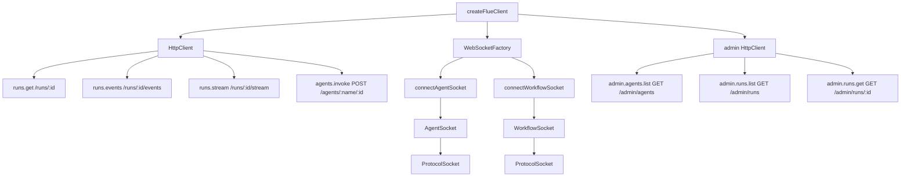
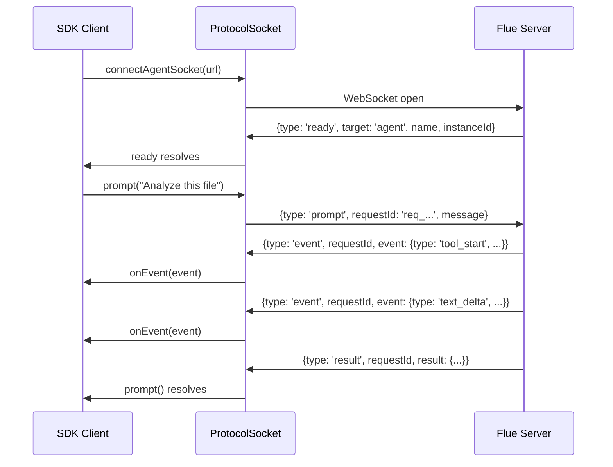
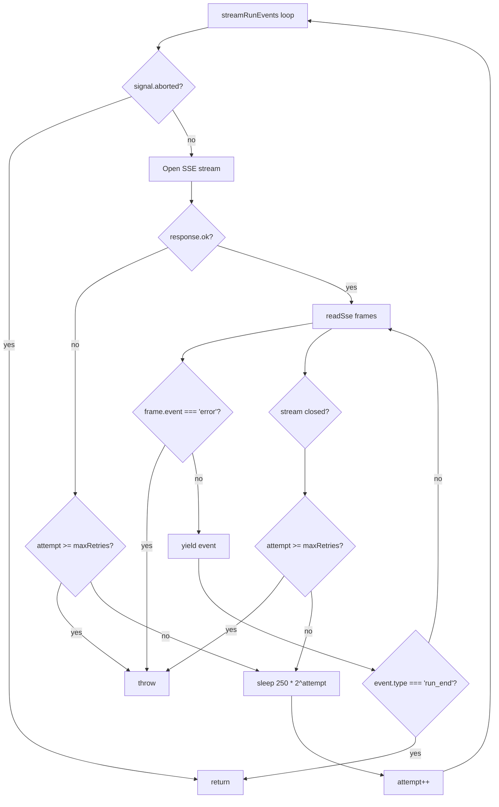

# SDK Client

The Flue SDK provides a unified client interface for invoking agents and workflows over HTTP and WebSocket, streaming run events via SSE, and inspecting deployed applications through read-only admin routes. This document covers `createFlueClient()`, the `FlueClient` interface, the `HttpClient` and `FlueApiError` HTTP layer, the `AgentSocket`/`WorkflowSocket` WebSocket abstractions, and the public functions `invokeAgent` and `streamRunEvents`.

**Source:** `packages/sdk/src/client.ts` — `createFlueClient`, `FlueClient` interface
**Source:** `packages/sdk/src/http.ts` — `HttpClient`, `FlueApiError`
**Source:** `packages/sdk/src/public/invoke.ts` — `invokeAgent`
**Source:** `packages/sdk/src/public/stream.ts` — `streamRunEvents`, `readSse`
**Source:** `packages/sdk/src/public/websocket.ts` — `AgentSocket`, `WorkflowSocket`, `connectAgentSocket`, `connectWorkflowSocket`, `FlueSocketError`
**Source:** `packages/sdk/src/types.ts` — re-exported types

Related: [HTTP & WebSocket Routing](07-routing-http-websocket.html) | [CLI, Build & Deploy](11-cli-build-deploy.html) | [Cloudflare Target](08-cloudflare-target.html)

---

## Core Concept

`FlueClient` is a five-subsystem interface returned by `createFlueClient()` that groups all remote interactions with a deployed Flue application: `runs` for workflow-run inspection and streaming, `agents` for direct agent invocation and persistent WebSocket connections, `workflows` for WebSocket workflow invocations, and `admin` for read-only listing of agents and runs. It sits entirely on the consumer side — it does not contain any runtime logic, only HTTP fetch calls, SSE consumption, and WebSocket protocol framing.

```
┌─────────────────────────────────────────────────┐
│                   FlueClient                     │
├──────────┬──────────┬───────────┬───────────────┤
│  runs    │  agents  │ workflows │    admin      │
├──────────┼──────────┼───────────┼───────────────┤
│ .get()   │ .invoke()│ .connect()│ .agents.list()│
│ .events()│ .connect()│          │ .runs.list()  │
│ .stream()│          │           │ .runs.get()   │
└──────────┴──────────┴───────────┴───────────────┘
       │          │         │           │
   HTTP GET    HTTP POST  WebSocket   HTTP GET
   /runs/:id   /agents/   /agents/    /admin/...
               :name/:id  :name/:id
```

---

## The FlueClient Interface

`FlueClient` is defined in `packages/sdk/src/client.ts:63-113` as a plain interface with four subsystems. There is no class — `createFlueClient()` returns a literal object.

### runs Subsystem

The `runs` subsystem provides three methods for inspecting workflow runs. Direct agent interactions are **not** runs; only workflow invocations produce run records.

```typescript
// packages/sdk/src/client.ts:65-75
runs: {
    /** Retrieves one workflow-run record. */
    get(runId: string): Promise<RunRecord>;
    /** Retrieves recorded workflow-run events. */
    events(runId: string, options?: RunEventsOptions): Promise<{ events: FlueEvent[] }>;
    /** Streams workflow-run events until `run_end`, cancellation, or an unrecoverable error. */
    stream(runId: string, options?: RunStreamOptions): AsyncIterable<FlueEvent>;
};
```

- **`runs.get(runId)`** — HTTP `GET /runs/:runId`. Returns a `RunRecord` with `runId`, `owner`, `status`, `startedAt`, and optional `endedAt`, `isError`, `durationMs`, `payload`, `result`, `error`.
- **`runs.events(runId, options)`** — HTTP `GET /runs/:runId/events`. Accepts `RunEventsOptions` with `after` (resume after event index), `types` (filter by event type names), and `limit` (1..1000, defaults to 100). Query parameters are serialized with `types` joined by comma.
- **`runs.stream(runId, options)`** — Delegates to `streamRunEvents()`. Opens an SSE stream at `/runs/:runId/stream` with automatic reconnection (default 3 retries, 250ms initial backoff, exponential). Yields `FlueEvent` objects until `run_end` or cancellation.

### agents Subsystem

The `agents` subsystem handles direct interactions with persistent agent instances. The `invoke` method has three overloads:

```typescript
// packages/sdk/src/client.ts:77-94
agents: {
    /** Streams events for one agent prompt. */
    invoke(name: string, id: string, options: AgentStreamInvokeOptions): AsyncIterable<AttachedAgentEvent>;
    /** Resolves the terminal result for one agent prompt. */
    invoke(name: string, id: string, options: AgentSyncInvokeOptions): Promise<SyncInvokeResult>;
    /** Sends one direct-agent prompt using either invocation mode. */
    invoke(name: string, id: string, options: AgentInvokeOptions): Promise<SyncInvokeResult> | AsyncIterable<AttachedAgentEvent>;
    /** Opens a reusable WebSocket connection to an agent instance. */
    connect(name: string, id: string): AgentSocket;
};
```

- **`agents.invoke(name, id, { mode: 'sync', payload })`** — HTTP `POST /agents/:name/:id` with JSON body. Returns `{ result }` when the agent finishes.
- **`agents.invoke(name, id, { mode: 'stream', payload })`** — HTTP `POST /agents/:name/:id` with `Accept: text/event-stream`. Returns an async iterable of `AttachedAgentEvent` objects, each validated against the 27 known event types.
- **`agents.connect(name, id)`** — Opens a WebSocket to `/agents/:name/:id` and returns an `AgentSocket` for multi-prompt sessions over a single connection.

### workflows Subsystem

The `workflows` subsystem has one method:

```typescript
// packages/sdk/src/client.ts:96-99
workflows: {
    /** Opens a WebSocket connection for one workflow invocation. */
    connect(name: string): WorkflowSocket;
};
```

- **`workflows.connect(name)`** — Opens a WebSocket to `/workflows/:name` and returns a `WorkflowSocket`. A workflow socket accepts exactly one invocation; calling `invoke()` twice throws.

### admin Subsystem

The `admin` subsystem provides read-only APIs mounted at `/admin` (configurable via `adminBasePath`):

```typescript
// packages/sdk/src/client.ts:101-113
admin: {
    agents: {
        /** Lists all built agents and their transport metadata. */
        list(): Promise<{ items: AgentManifestEntry[] }>;
    };
    runs: {
        /** Lists workflow-run summaries. */
        list(options?: ListRunsOptions): Promise<ListResponse<RunPointer>>;
        /** Retrieves one workflow-run record from the admin mount path. */
        get(runId: string): Promise<RunRecord>;
    };
};
```

- **`admin.agents.list()`** — HTTP `GET /admin/agents`. Returns the agent manifest with transport metadata.
- **`admin.runs.list(options)`** — HTTP `GET /admin/runs`. Accepts `cursor`, `limit` (1..1000), `status`, and `workflowName` filters.
- **`admin.runs.get(runId)`** — HTTP `GET /admin/runs/:runId`.

---

## createFlueClient()

```typescript
// packages/sdk/src/client.ts:116-168
export function createFlueClient(options: CreateFlueClientOptions): FlueClient {
    const http = new HttpClient(options);
    const websocket = options.websocket ?? defaultWebSocketFactory;
    const websocketEndpoint = createWebSocketEndpoint(http, options.websocketUrl);
    const adminBasePath = normalizeBasePath(options.adminBasePath ?? '/admin');
    const adminHttp = new HttpClient({
        ...options,
        baseUrl: new URL(`${adminBasePath}/`, http.baseUrl).toString(),
    });
    return { /* runs, agents, workflows, admin */ };
}
```

`createFlueClient()` constructs the client from `CreateFlueClientOptions`:

| Option | Type | Default | Purpose |
|--------|------|---------|---------|
| `baseUrl` | `string` | (required) | URL where the public `flue()` sub-app is mounted |
| `token` | `string` | `undefined` | Bearer token added to HTTP requests as `Authorization: Bearer <token>` |
| `headers` | `RequestHeaders` | `undefined` | Static headers or a function resolved per request |
| `fetch` | `typeof fetch` | `globalThis.fetch` | Custom HTTP implementation |
| `adminBasePath` | `string` | `'/admin'` | Origin-relative mount path for read-only admin routes |
| `websocket` | `WebSocketFactory` | `globalThis.WebSocket` | Custom WebSocket constructor |
| `websocketUrl` | `WebSocketUrlTransform` | `undefined` | Transform each WebSocket URL after HTTP→WS protocol conversion |

The function creates two `HttpClient` instances: one for the public API routes and one for admin routes (with `baseUrl` rewritten to the admin mount path). WebSocket endpoints are derived from the public HTTP client's URL via `createWebSocketEndpoint()`.

```typescript
// packages/sdk/src/client.ts:176-181
function createWebSocketEndpoint(http: HttpClient, transform: WebSocketUrlTransform | undefined) {
    return (path: string, target: WebSocketTarget): string => {
        const url = new URL(webSocketUrl(http.url(path)));
        return String(transform?.(url, target) ?? url);
    };
}
```

### normalizeBasePath

The admin base path is normalized to strip leading/trailing slashes:

```typescript
// packages/sdk/src/client.ts:170-174
function normalizeBasePath(path: string): string {
    const trimmed = path.trim();
    if (!trimmed || trimmed === '/') return '';
    return `/${trimmed.replace(/^\/+|\/+$/g, '')}`;
}
```

---

## HTTP Layer: HttpClient and FlueApiError

### HttpClient

`HttpClient` in `packages/sdk/src/http.ts:41-85` wraps `fetch` with JSON serialization, header management, and URL construction.

```typescript
// packages/sdk/src/http.ts:41-52
export class HttpClient {
    readonly baseUrl: string;
    readonly fetchImpl: typeof fetch;
    private headers: RequestHeaders | undefined;
    private token: string | undefined;

    constructor(options: HttpClientOptions) {
        this.baseUrl = options.baseUrl.replace(/\/+$/, '');
        this.fetchImpl = options.fetch ?? fetch;
        this.headers = options.headers;
        this.token = options.token;
    }
```

The `json<T>()` method handles the full request lifecycle:

```typescript
// packages/sdk/src/http.ts:54-62
async json<T>(options: JsonRequestOptions): Promise<T> {
    const response = await this.fetchImpl(this.url(options.path, options.query), {
        method: options.method ?? 'GET',
        headers: await this.requestHeaders(options.headers, options.body !== undefined),
        body: options.body === undefined ? undefined : JSON.stringify(options.body),
        signal: options.signal,
    });
    return parseJsonResponse<T>(response);
}
```

The `url()` method constructs full URLs with query parameters:

```typescript
// packages/sdk/src/http.ts:64-70
url(path: string, query?: Record<string, string | number | boolean | undefined>): string {
    const url = new URL(path.replace(/^\/+/, ''), `${this.baseUrl}/`);
    for (const [key, value] of Object.entries(query ?? {})) {
        if (value !== undefined) url.searchParams.set(key, String(value));
    }
    return url.toString();
}
```

`requestHeaders()` merges static headers, bearer tokens, and per-request overrides:

```typescript
// packages/sdk/src/http.ts:72-84
async requestHeaders(extra: Record<string, string> | undefined, hasBody: boolean): Promise<Record<string, string>> {
    const headers = typeof this.headers === 'function' ? await this.headers() : (this.headers ?? {});
    return {
        ...(hasBody ? { 'content-type': 'application/json' } : {}),
        ...(this.token ? { authorization: `Bearer ${this.token}` } : {}),
        ...headers,
        ...extra,
    };
}
```

### FlueApiError

All failed HTTP JSON requests throw `FlueApiError`:

```typescript
// packages/sdk/src/http.ts:27-39
export class FlueApiError extends Error {
    readonly status: number;
    readonly body: unknown;

    constructor(status: number, body: unknown) {
        super(errorMessage(status, body));
        this.name = 'FlueApiError';
        this.status = status;
        this.body = body;
    }
}
```

The error message extraction in `errorMessage()` (line 102-108) parses the Flue error envelope `{ error: { type, message, details } }` and produces human-readable strings like `"Flue API error 404 [not_found]: Agent 'assistant' not found"`.

The response parser `parseJsonResponse()` (line 87-92) uses `safeJsonParse()` to handle non-JSON responses gracefully — if the body text is not valid JSON, it stores the raw text as `body` rather than throwing.

---

## Agent Invocation: invokeAgent

`invokeAgent` in `packages/sdk/src/public/invoke.ts:25-53` is an overloaded function that dispatches to either sync HTTP POST or SSE streaming based on `options.mode`:

```typescript
// packages/sdk/src/public/invoke.ts:25-53
export function invokeAgent(http: HttpClient, name: string, id: string, options: AgentStreamInvokeOptions): AsyncIterable<AttachedAgentEvent>;
export function invokeAgent(http: HttpClient, name: string, id: string, options: AgentSyncInvokeOptions): Promise<SyncInvokeResult>;
export function invokeAgent(http: HttpClient, name: string, id: string, options: AgentInvokeOptions): Promise<SyncInvokeResult> | AsyncIterable<AttachedAgentEvent> {
    const path = `/agents/${encodeURIComponent(name)}/${encodeURIComponent(id)}`;
    if (options.mode === 'stream') return invokeStream(http, path, id, options);
    return http.json<{ result?: unknown }>({
        method: 'POST', path, body: options.payload, signal: options.signal,
    }).then((body) => ({ result: body.result }));
}
```

The streaming path `invokeStream()` (line 55-80) sets `Accept: text/event-stream`, parses SSE frames via `readSse()`, and validates each event:

```typescript
// packages/sdk/src/public/invoke.ts:55-80
async function* invokeStream(http: HttpClient, path: string, instanceId: string, options): AsyncIterable<AttachedAgentEvent> {
    const response = await http.fetchImpl(http.url(path), {
        method: 'POST',
        headers: await http.requestHeaders({ accept: 'text/event-stream' }, true),
        body: JSON.stringify(options.payload),
        signal: options.signal,
    });
    if (!response.ok) throw new Error(`Invocation stream failed with HTTP ${response.status}.`);
    if (!response.body) throw new Error('Invocation stream response has no body.');
    for await (const frame of readSse(response.body)) {
        const event = JSON.parse(frame.data) as unknown;
        if (frame.event === 'error') {
            if (!isAttachedAgentStreamError(event, instanceId))
                throw new Error('Agent invocation stream received an invalid error event.');
            throw new Error(event.error.message);
        }
        if (!isAttachedAgentEvent(event, instanceId))
            throw new Error('Agent invocation stream received an invalid event.');
        yield event;
    }
}
```

Event validation uses a `Set` of 26 known event types (line 82-109): `agent_start`, `agent_end`, `turn_start`, `turn_request`, `turn_end`, `message_start`, `message_update`, `message_end`, `tool_execution_start`, `tool_execution_update`, `tool_execution_end`, `text_delta`, `thinking_start`, `thinking_delta`, `thinking_end`, `tool_start`, `tool_call`, `turn`, `task_start`, `task`, `compaction_start`, `compaction`, `operation_start`, `operation`, `log`, `idle`. The validator also checks that `event.instanceId === instanceId` and `event.runId === undefined` to prevent cross-instance event leakage.

---

## SSE Streaming: streamRunEvents and readSse

`streamRunEvents()` in `packages/sdk/src/public/stream.ts:22-71` implements a resilient SSE consumer with automatic reconnection:

```typescript
// packages/sdk/src/public/stream.ts:22-71
export async function* streamRunEvents(http: HttpClient, runId: string, options: RunStreamOptions = {}): AsyncIterable<FlueEvent> {
    let lastEventId = options.lastEventId;
    let attempt = 0;
    const maxRetries = options.maxRetries ?? 3;
    const initialRetryMs = options.initialRetryMs ?? 250;

    while (!options.signal?.aborted) {
        try {
            const headers = await http.requestHeaders({
                accept: 'text/event-stream',
                ...(lastEventId !== undefined ? { 'last-event-id': String(lastEventId) } : {}),
            }, false);
            const response = await http.fetchImpl(http.url(`/runs/${encodeURIComponent(runId)}/stream`), {
                headers, signal: options.signal,
            });
            if (!response.ok) throw new Error(`Stream request failed with HTTP ${response.status}.`);
            if (!response.body) throw new Error('Stream response has no body.');

            for await (const frame of readSse(response.body)) {
                if (frame.id !== undefined && /^\d+$/.test(frame.id)) {
                    const parsed = Number(frame.id);
                    if (Number.isSafeInteger(parsed)) lastEventId = parsed;
                }
                if (frame.event === 'error') throw new Error(parseSseErrorMessage(frame.data));
                const event = JSON.parse(frame.data) as FlueEvent;
                yield event;
                if (event.type === 'run_end') return;
            }
            if (options.signal?.aborted) return;
            if (attempt >= maxRetries) throw new Error('SSE stream closed before run_end.');
            await sleep(initialRetryMs * 2 ** attempt, options.signal);
            attempt++;
        } catch (error) {
            if (options.signal?.aborted) return;
            if (attempt >= maxRetries) throw error;
            await sleep(initialRetryMs * 2 ** attempt, options.signal);
            attempt++;
        }
    }
}
```

Key reconnection behavior:
- **Default 3 retries** with exponential backoff starting at 250ms (250, 500, 1000ms)
- **`lastEventId` tracking** — each SSE frame with a numeric `id` updates the resume position, sent as `Last-Event-ID` on reconnect
- **`run_end` termination** — the generator returns (not throws) when it sees `event.type === 'run_end'`
- **AbortSignal support** — checks `options.signal?.aborted` at loop entry, after stream close, and inside `sleep()`

### readSse

`readSse()` in `packages/sdk/src/public/stream.ts:73-100` is a low-level SSE frame parser that reads a `ReadableStream<Uint8Array>` and yields `SseFrame` objects:

```typescript
// packages/sdk/src/public/stream.ts:73-100
export async function* readSse(body: ReadableStream<Uint8Array>): AsyncIterable<SseFrame> {
    const reader = body.getReader();
    const decoder = new TextDecoder();
    let buffer = '';
    try {
        while (true) {
            const { done, value } = await reader.read();
            if (done) break;
            buffer += decoder.decode(value, { stream: true }).replace(/\r\n/g, '\n');
            let idx = buffer.indexOf('\n\n');
            while (idx !== -1) {
                const raw = buffer.slice(0, idx);
                buffer = buffer.slice(idx + 2);
                const frame = parseFrame(raw);
                if (frame) yield frame;
                idx = buffer.indexOf('\n\n');
            }
        }
        buffer += decoder.decode().replace(/\r\n/g, '\n');
        const frame = parseFrame(buffer);
        if (frame) yield frame;
    } finally {
        try { await reader.cancel(); } catch {}
        reader.releaseLock();
    }
}
```

`parseFrame()` (line 102-118) handles the SSE field protocol: `event:`, `id:`, `data:` lines, comment lines starting with `:`, and multi-line `data:` concatenation via newline joining.

---

## WebSocket Layer: AgentSocket and WorkflowSocket

### WebSocket URL Transformation

The WebSocket URL transformation happens in `webSocketUrl()` (`packages/sdk/src/public/websocket.ts:470-476`):

```typescript
export function webSocketUrl(httpUrl: string): string {
    const url = new URL(httpUrl);
    if (url.protocol === 'https:') url.protocol = 'wss:';
    else if (url.protocol === 'http:') url.protocol = 'ws:';
    else throw new Error(`Flue WebSocket requires an HTTP base URL, received ${url.protocol}`);
    return url.toString();
}
```

This is the only place where HTTP URLs are converted to WebSocket URLs. The `WebSocketUrlTransform` type allows consumers to intercept and modify the URL after conversion — for example, to append authentication query parameters:

```typescript
// packages/sdk/src/public/websocket.ts:28
export type WebSocketUrlTransform = (url: URL, target: WebSocketTarget) => URL | string;
```

Aha: **The SDK never opens WebSockets directly to the base URL.** Every WebSocket URL is first constructed from the HTTP client's URL via `webSocketUrl()`, then optionally transformed, then passed to the factory. This means authentication headers set on the HTTP client (`token`, `headers`) do NOT automatically apply to WebSockets — if you need auth on the WebSocket, you must use `websocketUrl` to append query parameters or use a custom `websocket` factory that sets headers. This is a deliberate separation: HTTP and WebSocket are different protocols with different auth mechanisms, and the SDK makes this visible rather than hiding it.

### AgentSocket

`AgentSocket` (`packages/sdk/src/public/websocket.ts:77-88`) is the interface for a persistent WebSocket connection to a single agent instance:

```typescript
export interface AgentSocket {
    readonly ready: Promise<void>;
    prompt(message: string, options?: AgentSocketPromptOptions): Promise<AgentSocketInvokeResult>;
    ping(): Promise<void>;
    onEvent(listener: AgentSocketEventListener): () => void;
    close(code?: number, reason?: string): void;
}
```

- **`ready`** — resolves when the server sends a `ready` message matching the agent name and instance ID. All other methods await this.
- **`prompt(message, options)`** — sends a `{ version: 1, type: 'prompt', requestId, message, session? }` message and waits for `{ type: 'result', requestId, result }`. Sequential prompts may reuse the connection.
- **`ping()`** — sends `{ version: 1, type: 'ping', requestId }` and waits for `{ type: 'pong', requestId }`.
- **`onEvent(listener)`** — subscribes to `event` messages from the server. Returns an unsubscribe function.
- **`close(code, reason)`** — closes the socket and rejects all pending requests.

### WorkflowSocket

`WorkflowSocket` (`packages/sdk/src/public/websocket.ts:91-102`) is similar but for one-shot workflow invocations:

```typescript
export interface WorkflowSocket {
    readonly ready: Promise<void>;
    readonly runId: Promise<string>;
    invoke(payload?: unknown): Promise<WorkflowSocketInvokeResult>;
    onEvent(listener: WorkflowSocketEventListener): () => void;
    close(code?: number, reason?: string): void;
}
```

The key difference: `WorkflowSocket.invoke()` can only be called **once**. A second call returns a rejected Promise with `"A workflow WebSocket accepts only one invocation."` The `runId` promise resolves when the server sends a `started` message.

### ProtocolSocket — The Shared Implementation

Both socket types delegate to `ProtocolSocket` (`packages/sdk/src/public/websocket.ts:133-348`), a generic class parameterized by result type, context type, and event type. The protocol handles:

- **Message sequencing** — `requestId()` generates `req_<uuid>_<sequence>` identifiers
- **Ready handshake** — only accepts `ready` messages that match the expected target/name/instanceId
- **Request/response correlation** — pending requests stored in a `Map<string, PendingRequest>` keyed by `requestId`
- **Error propagation** — `FlueSocketError` wraps the server's `FluePublicError` with optional `requestId` and `runId`
- **Terminal failure** — `fail()` rejects all pending requests, clears the listener set, and marks the socket closed

```typescript
// packages/sdk/src/public/websocket.ts:336-347
private fail(error: Error): void {
    if (this.isClosed) return;
    this.isClosed = true;
    this.terminalError = error;
    this.onFailure?.(error);
    if (!this.isReady) this.rejectReady(error);
    for (const pending of this.pendingRequests.values()) pending.reject(error);
    for (const pending of this.pendingPings.values()) pending.reject(error);
    this.pendingRequests.clear();
    this.pendingPings.clear();
    this.listeners.clear();
}
```

### FlueSocketError

```typescript
// packages/sdk/src/public/websocket.ts:105-117
export class FlueSocketError extends Error {
    readonly error: FluePublicError;
    readonly requestId: string | undefined;
    readonly runId: string | undefined;

    constructor(error: FluePublicError, context: { requestId?: string; runId?: string } = {}) {
        super(error.message);
        this.name = 'FlueSocketError';
        this.error = error;
        this.requestId = context.requestId;
        this.runId = context.runId;
    }
}
```

---

## Mermaid: SDK Architecture



## Mermaid: WebSocket Protocol Sequence



## Mermaid: SSE Stream Reconnection



---

## Code Examples

### Basic Client Usage

```typescript
// examples/basic-client.ts
import { createFlueClient } from '@flue/sdk';

const client = createFlueClient({
    baseUrl: 'http://localhost:3583',
    token: process.env.FLUE_TOKEN,
});

// Invoke an agent synchronously
const result = await client.agents.invoke('assistant', 'thread-1', {
    mode: 'sync',
    payload: { message: 'Summarize the project' },
});
console.log(result.result);
```

Source: `packages/sdk/src/client.ts:116` — `createFlueClient`

### Streaming Agent Events

```typescript
// examples/stream-agent-events.ts
import { createFlueClient } from '@flue/sdk';

const client = createFlueClient({ baseUrl: 'http://localhost:3583' });

for await (const event of client.agents.invoke('reviewer', 'pr-42', {
    mode: 'stream',
    payload: { message: 'Review the diff at HEAD' },
})) {
    if (event.type === 'text_delta') {
        process.stdout.write(event.text);
    } else if (event.type === 'tool_start') {
        console.error(`\n[tool] ${event.toolName}`);
    }
}
```

Source: `packages/sdk/src/public/invoke.ts:55` — `invokeStream` generator

### WebSocket Agent Session

```typescript
// examples/websocket-agent-session.ts
import { createFlueClient } from '@flue/sdk';

const client = createFlueClient({ baseUrl: 'http://localhost:3583' });

// Persistent connection for multi-prompt conversation
const socket = client.agents.connect('assistant', 'session-1');
await socket.ready;

// Subscribe to events from all prompts
const unsub = socket.onEvent((event, ctx) => {
    console.log(`[${event.type}] requestId=${ctx.requestId}`);
});

// Send multiple prompts over the same connection
const r1 = await socket.prompt('What files are in the repo?');
const r2 = await socket.prompt('Now find all TODO comments', { session: 'analysis' });

unsub();
socket.close();
```

Source: `packages/sdk/src/public/websocket.ts:77` — `AgentSocket` interface

### Workflow WebSocket Invocation

```typescript
// examples/workflow-websocket.ts
import { createFlueClient } from '@flue/sdk';

const client = createFlueClient({ baseUrl: 'http://localhost:3583' });

const ws = client.workflows.connect('deploy-pipeline');
await ws.ready;

// Listen to workflow events as they happen
ws.onEvent((event, ctx) => {
    console.log(`[run ${ctx.runId}] ${event.type}`);
});

// One-shot invocation — second invoke() throws
const result = await ws.invoke({ environment: 'production' });
console.log(`Run completed: ${result.runId}`);
```

Source: `packages/sdk/src/public/websocket.ts:91` — `WorkflowSocket` interface

### Admin Routes

```typescript
// examples/admin-apis.ts
import { createFlueClient } from '@flue/sdk';

const client = createFlueClient({
    baseUrl: 'http://localhost:3583',
    adminBasePath: '/admin',
});

// List all deployed agents
const agents = await client.admin.agents.list();
console.log(agents.items.map(a => a.name));

// List completed runs
const runs = await client.admin.runs.list({
    status: 'completed',
    limit: 10,
});

// Get a specific run record
const run = await client.admin.runs.get(runs.items[0].runId);
console.log(`Duration: ${run.durationMs}ms`);
```

Source: `packages/sdk/src/client.ts:101-113` — admin subsystem

### SSE Stream with Reconnection

```typescript
// examples/stream-with-retry.ts
import { createFlueClient } from '@flue/sdk';

const client = createFlueClient({ baseUrl: 'http://localhost:3583' });

const controller = new AbortController();

// Stream with custom retry behavior
for await (const event of client.runs.stream('run_01H...', {
    maxRetries: 5,
    initialRetryMs: 500,
    signal: controller.signal,
})) {
    if (event.type === 'run_end') break;
    console.log(event.type);
}

// Or cancel from elsewhere
setTimeout(() => controller.abort(), 30_000);
```

Source: `packages/sdk/src/public/stream.ts:22` — `streamRunEvents`

### WebSocket URL Transform for Authentication

```typescript
// examples/ws-auth-transform.ts
import { createFlueClient } from '@flue/sdk';

const client = createFlueClient({
    baseUrl: 'http://localhost:3583',
    token: 'my-api-token',
    websocketUrl: (url, target) => {
        // Append auth token as query param since WebSocket
        // doesn't support Authorization headers in browsers
        url.searchParams.set('token', 'my-api-token');
        return url;
    },
});

// Now agent/workflow WebSocket connections include ?token=...
const socket = client.agents.connect('assistant', 'thread-1');
```

Source: `packages/sdk/src/client.ts:59` — `websocketUrl` option in `CreateFlueClientOptions`

---

## Error Handling

### HTTP Errors: FlueApiError

Every failed HTTP request from `HttpClient.json()` throws `FlueApiError`:

```typescript
try {
    await client.runs.get('nonexistent');
} catch (err) {
    if (err instanceof FlueApiError) {
        console.error(`HTTP ${err.status}: ${err.message}`);
        // err.body contains the parsed response or raw text
    }
}
```

### WebSocket Errors: FlueSocketError

WebSocket protocol errors throw `FlueSocketError` with the server's structured error:

```typescript
try {
    await socket.prompt('bad request');
} catch (err) {
    if (err instanceof FlueSocketError) {
        console.error(`[${err.error.type}] ${err.error.message}`);
        console.error(err.error.details);
        console.error(`requestId: ${err.requestId}, runId: ${err.runId}`);
    }
}
```

### Protocol Violations

The `ProtocolSocket.receive()` method (line 236-324) validates every incoming message against the protocol schema. Invalid messages (wrong `version`, missing fields, mismatched `instanceId`) trigger `protocolFailure()` which closes the socket with code 1008 and rejects all pending work.

---

## Aha: The SDK Package Exports Are Deprecated

**The `@flue/sdk` package's own exports are deprecated.** If you look at the package's main export entry point, all re-exports point to `deprecated.mjs`. The framework intends consumers to either:

1. Use `createFlueClient()` from `@flue/sdk` for client-only usage (the interface is stable and documented here)
2. Import directly from `@flue/runtime` for server-side code that needs runtime types

This is a deliberate migration path: the SDK was consolidated into the runtime package, and the standalone SDK package remains only as a thin compatibility shim. New code should import from `@flue/runtime` when running in the same process as the Flue server, and use `createFlueClient()` only when running as a remote consumer.

---

## Aha: WebSocket URL Transforms Solve the Browser Auth Problem

**WebSockets in browsers do not support custom headers on the initial handshake.** The `WebSocket` constructor only accepts a URL string. The SDK addresses this via `WebSocketUrlTransform`: a function that receives the transformed URL (after `http://` → `ws://` conversion) and the target descriptor, and can append query parameters or rewrite the hostname. This is how consumers inject authentication into WebSocket connections without needing a custom WebSocket factory. The transform receives `{ target: 'agent' | 'workflow', name, instanceId? }` so you can apply different auth strategies per route type.

---

## Aha: Admin Routes Use a Separate HttpClient

**The admin subsystem creates its own `HttpClient` with a rewritten `baseUrl`.** This is not just cosmetic — it means the admin client inherits all the same auth configuration (token, headers, custom fetch) as the public client, but mounts at a different path. The admin path is resolved relative to the public base URL: `new URL(\`\${adminBasePath}/\`, http.baseUrl)`. So if `baseUrl` is `http://example.com/api/`, admin routes go to `http://example.com/api/admin/...`. This unified auth model means you configure credentials once and both public and admin routes share them.

---

## Types Reference

### RequestHeaders

```typescript
// packages/sdk/src/http.ts:2-4
export type RequestHeaders =
    | Record<string, string>
    | (() => Record<string, string> | Promise<Record<string, string>>);
```

Static headers or a function resolved per request.

### RunEventsOptions

```typescript
// packages/sdk/src/client.ts:34-41
export interface RunEventsOptions {
    after?: number;
    types?: string[];
    limit?: number;  // 1..1000, defaults to 100
}
```

### ListRunsOptions

```typescript
// packages/sdk/src/client.ts:44-50
export interface ListRunsOptions {
    cursor?: string;
    limit?: number;  // 1..1000
    status?: RunStatus;
    workflowName?: string;
}
```

### RunStreamOptions

```typescript
// packages/sdk/src/public/stream.ts:5-14
export interface RunStreamOptions {
    lastEventId?: number;
    signal?: AbortSignal;
    maxRetries?: number;       // defaults to 3
    initialRetryMs?: number;   // defaults to 250
}
```

### AgentSocketPromptOptions

```typescript
// packages/sdk/src/public/websocket.ts:71-74
export interface AgentSocketPromptOptions {
    session?: string;  // defaults to 'default'
}
```

---

## Related Documents

- [HTTP & WebSocket Routing](07-routing-http-websocket.html) — Server-side route handlers that the SDK calls into
- [CLI, Build & Deploy](11-cli-build-deploy.html) — `flue` CLI commands including `connect` and `run` which use similar WebSocket/SSE patterns
- [Cloudflare Target](08-cloudflare-target.html) — Durable Object persistence that backs the `runs` subsystem
- [Observability](12-observability.html) — `FlueEvent` types streamed through `runs.stream()` and `runs.events()`
- [Node Target](09-node-target.html) — Local WebSocket server that `AgentSocket` connects to
