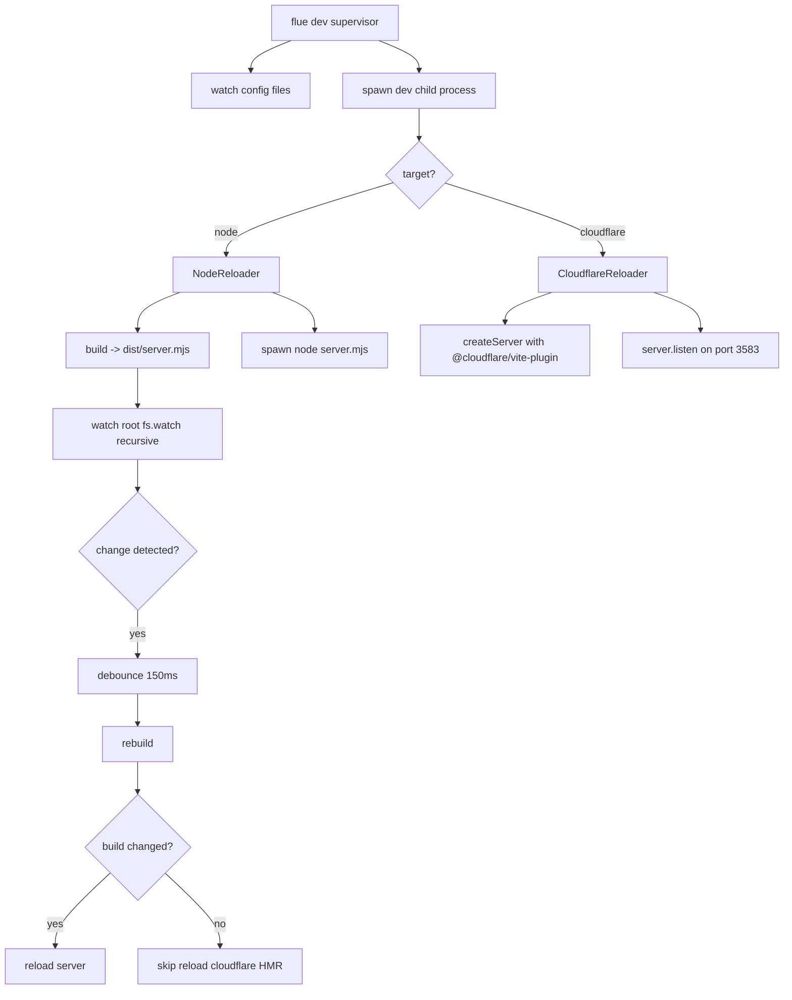

# CLI, Build & Deploy

The `flue` CLI is the developer-facing interface for building, running, and deploying Flue applications. It provides seven commands: `dev` (watch-mode dev server), `build` (production artifact generation), `run` (one-shot workflow invocation), `connect` (interactive agent session), `add` (connector installation via piped markdown), `init` (project scaffolding), and `logs` (workflow run event tailing). This document covers the CLI command implementations, Vite build plugins, Cloudflare integration, and the connector system.

**Source:** `packages/cli/bin/flue.ts` — CLI entry point, argument parsing, command dispatch
**Source:** `packages/cli/src/lib/build.ts` — Build logic, agent/workflow discovery, Vite bundling
**Source:** `packages/cli/src/lib/dev.ts` — Dev server, watcher, Node/Cloudflare reloaders
**Source:** `packages/cli/src/lib/config.ts` — Configuration discovery, loading, validation
**Source:** `packages/cli/src/lib/vite-skill-reference-plugin.ts` — Skill reference Vite plugin
**Source:** `packages/cli/src/lib/vite-markdown-import-plugin.ts` — Markdown import Vite plugin

Related: [Cloudflare Target](08-cloudflare-target.html) | [Node Target](09-node-target.html) | [SDK Client](10-sdk-client.html) | [Agent System](02-agent-system.html)

---

## Core Concept

The `flue` CLI is a multi-target build tool that discovers agents and workflows from source directories, bundles them via Vite into deployable artifacts, and provides local development and invocation tooling. It supports two deployment targets (`node` and `cloudflare`), each with its own build plugin, reloader, and runtime model. The CLI is designed to work both interactively (developer at a terminal) and as a pipe target for AI coding agents (`flue add daytona | claude`).

---

## CLI Commands Overview

```
flue dev      [--target <node|cloudflare>] [--root <path>] [--output <path>] [--config <path>] [--port <number>] [--env <path>]
flue build    [--target <node|cloudflare>] [--root <path>] [--output <path>] [--config <path>] [--env <path>]
flue run      <workflow> [--target node] [--payload <json>] [--root <path>] [--output <path>] [--config <path>] [--env <path>]
flue connect  <agent> <instance-id> [--target node] [--session <name>] [--root <path>] [--output <path>] [--config <path>] [--env <path>]
flue add      [<name>|<url>] [--category <category>] [--print]
flue init     --target <node|cloudflare> [--root <path>] [--force]
flue logs     <runId> [--server <url>] [--header 'Name: value'] [--follow] [--since <eventIndex>] [--types a,b,c] [--limit <n>] [--format pretty|json|ndjson]
```

Source: `packages/cli/bin/flue.ts:87-144` — `printUsage()`

---

## flue dev — Watch-Mode Development Server

`flue dev` is the long-running edit-and-iterate command. It watches the project root, rebuilds on file changes, and reloads the underlying server. It is distinct from `flue run`: dev is for interactive development, while run is a one-shot production-style invoker.

### Default Port: 3583

The default dev port is **3583** — "FLUE" on a phone keypad (F=3, L=5, U=8, E=3).

```typescript
// packages/cli/src/lib/dev.ts:47
export const DEFAULT_DEV_PORT = 3583;
```

### Dev Lifecycle

```typescript
// packages/cli/src/lib/dev.ts:88-209
export async function dev(options: DevOptions): Promise<void> {
    const root = path.resolve(options.root);
    const sourceRoot = path.resolve(options.sourceRoot);
    const output = path.resolve(options.output ?? path.join(root, 'dist'));
    const port = options.port ?? DEFAULT_DEV_PORT;

    // Initial build
    const initialStart = Date.now();
    await build(buildOptions);
    console.error(`[flue] Built in ${Date.now() - initialStart}ms`);

    // Start the appropriate reloader
    const reloader = options.target === 'node'
        ? new NodeReloader({ root, output, port })
        : await createCloudflareReloader({ root, sourceRoot, port });
    await reloader.start();

    // Print ready message with example curl
    if (reloader.url) {
        console.error(`[flue] Server: ${reloader.url}`);
        const exampleAgent = pickExampleAgentName(sourceRoot);
        if (exampleAgent) {
            console.error(`[flue] Try: curl -X POST ${reloader.url}/agents/${exampleAgent}/test-1 \\`);
            console.error(`         -H 'Content-Type: application/json' -d '{}'`);
        }
    }
    console.error(`[flue] Press Ctrl+C to stop\n`);
    options.onReady?.();  // IPC readiness signal for supervisor

    // Watch loop — blocks until SIGINT/SIGTERM
    const watcher = createWatcher({ root, sourceRoot, output, envFile, configFiles, onChange });
    await new Promise<void>(() => {});  // block forever
}
```

### Watching

The watcher uses `fs.watch` recursive (Node 20+) with a **150ms debounce**. Ignored paths include:

- Build output directory (`dist/` by default) — critical to prevent infinite rebuild loops
- `node_modules/`, `.git/`, `.turbo/`
- Dotfiles and dotdirs (except `.flue/` when it is the source directory)
- Editor backup files (`*.swp`, `*.swx`, `*~`)

```typescript
// packages/cli/src/lib/dev.ts:318-393
function createWatcher(options: WatcherOptions): WatcherHandle {
    // Two watchers: one for root (recursive), one for env file
    const w = fs.watch(root, { recursive: true }, (_event, filename) => {
        if (!filename) return;
        const rel = filename.toString();
        if (isIgnoredPath(rel)) return;
        onChange(rel);
    });

    // Separate env file watcher for live env reload
    const envW = fs.watch(envDirectory, (_event, filename) => {
        if (filename?.toString() === envBasename) onChange(envFile);
    });
}
```

### Rebuilder — Coalesced Rebuilds

The rebuilder coalesces rapid file changes: if a rebuild is already running, at most one follow-up rebuild is queued. Multiple changes during the debounce window are collapsed:

```typescript
// packages/cli/src/lib/dev.ts:229-280
function createRebuilder(buildOptions, reloader, rebuild): Rebuilder {
    let running = false;
    let queued = false;
    let queuedForce = false;
    let pendingForce = false;
    let debounceTimer: NodeJS.Timeout | null = null;

    const runOnce = async (force: boolean) => {
        running = true;
        const { changed } = await rebuild();
        await reloader.reload(changed || force);
        running = false;
        if (queued) {
            const nextForce = queuedForce;
            queued = false;
            queuedForce = false;
            void runOnce(nextForce);  // at most one follow-up
        }
    };

    return {
        schedule(forceReload = false) {
            if (debounceTimer) clearTimeout(debounceTimer);
            debounceTimer = setTimeout(() => {
                // ... debounce at 150ms
            }, 150);
        },
    };
}
```

### NodeReloader

For the Node target, the reloader spawns `node dist/server.mjs` as a child process and respawns on every rebuild:

```typescript
// packages/cli/src/lib/dev.ts:397-523
class NodeReloader implements DevReloader {
    private child: ChildProcess | null = null;

    shouldRebuildOn(_relPath: string): boolean {
        return true;  // Node: every root change requires rebuild
    }

    async reload(_buildChanged: boolean): Promise<void> {
        // Always restart — previous module graph is stale
        await this.killChild();
        await this.spawnAndWait();
    }

    private async spawnAndWait(): Promise<void> {
        this.child = spawn('node', [this.serverPath], {
            stdio: ['ignore', 'pipe', 'pipe'],
            cwd: this.root,
            env: { ...process.env, PORT: String(this.port), FLUE_MODE: 'local' },
        });
        // Pipe child stdout/stderr to console.error, filtering flue internal lines
        // ([flue] Server listening, Available agents, Mode: local are suppressed)
    }
}
```

The Node reloader passes `FLUE_MODE: 'local'` and `PORT` as environment variables to the spawned server.

### CloudflareReloader

For the Cloudflare target, the reloader uses Vite's dev server with the `@cloudflare/vite-plugin`:

```typescript
// packages/cli/src/lib/dev.ts:535-584
class CloudflareReloader implements DevReloader {
    private server: Awaited<ReturnType<typeof import('vite').createServer>> | null = null;

    async start(): Promise<void> {
        const { createServer } = await import('vite');
        this.server = await createServer({
            ...createCloudflareViteConfig(this.root, this.configPath, [this.entryPath]),
            logLevel: 'info',
            server: { host: '127.0.0.1', port: this.port, strictPort: true },
        });
        await this.server.listen();
    }

    shouldRebuildOn(relPath: string): boolean {
        // Cloudflare: only structural changes trigger rebuild
        const normalized = relPath.replace(/\\/g, '/');
        if (normalized === 'wrangler.jsonc' || normalized === 'wrangler.json' || normalized === 'wrangler.toml')
            return true;
        return isSourceStructurePath(this.root, this.sourceRoot, normalized);
    }

    async reload(buildChanged: boolean): Promise<void> {
        if (buildChanged) await this.server?.restart();
    }
}
```

**Key difference from Node:** The Cloudflare reloader's `shouldRebuildOn()` only returns `true` for "structural" changes — wrangler configuration files, `agents/`, `workflows/`, and `app.*`/`cloudflare.*` entry files. Content edits to agent bodies do NOT trigger a rebuild because Vite's HMR handles those in-process.

### Dev Supervision

The CLI entry point wraps `dev()` in a supervisor that restarts when config files change:

```typescript
// packages/cli/bin/flue.ts:1095-1207
function superviseDevCommand(args: DevArgs) {
    // Watch config files for changes
    for (const [directory, basenames] of configFilesByDirectory) {
        const watcher = fs.watch(directory, (_event, filename) => {
            if (basenames.has(basename)) restart(path.join(directory, basename));
        });
    }

    // Spawn child dev sessions
    const startSession = (replacement: boolean) => {
        child = spawn(process.execPath, [cliPath, ...process.argv.slice(2)], {
            stdio: ['inherit', 'inherit', 'inherit', 'ipc'],
            env: { ...process.env, [INTERNAL_DEV_SESSION]: '1' },
        });
    };
}
```

The supervisor uses an environment flag `FLUE_INTERNAL_DEV_SESSION` to distinguish the outer supervisor from the inner dev process. When config files change, the supervisor kills the child and spawns a fresh one.

---

## flue build — Production Artifact Generation

`flue build` creates a deployable artifact in the output directory (default `<root>/dist`). The build process discovers agents and workflows, generates a server entry point, and bundles via Vite.

### Build Flow

```typescript
// packages/cli/src/lib/build.ts:31-206
export async function build(options: BuildOptions): Promise<BuildResult> {
    if (options.target !== 'cloudflare') return buildApplication(options);
    // Cloudflare: load env vars, then build
    const env = loadEnv(mode, root, ['CLOUDFLARE_', 'WRANGLER_HYPERDRIVE_LOCAL_CONNECTION_STRING_']);
    return withTemporaryProcessEnv(env, () => buildApplication(options));
}

async function buildApplication(options: BuildOptions): Promise<BuildResult> {
    const plugin = resolvePlugin(options);  // NodePlugin or CloudflarePlugin

    // Discover agents and workflows from source
    const agents = discoverAgents(sourceRoot);
    const workflows = discoverWorkflows(sourceRoot);

    // Generate server entry point code
    const serverCode = await plugin.generateEntryPoint(ctx);

    // Bundle with Vite
    if (bundleStrategy === 'vite') {
        await viteBuild({
            build: {
                ssr: entryPath,
                outDir: output,
                target: 'node22',
                rolldownOptions: {
                    external: [...pluginExternal, ...userExternals, ...builtinModules, ...builtinModules.map((name) => `node:${name}`)],
                    output: { entryFileNames: 'server.mjs', format: 'es' },
                },
            },
        });
    } else if (bundleStrategy === 'vite-cloudflare') {
        // Generate wrangler.jsonc, entry files, then build with Cloudflare Vite plugin
    }

    // Write additional outputs (wrangler config, etc.)
    if (plugin.additionalOutputs) { ... }
    return { changed: anyChanged };
}
```

### Agent and Workflow Discovery

Agents are discovered from `<sourceRoot>/agents/*.ts` and workflows from `<sourceRoot>/workflows/*.ts`:

```typescript
// packages/cli/src/lib/build.ts:250-278
function discoverAgents(sourceRoot: string): AgentInfo[] {
    const agentsDir = path.join(sourceRoot, 'agents');
    if (!fs.existsSync(agentsDir)) return [];

    const files = fs.readdirSync(agentsDir)
        .filter((file) => !/\.d\.(ts|mts)$/.test(file) && /\.(ts|js|mts|mjs)$/.test(file));

    // Validate: no empty names, no colons, no duplicates
    for (const file of files) {
        const name = file.replace(/\.(ts|js|mts|mjs)$/, '');
        if (!name || name.includes(':')) {
            throw new Error(`Agent basename "${name}" is invalid. Agent names must be non-empty and must not contain ":".`);
        }
    }
    return files.map((file) => ({
        name: file.replace(/\.(ts|js|mts|mjs)$/, ''),
        filePath: path.join(agentsDir, file),
    }));
}
```

Agent and workflow names must be non-empty and must not contain `:` — this prevents routing ambiguity since `:` is used as a segment delimiter in Flue's URL routing.

### User Externals

The build externalizes the user's direct dependencies (from `package.json`) plus all Node.js built-in modules:

```typescript
// packages/cli/src/lib/build.ts:319-334
function getUserExternals(root: string): string[] {
    const pkgPath = packageUpSync({ cwd: root });
    if (!pkgPath) return [];
    const pkg = JSON.parse(fs.readFileSync(pkgPath, 'utf-8'));
    const deps = Object.keys({
        ...pkg.dependencies, ...pkg.devDependencies, ...pkg.peerDependencies,
    }).filter((name) => name !== '@flue/runtime');
    return deps.flatMap((name) => [name, `${name}/*`]);
}
```

`@flue/runtime` is explicitly excluded from externals so it gets bundled into the artifact.

---

## flue run — One-Shot Workflow Invocation

`flue run <workflow>` performs a production-style invocation: build → spawn → invoke → exit. It is designed for CI pipelines and scripted runs.

```typescript
// packages/cli/bin/flue.ts:1231-1267
async function run(args: RunArgs) {
    const built = await buildLocalTarget(args);
    if (built.cfg.target === 'cloudflare') printCloudflareRunUnsupported(args.workflow, args.payload);

    const child = startLocalProcess(built.serverPath, 'workflow', args.workflow, undefined, built.cfg.root);

    await waitForLocalReady(child, (message) =>
        message.target === 'workflow' && message.name === args.workflow);

    const result = await sendLocalRequest(child, {
        version: 1, type: 'invoke',
        requestId: `req_${crypto.randomUUID()}`,
        payload: JSON.parse(args.payload),
    }, (message) => console.error(`[flue] Run ID: ${message.runId}`));

    if (result !== undefined && result !== null) console.log(JSON.stringify(result, null, 2));
    stopLocalProcess();
}
```

**Node only:** `flue run` does not support Cloudflare targets. Cloudflare builds need a Workers runtime, while `run` is a one-shot Node.js invoker. For Cloudflare development, use `flue dev --target cloudflare` and invoke via curl.

The IPC communication between CLI and the spawned server uses Node's `child.send()` / `child.on('message')` protocol, not HTTP. The server sets `FLUE_MODE: 'local'`, `FLUE_CLI_TARGET` ('workflow' or 'agent'), `FLUE_CLI_NAME` (the workflow/agent name), and conditionally `FLUE_CLI_ID`. The CLI sends protocol messages with `version: 1`.

---

## flue connect — Interactive Agent Session

`flue connect <agent> <instance-id>` builds and opens an interactive local connection to an agent instance. It provides a readline-based prompt for sending messages and receiving results.

```typescript
// packages/cli/bin/flue.ts:1269-1324
async function connectCommand(args: ConnectArgs) {
    const built = await buildLocalTarget(args);
    if (built.cfg.target === 'cloudflare') printCloudflareConnectUnsupported();

    const child = startLocalProcess(built.serverPath, 'agent', args.agent, args.instanceId, built.cfg.root);

    await waitForLocalReady(child, (message) =>
        message.target === 'agent' && message.name === args.agent && message.instanceId === args.instanceId);

    console.error(`[flue] Connected to ${args.agent}/${args.instanceId}. Enter a prompt per line; Ctrl-D to exit.`);

    const input = createInterface({ input: process.stdin, crlfDelay: Infinity });
    for await (const line of input) {
        if (!line.trim()) continue;
        const result = await sendLocalRequest(child, {
            version: 1, type: 'prompt',
            requestId: `req_${crypto.randomUUID()}`,
            message: line,
            ...(args.session === undefined ? {} : { session: args.session }),
        });
        if (result !== undefined && result !== null) console.log(JSON.stringify(result, null, 2));
    }
    stopLocalProcess();
}
```

Like `run`, `connect` is Node-only. The interactive loop reads lines from stdin, sends them as `prompt` messages via IPC, and prints JSON results to stdout.

---

## flue add — Connector Installation via Piped Markdown

`flue add` is a unique command: it fetches connector installation instructions as markdown from a registry and pipes them to stdout. When piped to a coding agent, the agent reads the instructions and performs the installation.

```typescript
// packages/cli/bin/flue.ts:1749-1810
async function addCommand(args: AddArgs) {
    if (!args.name && !args.category) {
        printListing(process.stderr);  // show available connectors
        return;
    }

    if (args.category) {
        // Category root: fetch category template, replace {{URL}} with user's URL
        const root = CATEGORY_ROOTS.find((r) => r.category === args.category);
        const result = await fetchConnectorMarkdown(args.category);
        const body = result.body.replaceAll('{{URL}}', args.name);

        const isAgentMode = args.print || (await determineAgent()).isAgent === true;
        if (isAgentMode) {
            process.stdout.write(body);  // pipe to coding agent
            return;
        }
        printHumanInstructions(args);  // show human-friendly instructions
        return;
    }

    // Known connector: fetch its markdown from registry
    const known = resolveConnector(args.name);
    const result = await fetchConnectorMarkdown(known.slug);

    const isAgentMode = args.print || (await determineAgent()).isAgent === true;
    if (isAgentMode) {
        process.stdout.write(result.body);
        return;
    }
    printHumanInstructions(args);
}
```

The agent detection uses `@vercel/detect-agent` to determine if stdout is connected to a coding agent's stdin. When detected (or when `--print` is forced), the connector markdown is written to stdout. Otherwise, human-friendly installation instructions are written to stderr.

### The Piped Pattern

```bash
flue add daytona | claude        # Pipe Daytona connector instructions to Claude
flue add e2b | codex             # Pipe E2B connector instructions to Codex
flue add https://e2b.dev --category sandbox | claude  # Build a sandbox connector from scratch
```

Source: `packages/cli/bin/flue.ts:135-136` — usage examples in `printUsage()`

The registry URL defaults to `https://flueframework.com/cli/connectors/<slug>.md` and can be overridden via `FLUE_REGISTRY_URL` for local development.

Connector resolution tries exact slug match, then exact alias match, then case-insensitive fallback:

```typescript
// packages/cli/bin/flue.ts:1634-1646
function resolveConnector(name: string) {
    const bySlug = CONNECTORS.find((c) => c.slug === name);
    if (bySlug) return bySlug;
    const byAlias = CONNECTORS.find((c) => c.aliases.includes(name));
    if (byAlias) return byAlias;
    const lower = name.toLowerCase();
    return CONNECTORS.find((c) => c.slug.toLowerCase() === lower || c.aliases.some((a) => a.toLowerCase() === lower));
}
```

---

## flue init — Project Scaffolding

`flue init` scaffolds a starter `flue.config.ts` in the target directory. It is the fastest way to start a new Flue project.

```typescript
// packages/cli/bin/flue.ts:1558-1615
function initCommand(args: InitArgs) {
    const targetDir = args.explicitRoot ?? process.cwd();

    // Detect any existing flue.config.* in the target dir
    let existing = resolveConfigPath({ cwd: targetDir, configFile: undefined });

    if (existing && !args.force) {
        // Refuse to overwrite unless --force is passed
        process.exit(1);
    }

    const outPath = path.join(targetDir, 'flue.config.ts');
    const content = `import { defineConfig } from '@flue/cli/config';\n\nexport default defineConfig({\n\ttarget: '${args.target}',\n});\n`;
    fs.writeFileSync(outPath, content);

    // Warn if --force overwrote a non-.ts variant (old file still on disk)
    if (existing && path.basename(existing) !== 'flue.config.ts') {
        console.error(`Note: ${existing} is still on disk.`);
    }

    console.error('Next step: fetch https://flueframework.com/start.md to create a new agent');
}
```

**Flags:**
- `--target <node|cloudflare>` — Required. Sets the build/dev target in the generated config.
- `--root <path>` — Target directory. Defaults to cwd.
- `--force` — Overwrite an existing `flue.config.*` file.

**Smart behavior:** `init` uses the same `CONFIG_BASENAMES` discovery as the rest of the CLI, so it detects `.mts`, `.js`, `.cjs`, etc. — not just `.ts`. When `--force` overwrites a non-`.ts` variant, it warns that the old file is still on disk (since `flue.config.ts` now takes precedence in priority order).

---

## flue logs — Workflow Run Event Tailing

`flue logs <runId>` tails or replays workflow run events from a running Flue server. It is a read-only command — it does not invoke workflows.

```typescript
// packages/cli/bin/flue.ts:1459-1544
async function logsCommand(args: LogsArgs): Promise<void> {
    // Determine whether to follow (live stream) or replay (one-shot)
    if (args.follow !== undefined) {
        shouldFollow = args.follow;
    } else {
        const run = await fetchJsonOrExit<RunRecord>(runPath, args.headers);
        shouldFollow = run.status === 'active';  // auto: follow if run is still active
    }

    if (!shouldFollow) {
        // One-shot mode: fetch persisted events and exit
        const body = await fetchJsonOrExit<{ events: [...] }>(url, args.headers);
        for (const event of body.events) {
            if (args.format === 'json' || args.format === 'ndjson') {
                process.stdout.write(`${JSON.stringify(event)}\n`);
            } else {
                logsRenderPretty(event);
            }
        }
        process.exit(exitCode);
    }

    // Live mode: SSE stream
    const res = await fetchLogsOrExit(streamUrl, { headers: { accept: 'text/event-stream' } });
    for await (const frame of iterateSse(res)) {
        // Render each event (pretty/json/ndjson)
    }
}
```

**SSE Parser:** The command includes a minimal SSE parser (`iterateSse`, line 1386) that parses `event:`, `id:`, and `data:` lines from the server's JSON event stream.

**Output formats:**
- `pretty` — Human-readable rendering with color-coded thinking buffers, tool start/done banners, and compaction events.
- `json` — One JSON object per event with newlines.
- `ndjson` — Same as json (one JSON object per line).

**Flags:**
- `--server <url>` — Base URL of the Flue server. Default: `http://127.0.0.1:3583`.
- `--header 'Name: value'` — Custom HTTP header (can be repeated). Reserved: `Accept`, `Last-Event-ID`.
- `--follow` / `-f` — Force live streaming mode.
- `--no-follow` — Force one-shot replay mode.
- `--since <eventIndex>` — Start from a specific event index (sets `Last-Event-ID`).
- `--types a,b,c` — Filter to specific event types (comma-separated).
- `--limit <n>` — Cap event count.
- `--format pretty|json|ndjson` — Output format.

**Event rendering:** The `logEvent` function (line 751) renders structured events including `text_delta`, `thinking_start`/`thinking_delta`/`thinking_end` (with dimmed ANSI styling), `tool_start`, `tool_call`, `compaction_start`/`compaction`, `error` (with type, message, details, and dev-only info), and more.

---

## Configuration System

Flue configuration uses `flue.config.ts` with `defineConfig()` for type safety:

```typescript
// packages/cli/src/lib/config.ts:74-76
export function defineConfig(config: UserFlueConfig): UserFlueConfig {
    return config;
}
```

### UserFlueConfig

```typescript
// packages/cli/src/lib/config.ts:21-48
export interface UserFlueConfig {
    target?: 'node' | 'cloudflare';  // Required unless --target on CLI
    root?: string;                    // Project root, defaults to config dir
    output?: string;                  // Build output, defaults to <root>/dist
}
```

### Config Discovery Priority

1. Inline CLI flags (`--target`, `--root`, `--output`)
2. `flue.config.ts` (or `.mts`, `.mjs`, `.js`, `.cjs`, `.cts`)
3. Built-in defaults

Config file discovery searches for `flue.config.*` basenames in priority order: TypeScript first (Flue's audience writes TS agents), then other variants mirroring Vite's supported set.

### Source Root Resolution

```typescript
// Flue uses <root>/.flue when it exists as a directory,
// otherwise <root>/src when it exists as a directory,
// otherwise <root>.
```

### Node TypeScript Support

Config loading uses Node's native dynamic `import()` with type-stripping (Node >= 22.18 / >= 23.6):

```typescript
// packages/cli/src/lib/config.ts:153-181
async function loadConfigModule(absConfigPath: string): Promise<unknown> {
    const fileUrl = `${pathToFileURL(absConfigPath).href}?t=${Date.now()}`;  // cache-bust
    const mod = await import(fileUrl);
    return mod.default ?? mod;
}
```

Cache-busting via `?t=${Date.now()}` ensures repeated loads get fresh modules. TypeScript syntax errors (`ERR_UNSUPPORTED_TYPESCRIPT_SYNTAX`) are repackaged with hints about erasable-type-only constraints.

---

## Vite Build Plugins

The build system uses two custom Vite plugins: `skillReferencePlugin` and `markdownImportPlugin`. Both are available on builds that use `createSharedViteConfig()`:

```typescript
// packages/cli/src/lib/build.ts:344-350
function createSharedViteConfig(root: string, bootstrapEntries: readonly string[] = []) {
    return {
        configFile: false as const,
        root,
        plugins: [markdownImportPlugin(), skillReferencePlugin({ root, bootstrapEntries })],
    };
}
```

Called from two sites: the `vite` SSR build path (line 114) and `createCloudflareViteConfig` (line 358).

### skillReferencePlugin — SKILL.md Packaging and Validation

`skillReferencePlugin` (`packages/cli/src/lib/vite-skill-reference-plugin.ts:32-187`) transforms static SKILL.md imports with `{ type: 'skill' }` into virtual modules that package the skill directory for lazy access at runtime.

#### Import Attribute Detection

The plugin parses TypeScript/JavaScript source with Vite's AST parser and detects imports with the `type: 'skill'` attribute:

```typescript
// packages/cli/src/lib/vite-skill-reference-plugin.ts:363-391
function collectAttributedSkillReferences(ast: ModuleAst): AttributedSkillReference[] {
    const references: AttributedSkillReference[] = [];
    for (const entry of ast.body) {
        const declaration = entry as AstNode;
        if (declaration.type !== 'ImportDeclaration' &&
            declaration.type !== 'ExportNamedDeclaration' &&
            declaration.type !== 'ExportAllDeclaration') continue;
        const specifier = declaration.source?.value;
        if (typeof specifier !== 'string') continue;
        const skillAttribute = declaration.attributes?.some((attribute) => {
            const key = attribute.key?.name ?? attribute.key?.value;
            return key === 'type' && attribute.value?.value === 'skill';
        });
        if (!skillAttribute) continue;
        // ... extract source start/end for code transformation
    }
    return references;
}
```

This means SKILL.md imports must use the attribute syntax:

```typescript
import mySkill from './skills/my-skill/SKILL.md' with { type: 'skill' };
```

Plain imports `import mySkill from './skills/my-skill/SKILL.md'` are rejected with:

```
[flue] Markdown import "./skills/my-skill/SKILL.md" must use an import attribute: with { type: 'skill' }.
```

#### Sensitive File Detection

**This is where the build-time security gate lives.** The plugin walks the skill directory and rejects files that look like secrets:

```typescript
// packages/cli/src/lib/vite-skill-reference-plugin.ts:15-25
const SENSITIVE_DIRECTORIES = new Set(['.aws', '.gnupg', '.ssh']);
const EXCLUDED_FILES = new Set(['.netrc', '.npmrc', '.pypirc', '_netrc', 'credentials.json']);
const SENSITIVE_FILE_PATTERNS = [/\.key$/i, /\.pem$/i, /\.p12$/i, /\.pfx$/i, /^secrets?(?:\.|$)/i];

// packages/cli/src/lib/vite-skill-reference-plugin.ts:294-304
function isSensitiveFile(filename: string): boolean {
    const lowerFilename = filename.toLowerCase();
    return (
        EXCLUDED_FILES.has(lowerFilename) ||
        lowerFilename === '.dev.vars' ||
        lowerFilename.startsWith('.dev.vars.') ||
        lowerFilename === '.env' ||
        lowerFilename.startsWith('.env.') ||
        SENSITIVE_FILE_PATTERNS.some((pattern) => pattern.test(filename))
    );
}
```

Rejected patterns include: `.key`, `.pem`, `.p12`, `.pfx`, `secrets` (or `secret.*`), `.env*`, `.dev.vars*`, `.netrc`, `.npmrc`, `.pypirc`, `_netrc`, `credentials.json`, and directories `.aws/`, `.gnupg/`, `.ssh/`.

The rejection is hard — the build fails with an error message pointing to the sensitive file. This prevents accidentally packaging credentials into deployed applications.

#### Virtual Module Generation

Each imported skill directory generates a virtual module:

```typescript
// packages/cli/src/lib/vite-skill-reference-plugin.ts:126-185
async load(id) {
    if (id.endsWith(SKILL_METADATA_QUERY)) {
        const metadata = await readSkillMetadata(skillPath, projectRoot);
        return `export default ${JSON.stringify(metadata)};`;
    }
    if (id.endsWith(SKILL_FILE_QUERY)) {
        const content = await fs.promises.readFile(filePath);
        if (content.byteLength > PACKAGED_FILE_WARNING_BYTES) {  // 1MB warning
            console.warn(`[flue] Skill file "${filePath}" exceeds 1MB...`);
        }
        const file: PackagedSkillFile = {
            encoding: 'base64',
            kind: isTextContent(content) ? 'text' : 'binary',
            content: content.toString('base64'),
        };
        return `export default ${JSON.stringify(file)};`;
    }
    // Generate skill reference module with all files
    const reference: SkillReference = {
        __flueSkillReference: true,
        id: metadata.id,
        name: metadata.name,
        description: metadata.description,
    };
    return `...`;
}
```

Skill IDs are deterministic: `skill:<name>:<sha256 of relative path, first 16 chars>`.

#### Symlink Rejection

Symbolic links in skill directories are rejected during file collection:

```typescript
// packages/cli/src/lib/vite-skill-reference-plugin.ts:258-261
if (entry.isSymbolicLink()) {
    throw new Error(
        `[flue] Skill directory "${skillRoot}" contains symbolic link "${relativePath}", which cannot be packaged. Replace it with a regular file or directory.`
    );
}
```

This prevents symlink traversal attacks and ensures packaged skills have a deterministic file graph.

#### Dynamic Import Rejection

Dynamic `import()` of SKILL.md files is rejected:

```typescript
// packages/cli/src/lib/vite-skill-reference-plugin.ts:393-403
function assertNoDynamicSkillImports(ast: ModuleAst): void {
    visitAst(ast, (node) => {
        if (node.type !== 'ImportExpression') return;
        const specifier = node.source?.value;
        if (typeof specifier === 'string' && isSkillMarkdownPath(specifier)) {
            throw new Error(`[flue] Dynamic SKILL.md import "${specifier}" is unsupported. Use a static import with { type: 'skill' }.`);
        }
    });
}
```

This ensures all skill dependencies are known at build time for tree-shaking and packaging.

### markdownImportPlugin — Markdown as String Imports

`markdownImportPlugin` (`packages/cli/src/lib/vite-markdown-import-plugin.ts:8-56`) transforms imports with `{ type: 'markdown' }` into string exports of the file content:

```typescript
// packages/cli/src/lib/vite-markdown-import-plugin.ts:8-56
export function markdownImportPlugin(): Plugin {
    return {
        name: 'flue-markdown-import',
        enforce: 'pre',
        async transform(code, id) {
            // Detect import x from './file.md' with { type: 'markdown' }
            const declarations = collectAttributedMarkdownImports(ast);
            // Transform to virtual module: \0flue-markdown:<absolute-path>
        },
        async load(id) {
            if (!id.startsWith(MARKDOWN_MODULE_PREFIX)) return null;
            this.addWatchFile(markdownPath);  // HMR: re-read on file change
            return `export default ${JSON.stringify(await fs.promises.readFile(markdownPath, 'utf8'))};`;
        },
    };
}
```

Unlike skill imports, markdown imports are simple string inlines — no directory packaging, no security scanning. The `addWatchFile()` call ensures HMR invalidates when the markdown file changes.

The plugin explicitly rejects SKILL.md files using the markdown attribute, forcing users to use `{ type: 'skill' }` instead:

```typescript
if (isSkillMarkdownPath(resolved.id)) {
    throw new Error(`[flue] SKILL.md imports must use an import attribute: with { type: 'skill' }.`);
}
```

---

## Cloudflare Vite Integration

### Cloudflare Plugin

The Cloudflare build uses `@cloudflare/vite-plugin` via `createCloudflareViteConfig()`:

```typescript
// packages/cli/src/lib/build.ts:352-370
export function createCloudflareViteConfig(root: string, configPath: string, bootstrapEntries, options = {}) {
    const sharedConfig = createSharedViteConfig(root, bootstrapEntries);
    return {
        ...sharedConfig,
        plugins: [
            ...sharedConfig.plugins,
            ...cloudflare({
                configPath,
                persistState: options.persistState ?? true,
                inspectorPort: false,
            }),
        ],
    };
}
```

### Generated Files

Cloudflare builds generate files in `.flue-vite/` (the `cloudflareViteInputDir`):

- `.flue-vite/_entry.ts` — Generated server entry point
- `.flue-vite.wrangler.jsonc` — Generated Wrangler configuration

```typescript
// packages/cli/src/lib/build.ts:336-342
export function cloudflareViteInputDir(root: string): string {
    return path.join(root, '.flue-vite');
}

export function cloudflareViteConfigPath(root: string): string {
    return path.join(root, '.flue-vite.wrangler.jsonc');
}
```

### Environment Variable Handling

Cloudflare builds load `.env` files and set them as `process.env` during the build:

```typescript
// packages/cli/src/lib/build.ts:34-38
const env = loadEnv(mode, root, ['CLOUDFLARE_', 'WRANGLER_HYPERDRIVE_LOCAL_CONNECTION_STRING_']);
return withTemporaryProcessEnv(env, () => buildApplication(options));
```

Only `CLOUDFLARE_*` and `WRANGLER_HYPERDRIVE_LOCAL_CONNECTION_STRING_*` prefixed variables are loaded, following Cloudflare's convention. The `withTemporaryProcessEnv()` wrapper (line 208-225) temporarily sets these variables and restores them after the build.

### Wrangler Deploy

The Cloudflare build produces output in `dist/` that can be deployed via `wrangler deploy`:

```bash
flue build --target cloudflare
wrangler deploy  # uses the generated .flue-vite.wrangler.jsonc
```

The generated `wrangler.jsonc` includes Durable Objects configuration for session persistence and the Worker script entry point.

---

## Mermaid: Build Pipeline

```mermaid
flowchart TD
    A[flue build] --> B[resolvePlugin: node|cloudflare]
    B --> C[discoverAgents agents/*.ts]
    B --> D[discoverWorkflows workflows/*.ts]

    C --> E[generate server entry code]
    D --> E

    E --> F{bundle strategy?}
    F -->|vite| G[Vite SSR build -> server.mjs]
    F -->|vite-cloudflare| H[Generate .flue-vite/ + wrangler.jsonc]

    G --> I[externalize user deps + builtin modules]
    H --> J[Vite Cloudflare build -> dist/]

    subgraph Vite Plugins
        K[skillReferencePlugin: SKILL.md packaging]
        L[markdownImportPlugin: .md string imports]
    end

    G --> K
    G --> L
    J --> K
    J --> L
```

## Mermaid: Dev Server Architecture



---

## Code Examples

### Project Configuration

```typescript
// flue.config.ts
import { defineConfig } from '@flue/cli/config';

export default defineConfig({
    target: 'cloudflare',
    root: './my-flue-app',
    output: './build',
});
```

Source: `packages/cli/src/lib/config.ts:74` — `defineConfig`

### Dev Server with Custom Port

```bash
flue dev --target cloudflare --port 8787
```

Source: `packages/cli/src/lib/dev.ts:47` — `DEFAULT_DEV_PORT = 3583`

### One-Shot Workflow Run

```bash
flue run deploy-pipeline --target node --payload '{"environment": "production"}'
```

Source: `packages/cli/bin/flue.ts:1231` — `run()` function

### Interactive Agent Connection

```bash
flue connect assistant thread-1 --target node --session analysis
```

Source: `packages/cli/bin/flue.ts:1269` — `connectCommand()`

### Connector Installation

```bash
# List available connectors
flue add

# Pipe connector instructions to Claude
flue add daytona | claude

# Build a custom sandbox connector from provider docs
flue add https://e2b.dev --category sandbox | claude

# Force print raw markdown to stdout
flue add e2b --print
```

Source: `packages/cli/bin/flue.ts:1749` — `addCommand()`

### Project Scaffolding

```bash
# Scaffold a Node.js project config
flue init --target node

# Scaffold a Cloudflare project config in a specific directory
flue init --target cloudflare --root ./my-new-project

# Force overwrite an existing config
flue init --target node --force
```

Source: `packages/cli/bin/flue.ts:1558` — `initCommand()`

### Workflow Run Event Tailing

```bash
# Tail a running workflow
flue logs run_01H...

# Replay a completed workflow run
flue logs run_01H... --no-follow

# Filter specific event types, JSON output
flue logs run_01H... --types tool_call,log,run_end --format json

# Follow with a custom server and limit
flue logs run_01H... --server http://localhost:8787 --limit 50 --follow
```

Source: `packages/cli/bin/flue.ts:1459` — `logsCommand()`

### Skill Import with Build-Time Validation

```typescript
// agents/reviewer.ts
import codeReviewer from '../skills/code-reviewer/SKILL.md' with { type: 'skill' };
import markdownGuide from '../docs/style-guide.md' with { type: 'markdown' };

const agent = createAgent(() => ({
    model: 'anthropic/claude-sonnet-4-20250514',
    skills: [codeReviewer],
}));
```

Source: `packages/cli/src/lib/vite-skill-reference-plugin.ts:32` — `skillReferencePlugin`

---

## Aha: flue add Pipes Markdown to Coding Agents

**`flue add` is not a package manager.** It does not install dependencies, modify `package.json`, or run shell commands. Instead, it fetches connector installation instructions as markdown from a registry and writes them to stdout. When piped to a coding agent (`flue add daytona | claude`), the coding agent reads the instructions and performs the installation itself. This is clever because:

1. **Zero CLI-side installation logic** — the `flue` CLI knows nothing about how to install a Daytona connector. It only knows where to fetch the instructions.
2. **Agent-aware routing** — `@vercel/detect-agent` determines if stdout is connected to a coding agent. If so, it outputs raw markdown. If not, it outputs human-friendly instructions to stderr telling you how to pipe it.
3. **Category templates** — `--category` fetches a generic template and replaces `{{URL}}` with the user's URL, enabling "build a connector from scratch" workflows.
4. **Universal compatibility** — works with any coding agent that reads stdin (Claude, Codex, Cursor, OpenCode, Pi).

---

## Aha: Port 3583 is "FLUE" on a Phone Keypad

The default dev server port **3583** is not arbitrary — it spells "FLUE" on a phone keypad: F=3, L=5, U=8, E=3. This is a memorable default that developers can recall without looking up documentation.

---

## Aha: The Skill Reference Plugin Validates SKILL.md at Build Time

**The `skillReferencePlugin` does more than just package skills — it acts as a build-time security gate.** When it walks a skill directory, it:

1. **Rejects sensitive files** — `.env*`, `.aws/`, `.ssh/`, `.gnupg/`, `.key`, `.pem`, `.p12`, `.pfx`, `secrets*`, `.netrc`, `.npmrc`, `.pypirc`, `credentials.json`. Any of these in an imported skill directory causes the build to fail.
2. **Rejects symbolic links** — preventing symlink traversal and ensuring deterministic packaging.
3. **Rejects dynamic imports** — all skill imports must be statically analyzable for tree-shaking.
4. **Validates the import attribute** — plain imports of SKILL.md are rejected; only `with { type: 'skill' }` is accepted.
5. **Rejects external skill imports** — skills must be inside the project root; symlinks to external directories are blocked.

This means you cannot accidentally package credentials into a deployed application. The build fails fast with a clear error message pointing to the problematic file.

---

## Aha: Cloudflare Dev Skips Rebuild for Body Edits

**The Cloudflare reloader's `shouldRebuildOn()` filters to structural changes only.** When you edit an agent's body (the prompt text inside an agent file), Vite's HMR handles the update in-process — no rebuild needed. The watcher detects the change, but `shouldRebuildOn()` returns `false` because the change is not structural (not a new agent file, not a config change, not a wrangler config change). The `reload()` method receives `buildChanged: false` and skips the `server.restart()` call. This makes Cloudflare dev iteration nearly instant for content edits, while Node always restarts the child process because Node has no HMR equivalent.

---

## Error Handling

### Build Errors

Build failures throw with clear messages:

- No agents or workflows: `"[flue] No agent or workflow files found.\n\nExpected at: agents/ or workflows/\nAdd at least one agent or workflow file."`
- Missing target: `"[flue] No build target specified. Use --target to choose a target:\n  flue build --target node\n  flue build --target cloudflare"`
- Invalid agent name: `"[flue] Agent basename \"\" is invalid. Agent names must be non-empty and must not contain \":\""`
- Duplicate agent names: `"[flue] Duplicate agent basename \"foo\" found: foo.ts, foo.mts. Keep only one agent source file per basename."`

### Dev Server Errors

- Initial build failure throws and exits: `"[flue] Initial build failed: ..."`
- Rebuild errors are logged but do NOT exit the dev loop: `"[flue] Rebuild failed: ..."` (the user is editing code and will fix it)
- Config file watcher failures exit with code 1

### Runtime Errors

- `flue run` and `flue connect` use `waitForLocalReady()` with a 5-second timeout. If the spawned server does not become ready in time, it rejects with `"Local execution process did not become ready within 5 seconds."`
- Child process crashes during `run`/`connect` are caught and reported via `formatLocalError()` which renders the structured error with type, message, details, and dev-only information.

---

## Related Documents

- [SDK Client](10-sdk-client.html) — `FlueClient` for remote invocation of the servers that `flue dev` and `flue run` start locally
- [Cloudflare Target](08-cloudflare-target.html) — Durable Object persistence and Cloudflare Workers runtime details
- [Node Target](09-node-target.html) — Local sandbox, process lifetime, and WebSocket server implementation
- [Agent System](02-agent-system.html) — `createAgent()` definitions that `build.ts` discovers from `agents/`
- [Workflows](06-workflows.html) — Workflow handler exports that `build.ts` discovers from `workflows/`
