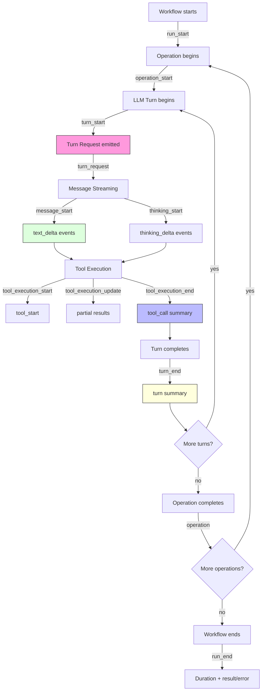
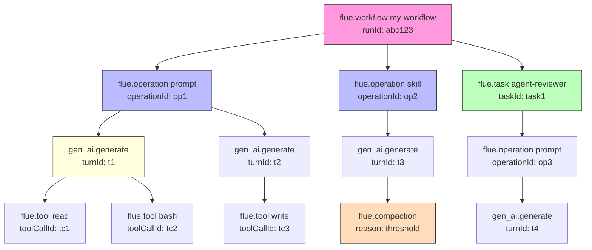

# Observability — FlueEvent System, observe(), and OpenTelemetry

Flue's observability system is built on a unified `FlueEvent` type system with 28+ event variants, a global `observe()` subscriber API, and a first-class OpenTelemetry adapter. Every action a Flue agent takes — from workflow lifecycle to individual token streaming — emits a typed event that can be observed, indexed, streamed over SSE, and exported as OpenTelemetry spans. This document explains the complete event taxonomy, the subscription mechanism, correlation fields, and how to wire the OpenTelemetry adapter.

## The FlueEvent Type System

`FlueEvent` is a TypeScript discriminated union with a `type` field as the discriminator. Every variant carries type-specific payload fields. On top of that, all variants are intersected with a shared correlation envelope containing optional fields for cross-referencing events across runs, sessions, turns, and operations.

Source: `packages/runtime/src/types.ts:1026-1176` — `FlueEvent` discriminated union

### Correlation Envelope

Every `FlueEvent` carries these optional correlation fields (defined at `types.ts:1164-1176`):

| Field | Type | Purpose |
|-------|------|---------|
| `runId` | `string` | Workflow run identifier; present on workflow events |
| `instanceId` | `string` | Isolate/DurableObject identifier; present on all events |
| `dispatchId` | `string` | Asynchronous input delivery identifier |
| `eventIndex` | `number` | Monotonically increasing index within a run; used for SSE replay and event ordering |
| `timestamp` | `string` | ISO 8601 timestamp of the event emission |
| `session` | `string` | Session name (e.g., `"main"`, `"task:main:uuid"`) |
| `parentSession` | `string` | Parent session name for task-delegated sessions |
| `taskId` | `string` | Task identifier when inside a `task()` call |
| `harness` | `string` | Harness name |
| `operationId` | `string` | Operation identifier (`prompt`, `skill`, `task`, `shell`, `compact`) |
| `turnId` | `string` | LLM turn identifier for a single model API call |

These fields are the primary way to correlate events across the lifecycle. A workflow run (`runId`) contains multiple operations (`operationId`), each containing multiple turns (`turnId`), each containing multiple tool calls. The `eventIndex` provides total ordering within a single run.

### AttachedAgentEvent

`AttachedAgentEvent` (`types.ts:1183-1189`) is `FlueEvent` with the workflow lifecycle variants (`run_start`, `run_resume`, `run_end`) excluded and `runId` typed as `never`. This is the event type emitted by direct attached-agent interactions that are not part of a workflow run. They carry `instanceId` and are not durable workflow history.

## Event Variants by Category

### Workflow Lifecycle

| Type | Fields | Description |
|------|--------|-------------|
| `run_start` | `runId`, `owner`, `instanceId`, `workflowName`, `startedAt`, `payload` | Workflow execution begins. `owner` is `{ kind: 'workflow'; workflowName; instanceId }` |
| `run_resume` | `runId`, `owner`, `instanceId`, `workflowName`, `startedAt` | Workflow resumes after isolation restart (e.g., Durable Object eviction). The OpenTelemetry adapter links the resumed run to the interrupted run via a span link |
| `run_end` | `runId`, `result?`, `isError`, `error?`, `durationMs` | Workflow execution terminates. Includes total duration and result/error payload |

### Agent Lifecycle

| Type | Fields | Description |
|------|--------|-------------|
| `agent_start` | *(none)* | Agent loop begins processing |
| `agent_end` | `messages: AgentMessage[]` | Agent loop completes; carries the full message history |

### Turn Lifecycle

| Type | Fields | Description |
|------|--------|-------------|
| `turn_start` | `turnId`, `purpose: LlmTurnPurpose` | A new LLM turn begins. Purpose is `'agent'`, `'compaction'`, or `'compaction_prefix'` |
| `turn_request` | `turnId`, `purpose`, `model`, `provider`, `api`, `input`, `reasoning?` | The exact HTTP payload being sent to the model provider. `input` contains `systemPrompt?`, `messages: LlmMessage[]`, and `tools?: LlmTool[]` |
| `turn_end` | `turnId`, `purpose`, `message: AgentMessage`, `toolResults: AgentMessage[]` | Model response received and tool results computed |
| `turn` | `turnId`, `purpose`, `durationMs`, `model?`, `provider?`, `api?`, `output?`, `usage?`, `stopReason?`, `isError`, `error?` | Summary event for the entire turn, including usage and duration |

### Message Streaming

| Type | Fields | Description |
|------|--------|-------------|
| `message_start` | `message: AgentMessage` | A new assistant message begins streaming |
| `message_update` | `message: AgentMessage`, `assistantMessageEvent: unknown` | Content delta during streaming; the inner event type drives `text_delta`, `thinking_*` events |
| `message_end` | `message: AgentMessage` | Assistant message is complete |
| `text_delta` | `text: string` | Individual text token during streaming |
| `thinking_start` | *(none)* | Model enters extended thinking mode |
| `thinking_delta` | `delta: string` | Individual thinking token |
| `thinking_end` | `content: string` | Extended thinking block is complete |

### Tool Execution

| Type | Fields | Description |
|------|--------|-------------|
| `tool_execution_start` | `toolCallId`, `toolName`, `args` | Tool execution begins (from pi-agent-core) |
| `tool_execution_update` | `toolCallId`, `toolName`, `args`, `partialResult` | Partial/streaming tool result |
| `tool_execution_end` | `toolCallId`, `toolName`, `result`, `isError` | Tool execution completes |
| `tool_start` | `toolName`, `toolCallId`, `args?` | Flue-level tool start (emitted alongside `tool_execution_start`) |
| `tool_call` | `toolName`, `toolCallId`, `isError`, `result?`, `durationMs` | Summary event for the tool call with duration |

### Task Delegation

| Type | Fields | Description |
|------|--------|-------------|
| `task_start` | `taskId`, `prompt`, `agent?`, `cwd?` | A child task session is being created |
| `task` | `taskId`, `agent?`, `isError`, `result?`, `durationMs` | Child task completes with result or error |

### Compaction

| Type | Fields | Description |
|------|--------|-------------|
| `compaction_start` | `reason: 'threshold' \| 'overflow' \| 'manual'`, `estimatedTokens` | Context compaction begins. Reason indicates the trigger |
| `compaction` | `messagesBefore`, `messagesAfter`, `durationMs`, `usage?` | Compaction completes. Usage carries the token cost of the summarization LLM calls |

### Operations

| Type | Fields | Description |
|------|--------|-------------|
| `operation_start` | `operationId`, `operationKind: 'prompt' \| 'skill' \| 'task' \| 'shell' \| 'compact'` | A session operation begins |
| `operation` | `operationId`, `operationKind`, `durationMs`, `isError`, `error?`, `result?`, `usage?` | Operation completes with result, duration, and usage |

### System Events

| Type | Fields | Description |
|------|--------|-------------|
| `log` | `level: 'info' \| 'warn' \| 'error'`, `message`, `attributes?` | Internal log event from the session (replaces `console.log` for observability) |
| `idle` | *(none)* | Session is idle and ready for the next input |

## Event Emission Flow

The `Session` class in `session.ts` subscribes to the underlying `pi-agent-core` agent and maps its events to `FlueEvent` variants. The `emit()` method (`session.ts:1557-1567`) enriches each event with correlation fields:

```typescript
// packages/runtime/src/session.ts:1557-1567
private emit(event: FlueEvent): void {
    const decorated = {
        ...event,
        session: event.session ?? this.name,
    };
    const operationId = event.operationId ?? this.activeOperationId;
    if (operationId !== undefined) decorated.operationId = operationId;
    const turnId = event.turnId ?? this.activeTurnId;
    if (turnId !== undefined) decorated.turnId = turnId;
    this.eventCallback?.(decorated);
}
```

The `emit()` method automatically attaches `session`, `operationId`, and `turnId` from the session's active context. This means every event emitted during a `prompt()` call carries the same `operationId`, and every event emitted during a single LLM turn carries the same `turnId`. This is how the correlation envelope is populated without the caller having to wire it manually.

The agent subscription (`session.ts:695-809`) maps pi-agent-core events to Flue events:

```typescript
// packages/runtime/src/session.ts:695-809
this.harness.subscribe(async (event) => {
    switch (event.type) {
        case 'agent_start':
            this.emit({ type: 'agent_start' });
            break;
        case 'turn_start':
            this.turnStartTime = Date.now();
            this.activeTurnId = generateTurnId();
            this.emit({ type: 'turn_start', turnId: this.activeTurnId, purpose: 'agent' });
            break;
        case 'message_start':
            this.emit({ type: 'message_start', message: event.message });
            break;
        case 'message_update': {
            this.emit({
                type: 'message_update',
                message: event.message,
                assistantMessageEvent: event.assistantMessageEvent,
            });
            // Inner event mapping for text_delta, thinking_start/delta/end
            const aEvent = event.assistantMessageEvent;
            if (aEvent.type === 'text_delta') {
                this.emit({ type: 'text_delta', text: aEvent.delta });
            } else if (aEvent.type === 'thinking_start') {
                this.emit({ type: 'thinking_start' });
            } // ... thinking_delta, thinking_end
            break;
        }
        case 'tool_execution_start':
            this.toolStartTimes.set(event.toolCallId, Date.now());
            this.emit({ type: 'tool_execution_start', ... });
            this.emit({ type: 'tool_start', ... });  // dual emission
            break;
        case 'tool_execution_end':
            this.emit({ type: 'tool_execution_end', ... });
            this.emit({ type: 'tool_call', durationMs: durationSince(...), ... });
            this.toolStartTimes.delete(event.toolCallId);
            break;
        // ... turn_end, turn, agent_end
    }
});
```

Note the dual emission pattern: `tool_execution_start` is emitted alongside `tool_start`, and `tool_execution_end` is followed by `tool_call`. The `tool_call` variant includes `durationMs`, which is computed from the timestamp stored in `toolStartTimes`. This pattern allows consumers to choose between fine-grained execution events and summary events.

## observe() — Global Event Subscription

Source: `packages/runtime/src/runtime/events.ts:1-80`

The `observe()` function registers a global subscriber that receives every `FlueEvent` emitted in the current isolate. It does not replay durable history — it only sees live events.

```typescript
// packages/runtime/src/runtime/events.ts:42-47
export function observe(subscriber: FlueEventSubscriber): () => void {
    subscribers.add(subscriber);
    return () => {
        subscribers.delete(subscriber);
    };
}
```

The subscriber receives a JSON-cloned snapshot of the event, so mutations in the callback do not affect the original. Subscriber failures are logged and do not halt event dispatch:

```typescript
// packages/runtime/src/runtime/events.ts:54-76
export function dispatchGlobalEvent(event: FlueEvent, ctx: FlueContext): void {
    if (subscribers.size === 0) return;
    let serializedEvent: string | undefined;
    try {
        serializedEvent = JSON.stringify(event);
        if (serializedEvent === undefined)
            throw new Error('Event snapshot serialization returned undefined.');
    } catch (error) {
        reportSubscriberFailure(error);
        return;
    }
    for (const subscriber of [...subscribers]) {
        try {
            Promise.resolve(subscriber(JSON.parse(serializedEvent) as FlueEvent, ctx)).catch(
                reportSubscriberFailure,
            );
        } catch (error) {
            reportSubscriberFailure(error);
        }
    }
}
```

The event is stringified and re-parsed to create an isolated JSON snapshot. This prevents subscribers from accidentally mutating shared state. The `[...subscribers]` copy prevents concurrent unsubscription from breaking iteration.

Typical usage in `app.ts`:

```typescript
import { observe } from '@flue/runtime';

// Register at startup
observe((event, ctx) => {
    if (event.type === 'run_end' && event.isError) {
        // Ship to error reporter
        errorReporter.capture(event.error, {
            runId: event.runId,
            durationMs: event.durationMs,
        });
    }
    if (event.type === 'compaction') {
        metrics.histogram('flue.compaction.messages_removed', event.messagesBefore - event.messagesAfter);
    }
});
```

## Event Lifecycle Flowchart



## OpenTelemetry Adapter

Source: `packages/opentelemetry/src/index.ts`

The `@flue/opentelemetry` package provides `createOpenTelemetryObserver()`, which converts `FlueEvent` emissions into OpenTelemetry spans. Wire it via `observe()`:

```typescript
import { observe } from '@flue/runtime';
import { createOpenTelemetryObserver } from '@flue/opentelemetry';
import { trace } from '@opentelemetry/api';

// Configure your OpenTelemetry provider elsewhere
const tracer = trace.getTracer('my-app');

// Create the observer
const otelObserver = createOpenTelemetryObserver({
    tracer,
    // Optional: sanitize events before export (e.g., strip sensitive args)
    sanitize: (event) => {
        if (event.type === 'tool_start' && event.args?.secret) {
            return { ...event, args: { ...event.args, secret: '[REDACTED]' } };
        }
        return event;
    },
    // Optional: resolve the root context for distributed tracing
    resolveRootContext: (event, ctx) => {
        // Extract trace context from incoming request headers
        return extractContextFromHeaders(ctx.request?.headers);
    },
});

// Subscribe
const unsubscribe = observe(otelObserver);
```

### Span Hierarchy

The OpenTelemetry adapter maintains parallel span registries for each lifecycle concept:

```typescript
// packages/opentelemetry/src/index.ts:26-31
const runs = new Map<string, Span>();
const recoveryHandledRuns = new Set<string>();
const operations = new Map<string, Span>();
const turns = new Map<string, Span>();
const tools = new Map<string, Span>();
const tasks = new Map<string, Span>();
const compactions = new Map<string, Span>();
```

Each `_start` event creates a span and stores it by its correlation ID. The corresponding completion event (`tool_call`, `turn`, `operation`, `task`, `compaction`, `run_end`) looks up the span, sets attributes, and ends it.

### Span Naming Convention

| Event Pair | Span Name | Parent Resolution |
|------------|-----------|-------------------|
| `run_start` → `run_end` | `flue.workflow {workflowName}` | Root span, or from `resolveRootContext` |
| `operation_start` → `operation` | `flue.operation {operationKind}` | Task span (if `taskId`) or workflow span |
| `turn_request` → `turn` | `gen_ai.generate` | Operation span or workflow span |
| `tool_start` → `tool_call` | `flue.tool {toolName}` | Turn span (if `turnId`) or operation span or workflow span |
| `task_start` → `task` | `flue.task {agent}` | Operation span or workflow span |
| `compaction_start` → `compaction` | `flue.compaction` | Operation span or workflow span |

The `turn_request` span uses `gen_ai.generate` as its name, which follows the OpenTelemetry semantic conventions for generative AI operations. The span attributes include `gen_ai.operation.name: 'chat'`, `gen_ai.provider.name`, and `gen_ai.request.model`.

### Span Attributes

Every span carries the correlation identifiers as attributes via the `identifiers()` function:

```typescript
// packages/opentelemetry/src/index.ts:433-447
function identifiers(event: FlueEvent): Attributes {
    return Object.fromEntries(
        Object.entries({
            'flue.run_id': event.runId,
            'flue.instance_id': event.instanceId,
            'flue.dispatch_id': event.dispatchId,
            'flue.harness.name': event.harness,
            'flue.session.name': event.session,
            'flue.parent_session.name': event.parentSession,
            'flue.operation.id': event.operationId,
            'flue.task.id': event.taskId,
            'flue.turn.id': event.turnId,
        }).filter((entry): entry is [string, string] => entry[1] !== undefined),
    );
}
```

Usage attributes follow the `gen_ai.usage` prefix convention:

```typescript
// packages/opentelemetry/src/index.ts:456-469
function usageAttributes(usage, prefix = 'gen_ai.usage'): Attributes {
    if (!usage) return {};
    return {
        [`${prefix}.input_tokens`]: usage.input,
        [`${prefix}.output_tokens`]: usage.output,
        [`${prefix}.cache_read_tokens`]: usage.cacheRead,
        [`${prefix}.cache_write_tokens`]: usage.cacheWrite,
        [`${prefix}.total_tokens`]: usage.totalTokens,
        [`${prefix}.cost_total`]: usage.cost.total,
    };
}
```

### Event Index Tracking

Start and end spans record the `eventIndex` from the correlation envelope:

```typescript
// packages/opentelemetry/src/index.ts:449-454
function eventIndexAttribute(scope: 'start' | 'end' | 'index', event: FlueEvent): Attributes {
    if (event.eventIndex === undefined) return {};
    return {
        [scope === 'index' ? 'flue.event.index' : `flue.event.${scope}_index`]: event.eventIndex,
    };
}
```

This allows reconstructing the exact event ordering from spans in a tracing backend.

### Run Resume Handling

When a Durable Object is evicted and a workflow resumes, the adapter:

1. Ends all in-flight descendant spans from the interrupted run with error status
2. Ends the original `run_start` span with error status
3. Creates a new `run_resume` span linked to the original via `spanContext()` link
4. Sets `flue.workflow.recovery_handling: true` on the resumed span

```typescript
// packages/opentelemetry/src/index.ts:61-104
if (event.type === 'run_resume') {
    endRunDescendants(event.runId, time, 'Workflow execution was interrupted...', ...);
    const interrupted = runs.get(event.runId);
    if (interrupted) {
        interrupted.setStatus({ code: SpanStatusCode.ERROR, message: '...' });
        interrupted.end(time);
    }
    recoveryHandledRuns.add(event.runId);
    runs.set(event.runId, startSpan(
        tracer,
        `flue.workflow ${event.workflowName}`,
        undefined,
        event, ctx, resolveRootContext,
        {
            startTime: time,
            ...(interrupted ? { links: [{ context: interrupted.spanContext() }] } : {}),
            attributes: {
                ...identifiers(event),
                'flue.workflow.name': event.workflowName,
                'flue.workflow.recovery_handling': true,
                'flue.workflow.started_at': event.startedAt,
            },
        },
    ));
    return;
}
```

### Sanitizer Function

The `sanitize` option allows scrubbing sensitive data before it reaches the tracing backend. If the sanitizer throws, the error is logged and the event proceeds without sanitization:

```typescript
// packages/opentelemetry/src/index.ts:471-481
function sanitizeEvent<TEvent extends FlueEvent>(
    sanitize,
    event: TEvent,
): TEvent | undefined {
    try {
        return sanitize?.({ ...event }) as TEvent | undefined;
    } catch (error) {
        console.error('[flue:opentelemetry] sanitizer failed:', error);
        return undefined;
    }
}
```

### Orphan Span Cleanup

The `endRunDescendants()` function handles the case where a run ends before all its child spans receive their terminal events. It iterates through all span registries, finds spans belonging to the run via a `WeakMap<Span, string>`, marks them as error, and ends them:

```typescript
// packages/opentelemetry/src/index.ts:370-392
function endRunDescendants(runId, time, message, spanRunIds, operations, turns, tools, tasks, compactions): void {
    for (const spans of [tools, turns, compactions, tasks, operations]) {
        for (const [key, span] of spans) {
            if (spanRunIds.get(span) !== runId) continue;
            span.setStatus({ code: SpanStatusCode.ERROR, message });
            span.end(time);
            spans.delete(key);
        }
    }
}
```

This prevents zombie spans from leaking when a workflow is interrupted (e.g., Durable Object eviction, process crash).

## OpenTelemetry Span Hierarchy



## Event Indexing and SSE Streaming

Every `FlueEvent` carries an `eventIndex` in the correlation envelope. This field is set by the workflow run store when events are persisted, and it is used by the SSE streaming endpoint to allow clients to resume from a specific index.

The Node run store (`packages/runtime/src/node/run-store.ts`) stores events with their `eventIndex` and returns them in sorted order:

```typescript
// packages/runtime/src/node/run-store.ts:70-78
async getEvents(runId: string, fromIndex?: number): Promise<FlueEvent[]> {
    const run = await this.getRun(runId);
    if (!run) return [];
    const instance = this.getInstance(ownerKey(run.owner)).events.get(runId) ?? [];
    return events
        .filter((event) => fromIndex === undefined || event.eventIndex >= fromIndex)
        .toSorted((left, right) => left.eventIndex - right.eventIndex)
        .map((event) => parsePersistedWorkflowEvent(runId, event.payload, event.eventIndex));
}
```

The `fromIndex` parameter enables resume-after-disconnect: a client that was at `eventIndex: 42` can request `fromIndex: 43` to get all events since the last one it processed. Duplicate event indices are rejected:

```typescript
// packages/runtime/src/node/run-store.ts:63-65
if (events.some((stored) => stored.eventIndex === eventIndex)) {
    throw new Error('[flue:run-store] duplicate persisted workflow event index.');
}
```

## Aha: Dual Emission for Tool Events

**Aha:** The `tool_execution_*` and `tool_start`/`tool_call` event pairs are emitted together but serve different audiences. The `tool_execution_*` variants come directly from pi-agent-core and carry the raw execution data (args, partial results, errors). The `tool_start`/`tool_call` variants are Flue's own summary events, where `tool_call` includes `durationMs`. This dual pattern means:

- **Real-time UIs** (SSE streams) can use the fine-grained `tool_execution_update` events for progressive rendering
- **Analytics/tracing** systems can use the summary `tool_call` events which have duration and are simpler to aggregate
- **The OpenTelemetry adapter** uses `tool_start` as the span start and `tool_call` as the span end, ignoring the execution events entirely. This avoids creating and managing intermediate span state for the execution events

This separation of concerns means the observability layer doesn't have to compute durations itself — it receives them pre-computed in the summary events.

## Aha: Event Index Is a Run-Scoped Monotonic Counter

**Aha:** The `eventIndex` is not globally unique — it is scoped to a single `runId` within a single instance. This is by design. Workflow events are persisted per-run, and the index is the position in that run's event log. This means:

- You can replay a run's events in exact order by sorting on `eventIndex`
- Cross-run correlation happens via `runId`, not via `eventIndex`
- `eventIndex` enables idempotent event storage: the run store rejects duplicates by index

This design prevents index collisions between concurrent runs and makes replay deterministic.

## Aha: Run Resume Creates Span Links, Not Continuations

**Aha:** When a workflow resumes after Durable Object eviction, the OpenTelemetry adapter does NOT try to resume the original span. Instead, it:

1. Force-ends the original span (and all descendants) with error status
2. Creates a brand new span for the resumed run
3. Links the new span to the old one via OpenTelemetry's `links` mechanism

This is the correct approach because spans represent continuous execution windows. A Durable Object eviction is a process boundary break — the new span after resume is a genuinely new execution context. The `links` mechanism in OpenTelemetry is designed exactly for this: connecting spans across process boundaries without pretending they are the same execution. The `flue.workflow.recovery_handling: true` attribute makes these events easy to filter in a tracing dashboard.

## Related Documents

- [Workflows](06-workflows.html) — Workflow lifecycle, dispatch, and run management
- [Session Persistence](13-session-persistence.html) — SessionData v5, SessionStore, tree deletion
- [Cloudflare Target](08-cloudflare-target.html) — Durable Objects, which trigger run_resume events
- [Structured Results](14-structured-results.html) — Result schemas and their operation lifecycle
- [Cross-Cutting Concerns](15-cross-cutting.html) — Error handling, provider configuration, usage tracking

## Source Code References

| Component | Source Path |
|-----------|-------------|
| `FlueEvent` union type | `packages/runtime/src/types.ts:1026-1176` |
| `AttachedAgentEvent` | `packages/runtime/src/types.ts:1183-1189` |
| `observe()`, `dispatchGlobalEvent()` | `packages/runtime/src/runtime/events.ts:1-80` |
| Session event emission | `packages/runtime/src/session.ts:695-809, 1557-1567` |
| OpenTelemetry adapter | `packages/opentelemetry/src/index.ts:1-525` |
| Node run store | `packages/runtime/src/node/run-store.ts:1-101` |
| `generateTurnId`, `generateOperationId` | `packages/runtime/src/runtime/ids.ts` |
