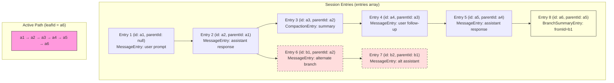
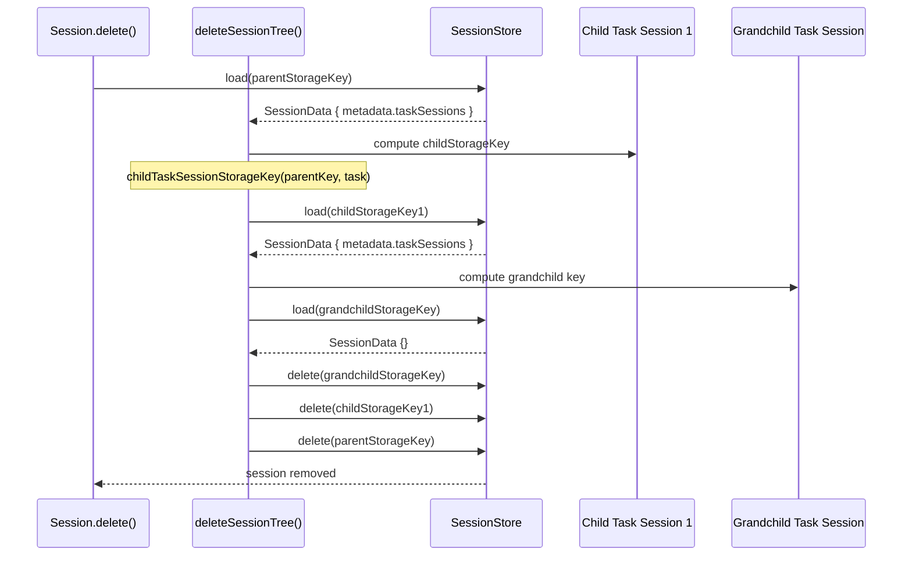

# Session Persistence — SessionData v5, SessionStore, and Tree Deletion

Flue persists session state as `SessionData` v5 — a versioned, parent-linked tree of conversation entries stored via a pluggable `SessionStore` interface. Every `prompt()`, `skill()`, `task()`, and `shell()` call appends entries to the session history, and the resulting `SessionData` snapshot is written to the store. On the Cloudflare target, this happens automatically in Durable Objects. On Node, it requires a supplied `SessionStore` implementation. This document explains the v5 data structure, the session history tree, storage backends, version enforcement, and the recursive `deleteSessionTree()` cleanup.

## SessionData v5 Structure

Source: `packages/runtime/src/types.ts:773-782` — `SessionData` interface

```typescript
// packages/runtime/src/types.ts:773-782
export interface SessionData {
    version: 5;
    /** Opaque stable provider-facing identity used for prompt caching and routing affinity. */
    affinityKey: string;
    entries: SessionEntry[];
    leafId: string | null;
    metadata: Record<string, any>;
    createdAt: string;
    updatedAt: string;
}
```

Every field serves a specific purpose:

| Field | Type | Purpose |
|-------|------|---------|
| `version` | `5` (literal) | Schema version. Loaded data with `version !== 5` throws — no silent migration |
| `affinityKey` | `string` (regex: `/^aff_[0-7][0-9A-HJKMNP-TV-Z]{25}$/`) | Stable provider-facing identity for prompt caching and routing affinity |
| `entries` | `SessionEntry[]` | Append-only array of all entries (messages, compactions, branch summaries) |
| `leafId` | `string \| null` | ID of the most recent entry on the active path — the tip of the conversation tree |
| `metadata` | `Record<string, any>` | Extensible metadata including `taskSessions` for parent-child session linking |
| `createdAt` | `string` (ISO 8601) | When the session was first persisted |
| `updatedAt` | `string` (ISO 8601) | When the session was last written |

## SessionEntry Union

Source: `packages/runtime/src/types.ts:784-829`

`SessionEntry` is a discriminated union of three entry types, all extending `SessionEntryBase`:

```typescript
// packages/runtime/src/types.ts:784-791
export type SessionEntry = MessageEntry | CompactionEntry | BranchSummaryEntry;

interface SessionEntryBase {
    type: string;
    id: string;
    parentId: string | null;
    timestamp: string;
}
```

### SessionEntryBase

Every entry has four common fields:

| Field | Type | Purpose |
|-------|------|---------|
| `type` | `string` | Discriminator: `'message'`, `'compaction'`, or `'branch_summary'` |
| `id` | `string` | Unique entry ID (8-char hex from `crypto.randomUUID().slice(0, 8)`) |
| `parentId` | `string \| null` | Parent entry ID — forms a linked list that enables branch tracking |
| `timestamp` | `string` (ISO 8601) | When the entry was created |

### MessageEntry

Source: `packages/runtime/src/types.ts:793-798`

```typescript
// packages/runtime/src/types.ts:793-798
export interface MessageEntry extends SessionEntryBase {
    type: 'message';
    message: AgentMessage;
    source?: 'prompt' | 'skill' | 'shell' | 'task' | 'retry' | 'dispatch';
    dispatch?: DispatchMessageMetadata;
}
```

`MessageEntry` represents a single message in the conversation. The `source` field tracks where the message originated:

- `'prompt'` — from `session.prompt()` or `session.processDirectInput()`
- `'skill'` — from `session.skill()`
- `'shell'` — from `session.shell()` (synthetic user+assistant+toolResult triple)
- `'task'` — from `session.task()` delegated to a child session
- `'retry'` — from the transient model retry loop
- `'dispatch'` — from `processDispatchInput()` (asynchronous input delivery)

When `source` is `'dispatch'`, the `dispatch` field carries `DispatchMessageMetadata` with `dispatchId`, `agent`, `id`, `session`, `acceptedAt`, and `input`.

### CompactionEntry

Source: `packages/runtime/src/types.ts:809-822`

```typescript
// packages/runtime/src/types.ts:809-822
export interface CompactionEntry extends SessionEntryBase {
    type: 'compaction';
    summary: string;
    firstKeptEntryId: string;
    tokensBefore: number;
    details?: { readFiles: string[]; modifiedFiles: string[] };
    /** Token usage consumed by the summarization call(s). */
    usage?: PromptUsage;
}
```

A `CompactionEntry` marks where context was summarized. The `summary` is the LLM-generated context summary. The `firstKeptEntryId` points to the entry after the compaction cut point — entries between the previous compaction (or start) and this ID are summarized and replaced by the `summary`. The `tokensBefore` is the estimated token count at the time of compaction. The `usage` field records the token cost of the summarization LLM calls.

### BranchSummaryEntry

Source: `packages/runtime/src/types.ts:824-829`

```typescript
// packages/runtime/src/types.ts:824-829
export interface BranchSummaryEntry extends SessionEntryBase {
    type: 'branch_summary';
    fromId: string;
    summary: string;
    details?: unknown;
}
```

A `BranchSummaryEntry` marks a branch point in the conversation tree. When the `leafId` is switched (e.g., after a user branches to explore an alternative conversation path), the old branch is summarized and a `BranchSummaryEntry` is appended to the new active path. The `fromId` points to the entry where the branch diverged.

## Session History Tree

The session history is not a flat list — it is a parent-linked tree. Each entry's `parentId` points to the entry that preceded it, and the `leafId` points to the tip of the current active path. Walking from `leafId` backwards through `parentId` reconstructs the active conversation path.

Source: `packages/runtime/src/session.ts:262-448` — `SessionHistory` class

```typescript
// packages/runtime/src/session.ts:262-275
export class SessionHistory {
    private entries: SessionEntry[];
    private byId: Map<string, SessionEntry>;
    private leafId: string | null;

    private constructor(entries: SessionEntry[], leafId: string | null) {
        this.entries = [...entries];
        this.leafId = leafId;
        this.byId = new Map(this.entries.map((entry) => [entry.id, entry]));
    }

    static empty(): SessionHistory {
        return new SessionHistory([], null);
    }
}
```

### Active Path Walking

`getActivePath()` walks from `leafId` to the root via `parentId`, then reverses to get chronological order:

```typescript
// packages/runtime/src/session.ts:299-307
getActivePath(): SessionEntry[] {
    const path: SessionEntry[] = [];
    let current = this.leafId ? this.byId.get(this.leafId) : undefined;
    while (current) {
        path.push(current);
        current = current.parentId ? this.byId.get(current.parentId) : undefined;
    }
    return path.reverse();
}
```

This means entries that are not on the active path (from abandoned branches) are stored in `entries` but excluded from the context presented to the model. The tree structure enables conversation branching without losing history.

### Bounded Windowing with getActivePathSince()

`getActivePathSince(afterLeafId)` returns entries appended after a given leaf ID. When `afterLeafId` is `null`, it returns the entire active path. When `afterLeafId` is set but the ID is not on the current active path (because a branch switch happened), it returns an empty array:

```typescript
// packages/runtime/src/session.ts:322-328
getActivePathSince(afterLeafId: string | null): SessionEntry[] {
    const path = this.getActivePath();
    if (afterLeafId === null) return path;
    const startIndex = path.findIndex((entry) => entry.id === afterLeafId);
    if (startIndex === -1) return [];
    return path.slice(startIndex + 1);
}
```

This is used by `aggregateUsageSince()` to sum token usage for entries appended during a single call. The empty-array return is a deliberate safety choice.

## Session History Tree Structure



## SessionStore Interface

Source: `packages/runtime/src/types.ts:831-835`

```typescript
// packages/runtime/src/types.ts:831-835
export interface SessionStore {
    save(id: string, data: SessionData): Promise<void>;
    load(id: string): Promise<SessionData | null>;
    delete(id: string): Promise<void>;
}
```

Three methods, no initialization, no configuration. Any storage backend that implements this interface works as a session store.

### InMemorySessionStore

Source: `packages/runtime/src/session.ts:231-245`

The default store for Node.js — a simple `Map` that persists for the process lifetime:

```typescript
// packages/runtime/src/session.ts:231-245
export class InMemorySessionStore implements SessionStore {
    private store = new Map<string, SessionData>();

    async save(id: string, data: SessionData): Promise<void> {
        this.store.set(id, data);
    }

    async load(id: string): Promise<SessionData | null> {
        return this.store.get(id) ?? null;
    }

    async delete(id: string): Promise<void> {
        this.store.delete(id);
    }
}
```

This is the fallback when no `persist` option is provided to `init()`. Sessions survive across requests within the same Node process but are lost on restart. For production Node deployments, supply a `SessionStore` backed by a database or file system.

### DurableObject Session Store (Cloudflare)

Source: `packages/runtime/src/cloudflare/session-store.ts`

The Cloudflare Durable Object store uses the DO's `setState()`/`state` API directly. Each DO instance holds a `Record<string, SessionData>` in its state:

```typescript
// packages/runtime/src/cloudflare/session-store.ts:14-36
export function store(): SessionStore {
    return {
        async save(id: string, data: SessionData): Promise<void> {
            const { agentInstance } = getCloudflareContext();
            const sessions = copySessions(agentInstance.state?.sessions);
            sessions[id] = data;
            agentInstance.setState({ ...agentInstance.state, sessions });
        },

        async load(id: string): Promise<SessionData | null> {
            const { agentInstance } = getCloudflareContext();
            const sessions = agentInstance.state?.sessions;
            return sessions && Object.hasOwn(sessions, id) ? (sessions[id] ?? null) : null;
        },

        async delete(id: string): Promise<void> {
            const { agentInstance } = getCloudflareContext();
            const sessions = copySessions(agentInstance.state?.sessions);
            delete sessions[id];
            agentInstance.setState({ ...agentInstance.state, sessions });
        },
    };
}
```

The `copySessions()` helper creates a fresh object with `Object.create(null)` to avoid prototype pollution:

```typescript
// packages/runtime/src/cloudflare/session-store.ts:8-12
function copySessions(
    sessions: Record<string, SessionData> | undefined,
): Record<string, SessionData> {
    return Object.assign(Object.create(null), sessions);
}
```

Note the immutability pattern: `save()` and `delete()` both create a copy of the sessions record, mutate the copy, then call `setState()` with the new object. This is required by the Durable Objects state API, which replaces the entire state object rather than patching it.

## Version Migration Enforcement

Source: `packages/runtime/src/session.ts:277-293` — `SessionHistory.fromData()`

When a session is loaded from storage, the version is checked immediately:

```typescript
// packages/runtime/src/session.ts:277-293
static fromData(data: SessionData | null): SessionHistory {
    if (!data) return SessionHistory.empty();
    if (data.version !== 5) {
        throw new Error(
            `[flue] Session data version ${String(data.version)} is unsupported. Clear persisted session state created by an earlier Flue beta.`,
        );
    }
    if (
        typeof data.affinityKey !== 'string' ||
        !/^aff_[0-7][0-9A-HJKMNP-TV-Z]{25}$/.test(data.affinityKey)
    ) {
        throw new Error(
            '[flue] Session data affinity key is malformed. Clear malformed persisted session state.',
        );
    }
    return new SessionHistory(data.entries, data.leafId);
}
```

Two validations happen here:

1. **Version check**: `data.version !== 5` throws with a clear error message. There is no migration path from earlier beta versions. The error instructs the user to clear persisted state. This is intentional — silent migration risks data corruption when the schema changed in incompatible ways.

2. **Affinity key validation**: The regex `/^aff_[0-7][0-9A-HJKMNP-TV-Z]{25}$/` validates the format. The key starts with `aff_`, followed by a digit 0-7, then 25 characters from a base32 alphabet that excludes ambiguous characters (0, 1, 8, I, L, O, U).

## Save Flow

Source: `packages/runtime/src/session.ts:1639-1651`

Every mutation to the session history triggers a save:

```typescript
// packages/runtime/src/session.ts:1639-1651
private async save(): Promise<void> {
    const result = this.pendingSave.then(async () => {
        const now = new Date().toISOString();
        const data = this.history.toData(this.affinityKey, this.metadata, this.createdAt ?? now, now);
        if (!this.createdAt) this.createdAt = now;
        await this.store.save(this.storageKey, data);
    });
    this.pendingSave = result.then(
        () => {},
        () => {},
    );
    await result;
}
```

The `pendingSave` pattern serializes saves: each new save waits for the previous one to complete before writing. This prevents race conditions where an older save overwrites a newer one. The `pendingSave` chain itself swallows rejections (via the empty rejection handler) so that a single save failure doesn't break the chain for subsequent saves.

## deleteSessionTree() — Recursive Task-Session Cleanup

Source: `packages/runtime/src/session.ts:2211-2227`

When a session is deleted, all its child task sessions must also be deleted. The `deleteSessionTree()` function walks the parent-to-child links stored in `metadata.taskSessions`:

```typescript
// packages/runtime/src/session.ts:2211-2227
export async function deleteSessionTree(
    store: SessionStore,
    storageKey: string,
    seen = new Set<string>(),
): Promise<void> {
    if (seen.has(storageKey)) return;
    seen.add(storageKey);
    const data = await store.load(storageKey);
    const taskSessions = Array.isArray(data?.metadata?.taskSessions)
        ? data.metadata.taskSessions
        : [];
    for (const task of taskSessions) {
        const childStorageKey = childTaskSessionStorageKey(storageKey, task);
        if (childStorageKey) await deleteSessionTree(store, childStorageKey, seen);
    }
    await store.delete(storageKey);
}
```

The algorithm:

1. **Cycle detection**: The `seen` set prevents infinite loops if there are circular references (unlikely but defensive)
2. **Load parent**: Read the session's `SessionData` to get `metadata.taskSessions`
3. **Recurse into children**: For each task session entry, compute the child's storage key using `childTaskSessionStorageKey()` and recurse
4. **Delete parent last**: After all children are deleted, delete the parent session

The `childTaskSessionStorageKey()` function (`packages/runtime/src/session-identity.ts:34-44`) parses the parent storage key and constructs the child key:

```typescript
// packages/runtime/src/session-identity.ts:34-44
export function childTaskSessionStorageKey(
    parentStorageKey: string,
    task: unknown,
): string | undefined {
    if (!task || typeof task !== 'object') return undefined;
    const { session, taskId } = task as { session?: unknown; taskId?: unknown };
    if (typeof session !== 'string' || typeof taskId !== 'string') return undefined;
    const parent = parseSessionStorageKey(parentStorageKey);
    if (!parent || session !== createTaskSessionName(parent.session, taskId)) return undefined;
    return createSessionStorageKey(parent.instanceId, parent.harness, session);
}
```

This validates that the task session name matches the expected pattern `task:<parentSession>:<taskId>` and reconstructs the storage key using the parent's `instanceId` and `harness`.

## Session Deletion Flow



## Task Session Metadata Tracking

Source: `packages/runtime/src/session.ts:1653-1662`

When a parent session creates a task session, it records the link in `metadata.taskSessions`:

```typescript
// packages/runtime/src/session.ts:1653-1662
private async recordTaskSession(session: string, taskId: string): Promise<void> {
    const taskSessions = Array.isArray(this.metadata.taskSessions)
        ? this.metadata.taskSessions
        : [];
    if (!taskSessions.some((task) => task?.session === session)) {
        taskSessions.push({ session, taskId });
        this.metadata.taskSessions = taskSessions;
        await this.save();
    }
}
```

The `taskSessions` array stores `{ session, taskId }` pairs. The deduplication check (`!taskSessions.some(...)`) prevents duplicate entries. This metadata is what `deleteSessionTree()` reads to find child sessions.

## Storage Key Structure

Session storage keys follow a structured format (`packages/runtime/src/session-identity.ts:26-32`):

```typescript
// packages/runtime/src/session-identity.ts:26-32
export function createSessionStorageKey(
    instanceId: string,
    harness: string,
    session: string,
): string {
    return `${SESSION_STORAGE_PREFIX}${JSON.stringify([instanceId, harness, session])}`;
}
```

The key is `agent-session:["instanceId","harness","session"]` — a JSON array of three strings prefixed with `agent-session:`. This structure allows `parseSessionStorageKey()` to extract the three components for child key computation.

Task session names follow the pattern `task:<parentSession>:<taskId>` (`session-identity.ts:22-24`):

```typescript
export function createTaskSessionName(parentSession: string, taskId: string): string {
    return `${TASK_SESSION_PREFIX}${parentSession}:${taskId}`;
}
```

## affinityKey — Prompt Caching and Routing Affinity

The `affinityKey` in `SessionData` is an opaque, stable identifier used for:

1. **Prompt caching**: Passing the same `sessionId` to the LLM provider enables the provider's prompt caching mechanism (e.g., Anthropic's cached prefixes)
2. **Routing affinity**: In multi-node deployments, the same `affinityKey` can route requests to the same node for cache locality

The format is validated by regex: `/^aff_[0-7][0-9A-HJKMNP-TV-Z]{25}$/`

- `aff_` prefix
- First character: digit 0-7 (3 bits of entropy)
- Remaining 25 characters: base32 alphabet without ambiguous characters

The alphabet `[0-9A-HJKMNP-TV-Z]` is a standard Crockford base32 variant:
- Includes digits 0-9
- Includes letters A-Z
- Excludes: I (confused with 1), L (confused with 1), O (confused with 0), U (sometimes excluded in base32)

The exclusion of ambiguous characters makes the key safe for display in logs, URLs, and operator tooling.

## Aha: Version Enforcement Throws, Not Migrates

**Aha:** Loading `SessionData` with `version !== 5` throws an error with explicit instructions to clear persisted state. This is a deliberate anti-migration design. The reasoning:

- Flue was in beta when v5 was introduced. Earlier versions had fundamentally different session structures
- A migration function would need to handle every possible corrupted or partial state from beta versions
- The cost of a migration bug (losing user data silently) far exceeds the cost of requiring users to clear state
- The error message is actionable: `"Clear persisted session state created by an earlier Flue beta."`

This is the correct approach for beta software. Production systems should implement proper version migration, but the beta-to-v5 transition is a one-time break that favors safety over convenience.

## Aha: getActivePathSince() Returns Empty, Not Full History

**Aha:** When `getActivePathSince(afterLeafId)` is called with an `afterLeafId` that is not on the current active path (because a branch switch happened since that leaf), it returns `[]` — not the full path and not the path from the root.

This is a deliberate "zero is loud" design:

- If usage aggregation returned the full path, it would silently overcount tokens from unrelated branches
- If it returned `[]`, the usage sum would be zero, and zero does not match expected values — the mismatch is visible and debuggable
- Silent overcounting would cause billing discrepancies that are hard to trace
- Loud zeros surface the issue immediately: "why is usage zero for this call?" leads to "because the session branched"

The comment in the source is explicit:

```
zero is loud (sums won't match expectations) while full-history would be silent overcounting
```

This same pattern appears in accounting systems: returning nothing is safer than returning wrong data.

## Aha: pendingSave Serializes Writes Without Blocking

**Aha:** The `save()` method uses a `pendingSave` promise chain to serialize writes:

```typescript
private async save(): Promise<void> {
    const result = this.pendingSave.then(async () => {
        // ... construct data and write to store
    });
    this.pendingSave = result.then(() => {}, () => {});
    await result;
}
```

Each call to `save()` chains onto the previous `pendingSave`, ensuring writes happen in order. But the re-assignment of `pendingSave` includes an empty rejection handler (`() => {}`), which means a failed save doesn't break the chain for future saves. Meanwhile, `await result` still propagates the error to the caller. This is a subtle but correct pattern:

- Writes are serialized (no concurrent saves can interleave)
- Failed saves are reported to the caller (via `await result`)
- Future saves are not blocked by past failures (via the empty `.catch` on the chain)

## Related Documents

- [Harness & Sessions](03-harness-sessions.html) — Session lifecycle, `init()`, and `FlueSession` interface
- [Compaction](05-compaction.html) — Context-window management and `CompactionEntry` creation
- [Observability](12-observability.html) — `FlueEvent` system, event streaming, OpenTelemetry
- [Cloudflare Target](08-cloudflare-target.html) — Durable Object state management, persistence
- [Node Target](09-node-target.html) — Local storage, `InMemorySessionStore` usage
- [Workflows](06-workflows.html) — Workflow runs and their relationship to sessions

## Source Code References

| Component | Source Path |
|-----------|-------------|
| `SessionData` interface | `packages/runtime/src/types.ts:773-782` |
| `SessionEntry` union + entry types | `packages/runtime/src/types.ts:784-829` |
| `SessionStore` interface | `packages/runtime/src/types.ts:831-835` |
| `SessionHistory` class | `packages/runtime/src/session.ts:262-448` |
| `InMemorySessionStore` | `packages/runtime/src/session.ts:231-245` |
| `deleteSessionTree()` | `packages/runtime/src/session.ts:2211-2227` |
| DurableObject session store | `packages/runtime/src/cloudflare/session-store.ts` |
| Session identity and key construction | `packages/runtime/src/session-identity.ts` |
| `recordTaskSession()` | `packages/runtime/src/session.ts:1653-1662` |
| `save()` with pendingSave chain | `packages/runtime/src/session.ts:1639-1651` |
| `toData()` serialization | `packages/runtime/src/session.ts:426-441` |
