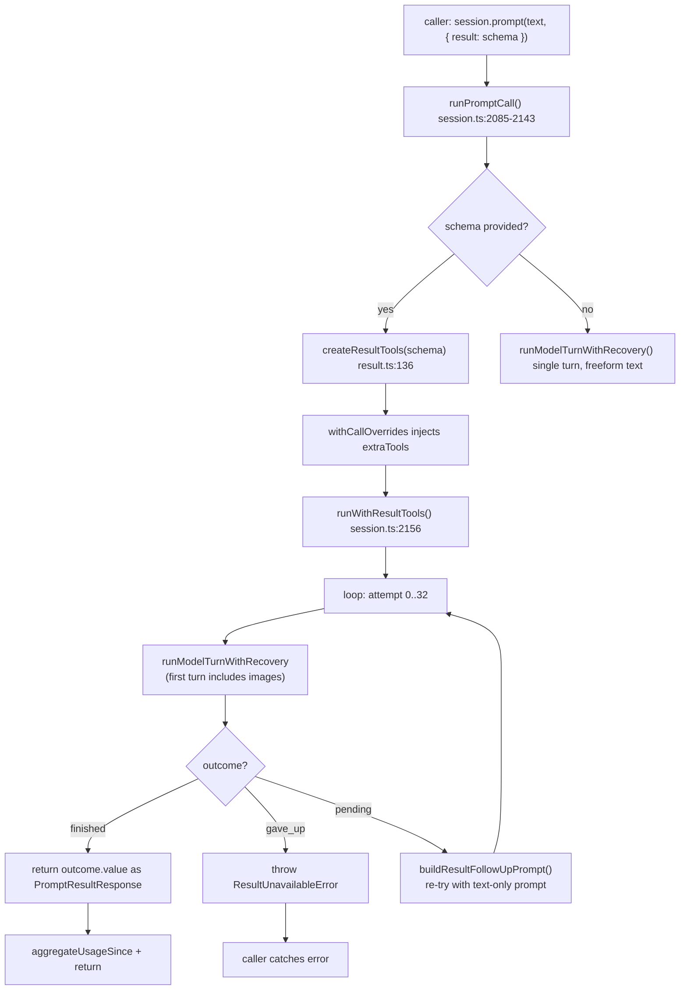
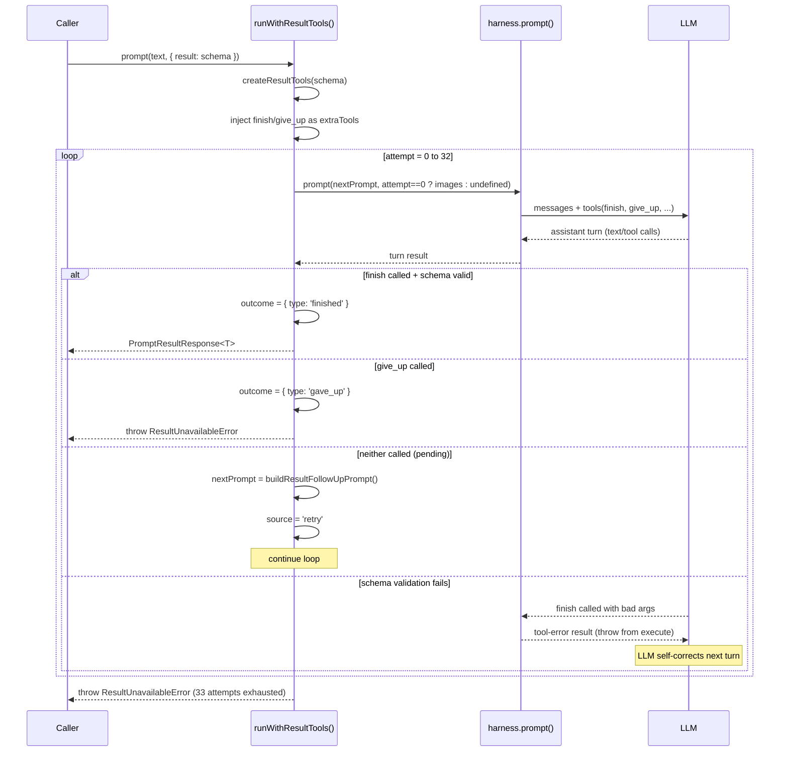
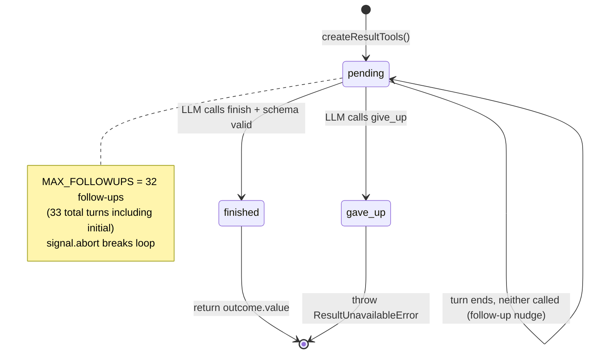

# Structured Results via `result` Schema

Flue lets callers require validated structured output from any `prompt()`, `skill()`, or `task()` call by passing a valibot schema via `options.result`. The framework injects two hidden tools into the harness (`finish` and `give_up`), drives a retry loop until one is called, and returns the validated data as `PromptResultResponse<T>`. This is **not** prompt engineering — it is schema-enforced, tool-mediated, protocol-guaranteed structured output.

**Related:** [15-cross-cutting](./15-cross-cutting.md) (error handling, provider config), [03-harness-sessions](./03-harness-sessions.md) (session lifecycle), [04-sandbox-tools](./04-sandbox-tools.md) (tool system).

---

## Core Mechanism: Tool Injection + Retry Loop

When a caller passes `options.result` to `session.prompt()`, `session.skill()`, or `session.task()`, the session intercepts the call at `runPromptCall()` (`packages/runtime/src/session.ts:2085-2143`). It creates a result-tool bundle via `createResultTools()` and hands it to `runWithResultTools()`, which loops up to `MAX_FOLLOWUPS = 32` attempts until the LLM calls `finish` (success) or `give_up` (typed error).

The full flow:



The `runPromptCall()` function (lines 2085-2143) decides which path to take. At line 2098, it creates the result bundle from the schema. Lines 2113-2126 handle the structured-result branch (calling `runWithResultTools()`), while lines 2129-2140 handle the freeform-text branch (single `runModelTurnWithRecovery()`).

```typescript
// packages/runtime/src/session.ts:2098-2140 (runPromptCall body)
const resultBundle = args.schema ? createResultTools(args.schema) : undefined;
// ...
if (resultBundle) {
    const result = await this.runWithResultTools(
        args.promptText,
        resultBundle,
        args.source,
        args.errorLabel,
        args.signal,
        args.images,
    );
    return {
        data: result,
        usage: this.aggregateUsageSince(beforeLeafId),
        model,
    };
}
```

---

## `createResultTools()`: The Hidden Tool Pair

Source: `packages/runtime/src/result.ts:136` — `createResultTools()`

`createResultTools()` takes a valibot schema and returns a `ResultToolBundle<T>` containing two `AgentTool` instances and a `getOutcome()` accessor. These tools are injected into the harness via `withCallOverrides()` as `extraTools` — they are **not** passed through the caller's `options.tools` array, so they are invisible to the caller but visible to the LLM.

### The `finish` Tool

The `finish` tool's parameters are derived from the valibot schema via `@valibot/to-json-schema`. If the schema's top-level type is not an object (e.g., `v.string()` or `v.array(v.number())`), it is wrapped in a `{ result: <schema> }` envelope because every LLM provider requires tool arguments to be a top-level object:

```typescript
// packages/runtime/src/result.ts:141-152
const wrapped = needsEnvelope(schema);
const innerJsonSchema = stripJsonSchemaMeta(
    toJsonSchema(schema, { errorMode: 'ignore' }) as Record<string, unknown>,
);
const finishParameters = wrapped
    ? {
          type: 'object',
          properties: { result: innerJsonSchema },
          required: ['result'],
          additionalProperties: false,
      }
    : innerJsonSchema;
```

The `needsEnvelope()` helper (`result.ts:242`) checks `(schema as { type?: string }).type !== 'object'`. This is valibot's runtime `type` discriminator. The `stripJsonSchemaMeta()` helper removes the `$schema` field that `toJsonSchema` emits, as it is unnecessary for tool parameter validation.

The `finish` tool's `execute` function (`result.ts:171-197`) performs two validation passes:

1. **JSON Schema validation** — pi-agent-core validates the tool args against the JSON Schema *before* calling `execute`. If this fails, the LLM receives a tool-error result and can self-correct.
2. **Valibot validation** — inside `execute`, `v.safeParse(schema, candidate)` runs to enforce valibot-specific refinements (transforms, defaults, coercion) that JSON Schema cannot express. On failure, it throws with a formatted error message that includes path information via `formatIssuePath()`.

```typescript
// packages/runtime/src/result.ts:171-197
async execute(_toolCallId, params) {
    if (outcome.type !== 'pending') {
        return alreadyDoneToolError(outcome);
    }

    const candidate = wrapped ? (params as { result: unknown }).result : params;
    const parsed = v.safeParse(schema, candidate);
    if (!parsed.success) {
        const issues = parsed.issues
            .map((i) => i.message + (i.path ? ` (at ${formatIssuePath(i.path)})` : ''))
            .join('; ');
        throw new Error(
            `Result does not match the required schema: ${issues}. ` +
                `Please call \`${FINISH_TOOL_NAME}\` again with a corrected payload.`,
        );
    }

    outcome = { type: 'finished', value: parsed.output };
    return {
        content: [{ type: 'text', text: 'Result accepted. The task is complete.' }],
        details: { tool: FINISH_TOOL_NAME, result: parsed.output },
        terminate: true,
    };
}
```

The `terminate: true` return value tells pi-agent-core to end the loop after the current tool batch. The first successful `finish` call wins — subsequent calls return an `alreadyDoneToolError` rather than throwing, to keep the transcript natural.

### The `give_up` Tool

The `give_up` tool (`result.ts:199-231`) accepts a single required parameter: a non-empty `reason` string. Its execution path mirrors `finish`: check `pending`, validate, set outcome, return `terminate: true`.

```typescript
// packages/runtime/src/result.ts:199-231
const giveUpTool: AgentTool<any> = {
    name: GIVE_UP_TOOL_NAME,
    label: GIVE_UP_TOOL_NAME,
    description: giveUpDescription,
    parameters: {
        type: 'object',
        properties: {
            reason: {
                type: 'string',
                minLength: 1,
                description: 'A clear explanation of why the task cannot be completed.',
            },
        },
        required: ['reason'],
        additionalProperties: false,
    } as any,
    async execute(_toolCallId, params) {
        if (outcome.type !== 'pending') {
            return alreadyDoneToolError(outcome);
        }
        const reason = (params as { reason: unknown }).reason;
        if (typeof reason !== 'string' || reason.trim().length === 0) {
            throw new Error(`\`${GIVE_UP_TOOL_NAME}\` requires a non-empty \`reason\` string.`);
        }
        outcome = { type: 'gave_up', reason };
        return {
            content: [{ type: 'text', text: 'Acknowledged.' }],
            details: { tool: GIVE_UP_TOOL_NAME, reason },
            terminate: true,
        };
    },
};
```

### `ResultOutcome` Type

The shared state machine is a discriminated union (`result.ts:110-113`):

```typescript
type ResultOutcome<T> =
    | { type: 'pending' }
    | { type: 'finished'; value: T }
    | { type: 'gave_up'; reason: string };
```

The `ResultToolBundle<T>` (`result.ts:115-118`) packages the two tools and the `getOutcome()` accessor:

```typescript
export interface ResultToolBundle<T> {
    tools: AgentTool<any>[];
    getOutcome(): ResultOutcome<T>;
}
```

---

## `runWithResultTools()`: The Retry Loop

Source: `packages/runtime/src/session.ts:2156-2192` — `runWithResultTools()`

The retry loop drives the harness through multiple turns. On each iteration, it runs a model turn, checks the outcome, and either returns (finished), throws (gave up), or nudges the model with a follow-up prompt (pending).

```typescript
// packages/runtime/src/session.ts:2156-2192
private async runWithResultTools<T>(
    initialPrompt: string,
    bundle: ResultToolBundle<T>,
    source: MessageSource,
    errorLabel: string,
    signal: AbortSignal,
    initialImages?: ImageContent[],
): Promise<T> {
    let nextPrompt: string = initialPrompt;
    const MAX_FOLLOWUPS = 32;
    for (let attempt = 0; attempt <= MAX_FOLLOWUPS; attempt++) {
        if (signal.aborted) throw abortErrorFor(signal);
        await this.runModelTurnWithRecovery({
            start: () => this.harness.prompt(nextPrompt, attempt === 0 ? initialImages : undefined),
            source,
            signal,
        });
        this.throwIfError(errorLabel);

        const outcome = bundle.getOutcome();
        if (outcome.type === 'finished') {
            return outcome.value;
        }
        if (outcome.type === 'gave_up') {
            throw new ResultUnavailableError(outcome.reason, this.getAssistantText());
        }
        // outcome.type === 'pending' → nudge the model and try again.
        nextPrompt = buildResultFollowUpPrompt();
        source = 'retry';
    }
    throw new ResultUnavailableError(
        `Agent did not call \`finish\` or \`give_up\` after ${MAX_FOLLOWUPS + 1} attempts.`,
        this.getAssistantText(),
    );
}
```

The loop runs `attempt` from `0` to `MAX_FOLLOWUPS` (inclusive), meaning up to **33 total turns** (the initial turn plus 32 follow-ups). The ceiling is defense-in-depth: the model has `give_up` as an escape hatch, the user has `signal` for cancellation, and pi-agent-core has its own iteration limits. `MAX_FOLLOWUPS` catches pathological loops that slip through all three.

The sequence diagram shows the interaction between session, harness, and LLM:



### Follow-Up Nudge Prompt

When the LLM ends a turn without calling `finish` or `give_up`, the framework sends a brief reminder via `buildResultFollowUpPrompt()` (`result.ts:26-31`):

```typescript
// packages/runtime/src/result.ts:26-31
export function buildResultFollowUpPrompt(): string {
    return [
        `You ended your turn without calling \`${FINISH_TOOL_NAME}\` or \`${GIVE_UP_TOOL_NAME}\`.`,
        `Either call \`${FINISH_TOOL_NAME}\` with your final answer, or call \`${GIVE_UP_TOOL_NAME}\` with a reason if you cannot determine the answer.`,
    ].join(' ');
}
```

This replaces `nextPrompt` for the next iteration and sets `source = 'retry'`, which is recorded in the `MessageEntry` for the conversation history. The `retry` source (`session.ts` `MessageEntry.source`) distinguishes follow-up turns from the original prompt.

---

## Prompt Text Construction with Schema Description

Source: `packages/runtime/src/result.ts:94-102` — `buildPromptText()`

When a `result` schema is set, the framework appends a footer to the prompt text instructing the LLM to use the `finish` and `give_up` tools. The `buildPromptText()` function handles this:

```typescript
// packages/runtime/src/result.ts:94-102
export function buildPromptText(text: string, schema?: v.GenericSchema): string {
    const parts: string[] = [text];

    if (schema) {
        parts.push(buildResultFooter());
    }

    return parts.join('\n');
}
```

`buildPromptText()` is a **public API** for callers who want to produce a schema-aware prompt string. Internally, `runPromptCall()` (`session.ts:2085`) does NOT call `buildPromptText()` — it receives `args.promptText` directly from the caller and passes it to `runWithResultTools()` as-is. The schema-driven tool injection happens separately via `createResultTools(args.schema)`, which produces the `finish`/`give_up` tools with parameter schemas derived from the same valibot schema. The LLM sees both the tools (with their validated parameters) and the prompt text, which together enforce structured output.

### `buildResultFooter()`: The Module-Private Footer Builder

Source: `packages/runtime/src/result.ts:16-23` — `buildResultFooter()` (not exported)

The footer that `buildPromptText()`, `buildPackagedSkillPrompt()`, and `buildSkillByPathlessNamePrompt()` all delegate to is a module-private function:

```typescript
// packages/runtime/src/result.ts:16-23
function buildResultFooter(): string {
    return [
        '',
        `When the task is complete, call the \`${FINISH_TOOL_NAME}\` tool with your final answer as its arguments. The arguments are validated against the required schema; if validation fails you will receive an error and may try again.`,
        `If you determine that you cannot complete the task or cannot produce a result that conforms to the required schema, call the \`${GIVE_UP_TOOL_NAME}\` tool with a clear \`reason\`.`,
        `Do not respond with the answer in plain text — only a successful \`${FINISH_TOOL_NAME}\` (or \`${GIVE_UP_TOOL_NAME}\`) call counts.`,
    ].join('\n');
}
```

Three exported functions call `buildResultFooter()` when a schema is present:
- `buildPromptText(text, schema)` — for plain prompt calls
- `buildPackagedSkillPrompt(reference, directory, args?, schema?)` — for packaged skill prompts (line 71)
- `buildSkillByPathlessNamePrompt(name, args?, schema?)` — for sandbox-discovered skill prompts (line 88)

The pattern is consistent: if a schema is provided, append the footer. This ensures the LLM always receives the instruction to use `finish`/`give_up` whenever structured output is expected.

The `buildResultFooter()` function is module-private — it is not exported. Only `buildPromptText()`, `buildResultFollowUpPrompt()`, `buildPackagedSkillPrompt()`, and `buildSkillByPathlessNamePrompt()` are exported from the result module.

---

## `ResultUnavailableError`: Typed Give-Up

Source: `packages/runtime/src/result.ts:289-297` — `ResultUnavailableError`

When the LLM calls `give_up`, `runWithResultTools()` throws a `ResultUnavailableError` carrying the LLM-supplied reason and the assistant transcript:

```typescript
// packages/runtime/src/result.ts:289-297
export class ResultUnavailableError extends Error {
    constructor(
        public readonly reason: string,
        public readonly assistantText: string,
    ) {
        super(`The agent gave up: ${reason}`);
        this.name = 'ResultUnavailableError';
    }
}
```

This error is also thrown when `MAX_FOLLOWUPS + 1` attempts are exhausted without either tool being called. The `assistantText` (retrieved via `this.getAssistantText()`) gives the caller access to the full assistant transcript for diagnostics — useful when debugging why the LLM refused to produce structured output.

---

## Image-Only First Turn: Avoiding Re-Billing

Source: `packages/runtime/src/session.ts:2168-2171`

```typescript
// packages/runtime/src/session.ts:2168-2171
await this.runModelTurnWithRecovery({
    start: () => this.harness.prompt(nextPrompt, attempt === 0 ? initialImages : undefined),
    source,
    signal,
});
```

Images are attached only on `attempt === 0`. All follow-up turns (`attempt >= 1`) carry text-only prompts via `buildResultFollowUpPrompt()`. This is a deliberate cost optimization: image tokens are expensive, and retrying the result-tool loop should not re-bill the same image bytes on every attempt. The LLM has already "seen" the image in the first turn — it remains in the conversation history as a `MessageEntry`, so the model retains full context for follow-ups.

**Key insight:** The conversation history persists across follow-up turns. The first turn's messages (including images) are recorded in `SessionHistory` as `MessageEntry` objects with `source: 'prompt'`. Follow-up turns are recorded with `source: 'retry'`. The LLM sees the full history on each turn, so it does not need the image re-sent.

---

## Schema Validation: Two-Layer Defense

The result-tool system validates the LLM's output at two levels:

| Layer | Where | What it catches |
|---|---|---|
| JSON Schema | pi-agent-core, before `execute()` | Structural violations: wrong types, missing required fields, extra properties |
| Valibot `safeParse` | Inside `execute()`, `result.ts:177` | Refinements: transforms, defaults, coercion, custom validators that JSON Schema cannot express |

If the JSON Schema layer rejects, the LLM receives a tool-error result and can self-correct on its next turn. If the valibot layer rejects, the `execute()` function throws, which pi-agent-core also encodes as a tool-error result. Both layers let the LLM retry within the same turn.

The error message from valibot failure includes path information formatted by `formatIssuePath()` (`result.ts:257-262`):

```typescript
// packages/runtime/src/result.ts:257-262
function formatIssuePath(path: ReadonlyArray<{ key?: unknown }>): string {
    return path
        .map((p) => (typeof p.key === 'number' ? `[${p.key}]` : `.${String(p.key ?? '?')}`))
        .join('')
        .replace(/^\./, '');
}
```

This produces paths like `user.address.street` or `items[0].name`, helping the LLM pinpoint the invalid field.

---

## `alreadyDoneToolError`: Idempotent Follow-Up Calls

Source: `packages/runtime/src/result.ts:264-280`

If the LLM calls `finish` or `give_up` after one has already succeeded, the tool returns an error-shaped result rather than throwing:

```typescript
// packages/runtime/src/result.ts:264-280
function alreadyDoneToolError<T>(outcome: ResultOutcome<T>) {
    const detail =
        outcome.type === 'finished'
            ? 'A result was already submitted; the task is complete.'
            : 'The task was already given up; it cannot be resumed.';
    return {
        content: [
            {
                type: 'text' as const,
                text: `${detail} Do not call this tool again.`,
            },
        ],
        details: { alreadyDone: true },
    };
}
```

Returning an error-shaped tool result (instead of throwing) keeps the transcript natural and avoids re-triggering termination logic. The LLM sees the message and can adjust its behavior on the next turn.

---

## Return Types: `PromptResponse` vs `PromptResultResponse<T>`

Source: `packages/runtime/src/types.ts:754-769`

When no schema is provided, the caller gets a `PromptResponse`:

```typescript
// packages/runtime/src/types.ts:754-761
export interface PromptResponse {
    text: string;
    usage: PromptUsage;
    model: PromptModel;
}
```

When a schema is provided, the caller gets a `PromptResultResponse<T>`:

```typescript
// packages/runtime/src/types.ts:764-769
export interface PromptResultResponse<T> {
    data: T;
    usage: PromptUsage;
    model: PromptModel;
}
```

The difference is `text` vs `data`. With structured results, there is no `text` field — the validated schema output is the only return value. The `usage` and `model` fields are shared between both types, recording aggregated token/cost usage and the model that served the call.

---

## Aha Moments

**Aha: Result schemas use `finish`/`give_up` injection — the framework injects two hidden tools into the harness, loops until one is called, with a 32-attempt defense-in-depth ceiling.** The LLM never knows these are "framework tools" — they appear as regular callable tools in the tool list. The framework maintains a closed-over `ResultOutcome` state that transitions from `pending` to `finished` or `gave_up`. The first successful call wins; subsequent calls return an error-shaped result. The 33-turn ceiling (`MAX_FOLLOWUPS = 32`, loop from 0) is a safety net: the model has `give_up`, the user has `signal`, and pi-agent-core has its own iteration limits. Three independent escape hatches plus a framework ceiling mean the system cannot hang.

**Aha: Images attach only on the first turn — retry follow-ups carry text only, so we don't re-bill image bytes on every result-tool retry.** The LLM sees the full conversation history on each turn, so the image remains available without being re-sent. The code `attempt === 0 ? initialImages : undefined` (`session.ts:2171`) is a single-line cost optimization that saves potentially thousands of tokens per retry attempt.

**Aha: Non-object schemas get wrapped in a `{ result: ... }` envelope because every LLM provider expects tool arguments to be a top-level object.** This is a subtle but critical detail: `v.string()` cannot be used directly as tool parameters because the LLM tool-calling protocol requires `{ type: 'object', ... }`. The `needsEnvelope()` check and wrapper in `createResultTools()` (`result.ts:141-152`) handle this transparently, so callers can use any valibot schema without thinking about tool protocol constraints.

---

## `TOOL_RESULT_MAX_CHARS` in Compaction Context

The constant `TOOL_RESULT_MAX_CHARS = 2000` (`packages/runtime/src/compaction.ts:248`) controls how much tool result text is included in compaction summarization. When compaction runs, it truncates tool results to 2000 characters before feeding them to the summarization LLM. This is separate from the result-tool system but relevant because result-tool retry turn data (including `finish`/`give_up` tool results) flows through the same compaction pipeline when context windows are approached.

```typescript
// packages/runtime/src/compaction.ts:248
const TOOL_RESULT_MAX_CHARS = 2000;
// ... used at line 303:
parts.push(`[Tool result]: ${truncateForSummary(text, TOOL_RESULT_MAX_CHARS)}`);
```

---

## Complete End-to-End Flow

The following state machine shows how the `ResultOutcome` transitions through a result-schema call:



---

## Next

Continue to [15-cross-cutting](./15-cross-cutting.md) for Flue's error handling framework, provider configuration system, and usage tracking. See [03-harness-sessions](./03-harness-sessions.md) for the session lifecycle and `runPromptCall()` entry point.
