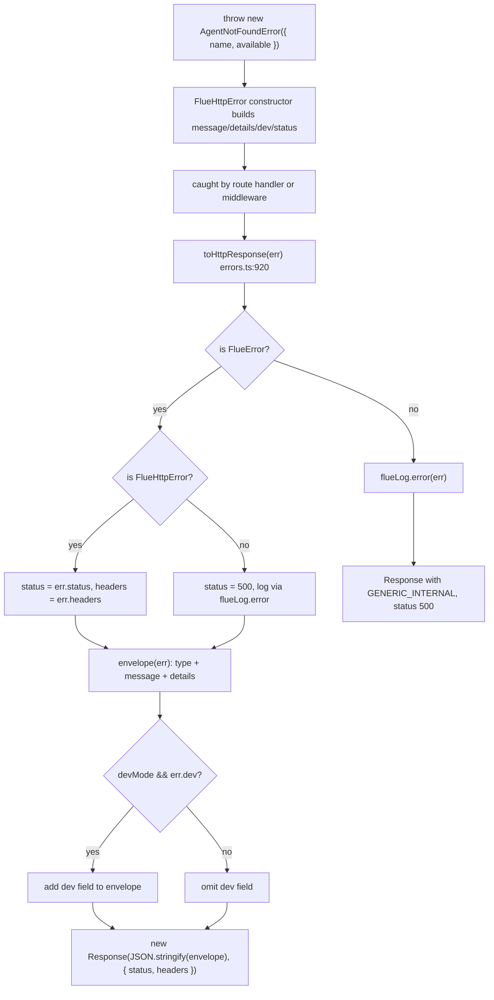
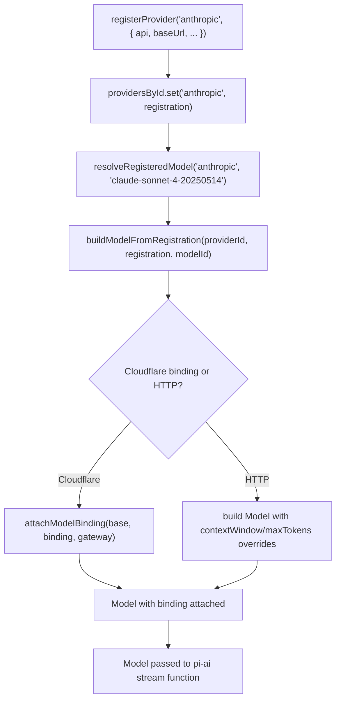
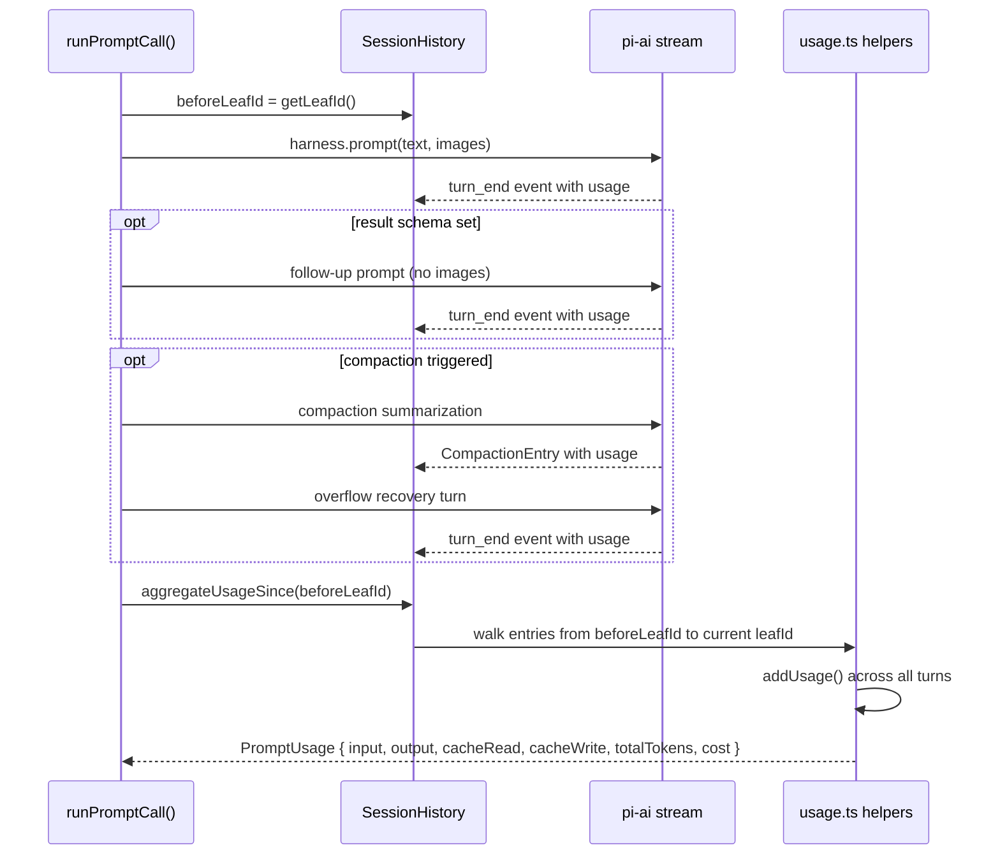

# Cross-Cutting Concerns: Errors, Provider Config, and Usage Tracking

Flue's cross-cutting infrastructure concentrates three critical systems into focused modules: error handling (`errors.ts`), provider configuration (`providers.ts`), and usage tracking (`usage.ts`). These systems span every layer of the runtime — from HTTP request parsing to LLM turn execution to cost aggregation — and share a common design principle: **consistency through discipline**. Each system establishes a pattern and enforces it by construction, so every call site follows the same rules without having to think about them.

**Related:** [14-structured-results](./14-structured-results.md) (structured output), [07-routing-http-websocket](./07-routing-http-websocket.md) (HTTP/WebSocket error envelopes), [03-harness-sessions](./03-harness-sessions.md) (session usage aggregation).

---

## Error Handling Framework: `FlueError` and `FlueHttpError`

Source: `packages/runtime/src/errors.ts` — entire file

Flue consolidates all error classes, utilities, and rendering logic in a single file (`errors.ts`). This is deliberate, not accidental. When all errors are visible together, three things happen:

1. **Message tone and detail level stay consistent** across the codebase.
2. **Duplicates are obvious** — you can see when two errors cover the same case.
3. **Norms emerge by example** — when adding a new error, you copy the pattern from the neighbor above.

The file header (`errors.ts:1-103`) documents the entire convention. Application code throughout the codebase reaches for one of the concrete error subclasses rather than constructing a `FlueError` ad hoc. If no existing class fits, you add one here. That is the entire convention.

```typescript
// packages/runtime/src/errors.ts:1-9 (file header)
/**
 * Complete error framework for Flue.
 *
 * This file contains both the error vocabulary (concrete error classes) and
 * the framework utilities (renderers, type guards, request parsing helpers).
 * Previously split across `errors.ts` and `error-utils.ts`, but consolidated
 * for better LLM comprehension.
 */
```

### The Two-Audience Pattern

The core design principle is that every Flue error serves two distinct audiences:

| Audience | Fields | Visibility | Purpose |
|---|---|---|---|
| **Caller** (HTTP client, possibly third-party or hostile) | `message`, `details` | Always rendered on wire | One-sentence summary + caller-safe explanation. Never leaks namespace, filesystem paths, or framework internals. |
| **Developer** (human running `flue dev` / `flue run`) | `dev` | Rendered only in local development mode | Everything that helps debug: available alternatives, filesystem layout, framework guidance, source-level fix instructions. |

The `FlueErrorOptions` interface (`errors.ts:120-168`) defines the shape:

```typescript
// packages/runtime/src/errors.ts:122-170
interface FlueErrorOptions {
    type: string;          // Stable machine-readable identifier (snake_case)
    message: string;       // One-sentence caller-safe summary, always rendered
    details: string;       // Caller-safe longer explanation, always rendered
    dev: string;           // Developer-only guidance, rendered only in dev mode
    meta?: Record<string, unknown>;  // Optional structured metadata
    cause?: unknown;       // Underlying error, logged server-side only
}
```

Both `details` and `dev` are **required** strings. Passing `''` is a deliberate "I have nothing for that audience" decision, not an oversight. The TypeScript compiler forces you to make that decision explicitly.

### Base Classes

`FlueError` (`errors.ts:180-196`) is the base class for every error Flue throws. It extends `Error` and carries the two-audience fields:

```typescript
// packages/runtime/src/errors.ts:180-196
class FlueError extends Error {
    readonly type: string;
    readonly details: string;
    readonly dev: string;
    readonly meta: Record<string, unknown> | undefined;
    override readonly cause: unknown;

    constructor(options: FlueErrorOptions) {
        super(options.message);
        this.name = 'FlueError';
        this.type = options.type;
        this.details = options.details;
        this.dev = options.dev;
        this.meta = options.meta;
        this.cause = options.cause;
    }
}
```

`FlueHttpError` (`errors.ts:210-220`) extends `FlueError` with HTTP semantics:

```typescript
// packages/runtime/src/errors.ts:210-220
class FlueHttpError extends FlueError {
    readonly status: number;
    readonly headers: Record<string, string> | undefined;

    constructor(options: FlueHttpErrorOptions) {
        super(options);
        this.name = 'FlueHttpError';
        this.status = options.status;
        this.headers = options.headers;
    }
}
```

### Concrete Error Vocabulary

The file defines concrete error subclasses, each owning its `type` constant, `status` code, and audience-specific prose. The **HTTP-layer** error vocabulary (all extend `FlueHttpError`):

| Error Class | Type | Status | Audience Split |
|---|---|---|---|
| `MethodNotAllowedError` | `method_not_allowed` | 405 | Caller: allowed methods. Dev: empty (nothing to add). Sets `Allow` header. |
| `UnsupportedMediaTypeError` | `unsupported_media_type` | 415 | Caller: received Content-Type, instructions to send JSON. Dev: empty. |
| `InvalidJsonError` | `invalid_json` | 400 | Caller: parse error details. Dev: empty. |
| `AgentNotFoundError` | `agent_not_found` | 404 | Caller: verify name. Dev: available agents + "agents/" directory mechanics. |
| `WorkflowNotFoundError` | `workflow_not_found` | 404 | Caller: verify name. Dev: available workflows + "workflows/" directory mechanics. Also handles non-HTTP workflows via `notHttp: true` constructor flag — same status 404 but different dev message ("built but not exposed over HTTP"). |
| `RouteNotFoundError` | `route_not_found` | 404 | Caller: "No route matches METHOD path". Dev: empty. |
| `RunNotFoundError` | `run_not_found` | 404 | Caller: verify run id. Dev: empty. |
| `StreamNotFoundError` | `stream_not_found` | 404 | Caller: event stream path. Dev: "Streams are created when agent instance receives first prompt or workflow run starts." |
| `RunStoreUnavailableError` | `run_store_unavailable` | 501 | Caller: requires run store config. Dev: empty. |
| `InvalidRequestError` | `invalid_request` | 400 | Caller: caller-provided reason. Dev: empty. |

Beyond the HTTP-layer errors, the file also defines these non-HTTP error classes (all extend `FlueError`, no `status` field): `PersistedSchemaVersionError`, `SandboxOperationUnsupportedError`, `SessionNotFoundError`, `SessionAlreadyExistsError`, `SessionBusyError`, `SessionDeletedError`, `SkillNotRegisteredError`, `ProviderRegistrationError`, `ModelNotConfiguredError`, `TaskDepthExceededError`, `SubagentNotDeclaredError`, `AttachmentNotAvailableError`, `ToolNameConflictError`, `ToolInputValidationError`, `OperationFailedError`, `SubmissionInterruptedError`, `SubmissionRetryExhaustedError`, `SubmissionTimeoutError`.

Example: `AgentNotFoundError` (`errors.ts:276-293`) demonstrates the structured-constructor pattern:

```typescript
// packages/runtime/src/errors.ts:276-293
class AgentNotFoundError extends FlueHttpError {
    constructor({ name, available }: { name: string; available: readonly string[] }) {
        super({
            type: 'agent_not_found',
            message: `Agent "${name}" is not registered.`,
            details: `Verify the agent name is correct.`,
            dev:
                `Available agents: ${formatList(available)}.\n` +
                `Agents are loaded from the project root's "agents/" directory at build time. ` +
                `Verify the agent file is present in the project root being served.`,
            status: 404,
        });
    }
}
```

Note the audience split: `details` says only "verify the agent name is correct" — safe for any caller, including hostile ones. `dev` enumerates available agents and explains the "agents/" directory mechanics — useful for the developer, but would leak namespace state to a public caller.

### Wire Envelope

The HTTP response body uses a canonical error envelope (`errors.ts:872-880`):

```json
{
    "error": {
        "type": "...",
        "message": "...",
        "details": "...",
        "dev": "...",
        "meta": {}
    }
}
```

The `envelope()` function (`errors.ts:888-905`) assembles this:

```typescript
// packages/runtime/src/errors.ts:888-905
function envelope(err: FlueError): WireEnvelope {
    const out: WireEnvelope = {
        error: {
            type: err.type,
            message: err.message,
            details: err.details,
        },
    };
    if (devMode && err.dev) out.error.dev = err.dev;
    if (err.meta) out.error.meta = err.meta;
    return out;
}
```

`dev` is included only when `devMode` is `true` (configured via `configureErrorRendering()`, `errors.ts:884-886`) **and** the error class actually populated `dev`. Some errors (`MethodNotAllowedError`, `InvalidJsonError`) intentionally set `dev: ''` — those render the same in dev and prod.

### `toHttpResponse()`: Rendering to Response

Source: `packages/runtime/src/errors.ts:920-950`

```typescript
// packages/runtime/src/errors.ts:920-950
export function toHttpResponse(err: unknown): Response {
    // Browser security headers (DS protocol §12.7) — set on every error
    // response so stream-endpoint errors thrown before the protocol layer
    // (e.g. run lookups) still carry them.
    const baseHeaders: Record<string, string> = {
        'content-type': 'application/json',
        'x-content-type-options': 'nosniff',
        'cross-origin-resource-policy': 'cross-origin',
    };
    if (isFlueError(err)) {
        const isHttp = err instanceof FlueHttpError;
        const status = isHttp ? err.status : 500;
        const headers = { ...baseHeaders };
        if (isHttp && err.headers) {
            Object.assign(headers, err.headers);
        }
        if (!isHttp) {
            flueLog.error(err);
        }
        return new Response(JSON.stringify(envelope(err)), { status, headers });
    }
    // Non-FlueError: log everything, leak nothing.
    flueLog.error(err);
    return new Response(JSON.stringify(GENERIC_INTERNAL), {
        status: 500,
        headers: baseHeaders,
    });
}
```

Non-FlueError values are logged in full and rendered as a generic 500 with no message leaked. The `GENERIC_INTERNAL` envelope (`errors.ts:907-913`) is the fallback:

```typescript
const GENERIC_INTERNAL: WireEnvelope = {
    error: {
        type: 'internal_error',
        message: 'An internal error occurred.',
        details: 'The server encountered an unexpected error while handling this request.',
    },
};
```

### Server-Side Logging

`flueLog.error()` (`errors.ts:866-870`) formats errors for server-side logs using `formatForLog()` (`errors.ts:838-864`), which shows **all** audience prose (message, details, dev) plus the cause stack. Mode gating applies only to the wire envelope — logs always show everything:

```typescript
// packages/runtime/src/errors.ts:866-870
const flueLog = {
    error(err: unknown): void {
        console.error(formatForLog('[flue]', err));
    },
};
```

The full rendering pipeline:



---

## Provider Configuration: `registerProvider()`

Source: `packages/runtime/src/runtime/providers.ts` — entire file

Flue's provider configuration system lets applications register model providers with endpoint settings (base URL, API key, headers) while preserving resolved model metadata (cost, context window, token limits) from pi-ai's catalog.

### `ProviderRegistration` and its two variants

Source: `packages/runtime/src/runtime/providers.ts:33`

```typescript
export type ProviderRegistration = HttpProviderRegistration | CloudflareAIBindingRegistration;
```

`HttpProviderRegistration` (`providers.ts:36-80`) carries endpoint settings:

```typescript
// packages/runtime/src/runtime/providers.ts:36-80
export interface HttpProviderRegistration {
    api?: Api;                        // Wire protocol (required for non-catalog providers)
    baseUrl?: string;                 // Endpoint root (required for non-catalog providers)
    apiKey?: string;                  // API key, propagated via getApiKey callback
    headers?: Record<string, string>; // Merged over catalog model's headers
    contextWindow?: number;           // Default context window for all models
    maxTokens?: number;               // Default max tokens for all models
    models?: Record<string, { contextWindow?: number; maxTokens?: number }>; // Per-model overrides
    storeResponses?: boolean;         // OpenAI Responses API persistence
}
```

`CloudflareAIBindingRegistration` (`providers.ts:83-100`) carries a Workers AI binding:

```typescript
// packages/runtime/src/runtime/providers.ts:83-100
export interface CloudflareAIBindingRegistration {
    api: typeof CLOUDFLARE_AI_BINDING_API;
    binding: CloudflareAIBinding;
    gateway?: CloudflareGatewayOptions | false;
}
```

### `registerProvider()` and the Provider Registry

Source: `packages/runtime/src/runtime/providers.ts:143-152`

```typescript
// packages/runtime/src/runtime/providers.ts:143-152
export function registerProvider(providerId: string, registration: ProviderRegistration): void {
    if (
        !isCloudflareBindingRegistration(registration) &&
        (registration.api === undefined || registration.baseUrl === undefined) &&
        getModels(providerId as KnownProvider).length === 0
    ) {
        throw new ProviderRegistrationError({ providerId });
    }
    providersById.set(providerId, registration);
}
```

The provider registry (`providersById`) is a module-scoped `Map`. Each call REPLACES the provider ID's previous registration; calls do not accumulate. Non-catalog provider IDs that omit `api` or `baseUrl` throw `ProviderRegistrationError`.

Additional registry helpers: `hasRegisteredProvider(providerId)`, `getRegisteredApiKey(providerId)`, `getRegisteredStoreResponses(providerId)`, and `resetProvidersForTests()`.

### Model Resolution from Registration

`buildModelFromRegistration()` (`providers.ts:263-314`) constructs a pi-ai `Model` from a provider registration. For Cloudflare binding registrations, it attaches the binding via `attachModelBinding()` so it flows through to the Workers AI stream function without going through `AsyncLocalStorage`:

```typescript
// packages/runtime/src/runtime/providers.ts:268-281
if (isCloudflareBindingRegistration(registration)) {
    const catalog = getModel('cloudflare-workers-ai' as KnownProvider, modelId as never);
    const base: Model<Api> = catalog
        ? { ...catalog, api: CLOUDFLARE_AI_BINDING_API, provider: providerId, baseUrl: '' }
        : zeroMetadataModel(providerId, modelId, CLOUDFLARE_AI_BINDING_API, '');
    const gateway =
        registration.gateway === false ? undefined : (registration.gateway ?? { id: 'default' });
    return attachModelBinding(base, registration.binding, gateway);
}
```

For HTTP registrations, the context window and max tokens follow per-model overrides falling back to registration-level defaults, then to catalog values:

```typescript
// packages/runtime/src/runtime/providers.ts:307-312
contextWindow:
    registration.models?.[modelId]?.contextWindow ??
    registration.contextWindow ??
    base.contextWindow,
maxTokens:
    registration.models?.[modelId]?.maxTokens ?? registration.maxTokens ?? base.maxTokens,
```

The full provider configuration flow:



---

## `getModelBinding()` and `getModelGateway()`

Source: `packages/runtime/src/runtime/providers.ts:220-242`

When you use a model prefixed with `cloudflare/` (e.g., `cloudflare/@cf/meta/llama-3.1-8b-instruct`), the resolved Model carries the binding attachment from `attachModelBinding()`, and the stream function reads it via `getModelBinding()` (`providers.ts:220-228`):

```typescript
// packages/runtime/src/runtime/providers.ts:220-228
export function getModelBinding<TApi extends Api>(
    model: Model<TApi>,
): CloudflareAIBinding | undefined {
    const candidate = (model as Model<TApi> & { binding?: unknown }).binding;
    if (!candidate || typeof (candidate as { run?: unknown }).run !== 'function') {
        return undefined;
    }
    return candidate as CloudflareAIBinding;
}
```

This is duck-typed detection — no type import on `CloudflareAIBinding`, just checking for a `run` method. The binding must have a `run` function matching the `CloudflareAIBinding` interface (`providers.ts:21-27`):

```typescript
// packages/runtime/src/runtime/providers.ts:21-27
export interface CloudflareAIBinding {
    run(
        modelId: string,
        inputs: Record<string, unknown>,
        options?: Record<string, unknown>,
    ): Promise<Response | Record<string, unknown>>;
}
```

`getModelGateway()` (`providers.ts:234-242`) similarly reads AI Gateway options off a resolved Model:

```typescript
export function getModelGateway<TApi extends Api>(
    model: Model<TApi>,
): CloudflareGatewayOptions | undefined {
    const candidate = (model as Model<TApi> & { gateway?: unknown }).gateway;
    if (!candidate || typeof (candidate as { id?: unknown }).id !== 'string') {
        return undefined;
    }
    return candidate as CloudflareGatewayOptions;
}
```

---

## Usage Tracking: `PromptUsage`

Source: `packages/runtime/src/types.ts:623-636` and `packages/runtime/src/usage.ts`

`PromptUsage` aggregates token and cost usage across every LLM call dispatched by a single `prompt()`, `skill()`, or `task()` invocation. This includes:

- Every assistant turn produced by the call
- Any result-extraction retry triggered by `result:` callers
- Any compaction summarization (1-2 internal calls) triggered when context approached the model's window
- The post-compaction retry assistant turn for overflow recovery

### `PromptUsage` Interface

Source: `packages/runtime/src/types.ts:623-636`

```typescript
// packages/runtime/src/types.ts:623-636
export interface PromptUsage {
    input: number;
    output: number;
    cacheRead: number;
    cacheWrite: number;
    totalTokens: number;
    cost: {
        input: number;
        output: number;
        cacheRead: number;
        cacheWrite: number;
        total: number;
    };
}
```

The `cost` field is computed by pi-ai as `(model.cost.X / 1_000_000) * usage.X`, where `model.cost.X` is the per-million-token rate from the model's cost table. The currency of `cost` therefore matches whatever unit that rate is denominated in. For pi-ai's built-in model registry, the rates mirror each provider's published pricing (USD for the major commercial providers). Custom-registered models or proxied endpoints may use other units.

### Usage Helpers

Source: `packages/runtime/src/usage.ts`

Three utility functions aggregate and convert usage:

```typescript
// packages/runtime/src/usage.ts:15-24
export function emptyUsage(): PromptUsage {
    return {
        input: 0,
        output: 0,
        cacheRead: 0,
        cacheWrite: 0,
        totalTokens: 0,
        cost: { input: 0, output: 0, cacheRead: 0, cacheWrite: 0, total: 0 },
    };
}
```

`addUsage()` (`usage.ts:30-45`) performs field-wise summation, including the nested `cost` sub-object:

```typescript
// packages/runtime/src/usage.ts:30-45
export function addUsage(a: PromptUsage, b: PromptUsage): PromptUsage {
    return {
        input: a.input + b.input,
        output: a.output + b.output,
        cacheRead: a.cacheRead + b.cacheRead,
        cacheWrite: a.cacheWrite + b.cacheWrite,
        totalTokens: a.totalTokens + b.totalTokens,
        cost: {
            input: a.cost.input + b.cost.input,
            output: a.cost.output + b.cost.output,
            cacheRead: a.cost.cacheRead + b.cost.cacheRead,
            cacheWrite: a.cost.cacheWrite + b.cost.cacheWrite,
            total: a.cost.total + b.cost.total,
        },
    };
}
```

`fromProviderUsage()` (`usage.ts:54-70`) converts pi-ai's `Usage` into Flue's public `PromptUsage`. The shapes are structurally identical today, but this normalizer keeps Flue's public types decoupled from pi-ai's so future divergence in pi-ai doesn't leak into the runtime package's public surface:

```typescript
// packages/runtime/src/usage.ts:54-70
export function fromProviderUsage(usage: Usage | undefined): PromptUsage | undefined {
    if (!usage) return undefined;
    return {
        input: usage.input,
        output: usage.output,
        cacheRead: usage.cacheRead,
        cacheWrite: usage.cacheWrite,
        totalTokens: usage.totalTokens,
        cost: {
            input: usage.cost.input,
            output: usage.cost.output,
            cacheRead: usage.cost.cacheRead,
            cacheWrite: usage.cost.cacheWrite,
            total: usage.cost.total,
        },
    };
}
```

### Usage Aggregation in `runPromptCall()`

Source: `packages/runtime/src/session.ts:2110-2126`

Usage is aggregated via `this.aggregateUsageSince(beforeLeafId)` which walks the session history from the recorded `leafId` to the current `leafId`, summing usage across all turns that occurred during the call:

```typescript
// packages/runtime/src/session.ts:2110-2126
const beforeLeafId = this.history.getLeafId();
// ... run the call ...
return {
    data: result,
    usage: this.aggregateUsageSince(beforeLeafId),
    model,
};
```

This aggregation captures every turn that happened during the call, including result-tool retries and compaction. The `leafId` mechanism works because `SessionHistory` uses parent-linked entries — every new turn is appended as a child of the current leaf, and `leafId` tracks the current end of the chain.

The usage aggregation flow:



---

## Aha Moments

**Aha: The error framework consolidates all errors in one file (`errors.ts`) so duplicates are visible and consistent patterns emerge by example.** This is a deliberate design choice, not an organizational accident. The file header (`errors.ts:1-103`) documents the entire convention, and the comment block explicitly states: "Concentrating every error in one file is deliberate. When all errors are visible together, it's easy to keep message tone and detail level consistent, notice duplicates, and establish norms by example." New errors follow the structured-constructor pattern — the class owns its `type` constant and `status` code, call sites never invent phrasing or pick HTTP status codes ad hoc.

**Aha: `PromptUsage.cost` is computed by pi-ai as `(model.cost.X / 1_000_000) * usage.X` — the currency matches whatever the model's cost table uses.** This means cost figures are in whatever unit the model registry defines (typically USD for commercial providers), but custom-registered models or proxied endpoints may use other units. The `fromProviderUsage()` normalizer (`usage.ts:54`) structurally copies the cost fields without transformation — it does not normalize currency. If you aggregate usage across providers with different cost tables, the `cost.total` may mix units.

**Aha: `registerProvider` settings layer transport facts over catalog metadata without losing cost/context-window/token-limit data.** For catalog provider IDs (e.g., `'anthropic'`), `registerProvider` preserves the catalog's cost table, context window, and wire protocol while overriding the endpoint, API key, or headers. Non-catalog provider IDs must supply `api` and `baseUrl` or throw `ProviderRegistrationError`. Per-model overrides (`registration.models[modelId]`) take precedence over registration-level defaults (`registration.contextWindow`), which in turn take precedence over catalog values.

---

## `PromptModel` and `PromptResponse` / `PromptResultResponse`

Source: `packages/runtime/src/types.ts:644-665`

These types tie together the model selection and usage tracking:

```typescript
// packages/runtime/src/types.ts:644-665
export interface PromptModel {
    provider: string;
    id: string;
}

export interface PromptResponse {
    text: string;
    usage: PromptUsage;
    model: PromptModel;
}

export interface PromptResultResponse<T> {
    data: T;
    usage: PromptUsage;
    model: PromptModel;
}
```

Every call returns both `usage` (tokens and cost) and `model` (which provider and model ID served the call). This is useful for cost tracking and debugging — you can log which model served each call and how much it cost.

---

## Next

See [14-structured-results](./14-structured-results.md) for how `ResultUnavailableError` integrates with the result-tool retry loop. See [07-routing-http-websocket](./07-routing-http-websocket.md) for how error envelopes flow through HTTP and WebSocket transports. See [12-observability](./12-observability.md) for the `FlueEvent` system that carries usage data through the event stream.
