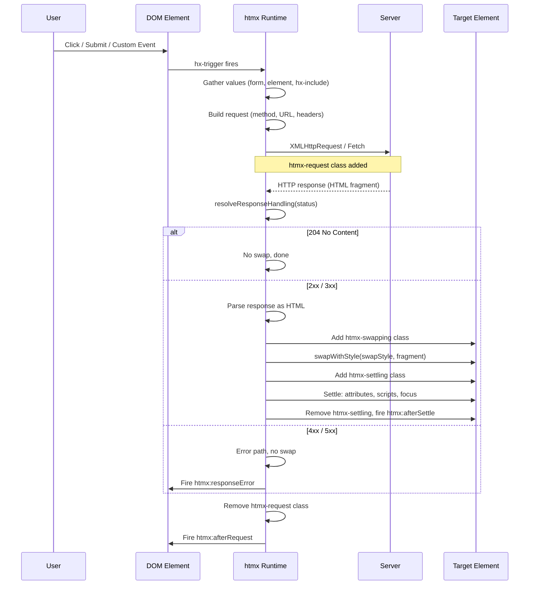

# HTMX Ecosystem Overview

htmx is a 5342-line JavaScript library that enables hypermedia-driven web development using HTML attributes instead of JavaScript frameworks. It replaces React, Vue, and Angular for most CRUD applications by moving application complexity to the server, where it belongs.

The htmx ecosystem exists because JSON APIs and client-side rendering introduced unnecessary complexity into web development. Instead of building UI in JavaScript by sending JSON to a browser and re-rendering, htmx lets the server return HTML fragments directly in response to user actions. You add behavior to HTML elements with attributes like `hx-get`, `hx-post`, and `hx-swap`. No component trees, no virtual DOM diffing, no state management libraries. Just HTML, over HTTP, with the server doing what servers do best: render.

This document explains the htmx ecosystem and its projects. It covers how a request flows through htmx from trigger to settled DOM.

---

## The Philosophy: HTML Over JSON

The core idea behind htmx is **hypermedia-driven development**. Hypermedia means the server sends complete UI representations (HTML) rather than raw data (JSON) that the client must interpret and render. This inverts the modern SPA pattern:

- **SPA pattern:** Client JavaScript sends a request, receives JSON, maps JSON to components, re-renders the virtual DOM, patches the real DOM, manages local state, handles routing client-side.
- **Hypermedia pattern:** Browser sends a request, receives HTML, swaps the HTML into the DOM. The server owns the UI logic. The browser owns the presentation.

htmx puts this philosophy into practice through **attributes as behavior**. You do not write JavaScript to make AJAX calls. You write:

```html
<button hx-post="/items/delete" hx-target="#item-list" hx-confirm="Delete this item?">
  Delete
</button>
```

The browser handles the click, htmx intercepts it, makes the POST request, receives HTML back, and swaps the content of `#item-list` with the response. Zero JavaScript. The behavior lives in attributes.

This approach works because HTML was designed as a hypermedia format. The `href` attribute on an anchor tag already describes a navigation action. htmx extends this model further. Any element can trigger any HTTP method. Methods include `GET`, `POST`, `PUT`, `PATCH`, and `DELETE`. The response can swap into any element on the page. Any swap style works.

### Why Attributes, Not Functions

The attribute-driven approach is deliberate. It means behavior is **declarative** (you describe what should happen, not how) and **co-located** with the markup it affects. You do not need to hunt through a JavaScript file to find what a button does. The behavior is on the element itself. This also means server-side templating languages can emit fully interactive UI without any client-side code generation.

---

## Ecosystem Architecture

The htmx ecosystem is not a single project. It is a family of tools built around a central hypermedia runtime, each solving a specific concern.

```mermaid
flowchart TB
    subgraph Core["Core Runtime"]
        htmx["htmx.js\n(5342 lines, v2.0.10)\nHypermedia AJAX engine"]
    end

    subgraph Scripting["Client Scripting"]
        hs["_hyperscript.js\n(10526 lines, v0.9.93)\nEvent-driven scripting DSL"]
    end

    subgraph Morphing["DOM Morphing"]
        idi["idiomorph.js\n(1390 lines, v0.7.4)\nID-based DOM diff/patch"]
    end

    subgraph Extensions["htmx Extensions (23 built-in)"]
        ext["sse, ws, json-enc,\npath-deps, class-tools,\npreload, morphdom-swap,\n+ 16 more"]
    end

    subgraph Predecessor["Predecessor"]
        ic["Intercooler.js\n(v1.2.4, 2084 lines, MIT)\nOriginal attribute-AJAX lib"]
    end

    subgraph Lightweight["Lightweight Variants"]
        fixi["fixi.js (90 lines)\nMinimal fixed-content AJAX"]
        moxi["moxi.js (110 lines)\nMobile-first htmx subset"]
        rexi["rexi.js (115 lines)\nResponsive htmx variant"]
        ssexi["ssexi.js (89 lines)\nServer-sent events focus"]
    end

    subgraph Styling["Styling"]
        miss["missing.css\n(v1.3.0, classless CSS)\nBaseline styling for htmx"]
    end

    ic -. "inspired" .-> htmx
    htmx --> ext
    htmx -. "uses for" .-> idi
    htmx -. "pairs with" .-> hs
    htmx -. "styled by" .-> miss
    htmx -. "minimal variants" .-> Lightweight

    classDef core fill:#2563eb,color:#fff
    classDef scripting fill:#7c3aed,color:#fff
    classDef morph fill:#059669,color:#fff
    classDef ext fill:#d97706,color:#fff
    classDef pred fill:#6b7280,color:#fff
    classDef light fill:#dc2626,color:#fff
    classDef style fill:#0891b2,color:#fff

    class htmx core
    class hs scripting
    class idi morph
    class ext ext
    class ic pred
    class fixi,moxi,rexi,ssexi light
    class miss style
```

**htmx.js** is the core runtime. It handles AJAX requests, response parsing, DOM swapping, history management, events, and extension loading. It is 5342 lines, version 2.0.10, licensed under 0BSD (public-domain-equivalent, no attribution required).

**_hyperscript** is a small scripting language designed to complement htmx when attributes are not enough. It provides event handling, DOM manipulation, transitions, and flow control in a readable syntax that embeds directly in HTML attributes. At 10526 lines, it is larger than htmx itself, reflecting the complexity of a general-purpose scripting language versus a focused AJAX engine.

**idiomorph** is a 1390-line DOM morphing library. It diff-and-patches two HTML fragments by element ID, preserving focus, animation state, and scroll position across swaps. It is the algorithmic alternative to htmx's built-in swap styles.

**23 built-in extensions** ship with htmx in `dist/ext/`. They add SSE/WebSocket support, JSON encoding, head tag merging, class management, path-based dependencies, preloading, and more.

**Intercooler.js** is the predecessor. Version 1.2.4, MIT licensed, it proved the attribute-driven AJAX concept. htmx is its spiritual successor with a cleaner API, better swap semantics, and the extension system.

**fixi, moxi, rexi, ssexi** are four lightweight variants. Each is under 120 lines of JavaScript. They prove that the core hypermedia pattern works at extreme minimalism, each optimized for a specific constraint (fixed content, mobile, responsive layouts, or server-sent events).

**missing.css** is the styling layer. At version 1.3.0, it is a classless CSS library that provides sensible defaults so htmx-powered pages look good without writing custom CSS classes.

---

## htmx Request Lifecycle

Every htmx interaction follows the same five-stage lifecycle: trigger, request, response, swap, settle. Understanding this lifecycle is the key to understanding htmx.



### Stage 1: Trigger

A user action (click, submit, keyup) or a custom event fires on an element with an htmx attribute like `hx-get`. The trigger can be the element's native event, a custom selector via `hx-trigger`, or a programmatically fired event via `htmx.trigger()`.

### Stage 2: Request

htmx gathers input values from the triggering element and its enclosing form. It builds the HTTP request with the method specified by the attribute (`hx-get`, `hx-post`, etc.) and the target URL. It adds the `htmx-request` class to the triggering element, which you can use to show a loading indicator.

### Stage 3: Response

The server returns an HTML fragment. htmx resolves the response handling configuration to decide what to do:

Source: `htmx/dist/htmx.js:264-268`

```javascript
responseHandling: [
  { code: '204', swap: false },
  { code: '[23]..', swap: true },
  { code: '[45]..', swap: false, error: true }
]
```

A 204 means "no content" and triggers no swap. 2xx and 3xx codes trigger a swap. 4xx and 5xx codes are errors and do not swap. The regex-based matching (`[23]..` matches any 3-digit code starting with 2 or 3) means you can add custom response handling rules for edge cases.

### Stage 4: Swap

The `swapWithStyle` function routes the HTML fragment into the DOM based on the swap style specified by `hx-swap` (or `defaultSwapStyle` which is `innerHTML`):

Source: `htmx/dist/htmx.js:1799-1848`

```javascript
function swapWithStyle(swapStyle, elt, target, fragment, settleInfo) {
  switch (swapStyle) {
    case 'none':
      return
    case 'outerHTML':
      swapOuterHTML(target, fragment, settleInfo)
      return
    case 'afterbegin':
      swapAfterBegin(target, fragment, settleInfo)
      return
    case 'beforebegin':
      swapBeforeBegin(target, fragment, settleInfo)
      return
    case 'beforeend':
      swapBeforeEnd(target, fragment, settleInfo)
      return
    case 'afterend':
      swapAfterEnd(target, fragment, settleInfo)
      return
    case 'delete':
      swapDelete(target)
      return
    default:
      // Extensions get first chance at unknown swap styles
      var extensions = getExtensions(elt)
      for (let i = 0; i < extensions.length; i++) {
        const ext = extensions[i]
        const newElements = ext.handleSwap(swapStyle, target, fragment, settleInfo)
        // ...extension handling
      }
      if (swapStyle === 'innerHTML') {
        swapInnerHTML(target, fragment, settleInfo)
      } else {
        swapWithStyle(htmx.config.defaultSwapStyle, elt, target, fragment, settleInfo)
      }
  }
}
```

The nine swap styles are: `none`, `innerHTML`, `outerHTML`, `afterbegin`, `beforebegin`, `beforeend`, `afterend`, `delete`, and `textContent`. The `delete` style removes the target element entirely. The `none` style makes the request but performs no DOM change, useful for triggering side effects. The `textContent` style sets the target's text content without parsing HTML, handled separately in the `swap` function rather than `swapWithStyle`.

Unknown swap styles are offered to extensions first. This is how `morphdom-swap` and `idiomorph-swap` work: they register as extensions that handle their own swap style name. If no extension claims it, the default (`innerHTML`) is used.

### Stage 5: Settle

After the swap completes, htmx enters the settling phase. During settlement, htmx:

1. Adds the `htmx-settling` class to the target element.
2. Processes any `<script>` tags in the swapped content (if `allowScriptTags` is true).
3. Reconciles attributes listed in `attributesToSettle` (default: `['class', 'style', 'width', 'height']`).
4. Fires the `htmx:afterSettle` event.
5. Removes the `htmx-settling` class.

The settle delay defaults to 20ms (`defaultSettleDelay`). This brief pause lets CSS transitions on the swapped content complete before htmx touches the attributes again.

---

## Public API Surface

The entire public API is defined on a single `htmx` object. The API is small by design because htmx's primary interface is HTML attributes, not JavaScript function calls.

Source: `htmx/dist/htmx.js:5-300`

```javascript
const htmx = {
  // Event processing
  onLoad: null,        // Register callback for when htmx loads new content
  process: null,       // Process htmx attributes on a subtree
  on: null,            // Add event listener (delegated)
  off: null,           // Remove event listener
  trigger: null,       // Fire a custom event on an element
  ajax: null,          // Programmatic AJAX call

  // DOM querying
  find: null,          // Query selector within an element
  findAll: null,       // Query selector all within an element
  closest: null,       // Find closest ancestor matching selector

  // Value resolution
  values: null,        // Get resolved input values for an element

  // DOM manipulation
  remove: null,        // Remove an element from the DOM
  addClass: null,      // Add a class to an element
  removeClass: null,   // Remove a class from an element
  toggleClass: null,   // Toggle a class on an element
  takeClass: null,     // Take a class from siblings
  swap: null,          // Programmatic content swap

  // Extensions
  defineExtension: null,
  removeExtension: null,

  // Debugging
  logAll: null,
  logNone: null,
  logger: null,

  // Configuration (30+ options)
  config: {
    historyEnabled: true,
    historyCacheSize: 10,
    defaultSwapStyle: 'innerHTML',
    defaultSwapDelay: 0,
    defaultSettleDelay: 20,
    includeIndicatorStyles: true,
    indicatorClass: 'htmx-indicator',
    requestClass: 'htmx-request',
    addedClass: 'htmx-added',
    settlingClass: 'htmx-settling',
    swappingClass: 'htmx-swapping',
    allowEval: true,
    allowScriptTags: true,
    attributesToSettle: ['class', 'style', 'width', 'height'],
    withCredentials: false,
    timeout: 0,
    wsReconnectDelay: 'full-jitter',
    selfRequestsOnly: true,
    // ... and more
  },

  // Utilities
  parseInterval: null, // Parse CSS-style time intervals ("1.5s" -> 1500)
  location,            // Proxy of window.location
  _: null,             // Internal eval proxy (hyperscript integration)
  version: '2.0.10'
}
```

The API is deliberately small. Most htmx applications never call these functions directly. They are escape hatches for when you need to integrate with non-htmx code, initialize dynamically-added content, or build extensions.

---

## Configuration: 30+ Knobs

htmx's `config` object has over thirty options. Most applications never need to change them, but they exist for the cases where you do.

| Category | Key Options | Defaults |
|----------|------------|----------|
| History | `historyEnabled`, `historyCacheSize` | `true`, `10` |
| Swap behavior | `defaultSwapStyle`, `defaultSwapDelay`, `defaultSettleDelay` | `'innerHTML'`, `0`, `20` |
| Indicator classes | `indicatorClass`, `requestClass`, `addedClass`, `settlingClass`, `swappingClass` | `'htmx-indicator'`, `'htmx-request'`, `'htmx-added'`, `'htmx-settling'`, `'htmx-swapping'` |
| Security | `allowEval`, `allowScriptTags`, `selfRequestsOnly`, `withCredentials` | `true`, `true`, `true`, `false` |
| Settle attributes | `attributesToSettle` | `['class', 'style', 'width', 'height']` |
| Network | `timeout`, `wsReconnectDelay`, `wsBinaryType` | `0`, `'full-jitter'`, `'blob'` |
| Styling | `includeIndicatorStyles` | `true` |
| Scroll/focus | `scrollBehavior`, `scrollIntoViewOnAdd`, `defaultFocusScroll` | `'instant'`, `true`, `false` |
| Response handling | `responseHandling` array | 204=no swap, 2xx/3xx=swap, 4xx/5xx=error |

The `responseHandling` array is particularly powerful. You can add custom handlers for specific status codes or patterns. For example, to treat a 422 Unprocessable Entity as a swap (useful for returning validation errors from the server):

```javascript
htmx.config.responseHandling.push({ code: '422', swap: true })
```

The `selfRequestsOnly: true` default prevents htmx from making cross-origin requests. This is a security measure. Set it to `false` if your application legitimately needs to fetch from other origins.

---

## Quick Start

### Minimal Example: A Button That Loads Content

```html
<!DOCTYPE html>
<html>
<head>
  <script src="htmx.min.js"></script>
</head>
<body>
  <div id="result">Click the button to load content</div>
  <button hx-get="/api/content" hx-target="#result" hx-indicator=".spinner">
    Load Content
  </button>
  <div class="spinner htmx-indicator">Loading...</div>
</body>
</html>
```

The `hx-indicator` and `htmx-indicator` class work together. htmx adds `htmx-request` to the triggering element during the request. The indicator CSS hides the spinner unless the `htmx-request` class is present somewhere in the ancestor chain.

### Form Submission

```html
<form hx-post="/items" hx-target="#item-list" hx-swap="afterbegin">
  <input name="name" required>
  <button type="submit">Add Item</button>
</form>
<ul id="item-list"></ul>
```

The server receives the POST with form data and returns an `<li>` element. htmx inserts it at the beginning of the list via `afterbegin`.

### Delete with Confirmation

```html
<button hx-delete="/items/42"
        hx-target="#item-42"
        hx-swap="outerHTML"
        hx-confirm="Are you sure?">
  Delete Item 42
</button>
```

The `hx-confirm` uses the browser's native `confirm()` dialog. The `delete` swap style could also be used to remove the element entirely without a server response.

---

## When to Use Which Project

| Project | Use When | Lines | Lines |
|---------|----------|-------|-------|
| **htmx** | You need full hypermedia AJAX with extensions, history, and all swap styles | 5342 | Always start here |
| **_hyperscript** | You need client-side event orchestration, DOM transitions, or logic that attributes alone cannot express | 10526 | Add alongside htmx when `hx-on:` is not enough |
| **idiomorph** | You need smooth DOM morphing (preserving focus, animations, input state) during swaps | 1390 | Use as swap strategy via `hx-swap="morph:idiomorph"` |
| **missing.css** | You want decent-looking pages without writing custom CSS | N/A | Drop into any htmx project for baseline styling |
| **fixi** | You need the absolute minimum: fixed-content AJAX with no extensions, no history | 90 | Embedded systems, single-purpose widgets |
| **moxi** | You target mobile-first with reduced feature set | 110 | Progressive enhancement on constrained devices |
| **rexi** | You need responsive htmx behavior | 115 | Layouts that adapt swap targets to viewport |
| **ssexi** | Your app is primarily server-sent events driven | 89 | Real-time dashboards, live feeds |
| **Intercooler** | You maintain a legacy codebase written before htmx existed | N/A | Migration path, not new development |

The decision tree is simple: start with htmx. If you need scripting, add hyperscript. If you need smooth transitions, add idiomorph. If you need baseline styling, add missing.css. The lightweight variants are for when htmx is too much for your constraint.

---

## Cross-Cutting Concepts

### Events as the Glue

htmx does not just make AJAX calls. It is an event system. Every stage of the request lifecycle fires events. Events include `htmx:configRequest`, `htmx:beforeRequest`, `htmx:afterRequest`, `htmx:afterSettle`, and `htmx:responseError`. You can listen with `htmx.on()` or `hx-on:` attributes. This event-driven architecture enables extensions and custom behavior.

### Out-of-Band Swaps

A single htmx response can update multiple elements. Elements with `hx-swap-oob="true"` are swapped into their matching targets. This happens regardless of the primary swap target. A server can update a toast notification, a counter, and the main content area in one response.

### History Management

htmx manages browser history automatically. Each `hx-get`/`hx-post` that targets an element with a URL can push a history entry. The history cache stores the last 10 pages (`historyCacheSize: 10`) in `sessionStorage`. The back and forward buttons trigger the `htmx:historyRestore` event, and htmx restores the cached content. This gives SPA-like navigation without client-side routing.

---

## Aha Moment

The entire htmx library is 5342 lines and replaces the need for React, Vue, or Angular for most CRUD applications by moving complexity to the server where it belongs. A 5342-line library that does the job of a 40,000+ line framework is possible because htmx does not try to rebuild the UI from JSON data in the browser. It lets the server send finished HTML and swaps it in. The complexity of state management, component lifecycle, and rendering logic stays on the server in whatever language you already use. The browser's job is to display HTML and send requests. This is what the web was designed to do.

The request handling config at lines 264-268 reveals another insight: htmx uses **regex-based status code matching** rather than hardcoded ranges. The pattern `[23]..` matches any code starting with 2 or 3. This means you can add a custom rule for any status code pattern without modifying htmx itself. The config array is user-extensible, not a fixed enum.

---

## Source File Map

| File | Description | Lines |
|------|-------------|-------|
| `htmx/dist/htmx.js` | Main htmx library (development) | 5342 |
| `htmx/dist/htmx.min.js` | Minified production build | ~51KB |
| `htmx/dist/htmx.esm.js` | ES module build | Same API |
| `htmx/dist/htmx.cjs.js` | CommonJS build | Same API |
| `htmx/dist/htmx.amd.js` | AMD module build | Same API |
| `htmx/dist/htmx.esm.d.ts` | TypeScript type definitions | 7688 bytes |
| `htmx/package.json` | Package metadata, v2.0.10, 0BSD license | N/A |
| `htmx/dist/ext/*.js` | 23 built-in extensions | Varies |
| `_hyperscript/dist/_hyperscript.js` | Hyperscript scripting language | 10526 |
| `idiomorph/dist/idiomorph.js` | DOM morphing library | 1390 |
| `intercooler-js/dist/intercooler.js` | Predecessor library (v1.2.4) | N/A |
| `fixi/fixi.js` | Minimal AJAX variant | 90 |
| `moxi/moxi.js` | Mobile-first variant | 110 |
| `rexi/rexi.js` | Responsive variant | 115 |
| `ssexi/ssexi.js` | SSE-focused variant | 89 |
| `missing/dist/missing.min.css` | Classless CSS library (v1.3.0) | N/A |

---

## Related Documents

- [htmx Core](01-htmx-core.md) -- Deep dive into htmx internals: request pipeline, event system, attribute parsing
- [_hyperscript](02-hyperscript.md) -- The client-side scripting language for htmx
- [idiomorph](03-idiomorph.md) -- ID-based DOM morphing for smooth swaps
- [Intercooler.js](04-intercooler.md) -- The predecessor: attribute-driven AJAX before htmx
- [fixi/moxi/rexi/ssexi](05-fixi-family.md) -- Lightweight variants under 120 lines each
- [missing.css](06-missing-css.md) -- Classless CSS styling for hypermedia pages
- [Cross-Cutting Concerns](07-cross-cutting.md) -- Events, extensions, security, testing patterns
