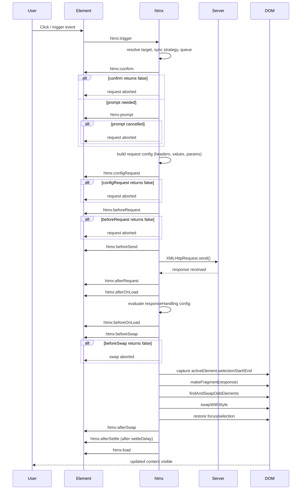
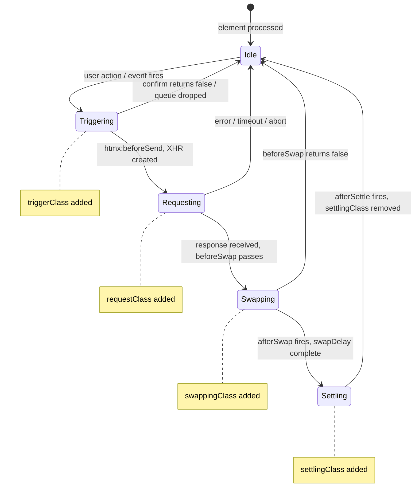

# htmx Core — Deep Dive

htmx adds AJAX, CSS transitions, WebSockets, Server-Sent Events, and server-driven DOM updates to HTML via attributes — no JavaScript framework required. Every interaction begins as an HTML attribute like `hx-get="/api/data"` and flows through a deterministic pipeline: trigger detection, attribute inheritance, request dispatch, response handling, DOM swap, and attribute settling. The entire library ships as a single ~5300-line IIFE (`htmx/dist/htmx.js`, version `2.0.10`) with zero dependencies. This document walks every layer of that pipeline, every configuration knob, and every extension point.

Related: [00-overview.md](00-overview.md) for the project landscape, [02-hyperscript.md](02-hyperscript.md) for the scripting companion, [03-idiomorph.md](03-idiomorph.md) for morphdom swap extensions, [05-fixi-family.md](05-fixi-family.md) for the broader ecosystem, and [07-cross-cutting.md](07-cross-cutting.md) for patterns that span all documents.

---

## 1. Public API Surface

Source: `htmx/dist/htmx.js:5-60` — the public API object definition, with assignments at lines 302-322.

The entire public API is a single object with 26 properties. Each property is assigned to an internal function at module load time (lines 302-322). The object shape is:

```javascript
// htmx/dist/htmx.js:5-60 — public API object shape
const htmx = {
    /* Event processing */
    onLoad: null,           // (callback) => void — fires on htmx:load
    process: null,          // (elt: Element) => void — processes a DOM node
    on: null,               // (target, event, selector?, handler) => void — event listener
    off: null,              // (target, event, handler) => void — remove listener
    trigger: null,          // (elt, eventName, detail?) => boolean — dispatch custom event
    ajax: null,             // (verb, path, context | opts) => void — programmatic AJAX
    /* DOM querying */
    find: null,             // (selector, from?) => Element
    findAll: null,          // (selector, from?) => NodeList
    closest: null,          // (elt, selector) => Element
    values: function(elt, type) { … },  // resolves htmx input values for an element
    /* DOM manipulation */
    remove: null,           // (elt, delay?) => void
    addClass: null,         // (elt, cls, delay?) => void
    removeClass: null,      // (elt, cls, delay?) => void
    toggleClass: null,      // (elt, cls, delay?) => void
    takeClass: null,        // (elt, cls) => void — removes siblings' matching class
    swap: null,             // (target, content, swapSpec, opts?) => void
    /* Extensions */
    defineExtension: null,  // (name, extension) => void
    removeExtension: null,  // (name) => void
    /* Debugging */
    logAll: null,           // enable full logging
    logNone: null,          // disable all logging
    logger: null,           // custom logger function
    config: { … },          // runtime configuration (30+ options)
    parseInterval: null,    // (str) => number — parse "30s", "500ms", etc.
    location,               // proxy of window.location
    _: null,                // internalEval — evaluate hyperscript expressions
    version: '2.0.10'
}
```

Key behavioral notes:

- `htmx.onLoad(callback)` registers for `htmx:load` events. Fires after every DOM swap, not just initial page load. This is how third-party libraries reinitialize on new content.
- `htmx.process(elt)` walks a subtree and applies htmx attribute processing to any unprocessed elements. Call this after manually inserting htmx-enhanced content.
- `htmx.ajax(verb, path, opts)` is the programmatic entry point. Accepts `{ target, select, swap, source, event, handler, values, headers, selectOOB, swapOverride }` as options.
- `htmx.values(elt, type)` returns the input values htmx would include in a request. The `type` parameter (`'get'` or `'post'`) controls whether the enclosing form's values are included.
- `htmx.takeClass(elt, cls)` adds `cls` to `elt` and removes it from all siblings. Useful for tab-like UI patterns.

---

## 2. Configuration System

Source: `htmx/dist/htmx.js:77-289` — the `htmx.config` object with all 30+ defaults.

Configuration lives in a single mutable object. Every option has a JSDoc type and default value. The table below lists every option:

| Option | Type | Default | Purpose |
|---|---|---|---|
| `historyEnabled` | `boolean` | `true` | Whether to use history (pushState/sessionStorage) |
| `historyCacheSize` | `number` | `10` | Pages kept in sessionStorage for history |
| `refreshOnHistoryMiss` | `boolean` | `false` | Full page reload on history cache miss |
| `defaultSwapStyle` | `HtmxSwapStyle` | `'innerHTML'` | Swap style when `hx-swap` is omitted |
| `defaultSwapDelay` | `number` | `0` | Delay between response receipt and swap (ms) |
| `defaultSettleDelay` | `number` | `20` | Delay between swap completion and settling (ms) |
| `includeIndicatorStyles` | `boolean` | `true` | Inject CSS to hide indicators without `.htmx-indicator` |
| `indicatorClass` | `string` | `'htmx-indicator'` | Class on loading indicators during requests |
| `requestClass` | `string` | `'htmx-request'` | Class on triggering element during request |
| `addedClass` | `string` | `'htmx-added'` | Class temporarily on newly added elements |
| `settlingClass` | `string` | `'htmx-settling'` | Class on target during settling phase |
| `swappingClass` | `string` | `'htmx-swapping'` | Class on target during swapping phase |
| `allowEval` | `boolean` | `true` | Enable `hx-vars`, trigger conditions, script eval |
| `allowScriptTags` | `boolean` | `true` | Enable `<script>` tag evaluation in responses |
| `inlineScriptNonce` | `string` | `''` | Nonce for inline scripts (CSP compatibility) |
| `inlineStyleNonce` | `string` | `''` | Nonce for inline styles (CSP compatibility) |
| `attributesToSettle` | `string[]` | `['class', 'style', 'width', 'height']` | Attributes merged during settling |
| `withCredentials` | `boolean` | `false` | Send cookies/cross-origin credentials |
| `timeout` | `number` | `0` | Request timeout in ms (0 = no timeout) |
| `wsReconnectDelay` | `'full-jitter' \| fn` | `'full-jitter'` | WebSocket reconnect delay strategy |
| `wsBinaryType` | `BinaryType` | `'blob'` | WebSocket binary data type |
| `disableSelector` | `string` | `'[hx-disable], [data-hx-disable]'` | Elements that disable htmx processing |
| `scrollBehavior` | `'auto' \| 'instant' \| 'smooth'` | `'instant'` | Scroll behavior for scroll targets |
| `defaultFocusScroll` | `boolean` | `false` | Scroll focused element into view after swap |
| `getCacheBusterParam` | `boolean` | `false` | Add cache-busting param to GET requests |
| `globalViewTransitions` | `boolean` | `false` | Use View Transition API for swaps |
| `methodsThatUseUrlParams` | `HttpVerb[]` | `['get', 'delete']` | Methods that encode params in URL, not body |
| `selfRequestsOnly` | `boolean` | `true` | Block requests to non-origin hosts |
| `ignoreTitle` | `boolean` | `false` | Skip updating `<title>` from response |
| `scrollIntoViewOnBoost` | `boolean` | `true` | Scroll boosted element target into viewport |
| `triggerSpecsCache` | `Object \| null` | `null` | Cache for evaluated trigger specifications |
| `disableInheritance` | `boolean` | `false` | Disable attribute inheritance entirely |
| `responseHandling` | `HtmxResponseHandlingConfig[]` | (see below) | Status code → swap/error mapping |
| `allowNestedOobSwaps` | `boolean` | `true` | Process OOB swaps on nested response elements |
| `historyRestoreAsHxRequest` | `boolean` | `true` | Send HX-Request header on history restore |
| `reportValidityOfForms` | `boolean` | `false` | Report form validation errors to users |

The `responseHandling` array deserves its own callout. It is a list of objects with `code` (regex-style pattern), `swap` (boolean), and `error` (boolean):

```javascript
// htmx/dist/htmx.js:264-268 — responseHandling config
responseHandling: [
    { code: '204', swap: false },           // No Content: don't swap
    { code: '[23]..', swap: true },          // 2xx/3xx: swap normally
    { code: '[45]..', swap: false, error: true }  // 4xx/5xx: don't swap, fire error
]
```

This means a `204 No Content` response triggers events but performs no DOM swap. A `400` or `500` response fires error events without replacing content. Any 2xx or 3xx response performs a normal swap. Custom response handling can be added by pushing additional objects to this array.

---

## 3. Request Lifecycle

The htmx request lifecycle spans approximately 25 distinct event phases. Each phase can be intercepted by event listeners. The sequence below traces a complete request from trigger through settlement.



Key event interception points:

- **`htmx:confirm`** — return `false` to abort. Used for confirmation dialogs. The `confirmDetails` object includes `{ target, elt, path, verb, triggeringEvent, etc, issueRequest, question }`.
- **`htmx:prompt`** — fires when `hx-prompt` is set. Return `false` or cancel the prompt dialog to abort.
- **`htmx:configRequest`** — fires after request config is built but before sending. Modify `requestConfig.headers`, `requestConfig.parameters`, `requestConfig.target`. Return `false` to abort.
- **`htmx:beforeRequest`** — last chance to abort before the XHR is created. Return `false`.
- **`htmx:beforeSwap`** — fires before content swap. The `beforeSwapDetails` object includes `{ shouldSwap, serverResponse, isError, ignoreTitle, selectOverride }`. Set `isError: true` to force error handling. Return `false` to abort swap.
- **`htmx:oobBeforeSwap`** — fires before each out-of-band swap. The detail includes `{ shouldSwap, target, fragment }`. Return `false` to skip that specific OOB swap.

Events that fire on the `document.body`:
- `htmx:load` — fires after each swap cycle completes
- `htmx:historyItemCreated` — when a history entry is created
- `htmx:historyCacheMiss` / `htmx:historyCacheHit` / `htmx:historyCacheMissLoad` / `htmx:historyCacheMissLoadError` / `htmx:historyCacheError`
- `htmx:historyRestore` — when history navigation restores a page
- `htmx:beforeHistorySave` — before saving to history
- `htmx:abort` — listened on body, triggered to abort in-flight requests
- `htmx:oobErrorNoTarget` — when an OOB swap target cannot be found

---

## 4. Element State Machine

Every htmx-enhanced element transitions through a well-defined state machine driven by CSS class application and removal.



The class lifecycle is deterministic:

1. **Triggering** — no dedicated class, but `htmx:trigger` event fires
2. **Requesting** — `htmx-request` class added to triggering element (config: `requestClass`). Removed when request completes (`htmx:afterRequest`)
3. **Swapping** — `htmx-swapping` class added to target before swap (config: `swappingClass`). Removed after `htmx:afterSwap`
4. **Settling** — `htmx-settling` class added to target after swap (config: `settlingClass`). Removed after `htmx:afterSettle`
5. **Idle** — no htmx classes present, element ready for next trigger

Newly added elements receive `htmx-added` temporarily during the swap, then it is removed during settling. This allows CSS transitions on newly inserted content.

---

## 5. Swap Strategies

Source: `htmx/dist/htmx.js:1799-1848` — the `swapWithStyle` switch statement.

htmx supports nine built-in swap strategies, each mapping to a specific DOM mutation. The switch at line 1799 dispatches by string name:

```javascript
// htmx/dist/htmx.js:1799-1848 — swapWithStyle switch
function swapWithStyle(swapStyle, elt, target, fragment, settleInfo) {
    switch (swapStyle) {
      case 'none':         return  // no DOM mutation
      case 'outerHTML':    swapOuterHTML(target, fragment, settleInfo); return
      case 'afterbegin':   swapAfterBegin(target, fragment, settleInfo); return
      case 'beforebegin':  swapBeforeBegin(target, fragment, settleInfo); return
      case 'beforeend':    swapBeforeEnd(target, fragment, settleInfo); return
      case 'afterend':     swapAfterEnd(target, fragment, settleInfo); return
      case 'delete':       swapDelete(target); return
      default:
        // Extension dispatch: try each extension's handleSwap
        // Falls through to innerHTML if no extension handles it
        if (swapStyle === 'innerHTML') {
            swapInnerHTML(target, fragment, settleInfo)
        } else {
            swapWithStyle(htmx.config.defaultSwapStyle, elt, target, fragment, settleInfo)
        }
    }
}
```

Each strategy:

| Swap Style | DOM Operation | Description |
|---|---|---|
| `none` | None | Response is processed for headers/OOB swaps but the target is not mutated |
| `innerHTML` | Replace `target.innerHTML` | Default. Replaces all child nodes of target |
| `outerHTML` | Replace target element entirely | Target element itself is replaced with response content |
| `beforebegin` | `target.parentNode.insertBefore(fragment, target)` | Inserts before target as previous sibling |
| `afterbegin` | `target.insertBefore(fragment, target.firstChild)` | Inserts as first child of target |
| `beforeend` | `target.appendChild(fragment)` | Inserts as last child of target |
| `afterend` | `target.parentNode.insertBefore(fragment, target.nextSibling)` | Inserts after target as next sibling |
| `delete` | `target.parentNode.removeChild(target)` | Removes target from DOM entirely |
| (custom) | Extension `handleSwap` | Any unrecognized string delegates to extensions |

The `swapInnerHTML` function (line 1779) is particularly careful: it inserts new nodes before the existing first child, then removes all original children one by one. This ensures the new content coexists briefly with the old, allowing CSS transitions if `globalViewTransitions` is enabled.

The `swapOuterHTML` function (line 1682) uses `target.previousSibling` to track insertion position, then calls `target.remove()` after processing. It handles the edge case where the target has no parent by returning early.

---

## 6. The Complete Swap Pipeline

Source: `htmx/dist/htmx.js:1880-2059` — the `swap` function.

The `swap` function is the orchestration layer. It does not directly mutate the DOM. Instead, it coordinates transitions, timing, focus preservation, OOB swaps, and settling:

```javascript
// htmx/dist/htmx.js:1880-1903 — swap function opening (focus preservation)
function swap(target, content, swapSpec, swapOptions) {
    if (!swapOptions) { swapOptions = {} }
    let settleResolve = null
    let settleReject = null

    let doSwap = function() {
        maybeCall(swapOptions.beforeSwapCallback)
        target = resolveTarget(target)
        const rootNode = swapOptions.contextElement
            ? getRootNode(swapOptions.contextElement, false)
            : getDocument()

        // preserve focus and selection
        const activeElt = document.activeElement
        let selectionInfo = {}
        selectionInfo = {
            elt: activeElt,
            start: activeElt ? activeElt.selectionStart : null,
            end: activeElt ? activeElt.selectionEnd : null
        }
        // ... continues with makeFragment, OOB swaps, swapWithStyle, restore
    }
    // ... transition wrapping and swapDelay scheduling
}
```

The pipeline order is:

1. **`beforeSwapCallback`** — optional hook from `swapOptions`
2. **Target resolution** — string selectors resolved to elements
3. **Focus/selection capture** — `activeElement`, `selectionStart`, `selectionEnd` saved
4. **Fragment creation** — `makeFragment(content)` parses HTML string into DocumentFragment
5. **Title extraction** — `<title>` from fragment captured for later document title update
6. **Select-OOB** — `hx-select-oob` attribute extracts elements by ID for OOB swap
7. **OOB swap discovery** — `findAndSwapOobElements` finds `[hx-swap-oob]` elements in fragment
8. **Template OOB** — OOB swaps inside `<template>` content are processed, then templates removed
9. **Content selection** — `hx-select` attribute filters fragment to matched elements only
10. **Preserved elements** — elements with `hx-preserve` are held aside
11. **`swapWithStyle`** — the actual DOM mutation (section 5 above)
12. **Restore preserved** — preserved elements reinserted into new content
13. **Focus/selection restore** — element looked up by `id`, selection restored, focus reapplied
14. **`htmx:afterSwap`** — fired on all settled elements
15. **Title merge** — `handleTitle(settleInfo.title)` updates `document.title`
16. **Settling** — after `settleDelay`, pending tasks execute, `htmx:afterSettle` fires

**Aha:** htmx's swap pipeline preserves focus and selection across DOM replacements by capturing `activeElement.selectionStart` and `selectionEnd` before the swap and restoring them after. This means a user typing in a textarea that gets replaced mid-keystroke (e.g., live autocomplete) does not lose their cursor position or selected text. The restore logic looks up the element by `id` in the new DOM, then calls `setSelectionRange` and `focus` with `preventScroll` controlled by `defaultFocusScroll`. This is what makes forms work seamlessly without JavaScript frameworks — the browser's native form state survives DOM mutations that would destroy it in a naive implementation.

---

## 7. Out-of-Band Swaps and Nested OOB Swaps

Out-of-band swaps let a single server response update multiple DOM targets. The response can contain elements marked with `hx-swap-oob="true"` or `hx-swap-oob="#target-id:swapStyle"`.

The discovery mechanism (`findAndSwapOobElements`, line 1856) runs twice:

1. First, on the top-level response fragment
2. Second, on every `<template>` element's content (lines 1937-1942)

This double-scan allows servers to wrap OOB elements in `<template>` tags for clean HTML that does not render visually if the response is viewed directly.

Nested OOB swaps are controlled by `htmx.config.allowNestedOobSwaps` (default `true`). When enabled, any element at any depth in the response with `hx-swap-oob` is processed. When disabled, only top-level OOB elements are processed — the attribute is stripped from nested elements to prevent accidental server-side data leaks from becoming DOM mutations.

The `oobSwap` function (line 1469) processes each OOB element:

- Parses the swap value (e.g., `"true"`, `"#myDiv:outerHTML"`, `"innerHTML"`)
- Resolves the target by ID (default) or explicit selector
- Fires `htmx:oobBeforeSwap` on the target
- Performs the swap via `swapWithStyle`
- Fires `htmx:oobAfterSwap`
- If target not found, fires `htmx:oobErrorNoTarget` on `document.body`

The `hx-select-oob` attribute on the triggering element provides a client-side OOB mapping: `hx-select-oob="#status:update, #count:innerHTML"` extracts elements from the response and swaps them into targets specified by the client.

---

## 8. Extension System

Source: `htmx/dist/htmx.js:4991-5057` — extension definition and resolution.

Extensions are registered via `htmx.defineExtension(name, extension)`. The extension object must conform to the `HtmxExtension` interface:

```javascript
// htmx/dist/htmx.js:4986-4993 — extension base interface
const extensionBase = function() {
    return {
        init: function(api) { },                  // receives internalAPI object
        onEvent: function(name, evt) { return true; },  // event interceptor
        transformResponse: function(text, xhr, elt) { return text; },
        isInlineSwap: function(swapStyle) { return false; },
        handleSwap: function(swapStyle, target, fragment, settleInfo) { return false; },
        encodeParameters: function(xhr, parameters, elt) { return null; }
    }
}
```

The extension lifecycle:

1. **Registration** — `defineExtension` calls `extension.init(internalAPI)` if present, then merges the extension into the `extensions` registry with defaults from `extensionBase`
2. **Resolution** — `getExtensions(elt)` walks up the DOM tree from an element, reading `hx-ext` attributes. Comma-separated extension names are resolved from the registry. `ignore:extName` syntax excludes extensions from child elements
3. **Invocation** — extensions are called at specific pipeline points:
   - `onEvent(name, evt)` — every htmx event, return `false` to prevent default
   - `transformResponse(text, xhr, elt)` — mutate response text before parsing
   - `isInlineSwap(swapStyle)` — return `true` to claim a custom swap style
   - `handleSwap(swapStyle, target, fragment, settleInfo)` — perform custom DOM mutation
   - `encodeParameters(xhr, parameters, elt)` — modify request encoding

Extension resolution walks upward through the DOM (line 5030-5056). An element's `hx-ext="json-enc"` enables that extension for the element and all descendants. A descendant with `hx-ext="ignore:json-enc,ws"` disables `json-enc` and enables `ws`. This mirrors the attribute inheritance system.

There are 23 shipped extensions in `dist/ext/`:
`ajax-header`, `alpine-morph`, `class-tools`, `client-side-templates`, `debug`, `disable-element`, `event-header`, `head-support`, `include-vals`, `json-enc`, `loading-states`, `method-override`, `morphdom-swap`, `multi-swap`, `path-deps`, `path-params`, `preload`, `rails-method`, `remove-me`, `response-targets`, `restored`, `sse`, `ws`.

---

## 9. History Management

Source: `htmx/dist/htmx.js:3157-3355` — history cache and restoration.

htmx implements browser history via `pushState`/`popState` with a sessionStorage-backed cache. The cache stores `{ url, content, title, scroll }` objects.

**Save flow** (`saveToHistoryCache`, line 3157):
1. `cleanInnerHtmlForHistory(rootElt)` extracts the current page content
2. Creates `newHistoryItem` with url, content, title, scroll position
3. Fires `htmx:historyItemCreated` on body
4. Pushes to `htmx-history-cache` array in sessionStorage
5. Trims to `historyCacheSize` (default 10) from the front
6. Retries on quota errors by dropping oldest entries until save succeeds

**Restore flow** (`getCachedHistory`, line 3217):
1. Normalize URL path for lookup
2. Search `htmx-history-cache` for matching URL
3. On hit: fires `htmx:historyCacheHit`, restores content and title, fires `htmx:historyRestore`
4. On miss: if `refreshOnHistoryMiss` is true, does `location.reload()`. Otherwise fires `htmx:historyCacheMiss`, fetches the URL via AJAX, fires `htmx:historyCacheMissLoad` or `htmx:historyCacheMissLoadError`, then restores

The `historyRestoreAsHxRequest` config option (default `true`) controls whether history restore requests include the `HX-Request: true` header. When using `HX-Request` to return partial responses from the server, this should be set to `false` — otherwise the server returns a fragment instead of a full page for history navigation.

URL push behavior is controlled per-request by `hx-push-url` (push new history entry) or `hx-replace-url` (replace current entry). Both accept `true`, `false`, or a specific URL string.

---

## 10. WebSocket and SSE Support

htmx core includes WebSocket reconnection configuration but delegates actual WebSocket and SSE protocol handling to extensions. The core config provides:

- `wsReconnectDelay: 'full-jitter'` (line 195) — string name for the reconnect delay algorithm. The actual `getWebSocketReconnectDelay` function implements exponential backoff with random jitter
- `wsBinaryType: 'blob'` (line 201) — controls `WebSocket.binaryType`

The `ws` extension (`dist/ext/ws.js`) provides the `hx-ws` attribute for WebSocket connections. It handles:
- Connection lifecycle (open, message, close)
- Sending form values over WebSocket on trigger events
- Receiving server messages and swapping content
- Automatic reconnection with the configured delay strategy

The `sse` extension (`dist/ext/sse.js`) provides the `hx-sse` attribute for Server-Sent Events. It handles:
- `EventSource` connection management
- Named event subscription via `hx-sse="event-name"`
- Receiving server-sent events and triggering DOM swaps
- Automatic reconnection on connection loss

Both extensions use the htmx event system (`onEvent`) to intercept the request pipeline and replace AJAX with persistent connection handling. The extensions follow the same attribute inheritance pattern — `hx-ext="ws"` on a parent enables WebSocket support for all children.

---

## 11. Attribute Inheritance, hx-disinherit, and hx-inherit

Source: `htmx/dist/htmx.js:466-498` — `getAttributeValueWithDisinheritance` and `getClosestAttributeValue`.

By default, htmx attributes inherit downward. A `hx-target="#main"` on a `<div>` applies to all descendant elements unless overridden. The inheritance mechanism is implemented in `getClosestAttributeValue`, which walks up the DOM tree calling `getAttributeValueWithDisinheritance` at each ancestor.

The disinheritance system provides two control attributes:

**`hx-disinherit`** — prevents attribute inheritance to children:
- `hx-disinherit="*"` — blocks all attribute inheritance from this element downward
- `hx-disinherit="hx-target hx-swap"` — blocks specific attributes only
- When an attribute is disinherit, `getClosestAttributeValue` returns `null` for descendants

**`hx-inherit`** — works with `disableInheritance: true` to enable opt-in inheritance:
- When `htmx.config.disableInheritance` is `false` (default), all attributes inherit unless blocked by `hx-disinherit`
- When `htmx.config.disableInheritance` is `true`, attributes do NOT inherit unless explicitly allowed by `hx-inherit`
- `hx-inherit="*"` — allow all attributes from this ancestor
- `hx-inherit="hx-target"` — allow only `hx-target` to inherit

The interaction logic (line 466-482):

```javascript
// htmx/dist/htmx.js:466-482 — disinheritance logic
function getAttributeValueWithDisinheritance(initialElement, ancestor, attributeName) {
    const attributeValue = getAttributeValue(ancestor, attributeName)
    const disinherit = getAttributeValue(ancestor, 'hx-disinherit')
    var inherit = getAttributeValue(ancestor, 'hx-inherit')
    if (initialElement !== ancestor) {
        if (htmx.config.disableInheritance) {
            // Opt-in mode: only inherit if explicitly allowed
            if (inherit && (inherit === '*' || inherit.split(' ').indexOf(attributeName) >= 0)) {
                return attributeValue
            } else {
                return null  // blocked by default
            }
        }
        // Opt-out mode: inherit unless explicitly blocked
        if (disinherit && (disinherit === '*' || disinherit.split(' ').indexOf(attributeName) >= 0)) {
            return 'unset'  // signals to caller that this is explicitly blocked
        }
    }
    return attributeValue
}
```

The `getClosestAttributeValue` function (line 490) walks upward via `getClosestMatch` and returns the first non-`'unset'` value. This means a disinherit at a closer ancestor takes precedence over an inherit at a farther ancestor.

---

## 12. Internal API

Source: `htmx/dist/htmx.js:324-352` — the `internalAPI` object.

The internal API exposes 27 functions used by the extension system and internal pipeline. Extensions receive this object in their `init(api)` callback:

| Function | Purpose |
|---|---|
| `addTriggerHandler` | Register custom trigger logic for elements |
| `bodyContains` | Check if element is in the document (works across iframes) |
| `canAccessLocalStorage` | Safe localStorage availability check |
| `findThisElement` | Resolve `this` in `hx-sync="this:..."` context |
| `filterValues` | Filter input values by `hx-params` spec |
| `swap` | The complete swap pipeline (section 6) |
| `hasAttribute` / `getAttributeValue` | Safe attribute access with `data-hx-` fallback |
| `getClosestAttributeValue` | Walk up tree with disinheritance (section 11) |
| `getClosestMatch` | Walk up DOM tree matching a predicate |
| `getExpressionVars` | Resolve `hx-vars` / `hx-vals` expressions |
| `getHeaders` | Build request headers from `hx-headers` |
| `getInputValues` | Collect all form/input values for an element |
| `getInternalData` | Access htmx-attached metadata on elements |
| `getSwapSpecification` | Parse `hx-swap` into `{ swapStyle, swapDelay, settleDelay, ... }` |
| `getTriggerSpecs` | Parse `hx-trigger` into `{ trigger, delay, from, target, ... }` |
| `getTarget` | Resolve `hx-target` to an Element |
| `makeFragment` | Parse HTML string into DocumentFragment |
| `mergeObjects` | Shallow object merge |
| `makeSettleInfo` | Create settle tracking structure for a swap |
| `oobSwap` | Perform a single out-of-band swap |
| `querySelectorExt` | Extended CSS selector with htmx scoping |
| `settleImmediately` | Run settle tasks without delay |
| `shouldCancel` | Determine if event should be cancelled by htmx |
| `triggerEvent` / `triggerErrorEvent` | Fire custom events on elements |
| `withExtensions` | Execute a callback against all active extensions for an element |

---

## 13. Supported Verbs and Selector

Source: `htmx/dist/htmx.js:354-357`.

htmx supports five HTTP verbs, mapped to both `hx-` and `data-hx-` prefixed attributes:

```javascript
// htmx/dist/htmx.js:354-357
const VERBS = ['get', 'post', 'put', 'delete', 'patch']
const VERB_SELECTOR = VERBS.map(function(verb) {
    return '[hx-' + verb + '], [data-hx-' + verb + ']'
}).join(', ')
// Result: '[hx-get], [data-hx-get], [hx-post], [data-hx-post], ...'
```

The `methodsThatUseUrlParams` config option (`['get', 'delete']`) determines which verbs encode parameters in the URL query string rather than the request body. This matches REST conventions where GET and DELETE requests traditionally do not have request bodies.

---

## 14. Next Steps

This document covers the core htmx engine. For the full ecosystem:

- [00-overview.md](00-overview.md) — project landscape and architecture
- [02-hyperscript.md](02-hyperscript.md) — the `_hyperscript` scripting language bundled with htmx
- [03-idiomorph.md](03-idiomorph.md) — the Idiomorph morphdom swap algorithm for minimal DOM diffing
- [05-fixi-family.md](05-fixi-family.md) — related projects in the Fixi ecosystem
- [07-cross-cutting.md](07-cross-cutting.md) — patterns, testing strategies, and cross-cutting concerns
