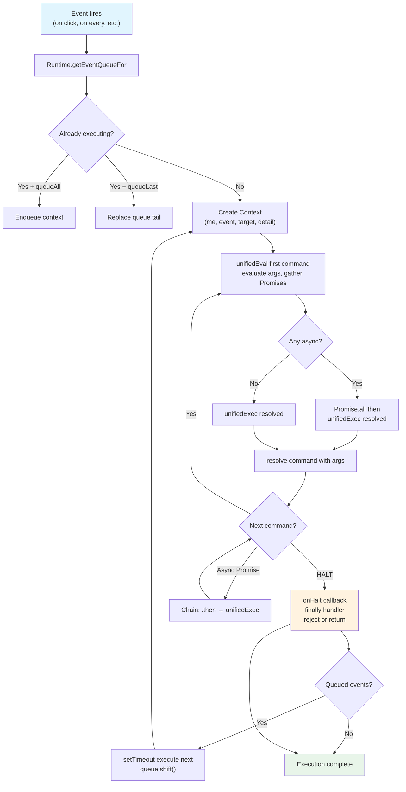
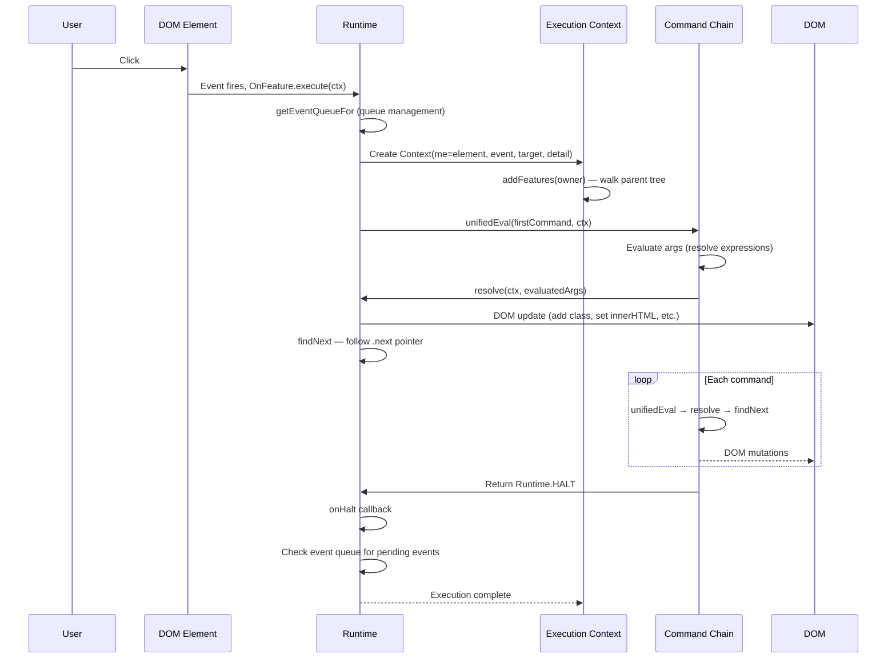

# Hyperscript Deep Dive — The Small Scripting Language for the Web

Hyperscript is a small scripting language for the web that lives inside HTML attributes. It provides event handlers, DOM manipulation, async control flow, and server integration through a natural-language-like syntax. Instead of writing JavaScript event listeners and DOM APIs, you write `on click put "Hello" into #output` directly on the element. The entire language compiles to an AST, runs through a custom execution engine, and integrates seamlessly with htmx for server-driven updates. It is a companion library to htmx — the same team, the same hypermedia philosophy — but it stands alone as a general-purpose DOM scripting language.

Source: `_hyperscript/package.json:1-8` — version 0.9.93, BSD 2-Clause license, repository at https://github.com/bigskysoftware/_hyperscript

```json
// _hyperscript/package.json:1-8
{
  "name": "hyperscript.org",
  "description": "a small scripting language for the web",
  "version": "0.9.93",
  "license": "BSD 2-Clause",
  "repository": {
    "type": "git",
    "url": "git+https://github.com/bigskysoftware/_hyperscript.git"
  }
}
```

---

## Architecture — Six Modules, One Pipeline

Hyperscript is not a single monolithic file. The source is organized into six architectural layers, each with a clear responsibility. The bundled distribution (`dist/_hyperscript.js`) is assembled from these modules by esbuild.

```
src/
  _hyperscript.js                  ← Entry point: wires all subsystems together
  core/
    tokenizer.js                   ← Lexical analysis: characters → Tokens stream
    kernel.js                      ← Grammar registry and AST builder
    parser.js                      ← Unified parser API over kernel + tokens
    config.js                      ← Global configuration
    runtime/
      runtime.js                   ← Execution engine: unifiedEval, unifiedExec
      collections.js               ← ElementCollection, auto-iteration
      conversions.js               ← Type coercion system
      cookies.js                   ← Cookie read/write API
      reactivity.js                ← Reactive tracking and mutation notification
      morph.js                     ← DOM morphing (idiomorph integration)
      htmx-compat.js               ← htmx interoperability layer
  parsetree/
    base.js                        ← Command, Feature, Expression base classes
    internals.js                   ← AST node utilities, error types
    commands/
      basic.js                     ← log, beep!, set, wait
      dom.js                       ← add, remove, toggle, put, append, prepend
      events.js                    ← send, trigger, halt
      controlflow.js               ← if, for, while, repeat, try/catch
      execution.js                 ← call, fetch, async
      animations.js                ← transition, add/remove class with timing
      debug.js                     ← break, log, beep!
      setters.js                   ← set, increment/decrement
      template.js                  ← live template commands
      pseudoCommand.js             ← Bare function-call syntax
    expressions/
      expressions.js               ← Arithmetic, comparison, logical operators
      literals.js                  ← Strings, numbers, booleans, null
      webliterals.js               ← URL, CSS, HTML literals
      postfix.js                   ← Property access, array indexing
      positional.js                ← first, last, random, positional operators
      existentials.js              ← exists, empty checks
      targets.js                   ← CSS query targets, attribute targets
    features/
      on.js                        ← Event handlers: on click, on every
      def.js                       ← Function definitions: def myFunc()
      set.js                       ← Module-like set blocks
      init.js                      ← init feature: run on element mount
      worker.js                    ← Web worker integration
      behavior.js                  ← Reusable behavior blocks
      install.js                   ← Extension installation
      js.js                        ← Inline JavaScript escape hatch
      when.js                      ← Reactive when expressions
      bind.js                      ← Two-way data binding
      live.js                      ← Live templates
  ext/                             ← Official extensions
    component.js                   ← Component system
    eventsource.js                 ← Server-sent events
    socket.js                      ← WebSocket support
    hdb.js                         ← Hyperscript debugger
    tailwind.js                    ← Tailwind integration
    intercept.js / intercept-sw.js ← Request interception
    worker.js                      ← Worker helper
  platform/                        ← Runtime platforms
    node-hyperscript.js            ← Node.js entry
    bun-hyperscript.js             ← Bun entry
    deno-hyperscript.js            ← Deno entry
```

The compilation pipeline flows through these modules in a strict sequence. Source text enters the tokenizer, which produces a `Tokens` object. The kernel drives the parser over that token stream, building an AST of `Command`, `Feature`, and `Expression` nodes. The runtime then executes the AST by walking command chains, resolving expressions, and updating the DOM.

```mermaid
flowchart TD
    A["HTML attribute source text\n_e.g. 'on click put \"Hi\" into #output'"] --> T[Tokenizer]
    T -->|"Tokens stream\n(consumed + remaining)"| K[LanguageKernel]
    K -->|"AST: HyperscriptProgram\n[Feature] → [CommandList] → [Expression]"| R[Runtime]
    R --> E["unifiedEval + unifiedExec\ncommand → next command → ..."]
    E --> D["DOM updates\ninnerHTML, classList, attributes"]
    E --> EV["Event dispatch\nhyperscript:* events"]
    E --> AS["Async resolution\nPromise chains"]

    subgraph "src/core/"
        T
        K
    end

    subgraph "src/core/runtime/"
        R
    end
```

---

## Tokenizer — Lexical Analysis with Follow Sets

The tokenizer is where hyperscript's natural-language readability begins. It turns raw source text into a stream of typed tokens that the parser consumes. The architecture has two classes: `Tokenizer` (the lexer) and `Tokens` (the token stream manager).

### The Tokens Class — Stream Management

Source: `_hyperscript/src/core/tokenizer.js:7-207`

The `Tokens` class is not a simple array wrapper. It manages a token stream with consumed/consumable tracking, lookahead, and a follow-set mechanism that enables context-aware parsing. The class holds four private fields:

- `#tokens` — the remaining unconsumed token array
- `#consumed` — tokens already processed by the parser
- `#lastConsumed` — the most recently consumed token (for error reporting)
- `#follows` — a stack of "follow tokens" that should not be consumed in the current parsing context

```javascript
// _hyperscript/src/core/tokenizer.js:7-26
export class Tokens {
    #tokens;
    #consumed = [];
    #lastConsumed = null;
    #follows = [];
    source;

    constructor(tokens, source) {
        this.#tokens = tokens;
        this.source = source;
        this.consumeWhitespace();
    }
```

The `token(n, includeWhitespace)` method provides positional access. It skips whitespace by default (mimicking how natural-language parsing ignores spaces between words) and returns the nth significant token. When `n` goes past the end, it returns an `EOF` sentinel:

```javascript
// _hyperscript/src/core/tokenizer.js:55-68
token(n, includeWhitespace) {
    var token;
    var i = 0;
    do {
        if (!includeWhitespace) {
            while (this.#tokens[i] && this.#tokens[i].type === "WHITESPACE") {
                i++;
            }
        }
        token = this.#tokens[i];
        n--;
        i++;
    } while (n > -1);
    return token || { type: "EOF", value: "<<<EOF>>>" };
}
```

### Matching and Consuming — The Parser's Interface

The matching methods are the parser's primary interface. They check the current token and consume it if it matches:

- `matchToken(value, type)` — matches an exact identifier value and type
- `matchOpToken(value)` — matches an operator token (has `.op === true`)
- `matchTokenType(...types)` — matches any of the given token types
- `matchAnyToken(...tokens)` — tries multiple exact matches in order
- `matchAnyOpToken(...ops)` — tries multiple operator matches in order

Each returns the consumed token on match, or `undefined` on failure. The parser uses these return values to drive conditional parsing.

```javascript
// _hyperscript/src/core/tokenizer.js:81-99
matchToken(value, type) {
    if (this.#follows.includes(value)) return;
    type = type || "IDENTIFIER";
    if (this.currentToken() && this.currentToken().value === value && this.currentToken().type === type) {
        return this.consumeToken();
    }
}

matchOpToken(value) {
    if (this.currentToken() && this.currentToken().op && this.currentToken().value === value) {
        return this.consumeToken();
    }
}
```

Notice the guard in `matchToken`: `if (this.#follows.includes(value)) return;`. This is the follow-set mechanism in action. If the current token value is in the follow set, the match is suppressed — the parser is told "this token belongs to the outer context, don't consume it here."

### The OP_TABLE — Operator Mapping

Source: `_hyperscript/src/core/tokenizer.js:213-248`

The tokenizer uses a flat lookup table to classify operator characters into token types:

```javascript
// _hyperscript/src/core/tokenizer.js:213-248
const OP_TABLE = {
    "+": "PLUS",        "-": "MINUS",      "*": "MULTIPLY",   "/": "DIVIDE",
    ".": "PERIOD",      "..": "ELLIPSIS",   "\\": "BACKSLASH", ":": "COLON",
    "%": "PERCENT",     "|": "PIPE",        "!": "EXCLAMATION","?": "QUESTION",
    "#": "POUND",       "&": "AMPERSAND",   "$": "DOLLAR",     ";": "SEMI",
    ",": "COMMA",       "(": "L_PAREN",     ")": "R_PAREN",    "<": "L_ANG",
    ">": "R_ANG",       "<=": "LTE_ANG",    ">=": "GTE_ANG",   "==": "EQ",
    "===": "EQQ",       "!=": "NEQ",        "!==": "NEQQ",     "{": "L_BRACE",
    "}": "R_BRACE",     "[": "L_BRACKET",   "]": "R_BRACKET",  "=": "EQUALS",
    "~": "TILDE",       "^": "CARET",
};
```

The `#consumeOp()` method uses this table greedily: it reads a character, then keeps reading while the two-character combination also exists in the table. This means `==` is tokenized as `EQ` (not two `EQUALS` tokens), and `===` becomes `EQQ` (not `EQ` plus `EQUALS`). Multi-character operators are recognized by maximal munch.

```javascript
// _hyperscript/src/core/tokenizer.js:617-627
#consumeOp() {
    var token = this.#makeOpToken();
    var value = this.#consumeChar();
    while (this.#currentChar() && OP_TABLE[value + this.#currentChar()]) {
        value += this.#consumeChar();
    }
    token.type = OP_TABLE[value];
    token.value = value;
    token.end = this.#position;
    return token;
}
```

### Follow Sets — The Key Insight

**Aha:** The follow-set mechanism (`pushFollow`/`popFollow`) is how hyperscript achieves natural-language readability without parser complexity. The same keyword can mean different things in different contexts because the follow set tells the tokenizer which tokens are "off limits" for the current parsing scope.

For example, consider `on click from .button put "Hi" into #output`. When parsing the event source clause after `from`, the parser pushes `put` onto the follow set. This means when `matchToken("button")` runs and encounters `put`, it does NOT consume `put` as a button name — `put` is in the follow set, so the match returns `undefined`. The parser knows it has finished parsing the event source and can move on to parsing the command body. Without follow sets, the parser would need explicit grammar rules to handle every possible keyword boundary. With follow sets, any keyword can serve as a scope delimiter.

The follow-set API provides stack operations:

```javascript
// _hyperscript/src/core/tokenizer.js:180-205
pushFollow(str) { this.#follows.push(str); }
popFollow() { this.#follows.pop(); }
pushFollows(...strs) { for (var i = 0; i < strs.length; i++) this.#follows.push(strs[i]); return strs.length; }
popFollows(count) { for (var i = 0; i < count; i++) this.#follows.pop(); }
clearFollows() { var tmp = this.#follows; this.#follows = []; return tmp; }
restoreFollows(f) { this.#follows = f; }
```

The `clearFollows()` and `restoreFollows()` pair enables context switching during error recovery. When the parser hits a syntax error, it clears the follow set, scans forward to the next known keyword boundary, then restores normal parsing.

### The Tokenizer Class — Character to Token

Source: `_hyperscript/src/core/tokenizer.js:250-751`

The `Tokenizer` class walks the source string character by character and produces a `Tokens` object. Its main loop (`#tokenize()`) classifies each character:

| Character pattern | Token type produced |
|---|---|
| `--` or `//` at start | Comment (consumed, not emitted) |
| Whitespace | `WHITESPACE` token |
| `.` + alpha (no preceding symbol) | `CLASS_REF` (e.g., `.button`) |
| `#` + alpha (no preceding symbol) | `ID_REF` (e.g., `#output`) |
| `[@` | `ATTRIBUTE_REF` (e.g., `[@data-id]`) |
| `@` | Short attribute ref (e.g., `@data-id`) |
| `*` + alpha | `STYLE_REF` (e.g., `*color`) |
| Alpha/`_`/`$` | `IDENTIFIER` |
| Digit | `NUMBER` (supports `e` exponent, decimal) |
| String (`"`, `'`, `` ` ``) | `STRING` (template if backtick) |
| OP_TABLE character | Operator token (`.op = true`) |
| Other | `RESERVED` or error |

The tokenizer tracks `#lastToken` to implement `#possiblePrecedingSymbol()`, which prevents ambiguous parses. For example, `foo.bar` is a property access (dot after identifier), while `.button` alone is a class reference (dot not after identifier). The same character produces different token types based on context.

```javascript
// _hyperscript/src/core/tokenizer.js:346-357
#possiblePrecedingSymbol() {
    return (
        this.#isAlpha(this.#lastToken) ||
        this.#isNumeric(this.#lastToken) ||
        this.#lastToken === ")" ||
        this.#lastToken === "\"" ||
        this.#lastToken === "'" ||
        this.#lastToken === "`" ||
        this.#lastToken === "}" ||
        this.#lastToken === "]"
    );
}
```

---

## Kernel and Parser — Grammar Registry and AST Builder

The `LanguageKernel` is hyperscript's grammar registry and the entry point for parsing. It does not tokenize or execute — it defines what the language looks like and builds the AST.

Source: `_hyperscript/src/core/kernel.js:1-457`

### Grammar Elements and Expression Precedence

The kernel organ the language into a hierarchy of grammar elements, each with a parse function:

```javascript
// _hyperscript/src/core/kernel.js:21-36
this.addGrammarElement("hyperscript", this.parseHyperscriptProgram.bind(this));
this.addGrammarElement("feature", this.parseFeature.bind(this));
this.addGrammarElement("commandList", this.parseCommandList.bind(this));
this.addGrammarElement("command", this.parseCommand.bind(this));
this.addGrammarElement("indirectStatement", this.parseIndirectStatement.bind(this));

this.addGrammarElement("expression", this.parseExpression.bind(this));
this.addGrammarElement("assignableExpression", this.parseAssignableExpression.bind(this));
this.addGrammarElement("unaryExpression", this.parseUnaryExpression.bind(this));
this.addGrammarElement("postfixExpression", this.parsePostfixExpression.bind(this));
this.addGrammarElement("primaryExpression", this.parsePrimaryExpression.bind(this));
this.addGrammarElement("indirectExpression", this.parseIndirectExpression.bind(this));
this.addGrammarElement("leaf", this.parseLeaf.bind(this));
```

The expression layers form a precedence chain. At the top are compound expressions (`expression`, `assignableExpression`), then unary expressions (negation, `not`), then postfix expressions (property access, array indexing), then primary expressions (parenthesized, leaf), and finally leaf expressions (literals, identifiers, CSS selectors). This layered approach means operator precedence is baked into the grammar structure, not into a precedence table.

The kernel registers commands and features by keyword. When a command class declares `static keyword = "log"`, the kernel creates a grammar type `"logCommand"` and stores the parse function in its `#commands` map:

```javascript
// _hyperscript/src/core/kernel.js:265-269
addCommand(keyword, definition) {
    var commandGrammarType = keyword + "Command";
    this.#grammar[commandGrammarType] = definition;
    this.#commands[keyword] = definition;
}
```

### The Parser — Unified API

Source: `_hyperscript/src/core/parser.js:1-330`

The `Parser` class wraps a kernel and a token stream, providing a single object that grammar functions operate against. It delegates all token operations to the `Tokens` stream and all grammar operations to the kernel:

```javascript
// _hyperscript/src/core/parser.js:29-35
export class Parser {
    #kernel;
    constructor(kernel, tokens) {
        this.#kernel = kernel;
        this.tokens = tokens;
    }
```

The `parseElement(type, root)` method is the primary entry point. It asks the kernel for the grammar definition, calls it with the parser, and initializes token positions on the resulting AST node:

```javascript
// _hyperscript/src/core/parser.js:216-218
parseElement(type, root = null) {
    return this.#kernel.parseElement(type, this, root);
}
```

The `commandBoundary()` method detects where a command list ends:

```javascript
// _hyperscript/src/core/parser.js:269-283
commandBoundary(token) {
    if (
        token.value == "end" ||
        token.value == "then" ||
        token.value == "else" ||
        token.value == ")" ||
        this.commandStart(token) ||
        this.featureStart(token) ||
        token.type == "EOF"
    ) return true;
    return false;
}
```

### Error Recovery — ParseRecoverySentinel

Hyperscript does not abort on the first syntax error. It uses `ParseRecoverySentinel` to recover and continue parsing. When a parse error occurs, the kernel's `#syncToCommand()` or `#syncToFeature()` methods scan forward to the next known keyword, emit a `FailedCommand` or `FailedFeature` node, and resume. This means a file with three features and an error in the second one still produces valid AST nodes for the first and third:

```javascript
// _hyperscript/src/core/kernel.js:406-426
#syncToFeature(parser) {
    parser.tokens.clearFollows();
    while (parser.hasMore() &&
           !parser.featureStart(parser.currentToken()) &&
           parser.currentToken().value !== "end" &&
           parser.currentToken().type !== "EOF") {
        parser.tokens.consumeToken();
    }
}

#syncToCommand(parser) {
    parser.tokens.clearFollows();
    while (parser.hasMore() &&
           !parser.commandBoundary(parser.currentToken())) {
        parser.tokens.consumeToken();
    }
    if (parser.hasMore() && parser.currentToken().value === "then") {
        parser.tokens.consumeToken();
    }
}
```

---

## Runtime — The Execution Engine

The `Runtime` class is where hyperscript comes alive. It takes the AST produced by the kernel and executes it against the DOM.

Source: `_hyperscript/src/core/runtime/runtime.js:1-1009`

### Context — The Execution Environment

Every hyperscript execution runs within a `Context` object. The context provides the variable scopes and metadata that commands operate against:

```javascript
// _hyperscript/src/core/runtime/runtime.js:11-50
export class Context {
    constructor(owner, feature, hyperscriptTarget, event, runtime, globalScope, kernel, tokenizer) {
        this.meta = {
            parser: kernel,
            tokenizer: tokenizer,
            runtime,
            owner,
            feature,
            iterators: {},
            ctx: this
        }
        this.locals = { cookies: cookies };
        this.me = hyperscriptTarget;
        this.you = undefined;
        this.result = undefined;
        this.event = event;
        this.target = event?.target ?? null;
        this.detail = event?.detail ?? null;
        this.sender = event?.detail?.sender ?? null;
        this.body = "document" in globalScope ? document.body : null;
        runtime.addFeatures(owner, this);
    }
}
```

The context exposes special pronouns as properties: `me` (the element the script is on), `you` (the target of a `tell` block), `result` (the last expression result), `it`/`its` (alias for `result`), `event` (the triggering event), `target` (the event target), `detail` (event detail), and `sender` (who dispatched the event). These are the pronouns that make hyperscript read like natural language.

### unifiedEval and unifiedExec — The Heartbeat

The runtime's execution loop follows a two-phase pattern. First, `unifiedEval` evaluates all arguments for a command, handling async values with `Promise.all`:

```javascript
// _hyperscript/src/core/runtime/runtime.js:145-204
unifiedEval(parseElement, ctx) {
    var async = false;
    var evaluatedArgs = {};
    if (parseElement.args) {
        for (var [name, argument] of Object.entries(parseElement.args)) {
            if (argument && argument.evaluate) {
                var value = argument.evaluate(ctx);
                if (value && value.then) async = true;
                evaluatedArgs[name] = value;
            }
            // ... handles arrays and non-expression args
        }
    }
    if (async) {
        return new Promise((resolve, reject) => {
            Promise.all(values).then(function (resolved) {
                resolve(parseElement.resolve(ctx, finalArgs));
            });
        });
    } else {
        return parseElement.resolve(ctx, evaluatedArgs);
    }
}
```

Then `unifiedExec` runs the command and follows the `next` pointer in a while loop:

```javascript
// _hyperscript/src/core/runtime/runtime.js:86-143
unifiedExec(command, ctx) {
    while (true) {
        try {
            var next = this.unifiedEval(command, ctx);
        } catch (e) {
            // Error handling: errorHandler, finally, exception tracking
            this.registerHyperTrace(ctx, e);
            if (ctx.meta.errorHandler && !ctx.meta.handlingError) {
                ctx.meta.handlingError = true;
                ctx.locals[ctx.meta.errorSymbol] = e;
                command = ctx.meta.errorHandler;
                continue;
            } else {
                ctx.meta.currentException = e;
                next = Runtime.HALT;
            }
        }
        if (next == null) {
            throw new Error("Command did not return a next element");
        } else if (next.then) {
            // Async: chain the promise and continue
            next.then(resolvedNext => this.unifiedExec(resolvedNext, ctx));
            return;
        } else if (next === Runtime.HALT) {
            // Finally handler, onHalt callbacks, exception rejection
            return;
        } else {
            command = next;  // Continue with next command
        }
    }
}
```

This design means every command is a node in a linked list. The `next` property points to the following command. When a command finishes, it returns `this.findNext(ctx)` which walks up the parent chain if needed. Async commands return a promise that resolves to the next command. Error conditions jump to the error handler via `continue`.



### Symbol Resolution — Four Scopes

Hyperscript resolves symbols through a layered scope chain. The `resolveSymbol` method checks in order:

1. **Pronouns** — `me`, `my`, `I` → `context.me`; `it`, `its` → `context.result`; `you`, `your` → `context.you`
2. **Global scope** — `window` / `globalThis` properties
3. **Element scope** — data stored on the element's `_hyperscript` internal object
4. **Local scope** — `context.locals` (set by `on click(x, y)` destructuring, `repeat with`, etc.)
5. **Inherited scope** — walks up the DOM tree via `#resolveInherited`, supporting `dom-scope` attributes for scope control

```javascript
// _hyperscript/src/core/runtime/runtime.js:254-313
resolveSymbol(str, context, type, targetElement) {
    if (str === "me" || str === "my" || str === "I") return context.me;
    if (str === "it" || str === "its") return context.beingTested ?? context.result;
    if (str === "you" || str === "your" || str === "yourself") return context.you;
    // ... global, element, inherited, local checks
    var fromContext = this.#isHyperscriptContext(context) && !this.#isReservedWord(str)
        ? context.locals[str] : context[str];
    if (typeof fromContext !== "undefined") return fromContext;
    var elementScope = this.#getElementScope(context);
    fromContext = elementScope[str];
    if (typeof fromContext !== "undefined") return fromContext;
    var val = this.#globalScope[str];
    return val;
}
```

The `#resolveInherited` method walks up the DOM tree and respects `dom-scope` attributes. Setting `dom-scope="isolated"` on an element stops the walk. Setting `dom-scope="closest .container"` jumps to the nearest matching ancestor. This gives fine-grained control over which elements share state.

### Element Initialization — The Bootstrapping

When hyperscript processes a DOM node, it looks for script attributes (configured via `config.attributes`, defaulting to `_`, `script`, `data-script`), reads the source text, tokenizes it, parses it into an AST, and calls `apply()` on the program:

```javascript
// _hyperscript/src/core/runtime/runtime.js:821-881
#initElement(elt, target) {
    if (elt.closest && elt.closest(config.disableSelector)) return;
    var src = this.#getScript(elt);
    if (!src) return;
    var hash = this.#hashScript(src);
    var internalData = this.getInternalData(elt);
    if (internalData.initialized && internalData.scriptHash === hash) return;
    if (internalData.initialized) this.cleanup(elt);  // Script changed

    internalData.initialized = true;
    internalData.scriptHash = hash;
    var tokens = this.#tokenizer.tokenize(src);
    var hyperScript = this.#kernel.parseHyperScript(tokens);
    if (hyperScript.errors?.length) {
        this.triggerEvent(elt, "hyperscript:parse-error", { errors: hyperScript.errors });
        return;
    }
    hyperScript.apply(target || elt, elt, null, this);
    elt.setAttribute('data-hyperscript-powered', 'true');
    this.triggerEvent(elt, "hyperscript:after:init");
    setTimeout(() => this.triggerEvent(target || elt, "load", { hyperscript: true }), 1);
}
```

The script hash enables hot-reloading: if the script text changes (e.g., after an idiomorph swap), the old element is cleaned up and reinitialized.

---

## Commands — What Hyperscript Can Do

Commands are the verbs of hyperscript. Each command class declares a `static keyword`, a `parse(parser)` method, and an `execute(ctx)` or `resolve(ctx, args)` method. Commands chain via the `next` property.

Source: `_hyperscript/src/parsetree/commands/` (9 files, 30+ commands)

### DOM Manipulation Commands

From `src/parsetree/commands/dom.js`:

| Command | Syntax | Effect |
|---|---|---|
| `put` | `put value into target` | Sets innerHTML of target |
| `append` | `append value to target` | Appends to target's children |
| `prepend` | `prepend value to target` | Prepends to target's children |
| `add` | `add .class to target` | Adds CSS classes |
| `remove` | `remove .class from target` | Removes CSS classes or DOM nodes |
| `toggle` | `toggle .class on target` | Toggles CSS classes |

Example — adding a class with a transition:

```hyperscript
-- HTML attribute: _="on click add .active to #modal transition opacity 0.3s"
on click
    add .active to #modal
    transition opacity 0.3s
```

### Event Commands

From `src/parsetree/commands/events.js`:

| Command | Syntax | Effect |
|---|---|---|
| `send` | `send eventName to target [with detail]` | Dispatches a custom event |
| `trigger` | `trigger eventName on target [with detail]` | Alias for send |
| `halt` | `halt [the event]` | Stops event propagation |

Example — sending a custom event with detail:

```hyperscript
-- HTML attribute: _="on click send itemSelected with {id: 42} to #cart"
on click
    send itemSelected with {id: 42} to #cart
```

### Control Flow Commands

From `src/parsetree/commands/controlflow.js`:

| Command | Syntax | Effect |
|---|---|---|
| `if` | `if condition ... end` | Conditional execution |
| `for` | `for x in collection ... end` | Iteration |
| `while` | `while condition ... end` | Loop while true |
| `repeat` | `repeat N times ... end` | Fixed iteration |
| `try` | `try ... catch e ... finally ... end` | Error handling |

Example — iterating over elements:

```hyperscript
-- HTML attribute: _="on click for item in .items log item.innerText"
on click
    for item in .items
        log item.innerText
```

### Async Commands

Hyperscript has async built in. The `wait` command pauses execution:

```hyperscript
-- Wait for event: wait for animationend
-- Wait for duration: wait 2s
-- Wait for condition: wait until .loading is empty
on click
    add .loading to me
    fetch /api/data
    put it into #results
    remove .loading from me
```

The `fetch` command is a built-in async operation that wraps `fetch()` and returns the response body as the `result`:

```hyperscript
on click
    fetch /api/users
    put it into #user-list
```

---

## Features — The Top-Level Constructs

Features are the top-level building blocks of hyperscript programs. Unlike commands (which execute sequentially), features are installable units that respond to triggers.

Source: `_hyperscript/src/parsetree/features/` (10 files)

### On Feature — Event Handlers

Source: `_hyperscript/src/parsetree/features/on.js`

The `on` feature is the most common. It installs event handlers with rich configuration:

```
on [every] <eventName>[(args...)] [filter] [from <target>] [elsewhere]
   [debounced|throttled at <time>] [queue all|first|last|none]
   <commands>
   [catch <error> <commands>]
   [finally <commands>]
   end
```

```javascript
// _hyperscript/src/parsetree/features/on.js:18-34
export class OnFeature extends Feature {
    static keyword = "on";

    constructor(displayName, events, start, every, errorHandler, errorSymbol,
                finallyHandler, queueAll, queueFirst, queueNone, queueLast) {
        // ... stores all configuration
    }
```

The `execute()` method manages an event queue per feature per element. If a handler is already running and `queueNone` is set, incoming events are dropped. If `queueLast` is set, only the latest event is kept. This prevents event storms from overwhelming the handler:

```javascript
// _hyperscript/src/parsetree/features/on.js:36-54
execute(ctx) {
    let eventQueueInfo = ctx.meta.runtime.getEventQueueFor(ctx.me, onFeature);
    if (eventQueueInfo.executing && every === false) {
        if (queueNone || (queueFirst && eventQueueInfo.queue.length > 0)) return;
        if (queueLast) eventQueueInfo.queue.length = 0;
        eventQueueInfo.queue.push(ctx);
        return;
    }
    eventQueueInfo.executing = true;
    ctx.meta.onHalt = function () {
        eventQueueInfo.executing = false;
        var queued = eventQueueInfo.queue.shift();
        if (queued) setTimeout(() => onFeature.execute(queued), 1);
    };
    start.execute(ctx);
}
```

### Def Feature — Function Definitions

The `def` feature creates reusable functions:

```hyperscript
def highlight(element, duration)
    add .highlight to element
    wait duration
    remove .highlight from element
end
```

### Init Feature — Mount Hook

The `init` feature runs once when the element is processed:

```hyperscript
init
    log me.innerText + " mounted"
end
```

### When Feature — Reactive Conditions

The `when` feature runs commands when a condition becomes true:

```hyperscript
when #cart.items.length > 0
    add .has-items to #cart
otherwise
    remove .has-items from #cart
```

### Bind Feature — Two-Way Data Binding

The `bind` feature creates reactive bindings between elements:

```hyperscript
bind value to #input on keyup
```

---

## Integration with htmx

Hyperscript and htmx are designed to work together. The integration lives in `src/core/runtime/htmx-compat.js`. When both libraries are loaded, hyperscript:

1. **Listens for htmx events** — `htmx:afterRequest`, `htmx:afterSwap`, `htmx:beforeRequest` — and can trigger hyperscript commands in response
2. **Shares the same element** — a single element can have both `hx-get` and `_="on click ..."` attributes
3. **Cooperates on DOM swaps** — when htmx swaps content, hyperscript's `processNode()` is called on the new content, initializing any hyperscript scripts within
4. **Uses idiomorph** — for out-of-band swaps, hyperscript delegates to the idiomorph morphing engine for intelligent DOM updates

A typical hypermedia pattern combines both:

```html
<button hx-get="/api/data"
        hx-target="#results"
        _="on htmx:beforeRequest add .loading to me
           on htmx:afterRequest remove .loading from me">
    Load Data
</button>
```

The `hx-*` attributes handle the server communication. The hyperscript handles the visual feedback. Neither library needs to know about the other's internals — they coordinate through DOM events.

---

## Comparison with JavaScript

Hyperscript is not a replacement for JavaScript. It is a complement designed for a specific niche: local DOM interactivity.

| Aspect | JavaScript | Hyperscript |
|---|---|---|
| **Scope** | General-purpose language | DOM scripting only |
| **Syntax** | C-style, semicolons, braces | Natural-language keywords |
| **Event handling** | `addEventListener`, callbacks | `on click`, `on every` |
| **DOM access** | `document.querySelector`, `el.classList` | Direct: `.class`, `#id`, `add`, `remove` |
| **Async** | `async/await`, Promises | Built in: `wait`, `fetch` return implicitly awaited |
| **Iteration** | `for...of`, `forEach` | `for x in collection` |
| **Templating** | Template literals, JSX | String templates with `$variable` interpolation |
| **Error handling** | `try/catch/finally` | Same keywords, same semantics |
| **Extensibility** | npm packages, modules | Extensions (`_hyperscript.use()`) |
| **Escape hatch** | N/A | `js ... end` block runs raw JavaScript |

Hyperscript shines when the task is: "when this happens, update that element." JavaScript is still needed for complex business logic, data transformations, and third-party integrations. The `js ... end` block lets you drop into JavaScript when hyperscript's built-in commands are insufficient:

```hyperscript
on click
    js
        const data = JSON.parse(me.dataset.config)
        return processData(data)
    end
    put it into #output
```

---

## Runtime Execution Flow — End to End

This sequence diagram shows how hyperscript handles a click event from trigger to DOM update:



---

## Summary

Hyperscript achieves its goal — a small scripting language for the web — through a clean six-module architecture. The tokenizer (`src/core/tokenizer.js`) converts HTML attribute text into a typed token stream, using the follow-set mechanism to resolve ambiguous contexts without grammar complexity. The kernel (`src/core/kernel.js`) registers grammar elements, commands, and features by keyword, building an AST through layered expression precedence. The parser (`src/core/parser.js`) provides a unified API over kernel and tokens. The runtime (`src/core/runtime/runtime.js`) executes the AST through `unifiedEval` and `unifiedExec`, managing four scope layers, async resolution, error recovery, and DOM initialization. Commands (`src/parsetree/commands/`) provide the verbs — DOM manipulation, events, control flow, async. Features (`src/parsetree/features/`) provide the top-level constructs — event handlers, function definitions, reactive conditions, data bindings.

The follow-set mechanism is the clever insight that makes natural-language syntax possible without a complex grammar. Event queue management prevents handler overload. Symbol resolution walks pronouns, locals, elements, and globals in a predictable chain. And the htmx integration layer coordinates through DOM events, not shared state.

For the next document in this series, see [03-idiomorph.md](03-idiomorph.md) for the DOM morphing algorithm that hyperscript uses during content swaps, or [00-overview.md](00-overview.md) for the broader htmx ecosystem architecture. Cross-references: [00-overview.md](00-overview.md) for the ecosystem map, [01-htmx-core.md](01-htmx-core.md) for htmx swap patterns, [05-fixi-family.md](05-fixi-family.md) for the minimalist hypermedia toolkit, and [07-cross-cutting.md](07-cross-cutting.md) for end-to-end data flows.
