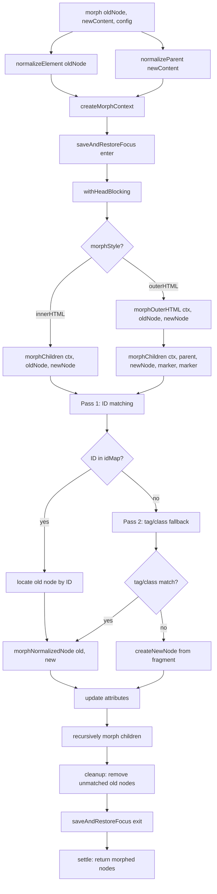
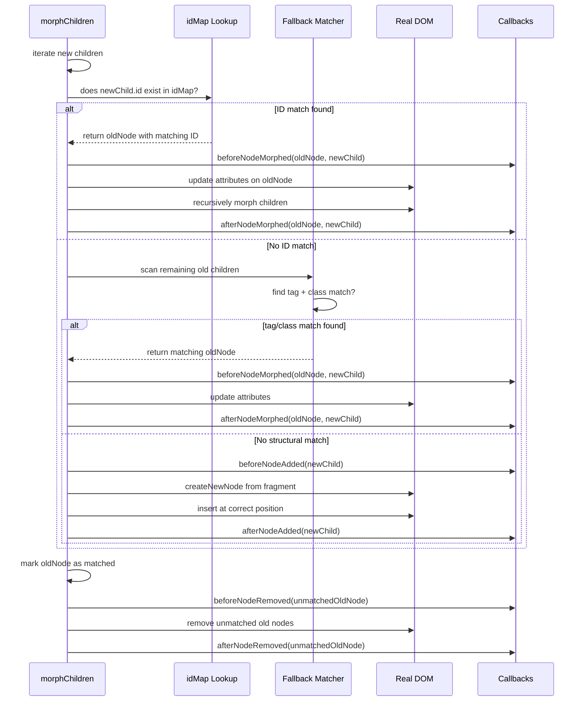

# Idiomorph: ID-Based DOM Morphing

Idiomorph is a DOM morphing library that uses **ID-based element matching** to minimize destructive DOM operations. Instead of replacing entire subtrees when server-sent HTML arrives, idiomorph identifies elements by their `id` attribute, morphs matching elements in place, and only creates or removes nodes where no match exists. This preserves focus, selection, animations, event listeners, and third-party widget state that would be destroyed by naive innerHTML replacement. The library is 1,383 lines (version 0.7.4), published at `https://github.com/bigskysoftware/idiomorph`, and serves as the default morphing engine for htmx 2.0.

---

## Why Morphing Exists

When htmx receives an HTML fragment from the server, it must insert that fragment into the existing page. The simplest approach is `element.innerHTML = response`, which destroys every child node and rebuilds them from scratch. That works for static content but breaks anything with runtime state: a focused input loses its cursor position, a playing video resets, a Google Map widget vanishes, a dropdown menu snaps closed, and every event listener must be re-attached.

Morphing solves this by treating the existing DOM as mutable state rather than disposable markup. Given an old subtree and a new HTML fragment, a morphing library walks both trees simultaneously and applies only the smallest set of mutations needed to make the old tree look like the new one. Elements that already exist (identified by some matching strategy) are kept and updated. Elements that appear only in the new fragment are created. Elements that disappeared are removed.

---

## The Core Insight: ID-Based Matching

Idiomorph's defining innovation is using the `id` attribute as the primary matching key. Most DOM diffing algorithms compare elements by their position in the tree: the first child of the old parent matches the first child of the new parent. This works for static lists but fails the moment elements reorder or when new elements are inserted at the top. Position-based matching treats a reordered element as a deletion plus an insertion, destroying the old node and creating a new one.

Idiomorph builds an `idMap` — a `Map<Node, Set<string>>` — that records every `id` in the old tree. When processing a new element, it first checks whether that element's `id` appears in the map. If it does, the algorithm locates the existing node by ID and morphs it in place rather than replacing it. The existing node keeps its event listeners, its animation state, its focus, and its identity in the browser's internal DOM tree.

When no ID match is found, idiomorph falls back to tag and class matching: it looks for an existing element with the same tag name and class list. This catches elements that lack explicit IDs but are structurally equivalent. If no fallback match exists either, the element is treated as genuinely new or genuinely removed.

### Aha Moment

Idiomorph's ID-based matching is fundamentally different from virtual DOM diffing. Virtual DOM libraries (React, Vue, Preact) build a lightweight copy of the UI tree, compare it to the previous virtual tree, compute a diff, and apply patches. The comparison is positional: the third virtual node in the old list maps to the third virtual node in the new list. Idiomorph skips the virtual tree entirely and works against the real DOM. It builds an idMap of all IDs in the old tree, then looks up each new element by ID in that map. If found, it morphs the existing element in place. If not, it falls back to structural matching. This means elements with stable IDs maintain their DOM identity across morphs, preserving everything the browser attached to them — event listeners, animations, focus, selection ranges, and third-party widget instances. Virtual DOM diffing optimizes for fewer operations; ID-based morphing optimizes for identity preservation. The difference is subtle but profound: one treats DOM nodes as interchangeable render targets, the other treats them as persistent objects with lifecycles.

---

## Configuration System

Idiomorph's behavior is controlled through a configuration object passed to `Idiomorph.morph()`. The defaults are defined in `idiomorph/dist/idiomorph.js:127-146`:

```javascript
// idiomorph/dist/idiomorph.js:127-146
const defaults = {
    morphStyle: "outerHTML",
    callbacks: {
        beforeNodeAdded: noOp,
        afterNodeAdded: noOp,
        beforeNodeMorphed: noOp,
        afterNodeMorphed: noOp,
        beforeNodeRemoved: noOp,
        afterNodeRemoved: noOp,
        beforeAttributeUpdated: noOp,
    },
    head: {
        style: "merge",
        shouldPreserve: (elt) => elt.getAttribute("im-preserve") === "true",
        shouldReAppend: (elt) => elt.getAttribute("im-re-append") === "true",
        shouldRemove: noOp,
        afterHeadMorphed: noOp,
    },
    restoreFocus: true,
};
```

### morphStyle

The `morphStyle` controls what portion of the target element is morphed:

- **`outerHTML`** (default): The target element itself is part of the morph. If the incoming fragment has a different tag name at the root, the target is replaced entirely. Attributes on the root are updated. This is the most common mode for htmx swaps like `hx-swap="morph"`.
- **`innerHTML`**: Only the children of the target element are morphed. The target element itself is never replaced or have its attributes changed. Use this when you want to update the contents of a container without touching the container.

### ignoreActive and ignoreActiveValue

When `ignoreActive` is true, idiomorph skips morphing the element that currently has focus. When `ignoreActiveValue` is true, the value attribute of the focused element is not updated during the morph. These options prevent the morph from fighting with user input — if a user is typing in a field while a morph arrives, the morph should not overwrite what they are typing.

### restoreFocus

When `restoreFocus` is enabled (default), idiomorph saves the active element and its parents before the morph, then restores focus afterward. This is critical for accessibility and keyboard navigation. The mechanism is implemented in `saveAndRestoreFocus()`, which captures `document.activeElement` and walks up its parent chain, storing them in `ctx.activeElementAndParents`. After the morph completes, it attempts to refocus the same element.

### Callbacks

Idiomorph fires seven callback hooks during the morph lifecycle. Each receives the affected node and can return `false` to cancel the operation. The callbacks are defined in `idiomorph/dist/idiomorph.js` and typed in the config structure at lines 1-90:

```javascript
// idiomorph/dist/idiomorph.js:1-35 (Config and ConfigHead type definitions)
const Config = {
    morphStyle: 'outerHTML' | 'innerHTML',
    ignoreActive: boolean,
    ignoreActiveValue: boolean,
    restoreFocus: boolean,
    callbacks: {
        beforeNodeAdded: (node) => boolean | void,
        afterNodeAdded: (node) => void,
        beforeNodeMorphed: (oldNode, newNode) => boolean | void,
        afterNodeMorphed: (oldNode, newNode) => void,
        beforeNodeRemoved: (node) => boolean | void,
        afterNodeRemoved: (node) => void,
        beforeAttributeUpdated: (attrName, oldValue, newValue) => boolean | void,
    },
    head: {
        style: 'merge' | 'append' | 'morph' | 'none',
        block: boolean,
        ignore: boolean,
        shouldPreserve: (elt) => boolean,
        shouldReAppend: (elt) => boolean,
        shouldRemove: (elt) => boolean,
        afterHeadMorphed: () => void,
    },
};
```

The callback lifecycle follows this order for each node:

1. **beforeNodeAdded** — fires before a new DOM node is inserted. Return `false` to prevent insertion.
2. **afterNodeAdded** — fires after the node is in the DOM.
3. **beforeNodeMorphed** — fires before an existing node is morphed to match incoming content. Return `false` to skip morphing this node.
4. **afterNodeMorphed** — fires after the node's attributes and children have been updated.
5. **beforeNodeRemoved** — fires before a DOM node is removed. Return `false` to prevent removal.
6. **afterNodeRemoved** — fires after the node is gone.
7. **beforeAttributeUpdated** — fires before any attribute is added, changed, or removed on a morphed element. Return `false` to block that specific attribute change.

The `beforeAttributeUpdated` callback is particularly powerful because it lets you control which attributes flow through during a morph. You can block `class` changes to preserve custom styling, or block `style` changes to let CSS transitions handle visual updates independently.

---

## The Morph Algorithm

The morph algorithm is the heart of idiomorph. It is implemented as a recursive tree walk that processes both the old and new trees simultaneously, applying mutations incrementally. Here is the entry point from `idiomorph/dist/idiomorph.js:156-179`:

```javascript
// idiomorph/dist/idiomorph.js:156-179
function morph(oldNode, newContent, config = {}) {
    oldNode = normalizeElement(oldNode);
    const newNode = normalizeParent(newContent);
    const ctx = createMorphContext(oldNode, newNode, config);

    return saveAndRestoreFocus(ctx, () => {
        return withHeadBlocking(ctx, oldNode, newNode, (ctx, oldNode, newNode) => {
            if (ctx.morphStyle === "innerHTML") {
                morphChildren(ctx, oldNode, newNode);
                return oldNode.children;
            } else {
                return morphOuterHTML(ctx, oldNode, newNode);
            }
        });
    });
}
```

The algorithm follows these steps:

1. **normalizeElement(oldNode)** — ensures the old node is a proper DOM Element. Accepts strings, templates, or existing elements and returns an Element.
2. **normalizeParent(newContent)** — parses the incoming HTML string or fragment into a parent element that can be traversed. Uses a hidden template or div to parse HTML safely.
3. **createMorphContext(oldNode, newNode, config)** — builds the MorphContext object that threads through every recursive call. The context holds the configuration, the idMap, persistent ID set, callbacks, head config, and the pantry element. The MorphContext type is defined at `idiomorph/dist/idiomorph.js:100-116`:

```javascript
// idiomorph/dist/idiomorph.js:100-116 (MorphContext type)
const MorphContext = {
    target: Element,
    newContent: Element,
    config: Config,
    morphStyle: 'outerHTML' | 'innerHTML',
    ignoreActive: boolean,
    ignoreActiveValue: boolean,
    restoreFocus: boolean,
    idMap: Map<Node, Set<string>>,    // old tree: node -> set of IDs in its subtree
    persistentIds: Set<string>,        // IDs present in both old and new trees
    callbacks: Callbacks,
    head: HeadConfig,
    pantry: HTMLDivElement,            // hidden div for temporary node storage
    activeElementAndParents: Element[],
};
```

4. **saveAndRestoreFocus(ctx, callback)** — wraps the entire morph. Captures `document.activeElement` and walks up to `document.body`, storing each ancestor. After the morph, re-focuses the captured element if it still exists in the DOM.
5. **withHeadBlocking(ctx, oldNode, newNode, callback)** — handles `<head>` element synchronization before the main body morph. If the incoming fragment contains a `<head>`, it processes head elements according to the configured `head.style` strategy. The callback blocks until head processing is complete.
6. **morphChildren or morphOuterHTML** — the core morphing logic, described next.
7. **settle** — after the morph completes, focus is restored and any pending callbacks fire.

### morphOuterHTML

When `morphStyle` is `"outerHTML"`, the morph includes the target element itself. The implementation at `idiomorph/dist/idiomorph.js:189-200`:

```javascript
// idiomorph/dist/idiomorph.js:189-200
function morphOuterHTML(ctx, oldNode, newNode) {
    const oldParent = oldNode.parentNode;
    let marker = oldParent.appendChild(document.createTextNode(''));
    morphChildren(ctx, oldParent, newNode, marker, marker);
    marker.remove();
    return Array.from(oldParent.children);
}
```

This creates a temporary text node marker at the position of the old element, calls `morphChildren` on the parent with the marker as both the start and end boundary, then removes the marker. The marker acts as an anchor so that morphChildren knows where in the parent's children list the morph is happening. The result is an array of the parent's children after the morph completes.

### morphChildren

This is the recursive core. `morphChildren(ctx, oldParent, newNode, optionalStart, optionalEnd)` walks the children of `oldParent` and the children of `newNode` simultaneously, applying insertions, morphs, and deletions as needed.

The algorithm processes children in two passes:

**Pass 1: ID matching.** For each child in the new content, if it has an ID, the algorithm looks up that ID in the old tree's idMap. If found, it moves the old node to the correct position (if necessary) and calls `morphNormalizedNode(oldNode, newNode)` to update its attributes and children. This is the identity-preserving step: the old node is not replaced, only updated.

**Pass 2: Fallback matching.** For new children without ID matches, the algorithm scans the remaining old children for a tag/class match. If found, it morphs that old node. If no match exists, it creates a new node from the incoming fragment.

**Cleanup:** After all new children are processed, any old children that were not matched are removed from the DOM.

The matching algorithm also handles ranges. When `optionalStart` and `optionalEnd` are provided (as in `morphOuterHTML`), the algorithm only considers old children within that range, preventing it from matching nodes outside the morph boundary.

---

## Head Element Handling

The `<head>` element requires special treatment during morphing because head elements (`<script>`, `<link>`, `<style>`, `<meta>`, `<title>`) have side effects when they change. A `<script>` tag executes when inserted into the DOM. A `<link>` tag triggers a network request. A `<style>` tag changes the CSSOM. Re-inserting these elements naively causes scripts to re-execute and stylesheets to re-download.

Idiomorph's `head.style` configuration controls how head elements are processed:

- **`merge`** (default): Compares incoming head elements against existing ones. Elements that match by ID or `href`/`src` are preserved. New elements are appended. Removed elements are removed only if they were in the old head but not in the new head. This is the safest default for most applications.
- **`append`**: Appends all incoming head elements without removing any existing ones. This is useful for incremental page updates where you want to add new scripts or styles without disturbing what is already loaded.
- **`morph`**: Runs the full morph algorithm on the `<head>` element itself, treating it like any other DOM node. This can cause scripts to re-execute. Use only when you need the head to exactly match the incoming fragment.
- **`none`**: Ignores the incoming head entirely. The existing head is left untouched.

The head config also provides fine-grained control through predicate functions:

- **`shouldPreserve(elt)`** — return `true` to prevent an element from being removed during head morphing. Default checks for `im-preserve="true"`.
- **`shouldReAppend(elt)`** — return `true` to force an element to be re-appended even if it already exists. Default checks for `im-re-append="true"`.
- **`shouldRemove(elt)`** — return `true` to explicitly remove an element during head processing.
- **`afterHeadMorphed()`** — callback fired after head processing completes.

---

## Focus Preservation

Focus preservation is critical for accessibility and usability. When a morph replaces a focused input, the browser loses track of which element should receive keyboard input. Idiomorph solves this with `saveAndRestoreFocus()`:

```
Before morph:
  1. ctx.activeElementAndParents = [document.activeElement, ..., document.body]
  2. Save the active element's selection range (for text inputs)
  3. Save the active element's scroll position

During morph:
  - The morph proceeds normally. The focused element may or may not be morphed.

After morph:
  1. Walk activeElementAndParents to find if the element still exists
  2. If found, restore focus to it
  3. Restore the selection range
  4. Restore the scroll position
```

The `ignoreActive` and `ignoreActiveValue` config options provide additional protection. When `ignoreActive` is true, the entire focused element is skipped during morphing. When `ignoreActiveValue` is true, the element is morphed but its `value` attribute is not updated, preserving what the user has typed.

---

## The Pantry Pattern

Idiomorph uses a hidden `<div>` called the **pantry** to temporarily hold DOM nodes during morphing. The pantry is created once on the document and reused across morphs. It serves several purposes:

1. **Node parking**: When an old node needs to be moved to a different position in the tree, idiomorph first parks it in the pantry. This prevents the node from being garbage collected while it is being repositioned.
2. **Fragment parsing**: The pantry is used as the parsing target for incoming HTML strings. `normalizeParent` sets `pantry.innerHTML = htmlString` and then extracts the parsed children. This is safer than using `document.createElement` for each node because the browser's HTML parser handles entity decoding, self-closing tags, and other edge cases.
3. **Temporary storage during reordering**: When children need to be reordered (an element moves from position 3 to position 1), the pantry holds elements that are being repositioned so they are not lost during the shuffle.

The pantry is a classic DOM manipulation pattern: keep a detached element around as a workspace. Because it is never attached to the visible DOM, operations on it do not trigger reflows or paints.

---

## Callback Lifecycle in Detail

The callback system gives you hooks at every point where idiomorph touches the DOM. Here is the complete lifecycle for a morph that adds one node, morphs one existing node, and removes one node:

```
morph(oldNode, newContent, config)
  saveAndRestoreFocus enters
    beforeNodeAdded(newNode)          // newNode is being created
    afterNodeAdded(newNode)           // newNode is now in the DOM
    beforeNodeMorphed(oldNode, newNode)  // oldNode matches newNode by ID
    // attributes are updated (beforeAttributeUpdated fires for each)
    // children are recursively morphed
    afterNodeMorphed(oldNode, newNode)   // oldNode now matches newNode
    beforeNodeRemoved(oldNode)        // oldNode has no match in new content
    afterNodeRemoved(oldNode)         // oldNode is gone
  saveAndRestoreFocus exits (focus restored)
```

The `beforeAttributeUpdated` callback fires for every attribute change during a morph, including additions, modifications, and deletions. It receives the attribute name, old value (or null for additions), and new value (or null for deletions). This lets you intercept specific attributes:

```javascript
Idiomorph.morph(target, html, {
    callbacks: {
        beforeAttributeUpdated: function(attrName, oldVal, newVal) {
            // Block class changes to preserve custom styling
            if (attrName === 'class') return false;
            // Block style changes to let CSS transitions handle it
            if (attrName === 'style') return false;
            // Allow everything else
        }
    }
});
```

---

## Integration with htmx

Idiomorph is the default morphing engine for htmx 2.0, registered as the `morph` swap strategy. When you use `hx-swap="morph"`, htmx calls `Idiomorph.morph()` with the target element and the server's HTML response.

```html
<div hx-get="/update" hx-swap="morph">
  <!-- This div and its children are morphed in place -->
  <p id="status">Loading...</p>
</div>
```

The `hx-swap="morph"` swap style supports additional parameters:

- `hx-swap="morph:innerHTML"` — morph only the children
- `hx-swap="morph:outerHTML"` — morph the element itself (default)

htmx also supports the `hx-ext` mechanism for custom extensions. The `morphdom` extension (`htmx-ext-morphdom`) swaps idiomorph for morphdom as the morphing engine. The `alpine-morph` extension integrates Alpine.js's lightweight morph algorithm. All three follow the same interface: accept an old element, new HTML, and configuration, and return the morphed result.

Idiomorph's callback system integrates with htmx's event system. When a callback fires, htmx can emit a corresponding event that other htmx extensions or hyperscript can react to. This creates a unified event-driven model: server sends HTML, idiomorph morphs the DOM, htmx fires events, hyperscript responds to events.

---

## Comparison with morphdom and Virtual DOM Diffing

Three approaches to updating the DOM after receiving new content:

**Virtual DOM diffing** (React, Vue, Preact): Build a lightweight JavaScript representation of the desired UI, compare it to the previous virtual tree using positional matching (with keys for list items), compute a diff, and apply patches to the real DOM. The virtual tree is discarded after each render. This approach is fast for large trees but destroys node identity for anything without a stable `key` prop. Event listeners are managed by the framework, not the browser.

**morphdom** (morphdom library): Compare two real DOM trees using a combination of tag matching and optional ID matching. morphdom does not require IDs to match elements, but uses them when available. It uses a sophisticated algorithm that handles special cases like `<option>` elements, `<textarea>` values, and SVG namespaces. morphdom is the predecessor to idiomorph and shares the same author. The key difference is that morphdom is primarily position-based with ID as an optimization, while idiomorph is ID-first with position as a fallback.

**Idiomorph**: Build an idMap of all IDs in the old tree. For each new element, look up its ID in the map. If found, morph in place. If not, fall back to tag/class matching. This makes ID-based identity the default behavior rather than an optimization. The result is fewer DOM operations when elements have stable IDs, and better preservation of browser-managed state.

| Aspect | Virtual DOM | morphdom | Idiomorph |
|---|---|---|---|
| Matching strategy | Positional + keys | Positional + optional ID | ID-first + tag/class fallback |
| Node identity | Lost without keys | Partially preserved | Preserved by ID |
| Focus preservation | Manual (refs) | Partial | Automatic (restoreFocus) |
| Event listener handling | Framework-managed | Browser-native | Browser-native |
| Tree representation | Virtual (JS objects) | Real DOM | Real DOM |
| Typical size | 10K+ lines | 300+ lines | 1,383 lines |
| Best for | Complex client-side UIs | Server-rendered fragments | Server-rendered fragments with stable IDs |

---

## Morph Algorithm Flowchart



---

## ID Matching vs Fallback Matching Sequence



---

## Practical Usage Patterns

### Basic Morph

```javascript
import Idiomorph from 'idiomorph';

const target = document.getElementById('content');
const html = '<div id="content"><p>Updated content</p></div>';
Idiomorph.morph(target, html);
```

### Morph with Callbacks

```javascript
Idiomorph.morph(target, html, {
    callbacks: {
        beforeNodeMorphed: (oldNode, newNode) => {
            // Animate the transition
            oldNode.style.opacity = '0.5';
        },
        afterNodeMorphed: (oldNode, newNode) => {
            // Restore full opacity after morph
            oldNode.style.opacity = '1';
        },
        beforeAttributeUpdated: (attr, oldVal, newVal) => {
            // Prevent class changes from overwriting custom classes
            if (attr === 'class' && oldVal?.includes('custom-')) return false;
        }
    }
});
```

### Morph with Head Control

```javascript
Idiomorph.morph(document.body, fullPageHtml, {
    head: {
        style: 'merge',
        shouldPreserve: (elt) => elt.hasAttribute('data-preserve'),
        shouldReAppend: (elt) => elt.hasAttribute('data-reload'),
    }
});
```

---

## Key Takeaways

- Idiomorph preserves element identity through ID-based matching, not positional diffing. Elements with stable `id` attributes maintain their DOM identity across morphs.
- The morph algorithm is a recursive tree walk: normalize, create context, handle head, match by ID, fall back to tag/class, update attributes, recurse into children, clean up unmatched nodes.
- The configuration system provides fine-grained control over morphing behavior through `morphStyle`, `ignoreActive`, `restoreFocus`, callbacks, and head strategies.
- The pantry pattern uses a hidden div as a workspace for parsing and repositioning nodes without triggering browser reflows.
- Focus preservation is automatic when `restoreFocus` is enabled, with `ignoreActive` and `ignoreActiveValue` providing additional protection for user input.
- Idiomorph integrates with htmx as the default morphing engine for `hx-swap="morph"`, and with Alpine.js through the `alpine-morph` extension.
- Compared to virtual DOM diffing, idiomorph trades the overhead of building virtual trees for direct DOM operations with identity preservation. The result is simpler code (1,383 lines vs 10,000+) and better runtime state preservation.

---

## Cross-References

- [HTMX Ecosystem Overview](00-overview.md) — the philosophy and architecture of hypermedia-driven development
- [htmx Core](01-htmx-core.md) — the request lifecycle, swap strategies, and event system that idiomorph integrates with
- [hyperscript](02-hyperscript.md) — the scripting language that pairs with htmx and idiomorph for client-side behavior
- [FIXI Family](05-fixi-family.md) — related projects in the htmx ecosystem
- [Cross-Cutting Concerns](07-cross-cutting.md) — shared patterns across the htmx ecosystem
