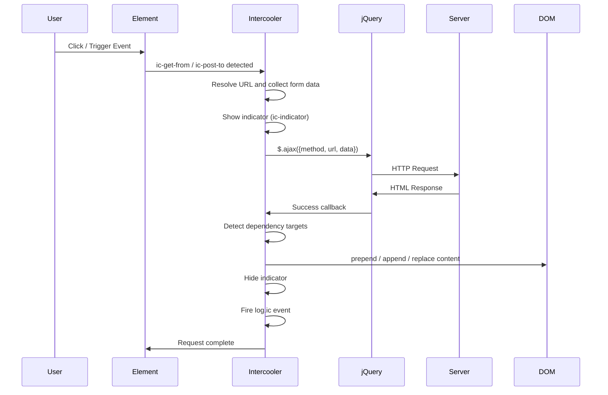
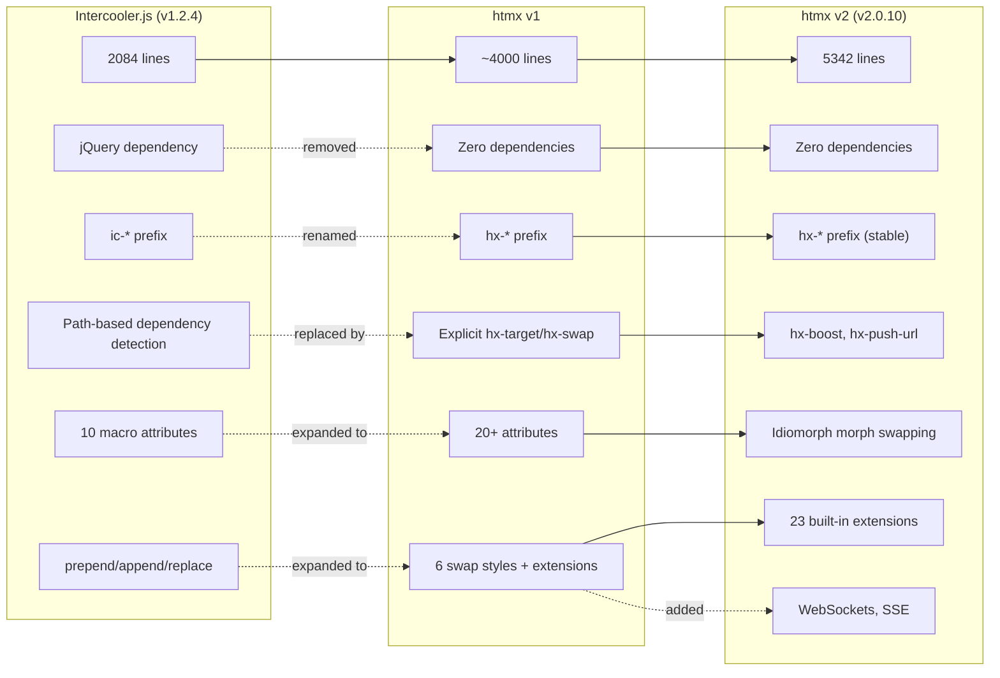

# Intercooler.js — The Ancestor of htmx

Intercooler.js is the original attribute-driven AJAX library that introduced the `ic-*` prefix convention and the idea that HTML attributes could declaratively describe server communication, DOM updates, and client-side actions without writing JavaScript functions. It is the direct predecessor of htmx. Every concept in htmx -- attribute-driven requests, swap strategies, event triggers, loading indicators, out-of-band updates -- traces its lineage back to this 2,084-line library. Understanding Intercooler.js means understanding why htmx exists and how its design decisions evolved from a jQuery-dependent prototype into a standalone runtime.

Related: [00-overview.md](00-overview.md) for the project landscape, [01-htmx-core.md](01-htmx-core.md) for the htmx request pipeline it inspired, [05-fixi-family.md](05-fixi-family.md) for the lightweight variants that followed, and [07-cross-cutting.md](07-cross-cutting.md) for patterns that span all documents.

---

## 1. Historical Context and Origins

Intercooler.js was created by Carson Gross, the same author who later built htmx. The library shipped as version 1.2.4 under the MIT license. Its source lives in a single file: `intercooler-js/src/intercooler.js`, totaling 2084 lines. The project was hosted at https://github.com/bigskysoftware/intercooler-js, the same GitHub organization that would later host htmx.

The library emerged during a period when jQuery was still the dominant client-side dependency. Intercooler embraced jQuery rather than fighting it. Every DOM manipulation, every AJAX call, every event trigger routed through `$()`. This was a pragmatic choice: jQuery handled cross-browser inconsistencies in event handling, AJAX, and DOM manipulation, which meant Intercooler could focus on the higher-level problem of making HTML attributes drive server communication.

The `ic-*` prefix convention was deliberate. At the time, `data-*` was the HTML5 standard for custom attributes. Intercooler offered both: by default it used `ic-get-from`, `ic-post-to`, and so on, but it could be switched to `data-ic-get-from` via a meta tag. This dual-prefix support was built into the macro system from day one.

Intercooler proved that attribute-driven AJAX worked in production. It demonstrated that developers could build interactive web applications without writing `$.ajax()` calls or managing state in JavaScript. The library was successful enough that its author realized the jQuery dependency was holding it back. The removal of jQuery, the rename from `ic-*` to `hx-*`, and the addition of new swap strategies became htmx.

---

## 2. Initialization and the Macro System

Source: `intercooler-js/src/intercooler.js:1-22` — initialization and macro definitions.

The library opens with an IIFE pattern that creates the `Intercooler` global namespace. Two configuration meta tags are read at load time:

```javascript
// intercooler-js/src/intercooler.js:1-22 — initialization and macros
var Intercooler = Intercooler || (function() {
  'use strict';

  var USE_DATA = $('meta[name="intercoolerjs:use-data-prefix"]').attr("content") == "true";
  var USE_ACTUAL_HTTP_METHOD = $('meta[name="intercoolerjs:use-actual-http-method"]').attr("content") == "true";

  var _MACROS = $.map(['ic-get-from', 'ic-post-to', 'ic-put-to', 'ic-patch-to', 'ic-delete-from',
                       'ic-style-src', 'ic-attr-src', 'ic-prepend-from', 'ic-append-from', 'ic-action'],
                      function(elt){ return fixICAttributeName(elt); });
```

The `USE_DATA` flag controls whether attributes use the `ic-` prefix or the `data-ic-` prefix. When set to `"true"` via a `<meta>` tag, every attribute lookup routes through `fixICAttributeName()`, which prepends `data-` to the attribute name. This allows Intercooler to coexist with HTML5 validators that reject non-standard attributes.

The `USE_ACTUAL_HTTP_METHOD` flag controls how non-GET/POST requests are sent. When `false` (the default), PUT/PATCH/DELETE requests are sent as POST with an `X-HTTP-Method-Override` header. When `true`, the actual HTTP method is used. This matters for firewalls and proxies that block non-standard methods.

The `_MACROS` array is the core of the attribute system. It lists every attribute that triggers a server request or client action. Each entry passes through `fixICAttributeName()`, which returns either `ic-get-from` or `data-ic-get-from` depending on the `USE_DATA` flag. This macro list drives the attribute scanning loop that finds and processes Intercooler elements on the page.

The macro system means Intercooler knows exactly which attributes to look for when scanning the DOM. It does not scan every attribute on every element. It scans only the ten macro names, plus additional attributes added later (`ic-trigger-on`, `ic-indicator`, `ic-limit-children`, etc.). This makes the initialization pass efficient even on large pages.

---

## 3. HTTP Request Attributes

Intercooler defines five HTTP request attributes, each mapping to an HTTP verb:

| Attribute | HTTP Method | Purpose |
|---|---|---|
| `ic-get-from` | GET | Fetch content from a URL |
| `ic-post-to` | POST | Submit data to a URL |
| `ic-put-to` | PUT | Replace resource at a URL |
| `ic-patch-to` | PATCH | Partially update resource at a URL |
| `ic-delete-from` | DELETE | Remove resource at a URL |

These attributes work on any HTML element, not just forms or links. A `div`, a `span`, or a `button` can carry `ic-get-from="/api/users"` and trigger a GET request when clicked. The attribute value is the target URL.

The request lifecycle for any of these attributes follows the same path:

1. The user triggers the element (click by default, or the event specified by `ic-trigger-on`)
2. Intercooler reads the attribute value as the request URL
3. Intercooler collects form data from the nearest enclosing form, plus any `ic-include` specified inputs
4. Intercooler sends the request via jQuery's `$.ajax()` with the appropriate HTTP method
5. The response HTML is processed according to the swap strategy (prepend, append, or replace)
6. Loading indicators are hidden, and `log.ic` events fire

The request attributes inherit from parent elements. If a `div` has `ic-post-to="/api/submit"`, child elements without their own request attributes inherit the parent's target. This means you can wrap a form in a `div` with `ic-post-to` and every button inside it posts to the same URL.

---

## 4. Content Swap Strategies

Source: `intercooler-js/src/intercooler.js:100-126` — prepend and append with `ic-limit-children`.

Intercooler supports three content insertion strategies, each implemented as a separate function:

```javascript
// intercooler-js/src/intercooler.js:100-126 — prepend and append with ic-limit-children
function prepend(parent, responseContent) {
  try {
    parent.prepend(responseContent);
  } catch (e) {
    log(parent, formatError(e), "ERROR");
  }
  if (getICAttribute(parent, 'ic-limit-children')) {
    var limit = parseInt(getICAttribute(parent, 'ic-limit-children'));
    if (parent.children().length > limit) {
      parent.children().slice(limit, parent.children().length).remove();
    }
  }
}

function append(parent, responseContent) {
  try {
    parent.append(responseContent);
  } catch (e) {
    log(parent, formatError(e), "ERROR");
  }
  if (getICAttribute(parent, 'ic-limit-children')) {
    var limit = parseInt(getICAttribute(parent, 'ic-limit-children'));
    if (parent.children().length > limit) {
      parent.children().slice(0, parent.children().length - limit).remove();
    }
  }
}
```

Both functions follow the same pattern: insert the content, then enforce the child limit if `ic-limit-children` is set. The difference is in which children get removed when the limit is exceeded.

`prepend` inserts at the top, so it removes children from index `limit` onward. The newest content stays at the top, and the oldest items fall off the bottom. This is ideal for activity feeds or log displays where you want the most recent items visible.

`append` inserts at the bottom, so it removes children from the beginning (index `0` through `length - limit - 1`). The newest content stays at the bottom, and the oldest items are trimmed from the top. This is ideal for chat messages or notification lists.

The `ic-limit-children` attribute takes an integer value. When set, Intercooler enforces the limit after every content insertion. This prevents memory leaks in long-running pages that continuously append content. Without it, a page that polls for updates every second would accumulate DOM nodes indefinitely.

There is also a replace strategy that swaps the entire target element's innerHTML with the response. This is the most common pattern and is the default when no explicit swap strategy is specified.

---

## 5. Dependency Detection System

Source: `intercooler-js/src/intercooler.js:28-56` — the `_isDependentFunction`.

This is one of the most interesting design decisions in Intercooler. The library automatically detects when a server response should update other elements on the page based on URL path containment:

```javascript
// intercooler-js/src/intercooler.js:28-56
var _isDependentFunction = function(src, dest) {
  if (!src || !dest) {
    return false;
  }

  // For two urls to be considered dependant, either one must contain all
  // of the path arguments the other has
  var asrc = src.split(/[\?#]/, 1)[0].split("/").filter(function(e) {
    return e != "";
  });

  var adest = dest.split(/[\?#]/, 1)[0].split("/").filter(function(e) {
    return e != "";
  });

  // ignore purely local tags (local transport)
  if (asrc == "" || adest == "") {
    return false;
  }
  return adest.slice(0, asrc.length).join("/") == asrc.join("/") ||
    asrc.slice(0, adest.length).join("/") == adest.join("/");
};
```

The function splits both URLs by `/` after stripping query strings and fragments. It then checks if one path is a prefix of the other. If `/api/users/1` posts to the server, and another element on the page is fetching from `/api/users`, the function detects that `/api/users` is a prefix of `/api/users/1` and marks them as dependent. The dependent element gets refreshed.

This means Intercooler can automatically update a user list when a single user is modified, without any explicit configuration. The developer does not need to specify "refresh the list when the detail changes." The URL structure encodes the relationship.

The function is overridable. The comment in the source explicitly notes that sites storing model IDs in query or hash parameters need to replace this function:

```javascript
Intercooler.setIsDependentFunction(function(src, dest) { return bool; });
```

This design decision trades explicit configuration for implicit convention. The benefit is less boilerplate. The cost is that developers must understand the URL path convention and structure their APIs accordingly. htmx replaced this with explicit `hx-target` and `hx-swap` attributes, which are more verbose but more predictable.

---

## 6. Event System and Triggers

Source: `intercooler-js/src/intercooler.js:131-151` — `triggerEvent` and `log`.

Intercooler uses a custom event system built on top of jQuery's event mechanism. Every significant action fires an event that other code can listen to:

```javascript
// intercooler-js/src/intercooler.js:131-151 — triggerEvent and log
function triggerEvent(elt, event, args){
  if($.zepto) {
    event = event.split(".").reverse().join(":");
  }
  elt.trigger(event, args);
}

function log(elt, msg, level) {
  if (elt == null) {
    elt = $('body');
  }
  triggerEvent(elt, "log.ic", [msg, level, elt]);
  if (level == "ERROR") {
    if (window.console) {
      window.console.log("Intercooler Error : " + msg);
    }
    var errorUrl = closestAttrValue($('body'), 'ic-post-errors-to');
    if (errorUrl) {
      $.post(errorUrl, {'error': msg});
    }
  }
}
```

The `triggerEvent` function handles a Zepto compatibility quirk. Zepto uses `:` as the event namespace separator instead of `.`, so the function reverses the split and joins when Zepto is detected. This ensures events like `beforeSend.ic` work identically in both jQuery and Zepto.

The `log` function fires a `log.ic` event with three arguments: the message, the level, and the element. This means any code can listen for `log.ic` events on any element and react to Intercooler's internal logging. When the level is `ERROR`, Intercooler also writes to `console.log` and optionally POSTs the error to a URL specified by `ic-post-errors-to` on the body element.

The `ic-trigger-on` attribute controls what events trigger a request. Common values include:

- `click` (default for buttons and links)
- `change` (default for form inputs)
- `submit` (for forms)
- `scrolled-into-view` (triggers when the element becomes visible in the viewport)
- `every <interval>` (polls at the specified interval, e.g., `every 5s`)
- `load` (triggers on page load)
- Custom jQuery events (any event name can be used)

The `scrolled-into-view` trigger is particularly noteworthy. It uses a scroll handler registered once on the window (line 179-191) that checks if elements with `ic-trigger-on='scrolled-into-view'` are visible. When they become visible, it fires the request and sets a `ic-scrolled-into-view-loaded` flag to prevent re-firing. This enables lazy loading of content as the user scrolls down the page.

---

## 7. The Request Lifecycle

The complete request lifecycle in Intercooler follows this sequence:



The lifecycle has three phases that deserve attention.

**Pre-request phase:** Intercooler resolves the target URL from the attribute, collects form data from the nearest enclosing form, shows any loading indicators specified by `ic-indicator`, and fires a `beforeSend.ic` event. If a `beforeSend` handler returns `false`, the request is cancelled.

**Request phase:** jQuery's `$.ajax()` sends the request. The HTTP method depends on the attribute used (`ic-get-from` sends GET, `ic-post-to` sends POST, etc.). Form data is serialized and included in the request body for POST/PUT/PATCH, or as query parameters for GET. Headers like `X-IC-Request` and `X-Requested-With` are added so the server can identify Intercooler requests.

**Post-request phase:** The response HTML is parsed with `createDocument()` (line 199), which handles both full HTML documents and fragments. The parsed content is inserted using the appropriate swap strategy. Intercooler then runs dependency detection to find other elements that need refreshing. Finally, indicators are hidden, `log.ic` fires, and any `ic-on-completed` actions execute.

---

## 8. Error Handling

Source: `intercooler-js/src/intercooler.js:138-152` — the `log` function with error reporting.

Intercooler handles errors at two levels: logging and server-side reporting.

The `log` function fires `log.ic` events for every message, regardless of level. This means developers can attach a listener to `body` for `log.ic` and capture all Intercooler activity:

```javascript
$('body').on('log.ic', function(e, msg, level, elt) {
  // Handle all Intercooler log messages
});
```

When the level is `ERROR`, Intercooler takes additional action. It writes to `console.log` with the prefix "Intercooler Error : ", and if `ic-post-errors-to` is set on the body element, it POSTs the error message to that URL. This enables server-side error collection without any custom error handling code.

The `ic-post-errors-to` attribute is typically set on the `<body>` element:

```html
<body ic-post-errors-to="/api/client-errors">
```

When an error occurs during a prepend or append operation (line 103-104 and 117-118), the catch block calls `log(parent, formatError(e), "ERROR")`. This triggers the error reporting chain: the `log.ic` event fires, the console message prints, and if `ic-post-errors-to` is configured, the error is sent to the server.

AJAX errors (network failures, 500 responses) are handled separately by jQuery's error callback. These also route through the `log` function, so they follow the same reporting path.

---

## 9. Utility Functions and Parsing

Source: `intercooler-js/src/intercooler.js:162-173` — `parseInterval`.

Several utility functions support the core request system:

```javascript
// intercooler-js/src/intercooler.js:162-173
function parseInterval(str) {
  log(null, "POLL: Parsing interval string " + str, 'DEBUG');
  if (str == "null" || str == "false" || str == "") {
    return null;
  } else if (str.lastIndexOf("ms") == str.length - 2) {
    return parseFloat(str.substr(0, str.length - 2));
  } else if (str.lastIndexOf("s") == str.length - 1) {
    return parseFloat(str.substr(0, str.length - 1)) * 1000;
  } else {
    return 1000;
  }
}
```

The `parseInterval` function converts human-readable interval strings into milliseconds. It handles three formats:

- `"500ms"` returns `500`
- `"5s"` returns `5000`
- Any other non-empty string (including bare numbers) returns `1000` (one second default)
- `"null"`, `"false"`, and `""` return `null` (no polling)

This function drives the `every <interval>` trigger. When an element has `ic-trigger-on="every 3s"`, Intercooler calls `parseInterval("3s")`, gets `3000`, and sets up a `setInterval` that fires every three seconds.

The `currentUrl()` function (line 194) returns the current page URL including query string and hash. This is used for dependency detection when determining which elements on the page might need refreshing after a request completes.

The `createDocument()` function (line 199) parses HTML strings into DOM nodes. It detects whether the HTML contains `<html>` or `<body>` tags. If it does, it clones `document.documentElement` and sets its innerHTML. If not, it creates a temporary `div` and uses that. This distinction matters because full-document responses (from redirects or error pages) need different handling than HTML fragments.

---

## 10. Evolution from Intercooler.js to htmx

Intercooler.js was the proof of concept. htmx was the production-ready refinement. The evolution happened in three stages:



The key changes at each step:

**Intercooler.js to htmx v1:** The jQuery dependency was removed entirely. This meant reimplementing AJAX with `XMLHttpRequest` or `fetch`, DOM manipulation with native APIs, and event handling with `addEventListener`. The `ic-*` prefix became `hx-*`. The automatic dependency detection (`_isDependentFunction`) was replaced with explicit `hx-target` (CSS selector for the update target) and `hx-swap` (how to insert the content). New attributes were added: `hx-boost` for progressive enhancement of links and forms, `hx-push-url` for history management, and `hx-trigger` for fine-grained event trigger configuration.

**htmx v1 to htmx v2:** The line count grew from ~4000 to 5342 as new features were added. The extension system matured to 23 built-in extensions including SSE, WebSockets, JSON encoding, path dependencies, class tools, preload, and morphdom swap. The `hx-swap` attribute gained the `morph` option, which uses idiomorph to intelligently merge new content with existing DOM rather than replacing it outright. Configuration expanded to 30+ options.

The attribute mapping between Intercooler and htmx is direct:

| Intercooler | htmx | Change |
|---|---|---|
| `ic-get-from` | `hx-get` | Prefix shortened, `-from` dropped |
| `ic-post-to` | `hx-post` | Prefix shortened, `-to` dropped |
| `ic-prepend-from` | `hx-get` + `hx-swap="beforeend"` | Merge into hx-swap |
| `ic-append-from` | `hx-get` + `hx-swap="afterend"` | Merge into hx-swap |
| `ic-trigger-on` | `hx-trigger` | Prefix shortened |
| `ic-indicator` | `hx-indicator` | Prefix shortened |
| `ic-limit-children` | _(removed)_ | Not carried forward |
| `ic-style-src` | _(removed)_ | Not carried forward |
| `ic-action` | `_hyperscript` or `hx-on` | Externalized |

---

## 11. Aha Moment: URL Path Containment as Dependency Detection

Intercooler's `_isDependentFunction` implements a form of automatic cache invalidation based on URL path structure. When `/api/users/1` receives a POST request that modifies user 1, Intercooler scans every element on the page that has an Intercooler attribute. If any element has a URL that is a path prefix of `/api/users/1` (like `/api/users`), or if `/api/users/1` is a prefix of the element's URL, Intercooler marks them as dependent and refreshes them.

This means a single POST to `/api/users/1` can automatically refresh:
- The user detail panel at `/api/users/1`
- The user list at `/api/users`
- A dashboard widget at `/api/users/stats/active`

Without any explicit configuration. The developer structures the API URLs hierarchically, and Intercooler infers the dependency graph from the URL structure alone.

This is clever because it eliminates the need for explicit "invalidate this cache key" logic that most web frameworks require. In a typical SPA, modifying a resource means manually dispatching an action to update the store, which triggers a re-render of all subscribed components. Intercooler skips the store entirely. The URL is the cache key, and path containment is the subscription mechanism.

The limitation is that it only works for URL-path-based resource hierarchies. Sites that use opaque IDs in query parameters (`/api/resource?id=123`) or hash routing (`/#/users/1`) fall outside the detection scope. The source code explicitly acknowledges this and provides `setIsDependentFunction` as an override point.

htmx replaced this with explicit targeting (`hx-target="#user-list"`) because explicit configuration is easier to debug and reason about. But the underlying insight — that server responses should be able to update multiple page regions without client-side coordination — carried forward into htmx's out-of-band swap system (`HX-Reswap: out-of-band` response header) and the `hx-target` attribute's ability to target any CSS selector.

---

## 12. Complete Attribute Reference

Beyond the core HTTP request attributes, Intercooler supported a rich set of additional attributes:

**Content insertion:**
- `ic-prepend-from` / `ic-append-from` — insert response at top or bottom of target
- `ic-replace-target` — replace the entire target element
- `ic-target` — CSS selector for the element to update

**Visual updates:**
- `ic-style-src` — fetch CSS styles from a URL and apply them
- `ic-attr-src` — fetch attribute values from a URL
- `ic-indicator` — show a loading spinner during requests

**Triggering:**
- `ic-trigger-on` — specify which event triggers the request
- `ic-poll` — poll at a fixed interval
- `ic-poll-repeats` — limit the number of poll iterations

**Data collection:**
- `ic-include` — include additional form elements in the request
- `ic-post-errors-to` — server endpoint for client-side error reporting

**DOM management:**
- `ic-limit-children` — cap the number of child elements after prepend/append
- `ic-action` — execute client-side actions (e.g., `ic-action="addClass: active"`)

**History and state:**
- `ic-push-url` — update the browser URL bar after a request
- `ic-history-elt` — mark an element for history snapshot storage

---

## 13. Loading Indicators

The `ic-indicator` attribute specifies a loading indicator element to show during requests. When a request starts, Intercooler adds the `ic-active` class to the indicator element and removes the `ic-indicator` class. When the request completes, the classes are reversed.

The indicator element is typically hidden by default and shown via CSS when it has the `ic-active` class:

```html
<button ic-post-to="/api/submit" ic-indicator="#spinner">
  Submit
</button>
<span id="spinner" class="ic-indicator" style="display:none">Loading...</span>
```

```css
.ic-indicator.ic-active {
  display: inline !important;
}
```

This class-based approach means the indicator can be styled with any CSS. The `ic-active` class can trigger CSS transitions, animations, or any visual effect. The indicator is shown before the AJAX call starts and hidden in the response callback, so it covers the full request duration including network latency.

---

## 14. Why Intercooler Matters Today

Intercooler.js is archived and no longer maintained. Its successor, htmx, is the recommended path forward. But Intercooler remains worth studying for three reasons.

First, it is the origin story. Every htmx concept traces back to an Intercooler concept. Understanding the lineage makes htmx easier to learn because you can see how each idea evolved. The `hx-target` attribute exists because `_isDependentFunction` was too magical. The `hx-swap` attribute exists because `ic-prepend-from` and `ic-append-from` were too specific. The `_hyperscript` project exists because `ic-action` was too limited.

Second, the dependency detection system is genuinely clever. Even though htmx replaced it with explicit targeting, the idea of inferring update relationships from URL structure is worth understanding. It represents a different philosophy: convention over configuration. Some projects still use this pattern, and recognizing it helps when reading legacy codebases.

Third, the single-file architecture is a masterclass in library design. Intercooler packs HTTP request handling, DOM manipulation, event management, dependency detection, error reporting, polling, scrolling, history management, and style/attribute updates into 2084 lines. Every function is small and focused. The macro system makes attribute scanning efficient. The utility functions handle edge cases cleanly. Reading the source is a lesson in how to build a complete tool without bloat.

---

## 15. Migration Path to htmx

Migrating from Intercooler.js to htmx requires three steps:

1. **Replace the library:** Remove the Intercooler.js script tag and add htmx. Remove jQuery if it is not needed elsewhere. Intercooler requires jQuery; htmx requires nothing.

2. **Update attribute names:** Change `ic-` to `hx-` and adjust the attribute names per the mapping table in section 11. The most common changes are `ic-get-from` to `hx-get`, `ic-post-to` to `hx-post`, and `ic-trigger-on` to `hx-trigger`.

3. **Replace automatic dependencies with explicit targets:** Where Intercooler relied on `_isDependentFunction` to detect which elements to refresh, add explicit `hx-target` attributes. This makes the update targets visible in the markup rather than implicit in the URL structure.

Attributes that were removed (`ic-style-src`, `ic-action`, `ic-limit-children`) need alternative solutions. Style updates can be handled by server responses that include `<style>` tags or `hx-swap-oob` out-of-band swaps. Client-side actions can use `_hyperscript` (the htmx companion scripting language) or native JavaScript with `hx-on`. Child limits can be handled server-side by returning only the needed number of items in the response.

---

## Next: The fixi Family

After Intercooler proved the attribute-driven AJAX concept and htmx refined it into a production runtime, the author explored minimal variants. The fixi family — fixi.js (90 lines), moxi.js (110 lines), rexi.js (115 lines), and ssexi.js (89 lines) — are ultra-lightweight htmx subsets, each optimized for a specific use case. See [05-fixi-family.md](05-fixi-family.md) for the complete breakdown.
