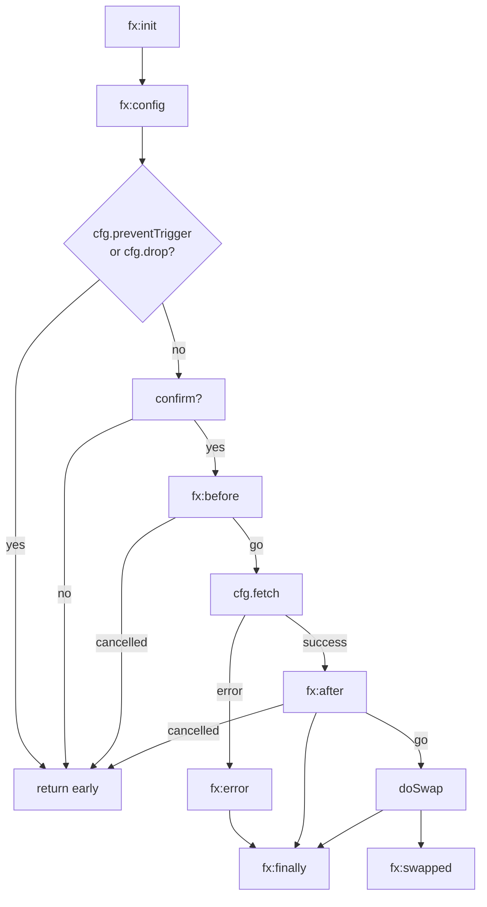
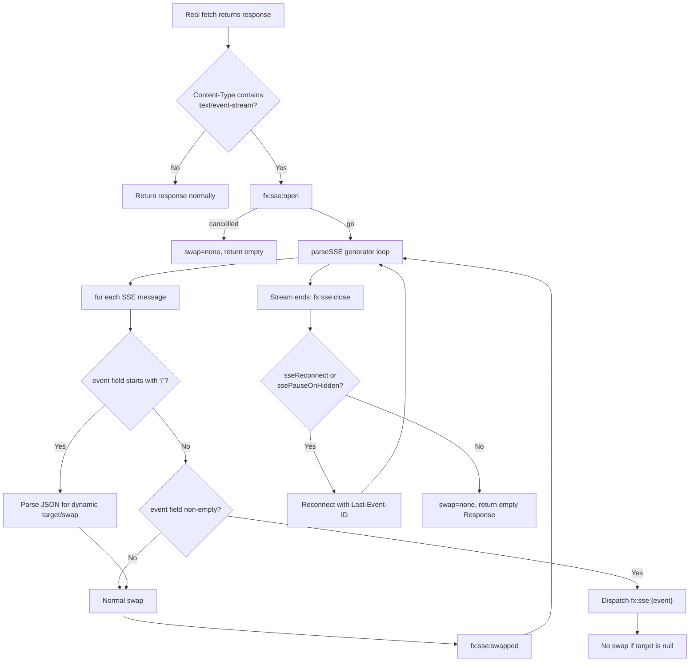

# The Fixi Family: fixi, moxi, rexi, and ssexi

fixi, moxi, rexi, and ssexi are four lightweight hypermedia libraries, each under 120 lines of JavaScript, that demonstrate the core htmx pattern can be decomposed into specialized, composable tools. They share a common philosophy: one file, one concern, zero dependencies. fixi handles fixed-content AJAX with a MutationObserver-driven initialization and a full request lifecycle. moxi provides a proxy-based DOM query API with `on-*` event handlers and reactive `live` attributes. rexi offers a fluent fetch wrapper with automatic body encoding. ssexi plugs into fixi via its event system to add Server-Sent Events streaming, without modifying a single line of fixi itself.

---

## Core Concept: Why Four Libraries Instead of One

The htmx core library is 5342 lines. It handles triggers, AJAX, swaps, extensions, history, WebSockets, SSE, client-side templating, and more. The fixi family proves that each of those concerns can be extracted into a self-contained module under 120 lines. The tradeoff is composability versus convenience. With htmx, you get everything in one import. With the fixi family, you pick exactly what you need and compose the rest yourself.

The libraries are organized around three concerns:

| Library | Concern | Lines | Key Pattern |
|---------|---------|-------|-------------|
| fixi | Fixed-content AJAX (triggers, requests, swaps) | 90 | MutationObserver + event-driven lifecycle |
| moxi | Mobile-first DOM interaction (event handlers, reactive queries) | 110 | Proxy-based DOM queries + XPath evaluation |
| rexi | Fluent HTTP API (fetch wrapper, body encoding) | 115 | Method-chain fetch with automatic encoding |
| ssexi | Server-Sent Events streaming | 89 | SSE parser + `fx:config` event hook |

Each library exports a minimal surface. fixi and moxi are auto-initializing via `MutationObserver`. rexi and ssexi install themselves on `window` or via event listeners. There is no shared runtime, no build step, and no coordination between them beyond standard DOM events.

---

## fixi Deep Dive: MutationObserver + Event-Driven Lifecycle

Source: `fixi/fixi.js` (90 lines, IIFE)

fixi is the anchor of the family. It provides the core hypermedia pattern: an element with an `fx-action` attribute triggers an HTTP request, and the response HTML is swapped into a target element. Everything else in the family builds on or around this pattern.

### Auto-Initialization via MutationObserver

fixi installs a single `MutationObserver` on `document.documentElement` at `DOMContentLoaded`. The observer watches for `childList` changes across the entire subtree. Every time a new node is added, `process()` checks whether it or any of its descendants carries an `[fx-action]` attribute. If so, `init()` is called on the element.

```javascript
// fixi/fixi.js:1-4
(()=>{
    if(document.__fixi_mo) return;
    document.__fixi_mo = new MutationObserver((recs)=>
        recs.forEach((r)=>r.type === "childList" && r.addedNodes.forEach((n)=>process(n))))
    // ...
})();
```

The guard `if(document.__fixi_mo) return` prevents double-initialization if the script is loaded twice. This is a common pattern in single-file libraries -- a boolean or reference flag on the document object serves as an include guard.

The `process()` function handles both the node itself and its descendants:

```javascript
// fixi/fixi.js:78-84
let process = (n)=>{
    if (n.matches){
        if (ignore(n)) return
        if (n.matches("[fx-action]")) init(n)
    }
    if(n.querySelectorAll) n.querySelectorAll("[fx-action]").forEach(init)
}
```

If the node is an element (`n.matches` exists), it is checked directly. Then `querySelectorAll` finds all `[fx-action]` descendants. The `ignore()` function checks for a parent with `[fx-ignore]`, providing a way to disable fixi processing for entire subtrees.

This same MutationObserver auto-initialization pattern is shared with moxi. Both libraries install their own observers on `DOMContentLoaded` and scan for their respective attributes. The observers coexist peacefully because they watch the same tree but act on different attribute selectors.

### Default Event Detection

fixi determines the trigger event automatically based on the element type (line 74):

```javascript
elt.__fixi.evt = attr(elt, "fx-trigger",
    elt.matches("form") ? "submit" :
    elt.matches("input:not([type=button]),select,textarea") ? "change" :
    "click")
```

The hierarchy is: forms trigger on `submit`, form controls (`input`, `select`, `textarea`) trigger on `change`, and everything else triggers on `click`. You can override this with an explicit `fx-trigger` attribute. This auto-detection means the common case requires zero configuration.

### The Request Lifecycle

The core handler is an async function assigned to `elt.__fixi`. It runs through a well-defined lifecycle, with each stage communicated via a custom event:



Here is the lifecycle in detail, with the source lines that drive each stage:

1. **fx:init** (line 10): Fires before the handler is installed. If a listener returns false, initialization is skipped. This lets you conditionally exclude elements from fixi processing.

2. **fx:config** (line 32): Fires when a request is about to be made. The listener receives the `cfg` object and the active `requests` set. Returning false cancels the request. This is the extension point that ssexi uses to override `cfg.fetch`.

3. **fx:before** (line 47): Fires immediately before the network request. Returning false cancels. Use this for logging, analytics, or last-minute header modifications.

4. **Fetch** (line 48): The actual HTTP call via `cfg.fetch(cfg.action, cfg)`. By default this is `window.fetch`, but it can be replaced (as ssexi does).

5. **fx:after** (line 50): Fires after the response is received but before the DOM is modified. Returning false skips the swap. The response text is available as `cfg.text`.

6. **fx:error** (line 52): Fires if the fetch throws. The error object is in `detail.error`.

7. **fx:finally** (line 56): Fires regardless of success or failure. The request is removed from the `requests` set at this point.

8. **fx:swapped** (line 71): Fires after the DOM swap completes. If the element was removed during the swap, the event also fires on `document` (line 72).

### The Configuration Object

The `cfg` object assembled at lines 17-31 is the heart of fixi's extensibility. Every piece of request state is captured here and passed through the event lifecycle:

```javascript
// fixi/fixi.js:17-31
let cfg = {
    trigger:evt,
    action:attr(elt, "fx-action"),
    method:attr(elt, "fx-method", "GET").toUpperCase(),
    target:document.querySelector(attr(elt, "fx-target")) ?? elt,
    swap:attr(elt, "fx-swap", dflt("swap", "outerHTML")),
    body,
    drop:reqs.size,
    headers:{"FX-Request":"true", ...window.fixiCfg?.headers},
    abort:ac.abort.bind(ac),
    signal:ac.signal,
    preventTrigger:true,
    transition:dflt("transition", document.startViewTransition?.bind(document)),
    fetch:fetch.bind(window)
}
```

Key fields:

- **action**: The URL to request. Taken from `fx-action`.
- **method**: HTTP method, defaulting to `GET`. Uppercased from `fx-method`.
- **target**: The element to swap into. Resolved via `fx-target` CSS selector, falling back to the element itself.
- **swap**: The swap strategy, defaulting to `outerHTML`. Can be overridden globally via `window.fixiCfg.swap`.
- **body**: A `FormData` object populated from the closest form (line 13-15).
- **drop**: The number of in-flight requests. If non-zero, the request is dropped (line 34). This is fixi's default request deduplication.
- **headers**: Always includes `FX-Request: true` so the server can identify fixi requests. Merged with `window.fixiCfg.headers`.
- **abort** / **signal**: An `AbortController` for cancellation. Call `cfg.abort()` in a lifecycle listener to cancel.
- **transition**: Bound to `document.startViewTransition` if the View Transitions API is available. Can be overridden globally.
- **fetch**: Bound to `window.fetch`. This is the field ssexi replaces with its SSE handler.

### GET/DELETE Query String Conversion

For `GET` and `DELETE` requests, fixi converts the `FormData` body into query parameters (lines 35-39):

```javascript
// fixi/fixi.js:35-39
if (/GET|DELETE/.test(cfg.method)){
    let params = new URLSearchParams(cfg.body)
    if (params.size)
        cfg.action += (/\?/.test(cfg.action) ? "&" : "?") + params
    cfg.body = null
}
```

This is correct behavior for these methods. The body is set to `null` after conversion because `GET` and `DELETE` requests should not have a request body. The query string is appended with proper `?`/`&` handling based on whether the URL already contains a query string.

### The Swap Engine

The swap logic at lines 58-66 is compact but covers all standard insertion strategies:

```javascript
// fixi/fixi.js:58-66
let doSwap = ()=>{
    if (cfg.swap instanceof Function)
        return cfg.swap(cfg)
    else if (/(before|after)(begin|end)/.test(cfg.swap))
        cfg.target.insertAdjacentHTML(cfg.swap, cfg.text)
    else if(cfg.swap in cfg.target)
        cfg.target[cfg.swap] = cfg.text
    else if(cfg.swap !== 'none') throw cfg.swap
}
```

The swap resolution has four branches:

1. **Function**: If `cfg.swap` is a function, it is called with the full `cfg` object. This is the custom swap escape hatch.
2. **insertAdjacentHTML**: If the swap string matches `beforebegin`, `afterbegin`, `beforeend`, or `afterend`, it uses `insertAdjacentHTML`. This covers relative positioning swaps.
3. **Property assignment**: If the swap string is a property on the target element (`outerHTML`, `innerHTML`, `textContent`), it is assigned directly. This is how `outerHTML` and `innerHTML` work.
4. **none**: The string `none` is a no-op. Any other unrecognized string throws an error.

The swap is wrapped in a View Transition if available (lines 67-70):

```javascript
if (cfg.transition)
    await cfg.transition(doSwap).finished
else
    await doSwap()
```

This means fixi gets animated swaps for free on browsers that support the View Transitions API, with no extra code.

### Confirm Dialogs

Before the request fires, fixi checks for `cfg.confirm` (lines 43-46). If set, it awaits the result and cancels the request if the user declines. This enables confirmation dialogs without any special attribute syntax -- you just attach a listener to `fx:config` that sets `cfg.confirm`.

---

## moxi Deep Dive: Proxy-Based DOM Queries and on-* Handlers

Source: `moxi/moxi.js` (110 lines, IIFE)

moxi takes a different approach to hypermedia interaction. Instead of attribute-driven AJAX, it provides a fluent DOM manipulation API via a proxy-based query function, combined with inline event handlers written as `on-*` attributes.

### The Proxy-Based Query System

The `q()` function returns a proxy that wraps a NodeList. Every property access on the proxy is forwarded to the underlying elements:

```javascript
// moxi/moxi.js:23-39
proxy = elts=>new Proxy({}, {
    get:(_,p)=>{
        if (p == "count") return elts.length
        if (p == "arr") return ()=>elts.slice()
        if (p == Symbol.iterator) return ()=>elts.values()
        if (p == "trigger") return (t,d,b)=>elts.forEach(e=>fire(e,t,d,b))
        if (p == "insert") return (pos,s)=>elts.forEach(e=>e.insertAdjacentHTML(POS[pos],s))
        if (p == "take") return (cls,from)=>{
            for (let e of typeof from == "string" ? doc.querySelectorAll(from) : from)
                e.classList.remove(cls)
            for (let e of elts) e.classList.add(cls)
        }
        let v = elts[0]?.[p]
        if (v?.call) return (...a)=>elts.map(e=>e[p](...a))[0]
        if (v && typeof v == "object") return proxy(elts.map(e=>e[p]))
        return v
    },
    set:(_,p,v)=>(elts.forEach(e=>e[p]=v),true)
}),
```

This proxy intercepts property access and provides several behaviors:

- **count**: Returns the number of matched elements.
- **arr()**: Returns a plain array copy.
- **Symbol.iterator**: Makes the proxy iterable in `for...of` loops.
- **trigger(type, detail, bubbles)**: Fires a custom event on every matched element.
- **insert(position, html)**: Inserts HTML at the specified position on every element.
- **take(className, from)**: Moves a CSS class from one set of elements to the matched elements.
- **Property forwarding**: For any other property, it reads from the first element. If the property is a function, it calls it on all elements and returns the first result. If the property is an object, it returns a new proxy wrapping that property across all elements.

This design means you can write `q(".items").style.display = "none"` and it sets the display on every matched element. Or `q("#btn").click()` calls click on the first button. The proxy chains naturally: `q(".parent").children` returns a proxy of all children elements.

### Query Syntax

The `mkq()` function (lines 41-58) extends CSS selectors with a mini-DSL:

```javascript
// moxi/moxi.js:41-58
mkq = ctx=>sel=>{
    if (typeof sel != "string") return proxy(sel.nodeType ? [sel] : [...sel])
    let im = sel.match(/^(.+)\s+in\s+(.+)$/), root = doc
    if (im){ sel = im[1]; root = im[2] == "this" ? ctx : doc.querySelector(im[2]) }
    if (!root) return proxy([])
    let m = sel.match(/^(next|prev|closest|first|last)\s+(.+)$/), elts
    if (m){
        let [,d,s] = m, cdp = e=>ctx.compareDocumentPosition(e)
        if (d == "closest") elts = one(ctx.closest(s))
        else {
            let all = [...root.querySelectorAll(s)]
            if (d == "first") elts = all.slice(0,1)
            else if (d == "last") elts = all.slice(-1)
            else if (d == "next") elts = one(all.find(e=>cdp(e) & 4))
            else elts = one(all.reverse().find(e=>cdp(e) & 2))
        }
    } else elts = [...root.querySelectorAll(sel)]
    return proxy(elts)
}
```

The query syntax supports:

| Syntax | Meaning |
|--------|---------|
| `q("selector")` | Standard `querySelectorAll` |
| `q("selector in this")` | Scoped to the current element (`ctx`) |
| `q("selector in #parent")` | Scoped to the element matching `#parent` |
| `q("next .item")` | Next sibling matching `.item` |
| `q("prev .item")` | Previous sibling matching `.item` |
| `q("closest .wrapper")` | Closest ancestor matching `.wrapper` |
| `q("first .item")` | First match in document order |
| `q("last .item")` | Last match in document order |

The `next` and `prev` queries use `compareDocumentPosition` with bitwise flags: `4` means `DOCUMENT_POSITION_FOLLOWING` and `2` means `DOCUMENT_POSITION_PRECEDING`. This is a clever way to find the next or previous element in document order without relying on DOM traversal methods.

### on-* Event Handlers

moxi scans element attributes for `on-*` patterns and converts them into async event handlers:

```javascript
// moxi/moxi.js:72-88
} else if (a.name.startsWith("on-")){
    let [name, ...mods] = a.name.slice(3).split("."),
    has = m=>mods.includes(m), h = has("halt"), debounce = mkDb()
    if (has("cc")) name = name.replace(/-([a-z])/g, (_,c)=>c.toUpperCase())
    let target = has("outside") ? doc : elt,
    opts = {capture: has("capture"), passive: has("passive")},
    fn = new AF("event", ...HARGS, `with(event?.detail||{}){${a.value}}`),
    handler = elt.__moxi[name] = evt=>{
        if (evt && (has("self") && evt.target != elt || has("outside") && elt.contains(evt.target))) return
        if (h || has("prevent")) evt?.preventDefault()
        if (h || has("stop")) evt?.stopPropagation()
        if (has("once")) target.removeEventListener(name, handler, opts)
        return fn.call(elt, evt, q, wait, trigger, debounce).catch(e=>{if(e!=DB) throw e})
    }
    if (name == "init") handler()
    else el(target, name, handler, opts)
}
```

The event modifiers are parsed from dot-separated suffixes on the attribute name. For example, `on-click.halt.once` means the click handler calls `preventDefault()`, `stopPropagation()`, and removes itself after one invocation.

Available modifiers:

| Modifier | Effect |
|----------|--------|
| `.halt` | Both `preventDefault()` and `stopPropagation()` |
| `.prevent` | `preventDefault()` only |
| `.stop` | `stopPropagation()` only |
| `.once` | Remove after first invocation |
| `.self` | Only fire if `event.target === elt` |
| `.outside` | Listen on `document` instead of `elt`, ignore if event is inside `elt` |
| `.capture` | Use capture phase listener |
| `.passive` | Use passive listener (cannot call preventDefault) |
| `.cc` | Convert hyphenated event names to camelCase |

The handler body is compiled with `new AsyncFunction("event", "q", "wait", "trigger", "debounce", ...)` and wrapped in a `with(event?.detail||{})` block. This means you can reference `event.detail` properties directly as local variables in the handler body. The four helpers (`q`, `wait`, `trigger`, `debounce`) are passed in automatically.

### Reactive live Attributes

moxi supports a `live` attribute that defines a reactive expression. The attribute value is compiled into an async function that receives four implicit arguments: `q` (query proxy), `wait` (event/timeout waiter), `trigger` (event dispatcher), and `debounce` (debounce utility). This function is added to a `liveFns` set and re-executed whenever the DOM changes:

```javascript
// moxi/moxi.js:66-71
if (a.name == "live"){
    let fn = new AF(...HARGS, a.value),
    debounce = mkDb(),
    run = ()=>elt.isConnected ? fn.call(elt, q, wait, trigger, debounce) : liveFns.delete(run)
    liveFns.add(run)
    liveRuns.push(run)
}
```

Recomputation is batched via `queueMicrotask` (lines 5-8). When a mutation occurs, `recompute()` sets a pending flag, queues a microtask to run all live functions, and resets the flag after a `setTimeout`. This ensures that rapid DOM changes do not cause excessive recomputation.

### XPath-Based Element Discovery

Unlike fixi's simple `querySelectorAll`, moxi uses `document.evaluate` with XPath to find elements (line 95):

```javascript
let r = doc.evaluate(
    "descendant-or-self::*[@live or @*[starts-with(name(),'on-')]]",
    n, null, 7, null)
```

The XPath expression `descendant-or-self::*[@live or @*[starts-with(name(),'on-')]]` finds any element that has a `live` attribute or any attribute starting with `on-`. The result type `7` is `XPathResult.UNORDERED_NODE_SNAPSHOT_TYPE`, which returns a static snapshot of matching nodes. This is more precise than `querySelectorAll` for attribute-based selectors because XPath can test attribute names dynamically.

---

## rexi Deep Dive: Fluent Fetch with Automatic Body Encoding

Source: `rexi/rexi.js` (115 lines, IIFE)

rexi is a fluent wrapper around `fetch` that handles body encoding, query string construction, and response parsing automatically. It exports `rexi.get`, `rexi.post`, `rexi.put`, `rexi.patch`, `rexi.del` (also available as global `get()`, `post()`, etc.).

### The Core Request Function

The `req()` function at lines 75-103 is the engine. It decides how to encode the body based on the HTTP method and the `send` option:

```javascript
// rexi/rexi.js:75-103
let req = async (method, url, body, ctl, {timeout, signal, include, send, headers = {}, ...rest} = {})=>{
    if (signal) signal.addEventListener("abort", ()=>ctl.abort(), {once: true})
    if (timeout) setTimeout(()=>ctl.abort(), timeout)
    let asQuery = (send === "query") || (send !== "body" && QS_DEFAULT[method])
    let init = {method, headers: {...headers}, ...rest, signal: ctl.signal}
    if (asQuery) {
        let fd = toFD(body)
        for (let el of resolve(include)) appendFields(fd, el)
        let qs = toQS(fd)
        if (qs) url += (url.includes("?") ? "&" : "?") + qs
    } else if (isRaw(body)) {
        init.body = body
    } else if (include == null && isJson(body)) {
        init.body = JSON.stringify(body)
        init.headers["Content-Type"] ??= "application/json"
    } else if (body != null || include != null) {
        let fd = toFD(body)
        for (let el of resolve(include)) appendFields(fd, el)
        init.body = fd
    }
    let cfg = {url, init}
    if (!doc.dispatchEvent(new CustomEvent("rexi:before", {detail: {cfg}, cancelable: true}))) {
        throw new DOMException("Request cancelled by rexi:before listener", "AbortError")
    }
    let res = await fetch(cfg.url, cfg.init)
    doc.dispatchEvent(new CustomEvent("rexi:after", {detail: {cfg, response: res}}))
    if (!res.ok) throw Object.assign(new Error(`${method} ${cfg.url} -> ${res.status}`), {status: res.status, response: res})
    return res
}
```

The body encoding decision tree works as follows:

1. **asQuery is true** (GET, HEAD, DELETE by default, or explicit `send: "query"`): The body is converted to a query string and appended to the URL. Blob values are excluded from the query string.
2. **isRaw(body) is true** (string, Blob, URLSearchParams, ArrayBuffer): The body is passed through as-is to `init.body`.
3. **isJson(body) is true** (plain objects, arrays): The body is `JSON.stringify`-ed and `Content-Type` is set to `application/json` (unless already set).
4. **Fallback**: The body is converted to `FormData` via `toFD()`.

### Body Resolution

The `resolve()` function (lines 45-55) converts an `include` parameter into an array of DOM elements:

```javascript
// rexi/rexi.js:45-55
let resolve = (inc)=>{
    if (inc == null) return []
    if (typeof inc === "string") return [...doc.querySelectorAll(inc)]
    if (inc instanceof Element) return [inc]
    if (Symbol.iterator in Object(inc)) {
        let out = []
        for (let i of inc) for (let e of resolve(i)) out.push(e)
        return out
    }
    return []
}
```

The `include` parameter lets you specify additional form elements to include in the request body. It accepts a CSS selector string, a single element, or an iterable of either. This is useful for including fields from a form that is not the closest form to the trigger element.

### Response Helpers

The `wrap()` function (lines 65-72) attaches convenience methods to the returned promise:

```javascript
// rexi/rexi.js:65-72
let wrap = (p, ctl)=>{
    p.json  = ()=>p.then((r)=>r.json())
    p.text  = ()=>p.then((r)=>r.text())
    p.blob  = ()=>p.then((r)=>r.blob())
    p.html  = ()=>p.then((r)=>r.text()).then((t)=>{
        let tpl = doc.createElement("template")
        tpl.innerHTML = t
        return tpl.content
    })
    p.raw   = ()=>p
    p.abort = ()=>ctl.abort()
    return p
}
```

The `.html()` helper is particularly useful for hypermedia applications. It parses the response text into a `DocumentFragment` via a `<template>` element. This gives you a DOM tree you can query or insert without `innerHTML` parsing overhead. The fragment is a live DOM object, not a string.

---

## ssexi Deep Dive: SSE Streaming via Event Hook

Source: `ssexi/ssexi.js` (89 lines, IIFE)

ssexi is the most architecturally interesting member of the family. It adds Server-Sent Events support to fixi **without modifying fixi at all**. It works by listening to the `fx:config` event and replacing `cfg.fetch` with an SSE-aware implementation.

### The SSE Parser

The `parseSSE` generator function (lines 3-24) parses an SSE stream from a `ReadableStream` reader:

```javascript
// ssexi/ssexi.js:3-24
async function* parseSSE(reader) {
    let buf = '', dec = new TextDecoder(), msg = {data:'', event:'', id:'', retry:null}
    while (true) {
        let {done, value} = await reader.read()
        if (done) break
        buf += dec.decode(value, {stream:true})
        let lines = buf.split(/\r\n|\r|\n/)
        buf = lines.pop()
        for (let line of lines) {
            if (!line) {
                if (msg.data || msg.event || msg.id || msg.retry) yield msg
                msg = {data:'', event:'', id:'', retry:null}
            } else if (line[0] !== ':') {
                let i = line.indexOf(':'),
                    field = i > 0 ? line.slice(0, i) : line,
                    val = i > 0 ? line.slice(i+1).replace(/^ /, '') : ''
                if (field === 'data') msg.data += (msg.data ? '\n' : '') + val
                else if (field === 'retry') msg.retry = parseInt(val) || null
                else if (field in msg) msg[field] = val
            }
        }
    }
    if (msg.data || msg.event || msg.id || msg.retry) yield msg
}
```

The parser follows the SSE specification precisely:

- Lines are split by `\r\n`, `\r`, or `\n`.
- An empty line signals the end of a message. The accumulated `msg` is yielded and reset.
- Lines starting with `:` are comments and ignored.
- The field name is everything before the first `:`, the value is everything after, with a leading space stripped.
- `data` fields are accumulated with newline separation (multi-line data is valid).
- `retry` is parsed as an integer.
- Unknown fields in `msg` (`event`, `id`) are set directly.
- The final `if` after the loop yields any remaining message if the stream ends without a blank line.

### The fx:config Hook

ssexi's entire integration happens at lines 25-88. It listens for `fx:config` and conditionally replaces `cfg.fetch`:

```javascript
// ssexi/ssexi.js:25-30
document.addEventListener("fx:config", (evt)=>{
    let cfg = evt.detail.cfg, realFetch = cfg.fetch
    cfg.headers.Accept ??= "text/html, text/event-stream"
    cfg.fetch = async(url, options)=>{
        let response = await realFetch(url, options)
        if (!response.headers.get('Content-Type')?.includes('text/event-stream')) return response
        // ... SSE handling
    }
})
```

The Accept header is set to prefer both HTML and event-stream. The replacement `fetch` first calls the original `realFetch`. If the response is not an SSE stream, it passes through unchanged. This means ssexi works transparently with fixi elements that may or may not receive SSE responses -- the same `fx-action` can return HTML or an SSE stream, and ssexi handles both.

### SSE Stream Handling

Once an SSE response is detected, ssexi enters a loop that processes messages and swaps content:



### Dynamic Targets via JSON Event Field

One of ssexi's most powerful features is the ability to specify the target and swap strategy dynamically in the SSE event field:

```javascript
// ssexi/ssexi.js:49-54
if (msg.event && msg.event[0] === '{') {
    let e = JSON.parse(msg.event)
    if (e.target) t = document.querySelector(e.target)
    if (e.swap) s = e.swap
    tx = e.transition
} else if (msg.event) {
    send(et, msg.event, {cfg, message:msg})
    t = null
}
```

A server can send `event: {"target": "#notification-42", "swap": "beforeend"}` followed by `data: <p>New notification</p>` and ssexi will insert the data into `#notification-42` using `beforeend` swap. This enables a single SSE connection to update multiple parts of the page, each with different swap strategies.

### Visibility Handling

ssexi supports two visibility strategies (lines 38-39):

- **ssePauseOnHidden**: When the tab is hidden, cancel the reader. When the tab becomes visible again, resume with the last event ID.
- **sseDisconnectOnHidden**: When the tab is hidden, close the connection permanently.

The pause strategy reconnects by waiting for a `visibilitychange` event (lines 71-72). The disconnect strategy simply stops the loop.

### Reconnection

If `cfg.sseReconnect` is set (or `ssePauseOnHidden` is active and the tab is hidden), ssexi reconnects after a delay (lines 70-79):

```javascript
if (!cfg.sseReconnect && !(cfg.ssePauseOnHidden && document.hidden)) break
// ... wait for delay or visibility
let hdrs = new Headers(options.headers)
if (sse.lastEventId) hdrs.set('Last-Event-ID', sse.lastEventId)
sse.reader = (await realFetch(url, {...options, headers: hdrs})).body.getReader()
```

The `Last-Event-ID` header ensures the server can resume from where the connection dropped. The default retry delay is 3000ms, or the server-specified `retry` value.

---

## Aha: Event-Driven Plugin Architecture

The most important design insight in the fixi family is the **event-driven plugin architecture**. fixi's entire request lifecycle is driven by custom events: `fx:init`, `fx:config`, `fx:before`, `fx:after`, `fx:error`, `fx:swapped`, and `fx:finally`. Each event can be intercepted by a listener. Each event can cancel the lifecycle by returning false. Each event carries the full `cfg` object.

ssexi works entirely by listening to `fx:config` and replacing `cfg.fetch`. It makes zero modifications to fixi's source code. This is the same extensibility that htmx achieves with its extension system, but the fixi family does it with standard DOM events and a fraction of the code.

This pattern is composable by design. Any library can listen to fixi's events and add behavior. You could write a logging plugin in ten lines:

```javascript
document.addEventListener("fx:before", (e)=>console.log(">", e.detail.cfg.action))
document.addEventListener("fx:after", (e)=>console.log("<", e.detail.cfg.response.status))
document.addEventListener("fx:error", (e)=>console.error("!", e.detail.error))
```

Or an authentication plugin that adds a token:

```javascript
document.addEventListener("fx:config", (e)=>{
    e.detail.cfg.headers["Authorization"] = `Bearer ${getToken()}`
})
```

The events are the API. There is no plugin system, no registration, no `htmx.defineExtension()`. Just `addEventListener`.

---

## When to Use Which Tool vs htmx

The decision between htmx and the fixi family comes down to your constraints.

| Use htmx when... | Use the fixi family when... |
|-------------------|---------------------------|
| You want a single import with all features | You want to minimize bundle size |
| You need history management, WebSockets, and SSE built in | You only need specific features (e.g., just AJAX or just SSE) |
| You want the extension ecosystem (htmx extensions) | You want to write your own extensions via events |
| Your server returns HTML fragments | You need programmatic DOM manipulation (moxi) |
| You are building a full application | You are building a single-purpose widget |
| You need IE11 support (htmx 1.x) | You target modern browsers only |

Within the fixi family, the choice depends on your primary concern:

- **fixi** for the standard hypermedia AJAX pattern. Use it when you need to make a request on click/change/submit and swap the response into the DOM. It is the most htmx-like of the four.
- **moxi** for reactive DOM manipulation. Use it when you need to manipulate the DOM in response to events, or when you want a fluent query API with built-in debounce and event modifiers.
- **rexi** for programmatic fetch calls. Use it when you want a convenient fetch wrapper with automatic body encoding and response parsing, without the attribute-driven pattern.
- **ssexi** for real-time streaming. Use it with fixi when your server pushes updates via SSE. Use it alone by dispatching `fx:config` events manually.

You can also combine them. A page could use fixi for button-triggered AJAX, moxi for reactive form validation, rexi for programmatic API calls, and ssexi for real-time notifications. Each library is an independent IIFE with no shared state.

---

## The Shared MutationObserver Pattern

Both fixi and moxi use the same auto-initialization pattern:

1. A guard checks for a prior initialization (`document.__fixi_mo`, `doc.__moxi_mo`).
2. A `MutationObserver` is created on `DOMContentLoaded`.
3. The observer watches `childList` changes (and `attributes`/`characterData` for moxi).
4. A `process()` function checks for the relevant attributes and calls `init()`.
5. A custom event (`fx:process`, `mx:process`) allows manual processing of subtrees.

This pattern means you can dynamically add HTML to the page (via AJAX, template rendering, or any other method) and the new elements are automatically initialized. There is no `htmx.process()` call needed. The observer catches everything.

moxi goes further by also observing `attributes` and `characterData` changes, and by listening to `input` and `change` events to trigger `live` function recomputation. This makes moxi's initialization more responsive to attribute changes on existing elements, not just new element additions.

---

## Global Exports

Each library exports a minimal set of globals:

| Library | Global Export |
|---------|--------------|
| fixi | None (auto-initializes via MutationObserver) |
| fixi | `window.fixiCfg` (configuration object, read by fixi) |
| moxi | `q()` (proxied DOM query), `wait()` (event/timeout waiter), `transition()` (View Transition wrapper) |
| rexi | `rexi` (API object), `get()`, `head()`, `post()`, `put()`, `patch()`, `del()` |
| ssexi | None (auto-installs via `fx:config` listener) |

fixi's configuration is controlled via `window.fixiCfg`, which supports `swap` (default swap style), `transition` (custom transition function), and `headers` (additional headers for all requests). Set this before fixi loads or at any time after.

---

## Related Documents

- [HTMX Ecosystem Overview](00-overview.md) -- Architecture of the entire htmx family, including where fixi/moxi/rexi/ssexi fit
- [htmx Core Deep Dive](01-htmx-core.md) -- How the 5342-line htmx engine works, for comparison with fixi's 90-line approach
- [_hyperscript Deep Dive](02-hyperscript.md) -- Client-side scripting language that pairs with htmx, analogous to moxi's on-* handlers
- [Cross-Cutting Patterns](07-cross-cutting.md) -- Shared patterns across the htmx ecosystem, including event-driven extensibility
