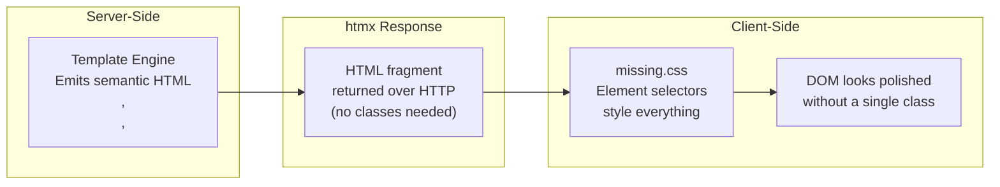
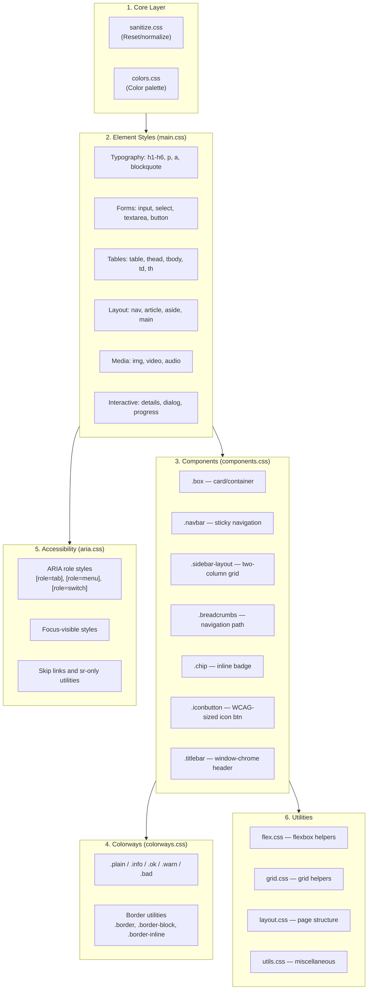
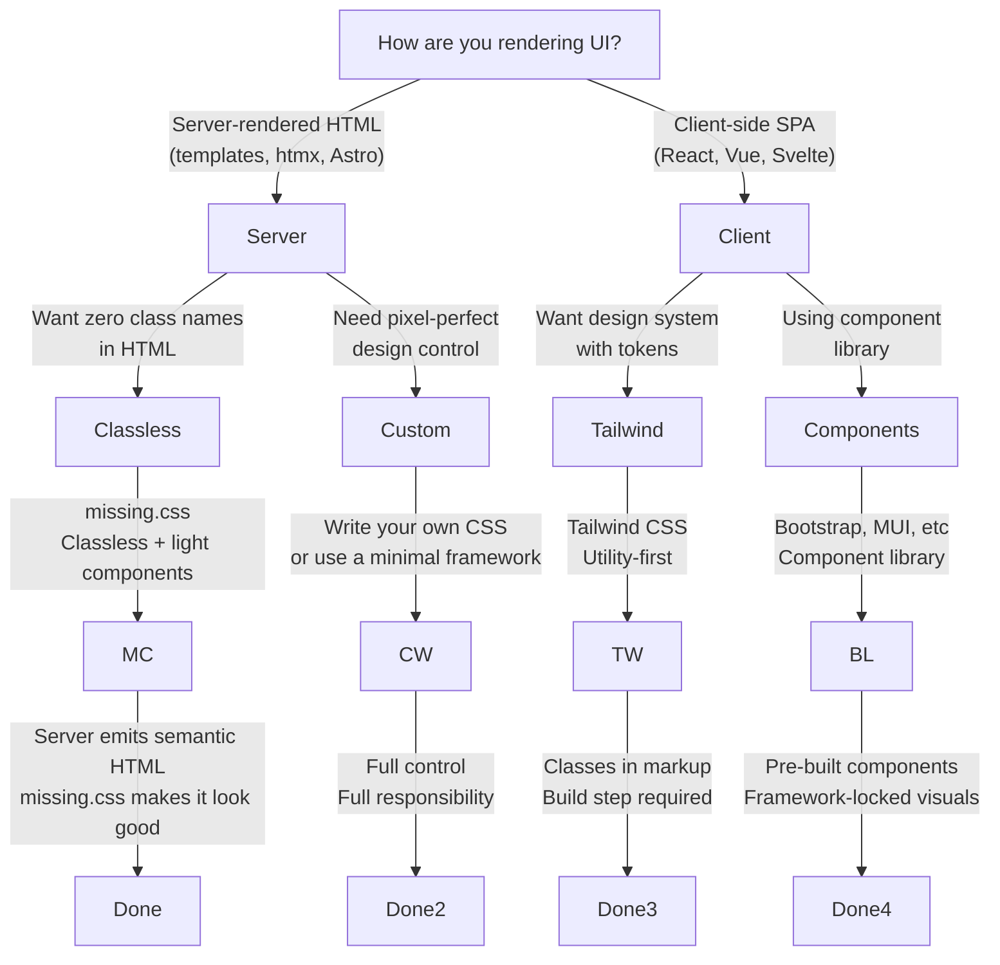

# missing.css — The Classless CSS Library We Wished Already Existed

missing.css is a classless CSS library that styles raw semantic HTML elements automatically, so you never need to write `<div class="card">` or `<button class="btn btn-primary btn-lg">` to get a polished result. Just write `<button>`, `<table>`, `<nav>`, `<article>`, `<blockquote>` and they look good by default. When you need more control than classless styling provides, missing.css layers on lightweight component classes like `.box`, `.navbar`, `.sidebar-layout`, and `.breadcrumbs` — all built on CSS custom properties rather than hardcoded values. The core promise is simple: your semantic HTML should look like a finished product before you write a single class name.

This document is part of the htmx ecosystem documentation. missing.css provides the styling layer that makes htmx's server-rendered HTML fragments look polished without any build step, CSS framework, or class name coordination between frontend and backend developers. For the broader ecosystem context, see [00-overview.md](00-overview.md). For how htmx returns HTML fragments, see [01-htmx-core.md](01-htmx-core.md).

---

## Package Metadata

missing.css ships as an npm package with a clean export map that lets you import the full bundle or individual modules.

```
File: missing/package.json
{
  "name": "missing.css",
  "author": "Deniz Akşimşek <deniz@denizaksimsek.com> (https://dz4k.com)",
  "version": "1.3.0",
  "description": "missing.css is the CSS library we wished already existed.",
  "repository": "github:bigskysoftware/missing",
  "keywords": ["css", "classless-css"],
  "license": "BSD 2-Clause",
  "homepage": "https://missing.style",
  "main": "./dist/missing.min.css",
  "exports": {
    ".": "./dist/missing.min.css",
    "./*": "./dist/*",
    "./prism": "./dist/missing-prism.min.css"
  }
}
```

The version 1.3.0 indicates a mature, production-ready library. The `github:bigskysoftware/missing` repository places it under the BigSkySoftware umbrella — the same organization behind htmx itself. The BSD 2-Clause license is permissive enough for commercial use without copyleft concerns.

---

## The Classless Philosophy

To understand why missing.css exists, you need to understand what problem it solves in the CSS ecosystem.

### Three Approaches to CSS

**Utility-first (Tailwind CSS):** You write `<button class="px-4 py-2 bg-blue-600 text-white rounded-lg hover:bg-blue-700 focus:ring-2 focus:ring-blue-300">`. Every visual detail is declared through utility classes. The HTML carries its styling vocabulary on its sleeve. This gives you maximum control but couples your markup to your CSS framework. Change frameworks and every element needs rewriting. Server-rendered HTML fragments must carry their class names with them.

**Component-first (Bootstrap):** You write `<button class="btn btn-primary btn-lg">`. Pre-built components give you consistent patterns but impose a specific visual language. Customization requires overriding component classes or using a theme builder. The class names are semantic-ish but still coupled to the framework's component taxonomy.

**Classless (missing.css):** You write `<button>`. That is all. The button looks like a button because the browser's native `<button>` element is styled by default. No classes needed. When the server returns `<table>` in an htmx response, it looks like a proper table immediately. When it returns `<nav>`, it looks like navigation.

The classless approach respects HTML's original design. HTML elements carry semantic meaning. A `<table>` is a table. A `<nav>` is navigation. A `<blockquote>` is a quotation. Classless CSS says these elements should look like what they mean, without requiring the author to remember which class name to apply.

### Why Classless Pairs Perfectly with htmx

htmx returns server-rendered HTML fragments. The backend developer writes templates that emit semantic HTML. With missing.css loaded, that HTML arrives in the browser looking polished — no CSS framework on the frontend, no build step, no coordination needed between what classes the server emits and what classes the CSS expects. The backend developer writes `<table>` and it looks like a proper table. This is the natural pairing: htmx delivers HTML, missing.css makes it beautiful.



### The Assembly Architecture

missing.css itself is assembled from focused modules. The main entry point `missing.css` imports everything in order:

```css
/* missing/src/missing.css — assembly file */
@import url(core/sanitize.css);
@import url(core/colors.css);
@import url(main.css);
@import url(components.css);
@import url(aria.css);
@import url(colorways.css);
@import url(variables.css);
@import url(layout.css);
@import url(utils.css);
@import url(flex.css);
@import url(grid.css);
```

Each module has a clear responsibility. The core layer provides the reset and color palette. The main layer styles every HTML element. Components layer adds optional classes. The aria layer handles accessibility. The colorways layer provides theming. Variables centralize custom properties. Layout, flex, and grid provide structural utilities.



---

## Typography System

missing.css treats typography as the foundation of readable web content. Every text element receives careful attention to font sizing, line heights, and visual rhythm.

### Font Stack

The default font stack uses Source Sans 3 (or Source Sans Pro) with system fallbacks:

```
--main-font: 'Source Sans 3', 'Source Sans Pro', -apple-system, system-ui, sans-serif
--display-font: same as secondary (headings use the UI font family)
--mono-font: 'M Plus Code Latin', monospace
```

Headings use `--display-font`, body text uses `--main-font`, and code uses `--mono-font`. The monospace stack lists `monospace` twice — this stops browsers from shrinking the font, a known quirk in some rendering engines.

### Heading Scale

The heading sizes follow a measured progression:

| Element | Size | Line Height | Notes |
|---------|------|-------------|-------|
| `h1` | 2em | 2 * rhythm | No letter-spacing, no text-transform |
| `h2` | 1.6em | 1.5 * rhythm | Same |
| `h3` | 1.17em | 1 * rhythm | |
| `h4`–`h6` | 1em | 1 * rhythm | No text-transform, no letter-spacing |

Notice what is absent: `text-transform: uppercase` on headings, exaggerated `letter-spacing`, and arbitrary font weights. missing.css avoids these common design mistakes. Headings are distinguished by size alone, not by shouting.

Consecutive headings receive reduced top margin. When `h2` follows `h1`, the margin collapses to a single `--gap` rather than the normal double gap. This prevents the visual awkwardness of stacked headings with excessive breathing room.

Target headings get a visual indicator. When a heading matches the URL fragment (`:target`), missing.css draws a colored bar at the left edge using the accent color. This helps users understand which section they navigated to:

```css
h1:target, h2:target, h3:target, h4:target, h5:target, h6:target {
  outline: none;
  &::before {
    content: "";
    display: block;
    position: absolute;
    inset-inline-start: -.5em;
    inline-size: 4px;
    block-size: 100%;
    background: var(--accent);
  }
}
```

### Paragraphs, Lists, and Blockquotes

Paragraphs get `margin-block: var(--gap)` — a single rhythm unit of spacing. Lists use the same gap for padding, with nested lists using a smaller indent. List markers use `--secondary-font` for visual distinction from body text.

Blockquotes are styled with a left border in the graphical foreground color, italic text, and muted foreground color. They use a slightly larger font size (1.1em) for emphasis. The inner formatting is careful about nested emphasis: if a blockquote contains `<em>`, `<cite>`, `<var>`, `<i>`, or `<address>`, those elements have their italic style removed, preventing double-italic rendering when the quote itself is already italic.

### Inline Text Semantics

Links use dotted underlines by default, switching to solid on hover. The underline thickness grows from 1px to 2px on hover — a subtle but clear affordance. Link color uses `--accent` (blue by default).

Code, `<samp>`, and `<kbd>` use the monospace font. `<kbd>` nested inside another `<kbd>` gets a raised-key appearance with a 3px bottom border (the classic "outset" keyboard key look). This follows the WHATWG HTML specification's pattern for marking up keyboard shortcuts.

`<mark>` highlights with the warning colorway background and foreground. `<ins>` (inserted text) uses the OK colorway (green). `<del>` (deleted text) uses the bad colorway (red). `<s>` (strikethrough) renders in red — semantically appropriate for "this is no longer valid."

---

## Form Styling

missing.css styles every form element consistently. The design philosophy here is that forms should feel like native OS controls, not web 2.0 artifacts.

### Text Inputs and Textareas

Text inputs (`[type=text]`, `[type=email]`, `[type=password]`, `[type=search]`, `[type=tel]`, `[type=url]`, `[type=number]`, `[type=date]`, and more), `<select>`, and `<textarea>` share a common style:

- Background: `--bg` (page background)
- Border: `--graphical-fg` (subtle gray)
- Border radius: `--interactive-border-radius` (0.2rem)
- Font: `--main-font` at 1rem
- Padding: `calc(var(--rhythm) / 4)` — compact but not cramped

On focus, the border color shifts to `--accent`. This provides a clear visual indicator without the heavy default browser outline. Placeholder text is rendered in `--muted-fg` and right-aligned — a design choice that keeps the placeholder from looking like entered content.

Default inline size for text inputs and selects is `20ch` — wide enough for most values but not excessively so. Elements with explicit `size` or `cols` attributes override this.

### Buttons

Buttons are the most styled form element in missing.css. The button selector targets `<button>`, `[type=submit]`, `[type=reset]`, `[type=button]`, and the class `.\<button\>` (the escaped class name lets you write `<a class="<button>">` to style a link as a button).

Default button style:
- Background: `--interactive-bg` (light gray in light mode, dark gray in dark mode)
- Font: `--secondary-font` at 0.8rem
- Border: `--muted-fg`
- Box shadow: subtle drop shadow (`0 2px 4px -2px var(--fg)`)
- Min height: `--rhythm` (1.4rem)

Hover and focus-visible increase brightness by 10% (`brightness(1.1)`) and shift the shadow. Active state removes the shadow entirely — the button appears to press down. Disabled buttons get `cursor: not-allowed` and a dimmed shadow.

**Primary buttons** are created by wrapping in `<strong>`:

```html
<strong><button>Save Changes</button></strong>
```

The `strong > button` selector inverts colors: accent background with background-color foreground, transparent border, and bold font. This uses HTML semantics (importance via `<strong>`) rather than a utility class to convey visual hierarchy.

Buttons support semantic state via ARIA attributes. `aria-pressed=true` or `aria-expanded=true` triggers a pressed state with an inset shadow. The colorways classes (`.plain`, `.info`, `.ok`, `.warn`, `.bad`) work on buttons too, remapping the interactive colors to the chosen semantic palette.

### Fieldsets and Legends

`<fieldset>` renders as a bordered box with rounded corners, matching the `.box` component style. The `<legend>` naturally positions itself on the top border as the browser's UA stylesheet intends — missing.css does not fight this.

### Select Elements

The `<select>` element receives special attention. missing.css anticipates the upcoming `appearance: base-select` CSS feature and provides progressive enhancement:

- When `base-select` is supported, the native picker icon is replaced with a custom chevron SVG (defined as `--chevron-down-icon` in variables.css).
- The `::picker-icon` pseudo-element masks the SVG with the accent color.
- For multi-select elements, `::checkmark` pseudo-elements show checkmarks next to selected options.

Until `base-select` is widely supported, the default select renders with the browser's native appearance but with missing.css's border and background colors applied.

### Toggle Switches

The aria.css module styles `input[type=checkbox][role=switch]` as a toggle switch. This uses CSS grid layout, `::before`/`::after` pseudo-elements, and `calc()` translations. The checked state animates the nub to the opposite side. The `:indeterminate` state centers the nub. RTL support is handled via `:dir(ltr)`/`:dir(rtl)` pseudo-class variables — a clever workaround until CSS logical `translate` properties are universally supported.

---

## Table Styling

Tables in missing.css are clean and readable without being ornamental:

- `font-variant-numeric: tabular-nums` ensures numbers align vertically in columns
- `<caption>` uses italic secondary-font, left-aligned
- `<thead>` and `<tbody>` are separated by a subtle border in `--faded-fg`
- `<th>` uses secondary-font, left-aligned text (not centered — a deliberate choice for readability)
- `<td>` and `<th>` have `vertical-align: top` and right padding of `--rhythm` on non-last cells
- No zebra striping, no hover highlighting, no alternating row colors

The table design is intentionally minimal. Data tables should communicate structure through alignment and spacing, not through decorative patterns. The tabular-nums property alone makes missing.css tables significantly more readable than default browser tables when displaying numbers.

---

## Navigation and Layout

missing.css styles semantic layout elements out of the box.

### Navigation

The `<nav>` element's links receive special treatment. Links inside `<nav>` have no underline by default and use the accent color. On hover and focus, they gain an underline. This distinguishes navigation links from body links (which are underlined by default).

### Main Content Area

`<main>` is constrained to `--eff-line-length`, which calculates the effective line length as the minimum of the available width minus rhythm padding, or `--line-length` (40rem — approximately 70-80 characters). The content is centered with `margin-inline: auto`. This enforces readable line lengths without requiring any wrapper divs or container classes.

### Aside

`<aside>` renders with a smaller font size (0.8em), tighter line height, and top/bottom borders. It is visually distinct from body content. When given the `.big` or `.<big\>` class, it transforms into a pull quote: left border only, italic, accent-colored text, no background.

### Header and Footer

`<body > header>` and `<body > footer` receive full-width padding that respects the line-length constraint. Header uses display font family. Footer uses secondary font at 0.8em. Both have border separators from the main content.

---

## Colorways Theming System

Colorways is missing.css's approach to consistent theming. Rather than defining arbitrary color variables, missing.css provides five semantic colorways, each with foreground, background, and graphical variants:

| Colorway | Purpose | Light Mode | Dark Mode |
|----------|---------|------------|-----------|
| `.plain` | Neutral/default | Gray palette | Gray palette |
| `.info` | Informational | Blue-11/Blue-2 | Blue tones |
| `.ok` | Success | Green-11/Green-2 | Green tones |
| `.warn` | Warning | Yellow-11/Yellow-2 | Yellow tones |
| `.bad` | Error/Danger | Red-11/Red-2 | Red tones |

Each colorway sets three custom properties:
- `--box-bg` — background for boxes/cards
- `--accent` — foreground/accent color
- `--graphical-fg` — color for borders and decorative elements

These properties cascade into all child elements. When you apply `.ok` to a container, every box, button, border, and accent inside inherits the green colorway. This is how missing.css achieves themed components without per-component color definitions.

```css
/* missing/src/colorways.css — excerpt */
.plain {
  --box-bg: var(--plain-bg);
  --accent: var(--plain-fg);
  --graphical-fg: var(--plain-graphical-fg);
}

.info {
  --box-bg: var(--info-bg);
  --accent: var(--info-fg);
  --graphical-fg: var(--info-graphical-fg);
}

.ok {
  --box-bg: var(--ok-bg);
  --accent: var(--ok-fg);
  --muted-accent: light-dark(var(--green-7), var(--green-5));
  --graphical-fg: var(--ok-graphical-fg);
}

.warn {
  --box-bg: var(--warn-bg);
  --accent: var(--warn-fg);
  --muted-accent: light-dark(var(--yellow-7), var(--yellow-5));
  --graphical-fg: var(--warn-graphical-fg);
}

.bad {
  --box-bg: var(--bad-bg);
  --accent: var(--bad-fg);
  --muted-accent: light-dark(var(--red-7), var(--red-5));
  --graphical-fg: var(--bad-graphical-fg);
}
```

The `light-dark()` CSS function handles automatic light/dark mode switching based on the `color-scheme` property. No JavaScript, no media queries, no duplicate theme definitions. The browser picks the correct value.

---

## Component Classes

When classless styling is not enough — when you need cards, navbars, or sidebar layouts — missing.css provides lightweight component classes. These are not full framework components with dozens of sub-classes. They are small, focused patterns built on the same custom property system.

### The .box Class

`.box` is the foundational component. It renders as a contained card with:

- Padding of `--gap`
- Background of `--box-bg`
- Border on all sides using `--graphical-fg`
- Border radius of `--border-radius`
- Overflow clipped

It also styles elements that semantically represent boxes: `<figure>`, `<details>`, `<dialog>`, `[role=menu]`, `[role=tabpanel]`, and sidebar layout headers. These all share the same visual language.

### .titlebar

The `.titlebar` class creates a window-chrome-style header that spans the full width of its `.box` parent. It uses the graphical foreground as background color, background as text color, and applies a text shadow for depth. Links inside a titlebar inherit the background color so they remain visible.

### .sidebar-layout

The `.sidebar-layout` class creates a two-column grid layout at widths above 75ch. The sidebar uses `--sidebar-width` (25ch) and the main content fills the remaining space. The header element inside the layout serves as the sidebar navigation with a right border separator. Below 75ch, it falls back to a single-column layout.

### .navbar

The `.navbar` class creates a sticky horizontal navigation bar with `inset-block-start: 0` and `z-index: 5`. Links are bold with no underline (underline on hover). The current page link (`[aria-current=page]`) gets a colored indicator bar below it. With the `.expanded` class, the navbar becomes a vertical menu — useful for mobile or collapsed states.

### .breadcrumbs

The `.breadcrumbs[aria-label]` class renders a navigation path using `display: inline list-item` and CSS `content` for separators. The separator changes based on ARIA state: `/` for `[aria-current=page]` and `>` for `[aria-current=step]`. The current item is bold.

### .chip

The `<chip>` element (or `.chip` class) renders as an inline badge with a rounded border using the accent color. Useful for tags, labels, and status indicators.

### .iconbutton

The `.iconbutton` class creates a circular button sized to WCAG target dimensions (24px for AA, 44px for AAA with `.big`). It has no background or border by default, shows an outline on hover/focus, and uses `border-radius: 50%` for the circular shape.

---

## Accessibility

missing.css takes accessibility seriously. The `aria.css` module provides styles for ARIA roles that go beyond what browsers implement natively.

### ARIA Role Styles

Tabs, menus, menu items, listboxes, and toggle switches all receive proper styling that matches their semantic role. Tab panels connect visually to their tab via shared borders. Menu items highlight on focus with accent background and inverted text. Toggle switches animate smoothly between states.

```css
/* missing/src/aria.css — excerpt: ARIA tab styling */
[role=tab]:not([specificity-hack]) {
  margin: 0;
  position: relative;
  inset-block-end: calc(-1 * var(--border-block-start-width));
  border: var(--border-block-start-width) var(--border-block-start-style) var(--graphical-fg);
  border-start-start-radius: var(--tab-border-radius);
  border-start-end-radius: var(--tab-border-radius);
  border-end-start-radius: 0;
  border-end-end-radius: 0;

  &:active, &[aria-selected=true] {
    background: var(--box-bg);
    border-block-end: var(--border-block-start-width) var(--border-block-start-style) transparent;
  }

  &:focus-visible {
    color: var(--accent);
    text-decoration: underline;
  }
}
```

Tabs use `inset-block-end` to overlap the tab panel's top border, creating the visual effect of a connected tab. The selected tab fills with the box background and removes its bottom border, appearing to "open" into the panel.

### Focus Styles

All interactive elements receive `:focus-visible` styling that uses the accent color for borders or outlines. This ensures keyboard users see clear focus indicators. The `:focus-visible` pseudo-class (rather than `:focus`) means mouse users do not see focus rings on click — only keyboard navigation triggers them.

### WCAG Target Sizes

The `.iconbutton` class explicitly sizes to `--wcag-target-size-aa` (24px) and `--wcag-target-size-aaa` (44px). This ensures touch targets meet accessibility guidelines. These sizes are defined as CSS custom properties so they can be overridden for different accessibility requirements.

---

## Prism.js Theme Integration

missing.css ships with a syntax highlighting theme for Prism.js, available as a separate export:

```css
/* missing/src/missing-prism.css — excerpt */
.token.comment, .token.prolog, .token.doctype, .token.cdata {
  color: var(--muted-fg);  /* Gray — recedes from attention */
}

.token.property, .token.tag, .token.boolean, .token.number, .token.deleted {
  color: var(--bad-fg);  /* Red — keywords, tags, constants */
}

.token.selector, .token.attr-name, .token.string, .token.inserted {
  color: var(--ok-fg);  /* Green — strings, selectors */
}

.token.operator, .token.entity, .token.url, .token.variable {
  color: var(--warn-fg);  /* Yellow — operators, URLs */
}

.token.atrule, .token.attr-value, .token.keyword {
  color: var(--info-fg);  /* Blue — keywords, at-rules */
}
```

The Prism theme reuses the same colorway variables as the rest of missing.css. This means code blocks automatically match the current theme (light or dark) and the current colorway if one is active. No separate syntax theme configuration is needed. The theme maps token types to semantic colors: comments are muted, keywords are informational, strings are OK, operators are warnings. This semantic mapping is more meaningful than arbitrary color assignments.

To use it, import `missing.css/prism` alongside the main bundle:

```html
<link rel="stylesheet" href="missing.min.css">
<link rel="stylesheet" href="missing-prism.min.css">
```

---

## Decision Flowchart: When to Use What

Not every project needs missing.css. Not every project needs Tailwind. The right choice depends on your rendering model, your team structure, and your complexity tolerance.



The decision tree shows the key branch point: if you are server-rendering HTML and want it to look good without writing classes, missing.css is the right choice. If you need pixel-perfect design control, you need custom CSS. If you are building an SPA and want a design system, Tailwind fits. If you want pre-built components, a component library works.

---

## Aha Moment

missing.css and htmx are a natural pairing because htmx returns server-rendered HTML fragments, and missing.css makes semantic HTML look polished without any coordination between frontend and backend developers. When the server emits `<table>`, missing.css makes it look like a proper table. When the server emits `<nav>`, it looks like navigation. When the server emits `<blockquote>`, it looks like a quotation. No CSS framework on the frontend, no build step, no class name collisions, no div soup. The backend developer writes HTML. The CSS handles the rest. This is what the web was supposed to be.

---

## Integration with htmx

The combination of htmx and missing.css creates a powerful development pattern for server-driven applications:

1. **htmx triggers an action** — a button click, a form submission, a poll interval.
2. **The server processes the request** and returns an HTML fragment.
3. **htmx swaps the fragment** into the DOM.
4. **missing.css styles the new content** automatically — no re-rendering, no class synchronization, no JavaScript execution.

This workflow means the server-side developer never needs to think about CSS classes. They write semantic HTML templates. missing.css handles the presentation. This separation of concerns is clean in a way that utility-first CSS cannot achieve — with Tailwind, the server template must carry CSS classes that match the frontend framework's expectations. With missing.css, the server just writes HTML.

For related styling approaches in the htmx ecosystem, see [05-fixi-family.md](05-fixi-family.md) which covers the lightweight htmx variants. For cross-cutting concerns like accessibility and performance across all htmx ecosystem tools, see [07-cross-cutting.md](07-cross-cutting.md).
