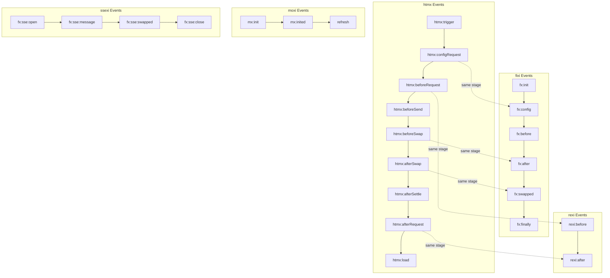
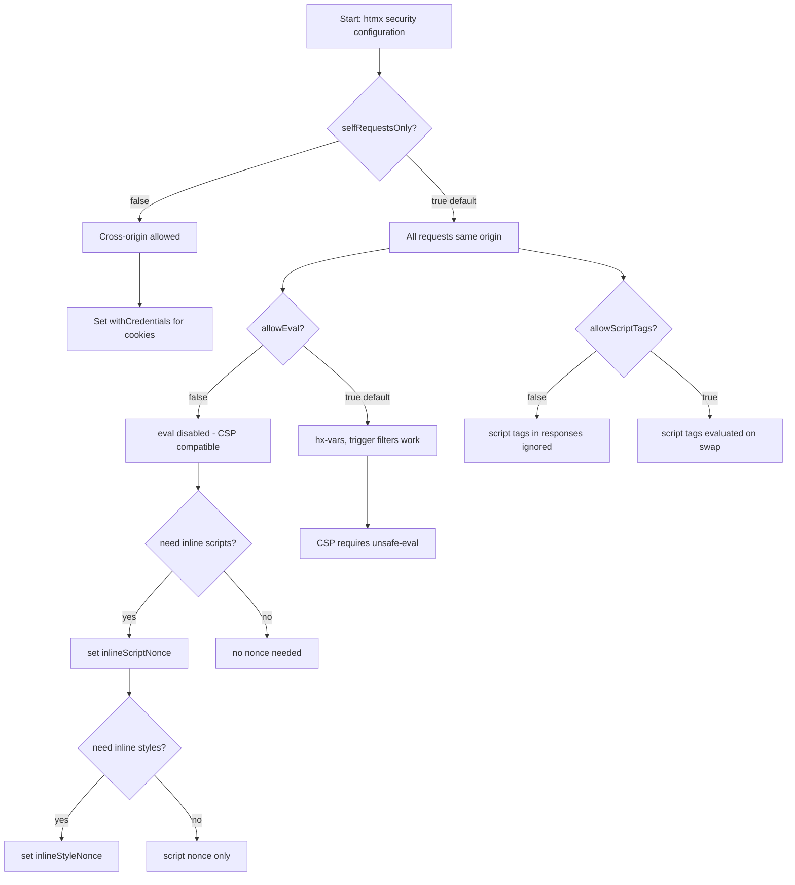

# Cross-Cutting Concerns

The htmx ecosystem shares a single core design pattern across every project: intercept a user action, make a request, swap HTML into the DOM. The difference between the five libraries is not capability -- it is surface area. htmx handles every edge case with 5342 lines and 23 extensions. fixi handles the common case with 90 lines and delegates everything else to custom events. Understanding how these libraries converge on the same pattern -- and where they diverge -- is essential for choosing the right tool, migrating between them, or building on top of any of them.

## Extension Systems Compared

Each library in the ecosystem provides a way to extend its behavior. The approaches differ dramatically in mechanism, power, and complexity.

### htmx Extensions: defineExtension()

htmx extensions are registered via `htmx.defineExtension(name, extensionObject)`. The extension object is a map of lifecycle event handlers that hook into htmx's internal event system. An extension can intercept request configuration, modify the response, add custom swap strategies, or run arbitrary code after DOM swaps.

The extension system is built directly into htmx's event architecture. Every extension gets a chance to participate in every phase of the request lifecycle.

```javascript
// htmx/dist/htmx.js -- defineExtension registration
htmx.defineExtension = defineExtension
htmx.removeExtension = removeExtension
```

htmx ships with 23 extensions in `dist/ext/`, covering everything from SSE (`sse.js`) and WebSockets (`ws.js`) to morphdom swapping (`morphdom-swap.js`), path parameters (`path-params.js`), JSON encoding (`json-enc.js`), loading states (`loading-states.js`), and Alpine.js morph integration (`alpine-morph.js`). Each extension is a self-contained module that calls `defineExtension()` and registers handlers for the specific lifecycle events it cares about.

The htmx extension model is the most powerful in the ecosystem. An extension can:

- Add new swap strategies by registering a `handleSwap(swapStyle, target, content, swapSpec)` method
- Modify outgoing requests via `onEvent("htmx:configRequest", ...)`
- Transform responses via `onEvent("htmx:beforeSwap", ...)`
- Run post-swap initialization via `onEvent("htmx:afterSwap", ...)`
- Inject custom headers, parameters, or validation logic

### fixi Plugins: Custom Event Hooks

fixi has no formal extension API. Instead, it emits custom events at every lifecycle stage, and extensions work by listening to those events and mutating the configuration object.

The key event is `fx:config`. When fixi is about to make a request, it fires `fx:config` with the full `cfg` object. A plugin listens to this event, replaces `cfg.fetch` with its own implementation, and fixi calls the replacement transparently.

```javascript
// fixi/fixi.js:32 -- fx:config event that plugins hook into
let go = send(elt, "config", {cfg, requests:reqs})
if (cfg.preventTrigger) evt.preventDefault()
if (!go || cfg.drop) return
```

The `send()` helper dispatches a `CustomEvent` with `cancelable: true` and `bubbles: true`. If any listener returns `false`, the event is canceled and the request is aborted. This is the entire extension mechanism: one event, one configuration object, one chance to intercept.

This approach is dramatically simpler than htmx's. There is no `defineExtension()` API, no extension registry, no lifecycle method names to memorize. There is just `addEventListener("fx:config", ...)` and whatever you do with `cfg` is your business.

The ssexi SSE plugin is the canonical example. It listens to `fx:config`, checks if the response is `text/event-stream`, and if so, replaces `cfg.fetch` with an SSE reader that parses server-sent events and swaps them into the DOM one at a time.

```javascript
// ssexi/ssexi.js:25 -- ssexi hooks fx:config to replace fetch with SSE reader
document.addEventListener("fx:config", (evt)=>{
    let cfg = evt.detail.cfg, realFetch = cfg.fetch
    cfg.headers.Accept ??= "text/html, text/event-stream"
    cfg.fetch = async(url, options)=>{
        // ... SSE streaming logic
    }
})
```

### moxi Extensions: XPath + Live Attributes

moxi uses a different model entirely. Extensions are not registered -- they are declared as HTML attributes. The `live` attribute contains an async function body that runs whenever the DOM changes. The `on-*` attributes (`on-click`, `on-init`, `on-mx:message`) attach event handlers.

moxi uses `document.evaluate()` with XPath to find elements with `live` or `on-*` attributes, then compiles the attribute value into an async function. The function receives four implicit arguments: `q` (query proxy), `wait` (promise helper), `trigger` (event dispatcher), and `debounce` (debounce utility).

```javascript
// moxi/moxi.js:14 -- XPath evaluation for live/on- attributes
let r = doc.evaluate("descendant-or-self::*[@live or @*[starts-with(name(),'on-')]]", n, null, 7, null)
for (let i = 0; i < r.snapshotLength; i++) init(r.snapshotItem(i))
```

### hyperscript Commands: Language Extension

hyperscript is a full scripting language. Its extension system lets you register new commands, features, and grammar constructs. A command extension adds a new verb to the language. A feature extension adds a new capability.

The hyperscript command registry is the most complex extension system in the ecosystem because it operates at the language level, not the event level. Extensions define new grammar rules, parse trees, and code generation logic.

### Extension System Comparison

| Aspect | htmx | fixi/moxi/rexi | hyperscript |
|--------|------|----------------|-------------|
| Registration | `defineExtension()` | `addEventListener()` | Command registry |
| Mechanism | Lifecycle method map | Custom event listeners | Grammar + codegen |
| Power | Full lifecycle access | Config mutation only | Full language extension |
| Complexity | High (23 built-ins) | Low (0 built-ins) | Very high (full parser) |
| Lines of API | ~50 in core | 0 (just events) | ~2000 in parser |
| Entry point | `htmx.defineExtension` | `document.addEventListener` | `_hyperscript.addCommand` |

## Event Lifecycles Compared

Every library in the ecosystem defines its own custom event vocabulary. But beneath the different names, the lifecycle stages are the same: initialize, configure, send, receive, swap, finalize.



The diagram above shows that all five libraries emit events at the same logical stages, just with different names. The mapping is:

| Lifecycle Stage | htmx | fixi | moxi | rexi | ssexi |
|----------------|------|------|------|------|-------|
| Initialization | `htmx:load` (per element) | `fx:init` | `mx:init` | N/A | N/A |
| Configuration | `htmx:configRequest` | `fx:config` | N/A | N/A | N/A |
| Before Send | `htmx:beforeRequest`, `htmx:beforeSend` | `fx:before` | N/A | `rexi:before` | N/A |
| After Receive | `htmx:beforeSwap` | `fx:after` | N/A | `rexi:after` | `fx:sse:message` |
| After Swap | `htmx:afterSwap` | `fx:swapped` | N/A | N/A | `fx:sse:swapped` |
| Finalization | `htmx:afterRequest` | `fx:finally` | N/A | N/A | `fx:sse:close` |
| Connection Open | N/A | N/A | N/A | N/A | `fx:sse:open` |
| DOM Scan Complete | `htmx:afterProcessNode` | `fx:inited` | `mx:inited` | N/A | N/A |

htmx has by far the richest event vocabulary, with over 50 distinct event types including fine-grained history events (`htmx:historyCacheHit`, `htmx:historyCacheMiss`, `htmx:historyRestore`), OOB swap events (`htmx:oobBeforeSwap`, `htmx:oobAfterSwap`), and error events (`htmx:sendError`, `htmx:responseError`, `htmx:swapError`).

fixi has seven events, covering the minimal lifecycle. moxi has three. rexi has two. ssexi has five. The pattern is clear: the more a library does internally, the more events it emits to let you intercept and observe.

## Request Patterns Compared

How does each library initiate a server request? The approaches fall into two categories: attribute-driven and JavaScript API.

### Attribute-Driven: htmx, Intercooler, fixi

htmx places request attributes directly on any HTML element. The attribute name encodes the HTTP method, and the value is the URL.

```html
<!-- htmx: method encoded in attribute name -->
<button hx-get="/items" hx-target="#list">Load</button>
<button hx-post="/items" hx-target="#list">Create</button>
<button hx-put="/items/1" hx-target="#list">Update</button>
<button hx-delete="/items/1" hx-target="#list">Delete</button>
<button hx-patch="/items/1" hx-target="#list">Patch</button>
```

Intercooler uses the same pattern but with the `ic-` prefix and slightly different attribute names. The method is part of the attribute name, and the URL is the value.

```html
<!-- intercooler: ic-get-from, ic-post-to, etc. -->
<button ic-get-from="/items" ic-target-element="#list">Load</button>
<button ic-post-to="/items" ic-target-element="#list">Create</button>
```

fixi separates the action (URL) from the method (HTTP verb) into two distinct attributes. This is the cleanest separation of concerns.

```html
<!-- fixi: action and method as separate attributes -->
<button fx-action="/items" fx-method="GET">Load</button>
<button fx-action="/items" fx-method="POST">Create</button>
<form fx-action="/items" fx-method="POST">
    <input name="name">
    <button type="submit">Submit</button>
</form>
```

### JavaScript API: rexi

rexi is the only library in the ecosystem that uses a JavaScript API instead of attributes. It exposes `rexi.get()`, `rexi.post()`, `rexi.put()`, `rexi.patch()`, and `rexi.del()` as functions.

```javascript
// rexi: JavaScript API for requests
const resp = await rexi.get("/items")
const html = await resp.text()
document.querySelector("#list").innerHTML = html
```

rexi also exposes shorthand globals: `get()`, `post()`, `put()`, `patch()`, `del()` are all bound to `window`.

### Request Pattern Comparison

| Library | Pattern | Methods | Target |
|---------|---------|---------|--------|
| htmx | `hx-{method}="url"` | GET, POST, PUT, DELETE, PATCH | `hx-target` |
| intercooler | `ic-{method}-{direction}="url"` | GET, POST, PUT, DELETE, PATCH | `ic-target-element` |
| fixi | `fx-action="url"` + `fx-method="VERB"` | Any verb | `fx-target` |
| rexi | `rexi.get(url)` / `rexi.post(url)` | GET, HEAD, POST, PUT, PATCH, DELETE | Manual DOM manipulation |

## Swap Strategies Compared

When the server returns HTML, how does each library insert it into the DOM? The swap strategy determines whether the content replaces an element's inner HTML, replaces the element itself, or is inserted adjacent to it.

| Strategy | htmx | fixi | intercooler | idiomorph | Description |
|----------|------|------|-------------|-----------|-------------|
| `innerHTML` | Yes | Yes | N/A | Yes | Replace element's inner HTML (htmx default) |
| `outerHTML` | Yes | Yes | N/A | Yes | Replace the entire element (fixi default) |
| `beforebegin` | Yes | Yes | N/A | No | Insert before the element as a sibling |
| `afterbegin` | Yes | Yes | N/A | No | Insert as first child of the element |
| `beforeend` | Yes | Yes | N/A | No | Insert as last child of the element |
| `afterend` | Yes | Yes | N/A | No | Insert after the element as a sibling |
| `delete` | Yes | No | N/A | No | Remove the target element entirely |
| `textContent` | Yes | No | N/A | No | Set textContent (no HTML parsing) |
| `none` | Yes | Yes | N/A | No | No swap (useful for side effects) |
| `prepend` | No | No | Yes | No | Insert as first child (Intercooler alias) |
| `append` | No | No | Yes | No | Insert as last child (Intercooler alias) |
| `replace` | No | No | Yes | No | Replace target element (Intercooler alias) |

htmx and fixi share the same six positional strategies via `insertAdjacentHTML`: `innerHTML`, `outerHTML`, `beforebegin`, `afterbegin`, `beforeend`, `afterend`. htmx adds three more: `delete` (removes the target), `textContent` (safe text insertion without HTML parsing), and `none` (no DOM change, useful for extensions that handle the response themselves).

fixi implements swap via a simple dispatch in `doSwap()`:

```javascript
// fixi/fixi.js:58-65 -- swap implementation
let doSwap = ()=>{
    if (cfg.swap instanceof Function)
        return cfg.swap(cfg)
    else if (/(before|after)(begin|end)/.test(cfg.swap))
        cfg.target.insertAdjacentHTML(cfg.swap, cfg.text)
    else if(cfg.swap in cfg.target)
        cfg.target[cfg.swap] = cfg.text
    else if(cfg.swap !== 'none') throw cfg.swap
}
```

If `cfg.swap` is a function, call it with the full config. If it matches a positional pattern, use `insertAdjacentHTML`. If it is a property name on the target element (`innerHTML`, `outerHTML`, `textContent`), assign directly. Otherwise, throw -- unless it is `none`.

htmx's swap implementation is more complex, handling OOB swaps, morphing via idiomorph, view transitions, and scroll preservation. But the core logic is the same: dispatch on the swap style name and insert the HTML accordingly.

## Auto-Initialization Patterns

How does each library find and activate its elements? This is the first thing that happens when the page loads, and it determines how the library handles dynamically-added content.

### htmx: Attribute Scanning

htmx scans the DOM for `hx-*` attributes via `htmx.process(elt)`. The `process()` function walks the element tree, finds all elements with htmx attributes, and sets up event listeners. It is called on `DOMContentLoaded` for the initial page, and can be called manually after dynamic content is added.

htmx does not use a `MutationObserver` by default. Dynamic content must be processed explicitly via `htmx.process()` or through the response handling pipeline (which calls `processNode()` on swapped content automatically).

### fixi/moxi: MutationObserver

Both fixi and moxi use a `MutationObserver` to watch for new elements. When a node is added to the DOM, the observer fires and the library processes the new node.

```javascript
// fixi/fixi.js:2-4 -- MutationObserver for auto-initialization
document.__fixi_mo = new MutationObserver((recs)=>
    recs.forEach((r)=>r.type === "childList" && r.addedNodes.forEach((n)=>process(n))))
```

moxi goes further. It watches for `childList`, `attributes`, and `characterData` changes, and also listens for `input` and `change` events to trigger re-computation of `live` expressions.

```javascript
// moxi/moxi.js:104-108 -- MutationObserver with attribute watching
doc.__moxi_mo.observe(de, {childList:1, subtree:1, attributes:1, characterData:1})
el(doc, "input", recompute, true)
el(doc, "change", recompute, true)
process(doc.body)
```

The MutationObserver approach means fixi and moxi handle dynamic content automatically. Any element added to the DOM is processed without explicit intervention. This is a significant usability advantage for applications that add content via JavaScript.

### Intercooler: jQuery Event Delegation

Intercooler uses jQuery's event delegation to handle dynamic content. Since jQuery delegates events at the document level, elements added after `DOMContentLoaded` are automatically handled. Intercooler also re-scans on `ajaxComplete` events.

### Initialization Comparison

| Library | Initial Scan | Dynamic Content | Mechanism |
|---------|-------------|-----------------|-----------|
| htmx | `DOMContentLoaded` -> `processNode(body)` | Manual `htmx.process()` or automatic via swap | Attribute walker |
| fixi | `DOMContentLoaded` -> `process(body)` | Automatic via `MutationObserver` | `MutationObserver` |
| moxi | `DOMContentLoaded` -> `process(body)` | Automatic via `MutationObserver` + input/change | `MutationObserver` + XPath |
| rexi | None (JavaScript API) | N/A | Direct function calls |
| intercooler | `DOMContentLoaded` -> scan | jQuery event delegation | jQuery delegation |

## Security Model

htmx's security configuration is the most sophisticated in the ecosystem. It provides four independent knobs that control different attack surfaces: request origin, code evaluation, script tags, and credential transmission.

### selfRequestsOnly

The `selfRequestsOnly` configuration option (default: `true`) blocks all cross-origin requests. When enabled, htmx validates that every request URL has the same origin as the current page.

```javascript
// htmx/dist/htmx.js:241 -- selfRequestsOnly blocks cross-origin requests
selfRequestsOnly: true,
```

This is the single most important security setting. It prevents an attacker from injecting an `hx-get` attribute that fetches data from a third-party server. Without it, any XSS vulnerability could be amplified into a data exfiltration channel.

### allowEval

The `allowEval` configuration option (default: `true`) controls whether htmx uses `eval()`-like functionality. It is needed for `hx-vars`, `hx-vals` with JavaScript expressions, trigger filter conditions, and inline script tag evaluation.

```javascript
// htmx/dist/htmx.js:154 -- allowEval enables eval-like functionality
allowEval: true,
```

Setting `allowEval: false` is the primary way to achieve CSP (Content Security Policy) compatibility. With `eval` disallowed, htmx cannot execute inline JavaScript expressions, but all attribute-driven functionality continues to work.

### Nonce Support

For CSP environments that require nonces on inline scripts and styles, htmx provides `inlineScriptNonce` and `inlineStyleNonce` configuration options.

```javascript
// htmx/dist/htmx.js:163-172 -- nonce configuration for CSP
inlineScriptNonce: '',
inlineStyleNonce: '',
```

When set, these nonces are attached to any `<script>` or `<style>` elements that htmx creates during DOM swaps. This allows htmx to work in strict CSP environments that block all inline scripts and styles without a matching nonce.

### withCredentials

The `withCredentials` option (default: `false`) controls whether htmx sends cookies and authorization headers on cross-site requests. This is only relevant when `selfRequestsOnly: false`.

### CSP Compatibility Matrix

| Setting | Default | CSP Impact | Set to False When |
|---------|---------|------------|-------------------|
| `selfRequestsOnly` | `true` | None | You need cross-origin requests (rare) |
| `allowEval` | `true` | Blocks `unsafe-eval` | Your CSP forbids `eval()` |
| `allowScriptTags` | `true` | None | You don't want `<script>` evaluation in responses |
| `withCredentials` | `false` | None | You need cookies on cross-site requests |
| `inlineScriptNonce` | `''` | Required for strict CSP | Your CSP requires nonces on inline scripts |
| `inlineStyleNonce` | `''` | Required for strict CSP | Your CSP requires nonces on inline styles |

### Security Decision Tree



The decision tree above shows how each security setting cascades. The most common secure configuration for a production application is: `selfRequestsOnly: true`, `allowEval: false`, `inlineScriptNonce: <server-generated>`.

## Testing Strategies

### htmx: web-test-runner + Playwright

htmx uses `@web/test-runner` with Playwright browsers for cross-browser testing. Tests run against Chrome, Firefox, and WebKit. The test runner configuration is in `web-test-runner.config.mjs`.

Tests are organized as HTML files with inline JavaScript that exercises htmx behavior and asserts on DOM state. Each test file loads htmx from the `dist/` directory, performs an action (click, submit, etc.), and verifies the resulting DOM.

The test suite covers the full lifecycle: request configuration, header sending, response handling, swap behavior, OOB swaps, history, events, and extension integration.

### hyperscript: Playwright with Coverage

hyperscript uses Playwright for browser automation, with optional coverage support. Tests verify command execution, event handling, and DOM manipulation across browsers.

### Intercooler: Grunt-Based Runner

Intercooler uses a Grunt-based test runner, reflecting its age (2013-2016 era). Tests are jQuery-dependent and use QUnit-style assertions.

### fixi/moxi/rexi/ssexi: Manual Test HTML

The fixi family ships with `test.html` files that serve as both demonstration and test. These are manual tests -- open the file in a browser and click the buttons. There is no automated test runner.

This is the trade-off for 90-115 line libraries: no test infrastructure, just read the code and verify by hand.

### Testing Comparison

| Library | Framework | Browsers | Automated | Test Files |
|---------|-----------|----------|-----------|------------|
| htmx | web-test-runner + Playwright | Chrome, Firefox, WebKit | Yes | Full suite |
| hyperscript | Playwright | Chrome (with coverage) | Yes | Full suite |
| intercooler | Grunt + QUnit | Single | Yes | Grunt tasks |
| fixi | Manual `test.html` | Any | No | 1 file |
| moxi | Manual `test.html` | Any | No | 1 file |
| rexi | Manual `test.html` | Any | No | 1 file |
| ssexi | Manual `test.html` | Any | No | 1 file |

## Migration Paths

### Intercooler.js to htmx

Intercooler is htmx's direct predecessor. The migration path is straightforward because the attribute patterns are similar.

| Intercooler | htmx | Notes |
|-------------|------|-------|
| `ic-get-from="/url"` | `hx-get="/url"` | Direct rename |
| `ic-post-to="/url"` | `hx-post="/url"` | Direct rename |
| `ic-put-to="/url"` | `hx-put="/url"` | Direct rename |
| `ic-patch-to="/url"` | `hx-patch="/url"` | Direct rename |
| `ic-delete-from="/url"` | `hx-delete="/url"` | Direct rename |
| `ic-target-element="#id"` | `hx-target="#id"` | Attribute rename |
| `ic-select-from-response` | `hx-select` | Same concept |
| `ic-replace-target="true"` | `hx-swap="outerHTML"` | Swap strategy mapping |
| `ic-on-beforeSend` | `hx-on::before-request` | Event handler mapping |
| `ic-indicator="#indicator"` | `hx-indicator="#indicator"` | Same concept |

The migration is mechanical for most attributes. The key difference is that htmx does not require jQuery, so the `ic-*` jQuery event handlers must be rewritten as `hx-on:*` handlers or htmx event listeners.

### htmx to fixi

Migrating from htmx to fixi makes sense when you want a smaller surface area and are willing to handle edge cases manually. The migration requires:

1. Replace `hx-*` attributes with `fx-*` equivalents
2. Replace `hx-get`/`hx-post` with `fx-action` + `fx-method`
3. Replace `hx-target` with `fx-target` (CSS selector)
4. Replace `hx-swap` with `fx-swap` (same strategy names)
5. Replace htmx extensions with event listeners

The fixi event model means you can replicate most htmx extension behavior with `addEventListener`:

```javascript
// Replicating htmx loading-states behavior in fixi
document.addEventListener("fx:before", (e)=>{
    const indicator = document.querySelector(e.detail.cfg.indicator)
    indicator?.classList.add("active")
})
document.addEventListener("fx:finally", (e)=>{
    const indicator = document.querySelector(e.detail.cfg.indicator)
    indicator?.classList.remove("active")
})
```

### fixi to htmx

Going the other direction -- from fixi to htmx -- is useful when you need OOB swaps, history management, WebSocket/SSE support, or any of the 23 built-in extensions. The migration is:

1. Replace `fx-action` with `hx-get`/`hx-post` etc.
2. Replace `fx-method` with the method encoded in the `hx-` attribute
3. Replace `fx-target` with `hx-target`
4. Replace `fx-swap` with `hx-swap` (same names)
5. Replace `addEventListener("fx:...")` with `htmx.on("htmx:...")`

## Performance Considerations

### Bundle Size

The size difference across the ecosystem is dramatic, and it matters for every page load.

| Library | Lines | Minified (approx) | Gzip (approx) | Dependencies |
|---------|-------|-------------------|---------------|--------------|
| hyperscript (max) | 11,981 | ~350 KB | ~90 KB | None |
| hyperscript (std) | 10,526 | ~300 KB | ~75 KB | None |
| htmx | 5,342 | ~50 KB | ~15 KB | None |
| intercooler | 2,084 | ~25 KB | ~8 KB | jQuery |
| idiomorph | 1,390 | ~12 KB | ~4 KB | None |
| rexi | 115 | ~1 KB | ~500 B | None |
| moxi | 110 | ~1 KB | ~500 B | None |
| ssexi | 89 | ~1 KB | ~400 B | None |
| fixi | 90 | ~1 KB | ~400 B | None |

htmx at ~15 KB gzipped is small for what it provides. The fixi family at ~400 bytes each is smaller than a single HTTP header. But size is not the only performance metric.

### DOM Operation Count

Every request cycle performs DOM operations: read the trigger element, collect form data, make the fetch, parse the response HTML, insert into the DOM, process the new nodes.

htmx's DOM operations are optimized for the general case but carry overhead for every feature it supports: event dispatch, extension iteration, OOB swap detection, history management, scroll preservation, and view transition support.

fixi performs the minimal operations: dispatch events, fetch, insert HTML, dispatch swapped event. There is no history management, no OOB swap detection, no extension iteration. The `doSwap()` function is five lines.

For a page that makes one htmx request per user interaction, the difference is negligible -- both complete in well under 16ms. The difference matters when a page makes dozens of requests, or when the device is low-powered.

### Rendering Cost

The rendering cost depends on the swap strategy and the size of the response HTML. `innerHTML` is the cheapest operation (replace children). `outerHTML` is more expensive (replace the element itself, losing event listeners). `beforebegin`/`afterend` are cheap (append siblings) but change the DOM structure.

idiomorph's morphing is the most expensive swap operation because it walks both the old and new DOM trees, matches elements by ID, and applies minimal diffs. But it preserves element state (focus, scroll position, animations) in a way that `innerHTML` cannot.

The trade-off is: `innerHTML` is fast but loses state. idiomorph is slow but preserves state. fixi's `outerHTML` is in between -- it replaces the element but does not try to preserve state.

## Aha: The Core Pattern Is the Same

All five libraries -- htmx, fixi, moxi, rexi, ssexi -- share the same core pattern: intercept a user action, make a request, swap HTML into the DOM. htmx does it with 5342 lines and 23 extensions for maximum flexibility. fixi does it with 90 lines by delegating everything to custom events. The difference is not capability -- it is surface area. htmx handles every edge case. fixi handles the common case and lets events fill the rest.

This means migration between libraries is always possible, because the lifecycle stages are the same. The events have different names, the attributes have different prefixes, but the request-response-swap cycle is identical. You can move from intercooler to htmx by renaming attributes. You can move from htmx to fixi by replacing extensions with event listeners. You can move from fixi to ssexi by adding one `addEventListener("fx:config", ...)`.

The ecosystem is not a collection of competing ideas. It is a single idea expressed at different levels of ambition.

---

**Cross-references:**

- [00-overview.md](00-overview.md) -- Ecosystem map and philosophy
- [01-htmx-core.md](01-htmx-core.md) -- htmx request pipeline and event system
- [02-hyperscript.md](02-hyperscript.md) -- Client-side scripting language
- [03-idiomorph.md](03-idiomorph.md) -- DOM morphing swap strategy
- [04-intercooler.md](04-intercooler.md) -- Intercooler.js predecessor
- [05-fixi-family.md](05-fixi-family.md) -- fixi, moxi, rexi, ssexi deep dive
- [06-missing-css.md](06-missing-css.md) -- Classless CSS styling

---

**Source references:**

- `htmx/dist/htmx.js:154` -- `allowEval: true`
- `htmx/dist/htmx.js:163-172` -- `inlineScriptNonce`, `inlineStyleNonce`
- `htmx/dist/htmx.js:241` -- `selfRequestsOnly: true`
- `htmx/dist/htmx.js:264-268` -- `responseHandling` defaults
- `htmx/dist/htmx.js:317-318` -- `defineExtension` / `removeExtension`
- `fixi/fixi.js:32` -- `fx:config` event dispatch
- `fixi/fixi.js:58-65` -- `doSwap()` implementation
- `fixi/fixi.js:2-4` -- `MutationObserver` initialization
- `rexi/rexi.js:96` -- `rexi:before` event dispatch
- `moxi/moxi.js:95` -- XPath evaluation for attribute scanning
- `ssexi/ssexi.js:25` -- `fx:config` listener for SSE interception
