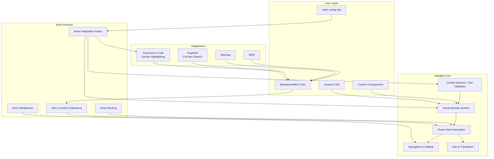
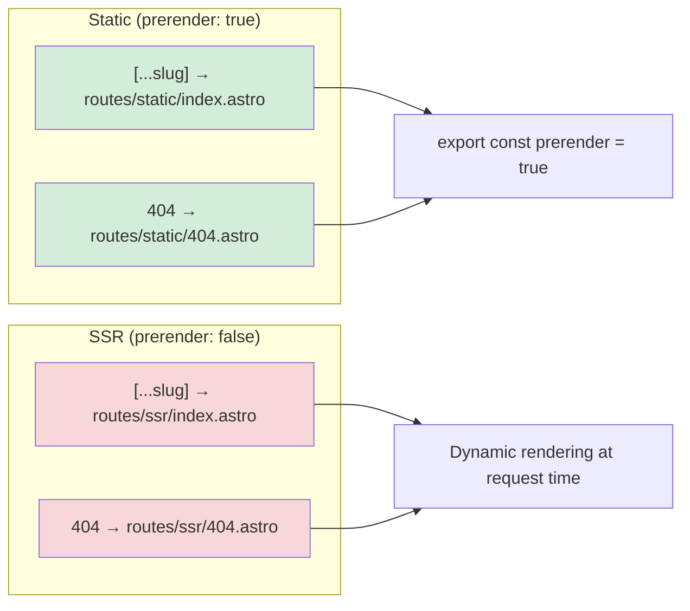
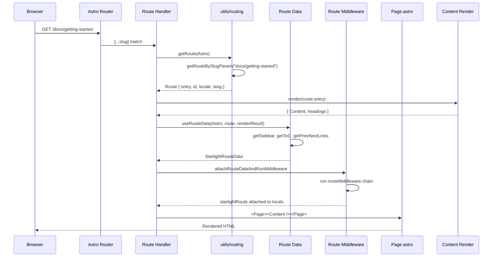

# Starlight Overview

Starlight (`@astrojs/starlight` v0.41.1) is a documentation theme and Astro integration that transforms Markdown and MDX content into polished, high-performance documentation websites with zero configuration beyond a single `title` field. It is built by the Astro team, lives in the same GitHub organization, and is designed to be the default documentation experience for Astro projects. Starlight provides internationalization, sidebar navigation, table of contents, full-text search, syntax-highlighted code blocks, dark/light themes, responsive layouts, and a comprehensive plugin system -- all while shipping under 8 kB of HTML and 27 kB of gzipped JavaScript.

## What Starlight Is

Starlight is not a standalone framework. It is an **Astro integration** -- a package you install and add to your `astro.config.mjs` `integrations` array. Once registered, Starlight hooks into Astro's build lifecycle via the `astro:config:setup`, `astro:config:done`, and `astro:build:done` hooks to inject routes, middleware, Vite plugins, content collection schemas, and Markdown processing extensions. The result is a complete documentation site framework that requires no custom routing, no custom page templates, and no custom CSS to produce a production-ready site.

Source: `packages/starlight/index.ts` -- main integration entry point, 200 lines, defines the `StarlightIntegration` function that returns an `AstroIntegration` object with three lifecycle hooks.

```typescript
// packages/starlight/index.ts:34
export default function StarlightIntegration(
	userOpts: StarlightUserConfigWithPlugins
): AstroIntegration {
	// ... validation
	return {
		name: '@astrojs/starlight',
		hooks: {
			'astro:config:setup': async ({ ... }) => { /* ... */ },
			'astro:config:done': ({ injectTypes }) => { /* ... */ },
			'astro:build:done': async (options) => { /* ... */ },
		},
	};
}
```

## Core Philosophy

Starlight follows three design principles:

1. **Convention over configuration.** Place Markdown files in `src/content/docs/` and they appear in the sidebar, with table of contents, pagination, and search. No routing configuration needed. The `[...slug]` catch-all route handles every page.
2. **Composable overrides.** Every part of Starlight -- components, CSS, schemas, middleware -- can be overridden or extended. The virtual module system (`virtual:starlight/*`) enables component swapping without forking. The plugin system enables feature additions without modifying Starlight's source.
3. **Zero JavaScript by default.** Starlight pages are prerendered to static HTML. JavaScript ships only for interactive features (search modal, theme toggle, mobile menu, sidebar collapse). The size-limit budget enforces 8 kB HTML and 27 kB JS (gzipped) for the `examples/basics` project.

Source: `packages/starlight/package.json` -- size-limit configuration

```json
// packages/starlight/package.json:36
"size-limit": [
  { "path": "examples/basics/dist/index.html", "limit": "8 kB", "gzip": true },
  { "path": "examples/basics/dist/_astro/*.js", "limit": "27 kB", "gzip": true },
  { "path": ["examples/basics/dist/_astro/*.css", "!.../print.*.css"], "limit": "16.75 kB", "gzip": true }
]
```

## Architecture at a Glance

Starlight has a layered architecture with four distinct tiers:



The flow works as follows:

1. **User Layer** -- The developer writes Markdown/MDX files, configures Starlight in `astro.config.mjs`, optionally adds custom CSS and component overrides.
2. **Astro Runtime** -- Astro's integration system invokes Starlight's hooks. Content collections load the Markdown files. Routing resolves the `[...slug]` catch-all. Middleware runs per request.
3. **Starlight Core** -- Config is validated via Zod. Virtual modules expose config and components at build time. Route data is generated for each page. Navigation and i18n are resolved.
4. **Integrations** -- Expressive Code handles syntax highlighting. Pagefind builds a search index. Sitemap generates `sitemap.xml`. MDX enables component usage in content.

## Package Structure

The Starlight monorepo contains five packages:

| Package | Purpose | Path |
|---------|---------|------|
| `@astrojs/starlight` | Core documentation theme | `packages/starlight/` |
| `@astrojs/starlight-tailwind` | Tailwind CSS integration | `packages/tailwind/` |
| `@astrojs/starlight-markdoc` | Markdoc content support | `packages/markdoc/` |
| `@astrojs/starlight-docsearch` | Algolia DocSearch integration | `packages/docsearch/` |
| `file-icons-generator` | File tree icon generation | `packages/file-icons-generator/` |

The core `@astrojs/starlight` package is the focus of this documentation. Its internal structure is:

```
packages/starlight/
├── index.ts                 ← Main integration entry point
├── schema.ts                ← Content collection schemas (docsSchema, i18nSchema)
├── types.ts                 ← Re-exported TypeScript types
├── constants.ts             ← Shared constants (PAGE_TITLE_ID)
├── locals.ts                ← Astro middleware for locals.starlightRoute
├── loaders.ts               ← Content loaders (docsLoader, i18nLoader)
├── route-data.ts            ← Route data types and middleware helper
├── components.ts            ← User component exports (Aside, Badge, Card, etc.)
├── internal.ts              ← Internal utility exports
├── props.ts                 ← Deprecated Props type, StarlightPageProps
├── virtual.d.ts             ← Public virtual module type declarations
├── virtual-internal.d.ts    ← Internal virtual module type declarations
├── expressive-code.mjs      ← Expressive Code integration entry
├── expressive-code.d.ts     ← Expressive Code type declarations
├── components/              ← Internal Astro components (Page, Header, Footer, etc.)
├── components-internals/    ← Internal components (TableOfContents, Icons)
├── user-components/         ← User-facing components (Aside, Badge, Card, Tabs, etc.)
├── integrations/            ← Astro integrations (expressive-code, pagefind, sitemap)
├── routes/                  ← Route templates (static/ and ssr/)
├── schemas/                 ← Zod schemas for config validation
├── style/                   ← CSS files (props.css, reset.css, layers.css, etc.)
├── utils/                   ← Utility functions (navigation, i18n, plugins, routing)
├── utils/routing/           ← Routing utilities (data, middleware, types)
└── translations/            ← Built-in i18n translation JSON files
```

## Key Dependencies

Starlight has 23 runtime dependencies:

| Dependency | Purpose |
|------------|---------|
| `astro ^7.0.2` | Peer dependency, the framework Starlight extends |
| `@astrojs/mdx ^7.0.0` | MDX support for component-aware content |
| `@astrojs/sitemap ^3.7.2` | Sitemap generation |
| `@astrojs/markdown-satteri ^0.3.2` | Markdown processing (Astro's default processor) |
| `satteri ^0.9.1` | Markdown processor |
| `astro-expressive-code ^0.44.0` | Code block syntax highlighting |
| `pagefind ^1.5.2` | Static full-text search engine |
| `@pagefind/default-ui ^1.3.0` | Pagefind default UI styles |
| `i18next ^26.0.7` | Internationalization framework |
| `bcp-47 ^2.1.0` | BCP-47 language tag parsing |
| `js-yaml ^4.1.1` | YAML parsing for i18n files |
| `klona ^2.0.6` | Deep cloning utility |
| `magic-string ^0.30.21` | Source map manipulation |
| `unified ^11.0.5` | Unified text processing pipeline |
| `rehype ^13.0.2` | HTML processing |
| `rehype-format ^5.0.1` | HTML formatting |
| `remark-directive ^4.0.0` | Markdown directive support |
| `mdast-util-directive ^3.1.0` | Markdown AST directive utilities |
| `mdast-util-to-markdown ^2.1.2` | Markdown AST to Markdown conversion |
| `mdast-util-to-string ^4.0.0` | Markdown AST to plain text |
| `unist-util-visit ^5.1.0` | AST tree traversal |
| `hastscript ^9.0.1` | HAST node creation |
| `hast-util-from-html ^2.0.3` | HTML to HAST conversion |
| `hast-util-select ^6.0.4` | HAST CSS selector queries |
| `hast-util-to-string ^3.0.1` | HAST to plain text |
| `vfile ^6.0.3` | Virtual file format |
| `ultrahtml ^1.6.0` | Fast HTML parsing/stringification |
| `@types/hast`, `@types/mdast`, `@types/js-yaml` | Type definitions |

Aha: **Starlight ships its own Markdown processor integration (`@astrojs/markdown-satteri` + `satteri`) rather than relying solely on Astro's default.** This gives Starlight full control over the Markdown processing pipeline, enabling custom remark/rehype plugins for asides, heading links, code RTL support, and icon resolution. The `integrations/markdown-processor.ts` and `integrations/markdown-plugins.ts` files define how Starlight integrates into Astro's Markdown processing, and `applyStarlightMarkdownPlugins` injects Starlight's remark/rehype plugins into the processor's options.

## Two Page Templates: Static and SSR

Starlight injects two routes, each with a static and SSR variant:



Source: `packages/starlight/index.ts:77-92`

```typescript
// packages/starlight/index.ts:77
if (!starlightConfig.disable404Route) {
    injectRoute({
        pattern: '404',
        entrypoint: starlightConfig.prerender
            ? '@astrojs/starlight/routes/static/404.astro'
            : '@astrojs/starlight/routes/ssr/404.astro',
        prerender: starlightConfig.prerender,
    });
}
injectRoute({
    pattern: '[...slug]',
    entrypoint: starlightConfig.prerender
        ? '@astrojs/starlight/routes/static/index.astro'
        : '@astrojs/starlight/routes/ssr/index.astro',
    prerender: starlightConfig.prerender,
});
```

The choice between static and SSR is controlled by the `prerender` config option (default: `true`). The static variant uses `getStaticPaths()` to pre-generate all pages at build time. The SSR variant resolves pages dynamically per request. Both variants share the `routes/common.astro` component that renders the page layout.

Source: `packages/starlight/routes/static/index.astro`

```astro
---
import { paths } from '../../utils/routing';
import CommonPage from '../common.astro';

export const prerender = true;

export async function getStaticPaths() {
    return paths;
}
---

<CommonPage />
```

Source: `packages/starlight/routes/common.astro` -- shared route logic

```astro
---
import { render } from 'astro:content';
import Page from '../components/Page.astro';
import { getRoute, useRouteData } from '../utils/routing/data';
import { attachRouteDataAndRunMiddleware } from '../utils/routing/middleware';

const route = await getRoute(Astro);
const renderResult = await render(route.entry);
await attachRouteDataAndRunMiddleware(Astro, useRouteData(Astro, route, renderResult));
const { Content, entry } = Astro.locals.starlightRoute;
---

<Page>{Content && <Content frontmatter={entry.data} />}</Page>
```

## Page Rendering Pipeline

Every Starlight page goes through a consistent rendering pipeline:



## The `locals.starlightRoute` Pattern

Aha: **Starlight uses a clever `Object.defineProperty` pattern in `locals.ts` to lazily provide route data.** The middleware sets up a getter on `context.locals.starlightRoute` that throws a helpful error if accessed before the route sets it. This avoids generating route data for non-Starlight pages while still providing a clean API for components.

Source: `packages/starlight/locals.ts:22`

```typescript
// packages/starlight/locals.ts:22
export function initializeStarlightRoute(context: APIContext) {
    if ('starlightRoute' in context.locals) return;
    const state: { routeData: StarlightRouteData | undefined } = { routeData: undefined };
    Object.defineProperty(context.locals, 'starlightRoute', {
        get() {
            if (!state.routeData) {
                throw new AstroError(
                    '`locals.starlightRoute` is not defined',
                    'This usually means a component that accesses `locals.starlightRoute` ' +
                    'is being rendered outside of a Starlight page...'
                );
            }
            return state.routeData;
        },
        set(routeData: StarlightRouteData) {
            state.routeData = routeData;
        },
    });
}
```

This pattern ensures:
1. Non-Starlight pages don't waste resources computing route data
2. Components that accidentally access `starlightRoute` on wrong pages get a clear error message
3. The route handler can set the data at the right time in the lifecycle

## Content Collections

Starlight defines two content collections:

1. **`docs`** -- Markdown/MDX files in `src/content/docs/`. Schema: `docsSchema()` from `schema.ts`. Supports `.md`, `.mdx`, `.mdown`, `.mkdn`, `.mkd`, `.mdwn`, and (with Markdoc) `.mdoc` extensions.
2. **`i18n`** -- Translation files in `src/content/i18n/`. Schema: `i18nSchema()` from `schema.ts`. Supports `.json`, `.yml`, `.yaml` extensions.

Source: `packages/starlight/loaders.ts`

```typescript
// packages/starlight/loaders.ts:6
const docsExtensions = ['markdown', 'mdown', 'mkdn', 'md', 'mdwn', 'mdx'];
const i18nExtensions = ['json', 'yml', 'yaml'];

// packages/starlight/loaders.ts:15
export function docsLoader({ generateId }: {...} = {}): Loader {
    return { name: 'starlight-docs-loader', load: createGlobLoadFn('docs', generateId) };
}

export function i18nLoader(): Loader {
    return { name: 'starlight-i18n-loader', load: createGlobLoadFn('i18n') };
}
```

The loaders use Astro's `glob` loader to match files against patterns like `**/[^_]*.{md,mdx,...}`. Files starting with `_` are ignored (private files).

## StarlightRouteData

The central data structure that flows through every Starlight page:

Source: `packages/starlight/utils/routing/types.ts:78`

```typescript
// packages/starlight/utils/routing/types.ts:78
export interface StarlightRouteData extends Route {
    siteTitle: string;
    siteTitleHref: string;
    headings: MarkdownHeading[];
    sidebar: SidebarEntry[];
    hasSidebar: boolean;
    pagination: PaginationLinks;
    toc: { minHeadingLevel: number; maxHeadingLevel: number; items: TocItem[] } | undefined;
    lastUpdated: Date | undefined;
    editUrl: URL | undefined;
    Content?: RenderResult['Content'];
    head: HeadConfig;
}
```

This single object powers every UI component on the page: the header reads `siteTitle`, the sidebar reads `sidebar`, the footer reads `pagination` and `lastUpdated`, the right sidebar reads `toc`, the `<head>` reads `head`.

## Relationship to Astro

Starlight is deeply coupled to Astro's architecture:

- **Integrations API:** Starlight is an Astro integration, not a standalone app
- **Content Collections:** Uses Astro's `astro:content` API for type-safe content
- **Routing:** Uses Astro's `injectRoute` API for `[...slug]` catch-all routing
- **Middleware:** Uses Astro's `defineMiddleware` for per-request processing
- **Vite:** Uses Vite plugins for virtual modules, CSS ordering, barrel optimization
- **MDX:** Integrates `@astrojs/mdx` with `optimize: true`
- **Markdown:** Hooks into Astro's Markdown processor (satteri or unified)

This tight coupling means Starlight benefits from Astro's performance (static HTML first, progressive enhancement) and developer experience (HMR, type safety, content collections), but it also means Starlight is not portable to other frameworks.

## What's Next

- Read [Architecture](01-architecture.html) for the full module dependency graph and layer breakdown
- Read [Configuration Schema](02-config-schema.html) for every config option
- Read [Integration Lifecycle](03-integration.html) for how Starlight hooks into Astro
- Read [Virtual Modules](04-virtual-modules.html) for the virtual module system that powers component overrides
