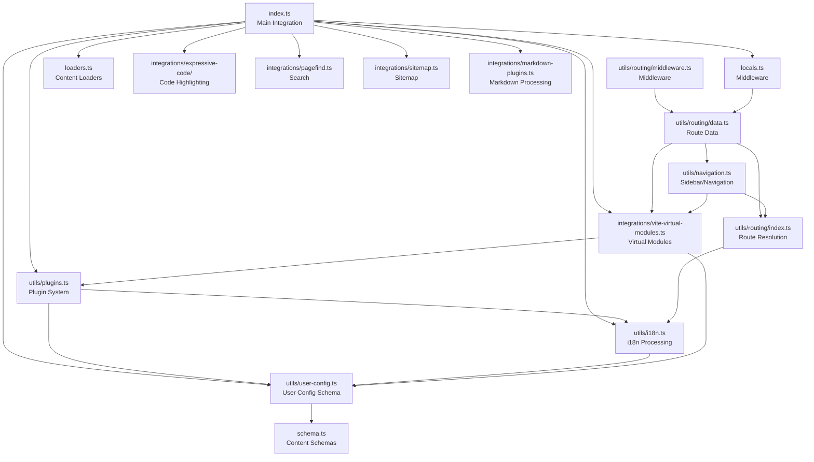
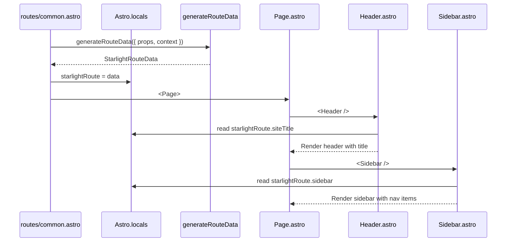

# Starlight Architecture

Starlight is a layered TypeScript/ Astro integration with a clear separation between configuration validation, build-time code generation, runtime route handling, and client-side rendering. The architecture follows a pipeline where user configuration is validated, virtual modules are generated, routes are resolved, route data is computed, and components render the final page -- each layer depending on the one below it.

## Layer Diagram

```mermaid
flowchart TD
    subgraph "Layer 1: User Configuration"
        A1[starlight\( astro.config.mjs \)]
        A2[Frontmatter in .md/.mdx]
        A3[i18n JSON/YAML files]
        A4[Custom CSS]
        A5[Custom Components]
    end

    subgraph "Layer 2: Schema & Validation"
        B1[user-config.ts\nZod schemas]
        B2[sidebar.ts, i18n.ts,\npagefind.ts schemas]
        B3[error-map.ts\nFriendly error messages]
    end

    subgraph "Layer 3: Build-Time Generation"
        C1[vite-virtual-modules.ts\nVirtual module code generation]
        C2[vite-layer-order.ts\nCSS cascade layer ordering]
        C3[vite-lazy-barrel.ts\nBarrel file optimization]
        C4[runPlugins\nPlugin execution]
    end

    subgraph "Layer 4: Routing & Data"
        D1[utils/routing/index.ts\nRoute resolution]
        D2[utils/routing/data.ts\nRoute data generation]
        D3[utils/routing/middleware.ts\nMiddleware chain]
        D4[utils/navigation.ts\nSidebar & prev/next]
    end

    subgraph "Layer 5: Rendering"
        E1[Page.astro\nMain layout]
        E2[Header, Footer,\nSidebar components]
        E3[user-components/\nAside, Badge, Card, Tabs]
        E4[MarkdownContent\nRendered content]
    end

    subgraph "Layer 6: Client-Side"
        F1[Search.astro\nPagefind UI]
        F2[ThemeProvider\nDark/light toggle]
        F3[SidebarPersistState\nCollapse state]
        F4[MobileMenuToggle\nResponsive nav]
    end

    A1 --> B1
    A2 --> B1
    A3 --> B2
    A4 --> C1
    A5 --> C1
    B1 --> C4
    B2 --> B1
    B3 --> B1
    C4 --> C1
    C1 --> D1
    C2 --> E1
    C3 --> E1
    D1 --> D2
    D2 --> D3
    D4 --> D2
    D3 --> E1
    E1 --> F1
    E1 --> F2
    E1 --> F3
    E1 --> F4
```

The six layers form a strict dependency chain:

1. **User Configuration** -- The developer's input: Starlight config, Markdown frontmatter, i18n files, custom CSS/components
2. **Schema & Validation** -- Zod schemas validate all configuration with friendly error messages
3. **Build-Time Generation** -- Vite plugins generate virtual modules, order CSS layers, optimize barrel imports
4. **Routing & Data** -- Routes resolve to content entries, route data is generated (sidebar, toc, pagination), middleware runs
5. **Rendering** -- Astro components render the page layout and content
6. **Client-Side** -- JavaScript handles search, theme toggle, sidebar state, mobile menu

## Module Dependency Graph



Key dependency observations:

- `index.ts` is the sole entry point that orchestrates everything. It validates config, runs plugins, processes i18n, injects routes, adds integrations, and configures Vite.
- `utils/user-config.ts` is the config authority. Every module that needs config values imports the `StarlightConfig` type or reads from `virtual:starlight/user-config`.
- `utils/plugins.ts` depends on `user-config.ts` for schema validation and feeds its output (updated config, integrations, translations) back to `index.ts`.
- `utils/i18n.ts` bridges Astro's i18n config and Starlight's `locales` config, generating equivalent configurations in both directions.
- `integrations/vite-virtual-modules.ts` consumes the validated config and generates JavaScript source code for virtual imports.
- `utils/routing/` is self-contained: `index.ts` resolves routes, `data.ts` generates route data, `middleware.ts` runs the middleware chain.
- `utils/navigation.ts` depends on routing to build sidebars from routes and user config.

## The Three Config Consumers

Starlight reads configuration in three distinct ways at three different times:

```mermaid
flowchart LR
    subgraph "Build Time - Node.js"
        A[User Config Object\nValidated by Zod]
        B[Virtual Module Generation\nStringified JSON + code]
    end

    subgraph "Build Time - Vite/Rollup"
        C["virtual:starlight/user-config"\nParsed JSON object]
        D["virtual:starlight/project-context"\nProject paths]
    end

    subgraph "Runtime - Request"
        E["Astro.locals.starlightRoute\nPer-page data]
    end

    A --> B
    B --> C
    B --> D
    C --> E
```

1. **Build time (Node.js):** The raw config object is validated by Zod in `index.ts`. This is where transforms like BCP-47 normalization, title parsing, and locale resolution happen.
2. **Build time (Vite/Rollup):** The validated config is stringified into virtual modules. `virtual:starlight/user-config` exports the config as a JavaScript object. Components and utilities import this virtual module to read config values.
3. **Runtime (per request):** `locals.starlightRoute` contains the resolved route data for the current page, including sidebar, pagination, table of contents, and content. This is where components read the actual data for the page they're rendering.

Aha: **The config is stringified via `JSON.stringify(opts)` in the virtual module, which means only JSON-serializable values survive.** Functions, `Date` objects, and custom class instances are lost. This is intentional -- the virtual module is code that gets bundled by Vite, so it must be plain JavaScript. Starlight handles non-serializable values (like `getNewestCommitDate`) by generating code that imports and calls functions at runtime rather than embedding values.

Source: `packages/starlight/integrations/vite-virtual-modules.ts:81`

```typescript
// packages/starlight/integrations/vite-virtual-modules.ts:81
'virtual:starlight/user-config': `export default ${JSON.stringify(opts)}`,
'virtual:starlight/git-info':
    (command !== 'build' && isNodeCompatibleEnv
        ? `import { makeAPI } from ${resolveLocalPath('../utils/git.ts')};` +
          `const api = makeAPI(${JSON.stringify(rootPath)});`
        : `import { makeAPI } from ${resolveLocalPath('../utils/gitInlined.ts')};` +
          `const api = makeAPI(${JSON.stringify(getAllNewestCommitDate(rootPath, docsPath))});`) +
    'export const getNewestCommitDate = api.getNewestCommitDate;',
```

Notice how `git-info` generates different code for dev vs build: in dev, it imports the live git API to query dates on demand; in build, it pre-computes all dates and inlines them.

## Directory Architecture

The `packages/starlight/` directory follows a functional decomposition:

```
packages/starlight/
│
├── Entry Points (public API)
│   ├── index.ts              ← Astro integration (default export)
│   ├── schema.ts             ← docsSchema(), i18nSchema()
│   ├── components.ts         ← User component exports
│   ├── loaders.ts            ← docsLoader(), i18nLoader()
│   ├── route-data.ts         ← StarlightRouteData type, defineRouteMiddleware
│   ├── types.ts              ← Re-exported types (StarlightConfig, StarlightPlugin)
│   ├── props.ts              ← StarlightPageProps, deprecated Props
│   ├── internal.ts           ← Internal utilities (useTranslations, EC preprocessor)
│   └── locals.ts             ← Middleware exports
│
├── Type Declarations
│   ├── virtual.d.ts          ← Public virtual module types
│   ├── virtual-internal.d.ts ← Internal virtual module types
│   ├── global.d.ts           ← Global type augmentations
│   ├── i18n.d.ts             ← i18n type augmentations
│   ├── expressive-code.d.ts  ← Expressive Code types
│   └── locals.d.ts           ← App.Locals augmentation
│
├── Astro Components
│   ├── components/           ← Internal layout components (Page, Header, etc.)
│   ├── components-internals/ ← Internal UI components (TableOfContents, Icons)
│   └── user-components/      ← User-facing components (Aside, Badge, Card, Tabs, etc.)
│
├── Build-Time Systems
│   ├── integrations/         ← Vite plugins & Astro integrations
│   ├── schemas/              ← Zod validation schemas
│   └── style/                ← CSS files
│
├── Runtime Systems
│   ├── routes/               ← Route templates (static/, ssr/)
│   ├── utils/                ← Utility functions
│   │   └── routing/          ← Route resolution and data
│   └── translations/         ← i18n JSON files
│
└── Tests
    ├── __tests__/            ← Unit tests (vitest)
    └── __e2e__/              ← End-to-end tests (playwright)
```

## Communication Patterns

Components communicate through two primary patterns:

1. **`Astro.locals.starlightRoute`** -- The main data bus. Route data is set in `routes/common.astro` and read by all components. This is a single, shared object that contains everything a component might need.
2. **Virtual module imports** -- Config values are read from `virtual:starlight/user-config` in components and utilities. This provides global configuration that doesn't change per page.



## CSS Cascade Layer Architecture

Starlight uses CSS cascade layers (`@layer`) to control style specificity. The ordering is managed by `integrations/vite-layer-order.ts`:

Source: `packages/starlight/style/layers.css`

```css
/* packages/starlight/style/layers.css */
@layer starlight.base, starlight.reset, starlight.core, starlight.content, starlight.components, starlight.utils;
```

Aha: **Starlight uses a Vite plugin to inject `@layer` ordering at the top of the CSS cascade, ensuring Starlight's styles always take precedence over user styles regardless of import order.** The `vitePluginStarlightCssLayerOrder` plugin generates an inline style that declares the layer order before any CSS is processed. This solves the classic problem of "my custom CSS is being overridden by Starlight's CSS" without requiring users to use `!important` or specificity hacks.

Source: `packages/starlight/integrations/vite-layer-order.ts`

```typescript
// packages/starlight/integrations/vite-layer-order.ts
export function vitePluginStarlightCssLayerOrder() {
    return {
        name: 'vite-plugin-starlight-css-layer-order',
        enforce: 'pre',
        resolveId(id) {
            if (id === 'virtual:starlight/css-layer-order') return '\0virtual:starlight/css-layer-order';
        },
        load(id) {
            if (id === '\0virtual:starlight/css-layer-order') {
                return '@layer starlight.props, starlight.optional, starlight.reset, ' +
                    'starlight.asides, starlight.util, starlight.base;';
            }
        },
    };
}
```

## Barrel File Optimization

Starlight's component exports use a "lazy barrel optimization" pattern. Instead of eagerly importing all components, Starlight generates code that dynamically imports components only when needed. This is handled by `integrations/vite-lazy-barrel-optimization.ts`.

Aha: **The lazy barrel optimization prevents unused components from being included in the final bundle.** Starlight has dozens of components (Page, Header, Footer, Search, Sidebar, etc.), but not every page uses every component. The optimization transforms static barrel imports into dynamic imports that Vite can tree-shake, reducing the final JS bundle size.

## Test Architecture

Starlight has two test suites:

1. **Unit tests (`__tests__/`)** -- Uses Vitest. Tests individual utilities like config validation, i18n processing, navigation generation, sidebar building, slug formatting, and Markdown processing. Each test directory focuses on one feature (e.g., `__tests__/i18n/`, `__tests__/sidebar/`, `__tests__/plugins/`).

2. **End-to-end tests (`__e2e__/`)** -- Uses Playwright. Tests actual page rendering in a browser against fixture projects. Fixtures include:
   - `basics/` -- Basic Starlight site with docs, custom collections (comments, reviews)
   - `custom src-dir/` -- Custom content directory location
   - `git/` -- Git-based last-updated dates
   - `ssr/` -- Server-side rendering mode
   - `legacy-collections-backwards-compat/` -- Legacy Astro collection format

## What's Next

- Read [Configuration Schema](02-config-schema.html) for every config option in detail
- Read [Integration Lifecycle](03-integration.html) for how Starlight hooks into Astro's lifecycle
- Read [Virtual Modules](04-virtual-modules.html) for the virtual module system
- Read [Cross-Cutting Concerns](11-cross-cutting.html) for CSS layers, Expressive Code, and Pagefind
