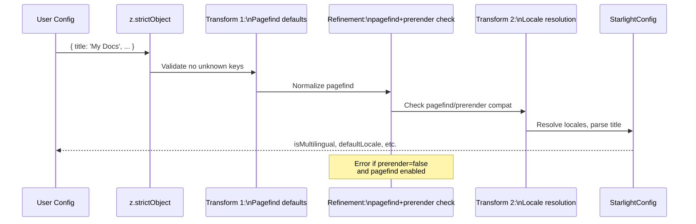

# Starlight Configuration Schema

Starlight's configuration is validated through a comprehensive Zod schema that transforms user input into a normalized internal representation. The schema lives in `utils/user-config.ts` and composes sub-schemas from the `schemas/` directory for sidebar, head, hero, badge, favicon, logo, social, expressive code, pagefind, table of contents, and components. Every config option has JSDoc documentation, defaults, and in many cases transforms that normalize or validate the input.

## Config Validation Pipeline

The schema validation runs through three phases: strict validation, transforms, and refinement.



## Schema Architecture

```mermaid
flowchart TD
    subgraph "User Input"
        A[starlight\( config object \)]
    end

    subgraph "Sub-Schemas (schemas/)"
        B1[sidebar.ts\nSidebarItemSchema]
        B2[head.ts\nHeadConfigSchema]
        B3[hero.ts\nHeroSchema]
        B4[badge.ts\nBadgeConfigSchema]
        B5[favicon.ts\nFaviconSchema]
        B6[logo.ts\nLogoConfigSchema]
        B7[social.ts\nSocialLinksSchema]
        B8[expressiveCode.ts\nExpressiveCodeSchema]
        B9[pagefind.ts\nPagefindConfigSchema]
        B10[tableOfContents.ts\nToC Schema]
        B11[components.ts\nComponentConfigSchema]
        B12[site-title.ts\nTitleConfigSchema]
    end

    subgraph "UserConfigSchema (user-config.ts)"
        C[z.object\({...shape...\}]
    end

    subgraph "Transforms"
        D1[Locale BCP-47 normalization]
        D2[Title parsing for i18n]
        D3[Pagefind/prerender validation]
    end

    subgraph "Output: StarlightConfig"
        E[Normalized config with\nisMultilingual, defaultLocale, etc.]
    end

    A --> C
    B1 --> C
    B2 --> C
    B3 --> C
    B4 --> C
    B5 --> C
    B6 --> C
    B7 --> C
    B8 --> C
    B9 --> C
    B10 --> C
    B11 --> C
    B12 --> C
    C --> D1
    D1 --> D2
    D2 --> D3
    D3 --> E

    style E fill:#d4edda
```

Source: `packages/starlight/utils/user-config.ts:262`

```typescript
// packages/starlight/utils/user-config.ts:262
export const StarlightConfigSchema = z
    .strictObject({ ...UserConfigSchema.shape })
    .transform((config) => ({
        ...config,
        pagefind: typeof config.pagefind === 'undefined'
            ? config.prerender && PagefindConfigDefaults()
            : config.pagefind,
    }))
    .refine((config) => !(!config.prerender && config.pagefind), {
        error: 'Pagefind search is not supported with prerendering disabled.',
    })
    .transform(({ title, locales, defaultLocale, ...config }, ctx) => {
        // ... locale resolution and title parsing
    });
```

The schema pipeline is:

1. **`z.strictObject`** -- Rejects any unknown keys. This prevents typos in config keys from silently doing nothing.
2. **First transform** -- Normalizes `pagefind`: if `pagefind` is `undefined` and `prerender` is `true`, defaults to `PagefindConfigDefaults()`.
3. **Refinement** -- Errors if `prerender: false` and `pagefind` is enabled (search doesn't work in SSR mode).
4. **Second transform** -- Resolves locales, parses titles for i18n, sets `isMultilingual`, `isUsingBuiltInDefaultLocale`, and `defaultLocale`.

## All Configuration Options

### Required

| Option | Type | Default | Description |
|--------|------|---------|-------------|
| `title` | `string \| Record<locale, string>` | (required) | Site title. Used in metadata and browser tab title. Can be localized per locale. |

Source: `packages/starlight/schemas/site-title.ts`

```typescript
// packages/starlight/schemas/site-title.ts
export const TitleConfigSchema = () => z
    .string()
    .or(z.record(z.string()).transform((obj, ctx) => {
        // Validate and normalize locale-keyed title object
    }));
```

### Optional (with defaults)

| Option | Type | Default | Description |
|--------|------|---------|-------------|
| `description` | `string` | `undefined` | Meta description for the site |
| `logo` | `{ src: string } \| { light: string, dark: string }` | `undefined` | Logo image path(s) |
| `tagline` | `string` | `undefined` | Site tagline shown below title |
| `social` | `Array<{ icon, label, href }>` | `[]` | Social media links in header |
| `sidebar` | `SidebarItem[]` | `undefined` | Manual sidebar configuration |
| `locales` | `{ root?: Locale, [key: string]: Locale }` | `undefined` | i18n locale configuration |
| `defaultLocale` | `string` | `undefined` | Default locale key |
| `favicon` | `string` | `'/favicon.svg'` | Favicon path in `public/` |
| `head` | `HeadConfig[]` | `[]` | Extra `<head>` tags |
| `customCss` | `string[]` | `[]` | Custom CSS file paths |
| `tableOfContents` | `{ minHeadingLevel, maxHeadingLevel }` | `{ min: 2, max: 3 }` | ToC heading levels |
| `editLink` | `{ baseUrl?: string }` | `{}` | "Edit this page" link config |
| `lastUpdated` | `boolean` | `false` | Show last-updated date in footer |
| `pagination` | `boolean` | `true` | Show prev/next page links |
| `expressiveCode` | `object \| false` | `{ themes: ['starlight-light', 'starlight-dark'] }` | Code block styling |
| `pagefind` | `boolean \| object` | `true` (if prerender) | Pagefind search config |
| `components` | `Record<string, string>` | `{}` | Component overrides |
| `titleDelimiter` | `string` | `'\|'` | Title delimiter in `<title>` tag |
| `disable404Route` | `boolean` | `false` | Disable default 404 page |
| `prerender` | `boolean` | `true` | Whether to prerender pages |
| `credits` | `boolean` | `false` | Show "Built with Starlight" in footer |
| `routeMiddleware` | `string \| string[]` | `[]` | Route middleware entrypoints |
| `markdown` | `{ headingLinks, processedDirs }` | `{ headingLinks: true, processedDirs: [] }` | Markdown processing config |

### Detailed Option Breakdown

#### `title`

The title can be a simple string or a locale-keyed object for multilingual sites:

```typescript
// Simple title
title: 'My Documentation'

// Localized title
title: {
    en: 'My Documentation',
    fr: 'Ma Documentation',
    de: 'Meine Dokumentation',
}
```

Source: `packages/starlight/schemas/site-title.ts`

```typescript
// packages/starlight/schemas/site-title.ts
export const TitleConfigSchema = () => z
    .string()
    .or(z.record(z.string()));
```

#### `locales`

The most complex config option. Defines the languages your site supports:

Source: `packages/starlight/utils/user-config.ts:15`

```typescript
// packages/starlight/utils/user-config.ts:15
const LocaleSchema = z.object({
    label: z.string(),
    lang: z.string().optional(),
    dir: z.enum(['rtl', 'ltr']).optional().default('ltr'),
});

// packages/starlight/utils/user-config.ts:72
locales: z
    .object({ root: LocaleSchema.required({ lang: true }).optional() })
    .catchall(LocaleSchema)
    .transform((locales, ctx) => {
        for (const key in locales) {
            const locale = locales[key]!;
            let lang = locale.lang || key;
            const schema = bcpParse(lang, { forgiving: true });
            schema.region = schema.region?.toUpperCase();
            const normalizedLang = bcpStringify(schema);
            if (!normalizedLang) {
                ctx.issues.push({ code: 'custom', message: `Could not validate language tag "${lang}"...` });
                return z.NEVER;
            }
            locale.lang = lang;
        }
        return locales;
    })
    .optional(),
```

Aha: **Starlight normalizes BCP-47 language tags automatically.** If you configure `lang: 'en-us'`, Starlight parses it with `bcp-47`, uppercases the region to `en-US`, and warns you about the normalization. This ensures consistent language tag handling throughout the codebase.

#### `sidebar`

The sidebar schema supports five types of items:

Source: `packages/starlight/schemas/sidebar.ts:156`

```typescript
// packages/starlight/schemas/sidebar.ts:156
export const SidebarItemSchema = z.union([
    SidebarLinkItemSchema,       // Manual link: { label, link }
    ManualSidebarGroupSchema,    // Group with items: { label, items }
    AutoSidebarEntriesSchema,    // Autogenerate: { autogenerate: { directory } }
    InternalSidebarLinkItemSchema, // By slug: { slug }
    InternalSidebarLinkItemShorthandSchema, // Just a string slug
]);
```

| Item Type | Required Fields | Description |
|-----------|----------------|-------------|
| Link | `label`, `link` | Manual link to any URL (relative or absolute) |
| Group | `label`, `items` | Group containing other items |
| Autogenerate | `autogenerate.directory` | Auto-generate from a docs subdirectory |
| Internal Link | `slug` | Link to a content collection entry by slug |
| Shorthand | (string) | Shortcut for internal link, just the slug |

Example:

```typescript
sidebar: [
    { label: 'Getting Started', link: '/getting-started' },
    {
        label: 'Reference',
        items: [
            { autogenerate: { directory: 'reference' } },
        ],
    },
    { slug: 'api/overview' },
    'api/configuration', // shorthand for { slug: 'api/configuration' }
]
```

#### `head`

Extra `<head>` tags for the site:

Source: `packages/starlight/schemas/head.ts`

```typescript
// packages/starlight/schemas/head.ts
export const HeadConfigSchema = ({ source }) => z
    .array(z.union([
        z.string(), // '<meta name="theme-color" content="#000">'
        z.object({
            tag: z.enum(['title', 'base', 'link', 'meta', 'style', 'script', 'noscript']),
            attrs: z.record(z.union([z.string(), z.number(), z.boolean(), z.undefined(), z.null()])),
            content: z.string().optional(),
        }),
    ]));
```

Example:

```typescript
head: [
    { tag: 'meta', attrs: { name: 'theme-color', content: '#5c34c2' } },
    { tag: 'link', attrs: { rel: 'icon', href: '/favicon.svg' } },
    {
        tag: 'script',
        attrs: { src: 'https://cdn.usefathom.com/script.js', 'data-site': 'MY-ID', defer: true },
    },
]
```

#### `pagefind`

Pagefind search configuration:

Source: `packages/starlight/schemas/pagefind.ts`

```typescript
// packages/starlight/schemas/pagefind.ts
export const PagefindConfigDefaults = () => ({
    ranking: { pageLength: 0.05, termSimilarity: 0.1, termFrequency: 0.1, termSaturation: 1.5 },
});

export const PagefindConfigSchema = z
    .object({
        ranking: z.object({
            pageLength: z.number().optional(),
            termSimilarity: z.number().optional(),
            termFrequency: z.number().optional(),
            termSaturation: z.number().optional(),
        }).optional(),
    })
    .strict();
```

Set `pagefind: false` to disable search entirely. Set `pagefind: true` (or omit it) to use defaults with full Pagefind indexing.

#### `markdown`

Controls Markdown processing features:

Source: `packages/starlight/utils/user-config.ts:247`

```typescript
// packages/starlight/utils/user-config.ts:247
markdown: z.object({
    headingLinks: z.boolean().default(true),
    processedDirs: z.string().array().default([]),
}).prefault({}),
```

- `headingLinks: true` (default) -- Render clickable anchor links next to headings
- `processedDirs: ['./src/data/comments/']` -- Additional directories to process through Starlight's Markdown pipeline (beyond the default `docs` collection)

#### `routeMiddleware`

Register route middleware to modify route data:

Source: `packages/starlight/utils/user-config.ts:224`

```typescript
// packages/starlight/utils/user-config.ts:224
routeMiddleware: z
    .string()
    .transform((string) => [string])
    .or(z.string().array())
    .default([])
    .superRefine((middlewares, ctx) => {
        const invalidPathRegex = /^\.?\/src\/middleware(?:\/index)?\.[jt]s$/;
        const invalidPaths = middlewares.filter((middleware) => invalidPathRegex.test(middleware));
        // ... error if paths conflict with Astro's middleware locations
    }),
```

Aha: **Starlight validates that `routeMiddleware` paths don't conflict with Astro's `src/middleware/` directory.** If you try to use `./src/middleware.ts` as a route middleware path, Starlight gives a specific error explaining the conflict and suggesting you rename the file. This prevents subtle bugs where Astro's middleware and Starlight's route middleware would interfere with each other.

#### `components`

Override any Starlight component with your own:

Source: `packages/starlight/schemas/components.ts`

```typescript
// packages/starlight/schemas/components.ts (simplified)
export const ComponentConfigSchema = () => z.object({
    Head: z.string().optional(),
    Header: z.string().optional(),
    Footer: z.string().optional(),
    Sidebar: z.string().optional(),
    PageTitle: z.string().optional(),
    // ... all 27 overridable components
}).default({});
```

The overridable components are: `Head`, `Header`, `Footer`, `Sidebar`, `PageTitle`, `ContentPanel`, `Banner`, `MarkdownContent`, `Hero`, `TableOfContents`, `MobileTableOfContents`, `PageSidebar`, `Search`, `SiteTitle`, `SocialIcons`, `ThemeSelect`, `LanguageSelect`, `EditLink`, `LastUpdated`, `Pagination`, `SkipLink`, `ThemeProvider`, `PageFrame`, `MobileMenuToggle`, `MobileMenuFooter`, `TwoColumnContent`, `FallbackContentNotice`, `DraftContentNotice`.

#### `expressiveCode`

Configure code block syntax highlighting:

Source: `packages/starlight/schemas/expressiveCode.ts`

```typescript
// packages/starlight/schemas/expressiveCode.ts
export const ExpressiveCodeSchema = z
    .literal(false)
    .or(
        z.object({
            themes: z.array(z.string()).optional(),
            styleOverrides: z.object({ /* ... */ }).optional(),
            plugins: z.array(z.any()).optional(),
        }).strict()
    )
    .optional()
    .default({ themes: ['starlight-light', 'starlight-dark'] });
```

Set `expressiveCode: false` to disable syntax highlighting entirely (not recommended).

#### `customCss` Validation

Source: `packages/starlight/utils/user-config.ts:163`

```typescript
// packages/starlight/utils/user-config.ts:163
.superRefine((paths, ctx) => {
    const invalidPathRegex = /^\.?\/public\/.+$/;
    const invalidPaths = paths.filter((path) => invalidPathRegex.test(path));
    if (invalidPaths.length > 0) {
        ctx.issues.push({
            message: `These paths in your Starlight \`customCss\` config are invalid...
CSS files specified in \`customCss\` should be in the \`src/\` directory, not the \`public/\` directory.`,
        });
    }
});
```

Aha: **Starlight explicitly forbids `public/` paths in `customCss`.** This is because CSS in the `public/` directory is served as-is without Vite processing, while `customCss` expects Vite-processed CSS (including CSS modules, `@import` resolution, etc.). The validation catches this common mistake early with a clear error message.

## Schema Extension Points

Starlight provides two extension points for schemas:

### `docsSchema({ extend })` -- Content Frontmatter

Extend the frontmatter schema for the `docs` collection:

Source: `packages/starlight/schema.ts:152`

```typescript
// packages/starlight/schema.ts:152
export function docsSchema<T extends BaseSchema = never>(
    ...args: [DocsSchemaOpts<T>?]
): (context: SchemaContext) => ExtendedSchema<T> {
    const [options = {}] = args;
    const { extend } = options;
    return (context: SchemaContext) => {
        const UserSchema = typeof extend === 'function' ? extend(context) : extend;
        return UserSchema
            ? StarlightFrontmatterSchema(context).and(UserSchema)
            : StarlightFrontmatterSchema(context)
    } as ExtendedSchema<T>;
}
```

Example:

```typescript
import { defineCollection } from 'astro:content';
import { docsSchema } from '@astrojs/starlight/schema';

export const collections = {
    docs: defineCollection({
        loader: docsLoader(),
        schema: docsSchema({
            extend: z.object({
                category: z.enum(['tutorial', 'guide', 'reference']).optional(),
                authors: z.array(z.string()).optional(),
            }),
        }),
    }),
};
```

### `i18nSchema({ extend })` -- i18n Strings

Extend the i18n schema for custom UI strings:

Source: `packages/starlight/schema.ts:51`

```typescript
// packages/starlight/schema.ts:51
export function i18nSchema<T extends z.ZodObject = BaseExtendSchema>({
    extend = z.object({}) as T,
}: i18nSchemaOpts<T> = {}): ExtendedSchema<T> {
    return z.looseObject({
        ...defaultI18nSchema().shape,
        ...extend.shape,
    }) as ExtendedSchema<T>;
}
```

## The Frontmatter Schema

The default frontmatter schema for each page:

Source: `packages/starlight/schema.ts:12`

```typescript
// packages/starlight/schema.ts:12
const StarlightFrontmatterSchema = (context: SchemaContext) =>
    z.object({
        title: z.string(),
        description: z.string().optional(),
        editUrl: z.union([z.url(), z.boolean()]).optional().default(true),
        head: HeadConfigSchema({ source: 'content' }),
        tableOfContents: FrontmatterTableOfContentsSchema(),
        template: z.enum(['doc', 'splash']).default('doc'),
        hero: HeroSchema(context).optional(),
        lastUpdated: z.union([z.date(), z.boolean()]).optional(),
        prev: PrevNextLinkConfigSchema(),
        next: PrevNextLinkConfigSchema(),
        sidebar: z.object({
            order: z.number().optional(),
            label: z.string().optional(),
            hidden: z.boolean().default(false),
            badge: BadgeConfigSchema(),
            attrs: SidebarLinkItemHTMLAttributesSchema(),
        }).prefault({}),
        banner: z.object({ content: z.string() }).optional(),
        pagefind: z.boolean().default(true),
        draft: z.boolean().default(false),
    });
```

Aha: **The `sidebar` frontmatter field mirrors the sidebar item schema, allowing per-page sidebar customization.** You can set `sidebar.order` to control position, `sidebar.label` to override the display name, `sidebar.hidden: true` to exclude from navigation, `sidebar.badge` to add a badge, and `sidebar.attrs` to add HTML attributes -- all without touching the sidebar config.

## What's Next

- Read [Integration Lifecycle](03-integration.html) for how this config is processed during Astro's lifecycle
- Read [Sidebar & Navigation](06-sidebar-nav.html) for the sidebar schema in depth
- Read [Internationalization](05-i18n.html) for the locales schema and i18n processing
- Read [Plugins](09-plugins.html) for how plugins can modify this configuration
