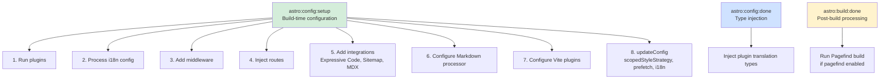
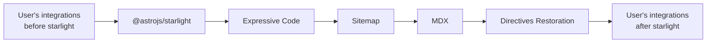

# Starlight Integration Lifecycle

Starlight operates as an Astro integration, meaning it plugs into Astro's lifecycle hooks at build time and runtime. The integration lifecycle has three phases: `astro:config:setup` (build-time configuration), `astro:config:done` (type injection), and `astro:build:done` (post-build processing). Understanding this lifecycle is essential for writing Starlight plugins, debugging build issues, or extending Starlight's behavior.

## The Three Hooks



Source: `packages/starlight/index.ts:46-199`

```typescript
// packages/starlight/index.ts:46
return {
    name: '@astrojs/starlight',
    hooks: {
        'astro:config:setup': async ({
            addMiddleware, command, config, injectRoute, isRestart, logger, updateConfig,
        }) => {
            // Phase 1: Run plugins, process config, inject routes, add integrations
        },
        'astro:config:done': ({ injectTypes }) => {
            // Phase 2: Inject TypeScript declarations for plugin translations
        },
        'astro:build:done': async (options) => {
            // Phase 3: Run Pagefind to build search index
        },
    },
};
```

## Phase 1: `astro:config:setup` -- The Heavy Lifting

This is where 90% of Starlight's work happens. The hook receives seven parameters:

| Parameter | Type | Purpose |
|-----------|------|---------|
| `addMiddleware` | Function | Register Astro middleware (Starlight's locals middleware) |
| `command` | `'dev' \| 'build' \| 'preview'` | Which Astro command is running |
| `config` | `AstroConfig` | Current Astro configuration (may be modified) |
| `injectRoute` | Function | Add routes to Astro's router |
| `isRestart` | `boolean` | True during dev server restart |
| `logger` | `AstroIntegrationLogger` | Forked logger for Starlight |
| `updateConfig` | Function | Update Astro's configuration (Vite, i18n, etc.) |

### Step 1: Run Plugins

```typescript
// packages/starlight/index.ts:59
const pluginResult = await runPlugins(opts, plugins, {
    command, config, isRestart, logger,
});
```

Plugins run first so they can modify the user configuration before Starlight processes it. The `runPlugins` function (in `utils/plugins.ts`) validates both the Starlight config and the plugins config, runs each plugin's `config:setup` hook, collects translation injections, and returns:

- `starlightConfig` -- The validated (and possibly plugin-modified) config
- `integrations` -- Astro integrations added by plugins
- `pluginTranslations` -- i18n strings injected by plugins
- `useTranslations` -- A function that returns a translation utility for a given locale
- `absolutePathToLang` -- A function that maps a file path to its language

### Step 2: Process i18n Config

```typescript
// packages/starlight/index.ts:66
const { astroI18nConfig, starlightConfig } = processI18nConfig(
    pluginResult.starlightConfig,
    config.i18n
);
```

This bridges Starlight's `locales` config with Astro's `i18n` config. If the user configured i18n only in Starlight, Astro's config is generated. If they configured it only in Astro (in a Starlight-compatible way), Starlight's config is generated. If both are configured, an error is thrown.

Source: `packages/starlight/utils/i18n.ts:28`

```typescript
// packages/starlight/utils/i18n.ts:28
export function processI18nConfig(
    starlightConfig: StarlightConfig,
    astroI18nConfig: AstroConfig['i18n']
) {
    if (astroI18nConfig && !starlightConfig.isUsingBuiltInDefaultLocale) {
        throw new AstroError(
            'Cannot provide both an Astro `i18n` configuration and a Starlight `locales` configuration.',
        );
    } else if (astroI18nConfig) {
        return { astroI18nConfig, starlightConfig: { ...starlightConfig, ...getStarlightI18nConfig(astroI18nConfig) } };
    }
    return { astroI18nConfig: getAstroI18nConfig(starlightConfig), starlightConfig };
}
```

### Step 3: Add Middleware

```typescript
// packages/starlight/index.ts:75
addMiddleware({ entrypoint: '@astrojs/starlight/locals', order: 'pre' });
```

The middleware runs before any route handler. It sets up `locals.t` (translation utility) and `locals.starlightRoute` (route data). The `order: 'pre'` ensures it runs before user middleware.

Source: `packages/starlight/locals.ts`

```typescript
// packages/starlight/locals.ts:7
export const onRequest = defineMiddleware(async (context, next) => {
    context.locals.t = useTranslations(context.currentLocale);
    initializeStarlightRoute(context);
    return next();
});
```

### Step 4: Inject Routes

```typescript
// packages/starlight/index.ts:77
if (!starlightConfig.disable404Route) {
    injectRoute({ pattern: '404', entrypoint: ..., prerender: ... });
}
injectRoute({ pattern: '[...slug]', entrypoint: ..., prerender: ... });
```

Two routes are injected:
1. **`404`** -- The not-found page (unless `disable404Route: true`)
2. **`[...slug]`** -- The catch-all route that handles every documentation page

Each route has two variants: static (prerendered) and SSR (dynamic), chosen based on `starlightConfig.prerender`.

### Step 5: Add Integrations

```typescript
// packages/starlight/index.ts:99-112
if (!allIntegrations.find(({ name }) => name === 'astro-expressive-code')) {
    integrations.push(...starlightExpressiveCode({ astroConfig: config, starlightConfig, useTranslations }));
}
if (!allIntegrations.find(({ name }) => name === '@astrojs/sitemap')) {
    integrations.push(starlightSitemap(starlightConfig));
}
if (!allIntegrations.find(({ name }) => name === '@astrojs/mdx')) {
    integrations.push(mdx({ optimize: true }));
}
```

Three integrations are added conditionally (only if the user hasn't already added them):

1. **Expressive Code** -- Syntax highlighting for code blocks. Custom themes: `starlight-light` and `starlight-dark` (Night Owl based).
2. **Sitemap** -- Generates `sitemap.xml` from all documentation pages.
3. **MDX** -- Enables `.mdx` content with `optimize: true` for better tree-shaking.

Aha: **Starlight checks if integrations already exist by name before adding them.** This allows users to add their own Expressive Code, Sitemap, or MDX configuration before Starlight. If a user adds `astro-expressive-code` with custom config, Starlight respects it and doesn't add its own. This is a key extensibility pattern.

### Step 6: Configure Markdown Processor

```typescript
// packages/starlight/index.ts:114-122
const markdownProcessorOptions: MarkdownProcessorPluginOptions = {
    starlightConfig, astroConfig: config, useTranslations, absolutePathToLang,
};
applyStarlightMarkdownPlugins(processor, markdownProcessorOptions, unified, logger);
```

Starlight adds remark/rehype plugins to the Markdown processor for:
- **Asides** -- `:::tip`, `:::note`, `:::caution`, `:::danger` callout blocks
- **Heading links** -- Anchor links on headings
- **Code RTL support** -- Right-to-left text handling in code blocks
- **Icon resolution** -- `<Icon name="..." />` processing in Markdown

### Step 7: Add Starlight Directives Restoration

```typescript
// packages/starlight/index.ts:128
integrations.push(starlightDirectivesRestorationIntegration());
```

Aha: **Starlight adds a "directives restoration" integration at the END of the integration list.** This ensures that Starlight's custom Markdown directives (asides, etc.) are processed before other plugins try to transform them. If Starlight added its plugins at the beginning, other remark/rehype plugins might transform the directive text before Starlight processes it.

### Step 8: Insert Integrations After Starlight

```typescript
// packages/starlight/index.ts:134
const selfIndex = config.integrations.findIndex((i) => i.name === '@astrojs/starlight');
config.integrations.splice(selfIndex + 1, 0, ...integrations);
```

Starlight inserts its integrations immediately after itself in the config array. If the user has `integrations: [starlight(), tailwind()]`, the final order becomes `[starlight(), expressiveCode(), sitemap(), mdx(), tailwind()]`. This ensures user integrations can depend on or override Starlight's behavior.

### Step 9: Configure Vite Plugins

```typescript
// packages/starlight/index.ts:144-187
updateConfig({
    vite: {
        plugins: [
            vitePluginStarlightCssLayerOrder(),
            vitePluginStarlightLazyBarrelOptimization(),
            vitePluginStarlightVirtualModules({ command, isNodeCompatibleEnv }, starlightConfig, config, pluginTranslations),
        ],
        ssr: isNodeCompatibleEnv ? {} : { optimizeDeps: { include: [...] } },
    },
    scopedStyleStrategy: 'where',
    prefetch: config.prefetch ?? { prefetchAll: true },
    i18n: astroI18nConfig,
});
```

Three Vite plugins are added:
1. **CSS Layer Order** -- Declares CSS cascade layer ordering
2. **Lazy Barrel Optimization** -- Tree-shakes unused components
3. **Virtual Modules** -- Generates `virtual:starlight/*` modules

Additional Astro config updates:
- `scopedStyleStrategy: 'where'` -- Uses `:where()` for scoped styles (lowest specificity)
- `prefetch: { prefetchAll: true }` -- Prefetches all links on hover (unless user configured otherwise)
- `i18n: astroI18nConfig` -- The generated/computed Astro i18n config

For non-Node.js environments (Cloudflare), `ssr.optimizeDeps.include` pre-bundles dependencies that are problematic in edge runtimes.

## Phase 2: `astro:config:done` -- Type Injection

```typescript
// packages/starlight/index.ts:190
'astro:config:done': ({ injectTypes }) => {
    injectPluginTranslationsTypes(pluginTranslations, injectTypes);
},
```

After config resolution, Starlight injects TypeScript declarations for plugin translation keys. This enables type-safe access to custom i18n strings added by plugins.

Source: `packages/starlight/utils/plugins.ts:156`

```typescript
// packages/starlight/utils/plugins.ts:156
export function injectPluginTranslationsTypes(
    translations: PluginTranslations,
    injectTypes: AstroHookParameters<'astro:config:done'>['injectTypes']
) {
    const allKeys = new Set<string>();
    for (const localeTranslations of Object.values(translations)) {
        for (const key of Object.keys(localeTranslations)) {
            allKeys.add(key);
        }
    }
    if (allKeys.size === 0) return;

    injectTypes({
        filename: 'i18n-plugins.d.ts',
        content: `declare namespace StarlightApp {
            type PluginUIStringKeys = { ${[...allKeys].map((key) => `'${key}': string;`).join('\n\t\t')} };
            interface I18n extends PluginUIStringKeys {}
        }`,
    });
}
```

## Phase 3: `astro:build:done` -- Post-Build Processing

```typescript
// packages/starlight/index.ts:194
'astro:build:done': async (options) => {
    if (!userConfig.pagefind) return;
    return starlightPagefind(options);
},
```

After Astro finishes building, Starlight runs Pagefind to build the search index. This only happens if `pagefind` is enabled (the default). The Pagefind integration:

1. Reads all built HTML files from the output directory
2. Runs Pagefind's indexing algorithm
3. Outputs the search index to `_pagefind/` directory
4. Injects the Pagefind config via `virtual:starlight/pagefind-config`

Aha: **Pagefind only runs in the `build:done` hook, not during development.** In dev mode, the search UI shows a warning: "Search is disabled during development." This is because Pagefind needs static HTML files to index, which only exist after the build completes. The search UI in dev mode is functional but returns no results.

Source: `packages/starlight/integrations/pagefind.ts`

```typescript
// packages/starlight/integrations/pagefind.ts
export async function starlightPagefind(options: BuildPayload) {
    // Read output directory, run pagefind, write index
    // Pass user config from virtual:starlight/pagefind-config
}
```

## Integration Order Summary

The final integration order after `astro:config:setup` completes:



This order matters because:
1. **Before Starlight:** User integrations run first and can affect Starlight's setup
2. **Expressive Code/Sitemap/MDX:** Starlight's built-in integrations
3. **Directives Restoration:** Must run last to handle Markdown directives after all other processing
4. **After Starlight:** User integrations can see Starlight's modifications

## Plugin Config Updates

When a plugin calls `updateConfig()`, the config is re-validated:

Source: `packages/starlight/utils/plugins.ts:87`

```typescript
// packages/starlight/utils/plugins.ts:87
updateConfig(newConfig) {
    if ('plugins' in newConfig) {
        throw new AstroError(`The \`${name}\` plugin tried to update the \`plugins\` config key which is not supported.`);
    }
    if ('routeMiddleware' in newConfig) {
        throw new AstroError(`The \`${name}\` plugin tried to update the \`routeMiddleware\` config key which is not supported.
Use the \`addRouteMiddleware()\` utility instead.`);
    }
    const mergedUserConfig = { ...userConfig, ...newConfig };
    const mergedConfig = parseWithFriendlyErrors(
        StarlightConfigSchema,
        mergedUserConfig,
        `Invalid config update provided by the '${name}' plugin`
    );
    userConfig = mergedUserConfig;
    starlightConfig = mergedConfig;
},
```

Aha: **Plugins cannot update `plugins` or `routeMiddleware` through `updateConfig`.** These have dedicated APIs (`addRouteMiddleware` for middleware). This prevents plugins from creating circular plugin dependencies or interfering with the middleware execution order.

## Environment Detection

Starlight detects non-Node.js environments to handle them specially:

Source: `packages/starlight/index.ts:139`

```typescript
// packages/starlight/index.ts:139
const isCloudflareEnv =
    config.adapter?.name === '@astrojs/cloudflare' ||
    config.integrations.some(({ name }) => name === '@astrojs/cloudflare');
const isNodeCompatibleEnv = !isCloudflareEnv;
```

In non-Node environments:
- Git info is pre-computed (no runtime git commands)
- Dependencies are pre-bundled via Vite's `optimizeDeps`
- Expressive Code's CJS dependencies are handled specially

## What's Next

- Read [Virtual Modules](04-virtual-modules.html) for the Vite plugins that generate virtual modules
- Read [Plugins](09-plugins.html) for how to write Starlight plugins
- Read [Content Loaders](07-content-loaders.html) for how content is loaded
- Read [Cross-Cutting Concerns](11-cross-cutting.html) for Expressive Code, Pagefind, and sitemap details
