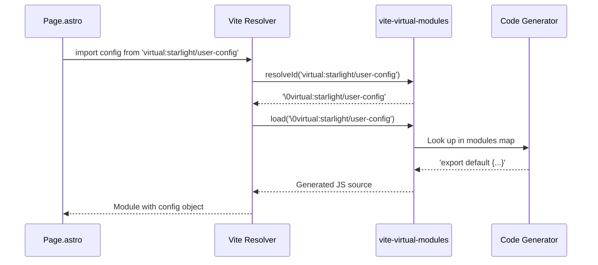
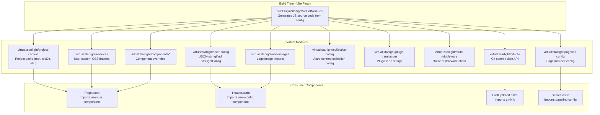

# Starlight Virtual Modules

Starlight's virtual module system is the mechanism by which build-time configuration becomes available to runtime components without passing props through every component in the tree. A Vite plugin generates JavaScript source code from the validated Starlight config and project context, then exposes this code through `virtual:starlight/*` module imports. Components import these virtual modules to read config, access project paths, load user CSS, resolve component overrides, and more.

## Virtual Module Resolution Flow

When a component imports a virtual module, Vite resolves it through the plugin:



## The Virtual Module Pattern



Aha: **Virtual modules solve the "prop drilling" problem in Astro component trees.** Without virtual modules, Starlight would need to pass the config object through every component: Page -> Header -> SiteTitle -> LanguageSelect. With virtual modules, any component can import `config from 'virtual:starlight/user-config'` and access the full config directly. This is the same pattern that React Context or Svelte stores solve, but at the module level rather than runtime.

## The Vite Plugin Implementation

Source: `packages/starlight/integrations/vite-virtual-modules.ts`

```typescript
// packages/starlight/integrations/vite-virtual-modules.ts:20
export function vitePluginStarlightVirtualModules(
    { command, isNodeCompatibleEnv },
    opts: StarlightConfig,
    { build, legacy, root, srcDir, trailingSlash },
    pluginTranslations: PluginTranslations
): NonNullable<ViteUserConfig['plugins']>[number] {
    const resolveId = (id, base = root) =>
        JSON.stringify(id.startsWith('.') ? resolve(fileURLToPath(base), id) : id);

    const modules = {
        'virtual:starlight/user-config': `export default ${JSON.stringify(opts)}`,
        'virtual:starlight/project-context': `export default ${JSON.stringify({
            build: { format: build.format },
            root, srcDir, trailingSlash,
        })}`,
        // ... more modules
    };

    const resolutionMap = Object.fromEntries(
        (Object.keys(modules) as (keyof typeof modules)[]).map((key) => [
            resolveVirtualModuleId(key),  // '\0virtual:starlight/...'
            key,
        ])
    );

    return {
        name: 'vite-plugin-starlight-user-config',
        resolveId: { filter: { id: /^virtual:starlight\// }, handler(id) {
            if (id in modules) return resolveVirtualModuleId(id);
        }},
        load: { filter: { id: /^\x00virtual:starlight\// }, handler(id) {
            const resolution = resolutionMap[id];
            if (resolution) return modules[resolution];
        }},
    };
}
```

The plugin implements two Vite hooks:

1. **`resolveId`** -- When a component imports `virtual:starlight/user-config`, Vite calls `resolveId` to resolve the module path. Starlight returns `\0virtual:starlight/user-config` (the `\0` prefix marks it as a virtual module in Vite/Rollup).

2. **`load`** -- When Vite needs the module's content, it calls `load` with the resolved ID. Starlight looks up the ID in `resolutionMap` and returns the generated JavaScript source code.

The `\0` prefix convention is critical: it tells Rollup that this module doesn't correspond to a real file on disk, preventing resolution errors.

## All Virtual Modules

### `virtual:starlight/user-config`

Exports the full Starlight config as a JavaScript object:

```typescript
// Generated code
export default {
    title: { en: 'My Docs' },
    description: 'Documentation for my project',
    locales: undefined,
    isMultilingual: false,
    defaultLocale: { label: 'English', lang: 'en', dir: 'ltr', locale: undefined },
    sidebar: [...],
    expressiveCode: { themes: ['starlight-light', 'starlight-dark'] },
    pagefind: { ranking: {...} },
    // ... all other config options
};
```

This is used by nearly every component to read configuration. For example, `Header.astro` reads `config.logo` to decide whether to show a logo or title.

### `virtual:starlight/project-context`

Exports project path information:

```typescript
// Generated code
export default {
    root: '/users/me/my-project/',
    srcDir: '/users/me/my-project/src/',
    trailingSlash: 'never',
    build: { format: 'directory' },
};
```

Used by utilities that need to resolve file paths relative to the project root, such as the git info module and content collection path resolution.

### `virtual:starlight/git-info`

Exports a function to get the newest commit date for a file:

```typescript
// Generated code (dev mode, Node.js environment)
import { makeAPI } from "/users/me/my-project/node_modules/@astrojs/starlight/utils/git.ts";
const api = makeAPI("/users/me/my-project/");
export const getNewestCommitDate = api.getNewestCommitDate;
```

```typescript
// Generated code (build mode or non-Node environment)
import { makeAPI } from "/users/me/my-project/node_modules/@astrojs/starlight/utils/gitInlined.ts";
const api = makeAPI({
    "src/content/docs/index.md": "2024-01-15T10:30:00Z",
    "src/content/docs/getting-started.md": "2024-01-20T14:00:00Z",
    // ... all files and their newest commit dates
});
export const getNewestCommitDate = api.getNewestCommitDate;
```

Aha: **The git-info module generates fundamentally different code in dev vs build.** In dev mode (Node.js), it imports the live git API that runs `git log` commands on each call. In build mode or non-Node environments, it pre-computes ALL commit dates at build time and inlines them as a JSON object. This avoids running git commands at runtime (which wouldn't work in SSR or edge environments) and speeds up build times by avoiding repeated git queries.

Source: `packages/starlight/integrations/vite-virtual-modules.ts:88`

```typescript
// packages/starlight/integrations/vite-virtual-modules.ts:88
'virtual:starlight/git-info':
    (command !== 'build' && isNodeCompatibleEnv
        ? `import { makeAPI } from ${resolveLocalPath('../utils/git.ts')};` +
          `const api = makeAPI(${JSON.stringify(rootPath)});`
        : `import { makeAPI } from ${resolveLocalPath('../utils/gitInlined.ts')};` +
          `const api = makeAPI(${JSON.stringify(getAllNewestCommitDate(rootPath, docsPath))});`) +
    'export const getNewestCommitDate = api.getNewestCommitDate;',
```

### `virtual:starlight/user-css`

Imports the user's custom CSS files:

```typescript
// Generated code
import "/users/me/my-project/src/custom-styles.css";
import "@fontsource/roboto";
```

If `customCss: []` (the default), this module is an empty string. This module is imported in `Page.astro` at the top of the file to ensure custom CSS is processed within the cascade layer order.

### `virtual:starlight/user-images`

Imports logo images:

```typescript
// Generated code (single logo)
import src from "/users/me/my-project/src/logo.png";
export const logos = { dark: src, light: src };

// Generated code (separate light/dark logos)
import dark from "/users/me/my-project/src/logo-dark.png";
import light from "/users/me/my-project/src/logo-light.png";
export const logos = { dark, light };

// Generated code (no logo)
export const logos = {};
```

### `virtual:starlight/collection-config`

Imports the user's content collection configuration:

```typescript
// Generated code
let userCollections;
try {
    userCollections = (await import("/users/me/my-project/src/content.config.ts")).collections;
} catch {}
export const collections = userCollections;
```

Aha: **The collection config import is wrapped in a try/catch to handle both new and legacy Astro projects.** Astro 5 uses `src/content.config.ts` while older versions used `src/content/config.ts`. The virtual module tries the new location first and silently falls back if it doesn't exist. The legacy path is used when `legacy.collectionsBackwardsCompat` is true and the new config file doesn't exist.

### `virtual:starlight/plugin-translations`

Exports plugin-injected i18n strings:

```typescript
// Generated code
export default {
    en: {
        'myPlugin.customLabel': 'Custom Label',
    },
    fr: {
        'myPlugin.customLabel': 'Label Personnalisé',
    },
};
```

### `virtual:starlight/route-middleware`

Exports the route middleware chain:

```typescript
// Generated code
import { onRequest as routeMiddleware0 } from "/users/me/my-project/src/starlightRouteData.ts";
import { onRequest as routeMiddleware1 } from "@my-inc/starlight-plugin/middleware";

export const routeMiddleware = [
    routeMiddleware0,
    routeMiddleware1,
];
```

### `virtual:starlight/pagefind-config`

Exports Pagefind configuration:

```typescript
// Generated code
export const pagefindUserConfig = {
    "ranking": { "pageLength": 0.05, "termSimilarity": 0.1, "termFrequency": 0.1, "termSaturation": 1.5 }
}
```

### `virtual:starlight/components/*` -- Component Overrides

Each overridable component gets its own virtual module:

```typescript
// Generated code (default)
export { default } from "/users/me/my-project/node_modules/@astrojs/starlight/components/Header.astro";

// Generated code (user override)
export { default } from "/users/me/my-project/src/components/MyHeader.astro";
```

Aha: **Component overrides are resolved through the SAME virtual module mechanism as config values.** When a user sets `components: { Header: './src/components/MyHeader.astro' }`, the virtual module for `virtual:starlight/components/Header` imports the user's file instead of Starlight's default. This means no conditional logic is needed in components -- they simply import from the virtual module and get the correct component. The override system is transparent and requires no special handling in the consuming code.

Source: `packages/starlight/integrations/vite-virtual-modules.ts:72`

```typescript
// packages/starlight/integrations/vite-virtual-modules.ts:72
const virtualComponentModules = Object.fromEntries(
    Object.entries(opts.components).map(([name, path]) => [
        `virtual:starlight/components/${name}`,
        `export { default } from ${resolveId(path)};`,
    ])
);
```

### `virtual:starlight/optional-css`

Conditionally imports CSS for optional features:

```typescript
// Generated code (headingLinks: true)
import "/users/me/my-project/node_modules/@astrojs/starlight/style/anchor-links.css";

// Generated code (headingLinks: false)
// empty
```

### `virtual:starlight/user-config` Type Declaration

Source: `packages/starlight/virtual.d.ts`

```typescript
// packages/starlight/virtual.d.ts:1
declare module 'virtual:starlight/user-config' {
    const Config: import('./types').StarlightConfig;
    export default Config;
}

declare module 'virtual:starlight/plugin-translations' {
    const PluginTranslations: import('./utils/plugins').PluginTranslations;
    export default PluginTranslations;
}

declare module 'virtual:starlight/project-context' {
    const ProjectContext: {
        root: string;
        srcDir: string;
        trailingSlash: import('astro').AstroConfig['trailingSlash'];
        build: { format: import('astro').AstroConfig['build']['format'] };
    };
    export default ProjectContext;
}
```

TypeScript declarations for the public virtual modules. These give TypeScript full type information when components import `virtual:starlight/*`.

### `virtual:starlight/*` Internal Type Declarations

Source: `packages/starlight/virtual-internal.d.ts`

```typescript
// packages/starlight/virtual-internal.d.ts
declare module 'virtual:starlight/git-info' {
    export function getNewestCommitDate(file: string): Date;
}
declare module 'virtual:starlight/user-css' {}
declare module 'virtual:starlight/optional-css' {}
declare module 'virtual:starlight/user-images' {
    export const logos: { dark?: ImageMetadata; light?: ImageMetadata };
}
declare module 'virtual:starlight/collection-config' {
    export const collections: ContentConfig['collections'] | undefined;
}
declare module 'virtual:starlight/route-middleware' {
    export const routeMiddleware: Array<RouteMiddlewareHandler>;
}
declare module 'virtual:starlight/pagefind-config' { ... }
// Plus 28 component module declarations...
```

## CSS Layer Ordering via Virtual Module

The CSS cascade layer order is enforced by a Vite plugin that injects a virtual CSS layer declaration:

Source: `packages/starlight/integrations/vite-layer-order.ts`

```typescript
// packages/starlight/integrations/vite-layer-order.ts
export function vitePluginStarlightCssLayerOrder() {
    return {
        name: 'vite-plugin-starlight-css-layer-order',
        enforce: 'pre',  // Run before other plugins
        // ... resolve and load virtual:starlight/css-layer-order
    };
}
```

The `enforce: 'pre'` ensures this plugin runs before all others, so the layer order is declared before any CSS is processed. This is critical: if a user's CSS imports before the layer declaration, their layers would be ordered incorrectly.

## Usage in Components

Every Starlight component uses virtual modules to avoid prop drilling:

Source: `packages/starlight/components/Page.astro:1`

```astro
---
// packages/starlight/components/Page.astro:1
import 'virtual:starlight/user-css';
import '../style/layers.css';
import '../style/props.css';
import '../style/reset.css';
// ... more CSS imports
import 'virtual:starlight/optional-css';

import Banner from 'virtual:starlight/components/Banner';
import ContentPanel from 'virtual:starlight/components/ContentPanel';
import Footer from 'virtual:starlight/components/Footer';
// ... more component imports from virtual modules
---
```

Notice how ALL component imports go through virtual modules. This is the override mechanism: if a user overrides `Footer`, the virtual module for `virtual:starlight/components/Footer` will import the user's component instead of Starlight's.

## Filter Patterns

The Vite plugin uses filter patterns for efficient resolution:

Source: `packages/starlight/integrations/vite-virtual-modules.ts:11`

```typescript
// packages/starlight/integrations/vite-virtual-modules.ts:11
const pluginResolveIdIdFilter = /^virtual:starlight\//;
const pluginLoadIdFilter = /^\x00virtual:starlight\//;
```

The `resolveId` filter matches un-resolved imports (`virtual:starlight/...`), while the `load` filter matches resolved imports (`\0virtual:starlight/...`). This ensures the plugin only handles its own modules and doesn't interfere with other imports.

## What's Next

- Read [Components](08-components.html) for how virtual modules power the component override system
- Read [Integration Lifecycle](03-integration.html) for how the virtual module plugin is registered
- Read [Cross-Cutting Concerns](11-cross-cutting.html) for how CSS layers interact with virtual modules
