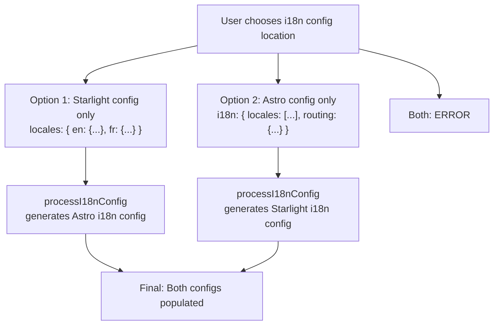
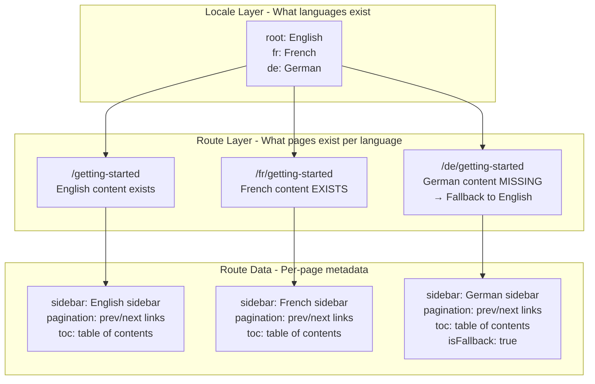

# Starlight Internationalization (i18n)

Starlight provides a comprehensive internationalization system that supports multilingual documentation sites with automatic fallback content, BCP-47 language tag handling, RTL writing direction support, and a file-based translation system. The i18n system bridges Astro's built-in i18n configuration with Starlight's own locale system, allowing users to configure i18n in either place while Starlight generates the equivalent configuration for the other.

## Two Configuration Entry Points



Source: `packages/starlight/utils/i18n.ts:28`

```typescript
// packages/starlight/utils/i18n.ts:28
export function processI18nConfig(
    starlightConfig: StarlightConfig,
    astroI18nConfig: AstroConfig['i18n']
) {
    if (astroI18nConfig && !starlightConfig.isUsingBuiltInDefaultLocale) {
        throw new AstroError(
            'Cannot provide both an Astro `i18n` configuration and a Starlight `locales` configuration.',
        );
    } else if (astroI18nConfig) {
        return { astroI18nConfig, starlightConfig: { ...starlightConfig, ...getStarlightI18nConfig(astroI18nConfig) } };
    }
    return { astroI18nConfig: getAstroI18nConfig(starlightConfig), starlightConfig };
}
```

Aha: **You can configure i18n in either Starlight's `locales` OR Astro's `i18n` -- but not both.** Starlight's `processI18nConfig` detects which one is configured and generates the equivalent for the other. If you try to configure both, you get a clear error. This design lets users who are familiar with Astro's i18n system use the configuration they know, while Starlight users can use the simpler `locales` syntax.

## Locale Configuration

### Starlight Style

```typescript
// astro.config.mjs
import { defineConfig } from 'astro/config';
import starlight from '@astrojs/starlight';

export default defineConfig({
    integrations: [
        starlight({
            title: 'My Docs',
            locales: {
                root: { label: 'English', lang: 'en' },
                fr: { label: 'Français', lang: 'fr' },
                'zh-cn': { label: '简体中文', lang: 'zh-CN' },
                ar: { label: 'العربية', lang: 'ar', dir: 'rtl' },
            },
        }),
    ],
});
```

The `locales` object has:
- **`root`** (optional) -- The default language served at `/`. Requires `lang` to be set.
- **Named keys** -- Each additional language with `label` (required), `lang` (optional, defaults to key), and `dir` (optional, `'ltr'` or `'rtl'`, defaults to `'ltr'`)

### Astro Style

```typescript
// astro.config.mjs
import { defineConfig } from 'astro/config';
import starlight from '@astrojs/starlight';

export default defineConfig({
    i18n: {
        defaultLocale: 'en',
        locales: [
            { path: 'en', codes: ['en'] },
            { path: 'fr', codes: ['fr'] },
            { path: 'zh-cn', codes: ['zh-CN'] },
        ],
        routing: {
            prefixDefaultLocale: false,
            redirectToDefaultLocale: false,
            fallbackType: 'redirect',
        },
    },
    integrations: [starlight({ title: 'My Docs' })],
});
```

Starlight generates the equivalent Starlight config from Astro's config, including locale labels (derived from `Intl.DisplayNames`), directions (derived from `Intl.Locale`), and the default locale.

## BCP-47 Language Tag Normalization

When a locale is configured, Starlight normalizes its BCP-47 language tag:

Source: `packages/starlight/utils/user-config.ts:78`

```typescript
// packages/starlight/utils/user-config.ts:78
.transform((locales, ctx) => {
    for (const key in locales) {
        const locale = locales[key]!;
        let lang = locale.lang || key;
        const schema = bcpParse(lang, { forgiving: true });
        schema.region = schema.region?.toUpperCase();
        const normalizedLang = bcpStringify(schema);
        if (!normalizedLang) {
            ctx.issues.push({ code: 'custom', message: `Could not validate language tag "${lang}"...` });
            return z.NEVER;
        }
        if (normalizedLang !== lang) {
            console.warn(`Warning: using "${normalizedLang}" language tag for locales.${key}.lang instead of "${lang}".`);
        }
        locale.lang = normalizedLang;
    }
    return locales;
})
```

This normalizes `en-us` to `en-US`, `zh-cn` to `zh-CN`, etc. If the tag is invalid, the schema returns `z.NEVER` which causes a Zod validation error.

## RTL Writing Direction

Starlight automatically detects right-to-left languages and adjusts the writing direction:

Source: `packages/starlight/utils/i18n.ts:184`

```typescript
// packages/starlight/utils/i18n.ts:184
function getLocaleDir(locale: Intl.Locale): 'ltr' | 'rtl' {
    if ('textInfo' in locale) {
        return locale.textInfo.direction;  // V8 environments (Node.js, Chrome)
    } else if ('getTextInfo' in locale) {
        return locale.getTextInfo().direction;  // Older Node.js versions
    }
    // Firefox fallback: well-known RTL languages
    return wellKnownRTL.includes(locale.language) ? 'rtl' : 'ltr';
}
```

Aha: **Starlight has a fallback for Firefox, which doesn't support `Intl.Locale.textInfo` or `getTextInfo`.** It maintains a list of well-known RTL languages (`['ar', 'fa', 'he', 'prs', 'ps', 'syc', 'ug', 'ur']`) and checks against it when the `Intl` API can't provide direction. This ensures RTL support works across all browsers, not just V8-based ones.

## Translation System

Starlight uses `i18next` as its translation engine. The translation system loads strings from three sources:

1. **Built-in translations** -- Starlight ships with UI strings for 20+ languages in `translations/`
2. **User translations** -- Files in `src/content/i18n/` (JSON, YAML)
3. **Plugin translations** -- Injected by plugins via `injectTranslations()` in the `i18n:setup` hook

Source: `packages/starlight/utils/createTranslationSystem.ts`

```typescript
// packages/starlight/utils/createTranslationSystem.ts
export function createTranslationSystemFromFs(
    starlightConfig, astroConfig, pluginTranslations
) {
    // Load built-in translations
    // Load user translations from src/content/i18n/
    // Merge with plugin translations
    // Create i18next instance with merged translations
    // Return a useTranslations(locale) function
}
```

The system creates a `useTranslations(locale)` function that returns a `t(key)` translator for a given locale:

```typescript
const t = useTranslations('en');
t('search.label');           // 'Search'
t('tableOfContents.overview'); // 'Overview'
t('page.editLink');          // 'Edit page'
```

### Built-in Translation Keys

Source: `packages/starlight/schemas/i18n.ts:69`

```typescript
// packages/starlight/schemas/i18n.ts:69
function starlightI18nSchema() {
    return z.object({
        'skipLink.label': z.string(),           // 'Skip to content'
        'search.label': z.string(),              // 'Search'
        'search.ctrlKey': z.string(),            // 'Ctrl'
        'search.cancelLabel': z.string(),        // 'Cancel'
        'search.devWarning': z.string(),         // 'Search is disabled during development.'
        'themeSelect.accessibleLabel': z.string(), // 'Select theme'
        'themeSelect.dark': z.string(),          // 'Dark'
        'themeSelect.light': z.string(),         // 'Light'
        'themeSelect.auto': z.string(),          // 'Auto'
        'languageSelect.accessibleLabel': z.string(), // 'Select language'
        'menuButton.accessibleLabel': z.string(), // 'Menu'
        'sidebarNav.accessibleLabel': z.string(), // 'Site navigation'
        'tableOfContents.onThisPage': z.string(), // 'On this page'
        'tableOfContents.overview': z.string(),   // 'Overview'
        'i18n.untranslatedContent': z.string(),   // 'This content is not available in your language yet.'
        'page.editLink': z.string(),              // 'Edit page'
        'page.lastUpdated': z.string(),           // 'Last updated:'
        'page.previousLink': z.string(),          // 'Previous'
        'page.nextLink': z.string(),              // 'Next'
        'page.draft': z.string(),                 // 'This page is a draft...'
        '404.text': z.string(),                   // 'Page not found'
        'aside.tip': z.string(),                  // 'Tip'
        'aside.note': z.string(),                 // 'Note'
        'aside.caution': z.string(),              // 'Caution'
        'aside.danger': z.string(),               // 'Danger'
        'fileTree.directory': z.string(),         // 'Directory'
        'builtWithStarlight.label': z.string(),   // 'Built with Starlight'
        'heading.anchorLabel': z.string(),        // 'Anchor link for'
    }).partial();
}
```

Plus 10 Pagefind UI strings and 3 Expressive Code UI strings.

### User Translation Files

Users can override or extend any translation key by creating files in `src/content/i18n/`:

```json
// src/content/i18n/en.json
{
    "search.label": "Search the docs",
    "myPlugin.customLabel": "Custom Label"
}
```

```yaml
# src/content/i18n/fr.yaml
search.label: "Rechercher dans la documentation"
myPlugin.customLabel: "Label personnalisé"
```

The `i18nLoader` loads these files:

Source: `packages/starlight/loaders.ts:33`

```typescript
// packages/starlight/loaders.ts:33
export function i18nLoader(): Loader {
    return { name: 'starlight-i18n-loader', load: createGlobLoadFn('i18n') };
}
```

The loader matches `**/[^_]*.{json,yml,yaml}` in the i18n collection directory. Files starting with `_` are ignored (private data).

## Fallback Content System

In multilingual sites, Starlight automatically falls back to the default locale's content when a translation doesn't exist:

Source: `packages/starlight/utils/routing/index.ts:53`

```typescript
// packages/starlight/utils/routing/index.ts:53
if (config.isMultilingual) {
    const defaultLocaleDocs = getLocaleDocs(
        config.defaultLocale?.locale === 'root' ? undefined : config.defaultLocale?.locale
    );
    for (const key in config.locales) {
        if (key === config.defaultLocale.locale) continue;
        const localeConfig = config.locales[key];
        const locale = key === 'root' ? undefined : key;
        const localeDocs = getLocaleDocs(locale);
        for (const fallback of defaultLocaleDocs) {
            const id = localizedSlug(fallback.id, locale);
            const doesNotNeedFallback = localeDocs.some((doc) => doc.id === id);
            if (doesNotNeedFallback) continue;
            routes.push({
                entry: fallback,
                id,
                isFallback: true,
                lang: localeConfig.lang || BuiltInDefaultLocale.lang,
                locale,
                dir: localeConfig.dir,
                entryMeta: slugToLocaleData(fallback.id),
            });
        }
    }
}
```

Aha: **Fallback routes are added to the route list, not generated on-demand.** During build time, Starlight iterates through ALL default locale docs and for each locale that doesn't have a translation, it creates a fallback route. The fallback route uses the default locale's content entry but with the target locale's language and direction. This means the page IS generated for the target locale, just with untranslated content. The `isFallback: true` flag triggers a notice in the UI informing readers they're viewing untranslated content.

The fallback notice is rendered by `FallbackContentNotice.astro`:

```astro
---
// components/FallbackContentNotice.astro
---
<p>{Astro.locals.t('i18n.untranslatedContent')}</p>
```

## Locales vs Routes: Understanding the Two Layers



- **Locale** -- Defines what languages the site supports. Set in `locales` config.
- **Route** -- Defines what pages exist for each language. Generated from content files + fallbacks.
- **Route Data** -- Per-page metadata (sidebar, pagination, toc) computed for each route.

## The `useTranslations` Function

The translation utility is set up in the middleware and accessed throughout the codebase:

Source: `packages/starlight/utils/translations.ts`

```typescript
// packages/starlight/utils/translations.ts
export function useTranslations(locale: string | undefined) {
    // Returns a t(key) function for the given locale
    // Uses the i18next instance internally
}
```

Usage in components:

```astro
---
const t = Astro.locals.t;
---
<button>{t('search.label')}</button>
```

Usage in Markdown processing (remark/rehype plugins):

```typescript
const t = useTranslations(lang);
const aside = h('aside', { class: `aside ${type}` }, [
    h('p', { class: 'aside-title' }, t(`aside.${type}`)),
    // ...
]);
```

Usage in plugins:

```typescript
// Plugin config:setup hook
{
    name: 'My Plugin',
    hooks: {
        'config:setup'({ useTranslations }) {
            const t = useTranslations('en');
            console.log(t('builtWithStarlight.label'));
            // 'Built with Starlight'
        }
    }
}
```

## i18n Schema Extension

Users and plugins can extend the i18n schema to add custom UI strings:

Source: `packages/starlight/schema.ts:51`

```typescript
// packages/starlight/schema.ts:51
export function i18nSchema<T extends z.ZodObject = BaseExtendSchema>({
    extend = z.object({}) as T,
}: i18nSchemaOpts<T> = {}): ExtendedSchema<T> {
    return z.looseObject({
        ...defaultI18nSchema().shape,
        ...extend.shape,
    }) as ExtendedSchema<T>;
}
```

Example:

```typescript
// src/content/config.ts
import { i18nSchema } from '@astrojs/starlight/schema';
import { i18nLoader } from '@astrojs/starlight/loaders';

export const collections = {
    i18n: defineCollection({
        loader: i18nLoader(),
        schema: i18nSchema({
            extend: z.object({
                'myPlugin.doThing': z.string(),
                'myPlugin.anotherThing': z.string(),
            }).partial(),
        }),
    }),
};
```

## The Built-In Default Locale

When no locales are configured, Starlight uses a built-in default:

Source: `packages/starlight/utils/i18n.ts:15`

```typescript
// packages/starlight/utils/i18n.ts:15
export const BuiltInDefaultLocale = { ...getLocaleInfo('en'), lang: 'en' };
// Result: { label: 'English', lang: 'en', dir: 'ltr' }
```

This is used as the fallback when:
- No `locales` config is provided
- No `lang` is specified for a locale
- The `defaultLocale` isn't explicitly set

## What's Next

- Read [Configuration Schema](02-config-schema.html) for the locales schema in detail
- Read [Content Loaders](07-content-loaders.html) for how i18n files are loaded
- Read [Cross-Cutting Concerns](11-cross-cutting.html) for how routing resolves locales
