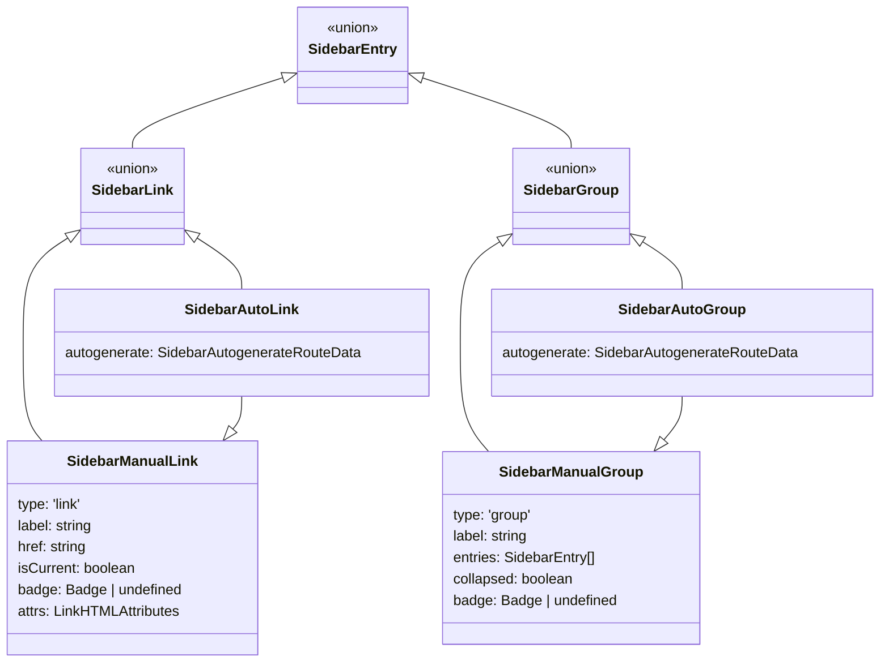
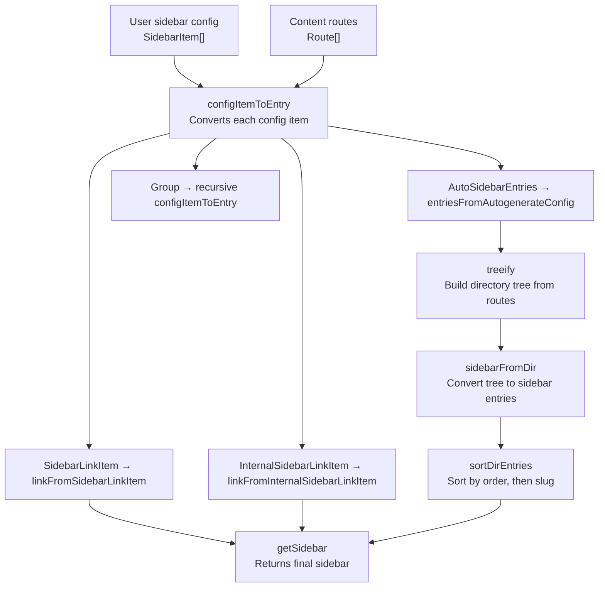

# Starlight Sidebar & Navigation

Starlight's sidebar is the primary navigation structure for a documentation site. It can be configured manually with explicit links and groups, auto-generated from the content directory structure, or a combination of both. The sidebar system transforms the user's sidebar configuration and the content collection routes into a nested tree of `SidebarEntry` objects, marks the current page, and generates prev/next navigation links.

## Sidebar Entry Types



Source: `packages/starlight/utils/routing/types.ts:21`

```typescript
// packages/starlight/utils/routing/types.ts:21
export interface SidebarAutogenerateRouteData {
    directory: string;
}

export interface SidebarManualLink {
    type: 'link';
    label: string;
    href: string;
    isCurrent: boolean;
    badge: Badge | undefined;
    attrs: LinkHTMLAttributes;
}

export interface SidebarAutoLink extends SidebarManualLink {
    autogenerate: SidebarAutogenerateRouteData;
}

export interface SidebarManualGroup {
    type: 'group';
    label: string;
    entries: (SidebarLink | SidebarGroup)[];
    collapsed: boolean;
    badge: Badge | undefined;
}

export interface SidebarAutoGroup extends SidebarManualGroup {
    autogenerate: SidebarAutogenerateRouteData;
}

export type SidebarEntry = SidebarLink | SidebarGroup;
```

The distinction between "manual" and "auto" entries matters:
- **Manual links** -- Created from explicit user config (`{ label, link }`). No `autogenerate` data.
- **Auto links** -- Created from content collection entries. Have `autogenerate.directory` indicating which directory they came from.
- **Manual groups** -- Created from explicit user config (`{ label, items }`). No `autogenerate` data.
- **Auto groups** -- Created from directory structure. Have `autogenerate.directory`.

## Sidebar Configuration Pipeline



Source: `packages/starlight/utils/navigation.ts:75`

```typescript
// packages/starlight/utils/navigation.ts:75
function configItemToEntry(
    item: SidebarItem,
    locale: string | undefined,
    routes: Route[]
): SidebarEntry | SidebarEntry[] {
    if ('link' in item) {
        return linkFromSidebarLinkItem(item, locale);
    } else if ('autogenerate' in item) {
        return entriesFromAutogenerateConfig(item, locale, routes);
    } else if ('slug' in item) {
        return linkFromInternalSidebarLinkItem(item, locale);
    } else {
        return {
            type: 'group',
            label: pickLang(item.translations, localeToLang(locale)) || item.label,
            entries: item.items.flatMap((i) => configItemToEntry(i, locale, routes)),
            collapsed: item.collapsed,
            badge: getSidebarBadge(item.badge, locale, label),
        };
    }
}
```

## Autogeneration: From Directory to Sidebar

When the user configures `{ autogenerate: { directory: 'reference' } }`, Starlight:

1. Filters routes to only those in the specified directory (and its subdirectories)
2. Builds a tree structure from the filtered routes using `treeify()`
3. Converts the tree to sidebar entries using `sidebarFromDir()`
4. Sorts entries by `sidebar.order` frontmatter, then alphabetically by slug

Source: `packages/starlight/utils/navigation.ts:99`

```typescript
// packages/starlight/utils/navigation.ts:99
function entriesFromAutogenerateConfig(
    item: AutoSidebarEntries,
    locale: string | undefined,
    routes: Route[]
): (SidebarAutoLink | SidebarGroup)[] {
    const { attrs, collapsed, directory } = item.autogenerate;
    const localeDir = locale ? locale + '/' + directory : directory;
    const dirDocs = routes.filter((doc) => {
        const filePathFromContentDir = getRoutePathRelativeToCollectionRoot(doc, locale);
        return (
            stripExtension(filePathFromContentDir) === localeDir ||
            filePathFromContentDir.startsWith(localeDir + '/')
        );
    });
    const tree = treeify(dirDocs, locale, localeDir);
    return sidebarFromDir(tree, { collapsed: collapsed ?? false, attrs }, { directory });
}
```

### The `treeify` Algorithm

Source: `packages/starlight/utils/navigation.ts:240`

```typescript
// packages/starlight/utils/navigation.ts:240
function treeify(routes: Route[], locale: string | undefined, baseDir: string): Dir {
    const treeRoot: Dir = makeDir(baseDir);
    routes
        .filter((doc) => !doc.entry.data.sidebar.hidden)
        .map((doc) => [getRoutePathRelativeToCollectionRoot(doc, locale), doc])
        .sort(([a], [b]) => b.split('/').length - a.split('/').length)  // Sort by depth
        .forEach(([filePathFromContentDir, doc]) => {
            const parts = getBreadcrumbs(filePathFromContentDir, baseDir);
            let currentNode = treeRoot;
            parts.forEach((part, index) => {
                const isLeaf = index === parts.length - 1;
                if (isLeaf && Object.hasOwn(currentNode, part)) {
                    currentNode = currentNode[part] as Dir;
                    part = 'index';
                }
                if (!isLeaf) {
                    const path = currentNode[SlugKey];
                    currentNode[part] ||= makeDir(stripLeadingAndTrailingSlashes(path + '/' + part));
                    currentNode = currentNode[part] as Dir;
                } else {
                    currentNode[part] = doc;
                }
            });
        });
    return treeRoot;
}
```

Aha: **The treeify algorithm sorts routes by depth (deepest first) to build the tree from leaves upward.** This ensures that parent directories are created before their children are inserted into them. The `makeDir` function uses non-enumerable properties (`DirKey` and `SlugKey`) to store metadata on directory objects, so `Object.entries(dir)` returns only the actual child entries, not the metadata. This is a clever way to attach data to objects without polluting the iteration.

Source: `packages/starlight/utils/navigation.ts:60`

```typescript
// packages/starlight/utils/navigation.ts:60
function makeDir(slug: string): Dir {
    const dir = {} as Dir;
    Object.defineProperty(dir, DirKey, { enumerable: false });
    Object.defineProperty(dir, SlugKey, { value: slug, enumerable: false });
    return dir;
}
```

### Directory Sorting

Source: `packages/starlight/utils/navigation.ts:304`

```typescript
// packages/starlight/utils/navigation.ts:304
function sortDirEntries(dir: [string, Dir | Route][]): [string, Dir | Route][] {
    const collator = new Intl.Collator(localeToLang(undefined));
    return dir.sort(([_keyA, a], [_keyB, b]) => {
        const [aOrder, bOrder] = [getOrder(a), getOrder(b)];
        if (aOrder !== bOrder) return aOrder < bOrder ? -1 : 1;
        return collator.compare(isDir(a) ? a[SlugKey] : a.id, isDir(b) ? b[SlugKey] : b.id);
    });
}
```

Sorting uses:
1. **`sidebar.order`** -- Lower numbers come first. If two items have different order values, they're sorted numerically.
2. **Slug** -- If order values are equal (or both undefined), items are sorted alphabetically using `Intl.Collator` for locale-aware comparison.

The `getOrder` function recursively finds the lowest order value in a directory:

```typescript
// packages/starlight/utils/navigation.ts:296
function getOrder(routeOrDir: Route | Dir): number {
    return isDir(routeOrDir)
        ? Math.min(...Object.values(routeOrDir).flatMap(getOrder))
        : (routeOrDir.entry.data.sidebar.order ?? Number.MAX_VALUE);
}
```

This means a group's sort weight is the lowest order of any page within it. A group containing a page with `order: 1` will sort before a group whose lowest order is `order: 2`.

## The Current Page Flag

Starlight marks the current page in the sidebar by setting `isCurrent: true`:

Source: `packages/starlight/utils/navigation.ts:376`

```typescript
// packages/starlight/utils/navigation.ts:376
const intermediateSidebars = new Map<string | undefined, SidebarEntry[]>();
const lastCurrentEntryByLocale = new Map<string | undefined, SidebarLink>();
```

Aha: **Starlight caches the intermediate sidebar (unmarked) per locale and mutates it to set `isCurrent`.** Instead of cloning the entire sidebar for each page and marking the current entry, Starlight keeps one mutable intermediate sidebar per locale. When a new page is requested, it resets the previous current entry (`isCurrent = false`) and marks the new one (`isCurrent = true`). This works because Astro deep-clones route data before passing it to components, so mutations to the intermediate sidebar don't leak between requests. This is a performance optimization that avoids O(n) sidebar cloning per page.

Source: `packages/starlight/utils/navigation.ts:417`

```typescript
// packages/starlight/utils/navigation.ts:417
function setIntermediateSidebarCurrentEntry(
    intermediateSidebar: SidebarEntry[],
    pathname: string,
    locale: string | undefined
): void {
    const lastCurrentEntry = lastCurrentEntryByLocale.get(locale);
    if (lastCurrentEntry) lastCurrentEntry.isCurrent = false;
    const entry = getSidebarCurrentEntry(intermediateSidebar, pathname);
    if (entry) {
        entry.isCurrent = true;
        lastCurrentEntryByLocale.set(locale, entry);
    }
}
```

## Prev/Next Navigation

The prev/next links are generated by flattening the sidebar into a linear list of links and finding the current page's position:

Source: `packages/starlight/utils/navigation.ts:481`

```typescript
// packages/starlight/utils/navigation.ts:481
export function getPrevNextLinks(
    sidebar: SidebarEntry[],
    paginationEnabled: boolean,
    config: { prev?: PrevNextLinkConfig; next?: PrevNextLinkConfig }
): PaginationLinks {
    const entries = flattenSidebar(sidebar);
    const currentIndex = entries.findIndex((entry) => entry.isCurrent);
    const prev = applyPrevNextLinkConfig(entries[currentIndex - 1], paginationEnabled, config.prev);
    const next = applyPrevNextLinkConfig(
        currentIndex > -1 ? entries[currentIndex + 1] : undefined,
        paginationEnabled,
        config.next
    );
    return { prev, next };
}
```

The `PrevNextLinkConfig` type allows per-page override of prev/next links:

Source: `packages/starlight/schemas/prevNextLink.ts`

```typescript
// packages/starlight/schemas/prevNextLink.ts
export const PrevNextLinkConfigSchema = () => z.union([
    z.boolean(),   // true = use default, false = hide
    z.string(),    // Custom label for the generated link
    z.object({     // Full custom: label + link
        label: z.string(),
        link: z.string(),
    }),
]).optional();
```

Frontmatter example:

```yaml
---
title: Custom Navigation
prev: "Previous Page Title"
next:
  label: "Go to External Site"
  link: "https://example.com"
---
```

The `applyPrevNextLinkConfig` function handles all combinations:

```typescript
// packages/starlight/utils/navigation.ts:501
function applyPrevNextLinkConfig(link, paginationEnabled, config) {
    if (config === false) return undefined;           // Explicitly remove
    else if (config === true) return link;            // Use generated link
    else if (typeof config === 'string' && link) {    // Update label
        return { ...link, label: config };
    } else if (typeof config === 'object') {
        if (link) {
            return { ...link, label: config.label ?? link.label, href: config.link ?? link.href, attrs: {} };
        } else if (config.link && config.label) {
            return makeLink({ href: config.link, label: config.label });  // Create new link
        }
    }
    return paginationEnabled ? link : undefined;       // Default behavior
}
```

## The Sidebar Hash

Starlight generates a hash of the sidebar for cache invalidation:

Source: `packages/starlight/utils/navigation.ts:452`

```typescript
// packages/starlight/utils/navigation.ts:452
export function getSidebarHash(sidebar: SidebarEntry[]): string {
    let hash = 0;
    const sidebarIdentity = recursivelyBuildSidebarIdentity(sidebar);
    for (let i = 0; i < sidebarIdentity.length; i++) {
        const char = sidebarIdentity.charCodeAt(i);
        hash = (hash << 5) - hash + char;  // djb2 hash
    }
    return (hash >>> 0).toString(36).padStart(7, '0');
}
```

This uses the djb2 hash algorithm on the concatenation of all labels and hrefs. The result is a 7-character base-36 string (e.g., `"a1b2c3d"`). The hash is used for client-side cache invalidation -- when the sidebar changes, the client knows to refresh its cached state.

## Sidebar Badges

Badges can be added to any sidebar item:

Source: `packages/starlight/utils/navigation.ts:534`

```typescript
// packages/starlight/utils/navigation.ts:534
function getSidebarBadge(config, locale, itemLabel): Badge | undefined {
    if (!config) return;
    if (typeof config === 'string') return { variant: 'default', text: config };
    return { ...config, text: getSidebarBadgeText(config.text, locale, itemLabel) };
}
```

Badge config supports:

```typescript
// String badge (default variant)
badge: 'New'

// Object badge
badge: { variant: 'note', text: 'Updated' }

// Variants: 'note', 'tip', 'caution', 'danger', 'success', 'default'

// i18n-aware badge
badge: { text: { en: 'New', fr: 'Nouveau' } }
```

## Sidebar Schema: Removed `autogenerate` Groups

Aha: **Starlight v0.39.0 removed support for `autogenerate` objects with a `label` (autogenerate groups).** Previously, you could write `{ label: 'API', autogenerate: { directory: 'api' } }` and Starlight would auto-generate the group. Now, you must explicitly wrap autogenerate in a group: `{ label: 'API', items: [{ autogenerate: { directory: 'api' } }] }`. The schema includes a custom `superRefine` that provides a migration message with the exact replacement code:

Source: `packages/starlight/schemas/sidebar.ts:77`

```typescript
// packages/starlight/schemas/sidebar.ts:77
.superRefine((config, ctx) => {
    if (!('label' in config)) return;
    ctx.addIssue({
        message: `Found an \`autogenerate\` object with a \`label\`. Support for autogenerated sidebar groups was removed in Starlight v0.39.0.\n` +
            `You should instead create a group with the desired \`label\` and an \`items\` array containing the autogenerate config:\n\n` +
            `{ label: '${config.label}', items: [{ autogenerate: ${JSON.stringify(config.autogenerate)} }] }`,
    });
});
```

## HTML Attributes on Sidebar Links

Links can have custom HTML attributes via the `attrs` field:

Source: `packages/starlight/schemas/sidebar.ts:33`

```typescript
// packages/starlight/schemas/sidebar.ts:33
const linkHTMLAttributesSchema = z.record(
    z.string(),
    z.union([z.string(), z.number(), z.boolean(), z.undefined(), z.null()])
) as z.ZodType<LinkHTMLAttributes, LinkHTMLAttributes>;
```

Example:

```typescript
sidebar: [
    {
        label: 'GitHub',
        link: 'https://github.com/user/repo',
        attrs: { target: '_blank', rel: 'noopener noreferrer' },
    },
    {
        label: 'Download',
        link: '/downloads/file.pdf',
        attrs: { download: true },
    },
]
```

Aha: **Groups explicitly cannot have `attrs` -- the schema uses `z.never().optional()` to enforce this.** This is because the final sidebar type is a non-discriminated union, which means TypeScript won't perform excess property checks. Without this explicit prevention, a user could define `attrs` on a group, get no TypeScript error, and only hit a runtime failure.

## What's Next

- Read [Configuration Schema](02-config-schema.html) for the sidebar schema options
- Read [Components](08-components.html) for the Sidebar.astro component
- Read [Content Loaders](07-content-loaders.html) for how content routes are loaded
