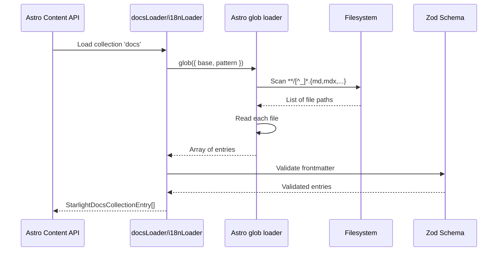
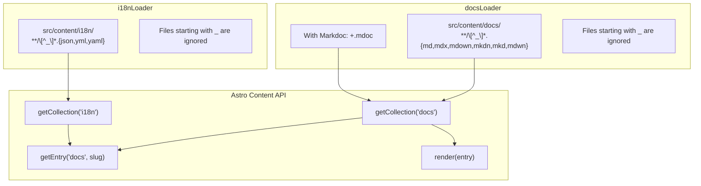

# Starlight Content Loaders

Starlight uses Astro's content loader system to load documentation files and translation files from the filesystem. The `docsLoader` loads Markdown content from `src/content/docs/` and the `i18nLoader` loads translation files from `src/content/i18n/`. Both loaders use Astro's built-in `glob` loader, configured with specific file patterns and collection paths. Understanding the loader system is essential for configuring custom content directories, integrating alternative content sources, or debugging content loading issues.

## Content Loading Lifecycle

Loaders run during Astro's content collection initialization:



## Two Loaders, Two Collections



Source: `packages/starlight/loaders.ts`

```typescript
// packages/starlight/loaders.ts
import { glob, type Loader, type LoaderContext } from 'astro/loaders';
import { getCollectionPathFromRoot, type StarlightCollection } from './utils/collection';

const docsExtensions = ['markdown', 'mdown', 'mkdn', 'mkd', 'mdwn', 'md', 'mdx'];
const i18nExtensions = ['json', 'yml', 'yaml'];

export function docsLoader({ generateId }: { generateId?: GenerateIdFunction } = {}): Loader {
    return { name: 'starlight-docs-loader', load: createGlobLoadFn('docs', generateId) };
}

export function i18nLoader(): Loader {
    return { name: 'starlight-i18n-loader', load: createGlobLoadFn('i18n') };
}
```

## The Glob Loader Factory

Both loaders share a common factory function:

Source: `packages/starlight/loaders.ts:40`

```typescript
// packages/starlight/loaders.ts:40
function createGlobLoadFn(
    collection: StarlightCollection,
    generateId?: GenerateIdFunction
): Loader['load'] {
    return (context: LoaderContext) => {
        const extensions = collection === 'docs' ? docsExtensions : i18nExtensions;

        if (collection === 'docs' &&
            context.config.integrations.find(({ name }) => name === '@astrojs/markdoc')) {
            extensions.push('mdoc');
        }

        const options: GlobOptions = {
            base: getCollectionPathFromRoot(collection, context.config),
            pattern: `**/[^_]*.{${extensions.join(',')}}`,
        };
        if (generateId) options.generateId = generateId;

        return glob(options).load(context);
    };
}
```

Key details:

1. **Extension detection** -- The docs loader checks if `@astrojs/markdoc` is installed and adds `.mdoc` to the extension list if so. This enables Markdoc content to be loaded alongside Markdown and MDX.
2. **Private file filtering** -- The pattern `[^_]*` matches filenames that DON'T start with `_`. This allows `_partial.md` or `_components/` directories to exist without being loaded as content entries.
3. **Base path resolution** -- `getCollectionPathFromRoot` computes the absolute path to the collection relative to the project root, respecting custom `srcDir` configurations.
4. **Custom ID generation** -- The `generateId` option allows overriding how entry IDs (slugs) are computed from file paths.

## Content Collection Path Resolution

Source: `packages/starlight/utils/collection.ts`

```typescript
// packages/starlight/utils/collection.ts
export function getCollectionPathFromRoot(
    collection: StarlightCollection,
    config: Pick<AstroConfig, 'srcDir'>
): string {
    // Returns 'src/content/docs' or 'src/content/i18n' relative to srcDir
}
```

The path resolution accounts for custom `srcDir` configurations. By default, Astro uses `src/` as the source directory, but users can configure a different location (e.g., `www/`). The loader resolves the collection path correctly regardless.

## How Loaders Are Used

### In `content.config.ts`

Users configure loaders in their Astro content configuration:

```typescript
// src/content.config.ts
import { defineCollection } from 'astro:content';
import { docsSchema } from '@astrojs/starlight/schema';
import { docsLoader, i18nLoader } from '@astrojs/starlight/loaders';

export const collections = {
    docs: defineCollection({
        loader: docsLoader(),
        schema: docsSchema(),
    }),
    i18n: defineCollection({
        loader: i18nLoader(),
        schema: i18nSchema(),
    }),
};
```

### In Route Resolution

The loaded content is accessed via Astro's content API:

Source: `packages/starlight/utils/routing/index.ts:37`

```typescript
// packages/starlight/utils/routing/index.ts:37
const docs: StarlightDocsEntry[] = (
    (await getCollection('docs', ({ data }) => {
        // In production, filter out drafts.
        return import.meta.env.MODE !== 'production' || data.draft === false;
    })) ?? []
).map(normalizeCollectionEntry);
```

Aha: **Draft entries are filtered at load time, not at rendering time.** The `getCollection` call includes a filter callback that excludes `draft: true` entries in production mode. This means draft pages are available during development (for preview) but completely excluded from production builds. The filter is applied BEFORE normalization, so draft entries don't consume any memory in the route list.

### Custom Content Collections

Starlight can process additional content collections through the `markdown.processedDirs` config option:

Source: `packages/starlight/utils/user-config.ts:256`

```typescript
// packages/starlight/utils/user-config.ts:256
processedDirs: z.string().array().default([]),
```

This allows content outside `src/content/docs/` to be processed through Starlight's Markdown pipeline (asides, heading links, etc.). For example, a blog at `src/content/blog/` or comments at `src/data/comments/`:

```typescript
// astro.config.mjs
starlight({
    markdown: {
        processedDirs: ['./src/content/blog/', './src/data/comments/'],
    },
});
```

## Collection Entry Normalization

Source: `packages/starlight/utils/routing/index.ts:26`

```typescript
// packages/starlight/utils/routing/index.ts:26
export function normalizeCollectionEntry(entry): StarlightDocsEntry {
    return {
        ...entry,
        // The `id` is a slug and should be normalized.
        id: normalizeIndexSlug(entry.id),
        // At the moment, Starlight only supports file-based loaders which always include a `filePath`.
        filePath: entry.filePath!,
    };
}

const normalizeIndexSlug = (slug: string) => (slug === 'index' ? '' : slug);
```

Aha: **The `index` slug normalization is necessary because Astro generates `id: 'index'` for `src/content/docs/index.md` but `id: ''` for `src/content/docs/subdir/index.md`.** Starlight normalizes the root index to an empty string for consistency, so the homepage is always at slug `''` regardless of whether it's named `index.md` or not.

## Loader Architecture: Why Glob Loaders?

Starlight uses glob loaders rather than database or API loaders because:

1. **Filesystem is the source of truth** -- Documentation lives in Markdown files on disk
2. **Build-time loading** -- Content is loaded once at build time, not per request
3. **Watch mode** -- Astro's dev server watches for file changes and re-loads content automatically
4. **Type safety** -- Combined with Zod schemas, loaded content is fully typed

Alternative loaders (database, API, Git) could theoretically be implemented using Astro's custom loader API, but Starlight's current architecture assumes glob-based file loading throughout.

## The `generateId` Customization

The `docsLoader` accepts an optional `generateId` function:

Source: `packages/starlight/loaders.ts:15`

```typescript
// packages/starlight/loaders.ts:15
export function docsLoader({
    generateId,
}: {
    generateId?: GenerateIdFunction;
} = {}): Loader { ... }
```

This allows overriding how entry IDs are computed from file paths. By default, the ID is the relative file path without extension (e.g., `src/content/docs/getting-started.md` → `getting-started`). A custom `generateId` could:

- Prefix IDs with a namespace
- Strip additional path segments
- Compute IDs from frontmatter metadata

Example:

```typescript
const loader = docsLoader({
    generateId: ({ entry }) => `docs/${entry.data.category}/${entry.slug}`,
});
```

## Content Entry Structure

A loaded docs entry has this structure:

```typescript
interface StarlightDocsCollectionEntry {
    id: string;              // Slug (e.g., 'getting-started', 'reference/config')
    body: string;            // Raw Markdown body
    slug: string;            // Same as id for glob loaders
    collection: 'docs';      // Collection name
    data: StarlightFrontmatter; // Parsed frontmatter
    filePath: string;        // Absolute file path
    render: () => Promise<RenderResult>; // Render function
}
```

The `data` object contains the parsed and validated frontmatter, including `title`, `description`, `sidebar`, `draft`, `pagefind`, `hero`, `banner`, and any custom fields added via `docsSchema({ extend })`.

## File Extensions Supported

| Extension | Processor | Notes |
|-----------|-----------|-------|
| `.md` | Satteri or Unified | Standard Markdown |
| `.mdx` | `@astrojs/mdx` | Markdown + JSX components |
| `.markdown`, `.mdown`, `.mkdn`, `.mkd`, `.mdwn` | Satteri or Unified | Alternative Markdown extensions |
| `.mdoc` | `@astrojs/markdoc` | Only when Markdoc integration is installed |

Aha: **Starlight supports seven different Markdown extensions out of the box.** This isn't a gimmick -- it handles the reality that different tools and editors use different conventions. A documentation team migrating from a system that uses `.mkdn` doesn't need to rename thousands of files. The glob pattern `{markdown,mdown,mkdn,md,mdwn,mdx}` catches all common variants.

## What's Next

- Read [Markdoc & DocSearch](10-markdoc-docsearch.html) for how Markdoc content is processed
- Read [Integration Lifecycle](03-integration.html) for how the Markdown processor integrates with loaded content
- Read [Cross-Cutting Concerns](11-cross-cutting.html) for how rendered content flows through the pipeline
