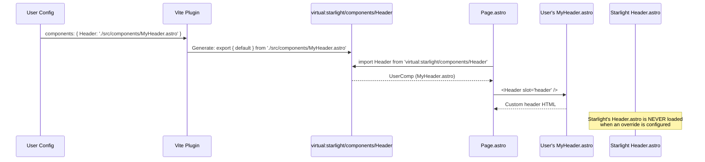

# Starlight Components

Starlight's component system is organized into three categories: internal layout components (Page, Header, Footer, Sidebar), user-facing content components (Aside, Badge, Card, Tabs), and internal UI components (TableOfContents, Icons). Every component is overridable through the `components` config option, and the virtual module system ensures overrides are transparent to consuming code. This document covers the full component architecture, the override mechanism, and every user-facing component.

## Component Architecture

```mermaid
flowchart TD
    subgraph "Layout Components (components/)"
        A1[Page.astro\nRoot layout]
        A2[Header.astro\nTop navigation]
        A3[Footer.astro\nPage footer]
        A4[Sidebar.astro\nLeft navigation]
        A5[PageSidebar.astro\nRight TOC sidebar]
        A6[PageFrame.astro\nPage wrapper]
        A7[TwoColumnContent.astro\nContent + TOC layout]
        A8[ContentPanel.astro\nContent section]
        A9[MobileMenuToggle.astro\nHamburger menu]
        A10[MobileMenuFooter.astro\nMobile nav]
    end

    subgraph "User Components (user-components/)"
        B1[Aside.astro\nCallout blocks]
        B2[Badge.astro\nStatus badges]
        B3[Card.astro\nContent cards]
        B4[CardGrid.astro\nCard layout]
        B5[Tabs.astro\nTabbed content]
        B6[TabItem.astro\nTab panel]
        B7[Icon.astro\nSVG icons]
        B8[FileTree.astro\nDirectory tree]
        B9[Steps.astro\nStep-by-step]
        B10[LinkButton.astro\nCTA buttons]
        B11[LinkCard.astro\nLink cards]
    end

    subgraph "Functional Components"
        C1[Search.astro\nPagefind UI]
        C2[ThemeSelect.astro\nDark/light toggle]
        C3[LanguageSelect.astro\nLanguage switcher]
        C4[EditLink.astro\nEdit page link]
        C5[Pagination.astro\nPrev/next links]
        C6[LastUpdated.astro\nDate display]
        C7[Head.astro\nMeta tags]
        C8[Hero.astro\nHero section]
        C9[Banner.astro\nAnnouncement banner]
        C10[SkipLink.astro\nAccessibility]
        C11[ThemeProvider.astro\nTheme JS]
        C12[MobileTableOfContents.astro\nMobile TOC]
    end

    A1 --> A2
    A1 --> A3
    A1 --> A4
    A1 --> A5
    A1 --> A6
    A1 --> A7
    A1 --> A8
    A1 --> A9
    A1 --> A10
    A7 --> C1
    A7 --> C2
    A7 --> C3
    A8 --> C8
    A8 --> C4
    A8 --> C5
    A8 --> C6
    A8 --> B1
    A8 --> B2
```



## The Page.astro Layout

`Page.astro` is the root layout for every Starlight page. It sets up the HTML structure, imports CSS, and composes all other components:

Source: `packages/starlight/components/Page.astro`

```astro
---
// packages/starlight/components/Page.astro
import 'virtual:starlight/user-css';
import '../style/layers.css';
import '../style/props.css';
import '../style/reset.css';
import '../style/asides.css';
import '../style/util.css';
import 'virtual:starlight/optional-css';

import Banner from 'virtual:starlight/components/Banner';
import ContentPanel from 'virtual:starlight/components/ContentPanel';
import Footer from 'virtual:starlight/components/Footer';
import Head from 'virtual:starlight/components/Head';
import Header from 'virtual:starlight/components/Header';
import Hero from 'virtual:starlight/components/Hero';
import MarkdownContent from 'virtual:starlight/components/MarkdownContent';
import PageFrame from 'virtual:starlight/components/PageFrame';
import PageSidebar from 'virtual:starlight/components/PageSidebar';
import PageTitle from 'virtual:starlight/components/PageTitle';
import Sidebar from 'virtual:starlight/components/Sidebar';
import SkipLink from 'virtual:starlight/components/SkipLink';
import ThemeProvider from 'virtual:starlight/components/ThemeProvider';
import TwoColumnContent from 'virtual:starlight/components/TwoColumnContent';

const { starlightRoute } = Astro.locals;
---

<html lang={starlightRoute.lang} dir={starlightRoute.dir} {...htmlDataAttributes}>
    <head>
        <Head />
        <ThemeProvider />
        <link rel="stylesheet" href={printHref} media="print" />
    </head>
    <body>
        <SkipLink />
        <PageFrame>
            <Header slot="header" />
            {starlightRoute.hasSidebar && <Sidebar slot="sidebar" />}
            <TwoColumnContent>
                <PageSidebar slot="right-sidebar" />
                <main {...mainDataAttributes} lang={starlightRoute.entryMeta.lang} dir={starlightRoute.entryMeta.dir}>
                    {starlightRoute.entry.data.hero
                        ? <ContentPanel><Hero /><MarkdownContent><slot /></MarkdownContent><Footer /></ContentPanel>
                        : <>
                            <ContentPanel><PageTitle /><DraftContentNotice /><FallbackContentNotice /></ContentPanel>
                            <ContentPanel><MarkdownContent><slot /></MarkdownContent><Footer /></ContentPanel>
                          </>
                    }
                </main>
            </TwoColumnContent>
        </PageFrame>
    </body>
</html>
```

Aha: **The hero layout has a completely different structure from the doc layout.** When `entry.data.hero` is set, the page renders: Banner → Hero → Content → Footer. Without hero, it renders: Banner → PageTitle → Notices → Content → Footer, split across two ContentPanels. The hero layout is designed for landing pages and splash pages, while the doc layout is designed for documentation reading. The conditional logic in Page.astro is the only place this structural difference exists.

## HTML Data Attributes

Page.astro sets data attributes on `<html>` and `<main>` for CSS targeting:

```typescript
const htmlDataAttributes: DOMStringMap = { 'data-theme': 'dark' };
if (Boolean(starlightRoute.toc)) htmlDataAttributes['data-has-toc'] = '';
if (starlightRoute.hasSidebar) htmlDataAttributes['data-has-sidebar'] = '';
if (Boolean(starlightRoute.entry.data.hero)) htmlDataAttributes['data-has-hero'] = '';

const mainDataAttributes: DOMStringMap = {};
if (pagefindEnabled) mainDataAttributes['data-pagefind-body'] = '';
```

These attributes enable CSS rules like:
- `html:not([data-has-toc]) { --sl-mobile-toc-height: 0rem; }`
- `html:not([data-has-sidebar]) { --sl-content-width: 67.5rem; }`
- `[data-has-sidebar] { --sl-content-inline-start: var(--sl-sidebar-width); }`

## Component Override Flow

When a user overrides a component, the virtual module system resolves the override:



## The Component Override System

Any of 29 components can be overridden through the `components` config:

Source: `packages/starlight/schemas/components.ts`

The overridable components are:

| Component | Purpose | Location |
|-----------|---------|----------|
| `Head` | `<head>` content (meta tags, CSS, JS) | `components/Head.astro` |
| `Header` | Top navigation bar | `components/Header.astro` |
| `Footer` | Page footer (edit link, pagination, last updated) | `components/Footer.astro` |
| `Sidebar` | Left sidebar navigation | `components/Sidebar.astro` |
| `PageTitle` | Page title display | `components/PageTitle.astro` |
| `ContentPanel` | Content section wrapper | `components/ContentPanel.astro` |
| `Banner` | Announcement banner | `components/Banner.astro` |
| `MarkdownContent` | Rendered Markdown content wrapper | `components/MarkdownContent.astro` |
| `Hero` | Hero section on splash pages | `components/Hero.astro` |
| `TableOfContents` | Right sidebar TOC | `components/TableOfContents.astro` |
| `MobileTableOfContents` | Mobile TOC dropdown | `components/MobileTableOfContents.astro` |
| `PageSidebar` | Combined TOC + sidebar on desktop | `components/PageSidebar.astro` |
| `Search` | Search button + modal | `components/Search.astro` |
| `SiteTitle` | Site title in header | `components/SiteTitle.astro` |
| `SocialIcons` | Social media links | `components/SocialIcons.astro` |
| `ThemeSelect` | Dark/light theme dropdown | `components/ThemeSelect.astro` |
| `LanguageSelect` | Language switcher | `components/LanguageSelect.astro` |
| `EditLink` | "Edit this page" link | `components/EditLink.astro` |
| `LastUpdated` | Last updated date | `components/LastUpdated.astro` |
| `Pagination` | Prev/next page links | `components/Pagination.astro` |
| `SkipLink` | Accessibility skip link | `components/SkipLink.astro` |
| `ThemeProvider` | Theme initialization script | `components/ThemeProvider.astro` |
| `PageFrame` | Page wrapper with slots | `components/PageFrame.astro` |
| `MobileMenuToggle` | Mobile hamburger menu | `components/MobileMenuToggle.astro` |
| `MobileMenuFooter` | Mobile navigation footer | `components/MobileMenuFooter.astro` |
| `TwoColumnContent` | Content + TOC two-column layout | `components/TwoColumnContent.astro` |
| `FallbackContentNotice` | Fallback content notice | `components/FallbackContentNotice.astro` |
| `DraftContentNotice` | Draft content notice | `components/DraftContentNotice.astro` |

Override example:

```typescript
// astro.config.mjs
starlight({
    title: 'My Docs',
    components: {
        Header: './src/components/MyHeader.astro',
        Footer: './src/components/MyFooter.astro',
    },
});
```

Aha: **The override system works at the virtual module level, not at runtime.** When you set `components: { Header: './src/components/MyHeader.astro' }`, the Vite plugin generates `export { default } from "./src/components/MyHeader.astro";` for `virtual:starlight/components/Header`. The Page.astro component simply imports from the virtual module and gets your custom component. There's no conditional logic, no prop forwarding, no wrapper. Your component IS the Header. This means your override has full control over the rendered output.

## User-Facing Components

These components can be used directly in Markdown/MDX content:

Source: `packages/starlight/components.ts`

```typescript
// packages/starlight/components.ts
export { default as Aside } from './user-components/Aside.astro';
export { default as Badge } from './user-components/Badge.astro';
export { default as Card } from './user-components/Card.astro';
export { default as CardGrid } from './user-components/CardGrid.astro';
export { default as Icon } from './user-components/Icon.astro';
export { default as Tabs } from './user-components/Tabs.astro';
export { default as TabItem } from './user-components/TabItem.astro';
export { default as LinkCard } from './user-components/LinkCard.astro';
export { default as Steps } from './user-components/Steps.astro';
export { default as FileTree } from './user-components/FileTree.astro';
export { default as LinkButton } from './user-components/LinkButton.astro';
export { Code } from 'astro-expressive-code/components';
```

### Aside

Callout blocks for notes, tips, cautions, and dangers:

```astro
<Aside type="note" title="Important">This is important information.</Aside>
<Aside type="tip">This is a helpful tip.</Aside>
<Aside type="caution">Watch out for this.</Aside>
<Aside type="danger">This could cause issues.</Aside>
```

In Markdown, these can also be written as directives:

```markdown
:::tip
This is a helpful tip.
:::

:::note[Important]
This is important information.
:::
```

### Badge

Status badges with variants:

```astro
<Badge>Default</Badge>
<Badge variant="note">Note</Badge>
<Badge variant="tip">Tip</Badge>
<Badge variant="caution">Caution</Badge>
<Badge variant="danger">Danger</Badge>
<Badge variant="success">Success</Badge>
```

### Card & CardGrid

Content cards in a grid layout:

```astro
<CardGrid>
    <Card title="Getting Started" href="/getting-started" icon="rocket">
        Learn the basics.
    </Card>
    <Card title="API Reference" href="/api" icon="book">
        Full API documentation.
    </Card>
</CardGrid>
```

### Tabs & TabItem

Tabbed content:

```astro
<Tabs>
    <TabItem label="npm">
        ```bash
        npm install my-package
        ```
    </TabItem>
    <TabItem label="yarn">
        ```bash
        yarn add my-package
        ```
    </TabItem>
</Tabs>
```

### FileTree

Directory tree display:

```markdown
\`\`\`filetree
src/
├── content/
│   └── docs/
│       ├── index.md
│       └── getting-started.md
└── content.config.ts
\`\`\`
```

### Steps

Step-by-step instructions:

```markdown
:::steps
## Step 1: Install the package
Run `npm install my-package`.

## Step 2: Configure
Add the integration to your astro.config.mjs.

## Step 3: Use it
Start writing documentation.
:::
```

### Icon

SVG icon display:

```astro
<Icon name="github" />
<Icon name="rocket" size="large" />
```

Starlight ships with 130+ built-in SVG icons in the icon registry.

### LinkButton & LinkCard

```astro
<LinkButton href="/getting-started" variant="primary">Get Started</LinkButton>
<LinkButton href="https://github.com" icon="github">View on GitHub</LinkButton>

<LinkCard href="/api" title="API Reference" description="Full API docs" />
```

### Code

Syntax-highlighted code blocks via Expressive Code:

```astro
<Code code={`const x = 42;`} language="ts" title="Example" />
```

Or in Markdown:

````markdown
```ts title="Example.ts" {3-5} showLineNumbers
const x = 42;
console.log(x);
```
````

## CSS Custom Properties

Starlight exposes CSS custom properties for customization:

Source: `packages/starlight/style/props.css`

```css
:root {
    --sl-nav-height: 4rem;
    --sl-sidebar-width: 18.75rem;
    --sl-content-width: 45rem;
    --sl-color-white: #fff;
    --sl-color-gray-1: #eee;
    --sl-color-gray-2: #ccc;
    --sl-color-gray-3: #aaa;
    --sl-color-gray-4: #888;
    --sl-color-gray-5: #666;
    --sl-color-gray-6: #444;
    --sl-color-black: #111;
    --sl-color-accent: #5c34c2;
    --sl-color-accent-high: #7b4fd4;
    --sl-color-accent-low: #4a29a0;
    /* ... many more */
}
```

Users can override these in their `customCss`:

```css
/* src/custom.css */
:root {
    --sl-color-accent: #ff6600;
    --sl-sidebar-width: 20rem;
}
```

## Recursive Components

The Sidebar and TableOfContents components use `<Astro.self>` for recursive rendering:

Aha: **Starlight uses Astro's `<Astro.self>` to render the sidebar and TOC recursively.** This allows the component to call itself for nested groups without needing a separate recursive component file. The pattern is:

```astro
---
// components/Sidebar.astro (simplified)
import SidebarLink from './SidebarLink.astro';
---

{entry.type === 'group' ? (
    <details open={!entry.collapsed}>
        <summary>{entry.label}</summary>
        {entry.entries.map((child) => <Astro.self entry={child} />)}
    </details>
) : (
    <SidebarLink entry={entry} />
)}
```

## Custom Elements for Interactivity

Client-side interactivity uses Web Components (custom elements):

- **`<sl-doc-search>`** -- DocSearch integration
- **`SidebarPersisterState`** -- Sidebar collapse state persistence
- **`MobileMenuToggle`** -- Mobile hamburger menu
- **`ThemeSelect`** -- Theme dropdown
- **`LanguageSelect`** -- Language dropdown
- **`TableOfContents`** -- TOC scroll spy

These custom elements isolate JavaScript behavior from server-side rendering. The Astro component renders the HTML structure, and the custom element class handles client-side behavior (event listeners, state management, DOM manipulation).

## What's Next

- Read [Virtual Modules](04-virtual-modules.html) for how the override system works
- Read [Cross-Cutting Concerns](11-cross-cutting.html) for Expressive Code integration details
