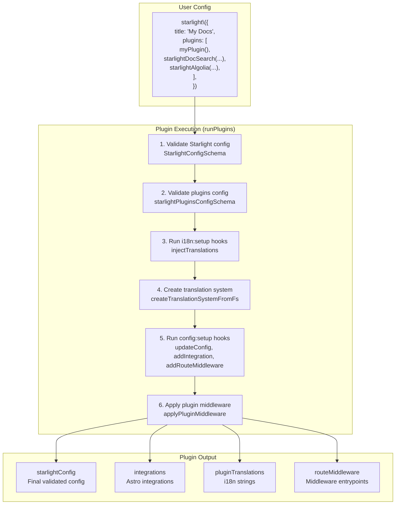
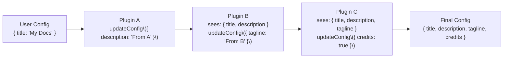

# Starlight Plugin System

Starlight provides a first-class plugin system that allows developers to extend Starlight's configuration, add Astro integrations, inject internationalization strings, and register route middleware. Plugins are defined as objects with a `name` and `hooks`, and they execute during Starlight's `astro:config:setup` phase. The plugin system is the recommended way to extend Starlight without forking or modifying its source.

## Plugin Architecture



## Plugin Schema

Source: `packages/starlight/utils/plugins.ts:194`

```typescript
// packages/starlight/utils/plugins.ts:194
const baseStarlightPluginSchema = z.object({
    name: z.string(),
});

const starlightPluginSchema = z.object({
    ...baseStarlightPluginSchema.shape,
    hooks: z.object({
        'i18n:setup': z.function({
            input: [z.object({
                injectTranslations: z.function({
                    input: [z.record(z.string(), z.record(z.string(), z.string()))],
                    output: z.void(),
                }),
            })],
            output: z.promise(z.void()),
        }).optional(),
        'config:setup': configSetupHookSchema,
        setup: configSetupHookSchema,  // deprecated
    }),
}).superRefine((plugin, ctx) => {
    if (!plugin.hooks['config:setup'] && !plugin.hooks.setup) {
        ctx.issues.push({
            message: 'A plugin must define at least a `config:setup` hook.',
        });
    } else if (plugin.hooks['config:setup'] && plugin.hooks.setup) {
        ctx.issues.push({
            message: 'A plugin cannot define both a `config:setup` and `setup` hook. As `setup` is deprecated...',
        });
    }
});
```

The schema validates that:
1. A plugin has a `name`
2. A plugin defines at least one of `config:setup` or `setup` (but not both)
3. The `setup` hook is deprecated in favor of `config:setup`

## Writing a Plugin

A Starlight plugin is a factory function that returns a plugin object:

```typescript
import type { StarlightPlugin } from '@astrojs/starlight/types';

export function myPlugin(options: MyPluginOptions): StarlightPlugin {
    return {
        name: 'My Starlight Plugin',
        hooks: {
            'i18n:setup'({ injectTranslations }) {
                injectTranslations({
                    en: { 'myPlugin.label': 'My Label' },
                    fr: { 'myPlugin.label': 'Mon Label' },
                });
            },
            'config:setup'({ config, updateConfig, addIntegration, addRouteMiddleware, astroConfig, command, isRestart, logger, useTranslations, absolutePathToLang }) {
                logger.info('My plugin is running!');
                
                // Update Starlight config
                updateConfig({
                    description: 'Custom description from plugin',
                });
                
                // Add an Astro integration
                addIntegration({
                    name: 'my-plugin-integration',
                    hooks: {
                        'astro:config:setup': () => { /* ... */ },
                    },
                });
                
                // Add route middleware
                addRouteMiddleware({
                    entrypoint: './src/my-route-middleware.ts',
                    order: 'default',  // 'pre', 'default', or 'post'
                });
            },
        },
    };
}
```

## The `config:setup` Hook Context

The `config:setup` hook receives a context object with these properties:

| Property | Type | Purpose |
|----------|------|---------|
| `config` | `StarlightUserConfigWithPlugins` | Read-only copy of the current Starlight config |
| `updateConfig` | `(newConfig: Partial<StarlightUserConfig>) => void` | Update Starlight config |
| `addIntegration` | `(integration: AstroIntegration) => void` | Add an Astro integration |
| `addRouteMiddleware` | `({ entrypoint, order }) => void` | Add route middleware |
| `astroConfig` | `AstroConfig` | Read-only copy of the Astro config |
| `command` | `'dev' \| 'build' \| 'preview'` | Current Astro command |
| `isRestart` | `boolean` | True during dev server restart |
| `logger` | `AstroIntegrationLogger` | Forked logger prefixed with plugin name |
| `useTranslations` | `(locale: string) => t` | Translation utility factory |
| `absolutePathToLang` | `(filePath: string) => string` | Get language for a file path |

### `updateConfig` Restrictions

Aha: **Plugins cannot update `plugins` or `routeMiddleware` through `updateConfig`.** These have dedicated APIs. This prevents plugins from creating circular plugin dependencies or interfering with middleware execution order.

Source: `packages/starlight/utils/plugins.ts:87`

```typescript
// packages/starlight/utils/plugins.ts:87
updateConfig(newConfig) {
    if ('plugins' in newConfig) {
        throw new AstroError(`The \`${name}\` plugin tried to update the \`plugins\` config key which is not supported.`);
    }
    if ('routeMiddleware' in newConfig) {
        throw new AstroError(`The \`${name}\` plugin tried to update the \`routeMiddleware\` config key which is not supported.
Use the \`addRouteMiddleware()\` utility instead.`);
    }
    // ... re-validate and apply
},
```

### `addRouteMiddleware` Order

Route middleware can specify execution order:

Source: `packages/starlight/utils/plugins.ts:139`

```typescript
// packages/starlight/utils/plugins.ts:139
function applyPluginMiddleware(
    routeMiddlewareConfigs: { entrypoint: string; order: 'default' | 'pre' | 'post' }[],
    starlightConfig: StarlightConfig
) {
    const middlewareBuckets = routeMiddlewareConfigs.reduce(
        (buckets, { entrypoint, order = 'default' }) => {
            buckets[order].push(entrypoint);
            return buckets;
        },
        { pre: [], default: [], post: [] }
    );
    starlightConfig.routeMiddleware.unshift(...middlewareBuckets.pre);
    starlightConfig.routeMiddleware.push(...middlewareBuckets.default, ...middlewareBuckets.post);
}
```

Execution order:
1. User's `routeMiddleware` (from config)
2. Plugin `pre` middleware (unshifted to front)
3. Plugin `default` middleware (pushed after)
4. Plugin `post` middleware (pushed last)

### `injectTranslations`

The `i18n:setup` hook allows plugins to inject translation strings:

Source: `packages/starlight/utils/plugins.ts:48`

```typescript
// packages/starlight/utils/plugins.ts:48
for (const { hooks: { 'i18n:setup': i18nSetup } } of pluginsConfig) {
    if (i18nSetup) {
        await i18nSetup({
            injectTranslations(translations) {
                for (const [locale, localeTranslations] of Object.entries(translations)) {
                    pluginTranslations[locale] ??= {};
                    Object.assign(pluginTranslations[locale], localeTranslations);
                }
            },
        });
    }
}
```

Aha: **Translations from all plugins are merged into a single `pluginTranslations` object BEFORE the `config:setup` hooks run.** This means the translation system is set up first, and then `useTranslations` in `config:setup` hooks can access both built-in strings and plugin-injected strings. The merge uses `Object.assign`, so later plugins can override earlier plugins' translations (first-come, first-served for the initial value, but later plugins merge on top).

### `absolutePathToLang`

This utility is particularly useful for remark/rehype plugins that need to know the language of the file being processed:

Source: `packages/starlight/utils/plugins.ts:68`

```typescript
// packages/starlight/utils/plugins.ts:68
function absolutePathToLang(path: string) {
    return getAbsolutePathFromLang(path, {
        docsPath: getCollectionPosixPath('docs', context.config.srcDir),
        starlightConfig,
    });
}
```

Example use in a remark plugin:

```typescript
'config:setup'({ absolutePathToLang, useTranslations }) {
    const remarkPlugin = () => (tree, file) => {
        const lang = absolutePathToLang(file.path);
        const t = useTranslations(lang);
        // Use t() to get locale-aware strings for processing
    };
}
```

## Plugin Execution Order

Plugins execute in the order they appear in the `plugins` array:

```typescript
plugins: [
    pluginA(),  // Runs first
    pluginB(),  // Runs second
    pluginC(),  // Runs third
],
```

Each plugin sees the config as updated by all previous plugins:



Aha: **Plugins can read config updated by previous plugins but cannot see updates from plugins that run after them.** This is a linear execution model, not a collaborative one. If Plugin B needs to know what Plugin C will do, the user must ensure Plugin C runs first. This is a deliberate design choice: it makes plugin behavior predictable (always the same order) but requires users to be aware of plugin ordering dependencies.

## The `StarlightPlugin` Type

Source: `packages/starlight/types.ts`

```typescript
// packages/starlight/types.ts
export type {
    StarlightPlugin,
    StarlightUserConfigWithPlugins as StarlightUserConfig,
    HookParameters,
} from './utils/plugins';
```

The `StarlightPlugin` type is exported from `@astrojs/starlight/types` for type-safe plugin development:

```typescript
import type { StarlightPlugin } from '@astrojs/starlight/types';

const myPlugin: StarlightPlugin = {
    name: 'My Plugin',
    hooks: { /* ... */ },
};
```

## Real-World Plugins

### `@astrojs/starlight-docsearch`

The DocSearch plugin replaces Pagefind with Algolia DocSearch:

```typescript
import { starlightDocSearch } from '@astrojs/starlight-docsearch';

export default defineConfig({
    integrations: [
        starlight({
            title: 'My Docs',
            plugins: [
                starlightDocSearch({
                    appId: 'YOUR_APP_ID',
                    apiKey: 'YOUR_API_KEY',
                    indexName: 'YOUR_INDEX',
                }),
            ],
        }),
    ],
});
```

The plugin uses `updateConfig` to disable Pagefind and override the Search component.

### `starlight-links-validator`

A third-party plugin that validates internal links:

```typescript
import { starlightLinksValidator } from 'starlight-links-validator';

export default defineConfig({
    integrations: [
        starlight({
            title: 'My Docs',
            plugins: [starlightLinksValidator()],
        }),
    ],
});
```

This plugin adds a custom Astro integration that runs during the build to check all internal links.

## Plugin Translation Type Injection

After config setup, plugin translation keys are injected as TypeScript types:

Source: `packages/starlight/utils/plugins.ts:156`

```typescript
// packages/starlight/utils/plugins.ts:156
export function injectPluginTranslationsTypes(
    translations: PluginTranslations,
    injectTypes: AstroHookParameters<'astro:config:done'>['injectTypes']
) {
    const allKeys = new Set<string>();
    for (const localeTranslations of Object.values(translations)) {
        for (const key of Object.keys(localeTranslations)) {
            allKeys.add(key);
        }
    }
    if (allKeys.size === 0) return;

    injectTypes({
        filename: 'i18n-plugins.d.ts',
        content: `declare namespace StarlightApp {
            type PluginUIStringKeys = {
                ${[...allKeys].map((key) => `'${key}': string;`).join('\n\t\t')}
            };
            interface I18n extends PluginUIStringKeys {}
        }`,
    });
}
```

This generates a `.d.ts` file that extends Starlight's `I18n` interface with the plugin's translation keys, providing autocomplete and type checking for `t('myPlugin.label')`.

## What's Next

- Read [Integration Lifecycle](03-integration.html) for how plugins fit into the Astro lifecycle
- Read [Markdoc & DocSearch](10-markdoc-docsearch.html) for the DocSearch plugin in detail
