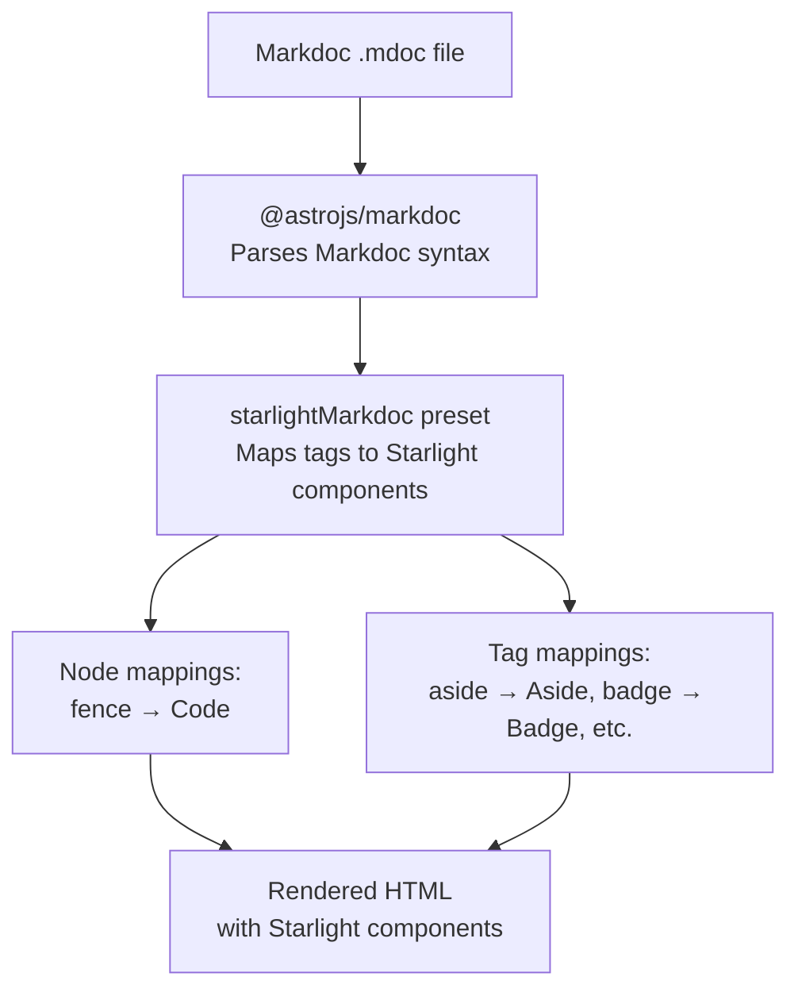
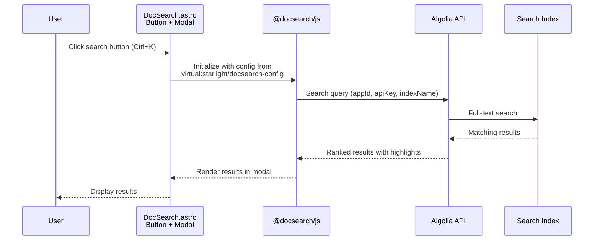

# Starlight Markdoc & DocSearch

Starlight ships two optional integration packages: `@astrojs/starlight-markdoc` for Markdoc content support and `@astrojs/starlight-docsearch` for Algolia DocSearch integration. Both are separate packages in the Starlight monorepo that extend the core Starlight functionality. This document covers how each package works, their configuration options, and how they integrate with the core Starlight system.

## Markdoc Processing Pipeline

When Markdoc content is loaded, it flows through this pipeline:



## DocSearch Request Flow

When a user searches, the request flows through Algolia's service:



## `@astrojs/starlight-markdoc`

Markdoc is a Markdown-based authoring framework developed by Stripe. The `@astrojs/starlight-markdoc` package (v0.7.0) provides a Markdoc preset that maps Markdoc syntax to Starlight components, enabling users to write content in Markdoc format while still using Starlight's UI components.

### Package Structure

```
packages/markdoc/
├── index.mjs          # Core preset factory: starlightMarkdoc()
├── html.mjs           # Well-known attribute maps
├── components.ts      # Component re-exports
├── Code.astro         # Expressive Code compatibility wrapper
├── virtual.d.ts       # (none)
└── __tests__/
    └── markdoc.test-d.ts  # Type-level tests only
```

Source: `packages/markdoc/package.json`

```json
{
    "name": "@astrojs/starlight-markdoc",
    "version": "0.7.0",
    "type": "module",
    "peerDependencies": {
        "@astrojs/markdoc": "^2.0.0",
        "@astrojs/starlight": ">=0.41.0"
    },
    "exports": {
        ".": "./index.mjs",
        "./components": "./components.ts"
    }
}
```

### The `starlightMarkdoc()` Factory

Source: `packages/markdoc/index.mjs`

```typescript
// packages/markdoc/index.mjs
export default function starlightMarkdoc({ headingLinks = true } = {}) {
    return {
        // ... AstroMarkdocConfig with node and tag mappings
    };
}
```

The factory accepts one optional parameter:
- `headingLinks` (boolean, default `true`) -- Toggles automatic anchor links on headings via `@astrojs/starlight/components/AnchorHeading.astro`

### Node Mappings (1 node)

The preset maps Markdoc's `fence` node (fenced code blocks) to Starlight's `Code` component:

```javascript
nodes: {
    fence: {
        render: 'Code',
        attributes: {
            content: { type: String },
            language: { type: String },
            frame: { type: String },
            meta: { type: String },
            title: { type: String },
        },
    },
}
```

Aha: **Markdoc ignores fence-line markers, so the preset provides a `meta` attribute for passing Expressive Code directives manually.** In regular Markdown, you can write `` ```js title="foo" `` and the metadata is parsed. In Markdoc, the fence syntax is `` and doesn't support inline markers. The `meta` attribute allows users to pass Expressive Code markers (like `{3-5}` for line highlighting) through the `meta` attribute:

```markdoc

```

### Tag Mappings (14 tags)

| Markdoc Tag | Starlight Component | Key Attributes |
|-------------|-------------------|----------------|
| `` | `Aside` | `type` (note/danger/caution/tip), `icon`, `title` |
| `` | `Badge` | `text` (required), `size`, `variant` |
| `` | `Card` | `title` (required), `icon` |
| `` | `CardGrid` | `stagger` (boolean) |
| `` | `Code` | `code` (required), `lang`, `frame`, `meta`, `title` |
| `` | `FileTree` | (none) |
| `` | `Icon` | `name` (required), `color`, `label`, `size`, `class` |
| `` | `LinkButton` | `href` (required), `icon`, `iconPlacement`, `variant` |
| `` | `LinkCard` | `href` (required), `title` (required), `description` |
| `` | `Steps` | (none) |
| `` | `TabItem` | `label` (required), `icon` |
| `` | `Tabs` | `syncKey` |

### `html.mjs` -- Shared Attribute Maps

Source: `packages/markdoc/html.mjs`

```javascript
// packages/markdoc/html.mjs
export const WellKnownElementAttributes = {
    class: { type: String },
    dir: { type: String },
    hidden: { type: Boolean },
    id: { type: String },
    lang: { type: String },
    role: { type: String },
    style: { type: String },
    title: { type: String },
};

export const WellKnownAnchorAttributes = {
    ...WellKnownElementAttributes,
    download: { type: String },
    href: { type: String },
    hreflang: { type: String },
    media: { type: String },
    ping: { type: String },
    rel: { type: String },
    target: { type: String },
};
```

These shared attribute maps are spread into tags that need HTML attribute support (like `badge` and `linkbutton`), avoiding duplication.

### `Code.astro` -- Expressive Code Wrapper

Source: `packages/markdoc/Code.astro`

```astro
---
// Expressive Code compatibility wrapper
// Only forwards `code` and `lang` props to prevent crashes
---
<Code code={Astro.props.code} lang={Astro.props.lang} />
```

Aha: **The Code.astro wrapper is a defensive measure against Expressive Code crashes.** Starlight's `Code` component from Expressive Code doesn't support children content. The Markdoc preset only forwards `code` and `lang` props, preventing any child content from reaching Expressive Code's component, which would crash if it received children.

### Integration Model

Users install alongside `@astrojs/markdoc` and extend their Markdoc config:

```typescript
// astro.config.mjs
import { defineConfig } from 'astro/config';
import starlight from '@astrojs/starlight';
import markdoc from '@astrojs/markdoc';
import { starlightMarkdoc } from '@astrojs/starlight-markdoc';

export default defineConfig({
    integrations: [
        starlight({ title: 'My Docs' }),
        markdoc({
            extends: [starlightMarkdoc()],
        }),
    ],
});
```

The `extends` array merges the Starlight Markdoc preset with the user's Markdoc configuration.

### Type Tests (No Runtime Tests)

Source: `packages/markdoc/__tests__/markdoc.test-d.ts`

The package uses compile-time type tests with `expectTypeOf` to verify:
- Every Starlight user component has a corresponding lowercase Markdoc tag
- All tag attributes match the target component's props (minus intentionally excluded ones)
- Fence attributes cover all non-unsupported `<Code>` props

No runtime tests exist because the package is purely configuration -- the actual Markdoc processing is handled by `@astrojs/markdoc`.

## `@astrojs/starlight-docsearch`

DocSearch replaces Starlight's default Pagefind search with Algolia's DocSearch service. The `@astrojs/starlight-docsearch` package (v0.7.0) is a Starlight plugin that injects Algolia's search UI and configures the search index.

### Package Structure

```
packages/docsearch/
├── index.ts           # Starlight plugin
├── schema.ts          # i18n Zod schema
├── DocSearch.astro    # Search component (button + script)
├── variables.css      # CSS variable overrides
├── virtual.d.ts       # Virtual module type declaration
└── README.md / CHANGELOG.md
```

Source: `packages/docsearch/package.json`

```json
{
    "name": "@astrojs/starlight-docsearch",
    "version": "0.7.0",
    "type": "module",
    "peerDependencies": {
        "@astrojs/starlight": ">=0.38.0"
    },
    "dependencies": {
        "@docsearch/css": "^3.6.0",
        "@docsearch/js": "^3.6.0"
    },
    "exports": {
        ".": "./index.ts",
        "./DocSearch.astro": "./DocSearch.astro",
        "./schema": "./schema.ts"
    }
}
```

### The `starlightDocSearch()` Plugin

Source: `packages/docsearch/index.ts`

```typescript
// packages/docsearch/index.ts
export default function starlightDocSearch(userConfig: DocSearchUserConfig): StarlightPlugin {
    return {
        name: '@astrojs/starlight-docsearch',
        hooks: {
            'config:setup'({ config, updateConfig, addIntegration }) {
                // Check for existing custom Search component
                if (config.components?.Search) {
                    console.warn('DocSearch is overriding the custom Search component...');
                }

                // Disable Pagefind and override Search component
                updateConfig({
                    pagefind: false,
                    components: { Search: '@astrojs/starlight-docsearch/DocSearch.astro' },
                });

                // Add nested Astro integration with Vite plugin
                addIntegration({
                    name: '@astrojs/starlight-docsearch',
                    hooks: {
                        'astro:config:setup'({ updateConfig }) {
                            updateConfig({
                                vite: {
                                    plugins: [vitePluginDocSearch(userConfig)],
                                },
                            });
                        },
                    },
                });
            },
        },
    };
}
```

### Config Schema -- Two-Mode Configuration

Source: `packages/docsearch/index.ts`

```typescript
const DocSearchConfigSchema = z.discriminatedUnion('clientOptionsModule', [
    // Mode 1: Inline config
    z.object({
        appId: z.string(),
        apiKey: z.string(),
        indexName: z.string(),
        maxResultsPerGroup: z.number().default(5),
        disableUserPersonalization: z.boolean().default(false),
        insights: z.boolean().default(false),
        searchParameters: z.passthrough().optional(),
    }),
    // Mode 2: Module config
    z.object({
        clientOptionsModule: z.string(),
    }),
]);
```

Aha: **DocSearch uses a discriminated union schema for two-mode configuration.** Mode 1 (inline) is for simple serializable config (appId, apiKey, indexName). Mode 2 (module) is for complex config that includes functions (like `transformItems`), which can't be serialized to JSON. When `clientOptionsModule` is set, ALL inline options are ignored.

The `clientOptionsModule` points to a file that exports `DocSearchClientOptions`:

```typescript
// src/docsearch-options.ts
import type { DocSearchClientOptions } from '@astrojs/starlight-docsearch';

export default {
    appId: 'YOUR_APP_ID',
    apiKey: 'YOUR_API_KEY',
    indexName: 'YOUR_INDEX',
    transformItems(items) {
        return items.map(item => ({ ...item, url: modifyUrl(item.url) }));
    },
} satisfies DocSearchClientOptions;
```

### Vite Plugin -- Virtual Module Pattern

Source: `packages/docsearch/index.ts`

```typescript
function vitePluginDocSearch(config: DocSearchUserConfig) {
    return {
        name: 'vite-plugin-starlight-docsearch',
        resolveId(id) {
            if (id === 'virtual:starlight/docsearch-config') return '\0' + id;
        },
        load(id) {
            if (id === '\0virtual:starlight/docsearch-config') {
                if (config.clientOptionsModule) {
                    return `export { default } from "${resolvedPath}";`;
                }
                return `export default ${JSON.stringify(config)};`;
            }
        },
    };
}
```

Aha: **DocSearch uses its own virtual module (`virtual:starlight/docsearch-config`) instead of the core Starlight virtual modules.** This is because the DocSearch config is separate from Starlight's config and may include function values (via `clientOptionsModule`) that can't be JSON-stringified. The virtual module handles this by either generating `export { default } from "..."` (for module mode) or `export default {...}` (for inline mode).

### `DocSearch.astro` -- Search Component

The component renders the search button and initializes DocSearch:

Source: `packages/docsearch/DocSearch.astro`

```astro
---
import '@docsearch/css/dist/modal.css';
import './variables.css';

// Build translations via Astro.locals.t() with pick() helper
const translations = {
    searchBox: pickByPrefix(Astro.locals.t, 'docsearch.searchBox.'),
    startScreen: pickByPrefix(Astro.locals.t, 'docsearch.startScreen.'),
    errorScreen: pickByPrefix(Astro.locals.t, 'docsearch.errorScreen.'),
    footer: pickByPrefix(Astro.locals.t, 'docsearch.footer.'),
    noResultsScreen: pickByPrefix(Astro.locals.t, 'docsearch.noResultsScreen.'),
};
---

<sl-doc-search data-translations={JSON.stringify(translations)}>
    <button class="DocSearch DocSearch-Button" aria-label={Astro.locals.t('search.label')}>
        <!-- Search icon SVG -->
        <span class="DocSearch-Button-Placeholder">{Astro.locals.t('search.label')}</span>
        <span class="DocSearch-Button-Keys">
            <kbd class="DocSearch-Button-Key">Ctrl</kbd>
            <kbd class="DocSearch-Button-Key">K</kbd>
        </span>
    </button>
</sl-doc-search>

<style is:global>
    /* Mobile (< 50rem): minimal icon-only button */
    /* Desktop (>= 50rem): full search bar */
</style>

<script>
    import config from 'virtual:starlight/docsearch-config';
    class StarlightDocSearch extends HTMLElement {
        constructor() {
            super();
            window.addEventListener('DOMContentLoaded', async () => {
                const { default: docsearch } = await import('@docsearch/js');
                const options = { ...config, container: 'sl-doc-search' };
                // Merge translations from data-translations attribute
                docsearch(options);
            });
        }
    }
    customElements.define('sl-doc-search', StarlightDocSearch);
</script>
```

### `variables.css` -- CSS Integration

Source: `packages/docsearch/variables.css`

```css
/* Maps 20+ DocSearch CSS custom properties to Starlight design tokens */
:root {
    --docsearch-primary-color: var(--sl-color-text-accent);
    --docsearch-modal-width: 560px;
    --docsearch-modal-height: 600px;
    --docsearch-modal-background: var(--sl-color-gray-6);
    --docsearch-container-background: var(--sl-color-backdrop-overlay);
    /* ... 16 more variable mappings */
}

/* Additional overrides: modal border, Algolia logo recoloring */
```

### i18n Schema -- 23 Translation Keys

Source: `packages/docsearch/schema.ts`

```typescript
// packages/docsearch/schema.ts
export function docSearchI18nSchema() {
    return z.object({
        // SEARCH BOX (5)
        'docsearch.searchBox.resetButtonTitle': z.string(),
        'docsearch.searchBox.resetButtonAriaLabel': z.string(),
        'docsearch.searchBox.cancelButtonText': z.string(),
        'docsearch.searchBox.cancelButtonAriaLabel': z.string(),
        'docsearch.searchBox.searchInputLabel': z.string(),
        // START SCREEN (6)
        'docsearch.startScreen.recentSearchesTitle': z.string(),
        // ... 12 more keys across errorScreen, footer, noResultsScreen
    }).partial();
}
```

### Integration

```typescript
// astro.config.mjs
import starlight from '@astrojs/starlight';
import { starlightDocSearch } from '@astrojs/starlight-docsearch';

export default defineConfig({
    integrations: [
        starlight({
            title: 'My Docs',
            plugins: [
                starlightDocSearch({
                    appId: 'YOUR_APP_ID',
                    apiKey: 'YOUR_API_KEY',
                    indexName: 'YOUR_INDEX',
                }),
            ],
        }),
    ],
});
```

Aha: **DocSearch defensively checks for existing custom Search components before overriding.** If the user has already configured a custom `Search` component, DocSearch warns and then proceeds to override it anyway. This prevents silent conflicts where both search providers try to render.

## Comparison: Markdoc vs DocSearch

| Aspect | Markdoc | DocSearch |
|--------|---------|-----------|
| **Purpose** | Markdoc content support | Algolia DocSearch integration |
| **Integration model** | Extends `@astrojs/markdoc` config | Starlight plugin via `config:setup` |
| **Core mechanism** | `AstroMarkdocConfig` with node/tag mappings | Plugin + nested Astro integration + Vite plugin |
| **Runtime dependencies** | None (just peer deps) | `@docsearch/css`, `@docsearch/js` |
| **Client-side code** | None (pure server-side rendering) | Web component + lazy-loaded DocSearch |
| **i18n support** | Not applicable | Full i18n via `Astro.locals.t()` + 23-key schema |
| **Config options** | `headingLinks` (boolean) | Inline (appId/apiKey/indexName) or `clientOptionsModule` |
| **CSS customization** | Inherits Starlight | Maps 20+ DocSearch CSS vars to Starlight tokens |
| **Test approach** | Type-level tests only | No tests |

## What's Next

- Read [Plugins](09-plugins.html) for the Starlight plugin system
- Read [Content Loaders](07-content-loaders.html) for how Markdoc content is loaded
