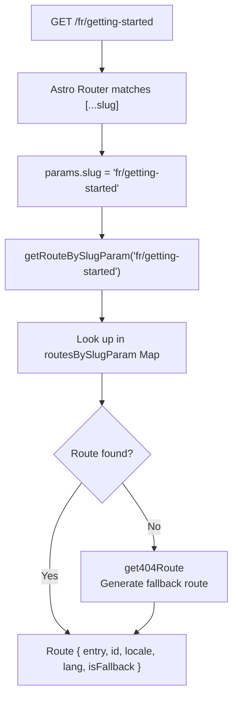
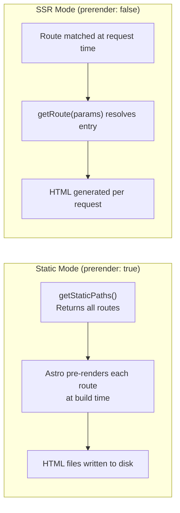
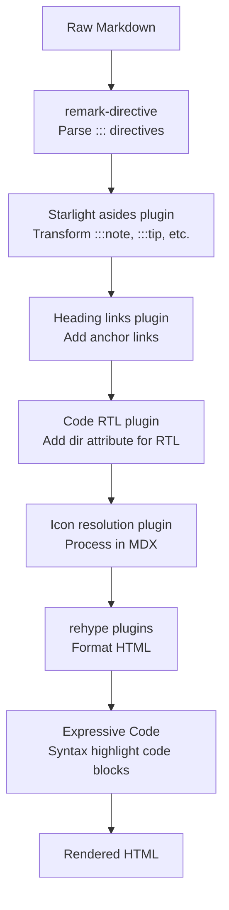

# Starlight Cross-Cutting Concerns

Cross-cutting concerns are systems that span multiple modules and layers of Starlight: routing, route data generation, CSS cascade layers, Expressive Code integration, Pagefind search, sitemap generation, and the Markdown processing pipeline. This document covers how these systems work end-to-end and how they interact with the rest of Starlight.

## Routing System

Starlight's routing is built on a single catch-all route pattern `[...slug]` that handles every documentation page plus a dedicated `404` route. The routing system resolves URLs to content entries, handles locale fallbacks, and generates the route data that powers every component on the page.

### Route Resolution Flow



Source: `packages/starlight/utils/routing/index.ts:85`

```typescript
// packages/starlight/utils/routing/index.ts:85
function getParamRouteMapping(): ReadonlyMap<string | undefined, Route> {
    const map = new Map<string | undefined, Route>();
    for (const route of routes) {
        map.set(slugToParam(route.id), route);
    }
    return map;
}
const routesBySlugParam = getParamRouteMapping();

export function getRouteBySlugParam(slugParam: string | undefined): Route | undefined {
    return routesBySlugParam.get(slugParam?.replace(/\/$/, '') || undefined);
}
```

Aha: **Route lookup uses a pre-built Map, not array filtering.** At module load time, Starlight builds a `Map<string | undefined, Route>` that maps every possible slug parameter to its route object. When a request comes in, the route is found in O(1) time. This is important because the route resolution runs on every page view (in SSR mode) and during every static path generation. With hundreds of pages, O(n) filtering would be noticeably slower than O(1) Map lookup.

### Static vs SSR Routes

The same route logic handles both static and SSR modes:



In static mode, `routes/static/index.astro` exports `getStaticPaths()`:

```typescript
// packages/starlight/routes/static/index.astro
export const prerender = true;
export async function getStaticPaths() {
    return paths;  // All routes from utils/routing
}
```

The `paths` array contains one entry per route:

```typescript
// packages/starlight/utils/routing/index.ts:98
function getPaths(): Path[] {
    return routes.map((route) => ({
        params: { slug: slugToParam(route.id) },
        props: route,
    }));
}
export const paths = getPaths();
```

## Route Data Generation

Every Starlight page receives a `StarlightRouteData` object computed by `generateRouteData`:

Source: `packages/starlight/utils/routing/data.ts:39`

```typescript
// packages/starlight/utils/routing/data.ts:39
export function generateRouteData({
    props, context,
}: {
    props: PageProps;
    context: RouteDataContext;
}): StarlightRouteData {
    const { entry, locale, lang } = props;
    const sidebar = getSidebar(context.url.pathname, locale);
    const siteTitle = getSiteTitle(lang);
    return {
        ...props,
        siteTitle,
        siteTitleHref: getSiteTitleHref(locale),
        sidebar,
        hasSidebar: entry.data.template !== 'splash',
        pagination: getPrevNextLinks(sidebar, config.pagination, entry.data),
        toc: getToC(props),
        lastUpdated: getLastUpdated(props),
        editUrl: getEditUrl(props),
        head: getHead(props, context, siteTitle),
    };
}
```

### The Route Middleware Chain

Before route data is passed to components, it runs through a middleware chain:

Source: `packages/starlight/utils/routing/middleware.ts`

```typescript
// packages/starlight/utils/routing/middleware.ts
export async function attachRouteDataAndRunMiddleware(
    context: APIContext,
    routeData: StarlightRouteData
) {
    // Import route middleware from virtual module
    const { routeMiddleware } = await import('virtual:starlight/route-middleware');

    for (const middleware of routeMiddleware) {
        await middleware(context, async () => {
            // Route data is attached to locals.starlightRoute
        });
    }

    // Set the final route data on locals
    context.locals.starlightRoute = routeData;
}
```

Aha: **The middleware chain runs BEFORE the route data is set on `locals.starlightRoute`.** This allows middleware to modify the route data before it reaches components. The middleware receives the context and a `next` function, following the standard Express/Astro middleware pattern. The virtual module import (`virtual:starlight/route-middleware`) generates the import statements for all configured middleware entrypoints.

### Table of Contents Generation

Source: `packages/starlight/utils/generateToC.ts`

```typescript
// packages/starlight/utils/generateToC.ts
export function generateToC(headings: MarkdownHeading[], config: ToCConfig): TocItem[] {
    // Filter headings by min/max heading level
    // Build nested TocItem tree based on heading levels
    // Return TocItem[] for sidebar rendering
}
```

The ToC generation filters headings by `minHeadingLevel` and `maxHeadingLevel` (default: 2-3, meaning h2 and h3), then builds a nested tree structure based on heading hierarchy.

### Last Updated Date

Source: `packages/starlight/utils/routing/data.ts:78`

```typescript
// packages/starlight/utils/routing/data.ts:78
function getLastUpdated({ entry }: PageProps): Date | undefined {
    const { lastUpdated: frontmatterLastUpdated } = entry.data;
    const { lastUpdated: configLastUpdated } = config;

    if (frontmatterLastUpdated ?? configLastUpdated) {
        try {
            return frontmatterLastUpdated instanceof Date
                ? frontmatterLastUpdated
                : getNewestCommitDate(entry.filePath);
        } catch {
            return undefined;  // If git command fails, ignore
        }
    }
    return undefined;
}
```

The last-updated date comes from either:
1. Frontmatter `lastUpdated: 2024-01-15` (explicit)
2. Git history (most recent commit touching the file)

If `lastUpdated: false` in frontmatter, it overrides the global config. If the git command fails (e.g., not a git repo), the date is silently undefined.

### Head Generation

Source: `packages/starlight/utils/head.ts`

The `<head>` generation combines:
1. Site-wide `head` config entries
2. Page-specific `head` from frontmatter
3. Default meta tags (charset, viewport, title, description)
4. Open Graph and Twitter card meta tags
5. Canonical URL
6. RSS feed link (if enabled)
7. Custom CSS imports

## Expressive Code Integration

Starlight integrates `astro-expressive-code` for syntax-highlighted code blocks. The integration configures themes, translations, and a custom preprocessor.

Source: `packages/starlight/integrations/expressive-code/index.ts`

```typescript
// packages/starlight/integrations/expressive-code/index.ts
export function starlightExpressiveCode({ astroConfig, starlightConfig, useTranslations }) {
    return [
        {
            name: 'astro-expressive-code',
            hooks: {
                'astro:config:setup': ({ updateConfig }) => {
                    updateConfig({
                        integrations: [
                            expressiveCode({
                                themes: starlightConfig.expressiveCode.themes,
                                styleOverrides: { /* Starlight-specific */ },
                                plugins: [ /* Starlight plugins */ ],
                            }),
                        ],
                    });
                },
            },
        },
    ];
}
```

### Custom Themes

Starlight ships two custom Expressive Code themes based on Night Owl:

- `starlight-light` -- Light theme (from `integrations/expressive-code/themes/night-owl-light.jsonc`)
- `starlight-dark` -- Dark theme (from `integrations/expressive-code/themes/night-owl-dark.jsonc`)

### Preprocessor

Source: `packages/starlight/integrations/expressive-code/preprocessor.ts`

The preprocessor handles Starlight-specific code block features like:
- Frame type detection (auto/code/terminal/none)
- Title extraction
- Expressive Code marker parsing

### RTL Support for Code Blocks

Source: `packages/starlight/integrations/rehype-code-rtl-support.ts`

A rehype plugin adds `dir="rtl"` to code blocks when the page language is RTL. This ensures code displays correctly in right-to-left contexts.

## Pagefind Integration

Starlight integrates Pagefind for full-text static search:

Source: `packages/starlight/integrations/pagefind.ts`

```typescript
// packages/starlight/integrations/pagefind.ts
export async function starlightPagefind(options: BuildPayload) {
    // Read output directory
    // Run pagefind indexing
    // Write search index to _pagefind/
}
```

The integration:
1. Runs in `astro:build:done` hook
2. Indexes all built HTML files
3. Uses user config from `virtual:starlight/pagefind-config`
4. Outputs search index to `_pagefind/` directory

Pagefind ranking defaults:

```typescript
// packages/starlight/schemas/pagefind.ts
export const PagefindConfigDefaults = () => ({
    ranking: {
        pageLength: 0.05,   // Weight for page length
        termSimilarity: 0.1, // Weight for term similarity
        termFrequency: 0.1,  // Weight for term frequency
        termSaturation: 1.5, // Saturation parameter
    },
});
```

### Search UI

Source: `packages/starlight/components/Search.astro`

The default search component renders:
- A search button in the header
- A Pagefind-powered modal on click
- Keyboard shortcut indicator (Ctrl+K)
- Mobile-responsive layout

During development, the search UI shows a warning: "Search is disabled during development."

## Sitemap Integration

Starlight adds `@astrojs/sitemap` for automatic `sitemap.xml` generation:

Source: `packages/starlight/integrations/sitemap.ts`

```typescript
// packages/starlight/integrations/sitemap.ts
export function starlightSitemap(starlightConfig: StarlightConfig) {
    return sitemap({
        // Filter out 404 pages
        // Respect pagefind: false entries
        // Handle i18n alternate links
    });
}
```

The sitemap:
- Includes all documentation pages
- Excludes 404 pages and pages with `pagefind: false`
- Generates `hreflang` alternate links for i18n sites

## Markdown Processing Pipeline

Starlight hooks into Astro's Markdown processing to add custom remark/rehype plugins:

Source: `packages/starlight/integrations/markdown-plugins.ts`



### Remark Asides

Source: `packages/starlight/integrations/remark-asides.ts`

The asides plugin transforms Markdown directives into styled callout blocks:

```markdown
:::tip
This is a tip.
:::

:::note[Title]
This is a note with a custom title.
:::

:::caution
This is a caution.
:::

:::danger
This is a danger warning.
:::
```

The plugin creates an `aside` element with the appropriate class and title:

```html
<aside class="aside tip">
    <p class="aside-title">Tip</p>
    <p>This is a tip.</p>
</aside>
```

### Heading Links

Source: `packages/starlight/integrations/rehype-heading-links.ts`

When `markdown.headingLinks: true` (default), each heading gets an anchor link:

```html
<h2 id="getting-started">
    Getting Started
    <a href="#getting-started" aria-label="Anchor link for Getting Started">#</a>
</h2>
```

The anchor link is hidden by default and shown on hover.

### Markdown Directives Restoration

Source: `packages/starlight/integrations/markdown-plugins.ts`

Aha: **Starlight adds a "directives restoration" integration that runs AFTER all other Markdown processing.** The `starlightDirectivesRestorationIntegration` is pushed to the end of the integrations array. This ensures that Starlight's custom directives (asides, steps, etc.) are processed before other remark/rehype plugins try to transform them. If this ran first, other plugins might transform the directive text before Starlight processes it, leading to broken output.

## CSS Architecture

Starlight uses CSS cascade layers for style specificity control:

Source: `packages/starlight/style/layers.css`

```css
@layer starlight.props, starlight.optional, starlight.reset,
       starlight.asides, starlight.util, starlight.base;
```

Layer order (lowest to highest specificity):
1. **`starlight.props`** -- CSS custom property definitions
2. **`starlight.optional`** -- Optional feature styles (e.g., heading links)
3. **`starlight.reset`** -- CSS reset styles
4. **`starlight.asides`** -- Aside/callout styles
5. **`starlight.util`** -- Utility classes
6. **`starlight.base`** -- Base component styles

User custom CSS (imported via `virtual:starlight/user-css`) falls OUTSIDE these layers, so it can override any Starlight style without needing `!important` or high specificity selectors.

## Session Storage & Local Storage

Starlight uses browser storage for state persistence:

| Feature | Storage | Purpose |
|---------|---------|---------|
| Theme | `localStorage` | Dark/light/auto preference |
| Sidebar collapse | `sessionStorage` | Which sidebar groups are collapsed |
| Sidebar position | `sessionStorage` | Whether sidebar is pinned on mobile |

The sidebar persist state is handled by a custom element:

Source: `packages/starlight/components-internals/SidebarPersistState`

```typescript
// Sidebar persistence using sessionStorage
// Hash-based invalidation: sidebar hash from navigation.ts
// Stores: { hash: 'a1b2c3d', collapsed: [true, false, ...] }
```

The sidebar hash (from `getSidebarHash` in navigation.ts) is used as a cache key. When the sidebar changes (new pages added, reordered), the hash changes and the stored collapse state is invalidated, preventing stale state from applying to the wrong groups.

## What's Next

- Read [Architecture](01-architecture.html) for the full system overview
- Read [Components](08-components.html) for the component system
- Read [Overview](00-overview.html) to start from the beginning
