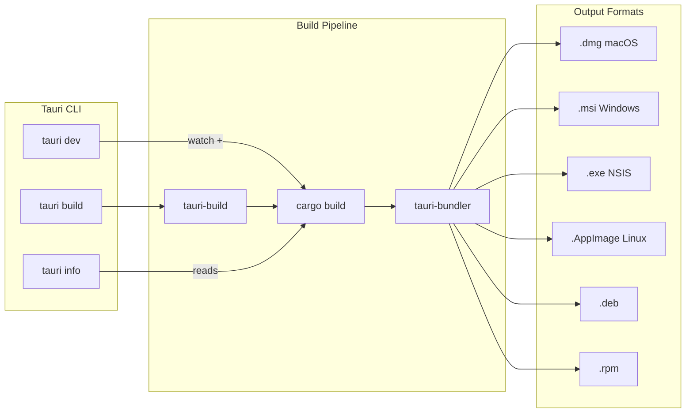
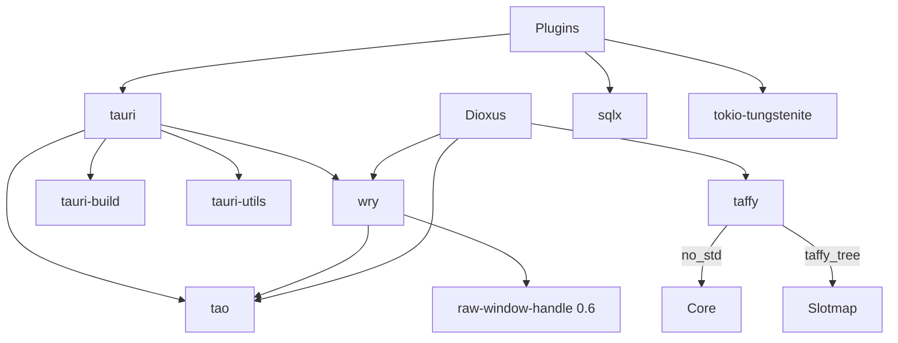

# Tauri Ecosystem — Overview

## What Tauri Is

Tauri is a framework for building secure, performant desktop applications using web frontend technologies (HTML/CSS/JavaScript) with a Rust backend. Instead of bundling a full Chromium instance like Electron, Tauri uses the operating system's native WebView component. The result is dramatically smaller binaries: 2-10 MB for Tauri versus 150-200 MB for Electron.

The Tauri ecosystem consists of six major Rust crates that work together as a layered stack:

| Layer | Crate | Purpose |
|-------|-------|---------|
| App Framework | `tauri` | Application lifecycle, IPC, plugins, security |
| WebView | `wry` (v0.55.1) | Cross-platform WebView abstraction |
| Windowing | `tao` (v0.34.5) | Cross-platform window and event loop |
| Layout | `taffy` (v0.5.2) | Flexbox/Grid/Block layout engine |
| UI Framework | `dioxus` (v0.6) | React-like UI in Rust with `rsx!` macro |
| Plugins | `@tauri-apps/plugin-*` | Shell, filesystem, HTTP, SQL, WebSocket |

## Architecture at a Glance

```mermaid
flowchart TB
    subgraph Frontend
        JS[JavaScript / HTML / CSS]
        IPC_JS[window.__TAURI__.ipc]
    end

    subgraph WebView Layer
        WV[WebView Instance]
        Protocol[Custom Protocol Handler]
    end

    subgraph Wry v0.55.1
        WB[WebViewBuilder]
        WK[WKWebView]
        WV2[WebView2]
        WGTK[WebKitGTK]
        WAV[Android WebView]
    end

    subgraph Tao v0.34.5
        EL[EventLoop]
        WIN[Window]
        CF[ControlFlow]
    end

    subgraph Tauri Core
        App[App&lt;R&gt;]
        AM[AppManager]
        WM[WindowManager]
        WVM[WebviewManager]
        Plugin[Plugin System]
        ACL[ACL / IPC Bridge]
    end

    JS -->|invoke()| IPC_JS
    IPC_JS -->|async message| WV
    WV --> Protocol
    Protocol --> ACL
    ACL --> AM

    WV --- WB
    WB --> WK
    WB --> WV2
    WB --> WGTK
    WB --> WAV

    WV --> WIN
    WIN --> EL
    EL --> CF

    AM --> WM
    AM --> WVM
    AM --> Plugin
    ACL -->|commands| App
```

The data flow is: JavaScript calls `window.__TAURI__.ipc.invoke()`. The call travels through the WebView's message handler into wry's protocol handler. Tauri's ACL layer validates the permission. The command is routed to the AppManager, which dispatches it to the appropriate plugin or Rust handler. The response flows back through the same path as a resolved Promise.



## Core Concepts

### WebView-Based Architecture

Tauri's fundamental insight is that every modern OS ships with a capable WebView. macOS has WKWebView (based on WebKit). Windows has WebView2 (based on Chromium). Linux has WebKitGTK. Android has Android WebView. Tauri doesn't ship a browser engine; it uses what's already there.

This means:
- **Small binaries:** No bundled Chromium means 2-10 MB instead of 150-200 MB
- **Fast updates:** Security patches come from OS updates, not your app
- **Platform native:** Users get the browser engine their OS provides
- **Trade-off:** You must test on all target platforms because WebKit and Chromium differ

The WebView approach has implications for development. WebKit (used on macOS and Linux) and Chromium (used on Windows) implement web standards slightly differently. CSS features may render differently. JavaScript behavior may vary. A Tauri developer must test on all target platforms, just like a web developer tests on multiple browsers.

However, the differences are much smaller than browser-to-browser differences in the past. WebKit and Chromium both implement modern CSS (Grid, Flexbox, Container Queries) and modern JavaScript (ES2023+). The main differences are in:
- Scroll behavior (momentum scrolling on macOS vs linear on Windows)
- Font rendering (Core Text on macOS vs DirectWrite on Windows vs FreeType on Linux)
- Color management (P3 color space on macOS vs sRGB on Windows)
- Default form controls (each platform has its own native form elements)

**Aha:** The WebView is not a constraint; it's a feature. By using the OS-provided WebView, Tauri apps automatically inherit platform-specific optimizations, accessibility features, and security updates. Electron apps bundle a specific Chromium version and stay on it until the developer updates the bundle.

### Two-Way IPC Bridge

Communication between JavaScript and Rust happens through a typed, asynchronous IPC bridge. JavaScript calls `invoke('command_name', { args })`. Rust defines handlers with the `#[tauri::command]` macro. The bridge is typed: arguments are serialized as JSON on the JavaScript side and deserialized into Rust types.

The IPC system includes an ACL (Access Control List) that permissions what commands each webview can call. This is Tauri's primary security mechanism.

### Plugin System

Tauri's plugin system allows extending the framework without modifying core code. A plugin implements the `tauri::plugin::Plugin` trait, which provides hooks for app lifecycle events, window creation, and message handling. Official plugins cover shell commands, filesystem access, dialogs, HTTP requests, SQL databases, and WebSockets.

## Crate Dependency Graph



Tauri depends on wry and tao. Wry also depends on tao (it needs the window handle). Dioxus depends on both wry and tao for its desktop renderer, and taffy for layout. Plugins depend on Tauri's plugin API.

## Quick Start Mental Model

```
tauri::Builder::default()
    .setup(|app| { /* register plugins */ Ok(()) })
    .invoke_handler(tauri::generate_handler![my_command])
    .run(tauri::generate_context!())
```

This is the minimal Tauri app. `Builder` creates an `App<R>`. `generate_context!` reads `tauri.conf.json` and generates the application context. `run` starts the event loop, creates the window, loads the WebView, and blocks until the app exits.

## When to Use Tauri

- **Building a desktop app** with web frontend technologies
- **Need small binary size** — Electron is too heavy for your use case
- **Rust backend** — you want Rust's performance and safety for backend logic
- **Cross-platform** — macOS, Windows, Linux from one codebase
- **Security matters** — the ACL system gives you fine-grained control over what the frontend can do

## When Not to Use Tauri

- **Need full browser control** — you can't pick a specific Chrome version
- **Heavy GPU rendering** — the WebView layer may bottleneck 3D applications
- **Pure Rust UI** — if you don't need HTML/JS, consider egui or iced directly

## Version History and Evolution

Tauri has evolved significantly across major versions:

| Version | Key Changes |
|---------|-------------|
| v1 | Initial stable release. Single-window, basic IPC, limited plugin system |
| v2 | Multi-webview, ACL permission system, remote content support, mobile support, rewritten IPC layer |

The v2 rewrite was substantial. The ACL system replaced the simpler v1 permission model. Multi-webview support means a single Tauri app can host multiple independent webviews, each with its own permissions. Mobile support (iOS and Android) required adapting the entire architecture to mobile lifecycles.

## The Tauri Philosophy

Tauri follows several design principles:

1. **Minimal binary size** — Use what the OS provides. Don't bundle what isn't needed.
2. **Security by default** — Nothing is allowed unless explicitly permitted. The ACL system enforces this.
3. **Type safety** — The IPC bridge is typed. Arguments are Rust types, not strings. Errors are `Result` types, not exceptions.
4. **Extensibility** — The plugin system allows third-party functionality without modifying core code.
5. **Platform native** — Use native dialogs, native menus, native theming. Don't try to override the OS.

## Ecosystem Beyond Core

Beyond the six major crates, the Tauri ecosystem includes:

| Crate | Purpose |
|-------|---------|
| `tauri-utils` | Shared utilities: config parsing, platform detection, asset handling |
| `tauri-build` | Compile-time code generation from `tauri.conf.json` |
| `tauri-bundler` | Installer packaging (DMG, MSI, NSIS, AppImage, deb, rpm) |
| `tauri-codegen` | Compile-time asset embedding and icon generation |
| `tauri-macos-sign` | macOS code signing utilities |
| `global-hotkey` | Cross-platform global hotkey registration |
| `muda` | Cross-platform menu library |
| `rfd` | Cross-platform file dialogs |

These crates are building blocks that Tauri uses internally but are also available for standalone use.

## Comparison with Alternatives

| Feature | Tauri | Electron | Neutralino | Flutter Desktop |
|---------|-------|----------|------------|-----------------|
| Binary Size | 2-10 MB | 150-200 MB | 5-15 MB | 10-30 MB |
| Memory | 110-280 MB | 300-800 MB | 100-250 MB | 80-200 MB |
| Backend | Rust | Node.js | C++ | C++/Dart |
| Frontend | HTML/JS/CSS | HTML/JS/CSS | HTML/JS/CSS | Dart widgets |
| WebView | OS-provided | Bundled Chromium | OS-provided | Skia rendering |
| Platforms | Desktop + Mobile | Desktop | Desktop | Desktop + Mobile |
| Security | ACL system | Node.js access | Permission model | Dart sandbox |
| Plugin Ecosystem | Growing | Massive | Small | Large |

Tauri's key advantages over Electron are binary size (20x smaller) and memory usage (3-5x less). The trade-off is platform-specific WebView behavior, which Electron avoids by bundling a single Chromium version.

Neutralino is closer to Tauri in approach (uses OS WebView, no bundled browser) but uses C++ for the backend instead of Rust. This means no memory safety guarantees and a smaller plugin ecosystem.

Flutter Desktop uses its own rendering engine (Skia) rather than a WebView, which gives consistent rendering across platforms but loses web ecosystem compatibility (no HTML/CSS, no web libraries).

## Cross-References

- [Tauri Core Deep Dive](01-tauri-core.md) — App<R>, AppManager, Builder, plugin system
- [IPC and ACL System](02-tauri-ipc-acl.md) — Command macros, permission model, message passing
- [Build and CLI](03-tauri-build-cli.md) — tauri-cli, tauri-build, bundler pipeline
- [Wry WebView](04-wry-webview.md) — WebViewBuilder, 4 platform backends, protocol handlers
- [Tao Windowing](05-tao-windowing.md) — EventLoop, Window, 5 platform backends
- [Taffy Layout](06-taffy-layout.md) — Flexbox/Grid/Block algorithms, TaffyTree
- [Dioxus UI](07-dioxus-ui.md) — VirtualDom, rsx!, signals, desktop renderer
- [Plugins](08-plugins.md) — shell, fs, dialog, http, sql, websocket
- [Native and Mobile](09-native-mobile.md) — iOS/Android support, native APIs
- [Cross-Cutting Concerns](10-cross-cutting.md) — Security, performance, testing
