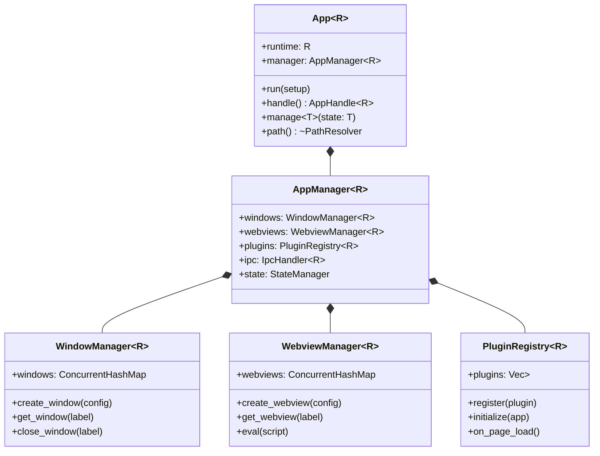
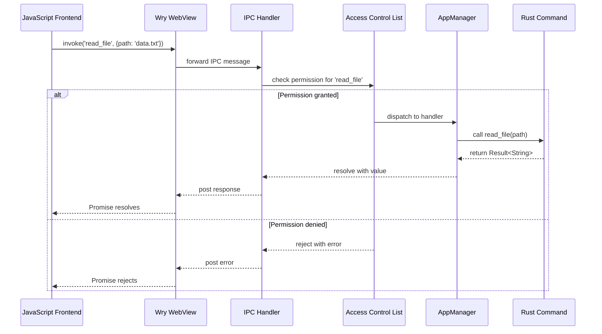
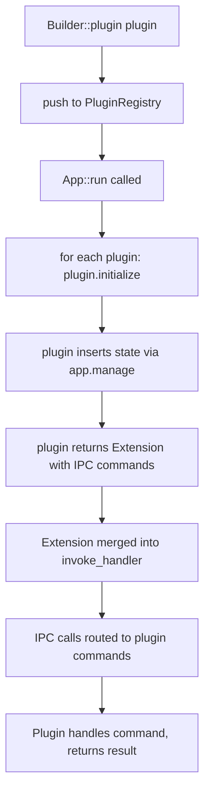
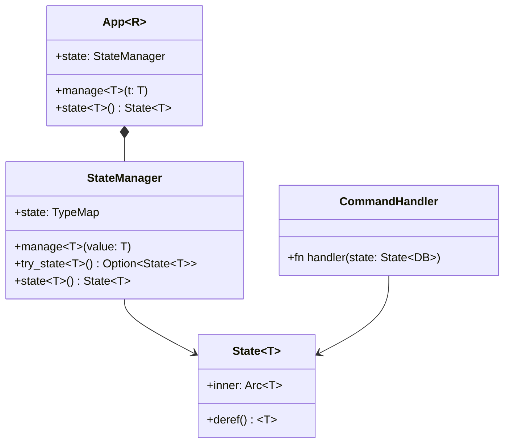

# Tauri Core — App, Builder, Managers, Plugin System

## Core Concept

Tauri's core is built around `App<R>`, a generic struct that holds the entire application state. It owns an `AppManager` which coordinates windows, webviews, plugins, and the IPC layer. The `Builder<R>` pattern constructs the App, and `generate_context!` reads `tauri.conf.json` at compile time to produce the runtime configuration.

The architecture follows a manager pattern: `AppManager` is the central hub. It holds `WindowManager` and `WebviewManager` instances. Each manager tracks its resources with concurrent-safe collections. The IPC handler routes JavaScript calls to Rust commands through an ACL-gated dispatcher.

## App<R> — The Central Type

```rust
// tauri/src/app.rs
pub struct App<R: Runtime> {
    pub(crate) runtime: R,
    pub(crate) manager: AppManager<R>,
    // ...
}
```

`R` is the runtime, which defaults to `Wry` (the wry-based runtime). The generic parameter allows Tauri to swap out the underlying WebView implementation. `App` owns the event loop, the plugin registry, and all managed resources.

Key methods on `App<R>`:
- `run(self, setup: impl FnOnce(&mut App<R>) -> Result<(), Box<dyn std::error::Error>>)` — starts the event loop
- `handle(&self) -> AppHandle<R>` — returns a clonable handle for use in async contexts
- `manage<T>(&self, state: T)` — inserts a type into the app's state container
- `path(&self) -> &PathResolver` — resolves app paths (app dir, cache, config)



The class diagram shows the ownership hierarchy. `App` owns `AppManager`. The manager owns the window, webview, and plugin sub-managers. Each sub-manager tracks its resources in a thread-safe collection (typically a `ConcurrentHashMap` from the `parking_lot` or `dashmap` crate).

## Builder Pattern

```rust
// tauri/src/app.rs
pub struct Builder<R: Runtime = Wry> {
    setup: Option<Box<dyn FnOnce(&mut App<R>) -> Result<(), Box<dyn std::error::Error + Send + std::fmt::Debug>> + Send>>,
    invoke_handler: Box<dyn Fn(Invoke<R>) -> bool + Send>,
    on_page_load: Option<Box<dyn Fn(Window<R>, &PageLoadPayload) + Send>>,
    // ... 30+ configuration fields
}
```

The Builder collects all configuration before constructing the App. Key configuration points:

| Method | Purpose |
|--------|---------|
| `.setup()` | Closure run after app creation, before event loop starts |
| `.invoke_handler()` | Routes IPC calls to Rust command functions |
| `.on_page_load()` | Hook called when each webview loads a page |
| `.plugin()` | Register a plugin before app creation |
| `.manage()` | Insert typed state available via `app.state::<T>()` |
| `.menu()` | Set the application menu |
| `.system_tray()` | Configure system tray icon |

```rust
// Typical Tauri application entry point
fn main() {
    tauri::Builder::default()
        .plugin(tauri_plugin_sql::init())
        .plugin(tauri_plugin_http::init())
        .setup(|app| {
            let db = setup_database(app.path())?;
            app.manage(db);
            Ok(())
        })
        .invoke_handler(tauri::generate_handler![
            read_file,
            write_file,
            run_command
        ])
        .run(tauri::generate_context!())
        .expect("error while running tauri application");
}
```

**Aha:** The `generate_context!` macro reads `tauri.conf.json` at compile time and generates Rust code. This means configuration errors are caught at compile time, not runtime. The macro also embeds the frontend assets into the binary, so the final executable is truly self-contained. No external assets directory is needed.

## AppManager — The Central Coordinator

`AppManager` is the workhorse. Every operation on windows, webviews, or plugins flows through it.

```rust
// tauri/src/manager.rs
pub struct AppManager<R: Runtime> {
    pub windows: WindowManager<R>,
    pub webviews: WebviewManager<R>,
    pub plugins: Arc<Mutex<PluginRegistry<R>>>,
    pub state: Arc<StateManager>,
    pub config: Arc<Config>,
    pub package_info: Option<PackageInfo>,
    // IPC and ACL
    pub invoke_responder: Arc<InvokeResponder<R>>,
    pub acl: Arc<AccessControlList>,
}
```

The AppManager coordinates:
1. **Window lifecycle** — creation, destruction, focus management
2. **Webview lifecycle** — creation, navigation, script evaluation
3. **Plugin lifecycle** — initialization, event forwarding, cleanup
4. **State management** — typed state container accessible via `app.state::<T>()`
5. **IPC dispatch** — routing JavaScript invokes to Rust handlers
6. **Access control** — validating permissions before executing commands



The sequence diagram shows the full IPC path. The ACL check is the critical security gate. Without a matching permission entry in the capability file, the command is rejected before the Rust handler is ever called.

## Plugin System

Plugins extend Tauri without modifying core code. The `Plugin` trait defines lifecycle hooks:

```rust
// tauri/src/plugin.rs
pub trait Plugin<R: Runtime>: Send + Sync {
    fn name(&self) -> &'static str;
    fn initialize(&mut self, app: &AppHandle<R>, api: PluginApi) -> Result<(), Box<dyn std::error::Error>> { ... }
    fn on_page_load(&self, window: Window<R>, payload: &PageLoadPayload) { ... }
    fn on_window_ready(&self, window: &Window<R>, label: &str) { ... }
    fn on_webview_ready(&self, webview: &Webview<R>, label: &str) { ... }
    fn extension(&self) -> Option<Box<dyn Extension>> { ... }
}
```

Key hooks:
- `initialize()` — called once when the plugin is registered. The plugin can insert state into the app.
- `on_page_load()` — called every time a webview navigates. Useful for injecting scripts.
- `on_window_ready()` — called when a new window is created. Useful for per-window setup.
- `extension()` — returns an `Extension` that defines custom IPC commands the plugin provides.

### Plugin Registration Flow

```rust
// tauri/src/plugin.rs
pub(crate) struct PluginRegistry<R: Runtime> {
    plugins: Vec<Box<dyn Plugin<R>>>,
}

impl<R: Runtime> PluginRegistry<R> {
    pub fn register(&mut self, plugin: Box<dyn Plugin<R>>) {
        self.plugins.push(plugin);
    }

    pub fn initialize(&self, app: &AppHandle<R>) -> Result<(), Box<dyn std::error::Error>> {
        for plugin in &self.plugins {
            plugin.initialize(app, PluginApi::new(app))?;
        }
        Ok(())
    }
}
```

Plugins are registered on the Builder, then initialized in order during `App::run()`.



## State Management

Tauri uses a typed state container. You store any `Send + Sync + 'static` type and retrieve it later:

```rust
// Setup phase
app.manage(DatabaseConnection::new("postgres://...")?);

// In a command handler
#[tauri::command]
fn get_users(state: State<DatabaseConnection>) -> Result<Vec<User>, String> {
    state.fetch_all()
}
```

`State<T>` is a smart pointer-like wrapper that retrieves the managed type from the app's state container. If the type was not managed, the command will panic at runtime (this is intentional — missing state is a programmer error, not a runtime condition).



## Runtime Trait

The `Runtime` trait abstracts the underlying windowing and webview implementation:

```rust
// tauri/src/runtime/mod.rs
pub trait Runtime: sealed::RuntimeBase + Sized {
    type WindowDispatcher: WindowDispatcher;
    type WebviewDispatcher: WebviewDispatcher;
    type EventLoopProxy: EventLoopProxy;

    fn create_event_loop() -> Self;
    fn run(self, callback: impl FnOnce(RunArgs<Self>));
}
```

The default runtime is `Wry`, which implements `Runtime` using wry for webviews and tao for windows. This abstraction allows Tauri to theoretically support different backend implementations, though wry is the only production runtime.

## generate_context! Macro

The `generate_context!` macro is the compile-time configuration reader:

```rust
// tauri-build/src/codegen/context.rs
#[macro_export]
macro_rules! generate_context {
    () => {
        $crate::generate_context!({
            "build": {
                "frontend_dist": "../dist",
                "devPath": ["../dist"],
                "beforeDevCommand": "",
                "beforeBuildCommand": ""
            },
            // ... default config merged with tauri.conf.json
        })
    };
    ($config:expr) => {
        // Generates Context struct from config
    };
}
```

The macro reads `tauri.conf.json` (or `Tauri.toml`), merges it with defaults, and generates a `Context` struct. It also embeds the frontend assets using `include_bytes!`. The resulting binary contains the frontend, the configuration, and the icons — everything needed to run.

**Key insight:** The macro runs at compile time. This means:
- Configuration typos are caught by the Rust compiler
- Asset paths are validated at compile time
- The final binary is self-contained
- No runtime configuration file parsing overhead

## AppHandle — Clonable Reference

`AppHandle<R>` is a clonable, thread-safe reference to the app. It is what you pass to async tasks and threads:

```rust
let handle = app.handle();
tokio::spawn(async move {
    // handle is clonable and Send
    let window = handle.get_window("main").unwrap();
    window.emit("progress", 42).unwrap();
});
```

`AppHandle` internally wraps an `Arc` to the shared app state. It provides methods for:
- `emit(event, payload)` — broadcast events to all windows
- `get_window(label)` — retrieve a specific window
- `state::<T>()` — access managed state
- `path()` — resolve paths
- `config()` — access configuration

## Cross-References

- [IPC and ACL System](02-tauri-ipc-acl.md) — how commands are dispatched and permissions checked
- [Build and CLI](03-tauri-build-cli.md) — how generate_context! is produced by tauri-build
- [Wry WebView](04-wry-webview.md) — how the Wry runtime creates webviews
- [Tao Windowing](05-tao-windowing.md) — how the Wry runtime creates windows
- [Plugins](08-plugins.md) — detailed plugin implementations
- [Cross-Cutting Concerns](10-cross-cutting.md) — performance and security patterns
