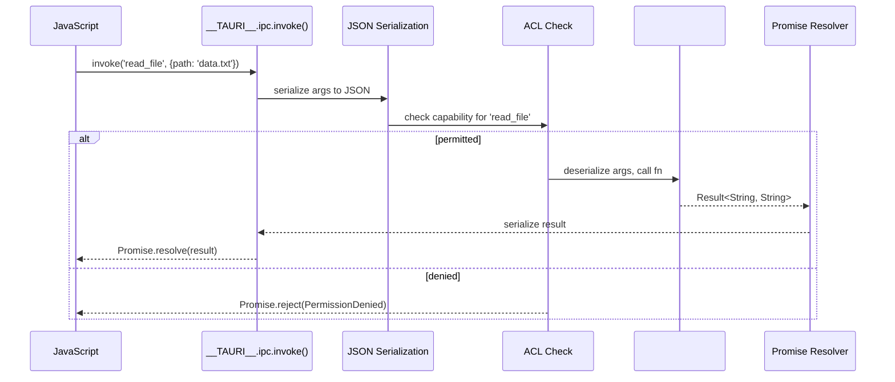
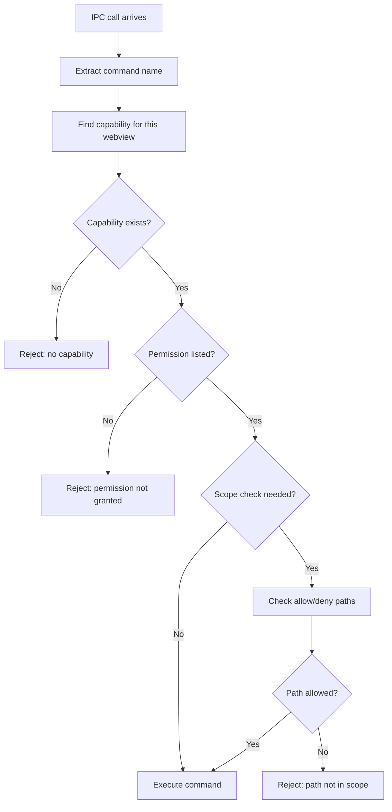
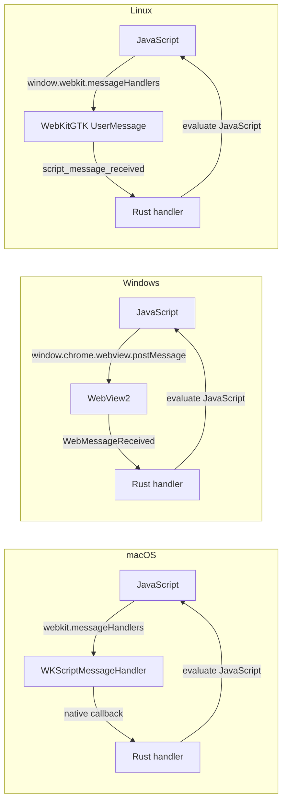
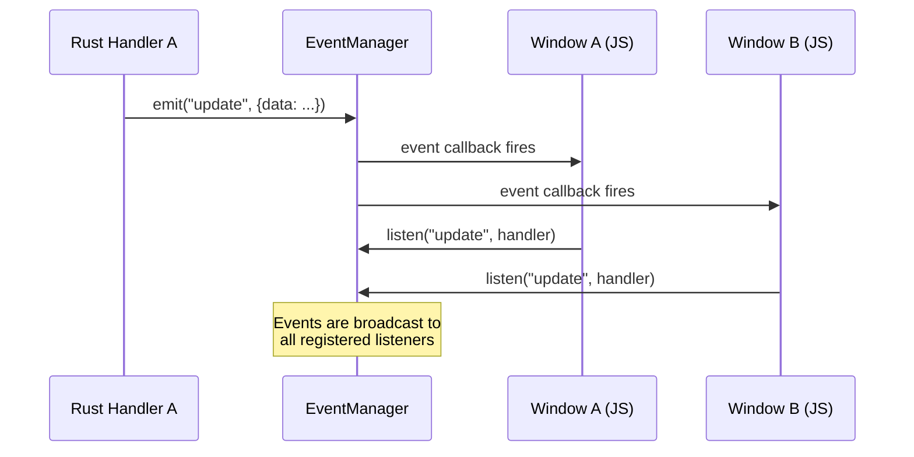

# Tauri IPC and ACL — Commands, Permissions, Message Passing

## Core Concept

Tauri's IPC (Inter-Process Communication) system bridges JavaScript frontend code with Rust backend handlers through a typed, asynchronous message-passing channel. The ACL (Access Control List) sits in front of every IPC call and checks whether the calling webview has permission to execute the requested command. This design makes security a first-class concern: capabilities are declarative, permissions are explicit, and the IPC layer enforces them automatically.

The IPC flow is: JavaScript calls `window.__TAURI__.ipc.invoke('command', args)`. The call is serialized and sent through the WebView's message handler. Tauri's IPC layer deserializes the call, checks the ACL, and dispatches to the appropriate Rust handler. The result is serialized and sent back as a resolved or rejected Promise.

## Command Macro

Rust handlers are defined with the `#[tauri::command]` procedural macro:

```rust
// tauri/src/command.rs
#[tauri::command]
fn read_file(path: String, state: State<Database>) -> Result<String, String> {
    // The function body executes when the IPC call arrives
    let content = std::fs::read_to_string(&path)
        .map_err(|e| e.to_string())?;
    Ok(content)
}
```

The macro generates an `InvokeHandler` implementation that:
1. Deserializes the JSON arguments into Rust types
2. Calls the function
3. Serializes the return value back to JSON
4. Handles `Result` by resolving or rejecting the JavaScript Promise

```rust
// Generated by #[tauri::command] — simplified
impl<R: Runtime> InvokeHandler<R> for __cmd__read_file {
    fn call(&self, invoke: Invoke<R>) -> bool {
        let args: ReadFileArgs = invoke.message.parse_args()?;
        let state = invoke.message.state::<Database>();
        let result = read_file(args.path, state);
        invoke.resolver.resolve_result(result)
    }
}
```

Commands can accept special types that Tauri injects:
- `State<T>` — managed application state
- `Window<R>` — the calling window
- `Webview<R>` — the calling webview
- `AppHandle<R>` — the application handle
- `Config` — the application configuration



## Invoke Message Structure

Every IPC call is a structured message:

```rust
// tauri/src/ipc/mod.rs
pub struct InvokeMessage<R: Runtime> {
    pub(crate) webview: Webview<R>,    // The webview that sent the invoke
    pub(crate) state: Arc<StateManager>, // Application managed state
    pub(crate) command: String,         // Command name
    pub(crate) payload: InvokeBody,     // JSON argument body
    pub(crate) headers: HeaderMap,      // HTTP request headers
}

pub struct Invoke<R: Runtime> {
    pub message: InvokeMessage<R>,
    pub resolver: InvokeResolver<R>,
    pub acl: Option<Vec<ResolvedCommand>>, // Resolved ACL for this invoke
}
```

The `command` is the command name string. The `payload` is the JSON-serialized argument body. The `resolver` is what the Rust handler uses to send back the result. The `acl` field contains the resolved permissions for this specific invoke.

## ACL — Access Control List

The ACL is Tauri's security gate. It reads capability definitions and checks every IPC call against them.

```rust
// tauri-utils/src/acl/capability.rs
pub struct Capability {
    pub identifier: String,
    pub description: String,
    pub local: bool,                          // default: true
    pub remote: Option<CapabilityRemote>,     // URLs that can use this capability
    pub windows: Vec<String>,                 // glob patterns for window labels
    pub webviews: Vec<String>,                // glob patterns for webview labels
    pub permissions: Vec<PermissionEntry>,    // permission strings or scoped entries
    pub platforms: Option<Vec<Target>>,       // optional platform targeting
}
```

### Capability Files

Capabilities are defined in `capabilities/` directory as JSON files:

```json
{
  "identifier": "main-capability",
  "description": "Permissions for the main window",
  "local": true,
  "remote": {
    "urls": []
  },
  "webviews": ["main"],
  "windows": ["main"],
  "permissions": [
    "shell:allow-open",
    "fs:allow-read-file",
    "fs:allow-read-text-file",
    "fs:allow-write-file",
    "dialog:allow-open",
    "http:default"
  ]
}
```

Each permission is a string in the format `plugin:action`. The `allow-` prefix grants permission. Without a matching permission entry, the command is silently rejected.

### ACL Check Flow



The ACL check is a three-step process:
1. **Capability match** — does any capability cover this webview?
2. **Permission check** — is the specific command listed in the capability's permissions?
3. **Scope check** — for filesystem and shell commands, does the requested path match the allowed/denied patterns?

### Scoped Permissions

Some plugins support scoped permissions that restrict what values a command can operate on:

```json
{
  "identifier": "fs-capability",
  "permissions": [
    {
      "identifier": "fs:default",
      "allow": [
        { "path": "$HOME/documents/**" },
        { "path": "$APPDATA/config.json" }
      ],
      "deny": [
        { "path": "$HOME/documents/secret/**" }
      ]
    }
  ]
}
```

The scope engine checks paths against allow/deny lists. Deny entries take priority over allow entries. Path variables like `$HOME`, `$APPDATA`, `$APPDIR` are resolved at runtime.

## IPC Transport Layer

The actual transport depends on the platform:



On macOS, wry registers a `WKScriptMessageHandler`. On Windows, it uses WebView2's `WebMessageReceived` event. On Linux, it uses WebKitGTK's `script_message_received`. All three converge to the same Rust IPC handler.

**Aha:** The IPC system doesn't use actual inter-process communication. The WebView and Rust code run in the same process. The "IPC" naming reflects the logical separation, not a process boundary. This is important: there is no serialization overhead crossing process boundaries. The JSON serialization happens because JavaScript and Rust have different type systems, not because they are in different processes.

## JavaScript API

The JavaScript side accesses IPC through `window.__TAURI__`:

```javascript
// Invoke a command
const content = await window.__TAURI__.invoke('read_file', { path: 'data.txt' })

// Listen for events from Rust
window.__TAURI__.event.listen('progress', (event) => {
    console.log(`Progress: ${event.payload}%`)
})

// Emit events to Rust
window.__TAURI__.event.emit('user-action', { action: 'click', element: 'button' })
```

The `__TAURI__` object is injected into the WebView at load time. It is not available in external URLs — only in the app's own frontend.

## Event System

Tauri has a pub/sub event system separate from the request/response IPC:

```rust
// tauri/src/event/listener.rs
struct InnerListeners {
    pending: Mutex<Vec<Pending>>,
    handlers: Mutex<HashMap<EventName, HashMap<EventId, Handler>>>,
    js_event_listeners: Mutex<HashMap<WebviewLabel, HashMap<EventName, HashSet<JsHandler>>>>,
    // ...
}

pub struct Listeners {
    inner: Arc<InnerListeners>,
}
```

Events are broadcast. Any window can listen to any event. Events are not ACL-gated — they are designed for pub/sub communication, not privileged operations.



## Invoke Handler Composition

Multiple command handlers are composed via the `generate_handler!` macro:

```rust
// tauri-macros/src/lib.rs
// generate_handler! is a proc macro that generates an invoke handler closure
// matching command names to their registered handlers
```

When an IPC call arrives, each handler is tried in order. The first handler that returns `true` (meaning it handled the call) short-circuits the rest. If no handler matches, the call returns false and the JavaScript Promise rejects with an "unknown command" error.

**Key insight:** Handler ordering matters. If two handlers register the same command name, the first one wins silently. This is a footgun — duplicate command names are not an error, they are a silent override.

## Error Handling

IPC errors flow through Rust's `Result` type:

```rust
#[tauri::command]
fn risky_operation() -> Result<String, InvokeError> {
    // Ok(value) → Promise resolves with value
    // Err(error) → Promise rejects with error message
    let data = std::fs::read_to_string("missing.txt")
        .map_err(|e| InvokeError(e.to_string()))?;
    Ok(data)
}
```

The error type must implement `serde::Serialize`. Tauri serializes the error and passes it to the JavaScript callback ID registered in the `InvokeMessage`. On the JavaScript side, the Promise rejects with the serialized error.

## IPC Message Serialization

All IPC messages are JSON-serialized. The serialization pipeline uses `serde_json`:

```rust
// tauri/src/ipc/serializer.rs
// JavaScript → Rust:
let args: InvokeArgs = serde_json::from_str(&message.body)?;

// Rust → JavaScript:
let result = serde_json::to_string(&response)?;
```

The serialization has performance implications:
- Small messages (< 1 KB): negligible overhead (~10 microseconds)
- Medium messages (100 KB): ~1 millisecond
- Large messages (1 MB): ~10 milliseconds

For performance-sensitive applications, consider:
- Using binary data through custom protocol handlers (avoids JSON encoding)
- Batching multiple small operations into a single IPC call
- Streaming large data through file paths rather than inline content

## Capability File Resolution

Capability files are resolved at build time by `tauri-build`:

```rust
// tauri-build/src/capabilities.rs
pub fn resolve_capabilities(config_dir: &Path) -> Result<Vec<Capability>> {
    let caps_dir = config_dir.join("capabilities");
    let mut capabilities = Vec::new();

    if caps_dir.exists() {
        for entry in std::fs::read_dir(&caps_dir)? {
            let entry = entry?;
            let path = entry.path();
            if path.extension() == Some("json".as_ref()) {
                let content = std::fs::read_to_string(&path)?;
                let cap: Capability = serde_json::from_str(&content)?;
                capabilities.push(cap);
            }
        }
    }

    // Validate capabilities
    for cap in &capabilities {
        validate_capability(cap)?;
    }

    Ok(capabilities)
}
```

Each capability file is validated:
- Identifier must be unique
- Permission strings must match known permission definitions
- Scope paths must be valid path patterns
- Webview references must match defined webviews

If validation fails, the build fails with a descriptive error. This is compile-time security: you cannot deploy an app with invalid capability configurations.

## Cross-References

- [Tauri Core](01-tauri-core.md) — App<R>, AppManager, where IPC is dispatched
- [Build and CLI](03-tauri-build-cli.md) — how capabilities are bundled into the binary
- [Wry WebView](04-wry-webview.md) — how wry's message handlers transport IPC messages
- [Plugins](08-plugins.md) — how plugins define their own IPC commands via Extension
- [Cross-Cutting Concerns](10-cross-cutting.md) — security review of the ACL system
