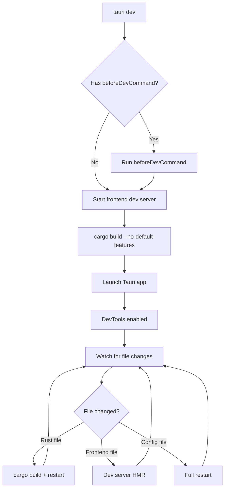
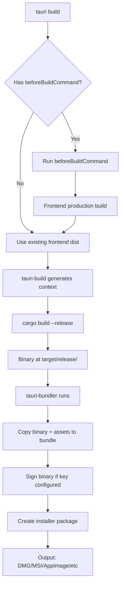
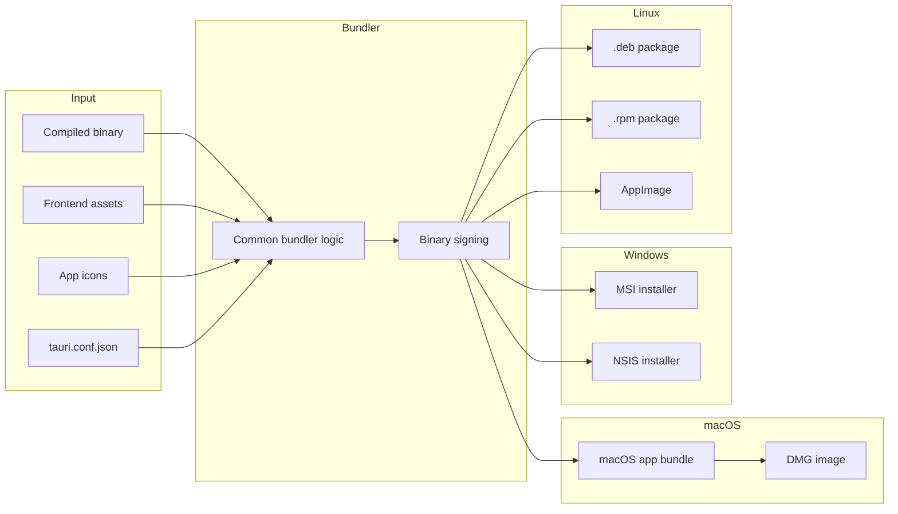
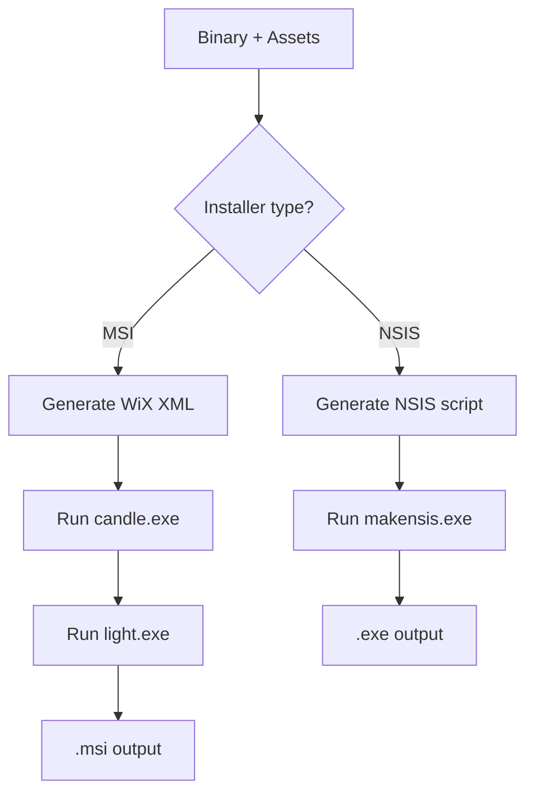

# Tauri Build and CLI — tauri-cli, tauri-build, Bundler Pipeline

## Core Concept

Tauri's build system has two distinct phases. First, `tauri-cli` drives the development and build workflow — it runs your frontend dev server, invokes `cargo build`, and orchestrates the entire process. Second, `tauri-bundler` takes the compiled binary and packages it into platform-specific installers: DMG for macOS, MSI and NSIS for Windows, AppImage and deb/rpm for Linux.

The key insight is that Tauri separates the Rust build (handled by cargo) from the installer packaging (handled by tauri-bundler). The CLI orchestrates both.

## tauri-cli Commands

The CLI is a Rust binary built with `clap`:

```rust
// tauri-cli/src/main.rs
#[derive(Parser)]
#[clap(about = "Tauri CLI", version)]
struct Cli {
    #[clap(subcommand)]
    command: Commands,
}

#[derive(Subcommand)]
enum Commands {
    /// Initialize a Tauri project
    Init(InitOptions),
    /// Run the app in development mode
    Dev(DevOptions),
    /// Build the app for production
    Build(BuildOptions),
    /// Show information about the project
    Info,
    /// Sign a binary or file
    Sign(SignOptions),
    /// ACL management
    Acl(AclOptions),
}
```

| Command | Purpose |
|---------|---------|
| `tauri init` | Scaffold a new Tauri project, create `tauri.conf.json` |
| `tauri dev` | Run frontend dev server, build Rust, launch app in dev mode |
| `tauri build` | Build frontend for production, compile Rust, run bundler |
| `tauri info` | Display versions, OS info, dependencies |
| `tauri sign` | Sign binaries with a signing key |
| `tauri acl` | Manage ACL capabilities |

## Development Flow



The development flow is a watch loop. The CLI monitors:
1. **Rust source files** — triggers `cargo build` and restarts the app
2. **Frontend files** — the dev server handles hot module replacement
3. **Configuration files** — triggers a full app restart

Dev mode enables features that are disabled in production:
- DevTools (F12 inspector)
- More verbose logging
- No asset minification

## Build Flow



The build flow produces an optimized release binary, then packages it. The bundler reads configuration from `tauri.conf.json`:

```json
{
  "bundle": {
    "active": true,
    "targets": "all",
    "identifier": "com.myapp.example",
    "icon": [
      "icons/32x32.png",
      "icons/128x128.png",
      "icons/128x128@2x.png",
      "icons/icon.icns",
      "icons/icon.ico"
    ],
    "resources": {
      "assets/*": "assets/"
    },
    "copyright": "Copyright © 2024 My Company",
    "category": "DeveloperTool"
  }
}
```

## tauri-build — Compile-Time Code Generation

`tauri-build` is a build dependency that runs during `cargo build`. It generates Rust code from `tauri.conf.json`:

```rust
// tauri-build/src/lib.rs
pub fn setup<R: tauri::Runtime>(
    context: tauri::Context<R>,
) -> Result<(), Box<dyn std::error::Error>> {
    // Generated code:
    // 1. Embed frontend assets using include_bytes!
    // 2. Parse and validate configuration
    // 3. Generate context struct with all config values
    // 4. Generate ACL capability definitions
    Ok(())
}
```

The generated code includes:
- **Asset embedding** — `include_bytes!("../dist/index.html")` embeds the frontend into the binary
- **Icon embedding** — app icons are embedded at compile time
- **Configuration struct** — all values from `tauri.conf.json` become Rust struct fields
- **ACL generation** — capability files are parsed and compiled into the binary

**Aha:** The `tauri-build` crate is a compile-time code generator, not a runtime library. It runs during `cargo build` and generates Rust code that becomes part of the final binary. This is why Tauri apps are self-contained: the frontend assets, icons, and configuration are all compiled into the executable. There is no external config file to distribute.

## tauri-bundler — Installer Pipeline

The bundler produces platform-specific installers:

```rust
// tauri-bundler/src/bundle/mod.rs
pub enum BundleType {
    Deb,        // Debian package (.deb)
    Rpm,        // Red Hat package (.rpm)
    AppImage,   // Linux portable app (.AppImage)
    Msi,        // Windows Installer (.msi)
    Nsis,       // Nullsoft installer (.exe)
    Dmg,        // macOS disk image (.dmg)
    Updater,    // Self-updating bundle
}
```



### macOS Bundling

The DMG bundler:
1. Creates a `.app` bundle directory structure (`Contents/MacOS/`, `Contents/Resources/`)
2. Copies the binary and assets into the bundle
3. Embeds icons and `Info.plist`
4. Optionally signs the binary with an Apple signing key
5. Creates a DMG (disk image) with the `.app` inside
6. Optionally creates an app bundle tarball for self-updating

```
MyApp.app/
├── Contents/
│   ├── Info.plist              ← App metadata
│   ├── PkgInfo                 ← APPL????
│   ├── MacOS/
│   │   └── myapp               ← Compiled binary
│   └── Resources/
│       ├── icon.icns           ← App icon
│       └── tauri.conf.json     ← Embedded config
```

### Windows Bundling

Windows supports two installer types:
- **MSI** — Windows Installer XML (WiX) toolchain. Produces a professional installer with registry entries, start menu shortcuts, and uninstall support.
- **NSIS** — Nullsoft Scriptable Install System. Produces a smaller `.exe` installer with a wizard UI.



### Linux Bundling

Linux supports three formats:
- **deb** — Debian package with control file, postinst scripts
- **rpm** — Red Hat package with spec file
- **AppImage** — Single-file portable executable (bundles everything)

```bash
# .deb structure
myapp_1.0.0_amd64.deb
├── control/
│   ├── control          ← Package metadata
│   ├── postinst         ← Post-install script
│   └── postrm           ← Post-remove script
├── usr/
│   ├── bin/myapp        ← Binary
│   └── share/
│       ├── applications/myapp.desktop  ← Desktop entry
│       └── icons/hicolor/256x256/apps/myapp.png
```

## Icon Generation

Tauri provides an icon generation command:

```bash
cargo tauri icon input.png
```

This generates all required icon sizes from a single source image:
- `32x32.png` — Windows taskbar
- `128x128.png` — Linux GTK
- `128x128@2x.png` — Retina displays
- `icon.icns` — macOS app bundle
- `icon.ico` — Windows installer

## Configuration Reference

The full `tauri.conf.json` schema:

```json
{
  "productName": "my-app",
  "version": "0.1.0",
  "identifier": "com.my-app.example",
  "build": {
    "frontendDist": "../dist",
    "devUrl": "http://localhost:1420",
    "beforeDevCommand": "npm run dev",
    "beforeBuildCommand": "npm run build"
  },
  "app": {
    "withGlobalTauri": true,
    "trayIcon": { ... },
    "windows": [
      {
        "title": "My App",
        "width": 800,
        "height": 600,
        "resizable": true,
        "fullscreen": false
      }
    ],
    "security": {
      "csp": "default-src 'self'"
    }
  },
  "bundle": { ... }
}
```

Key configuration points:
- `identifier` — reverse-DNS app identifier (used for bundle naming)
- `build.frontendDist` — path to the built frontend assets
- `build.devUrl` — URL of the dev server
- `app.windows` — default window configuration
- `app.security.csp` — Content Security Policy for the WebView
- `bundle.active` — whether to run the bundler after building

## Code Signing

Code signing is critical for production builds. Tauri supports signing on all platforms:

### macOS Signing

macOS requires apps to be signed with an Apple Developer certificate:

```json
{
  "bundle": {
    "macOS": {
      "signingIdentity": "Developer ID Application: My Company (TEAM_ID)",
      "entitlements": "entitlements.plist",
      "hardenedRuntime": true
    }
  }
}
```

The signing process:
1. Compile the binary
2. Create the `.app` bundle
3. Sign the binary with `codesign`
4. Create the DMG
5. Notarize with Apple (required for distribution outside the Mac App Store)

Notarization sends the app to Apple's servers for malware scanning. If it passes, Apple issues a "ticket" that allows the app to run without Gatekeeper warnings.

### Windows Signing

Windows uses Authenticode signing:

```json
{
  "bundle": {
    "windows": {
      "certificatePath": "certificate.pfx",
      "certificateThumbprint": "ABC123...",
      "digestAlgorithm": "sha256",
      "timestampUrl": "http://timestamp.digicert.com"
    }
  }
}
```

The process:
1. Compile the binary
2. Sign with `signtool.exe`
3. Timestamp the signature (prevents expiration when the cert expires)
4. Create the installer (MSI or NSIS)
5. Sign the installer as well

### Linux

Linux does not have a universal code signing standard. Debian packages can be signed with GPG keys, and AppImages can use `appimagetool` with a signing key, but these are optional steps that Tauri does not automate by default.

## Build Optimizations

Several configuration options affect the final binary size:

```toml
# Cargo.toml — release profile optimizations
[profile.release]
lto = true              # Link-time optimization (smaller binary, longer build)
codegen-units = 1       # Single codegen unit (better optimization, longer build)
opt-level = "z"         # Optimize for size (or "3" for speed)
panic = "abort"         # Abort on panic (smaller binary, no panic unwind)
strip = true            # Strip debug symbols (much smaller binary)
```

Typical size impact:
- Without optimizations: 15-25 MB
- With `opt-level = "z"`: 8-12 MB
- With `lto + strip`: 2-6 MB

The `strip = true` option is the most impactful. It removes all debug symbols and function names from the binary, reducing size by 50-70%.

## Troubleshooting Common Build Issues

| Error | Cause | Fix |
|-------|-------|-----|
| `frontendDist not found` | Frontend not built before `tauri build` | Run `beforeBuildCommand` or build frontend manually |
| `identifier is invalid` | Invalid reverse-DNS format | Use `com.company.appname` format |
| `bundle target failed` | Missing platform dependencies | Install GTK (Linux), WebView2 SDK (Windows) |
| `generate_context!` fails | `tauri.conf.json` syntax error | Validate JSON, check file paths |
| Signing fails | Certificate not found | Verify certificate path and password |

## Cross-References

- [Tauri Core](01-tauri-core.md) — how generate_context! uses tauri-build output
- [IPC and ACL](02-tauri-ipc-acl.md) — how capability files are bundled by tauri-build
- [Wry WebView](04-wry-webview.md) — how the bundled app creates WebViews
- [Plugins](08-plugins.md) — how plugins are bundled and distributed
- [Cross-Cutting Concerns](10-cross-cutting.md) — code signing, security, CI/CD
