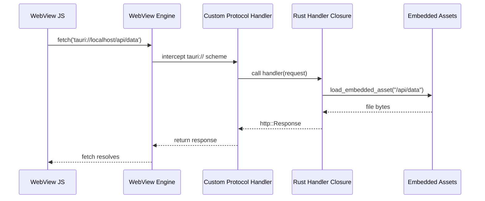
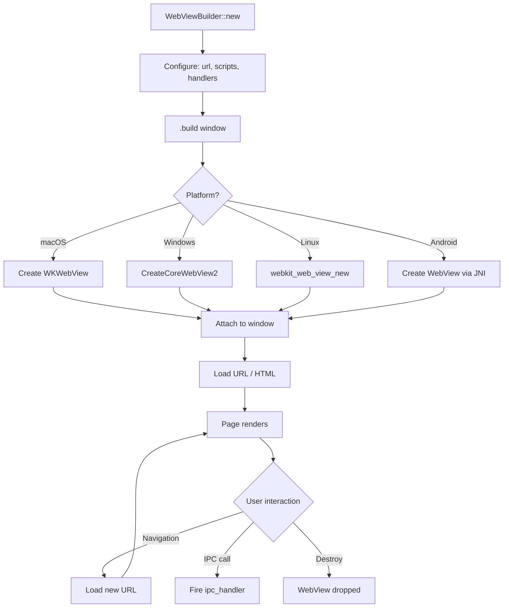
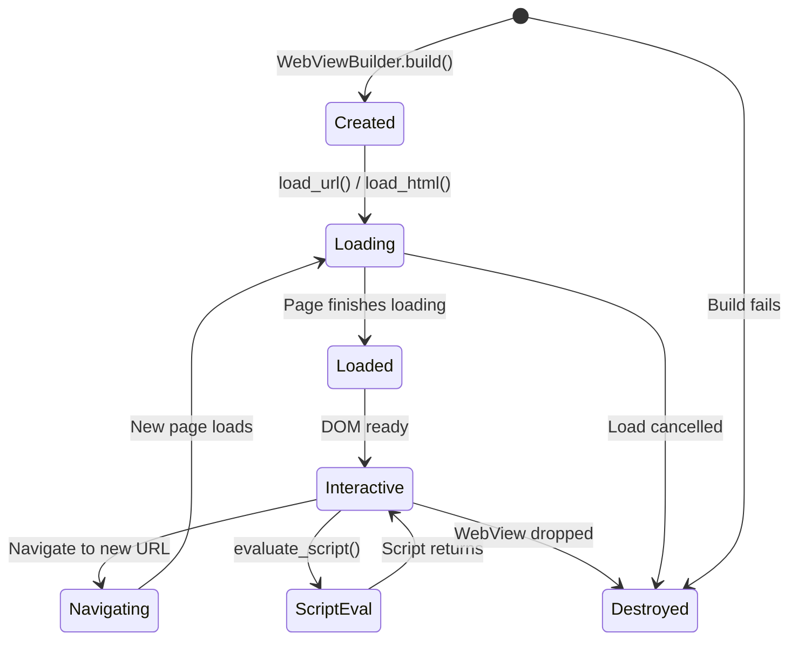

# Wry — Cross-Platform WebView Abstraction (v0.55.1)

## Core Concept

Wry is a cross-platform WebView rendering library that abstracts four platform-specific WebView backends behind a single, consistent `WebViewBuilder` API. The backends are: WKWebView on macOS/iOS, WebView2 on Windows, WebKitGTK on Linux, and Android WebView on Android. A developer writes one `WebViewBuilder` configuration and wry translates it into the appropriate native API calls for each platform.

Wry's architecture is a facade over platform-specific WebView implementations. The `WebViewBuilder` struct has 50+ configuration fields, all of which are mapped to the appropriate native APIs at build time through `cfg()` conditional compilation.

## WebViewBuilder — The Central API

```rust
// wry/src/webview/mod.rs
pub struct WebViewBuilder<'a> {
    // Core
    pub platform_specific: PlatformSpecificWebViewAttributes,
    // URL/content
    pub url: Option<Url>,
    pub html: Option<String>,
    pub initialization_scripts: Vec<Script>,
    // IPC
    pub ipc_handler: Option<Handler>,
    pub custom_protocol: Option<CustomProtocol>,
    // Window integration
    pub window: Option<Window>,
    // Settings
    pub devtools: bool,
    pub transparent: bool,
    pub fullscreen: bool,
    pub zoom_hotkeys_enabled: bool,
    pub scroll_bounce: bool,
    // ... 50+ total fields
}
```

The builder pattern allows fluent configuration:

```rust
let webview = WebViewBuilder::new()
    .with_url("https://example.com")
    .with_initialization_script("window.__APP__ = { version: '1.0' };")
    .with_ipc_handler(|handler| {
        println!("Received: {}", handler.body());
    })
    .with_devtools(true)
    .build(&window)?;
```

### Key Configuration Methods

| Method | Purpose | Default |
|--------|---------|---------|
| `with_url(url)` | Load a URL | None |
| `with_html(html)` | Load HTML string | None |
| `with_initialization_script(script)` | Inject JS before page load | Empty |
| `with_ipc_handler(handler)` | Handle messages from JS | None |
| `with_custom_protocol(protocol)` | Register custom URL scheme | None |
| `with_devtools(enabled)` | Enable developer tools | false |
| `with_transparent(enabled)` | Transparent background | false |
| `with_fullscreen(enabled)` | Start in fullscreen | false |
| `with_user_agent(ua)` | Custom User-Agent header | Platform default |
| `with_background_color(color)` | Background color | White |
| `with_zoom_hotkeys_enabled(enabled)` | Cmd/Ctrl+ zoom | false |
| `with_scroll_bounce(enabled)` | Elastic scroll on macOS | false |
| `with_data_directory(path)` | Persistent data storage | None |

## Four Platform Backends

```mermaid
flowchart TD
    subgraph WebViewBuilder
        Config[50+ config fields]
        Build[.build window]
    end

    Build -->|cfg target_os = "macos"| WK[WKWebView]
    Build -->|cfg target_os = "windows"| WV2[WebView2 COM]
    Build -->|cfg target_os = "linux"| GTK[WebKitGTK]
    Build -->|cfg target_os = "android"| AWV[Android WebView JNI]

    subgraph macOS
        WK --> ObjC[objc2 + objc2-web-kit]
        ObjC --> Cocoa[Cocoa/WebKit APIs]
    end

    subgraph Windows
        WV2 --> WinR[windows-rs + webview2-com]
        WinR --> WinAPI[Win32 COM APIs]
    end

    subgraph Linux
        GTK --> GTKSys[gtk + webkit2gtk]
        GTKSys --> GTKLib[libwebkit2gtk-4.1]
    end

    subgraph Android
        AWV --> JNI2[jni crate + NDK]
        JNI2 --> Dalvik[Android WebView]
    end
```

Each backend uses platform-specific dependencies that are conditionally compiled:

```toml
# wry/Cargo.toml — platform dependencies

[target.'cfg(target_os = "macos")'.dependencies]
objc2 = "0.6.4"
objc2-web-kit = "0.3.2"      # WKWebView, WKUserContentController, etc.
objc2-foundation = "0.3.2"    # NSURL, NSString, NSData
objc2-app-kit = "0.3.2"       # NSApplication, NSWindow

[target.'cfg(target_os = "windows")'.dependencies]
webview2-com = "0.38"          # WebView2 COM wrapper
windows = "0.61"               # Win32 API bindings
windows-core = "0.61"

[target.'cfg(any(target_os = "linux", ...))'.dependencies]
webkit2gtk = "2.0.2"           # WebKitGTK Rust bindings
webkit2gtk-sys = "2.0.2"       # FFI bindings
gtk = "0.18"
javascriptcore-rs = "1.1.2"    # JavaScriptCore engine

[target.'cfg(target_os = "android")'.dependencies]
jni = "0.21"                   # Java Native Interface
ndk = "0.9"                    # Android NDK
dom_query = "0.28.0"           # DOM manipulation
```

**Aha:** Wry doesn't abstract away platform differences entirely. Some configuration fields only work on specific platforms. For example, `with_scroll_bounce` is macOS-only (WebKitGTK and WebView2 don't have an equivalent API). Wry's design choice is to make these fields no-ops on unsupported platforms rather than compile errors. This means developers write portable code, but some settings silently have no effect on certain platforms.

## Protocol Handlers — Custom URL Schemes

One of wry's most powerful features is custom protocol handlers. Instead of loading files from `file://` URLs, wry can intercept custom scheme URLs and serve content from Rust:

```rust
// wry/src/webview/mod.rs
WebViewBuilder::new()
    .with_custom_protocol(
        "tauri".into(),
        move |_webview_id, _request| {
            // Load asset from embedded filesystem
            let path = request.uri().path();
            let content = load_embedded_asset(path);
            http::Response::builder()
                .header("Content-Type", mime_type_for_path(path))
                .body(content)
                .unwrap()
        }
    )
    .with_url("tauri://localhost/index.html")
    .build(&window)?;
```

This is how Tauri serves the frontend without a web server. The `tauri://` scheme is intercepted by wry, which calls the Rust handler. The handler reads the asset from the embedded filesystem and returns an HTTP response. The WebView thinks it made an HTTP request.



The protocol handler can serve any content type: HTML, CSS, JavaScript, JSON, images, fonts. It can also do dynamic content generation — the handler is a Rust closure, so it can query a database, call an API, or generate HTML on the fly.

## IPC Message Handlers

Wry provides a unified IPC message handler across all platforms:

```rust
// wry/src/webview/mod.rs
pub struct WebViewAttributes {
    pub ipc_handler: Option<Box<dyn Fn(String)>>,
}
```

On each platform, the message handler is wired differently:

**macOS (WKWebView):**
```rust
// wry/src/webview/wkwebview/mod.rs
unsafe extern "C" fn did_receive(
    this: &Object,
    _sel: Sel,
    _controller: &WKUserContentController,
    message: &WKScriptMessage,
) {
    if let Some(body) = message.body() {
        let handler = get_ipc_handler();
        handler(body.to_string());
    }
}
```

**Windows (WebView2):**
```rust
// wry/src/webview/webview2/mod.rs
webview.add_web_message_received(move |_sender, args| {
    let message = args.try_get_web_message_as_string()?;
    let handler = get_ipc_handler();
    handler(message.to_string());
    Ok(())
})?;
```

**Linux (WebKitGTK):**
```rust
// wry/src/webview/webkitgtk/mod.rs
web_context.connect_script_message_received(move |_context, js_value| {
    let handler = get_ipc_handler();
    handler(js_value.to_string());
});
```

Despite the platform differences, the Rust developer writes one `ipc_handler` closure and wry handles the platform wiring.

## Initialization Scripts

Wry supports injecting JavaScript before the page loads:

```rust
WebViewBuilder::new()
    .with_initialization_script(r#"
        // This runs before any page content
        window.__TAURI_INTERNALS__ = {
            metadata: { ... },
            ipc: { invoke: ... }
        };
    "#)
    .build(&window)?;
```

Initialization scripts are different from regular script injection:
- They run **before** any page content loads
- They run on **every** navigation (not just the first page)
- They cannot access the DOM (the DOM doesn't exist yet)
- They can define global variables and functions

This is how Tauri injects `window.__TAURI__` — through an initialization script that runs before the frontend loads.

## WebView Lifecycle



## Platform-Specific Details

### macOS — WKWebView

```rust
// wry/src/webview/wkwebview/mod.rs — key types
use objc2_web_kit::{
    WKWebView,
    WKWebViewConfiguration,
    WKUserContentController,
    WKWebsiteDataStore,
    WKPreferences,
    WKUserScript,
    WKURLSchemeHandler,
    WKScriptMessageHandler,
};
```

WKWebView is the most feature-complete backend. It supports:
- Full JavaScript (V8-equivalent JavaScriptCore engine)
- DevTools via `inspector` panel
- Custom protocols via `WKURLSchemeHandler`
- Transparent backgrounds
- Custom user content controller

### Windows — WebView2

```rust
// wry/src/webview/webview2/mod.rs
use webview2_com::Microsoft::Web::WebView2::Win32::{
    CoreWebView2,
    CoreWebView2Environment,
    CoreWebView2Controller,
};
```

WebView2 requires the Edge WebView2 runtime to be installed. On Windows 10/11, it is pre-installed. On older Windows, the user may need to install it. Wry does not bundle the runtime.

WebView2 specifics:
- Based on Chromium (same engine as Chrome)
- DevTools via F12
- Custom protocols via `SetVirtualHostNameToFolderMapping`
- Requires COM initialization (wry handles this)

### Linux — WebKitGTK

```rust
// wry/src/webview/webkitgtk/mod.rs
use webkit2gtk::{
    WebView,
    WebContext,
    Settings,
    UserContentManager,
};
```

WebKitGTK specifics:
- Based on WebKit (same engine as Safari)
- Requires `libwebkit2gtk-4.1` system package
- DevTools via `enable-developer-extras` setting
- Custom protocols via `URIRequest` handler
- X11 and Wayland support

### Android WebView

```rust
// wry/src/webview/android/mod.rs
use jni::{JNIEnv, objects::{JObject, JString}};
```

Android WebView specifics:
- Accessed via JNI calls to `android.webkit.WebView`
- Uses `dom_query` for DOM manipulation (Rust can't directly call JS)
- IPC goes through `addJavascriptInterface`
- Custom protocols are complex — wry intercepts at the request level

## WebView Lifecycle Management

Each platform has different resource management requirements:



When a WebView is dropped:
- **macOS:** The `WKWebView` is released from the autorelease pool. Any pending JavaScript execution is cancelled.
- **Windows:** The `CoreWebView2Controller` is released. COM reference counts are decremented.
- **Linux:** The `WebKitWebView` widget is destroyed. GTK unregisters it from the main loop.
- **Android:** The `WebView.destroy()` method is called via JNI to prevent memory leaks.

## Performance Considerations

### WebView Creation Time

| Platform | Cold creation | Warm creation |
|----------|--------------|---------------|
| macOS | 50-100ms | 20-50ms |
| Windows | 100-200ms | 50-100ms |
| Linux | 50-100ms | 20-50ms |
| Android | 100-200ms | 50-100ms |

Windows is the slowest because WebView2 initialization involves COM setup and connecting to the Edge runtime.

### Memory Usage Per WebView

| Platform | Base memory | Per-page memory |
|----------|------------|-----------------|
| macOS | 20-40 MB | 5-20 MB |
| Windows | 40-80 MB | 10-30 MB |
| Linux | 15-35 MB | 5-15 MB |
| Android | 25-50 MB | 5-20 MB |

Windows has the highest base memory because the WebView2 runtime runs in a separate process (the Browser sub-process). macOS and Linux run the WebView in-process.

**Aha:** The platform differences in memory and startup time mean that a Tauri app will have different performance characteristics on each platform. This is inherent to the "use the OS WebView" approach. On Windows, the separate Chromium process adds overhead but provides better isolation (a WebView crash doesn't crash the app). On macOS, the in-process WKWebView is lighter but a crash in the JavaScript engine could crash the entire app.

## Platform-Specific Quirks

### macOS

- **WKProcessPool:** Sharing a process pool between WebViews allows them to share cookies and localStorage. Wry creates a shared pool by default.
- **Custom protocol limitations:** `WKURLSchemeHandler` cannot be registered for `http://` or `https://` schemes. You must use a custom scheme like `tauri://` or `app://`.
- **No WebSQL:** WKWebView does not support WebSQL (deprecated).

### Windows

- **WebView2 runtime version:** The installed runtime version affects available features. Older versions may lack APIs wry depends on.
- **COM threading:** WebView2 requires STA (Single-Threaded Apartment) COM initialization. Wry handles this, but if you create your own COM objects, you must be careful about threading.
- **User data folder:** WebView2 creates a user data folder for cookies, cache, and localStorage. If not specified, it uses a temporary directory (cleared on restart).

### Linux

- **GTK version:** WebKitGTK depends on GTK. The GTK version must match what's installed on the system.
- **Wayland vs X11:** WebKitGTK works on both, but some features (like custom cursors) may behave differently.
- **Memory pressure:** WebKitGTK may use more memory under heavy load because it doesn't have the same memory management as Chromium.

### Android

- **WebView version:** The Android WebView is updated through Google Play. Different Android versions have different WebView implementations.
- **HTTPS requirement:** Mixed content (HTTP on an HTTPS page) is blocked by default.
- **File access:** `file://` URLs have restricted access on Android. Wry's custom protocol handler is the recommended approach.

## WebView Attributes Mapping Table

| Attribute | macOS (WKWebView) | Windows (WebView2) | Linux (WebKitGTK) | Android |
|-----------|-------------------|-------------------|-------------------|---------|
| URL loading | `loadRequest` | `Navigate` | `load_uri` | `loadUrl` |
| IPC handler | `WKScriptMessageHandler` | `WebMessageReceived` | `script_message_received` | `JavascriptInterface` |
| DevTools | `inspect` | `OpenDevToolsWindow` | `enable-developer-extras` | `setWebContentsDebuggingEnabled` |
| Custom protocol | `WKURLSchemeHandler` | `SetVirtualHostNameToFolderMapping` | `URIRequest handler` | `shouldInterceptRequest` |
| Initialization script | `WKUserScript` | `AddScriptToExecuteOnDocumentCreated` | `UserContentManager.add_script` | `evaluateJavascript` |
| Transparent bg | `drawsBackground = NO` | `DefaultBackgroundColor` | `background-color:transparent` | `setBackgroundColor` |
| User agent | `customUserAgent` | `Settings.UserAgent` | `set_user_agent` | `setUserAgentString` |

## Cross-References

- [Tauri Core](01-tauri-core.md) — how Tauri creates WebViews through wry
- [Tao Windowing](05-tao-windowing.md) — how wry integrates with tao windows
- [IPC and ACL](02-tauri-ipc-acl.md) — how IPC messages travel through wry
- [Cross-Cutting Concerns](10-cross-cutting.md) — WebView security considerations
