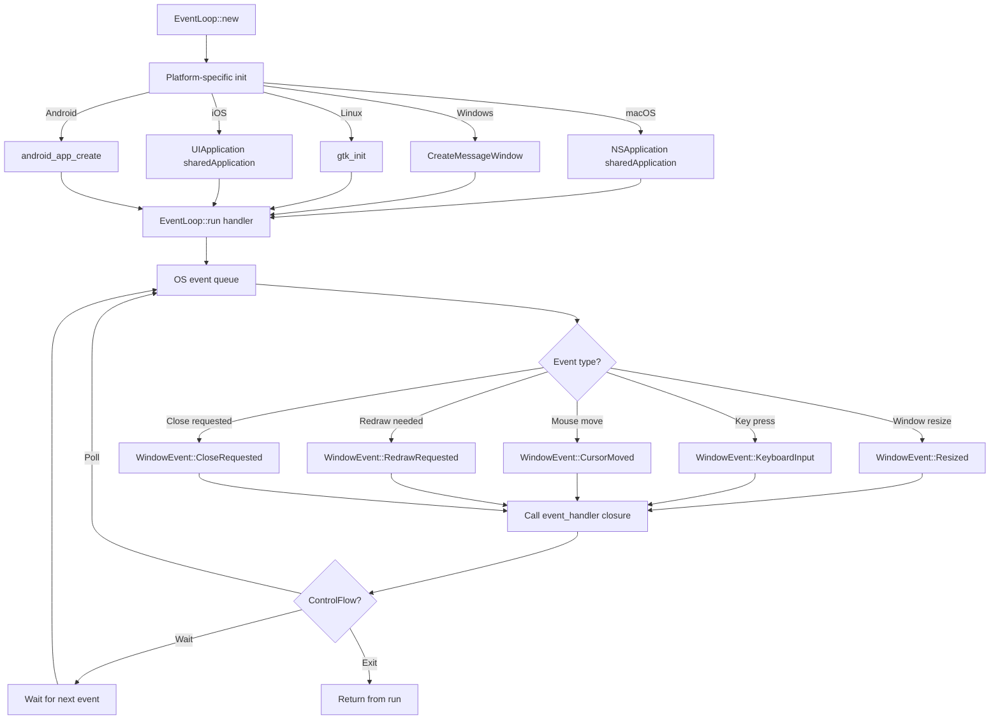
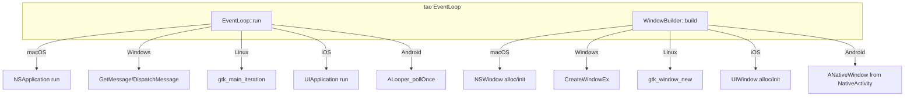

# Tao — Cross-Platform Windowing and Event Loop (v0.34.5)

## Core Concept

Tao is a cross-platform window management and event loop library. It abstracts five platform-specific windowing backends (macOS AppKit, Windows Win32, Linux GTK, iOS UIKit, Android NativeActivity) behind a single `EventLoop` and `Window` API. Tao handles window creation, input events, display management, and the main event loop.

Wry (the WebView library) depends on tao for window handles. Tauri depends on tao indirectly through wry. If you use dioxus-desktop, it depends on tao directly for its window management.

## EventLoop — The Main Loop

```rust
// tao/src/event_loop.rs
pub struct EventLoop<T: 'static> {
    pub(crate) window_target: RootELW<T>,
    // ...
}

pub struct EventLoopWindowTarget<T> {
    // Platform-specific window target data
}

impl<T> EventLoop<T> {
    pub fn new() -> EventLoop<T> { ... }
    pub fn run<F>(self, event_handler: F) -> !
    where
        F: FnMut(Event<T>, &EventLoopWindowTarget<T>, &mut ControlFlow) + 'static,
    { ... }
    pub fn create_proxy(&self) -> EventLoopProxy<T> { ... }
}
```

The event loop is the heart of any GUI application. It:
1. Polls the OS for new events (keyboard, mouse, window resize, etc.)
2. Dispatches events to the registered handler closure
3. Runs until the handler sets `ControlFlow::Exit`



## ControlFlow — Loop Management

```rust
// tao/src/event_loop.rs
pub enum ControlFlow {
    /// Exit the event loop after the current iteration
    Exit,
    /// Wait for the next event, then process it (low CPU)
    Wait,
    /// Poll for events continuously (high CPU, needed for animations)
    Poll,
    /// Wait until a specific time, then poll
    WaitUntil(Instant),
}
```

`ControlFlow` is how the event handler controls the loop's behavior:

```rust
event_loop.run(move |event, _, control_flow| {
    *control_flow = ControlFlow::Wait; // Default: wait for events

    match event {
        Event::WindowEvent { event, .. } => match event {
            WindowEvent::CloseRequested => {
                *control_flow = ControlFlow::Exit;
            }
            WindowEvent::RedrawRequested => {
                // Render frame
                *control_flow = ControlFlow::Poll; // Keep rendering
            }
            _ => {}
        }
        _ => {}
    }
});
```

## Window — The Window Abstraction

The `Window` struct has 60+ methods covering every window operation:

```rust
// tao/src/window.rs
pub struct Window {
    window: Arc<WindowInner>,
}

impl Window {
    // Creation
    pub fn new(event_loop: &EventLoopWindowTarget) -> Result<Self> { ... }

    // Properties
    pub fn title(&self) -> String { ... }
    pub fn set_title(&self, title: &str) { ... }
    pub fn outer_position(&self) -> Result<PhysicalPosition<i32>> { ... }
    pub fn set_outer_position(&self, position: PhysicalPosition<i32>) { ... }
    pub fn inner_size(&self) -> PhysicalSize<u32> { ... }
    pub fn set_inner_size(&self, size: PhysicalSize<u32>) { ... }
    pub fn min_inner_size(&self) -> Option<PhysicalSize<u32>> { ... }
    pub fn set_min_inner_size(&self, size: Option<PhysicalSize<u32>>) { ... }
    pub fn max_inner_size(&self) -> Option<PhysicalSize<u32>> { ... }
    pub fn set_max_inner_size(&self, size: Option<PhysicalSize<u32>>) { ... }

    // Visibility
    pub fn is_visible(&self) -> bool { ... }
    pub fn set_visible(&self, visible: bool) { ... }
    pub fn set_visible_on_all_workspaces(&self, visible: bool) { ... }

    // State
    pub fn is_minimized(&self) -> Option<bool> { ... }
    pub fn set_minimized(&self, minimized: bool) { ... }
    pub fn is_maximized(&self) -> bool { ... }
    pub fn set_maximized(&self, maximized: bool) { ... }
    pub fn fullscreen(&self) -> Option<Fullscreen> { ... }
    pub fn set_fullscreen(&self, mode: Option<Fullscreen>) { ... }

    // Focus
    pub fn focus_window(&self) { ... }
    pub fn set_focusable(&self, focusable: bool) { ... }

    // Decorations
    pub fn is_decorated(&self) -> bool { ... }
    pub fn set_decorations(&self, decorations: bool) { ... }
    pub fn is_resizable(&self) -> bool { ... }
    pub fn set_resizable(&self, resizable: bool) { ... }

    // Always on top
    pub fn set_always_on_top(&self, always_on_top: bool) { ... }

    // Content protection (hide from screenshots)
    pub fn set_content_protection(&self, enabled: bool) { ... }

    // Window level (z-order)
    pub fn set_window_level(&self, level: WindowLevel) { ... }

    // Theme
    pub fn theme(&self) -> Option<Theme> { ... }

    // Raw window handle (for wry, wgpu, etc.)
    pub fn raw_window_handle(&self) -> Result<RawWindowHandle> { ... }
}
```

## WindowBuilder

```rust
// tao/src/window.rs
pub struct WindowBuilder {
    window: WindowAttributes,
}

pub struct WindowAttributes {
    pub inner_size: Option<Size>,
    pub min_inner_size: Option<Size>,
    pub max_inner_size: Option<Size>,
    pub position: Option<Position>,
    pub resizable: bool,            // default: true
    pub enabled_buttons: EnabledButtons,
    pub title: String,              // default: "Window"
    pub maximized: bool,            // default: false
    pub visible: bool,              // default: true
    pub transparent: bool,          // default: false
    pub decorations: bool,          // default: true
    pub always_on_top: bool,        // default: false
    pub content_protection: bool,   // default: false
    pub window_level: WindowLevel,
    pub window_icon: Option<Icon>,
    pub theme: Option<Theme>,
    pub preferred_theme: Option<Theme>,
    pub resize_increments: Option<Size>,
    pub active: bool,               // default: true
    pub visible_on_all_workspaces: bool,
    pub fullsize_content_view: bool, // macOS: traffic lights over content
    pub titlebar_transparent: bool,
    pub titlebar_hidden: bool,
    pub titlebar_buttons_hidden: bool,
}
```

```rust
let window = WindowBuilder::new()
    .with_title("My App")
    .with_inner_size(LogicalSize::new(800.0, 600.0))
    .with_min_inner_size(LogicalSize::new(400.0, 300.0))
    .with_resizable(true)
    .with_decorations(true)
    .with_transparent(false)
    .build(&event_loop)?;
```

## Event System

```mermaid
classDiagram
    class Event~T~ {
        <<enum>>
        NewEvents(StartCause)
        MainEventsCleared
        RedrawEventsCleared
        LoopDestroyed
        UserEvent(T)
        WindowEvent{event, windowId}
        DeviceEvent{event, device_id}
    }

    class WindowEvent {
        <<enum>>
        Resized(PhysicalSize)
        Moved(PhysicalPosition)
        CloseRequested
        Destroyed
        Focused(bool)
        KeyboardInput{event, is_synthetic}
        CursorMoved{position}
        CursorEntered
        CursorLeft
        MouseWheel{delta}
        MouseInput{state, button}
        Touch(Touch)
        DroppedFile(PathBuf)
        RedrawRequested
        ThemeChanged(Theme)
        ScaleFactorChanged{factor, inner_size}
    }

    class StartCause {
        <<enum>>
        Init
        WaitCancelled
        WaitCanceled
        ResumeTimeReached
    }

    class ControlFlow {
        <<enum>>
        Exit
        Wait
        Poll
        WaitUntil(Instant)
    }

    Event --> WindowEvent
    Event --> StartCause
    Event --> ControlFlow
```

The event hierarchy is a two-level system:
1. `Event<T>` — top-level events (window events, device events, lifecycle events)
2. `WindowEvent` — specific window events (resize, keyboard, mouse, etc.)

User events allow sending custom data into the event loop from other threads:

```rust
let proxy = event_loop.create_proxy();

// From another thread:
proxy.send_event(MyEvent::DataReady(data)).unwrap();

// In the event loop:
match event {
    Event::UserEvent(MyEvent::DataReady(data)) => {
        // Handle the data
    }
    // ...
}
```

## Platform Backends



### macOS — AppKit

```rust
// tao/src/platform_impl/macos/
// Uses: NSApplication, NSWindow, NSEvent, NSScreen
```

macOS specifics:
- `NSApplication` manages the event loop
- `NSWindow` provides the window
- Traffic light buttons (close/minimize/maximize) are configurable
- Full-size content view (Safari-style toolbar) is supported
- Dark/light theme is detected via `effectiveAppearance`

### Windows — Win32

```rust
// tao/src/platform_impl/windows/
// Uses: CreateWindowEx, GetMessage, DispatchMessage
// Dependencies: windows crate 0.61
```

Windows specifics:
- `CreateWindowEx` creates the native window
- Message loop uses `GetMessage`/`DispatchMessage`
- DPI awareness is configured at startup
- Dark mode title bar requires undocumented APIs (tao handles this)
- Window composition (acrylic/transparent) uses `DwmSetWindowAttribute`

### Linux — GTK

```rust
// tao/src/platform_impl/linux/
// Uses: gtk_window_new, gtk_main_iteration
// Dependencies: gtk 0.18, gdkwayland-sys, x11-dl
```

Linux specifics:
- GTK provides the window and event loop
- Supports both X11 and Wayland
- X11 support is optional (feature flag `x11`)
- Wayland support uses `gdkwayland-sys`
- Window decorations follow the desktop environment

### iOS — UIKit

```rust
// tao/src/platform_impl/ios/
// Uses: UIApplication, UIWindow, UIResponder
```

iOS specifics:
- `UIApplication` manages the event loop
- `UIWindow` provides the view container
- Touch events are primary input
- No keyboard shortcuts (virtual keyboard only)
- Status bar is managed by the system

### Android — NativeActivity

```rust
// tao/src/platform_impl/android/
// Uses: android_native_app_glue, ALooper_pollOnce
// Dependencies: jni 0.21, ndk 0.9, ndk-sys
```

Android specifics:
- Uses NativeActivity for the event loop
- `ALooper_pollOnce` waits for events
- JNI bridges between Rust and Java
- Lifecycle events (pause/resume/destroy) come from the Android system
- Input events go through `AInputQueue`

## Raw Window Handle Integration

Tao provides `raw-window-handle` integration, which is how wry embeds a WebView into a tao window:

```rust
// tao/src/window.rs
impl raw_window_handle::HasWindowHandle for Window {
    fn window_handle(&self) -> Result<WindowHandle<'_>, HandleError> {
        self.window.raw_window_handle()
    }
}

impl raw_window_handle::HasDisplayHandle for Window {
    fn display_handle(&self) -> Result<DisplayHandle<'_>, HandleError> {
        self.window.raw_display_handle()
    }
}
```

The raw window handle is a platform-specific pointer or ID that wry uses to attach the WebView:
- macOS: `NSView` pointer
- Windows: `HWND` handle
- Linux: `GtkWidget` pointer (GTK) or X11 window ID
- iOS: `UIView` pointer
- Android: `ANativeWindow` pointer

**Aha:** Tao doesn't render anything. It creates windows and dispatches events. The actual rendering is done by whatever embeds into the window — typically wry (WebView), wgpu (GPU rendering), or softbuffer (CPU rendering). This separation of concerns is elegant: tao handles the OS windowing contract, and other crates handle the content.

## Display and Monitor Management

```rust
// tao/src/monitor.rs
pub struct MonitorHandle {
    inner: PlatformSpecificMonitorHandle,
}

impl MonitorHandle {
    pub fn name(&self) -> Option<String> { ... }
    pub fn size(&self) -> PhysicalSize<u32> { ... }
    pub fn position(&self) -> PhysicalPosition<i32> { ... }
    pub fn scale_factor(&self) -> f64 { ... }
}

// tao/src/window.rs
impl EventLoopWindowTarget {
    pub fn available_monitors(&self) -> impl Iterator<Item = MonitorHandle> { ... }
    pub fn primary_monitor(&self) -> Option<MonitorHandle> { ... }
}
```

Tao handles multi-monitor setups:
- Enumerate all monitors with `available_monitors()`
- Get the primary monitor with `primary_monitor()`
- Get the scale factor (DPI) for positioning
- Move windows between monitors

## DPI Handling

```rust
// tao/src/dpi.rs
pub struct LogicalSize<f32> {
    pub width: f32,
    pub height: f32,
}

pub struct PhysicalSize<u32> {
    pub width: u32,
    pub height: u32,
}

// Conversion: physical = logical * scale_factor
```

Tao distinguishes logical (CSS-like, DPI-independent) and physical (actual pixel) sizes. On a 2x Retina display, a logical 800x600 window is physically 1600x1200 pixels.

## Cross-References

- [Wry WebView](04-wry-webview.md) — how wry uses tao's raw window handles
- [Tauri Core](01-tauri-core.md) — how Tauri creates windows through tao
- [Dioxus UI](07-dioxus-ui.md) — how dioxus-desktop uses tao for windows
- [Cross-Cutting Concerns](10-cross-cutting.md) — input handling, DPI awareness
