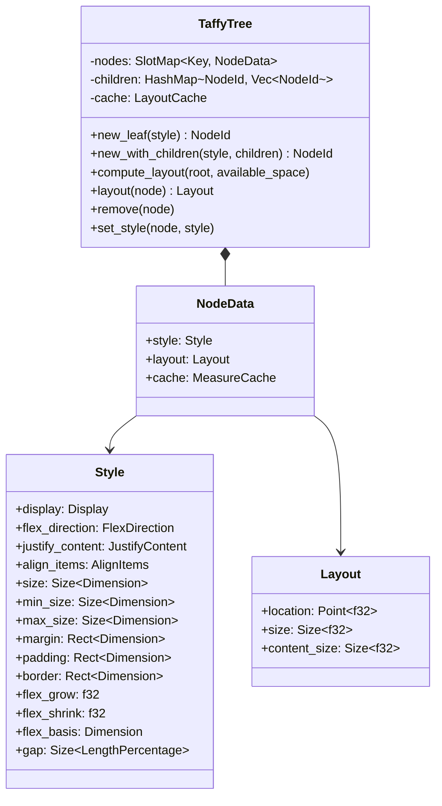
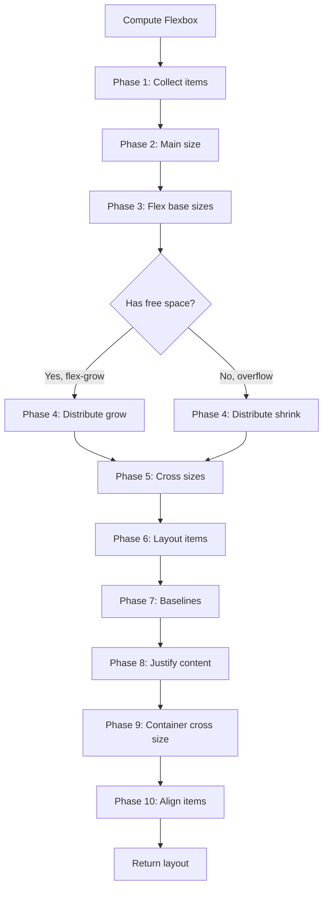
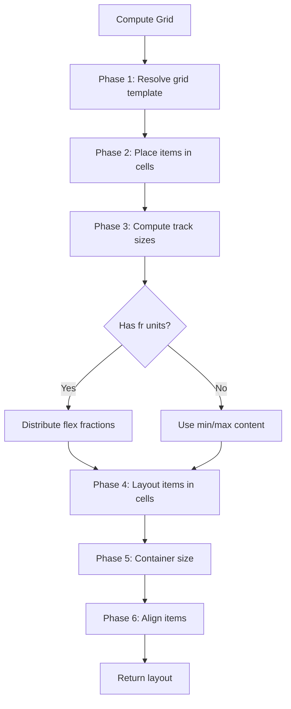

# Taffy — Flexible Layout Engine (v0.5.2)

## Core Concept

Taffy is a flexible UI layout engine that implements CSS Flexbox, CSS Grid, and Block layout algorithms in pure Rust. It supports `no_std` environments (with the `alloc` feature) and provides a `TaffyTree` data structure for managing layout nodes. Taffy is used by dioxus-desktop for UI layout and can be used standalone for any application that needs CSS-compatible layout without a browser engine.

The key insight is that layout algorithms are independent of rendering. Taffy computes positions and sizes (the layout tree). A separate renderer draws the results. This separation means Taffy works with any rendering backend: GPU, CPU, canvas, or even a terminal.

## TaffyTree — The Node Tree

```rust
// taffy/src/tree.rs
pub struct TaffyTree {
    /// The node storage — a slotmap for O(1) insert/delete
    nodes: SlotMap<DefaultKey, NodeData>,
    /// The tree structure — parent-child relationships
    children: HashMap<NodeId, Vec<NodeId>>,
    /// Layout cache — computed layouts are cached
    cache: LayoutCache,
}
```

`TaffyTree` is the main entry point. It manages a tree of layout nodes, each with a style and a computed layout:

```rust
use taffy::prelude::*;

let mut tree = TaffyTree::new();

// Create nodes
let child = tree.new_leaf(
    Style::default()
        .with_flex_grow(1.0)
        .with_size(Size::from_percent(100.0, 50.0))
).unwrap();

let root = tree.new_with_children(
    Style::default()
        .with_display(Display::Flex)
        .with_flex_direction(FlexDirection::Row)
        .with_size(Size::from_length(800.0, 600.0)),
    &[child],
).unwrap();

// Compute layout
tree.compute_layout(root, Size::MAX_CONTENT).unwrap();

// Get computed layout
let layout = tree.layout(root).unwrap();
println!("child position: ({}, {})", layout.location.x, layout.location.y);
println!("child size: {}x{}", layout.size.width, layout.size.height);
```



## Three Layout Algorithms

Taffy implements three CSS layout algorithms, each behind a feature flag:

| Feature | Algorithm | Description |
|---------|-----------|-------------|
| `flexbox` | Flexbox | One-dimensional layout (row or column) |
| `grid` | CSS Grid | Two-dimensional layout (rows and columns) |
| `block_layout` | Block | Vertical stacking (like HTML block elements) |

```rust
// taffy/src/lib.rs — feature flags
#[cfg(feature = "flexbox")]
pub use compute_flexbox_layout;

#[cfg(feature = "grid")]
pub use compute_grid_layout;

#[cfg(feature = "block_layout")]
pub use compute_block_layout;
```

### Flexbox Algorithm

```rust
// taffy/src/compute/flexbox.rs
pub fn compute_flexbox_layout(
    tree: &impl LayoutTree,
    node: NodeId,
    known_dimensions: Size<Option<f32>>,
    parent_size: Size<Option<f32>>,
) -> Result<Size<f32>> {
    // Phase 1: Collect flex items and determine main/cross axes
    // Phase 2: Determine available main space
    // Phase 3: Calculate flex base sizes (hypothetical main sizes)
    // Phase 4: Resolve flexible lengths (grow/shrink distribution)
    // Phase 5: Cross-size alignment
    // Phase 6: Layout each item
    // Phase 7: Collect baseline (if needed)
    // Phase 8: Handle remaining free space (justify-content)
    // Phase 9: Determine container cross size
    // Phase 10: Align items (align-items/align-self)
}
```

The Flexbox algorithm follows the CSS specification exactly. It has 10 phases:

1. **Collect items** — gather all children and determine the main axis (row vs column)
2. **Determine main size** — use known dimensions or `min-content`/`max-content` constraints
3. **Calculate flex base sizes** — each item's initial size before flexing
4. **Resolve flexible lengths** — distribute free space among `flex-grow` items, or shrink `flex-shrink` items
5. **Cross-size alignment** — determine cross-axis sizes
6. **Layout items** — position each item along the main axis
7. **Collect baselines** — for `align-items: baseline`
8. **Handle remaining free space** — apply `justify-content`
9. **Determine container cross size** — fit the container to its content
10. **Align items** — apply `align-items` and `align-self`



### CSS Grid Algorithm

```rust
// taffy/src/compute/grid/mod.rs
pub fn compute_grid_layout(
    tree: &impl LayoutTree,
    node: NodeId,
    known_dimensions: Size<Option<f32>>,
    parent_size: Size<Option<f32>>,
) -> Result<Size<f32>> {
    // Phase 1: Resolve grid template (tracks, areas, auto-fill/fit)
    // Phase 2: Place items into grid cells
    // Phase 3: Compute track sizes (min/max content, flex fractions)
    // Phase 4: Layout items within their grid areas
    // Phase 5: Determine container size
    // Phase 6: Align items within cells
}
```

CSS Grid is more complex than Flexbox:
- It resolves `grid-template-columns` and `grid-template-rows`
- It places items into explicit and implicit grid cells
- It computes track sizes considering `minmax()`, `auto`, `fr` units
- It handles `grid-area` spanning across multiple cells
- It resolves alignment within each cell



### Block Layout Algorithm

```rust
// taffy/src/compute/block_layout.rs
pub fn compute_block_layout(
    tree: &impl LayoutTree,
    node: NodeId,
    known_dimensions: Size<Option<f32>>,
    parent_size: Size<Option<f32>>,
) -> Result<Size<f32>> {
    // Block layout is the simplest: stack children vertically
    // Each child is laid out with full width and auto height
    // Margin collapsing is handled
}
```

Block layout is the simplest algorithm:
- Stack children vertically
- Each child takes full width (or its specified width)
- Height is auto (determined by content)
- Margin collapsing between siblings
- No wrapping, no flexing, no grid placement

## Style System

```rust
// taffy/src/style.rs
#[derive(Debug, Clone, PartialEq)]
pub struct Style {
    pub display: Display,
    pub overflow: Point<OverflowAxis>,
    pub position: Position,
    pub inset: Rect<LengthPercentageAuto>,
    pub size: Size<Dimension>,
    pub min_size: Size<Dimension>,
    pub max_size: Size<Dimension>,
    pub aspect_ratio: Option<f32>,

    // Flexbox
    pub flex_direction: FlexDirection,
    pub flex_wrap: FlexWrap,
    pub flex_grow: f32,
    pub flex_shrink: f32,
    pub flex_basis: Dimension,
    pub justify_content: Option<JustifyContent>,
    pub align_items: Option<AlignItems>,
    pub align_self: Option<AlignSelf>,
    pub align_content: Option<AlignContent>,
    pub gap: Size<LengthPercentage>,

    // Grid
    pub grid_template_columns: Vec<TrackSizingFunction>,
    pub grid_template_rows: Vec<TrackSizingFunction>,
    pub grid_auto_columns: Vec<TrackSizingFunction>,
    pub grid_auto_rows: Vec<TrackSizingFunction>,
    pub grid_auto_flow: GridAutoFlow,
    pub grid_column: Line<GridPlacement>,
    pub grid_row: Line<GridPlacement>,

    // Spacing
    pub margin: Rect<LengthPercentageAuto>,
    pub padding: Rect<LengthPercentage>,
    pub border: Rect<LengthPercentage>,
}
```

### Dimension Types

```rust
// taffy/src/geometry.rs
pub enum Dimension {
    /// Use the node's intrinsic size
    Auto,
    /// A specific length in abstract units
    Length(f32),
    /// A percentage of the parent's size
    Percent(f32),
    /// Minimum content size
    MinContent,
    /// Maximum content size
    MaxContent,
}

pub enum LengthPercentage {
    Length(f32),
    Percent(f32),
}

pub enum LengthPercentageAuto {
    Length(f32),
    Percent(f32),
    Auto,
}
```

Dimensions support the same unit types as CSS: absolute lengths, percentages, and auto. The `Auto` variant delegates to the algorithm's default behavior.

## Measure Cache — 9-Slot Cache

```rust
// taffy/src/tree.rs
pub struct MeasureCache {
    // 9-slot cache for different constraint combinations
    // Each slot maps to a specific (available_width, available_height) constraint
    slots: [Option<(Size<Option<f32>>, Size<f32>)>; 9],
}
```

**Aha:** Taffy uses a 9-slot measure cache instead of a general-purpose LRU cache. The 9 slots correspond to the 9 possible constraint combinations:

| Slot | Width constraint | Height constraint |
|------|-----------------|-------------------|
| 0 | Exact | Exact |
| 1 | Exact | Min-content |
| 2 | Exact | Max-content |
| 3 | Min-content | Exact |
| 4 | Min-content | Min-content |
| 5 | Min-content | Max-content |
| 6 | Max-content | Exact |
| 7 | Max-content | Min-content |
| 8 | Max-content | Max-content |

This is clever: layout algorithms always measure nodes under one of these constraint combinations. A 9-slot direct-index cache is faster than a HashMap lookup and has no allocation overhead. The cache is reset when the node's style changes.

## no_std Support

```toml
# taffy/Cargo.toml
[features]
std = ["num-traits/std", "grid?/std", "serde?/std", "slotmap?/std"]
alloc = ["serde?/alloc"]
taffy_tree = ["dep:slotmap"]
```

Taffy supports `no_std` environments:
- Without `std`: no `HashMap`, uses alternative storage
- With `alloc`: uses `alloc` collections but not full std
- With `std`: full feature set including `TaffyTree`

The layout algorithms themselves (`compute_flexbox_layout`, `compute_grid_layout`, `compute_block_layout`) work without any heap allocation. Only the `TaffyTree` storage needs allocation.

## Layout Tree Trait

Taffy decouples the algorithm from the storage through the `LayoutTree` trait:

```rust
// taffy/src/tree.rs
pub trait LayoutTree {
    type ChildIter<'a>: Iterator<Item = NodeId>
    where Self: 'a;

    fn children(&self, node: NodeId) -> Self::ChildIter<'_>;
    fn child_count(&self, node: NodeId) -> usize;
    fn style(&self, node: NodeId) -> &Style;
    fn layout(&self, node: NodeId) -> &Layout;
    fn set_unrounded_layout(&mut self, node: NodeId, layout: Layout);
    fn measure_child(
        &mut self,
        node_id: NodeId,
        known_dimensions: Size<Option<f32>>,
        parent_size: Size<Option<f32>>,
    ) -> Option<Size<f32>>;
}
```

Any data structure that implements `LayoutTree` can use Taffy's algorithms. `TaffyTree` is the default implementation, but you could implement `LayoutTree` for your own tree structure.

**Aha:** The `LayoutTree` trait is Taffy's most important design decision. It means the layout algorithms are pure functions over an abstract tree, not coupled to a specific storage implementation. This allows Taffy to be embedded in any UI framework (dioxus, egui, iced) without requiring a specific node representation.

## Integration with Dioxus

Dioxus-desktop uses Taffy for layout:

```rust
// dioxus/packages/desktop/src/renderer.rs
struct DesktopRenderer {
    taffy: TaffyTree,
    // ...
}

impl DesktopRenderer {
    fn compute_layout(&mut self, root: ElementId) {
        let taffy_node = self.element_to_taffy_id(root);
        self.taffy
            .compute_layout(taffy_node, Size::from_length(800.0, 600.0))
            .unwrap();
    }
}
```

Dioxus converts its VirtualDom element tree into a Taffy tree, computes layout, then uses the computed positions to set the WebView elements' CSS positions.

## Layout Output

```rust
// taffy/src/geometry.rs
pub struct Layout {
    pub location: Point<f32>,
    pub size: Size<f32>,
    #[cfg(feature = "content_size")]
    pub content_size: Size<f32>,
}

pub struct Point<T> {
    pub x: T,
    pub y: T,
}

pub struct Size<T> {
    pub width: T,
    pub height: T,
}
```

The layout output is a simple position and size. The `content_size` feature (enabled by default) additionally computes the size of the content within the node's padding/border area. This is useful for scrollable containers.

## Cross-References

- [Dioxus UI](07-dioxus-ui.md) — how dioxus uses Taffy for layout
- [Wry WebView](04-wry-webview.md) — how Taffy-computed layouts map to WebView elements
- [Cross-Cutting Concerns](10-cross-cutting.md) — layout performance, cache behavior
